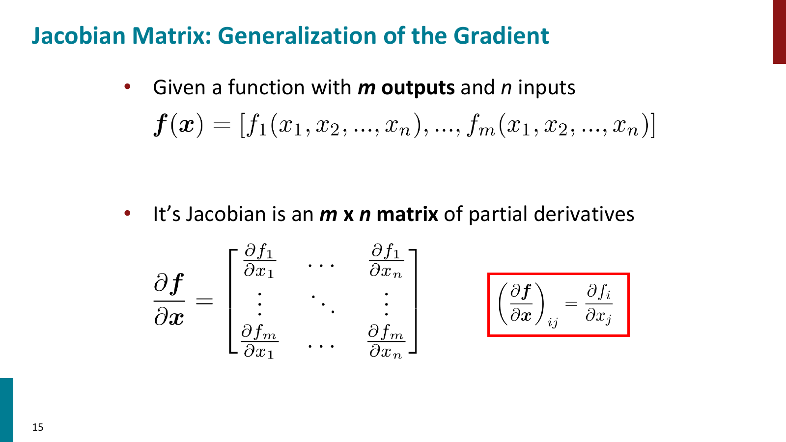
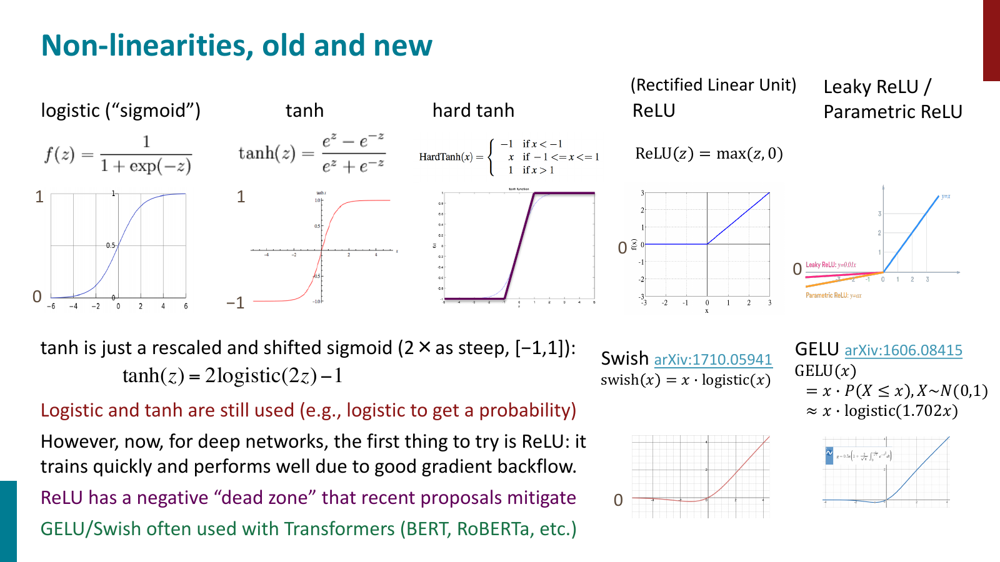
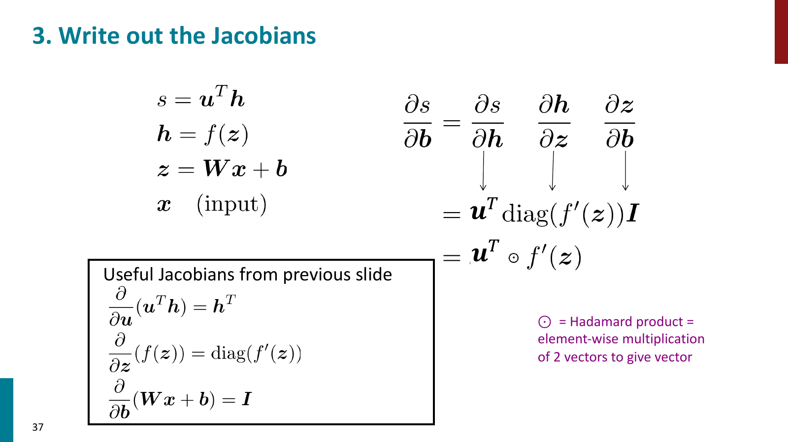
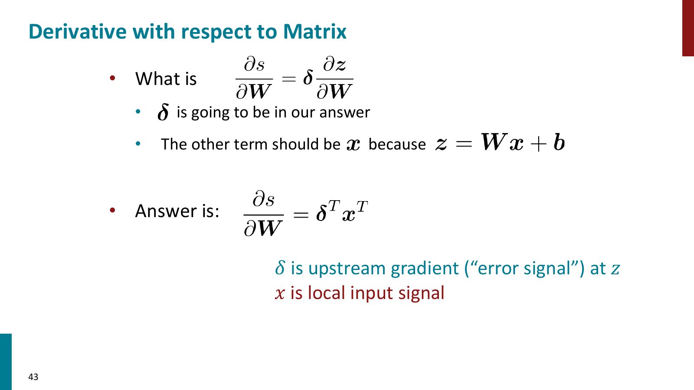
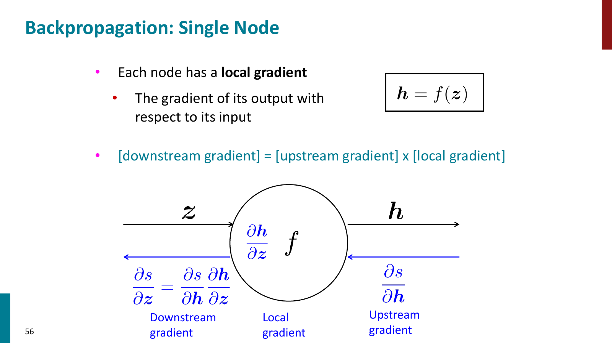
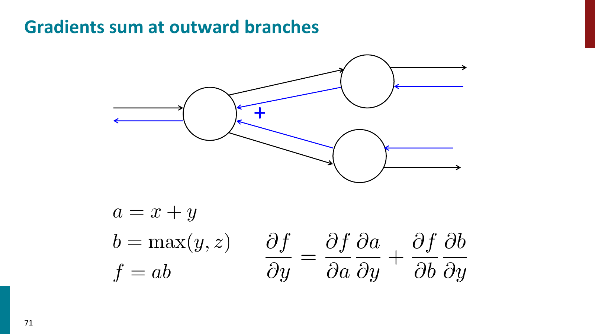

## 1. 神经网络的结构与训练

### 1.1 神经网络与层

**神经网络是一类由多个可学习的计算单元组合而成的模型，用于将输入映射为预测结果。** 单个计算单元称为神经元；在全连接前馈网络中，同一层的多个神经元接收上一层的输出，分别进行加权求和、加上偏置，再经过激活函数。

一个神经元的计算为：

$$
a_i=f\left(\sum_jW_{ij}x_j+b_i\right).
$$

$x_j$ 是输入的第 $j$ 个分量，$W_{ij}$ 是该分量到第 $i$ 个神经元的权重，$b_i$ 是偏置，$f$ 是激活函数，$a_i$ 是这个神经元的输出。权重和偏置由训练学习。

将同一层的输出排列成向量，可以写成：

$$
\mathbf{a}=f(\mathbf{W}\mathbf{x}+\mathbf{b}).
$$

这里 $f$ 对每个分量分别计算。非线性激活让网络能够表达比单次线性打分更复杂的输入关系。

一个用于分类的前馈神经网络通常包含：

- **输入层**：接收数值特征，例如按顺序拼接的词向量。
- **隐藏层**：把输入变换成中间特征；可以有一层或多层，其输出不需要人工逐个标注。
- **输出层**：把最终特征转换成任务所需的结果，例如各类别的预测概率。

“前馈”表示计算从输入依次向输出进行，没有反馈回路。多个隐藏层将前一层的输出作为后一层的输入，逐层组合特征。

### 1.2 分类预测与损失

以地点分类器为例，将窗口中的词向量拼接成输入 $\mathbf{x}$，依次计算：

$$
\mathbf{z}=\mathbf{W}\mathbf{x}+\mathbf{b},\qquad \mathbf{h}=f(\mathbf{z}),\qquad s=\mathbf{u}^\top \mathbf{h},\qquad \hat p=\sigma(s).
$$

其中 $\mathbf{z}$ 是隐藏层激活之前的加权和，$\mathbf{h}$ 是隐藏表示，$s$ 是分类分数，$\hat p$ 是地点概率。$\mathbf{W},\mathbf{b},\mathbf{u}$ 都是可学习参数，输入中的词向量也可以参与训练。

标签为 $y\in\{0,1\}$ 时，二分类交叉熵为：

$$
J=-y\log\hat p-(1-y)\log(1-\hat p).
$$

### 1.3 梯度与参数更新

训练要调整参数，使模型在训练样本上的损失减小。将全部参数统称为 $\boldsymbol{\theta}$，梯度下降使用：

$$
\boldsymbol{\theta}\leftarrow\boldsymbol{\theta}-\alpha\nabla_{\boldsymbol{\theta}} J.
$$

本讲解决的是其中的**梯度计算**：从最后的损失出发，怎样得到每个权重、偏置和输入向量的梯度。手工矩阵求导用于理解和推导公式，反向传播则把这些求导步骤组织成高效算法。

## 2. 导数、梯度与雅可比矩阵

### 2.1 导数与梯度

对于一个输入、一个输出的函数，导数描述输入微小变化时，输出怎样变化。例如 $f(x)=x^3$，有：

$$
f'(x)=3x^2,\qquad f(x+\Delta x)\approx f(x)+f'(x)\Delta x.
$$

在 $x=1$ 附近，输入增加 $0.01$，输出约增加 $3\times0.01=0.03$。这是当前位置的局部近似。

损失通常有许多输入参数。偏导数 $\partial J/\partial x_i$ 描述其他分量固定时，改变第 $i$ 个分量对损失的影响。把这些偏导排列起来，就是**梯度**：

$$
\nabla_{\mathbf{x}}J=\begin{bmatrix}
\partial J/\partial x_1\\\vdots\\\partial J/\partial x_n
\end{bmatrix}.
$$

例如，$J(x_1,x_2)=x_1^2+3x_2$ 的梯度为 $(2x_1,3)^\top$。

本笔记将向量写成列向量；标量损失对参数的梯度采用**与参数同形状的约定**：向量参数得到同长度的列梯度，矩阵参数得到相同行列数的梯度矩阵。这样才能逐项执行参数更新。

### 2.2 雅可比矩阵

神经网络的中间层通常输出一个向量。设 $\mathbf{a}=g(\mathbf{x})$，输入 $\mathbf{x}$ 有 $n$ 个分量，输出 $\mathbf{a}$ 有 $m$ 个分量。每个输出都可以对每个输入求偏导，将它们排成**雅可比矩阵（Jacobian）**：

$$
\frac{\partial \mathbf{a}}{\partial \mathbf{x}}
=\left[\frac{\partial a_i}{\partial x_j}\right]
\in\mathbb R^{m\times n}.
$$

行对应输出，列对应输入。例如：

$$
\mathbf{a}=\begin{bmatrix}x_1+2x_2\\x_1x_2\end{bmatrix},\qquad
\frac{\partial \mathbf{a}}{\partial \mathbf{x}}
=\begin{bmatrix}1&2\\x_2&x_1\end{bmatrix}.
$$

第一行记录 $a_1$ 怎样受两个输入影响，第二行记录 $a_2$ 的变化。

标量损失也可以看作只有一个输出的函数，其雅可比矩阵是一行：

$$
\frac{\partial J}{\partial \mathbf{x}}=(\nabla_{\mathbf{x}}J)^\top.
$$

它与列梯度包含相同的偏导，只是排列方向不同。后面用雅可比矩阵说明链式法则，实际参数更新仍使用同形状梯度。

## 3. 链式法则与局部求导

### 3.1 复合函数的链式法则

设 $\mathbf{a}=g(\mathbf{x})$，最终损失为 $J(\mathbf{a})$。输入 $x_j$ 可能通过多个中间分量 $a_i$ 影响损失，因此要把各条路径的影响相加：

$$
\frac{\partial J}{\partial x_j}
=\sum_i\frac{\partial J}{\partial a_i}\frac{\partial a_i}{\partial x_j}.
$$

例如，$a_1=2x$、$a_2=3x$，$J=a_1+a_2$，则两条路径分别贡献 2 和 3，合计 $dJ/dx=5$。

将各分量一起写成矩阵形式：

$$
\frac{\partial J}{\partial \mathbf{x}}
=\frac{\partial J}{\partial \mathbf{a}}\frac{\partial \mathbf{a}}{\partial \mathbf{x}}.
$$

按列梯度表示，同一个关系为：

$$
\boxed{\nabla_{\mathbf{x}}J=\left(\frac{\partial \mathbf{a}}{\partial \mathbf{x}}\right)^\top\nabla_{\mathbf{a}}J}.
$$

右侧先使用“损失对中间变量的梯度”，再结合“中间变量对输入的局部导数”，得到输入梯度。转置来自列梯度的排列约定。

### 3.2 逐元素激活

若 $h_i=f(z_i)$，每个输出只依赖同位置的输入，因此：

$$
\frac{\partial h_i}{\partial z_j}
=\begin{cases}f'(z_i),&i=j,\\0,&i\ne j.\end{cases}
$$

雅可比矩阵只有对角线非零。反向计算可以直接写成：

$$
\boxed{\nabla_{\mathbf{z}}J=\nabla_{\mathbf{h}}J\odot f'(\mathbf{z})}.
$$

$\odot$ 表示逐元素乘法。例如，上游梯度是 $(2,3)^\top$，局部导数是 $(0.5,0.1)^\top$，传回的梯度就是 $(1,0.3)^\top$，不需要真的构造对角矩阵。

常用激活函数及其局部导数为：

| 函数 | 定义 | 导数 |
| --- | --- | --- |
| Sigmoid | $\sigma(z)=1/(1+e^{-z})$ | $\sigma(z)(1-\sigma(z))$ |
| tanh | $\tanh z$ | $1-\tanh^2z$ |
| ReLU | $\max(0,z)$ | 正区间为 1，负区间为 0 |

ReLU 在零点不可微，实现中常将该点的反向导数取 0。Sigmoid 和 tanh 的导数可以直接复用前向输出。

激活函数不仅改变模型能表达的函数，也改变梯度如何传递。阈值函数直接输出 0 或 1，几乎处处导数为零，不适合常规梯度训练。ReLU 在正区间保留梯度，但负区间梯度为零；Leaky ReLU 在负区间保留小斜率。Hard tanh 将输入截断到 $[-1,1]$，区间外梯度为零。

Swish 和 GELU 使用平滑的门控形式，分别为 $z\sigma(z)$ 和 $z\Phi(z)$，其中 $\Phi$ 是标准正态分布的累积分布函数。不同激活函数会形成不同的局部梯度。

### 3.3 加权求和、偏置与点积

对 $\mathbf{z}=\mathbf{W}\mathbf{x}+\mathbf{b}$，第 $i$ 个输出为：

$$
z_i=\sum_jW_{ij}x_j+b_i.
$$

所以 $\partial z_i/\partial x_j=W_{ij}$，雅可比矩阵就是 $\mathbf{W}$。若已知损失对 $\mathbf{z}$ 的梯度 $\mathbf{g}_z=\nabla_{\mathbf{z}}J$，则：

$$
\nabla_{\mathbf{x}}J=\mathbf{W}^\top\mathbf{g}_z,\qquad \nabla_{\mathbf{b}}J=\mathbf{g}_z.
$$

偏置只加到对应输出上，局部导数为 1，因此直接接收该位置的梯度。

对于点积 $s=\mathbf{u}^\top \mathbf{h}=\sum_i u_ih_i$，有：

$$
\nabla_{\mathbf{h}}s=\mathbf{u},\qquad \nabla_{\mathbf{u}}s=\mathbf{h}.
$$

每种操作只需掌握自己的局部规则，就可以沿网络逐步应用链式法则。

## 4. 单隐藏层分类网络的梯度推导

### 4.1 前向计算与求导目标

地点分类网络先计算分数 $s$，再将它转换为概率。这里先按课件推导**分数 $s$ 对各参数和输入的梯度**。设输入为 $n$ 维，隐藏层有 $m$ 个单元：

$$
\mathbf{x}\in\mathbb R^n,\quad \mathbf{W}\in\mathbb R^{m\times n},\quad \mathbf{b},\mathbf{u}\in\mathbb R^m,
$$

$$
\mathbf{z}=\mathbf{W}\mathbf{x}+\mathbf{b},\qquad \mathbf{h}=f(\mathbf{z}),\qquad s=\mathbf{u}^\top\mathbf{h}.
$$

求导顺序与计算顺序相反：从 $s$ 出发，经过 $\mathbf{h}$、$\mathbf{z}$，再传到权重、偏置和输入。

### 4.2 从分数传回隐藏层

由 $s=\sum_i u_i h_i$，得到：

$$
\nabla_{\mathbf{u}}s=\mathbf{h},\qquad \nabla_{\mathbf{h}}s=\mathbf{u}.
$$

每个隐藏单元满足 $h_i=f(z_i)$，因此：

$$
\frac{\partial s}{\partial z_i}=u_i f'(z_i).
$$

将这些偏导排成向量，记为 $\boldsymbol{\delta}$：

$$
\boxed{\boldsymbol{\delta}=\nabla_{\mathbf{z}}s=\mathbf{u}\odot f'(\mathbf{z})}.
$$

$\delta_i$ 表示第 $i$ 个隐藏单元的加权和 $z_i$ 改变时，分数 $s$ 怎样变化。它会用于计算隐藏层权重、偏置和输入的梯度。

### 4.3 权重、偏置与输入梯度

单个权重 $W_{ij}$ 只直接影响 $z_i$，且 $\partial z_i/\partial W_{ij}=x_j$。因此：

$$
\frac{\partial s}{\partial W_{ij}}=\delta_i x_j.
$$

将每个权重的偏导排列成矩阵：

$$
\boxed{\nabla_{\mathbf{W}}s=\boldsymbol{\delta}\mathbf{x}^\top}.
$$

这是外积：$m$ 维列向量乘 $n$ 维行向量，得到 $m\times n$ 的矩阵，与 $\mathbf{W}$ 同形状。例如：

$$
\boldsymbol{\delta}=\begin{bmatrix}2\\-1\end{bmatrix},\quad
\mathbf{x}=\begin{bmatrix}3\\4\\5\end{bmatrix}
\quad\Longrightarrow\quad
\boldsymbol{\delta}\mathbf{x}^\top=\begin{bmatrix}6&8&10\\-3&-4&-5\end{bmatrix}.
$$

每一行使用对应的 $\delta_i$，乘以输入的各个分量。

偏置和输入梯度为：

$$
\boxed{\nabla_{\mathbf{b}}s=\boldsymbol{\delta}},\qquad
\boxed{\nabla_{\mathbf{x}}s=\mathbf{W}^\top\boldsymbol{\delta}}.
$$

若 $\mathbf{x}$ 由五个词向量拼接而成，就将 $\nabla_{\mathbf{x}}s$ 按同样位置切成五段，分别传给对应词向量。同一个词出现多次时，各段梯度需要累加到同一份词向量参数上。

### 4.4 从分数梯度得到损失梯度

训练时要减小的是损失 $J$。对于 $\hat p=\sigma(s)$ 和二分类交叉熵，有：

$$
\frac{\partial J}{\partial s}=\hat p-y.
$$

因此，前面算出的每个分数梯度都要乘以这个因子，才得到训练使用的损失梯度。例如：

$$
\nabla_{\mathbf{W}}J=(\hat p-y)\boldsymbol{\delta}\mathbf{x}^\top,\qquad
\nabla_{\mathbf{u}}J=(\hat p-y)\mathbf{h}.
$$

若真实标签为地点，$y=1$，而预测概率只有 $0.2$，则 $\hat p-y=-0.8$，梯度下降会推动分数增加。

各步都使用前向计算时的参数和中间值，全部梯度算完后再更新参数。$\boldsymbol{\delta}$ 及其他中间梯度可以重复使用，不必为每个参数重新计算整条求导链。

## 5. 计算图与反向传播

### 5.1 计算图与局部导数

**计算图**用节点记录输入、参数和中间结果，用连接关系表示哪些量参与了后续计算。每个操作只需处理自己的输入与输出。

**前向传播**按依赖顺序计算节点值。**反向传播**从最终标量损失开始，按相反顺序计算梯度，并复用已经得到的中间梯度。

下图以标量操作 $h=f(z)$ 为例：输入 $z$ 经过当前节点得到 $h$，$h$ 再参与后续计算，得到最终分数 $s$。这里 $z,h,s$ 都是标量。

反向传播时，若后续计算已经传回 $\partial s/\partial h$，当前节点就利用链式法则计算：

$$
\frac{\partial s}{\partial z}
=\frac{\partial s}{\partial h}\frac{\partial h}{\partial z}.
$$

- **上游梯度 $\partial s/\partial h$**：从后续计算传回，表示当前输出 $h$ 的变化对最终分数 $s$ 的影响。
- **局部导数 $\partial h/\partial z=f'(z)$**：由当前操作决定，表示输入 $z$ 的变化对输出 $h$ 的影响。
- **传给输入的梯度 $\partial s/\partial z$**：前两者相乘的结果，图中称为 downstream gradient，位于输入侧。

图中的“上游、下游”按反向传播的梯度传递方向命名：梯度从输出侧传入当前节点，再向输入侧传出。

例如，$h=2z$，局部导数为 2。若上游梯度 $\partial s/\partial h=3$，则传给输入的梯度 $\partial s/\partial z=3\times2=6$。若最终求导目标是损失 $J$，就把公式中的 $s$ 换成 $J$；操作有多个输入时，对每个输入分别应用链式法则。

### 5.2 加法、乘法与最大值节点的反向计算

考虑函数：

$$
a=x+y,\qquad b=\max(y,z),\qquad J=ab.
$$

令 $x=1$、$y=2$、$z=0$，前向计算得到 $a=3$、$b=2$、$J=6$。

从最终输出开始，$\partial J/\partial J=1$。乘法节点 $J=ab$ 先把梯度传给两个输入：

$$
\frac{\partial J}{\partial a}=b=2,\qquad
\frac{\partial J}{\partial b}=a=3.
$$

再分别处理两条分支：

| 操作 | 收到的上游梯度 | 传回输入的梯度 |
| --- | ---: | --- |
| $a=x+y$ | 2 | 对 $x$ 贡献 2，对 $y$ 贡献 2 |
| $b=\max(y,z)$，且 $y>z$ | 3 | 对 $y$ 贡献 3，对 $z$ 贡献 0 |

$y$ 同时用于加法和最大值操作，两条路径的梯度相加，最终得到：

$$
\boxed{\frac{\partial J}{\partial x}=2,\qquad
\frac{\partial J}{\partial y}=2+3=5,\qquad
\frac{\partial J}{\partial z}=0}.
$$

这个例子体现了三类局部规则：加法将上游梯度原样传给每个加数；乘法让每个输入的梯度乘上另一个输入值；最大值将梯度传给较大的输入。最大值相等时需要另行约定反向规则。

### 5.3 共享变量的梯度累加

一个变量可能通过多条路径影响损失。反向传播必须把所有路径的贡献相加，而不是用后到的梯度覆盖先到的梯度。

上例中只计算加法路径会误得到 $\partial J/\partial y=2$，只计算最大值路径则得到 3；完整答案是 5。共享词向量和重复使用的权重遵循同一规则。

### 5.4 反向传播算法

计算图必须先算输入、再算依赖这些输入的输出。这种依赖顺序称为**拓扑顺序**。反向传播使用逆拓扑顺序，确保一个节点传回梯度之前，已经收齐全部后续路径的梯度。

> **算法 1：计算图上的反向传播**
>
> **输入**：由可求导操作组成的有向无环计算图，以及当前输入和参数值。
>
> **输出**：标量损失 $J$ 对各输入和参数的梯度。
>
> 1. **前向计算**：按拓扑顺序计算各节点值，保存反向计算所需的中间值。
> 2. **初始化**：将各节点的梯度设为 0，将最终损失节点的梯度设为 1。
> 3. **反向遍历**：按逆拓扑顺序处理每个操作节点：
>    1. 读取该节点输出处已经累加好的梯度。
>    2. 根据局部导数，计算传给各输入的梯度。
>    3. 将结果累加到对应输入的梯度中。
> 4. **返回**：输入与参数节点上累加得到的梯度。

输出处初始化为 1，是因为 $\partial J/\partial J=1$。反向传播只负责计算梯度，之后才由梯度下降等优化器更新参数。

它不为每个参数重新走一遍完整求导链，而是一次反向遍历共同求出所有梯度。对常见神经网络操作，反向与前向的计算成本通常是同一量级。

## 6. 自动微分与实现

**自动微分**根据程序执行的操作及其局部求导规则，自动组织导数计算。深度学习框架通常用反向模式自动微分完成反向传播。

每种操作需要提供两部分：

| 接口 | 接收什么 | 完成什么 |
| --- | --- | --- |
| forward | 当前输入 | 计算输出，保存必要的中间值 |
| backward | 输出处的梯度 | 计算并返回各输入的梯度 |

例如，乘法 $a=xy$ 的前向过程保存 $x,y$；反向收到梯度 $g$ 后，分别返回 $gy$ 和 $gx$。Sigmoid 的反向可以保存前向输出 $a$，再返回 $g\,a(1-a)$。

前向写出网络计算，框架记录依赖关系；反向调用这些局部规则并累加梯度。自动微分不需要逐个扰动参数，也不必把整个网络展开成一个巨大的解析表达式。

## 7. 数值梯度检查

实现了反向规则之后，可以用另一种独立计算检查它：对一个参数作微小扰动，观察损失怎样变化。

固定其他参数，只改变第 $i$ 个参数 $\theta_i$。用中心差分近似其偏导：

$$
g_i^{\mathrm{num}}=
\frac{J(\boldsymbol{\theta}+\varepsilon \mathbf{e}_i)-J(\boldsymbol{\theta}-\varepsilon \mathbf{e}_i)}{2\varepsilon}.
$$

$\mathbf{e}_i$ 是第 $i$ 个坐标为 1、其他坐标为 0 的单位向量；$\varepsilon$ 是小扰动，例如 $10^{-4}$。分子表示该参数正向和负向扰动后的损失差。

对于第 5 节的例子，固定 $x=1,z=0$，在 $y=2$ 附近有 $J=(1+y)y$。中心差分为：

$$
\frac{(3+\varepsilon)(2+\varepsilon)-(3-\varepsilon)(2-\varepsilon)}{2\varepsilon}=5,
$$

与反向传播的结果一致。

> **算法 2：检查一个参数的梯度**
>
> **输入**：损失函数、当前参数、待检查的坐标 $i$、扰动大小 $\varepsilon$。
>
> **输出**：数值梯度与反向传播梯度的比较结果。
>
> 1. 用反向传播计算当前参数的梯度，记录第 $i$ 个分量。
> 2. 将 $\theta_i$ 增加 $\varepsilon$，计算损失 $J_+$。
> 3. 将 $\theta_i$ 改为原值减去 $\varepsilon$，计算损失 $J_-$。
> 4. 恢复原参数，用 $(J_+-J_-)/(2\varepsilon)$ 计算数值梯度。
> 5. 比较两种结果，检查误差是否在容许范围内。

检查时要固定输入和其他随机因素，让两次损失计算只因参数扰动而不同。ReLU 或最大值的折点处可能不存在普通导数，应避免用跨越折点的差分来判定实现是否正确。

数值差分有截断和浮点舍入误差，$\varepsilon$ 不是越小越好。检查 $P$ 个参数大约需要 $2P$ 次前向计算，因此适合检查少量参数，不适合替代日常训练中的反向传播。

## 8. 优化器与 Dropout

梯度告诉我们当前位置的变化方向；优化器决定怎样利用它更新参数。Dropout 则改变训练时使用的隐藏表示。它们参与训练，但与反向传播的求导算法承担不同职责。

### 8.1 动量与 Adam

普通梯度下降直接使用本次梯度 $\mathbf{g}_t$。**动量**维护历史梯度的指数移动平均：

$$
\mathbf{m}_t=\beta_1\mathbf{m}_{t-1}+(1-\beta_1)\mathbf{g}_t,\qquad
\boldsymbol{\theta}_{t+1}=\boldsymbol{\theta}_t-\alpha \mathbf{m}_t.
$$

这里 $\mathbf{m}_0=0$，$0\le\beta_1<1$。持续同向的梯度会保留在平均值中，方向反复变化的梯度则部分抵消，从而平滑更新。

Adam 在此基础上，还维护逐坐标的梯度平方平均：

$$
\mathbf{v}_t=\beta_2\mathbf{v}_{t-1}+(1-\beta_2)(\mathbf{g}_t\odot \mathbf{g}_t),\qquad \mathbf{v}_0=0.
$$

初期的平均值因零初始化而偏小，因此使用偏差修正：

$$
\hat{\mathbf{m}}_t=\frac{\mathbf{m}_t}{1-\beta_1^t},\qquad
\hat{\mathbf{v}}_t=\frac{\mathbf{v}_t}{1-\beta_2^t},
$$

$$
\boldsymbol{\theta}_{t+1}=\boldsymbol{\theta}_t-\alpha\frac{\hat{\mathbf{m}}_t}{\sqrt{\hat{\mathbf{v}}_t}+\epsilon}.
$$

平方、开方和除法都按分量计算，$\epsilon$ 是防止除零的小常数。分子保留更新方向，分母根据各坐标的历史梯度尺度进行缩放。

### 8.2 Dropout 与训练时的缩放

**Dropout**在训练时随机将一部分隐藏单元输出置零，以减少模型对固定特征组合的依赖。设丢弃概率为 $p<1$，对每个分量抽取掩码 $d_i$：以概率 $1-p$ 取 1，以概率 $p$ 取 0。

采用训练时缩放的形式：

$$
\tilde h_i=\frac{d_i h_i}{1-p}.
$$

保留的输出除以保留概率，使每个分量的期望不变：

$$
\mathbb E[\tilde h_i\mid h_i]
=\frac{(1-p)h_i}{1-p}=h_i.
$$

例如，$p=0.5$ 时，一个单元以一半概率输出 0，以一半概率输出 $2h_i$，平均仍为 $h_i$。反向传播使用本次前向计算的同一个掩码，被丢弃的分量在该处梯度为零。

评估时关闭随机丢弃，直接使用完整的 $\mathbf{h}$，不再重复缩放。
