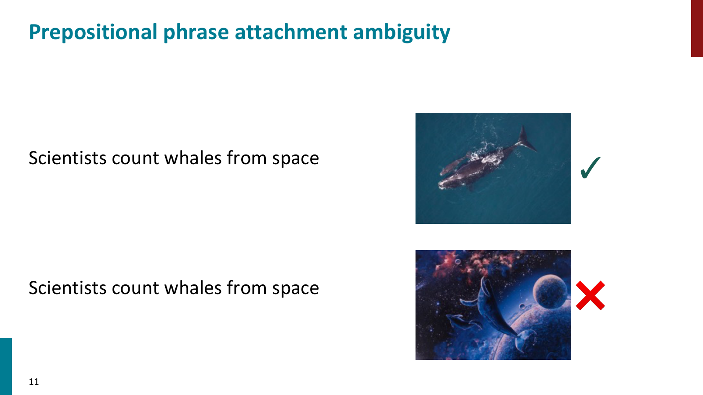
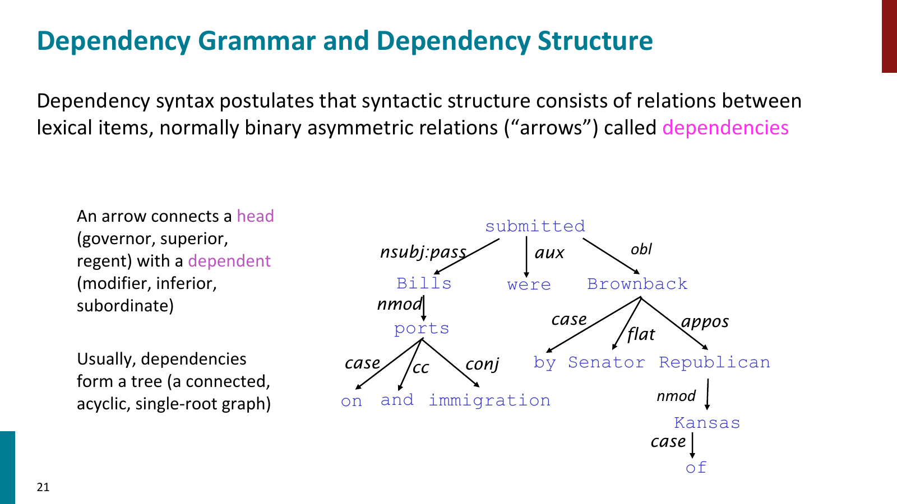
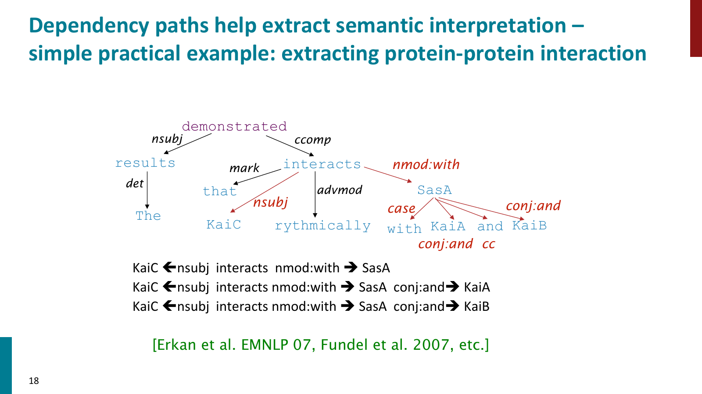
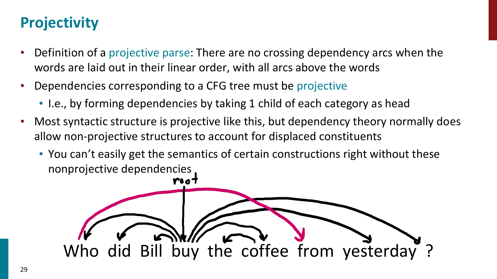
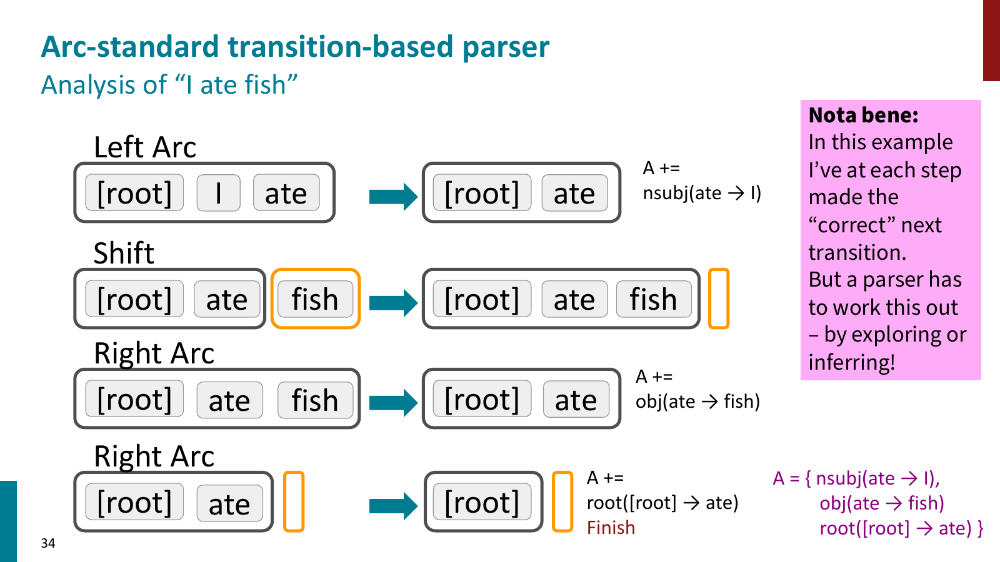
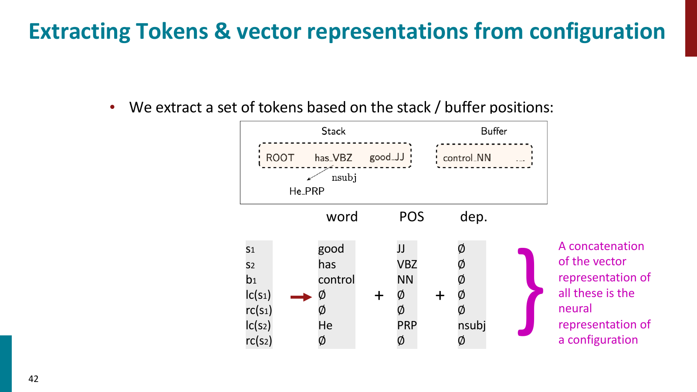
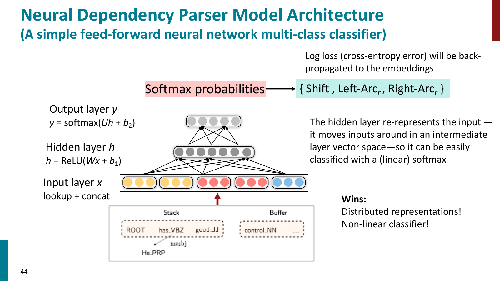
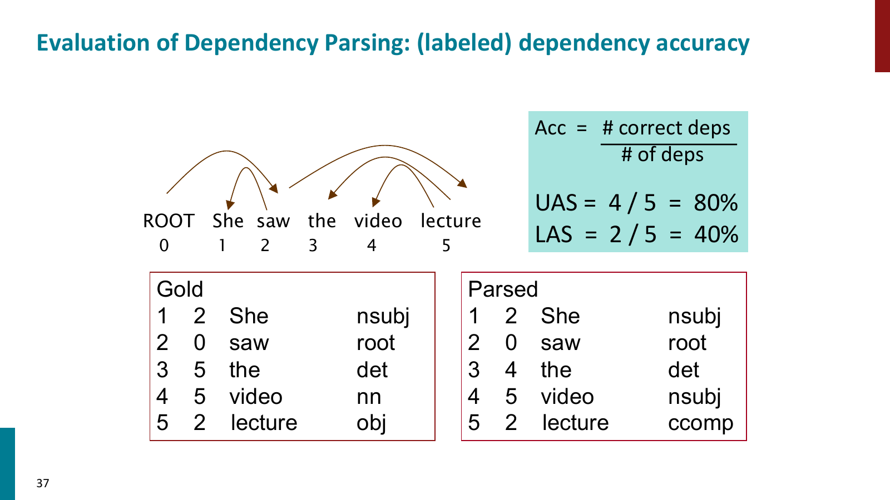
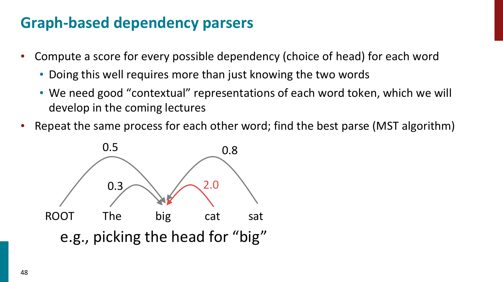

## 1. 句法结构与词间关系

**句法分析（Syntactic Parsing）**根据句子中的词，确定它们如何组合、哪些词之间存在修饰或支配关系。输入是一串按顺序排列的词，输出是显式的句法结构。

例如，`Scientists count whales from space` 可以有两种附着方式：

- `from space` 修饰 `count`：科学家从太空观测并统计鲸鱼。
- `from space` 修饰 `whales`：统计的是来自太空的鲸鱼。

两种解释使用完全相同的词，区别在于 **`from space` 与哪个词建立关系**。这称为介词短语附着歧义（PP Attachment Ambiguity）。句法分析要结合词义和上下文选择合理结构。

### 1.1 成分结构：词组成短语，短语继续组合

**成分结构（Constituency Structure）**将句子组织成嵌套的短语。例如，`the cuddly cat by the door` 可以分为：

- `the cuddly cat`：一个名词短语，中心是 `cat`。
- `by the door`：一个介词短语，其中 `the door` 又是一个名词短语。
- 两者组合成更大的名词短语，表示门旁边那只可爱的猫。

这种结构既记录一段词构成什么短语，也记录短语内部的层次。上下文无关语法（Context-free Grammar，CFG）常用规则描述这种组合，例如“名词短语可以由限定词和名词组成”。

### 1.2 依存结构：直接连接中心词与从属词

**依存结构（Dependency Structure）**直接连接有句法关系的词。每条边有两个角色：

- **中心词（Head）**：当前关系中支配另一词的词。
- **从属词（Dependent）**：依附于中心词的词，可以是修饰语，也可以是主语、宾语等句子成分。

本笔记将箭头从中心词指向从属词。例如，`I ate fish` 包含：

$$
\mathrm{ate}\xrightarrow{\mathrm{nsubj}}\mathrm{I},\qquad
\mathrm{ate}\xrightarrow{\mathrm{obj}}\mathrm{fish}.
$$

`nsubj` 表示主语关系，`obj` 表示宾语关系。`I` 是谁吃了，`fish` 是吃了什么，`ate` 将这两个参与者组织成一个动作。这里的“从属”是结构上的角色，不表示这个词在意义上不重要。

成分结构突出短语的嵌套层次；依存结构突出词与词的关系。本讲学习如何自动预测后一种结构。

### 1.3 附着歧义与候选结构

附着不只出现在介词短语中：

| 类型 | 例子 | 需要确定的关系 |
| --- | --- | --- |
| 介词短语附着 | `count whales from space` | `from space` 修饰 `count` 还是 `whales` |
| 并列范围 | `Shuttle veteran and longtime NASA executive Fred Gregory` | 两个身份都描述 Fred Gregory，还是在并列两个人 |
| 修饰范围 | `brown rice or garlic naan` | `brown` 只修饰 `rice`，还是修饰整个并列结构 |
| 动词短语附着 | `Leaving the store unattended, I went outside` | `Leaving ...` 与哪个动作建立关系 |

一个名词后面连续出现多个介词短语时，不同的附着方式会产生不同的候选结构。例如，`the cat in the crate by the door` 中：

- `in the crate` 修饰 `cat`，`by the door` 也修饰 `cat`：猫既在箱子里，也在门旁。
- `in the crate` 修饰 `cat`，`by the door` 修饰 `crate`：猫在一个位于门旁的箱子里。

**卡特兰数计数的是这类连续介词短语的候选附着结构数量。** 在简化模型中，设初始名词后有 $n$ 个“介词＋名词”短语，每个短语可以修饰前面的名词，并要求各短语保持连续嵌套、不出现交叉附着；暂不按词义排除任何方案，则候选结构共有：

$$
C_n=\frac{(2n)!}{(n+1)!n!}.
$$

| 连续介词短语数量 $n$ | 1 | 2 | 3 | 4 | 5 |
| --- | ---: | ---: | ---: | ---: | ---: |
| 候选附着结构数量 $C_n$ | 1 | 2 | 5 | 14 | 42 |

上面的 `in the crate` 和 `by the door` 是两个介词短语，对应 $C_2=2$，也就是列出的两种结构。这个计数描述简化模型中的结构候选；实际句子还需要结合语法和词义选择合理的附着。

## 2. 依存树的表示与学习数据

### 2.1 ROOT、中心词与关系标签

词与词之间的有向连接表示**依存关系（Dependency）**，连接本身称为**依存弧（Dependency Arc）**。箭头从中心词指向从属词；弧上的 `nsubj`、`obj` 等标签标明具体的**语法关系（Grammatical Relation）**，例如主语、宾语。

这些依存关系通常组成一棵**依存树（Dependency Tree）**，即连通、无环且只有一个根的图。再添加人工节点 **ROOT**，让句子的主中心词也有一个中心词。这样，每个真实词都恰好依附于一个节点，ROOT 则作为整棵树的根。

`I ate fish` 的完整依存弧为：

$$
\mathrm{ROOT}\xrightarrow{\mathrm{root}}\mathrm{ate},\qquad
\mathrm{ate}\xrightarrow{\mathrm{nsubj}}\mathrm{I},\qquad
\mathrm{ate}\xrightarrow{\mathrm{obj}}\mathrm{fish}.
$$

这里大写的 `ROOT` 是节点名，小写的 `root` 是 `ROOT → ate` 这条弧的关系标签。`ate` 是句子的主中心词，因此依附于 ROOT；其他词依附于句中的某个词。

一条带标签的依存弧可记为 $(h,r,d)$，分别表示中心词、关系标签、从属词。例如，$(\mathrm{ate},\mathrm{nsubj},\mathrm{I})$ 就是 `ate → I` 这条主语弧。为每个词记录“中心词编号、关系标签”，就能保存整棵树：

| 编号 | 词 | 中心词编号 | 关系标签 |
| --- | --- | ---: | --- |
| 1 | I | 2 | nsubj |
| 2 | ate | 0（ROOT） | root |
| 3 | fish | 2 | obj |

解析器要预测的就是表格后两列。中心词可以位于从属词左边或右边，也不必与它相邻。

### 2.2 树结构的约束

本讲使用的基本依存树满足：

1. **单一中心词**：每个真实词恰好有一个中心词；ROOT 没有中心词。
2. **单根**：只有一个真实词直接依附于 ROOT。
3. **无环**：不能出现 $A\to B\to A$ 这样的闭环。
4. **连通**：从 ROOT 出发，沿箭头能够到达每个词。

因此，为每个词独立选择一个高分中心词还不够。例如，分别选择 `cat → dog` 和 `dog → cat`，虽然每个词都选到了中心词，却形成了环。解析算法还必须保证整体结构合法。

### 2.3 树库与判断依存关系的线索

**树库（Treebank）**是人工标注了句法结构的语料。训练时，句子提供输入，标注树提供正确的中心词和关系标签；测试时，用未参与训练的句子检查解析器的预测。

Penn Treebank 和 Universal Dependencies（通用依存，UD）是常见资源。UD 为多种语言提供共同的标注框架；具体标签和中心词选择仍需遵循所用数据集的规范。

树库除了给出合法例子，还记录各种结构在真实文本中的出现频率。解析器可以据此学习下列偏好：

| 线索 | 对解析的帮助 |
| --- | --- |
| 词对的搭配 | `discussion → issues` 是合理的中心词—从属词组合 |
| 依存距离 | 邻近词之间更常有依存关系，但也存在长距离关系 |
| 中间经过的词 | 跨过动词或标点可能意味着跨越了短语、分句边界 |
| 中心词的配价（Valency） | 动词通常需要哪些参与者、它们常出现在什么位置，例如 `eat` 可以带主语和宾语 |

这些偏好共同帮助选择结构，没有单一线索能决定整句的树。

### 2.4 依存路径与关系抽取

依存树可以把在线性词序中相隔很远的词联系起来。例如，蛋白质关系抽取要判断 `KaiC` 与 `SasA` 是否发生相互作用，可以沿树找到：

$$
\mathrm{KaiC}\xleftarrow{\mathrm{nsubj}}\mathrm{interacts}
\xrightarrow{\mathrm{nmod:with}}\mathrm{SasA}.
$$

路径表达了 `KaiC` 是 `interacts` 的主语，`SasA` 是与它相互作用的对象。即使整个片段嵌在更长的句子中，这条路径仍能突出相关关系。若 `KaiA`、`KaiB` 与 `SasA` 并列，还可以沿并列边找到其他参与者。

其中 `nmod:with` 是图中采用的标签，表示通过 `with` 引出的关系。

## 3. 投射性与解析方法

### 3.1 投射树与非投射树

将句中的词按原有词序排在一行，把所有依存弧画在词的上方。如果没有交叉的依存弧，就称为**投射分析（Projective Parse）**；存在交叉弧的结构则是**非投射的（Non-projective）**。

将 CFG 成分树转换为依存结构时，在每个成分中选定一个子成分作为中心，由此得到的依存结构是投射的。

大部分句法结构是投射的，但依存语法通常也允许非投射结构，以表示**移位成分（Displaced Constituents）**。某些句式需要非投射依存关系，才能正确表达其语义。下面是句子 `Who did Bill buy the coffee from yesterday?` 的示例：

### 3.2 依存解析的主要路线

| 方法 | 构造依存树的方式 |
| --- | --- |
| 动态规划 | 保存可复用的局部结构，再组合成最优整树；例如投射解析的 Eisner 算法，时间复杂度为 $O(n^3)$ |
| 图式解析 | 为候选依存边打分，在根、无环等约束下选择总分最高的树 |
| 约束满足 | 用语法约束排除不允许的边或结构，缩小候选集合 |
| 转移式解析 | 维护当前状态，每次执行一个动作，逐步添加边，直到建成整树 |

下面重点介绍 **arc-standard 转移式解析**，然后将前几讲的神经分类器用于预测它的动作。句长用 $n$ 表示。

## 4. Arc-standard 转移式解析

### 4.1 栈、缓冲区与已建立的边

转移式解析不会一次输出整棵树，而是在一个不断变化的状态上操作。状态记为 $(\sigma,\beta,A)$：

| 部分 | 保存什么 | 初始内容 |
| --- | --- | --- |
| 栈 $\sigma$ | 已读入、仍需与其他词建立关系的节点；栈顶在右侧 | `[ROOT]` |
| 缓冲区 $\beta$ | 尚未读入的词；下一个词在左侧 | 整个句子 |
| 弧集合 $A$ | 已确定的中心词、标签、从属词三元组 | 空集 |

例如，栈为 `[ROOT, I, ate]`、缓冲区为 `[fish]` 时，栈顶是 `ate`，次栈顶是 `I`。解析器可以让这两个词建立关系，也可以继续读入 `fish`。

### 4.2 三种动作

设栈顶为 $j$、次栈顶为 $i$。两种建边动作都只处理这两个节点：

| 动作 | 操作 | 栈和缓冲区的变化 |
| --- | --- | --- |
| **SHIFT** | 将缓冲区首词移到栈顶 | 缓冲区少一个词，栈多一个词 |
| **LEFT-ARC** | 添加 $j\to i$，栈顶是中心词 | 删除次栈顶 $i$，保留栈顶 $j$ |
| **RIGHT-ARC** | 添加 $i\to j$，次栈顶是中心词 | 删除栈顶 $j$，保留次栈顶 $i$ |

“左、右”描述从属词位于中心词的哪一侧。两种建边动作都移除**从属词**，不是都弹出栈顶。

移除意味着该词的子树已经处理完成，之后不能再给它添加孩子。因此，在一个正确的动作序列中，必须先收齐某个词的从属词，再把它作为从属词移出栈。这也是 arc-standard 自底向上建立结构的含义。

用 $\sigma|i|j$ 表示栈末尾的两个节点，用 $k|\beta$ 表示缓冲区首词和剩余部分；带关系标签 $r$ 的动作写为：

$$
\begin{aligned}
\operatorname{SHIFT}:\quad
&(\sigma,k|\beta,A)\to(\sigma|k,\beta,A),\\
\operatorname{LEFT\!\text{-}\!ARC}_r:\quad
&(\sigma|i|j,\beta,A)\to(\sigma|j,\beta,A\cup\{(j,r,i)\}),\\
\operatorname{RIGHT\!\text{-}\!ARC}_r:\quad
&(\sigma|i|j,\beta,A)\to(\sigma|i,\beta,A\cup\{(i,r,j)\}).
\end{aligned}
$$

SHIFT 要求缓冲区非空；建边动作要求栈中至少有两个节点。ROOT 不能作为从属词被移除。为保持单根，只有缓冲区为空且栈中仅剩 ROOT 和一个真实词时，才允许建立最终的 ROOT 边。

### 4.3 `I ate fish` 的完整解析

目标树是 `ate → I`、`ate → fish`、`ROOT → ate`。逐步执行：

| 步骤 | 动作 | 动作后的栈 | 剩余缓冲区 | 新增边 |
| --- | --- | --- | --- | --- |
| 0 | 初始化 | `[ROOT]` | `[I, ate, fish]` | — |
| 1 | SHIFT | `[ROOT, I]` | `[ate, fish]` | — |
| 2 | SHIFT | `[ROOT, I, ate]` | `[fish]` | — |
| 3 | LEFT-ARC，nsubj | `[ROOT, ate]` | `[fish]` | `ate → I` |
| 4 | SHIFT | `[ROOT, ate, fish]` | `[]` | — |
| 5 | RIGHT-ARC，obj | `[ROOT, ate]` | `[]` | `ate → fish` |
| 6 | RIGHT-ARC，root | `[ROOT]` | `[]` | `ROOT → ate` |

第 3 步中，`I` 已经找到中心词，也没有待处理的孩子，因此可以移除。此时不能把 `ate` 接到 ROOT 后移除，因为还没读入它的宾语 `fish`。先读入 `fish` 并建立宾语边，最后才能处理 ROOT 边。

这张表给出了正确动作序列。实际解析时只有句子，解析器需要根据当前状态预测下一步。

### 4.4 完整解析算法与动作数

> **算法 1：贪心 arc-standard 依存解析**
>
> **输入**：词序列 $w_1,\ldots,w_n$，已训练的动作评分模型。
>
> **输出**：依存弧集合 $A$。
>
> 1. **初始化**：栈为 `[ROOT]`，缓冲区为输入词序列，$A=\varnothing$。
> 2. **循环**：只要缓冲区非空，或栈中还有 ROOT 之外的节点：
>    1. 从当前状态提取特征。
>    2. 找出当前合法动作，并用模型给这些动作评分。
>    3. 选择最高分动作，更新栈、缓冲区和弧集合。
> 3. **返回**：当缓冲区为空且栈只剩 ROOT 时，返回 $A$。

每个真实词恰好被 SHIFT 入栈一次，又恰好作为从属词被建边动作移出一次，因此一共执行 $2n$ 个动作。ROOT 初始就在栈中，始终保留。

当每步使用固定数量的状态特征，且模型规模固定时，单步成本可视为常数，整句解析的时间复杂度就是 $O(n)$。

## 5. 神经网络预测解析动作

### 5.1 从解析状态提取特征

动作分类器要根据当前解析进度，选择下一步执行 SHIFT、LEFT-ARC 还是 RIGHT-ARC。它的输入来自两部分：**现在栈和缓冲区里有哪些词，以及这些词已经建立了哪些依存关系。**

以 `I ate fish` 为例，已经执行两次 SHIFT 和一次 LEFT-ARC 后：

- 栈是 `[ROOT, ate]`，栈顶词是 `ate`。
- 缓冲区是 `[fish]`，下一个尚未读入的词是 `fish`。
- 已建立 `ate → I`，标签为 `nsubj`，表示 `I` 是 `ate` 的主语。虽然 `I` 已移出栈，这条关系仍保存在依存弧集合中。

模型从这些位置取信息：取栈顶的词，得到 `ate`；取缓冲区首词，得到 `fish`；沿已建立的边查找栈顶词的从属词，得到 `I`。它还可以取出这些词的词性，以及已有边的标签 `nsubj`。这样，分类器既能看到正在处理的词，也能看到 `ate` 已经连接了一个主语。这里提取的是当前已有的关系，不是尚未预测出来的正确树。

下图用简写表示这些取词位置：$s_1$ 是栈顶词，$s_2$ 是次栈顶词，$b_1$ 是缓冲区首词。**孩子**指某个词直接连接的从属词；$lc(s_1)$ 是栈顶词最左边的孩子，$rc(s_1)$ 是最右边的孩子，左右按原句词序确定。上例中的 `I` 就是 `ate` 的左孩子。$lc(s_2)$、$rc(s_2)$ 则对次栈顶词做同样的查找。

图中的三列 `word`、`POS`、`dep.` 分别表示词、词性和依存关系标签。模型为这三类信息分别学习向量，例如 `ate` 有词向量，`nsubj` 有关系标签向量。将选出的向量按固定顺序拼接，便得到供动作分类器使用的输入 $\mathbf{x}$。

### 5.2 查表与拼接：得到状态向量

传统方法把“栈顶词是 ate 且次栈顶词是 I”等条件编码成二元指示特征。大量词汇组合会产生极高维的稀疏输入；某个组合没在训练中出现，就很难直接获得可靠的权重。

神经方法为词、词性和关系标签分别学习嵌入。设选定的 $m$ 个特征值查表后得到向量 $\mathbf{e}_1,\ldots,\mathbf{e}_m$，将它们按固定槽位顺序拼接：

$$
\mathbf{x}=\operatorname{concat}(\mathbf{e}_1,\ldots,\mathbf{e}_m).
$$

若每个嵌入都是 $d$ 维，则 $\mathbf{x}\in\mathbb R^{md}$。不同特征类型也可以使用不同维度，此时输入维度是各槽位维度之和。

向量按固定顺序拼接，模型才能分清哪个词在栈顶、哪个词在缓冲区。词向量还能帮助模型举一反三，比如学过含 `cat` 的例子后，也可能用来处理含 `dog` 的类似情况。

### 5.3 隐藏层与动作概率

将状态向量输入前馈神经网络。设输入维度为 $D$，隐藏层宽度为 $H$，动作类别数为 $K$：

$$
\mathbf{h}=\operatorname{ReLU}(\mathbf{W}\mathbf{x}+\mathbf{b}_1),\qquad
\mathbf{y}=\operatorname{softmax}(\mathbf{U}\mathbf{h}+\mathbf{b}_2).
$$

其中 $\mathbf{W}\in\mathbb R^{H\times D}$、$\mathbf{U}\in\mathbb R^{K\times H}$，$\mathbf{b}_1$ 和 $\mathbf{b}_2$ 是偏置向量。$\mathbf{y}$ 是所有动作的预测概率向量，分量 $y_a$ 对应动作 $a$。

不预测关系标签时，输出有 SHIFT、LEFT-ARC、RIGHT-ARC 三类。若关系标签集合为 $R$，每种标签各对应一个左弧动作和一个右弧动作，总类别数为 $K=1+2|R|$。

选择动作时，需要排除当前状态下不能执行的动作。例如，缓冲区已经为空时，不能再执行 SHIFT。实现中可以在 Softmax 之前屏蔽非法动作的分数，再对其余动作计算概率。

网络的两项作用分别是：**嵌入提供可共享的稠密特征；非线性隐藏层学习特征之间的组合关系。** 最终输出层仍是对隐藏表示进行线性打分。

### 5.4 动作分类器的训练

训练时，要给模型提供**当前解析状态，以及这个状态下应该执行的动作**。例如，在 `I ate fish` 的正确解析过程中，有这样一步：

- **输入**：栈为 `[ROOT, I, ate]`，缓冲区为 `[fish]`，还没有建立依存弧。按前面的规则提取特征，拼成输入向量 $\mathbf{x}$。
- **正确动作**：LEFT-ARC，标签为 `nsubj`。它建立 `ate → I`，表示 `I` 是 `ate` 的主语。

这个正确动作来自训练句子已经标注好的依存树：我们知道 `ate → I` 是正确关系，因此可以用建立这条关系的动作作为训练答案。沿着正确解析过程，将每一步的状态和动作保存下来，就得到多条训练样本。

模型接收状态向量后，为各个动作给出概率。设正确动作的预测概率为 $y_{a^*}$，这条样本的交叉熵损失为：

$$
J=-\log y_{a^*}.
$$

例如，模型给上述 LEFT-ARC 主语动作的概率只有 $0.2$，损失约为 $1.609$；概率提高到 $0.8$ 时，损失降为约 $0.223$。训练就是利用这个损失计算梯度，更新网络参数和输入嵌入，使模型更容易选中正确动作。

解析新句子时没有标注树，也没有给定的正确动作。模型需要根据当前状态自行选择动作，再对更新后的状态继续预测，直到整句解析完成。

### 5.5 贪心解析与束搜索

**贪心解析**每一步直接选择最高分动作，沿这一条路径继续解析，不保留其他选择。

**束搜索（Beam Search）**每一步保留 $k$ 个较好的部分解析结果，也就是保留 $k$ 条尚未完成的解析路径。相比贪心解析，它速度更慢，但可能得到更准确的结果。

### 5.6 多句解析的批处理

实现时，可以把多个句子的当前状态组成一批，让模型一次为每个句子预测一个动作，再分别更新各句的状态。重复这个过程，直到所有句子解析完成。批处理并行的是不同句子；同一句子的动作仍按先后顺序执行。

## 6. 解析质量与结构限制

### 6.1 UAS 与 LAS

**UAS 和 LAS 统计的是依存弧有多少条预测正确。** 每个真实词都恰好有一条从中心词指向它的弧，因此下面的例句有 5 个词，就有 5 条待评估的弧，其中包括 `ROOT → saw`。

- **UAS（Unlabeled Attachment Score，无标签附着分数）**只检查连接：是否选对了中心词，不检查弧上的标签。
- **LAS（Labeled Attachment Score，有标签附着分数）**同时检查连接和标签：中心词、关系标签都对，这条弧才算正确。

计算方法为：

$$
\mathrm{UAS}=\frac{\text{连接正确的依存弧数}}{\text{参与评估的依存弧总数}}\times100\%.
$$

$$
\mathrm{LAS}=\frac{\text{连接和标签都正确的依存弧数}}{\text{参与评估的依存弧总数}}\times100\%.
$$

以 `She saw the video lecture` 为例：

| 正确依存弧 | 预测依存弧 | 连接正确（计入 UAS） | 连接和标签都正确（计入 LAS） |
| --- | --- | --- | --- |
| `saw → She`，nsubj | `saw → She`，nsubj | 是 | 是 |
| `ROOT → saw`，root | `ROOT → saw`，root | 是 | 是 |
| `lecture → the`，det | `video → the`，det | 否 | 否 |
| `lecture → video`，nn | `lecture → video`，nsubj | 是 | 否 |
| `saw → lecture`，obj | `saw → lecture`，ccomp | 是 | 否 |

因此，UAS 为 $4/5=80\%$，LAS 为 $2/5=40\%$。`the` 的标签虽然对了，但中心词错了，因此不计入 LAS；`video` 和 `lecture` 只计入 UAS。这里 `nn` 是复合名词修饰关系的标签。

人工 ROOT 节点本身不计入分母，但真实词到 ROOT 的边需要评估。比较不同结果时还需保持标点处理、数据集和标签规范一致。同一评估设置下，LAS 不会高于 UAS。

### 6.2 基本 arc-standard 的非投射限制

基本 arc-standard 只生成投射树。它按词序 SHIFT，并在相邻的栈顶节点间建立关系，再将已完成的子树移出栈。这种操作方式无法构造任意交叉依存边。

即使动作分类器每次都判断得很好，也不能输出转移系统无法表示的树。处理非投射结构需要改变表示或解析机制，常见方法有：

- 增加 **SWAP** 等动作，调整节点的处理顺序。
- 先生成投射结构，再用后处理恢复非投射关系。
- 改用允许非投射树的图式解析算法。

增加新动作后，动作数量和时间复杂度需要重新分析，基本三动作系统的 $2n$ 步结论不再直接适用。

## 7. 图式神经依存解析

**图式解析（Graph-based Parsing）**先给可能的依存弧打分，再从中选出一组能够组成合法依存树、总分最高的弧。

例如，在 `The big cat sat` 中，要判断 `big` 的中心词，模型分别给 `ROOT → big`、`The → big`、`cat → big`、`sat → big` 打分。分数表示模型认为这条关系有多合理。句中其他词也做同样的处理。

选边时还要保证结果是一棵树：每个真实词只有一个中心词，整棵树连通、无环，并满足单根要求。因此，不能只让每个词各选自己的最高分中心词，而要用生成树算法，在这些约束下选择总分最高的整棵树。

**神经图式解析器用神经网络计算弧的分数。** 评分需要结合整句上下文，因为同一个词在不同句子中可能承担不同的句法角色。Dozat 与 Manning（2017）是代表性工作。

与前面的转移式解析相比，区别在于：**转移式解析每次选择一个动作，逐步建树；图式解析先给候选弧评分，再整体选树。**
