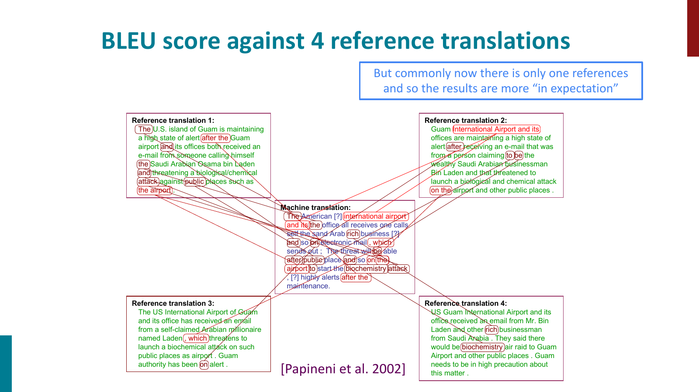
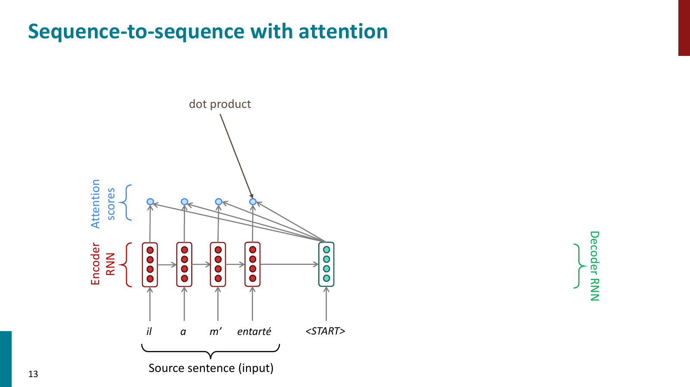
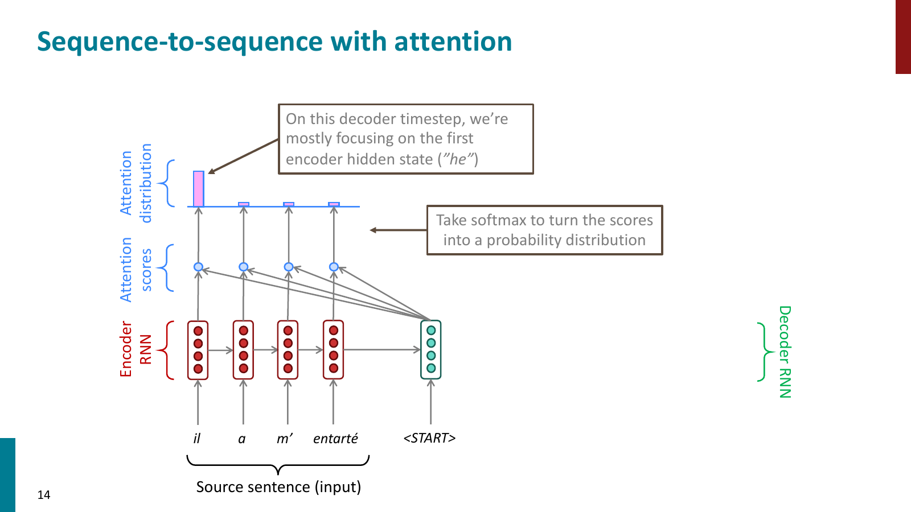
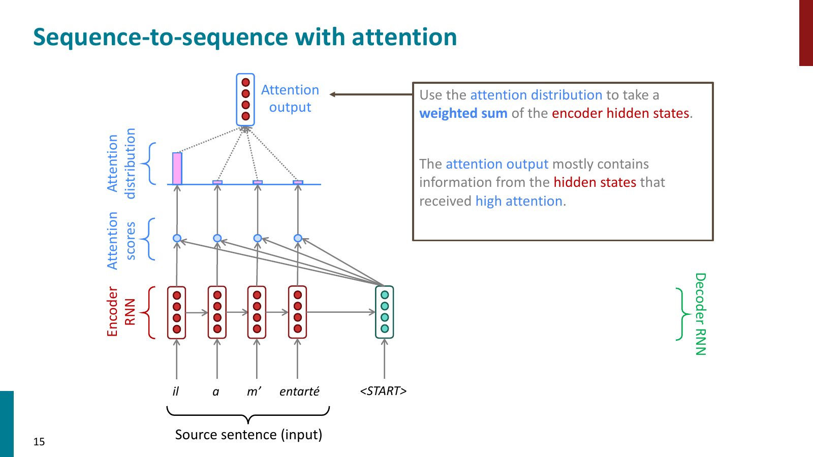
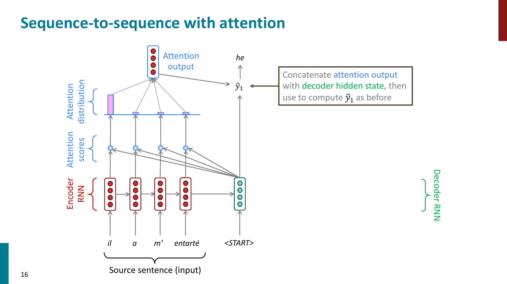
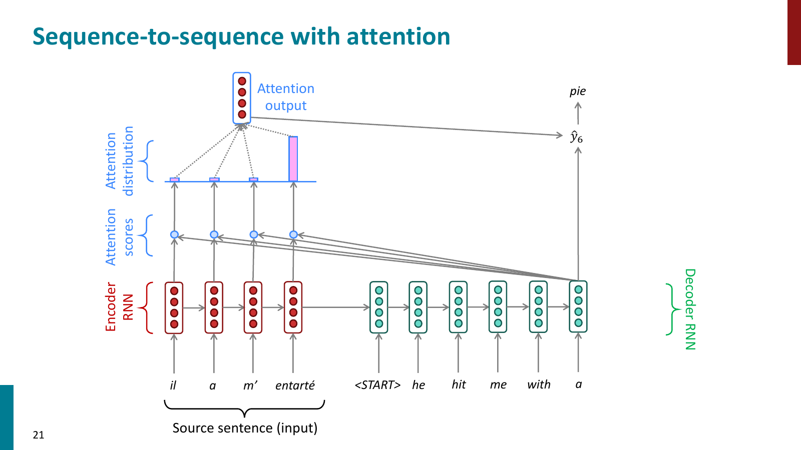
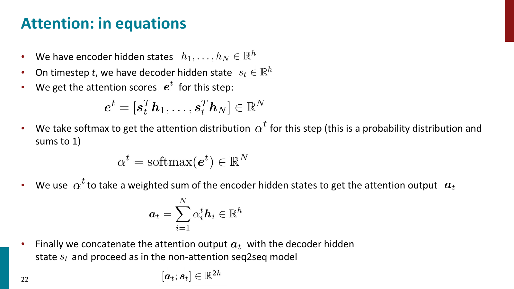
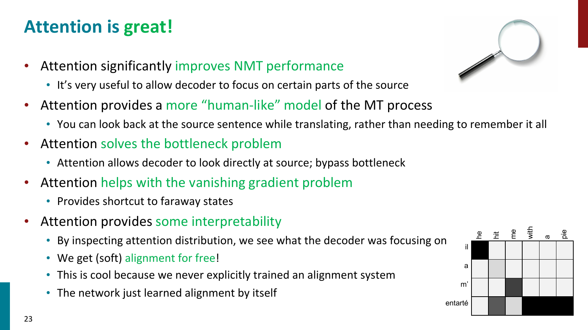
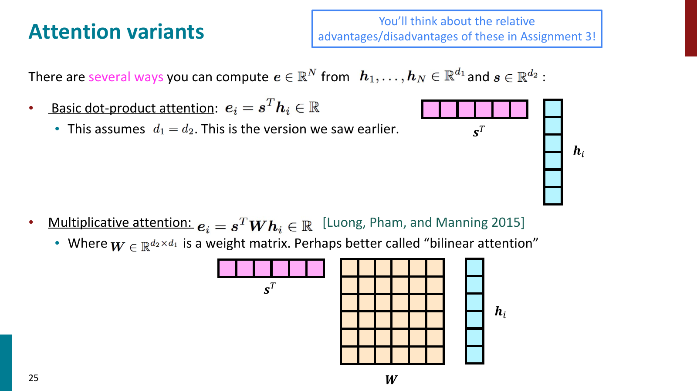
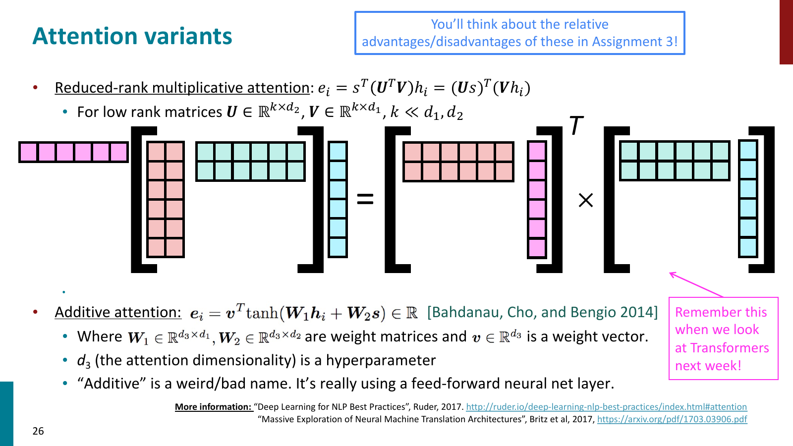

## 1. 机器翻译的自动评估：BLEU

**BLEU（Bilingual Evaluation Understudy）**将机器译文与一条或多条人工参考译文进行比较，根据两者的 **n-gram 匹配情况**计算得分，并对过短的机器译文施加惩罚。

BLEU 根据以下两部分计算相似度得分：

- **n-gram 精确率的几何平均**：通常分别计算 1、2、3、4-gram 的精确率，即机器译文中的这些片段有多大比例能与参考译文匹配，再用几何平均将各阶结果合成一个分数。
- **对过短译文的惩罚**：如果机器译文过短，还要降低最终得分。

BLEU 有用，但并不完美。同一句话有多种正确译法；即使机器译文正确，也可能因为与人工参考译文的 n-gram 重叠较少而得低分。

图中的四条参考译文描述同一事件，但用词和句式不同。多条参考译文能覆盖更多正确表达；只有一条参考译文时，另一种正确表达可能因为词语片段不同而得分较低。

BLEU 便于自动比较翻译系统，但不能完全代表翻译质量：**正确译文也可能因为与参考译文措辞不同而得低分**。比较模型时需要使用一致的参考译文和计算设置，并结合实际译文检查错误。

## 2. 注意力机制

### 2.1 编码器—解码器的信息瓶颈

基础的序列到序列模型先用编码器读取整个源句，再把编码器的最终状态传给解码器。解码器以此为初始状态，逐词生成译文。

这要求一个固定长度的状态保存整个源句的信息。句子变长、细节增多时，最终状态可能无法保留翻译所需的全部内容；解码器生成后面的词时，也不能直接读取源句中较早位置的状态。

**注意力（Attention）**让解码器在生成每个目标词时，直接读取编码器在各个源位置留下的隐藏状态，并根据当前需要给这些状态分配不同的权重。

例如，把 `il a m’ entarté` 翻译成 `he hit me with a pie`：生成 `he` 时，可以主要读取与主语有关的源端状态；生成后续词时，再重新计算应该读取哪些位置。

### 2.2 计算注意力分数

设源句有 $N$ 个词，编码器读完各个词后，分别留下隐藏状态：

$$
\mathbf{h}_1,\ldots,\mathbf{h}_N\in\mathbb{R}^{h}.
$$

编码器每读入一个源词，就计算一个隐藏状态：读入第一个词得到 $\mathbf{h}_1$，读入第二个词得到 $\mathbf{h}_2$，以此类推。对这里的单向编码器，$\mathbf{h}_i$ 由当前词和上一步状态计算，因此既包含当前词的信息，也包含此前读过的词的信息。注意力模型会保存**每个位置的状态**，供解码器读取，而不只保留最后一个状态。

解码器根据上一步状态和本步输入词，计算当前隐藏状态 $\mathbf{s}_t\in\mathbb{R}^{h}$，用于预测第 $t$ 个目标词。第一步输入 `<START>`；后续生成时输入上一步选出的词。

在第 $t$ 步，将当前解码状态 $\mathbf{s}_t$ 分别与各源位置的编码状态 $\mathbf{h}_i$ 做点积，得到**注意力分数**：

$$
e_i^t=\mathbf{s}_t^\top\mathbf{h}_i,\qquad i=1,\ldots,N.
$$

每个 $e_i^t$ 都是一个标量，用来比较当前解码状态与第 $i$ 个源端状态的匹配程度。把这些分数放在一起，得到 $N$ 维向量 $\mathbf{e}^t$。

图中右侧是输入 `<START>` 后的解码状态，左侧是各个源词对应的编码状态。标注 `dot product` 的计算是：用右侧这一个状态，分别与左侧每个状态做点积。每个源位置得到一个分数，组成图中的 `Attention scores`。

### 2.3 从分数得到权重，再加权读取源句

对同一步的全部源位置分数做 Softmax，得到**注意力分布**：

$$
\boldsymbol{\alpha}^t=\operatorname{softmax}(\mathbf{e}^t),
\qquad
\alpha_i^t=\frac{\exp(e_i^t)}{\sum_{j=1}^{N}\exp(e_j^t)}.
$$

$\alpha_i^t$ 是第 $t$ 步分给源位置 $i$ 的权重。所有权重非负，且在这一步加起来等于 1。分数越高的位置，获得的权重越大。

图中从 `Attention scores` 到 `Attention distribution` 的箭头表示 Softmax。第一步主要关注第一个源位置，因此该位置的权重最大。这里的权重对应源句位置，还不是目标词表中各个词的预测概率。

接着，用这些权重对源端隐藏状态求加权和，得到**注意力输出** $\mathbf{a}_t$，也称**上下文向量（Context Vector）**：

$$
\mathbf{a}_t=\sum_{i=1}^{N}\alpha_i^t\mathbf{h}_i\in\mathbb{R}^{h}.
$$

例如，若三个源位置的权重为 $0.7,0.2,0.1$，则 $\mathbf{a}_t=0.7\mathbf{h}_1+0.2\mathbf{h}_2+0.1\mathbf{h}_3$。它主要保留第一个位置的信息，同时也包含其他位置的信息。

图中的 `Attention output` 是把各个源端状态分别乘以对应权重，再相加得到的向量。权重较大的状态，对这个向量的贡献也较大。

注意力分布 $\boldsymbol{\alpha}^t$ 有 $N$ 个分量，每个分量对应一个源位置；注意力输出 $\mathbf{a}_t$ 有 $h$ 个分量，与被加权的隐藏状态维度相同。

### 2.4 结合注意力输出预测目标词

将注意力输出 $\mathbf{a}_t$ 与当前解码状态 $\mathbf{s}_t$ 拼接：

$$
[\mathbf{a}_t;\mathbf{s}_t]\in\mathbb{R}^{2h}.
$$

$\mathbf{s}_t$ 提供解码器已读入的目标词信息，$\mathbf{a}_t$ 提供本步从源句中读取的信息。拼接后的向量经过输出层，得到目标词表上的概率向量 $\hat{\mathbf{y}}_t$：每个分量对应一个候选目标词的概率，再据此选出本步输出词。

图中第一步输入 `<START>`，解码器得到 $\mathbf{s}_1$，计算对各源位置的权重，再将 $\mathbf{a}_1$ 与 $\mathbf{s}_1$ 拼接，用来预测 `he`。

下一步输入 `he` 后，解码器得到新的状态 $\mathbf{s}_2$，重新计算分数、权重和注意力输出，用来预测 `hit`。**源端隐藏状态仍是同一组 $\mathbf{h}_1,\ldots,\mathbf{h}_N$，变化的是每一步读取它们的权重。** 后续预测 `me`、`with`、`a`、`pie` 时也重复这一过程。

有些模型还把上一步的注意力输出与本步词向量一起输入解码器，使下一步计算也能利用上一步从源句读取的信息。

### 2.5 注意力的作用与软对齐

注意力的主要优点包括：

- **改善翻译效果**：解码器生成每个目标词时，都可以直接关注源句中与当前词相关的部分。
- **绕过信息瓶颈**：解码器能够直接读取全部源端状态，不必只依靠编码器的最终状态保存整句信息。
- **提供较短的梯度路径**：损失可以通过注意力连接直接传到较早的源端状态，有助于缓解长序列中的梯度消失。
- **具有一定可解释性**：注意力分布显示了生成某个目标词时，模型主要读取了源句的哪些位置。

这种源位置与目标位置之间由注意力权重表示的关系称为**软对齐（Soft Alignment）**。“软”表示一个目标位置可以同时对多个源位置赋予不同权重，而不是只能指定唯一对应词。

下图展示了源句与译文之间的软对齐：不同目标词在生成时会对源句中的不同位置给予较高关注。它表示模型计算时关注了哪些位置，不是额外提供给模型的词语对应标注。

训练时只需要源句和正确译文，通过翻译损失学习参数；无需额外标注“哪个目标词对应哪个源词”，模型就能学到这样的对齐关系。

## 3. 注意力的通用形式与评分方法

### 3.1 查询、值与注意力输出

注意力要解决的问题是：当前这一步需要从一组表示中读取哪些信息，以及各读取多少。

- 一组值 $\mathbf{h}_1,\ldots,\mathbf{h}_N$（Values）：实际被读取的候选信息。在机器翻译中，它们是源句各位置的隐藏状态。
- 一个查询 $\mathbf{s}_t$（Query）：表示当前的需求，用来和候选表示比较。在机器翻译中，它是当前解码状态，表示解码器正在准备生成哪个目标词。

计算时，用查询分别与每个值计算分数；对分数做 Softmax 得到各个值的权重；再用这些权重对值求和，得到注意力输出。在第 $t$ 步，当前解码状态 $\mathbf{s}_t$ 作为查询，与源句各位置的隐藏状态比较，并据此计算注意力权重。下一步得到新的解码状态 $\mathbf{s}_{t+1}$，再重新计算各源位置的注意力权重。因此，每个生成步骤都可以根据当前状态调整对源句各位置的关注程度。

### 3.2 点积注意力与乘性注意力

设值 $\mathbf{h}_i\in\mathbb{R}^{d_1}$，查询 $\mathbf{s}\in\mathbb{R}^{d_2}$。不同注意力方法主要在于怎样计算分数，之后的 Softmax 和加权求和过程相同。

**点积注意力（Dot-product Attention）**直接计算：

$$
e_i=\mathbf{s}^\top\mathbf{h}_i.
$$

查询和值必须维度相同，即 $d_1=d_2$；评分本身没有额外的可学习参数。

**乘性注意力（Multiplicative Attention）**在中间加入可学习矩阵，也称**双线性注意力（Bilinear Attention）**：

$$
e_i=\mathbf{s}^\top\mathbf{W}\mathbf{h}_i,
\qquad \mathbf{W}\in\mathbb{R}^{d_2\times d_1}.
$$

先由 $\mathbf{W}$ 把值映射到与查询相同的维度，再与查询做点积。因此，查询和值可以具有不同维度，模型也能通过训练调整两者的匹配方式。

### 3.3 低秩乘性注意力与加性注意力

**低秩乘性注意力（Reduced-rank Multiplicative Attention）**分别把查询和值映射到较低维空间，再做点积：

$$
e_i=\mathbf{s}^\top\mathbf{U}^\top\mathbf{V}\mathbf{h}_i
=(\mathbf{U}\mathbf{s})^\top(\mathbf{V}\mathbf{h}_i),
$$

$$
\mathbf{U}\in\mathbb{R}^{k\times d_2},\qquad
\mathbf{V}\in\mathbb{R}^{k\times d_1},\qquad k\ll d_1,d_2.
$$

两个向量都先变成 $k$ 维。它相当于把完整双线性矩阵限制为 $\mathbf{W}=\mathbf{U}^\top\mathbf{V}$，在 $k$ 较小时可以减少评分参数。

**加性注意力（Additive Attention）**用一个前馈神经网络计算匹配分数：

$$
e_i=\mathbf{v}^\top\tanh(\mathbf{W}_1\mathbf{h}_i+\mathbf{W}_2\mathbf{s}),
$$

$$
\mathbf{W}_1\in\mathbb{R}^{d_3\times d_1},\qquad
\mathbf{W}_2\in\mathbb{R}^{d_3\times d_2},\qquad
\mathbf{v}\in\mathbb{R}^{d_3}.
$$

先把值和查询分别映射成 $d_3$ 维向量，相加并经过 $\tanh$，最后与 $\mathbf{v}$ 做点积，得到一个标量分数。$d_3$ 是可选择的注意力内部维度。

## 4. 研究选题、文献与数据

### 4.1 从问题或方法出发

研究选题有两种常见起点：

- **从问题出发**：先确定一个尚未解决好的问题，再寻找更有效的解决方法。例如，发现翻译系统经常漏译长句中的细节，再研究怎样改善。
- **从方法出发**：先选择一种感兴趣的方法，再研究怎样改进它、解释它的效果，或将它用于新的问题。例如，研究注意力能否改善另一类序列任务。

选题需要进一步缩小到具体问题。“研究机器翻译”只是一个方向；“改善长句翻译中的漏译”才明确了要处理的现象。还要考虑能否在已有的时间、数据和计算资源下完成研究。

### 4.2 查找文献与已有结果

可以从本领域的主要会议、期刊、论文数据库和预印本平台查找相关工作。例如，NLP 论文可查 [ACL Anthology](https://aclanthology.org/)，机器学习论文可查 NeurIPS、ICML、ICLR 等会议论文，以及 [arXiv](https://arxiv.org/) 预印本。

围绕一个具体问题，查清已有工作研究了什么、采用什么方法、使用哪些数据，以及还存在哪些不足。相关论文引用的早期工作，以及后续引用它的论文，有助于继续追踪研究的发展。

公开评测任务和结果汇总可以帮助找到比较对象。**基线（Baseline）**是用来比较的已有方法或简单方案；新方法的效果需要放在与基线一致的实验条件下判断。排行榜和汇总信息未必准确，具体的数据划分、评价指标和实验设置需要回到原论文确认。

### 4.3 将研究方向变成可检验的问题

研究不一定要提出全新的模型，也可以改进已有方法、解释某种现象，或找出方法的适用条件。常见切入点包括：

- **效果与适用范围**：方法在什么条件下有效，换一类数据或使用环境后是否仍然有效。例如，新闻文本上训练的模型能否处理医学文本。
- **机制与错误分析**：哪些设计产生了效果，哪些情况容易失败。可以移除或替换某个组件，再与完整方法比较，这称为**消融实验（Ablation Study）**。
- **数据不足与罕见情况**：数据变少时性能如何变化，补充或增强数据能否改善表现。
- **效率与资源限制**：能否减少时间、存储或计算开销，以及需要牺牲多少效果。
- **可靠性与影响**：结果是否稳定，是否存在系统性偏差，方法的行为能否被理解和检查。

每个方向都需要明确比较条件和观察结果。例如，研究模型压缩时，同时报告模型大小、运行开销和任务表现，才能判断压缩是否达到了预期目的。

### 4.4 获取与选择研究数据

获取研究数据主要有三种方式：

- **使用已有公开数据**：可以较快开始研究，也容易找到使用同一数据的已有工作作为比较对象。
- **自行采集或标注**：能围绕具体问题获取数据，但需要估计采集、清洗和标注的工作量。例如，网站评分可以作为情感分析的标签来源。
- **使用已有研究或企业数据**：需要确认使用权限，以及能否提供验证和展示结果所需的材料。

相关论文、公开评测任务、领域数据库和数据集平台都是寻找数据的入口。例如，[Kaggle](https://www.kaggle.com/datasets) 和 [Hugging Face Datasets](https://huggingface.co/datasets) 提供多类数据；NLP 中还可从 [WMT](https://www.statmt.org/) 找翻译数据，从 [Universal Dependencies](https://universaldependencies.org/) 找依存句法标注数据。

选择数据时，需要确认它是否覆盖要研究的现象、是否提供所需标注，以及规模和质量是否足以支持比较。数据容易下载，并不意味着它适合当前问题。

## 5. 数据划分与训练调试

### 5.1 训练、调参与最终测试

**泛化性能**是模型在没有参与训练和开发选择的新数据上的表现。不同数据集承担不同作用：

| 数据集 | 用途 |
| --- | --- |
| 训练集（Train） | 计算训练损失，通过梯度更新模型参数。 |
| 调参集（Tune） | 比较学习率、正则化强度等超参数，选择配置。 |
| 开发／验证集（Dev / Validation） | 在开发过程中检查进展，比较模型设计和训练结果。 |
| 第二开发集（Dev2） | 在反复使用第一个开发集后，用另一份数据复核效果。 |
| 测试集（Test） | 开发完成后，给出最终独立评价。 |

各份数据划分应互不重叠。缺少开发集或需要单独的调参集时，可以从训练数据中划出一部分。

反复根据同一评价集的结果修改模型，也会逐渐过拟合这份数据。因此，开发过程中用开发集检查效果，最终测试集留到开发结束后使用，理想情况下只用一次。

### 5.2 从简单模型和少量样本开始

先让简单模型正常训练，再逐个加入新组件，每次检查新增部分是否有效。

最初只用 **4–8 个样本**，必要时用合成数据，检查模型能否记住这些训练样本、达到接近完全正确。小数据训练快，也容易检查错误；如果连这些样本都学不会，应排查实现和训练设置，或检查模型能力是否足够。这一步用于调试，不用于评价泛化性能。

### 5.3 扩大训练与改善泛化

再用完整训练集训练，检查模型是否能充分拟合训练数据；拟合不足时，检查训练过程和模型能力。

如果训练效果好、开发集效果差，说明存在过拟合，可以使用 L2 正则化或 Dropout 改善泛化，并在开发集上检查效果。

调试时还要查看原始数据及统计信息，阅读模型输出并分析错误，检查学习率、初始化等训练设置。
