## 1. 从循环网络到 Transformer

**Transformer** 是一种以注意力机制进行序列中信息交互的神经网络结构。原始 Transformer 用于机器翻译，由编码器和解码器组成；两侧都使用注意力和前馈网络，不再通过 RNN 逐步传递隐藏状态。

### 1.1 循环计算的限制

RNN 在第 $t$ 步的隐藏状态依赖第 $t-1$ 步，因此必须先算前一步，再算后一步。这带来两个问题：

**远距离信息需要经过较长路径。** 例如，`The chef who ... ate` 中，`chef` 的信息需要经过中间多个时间步，才能影响 `ate` 处的状态；反向传播也要经过这条长链，长期依赖较难学习。

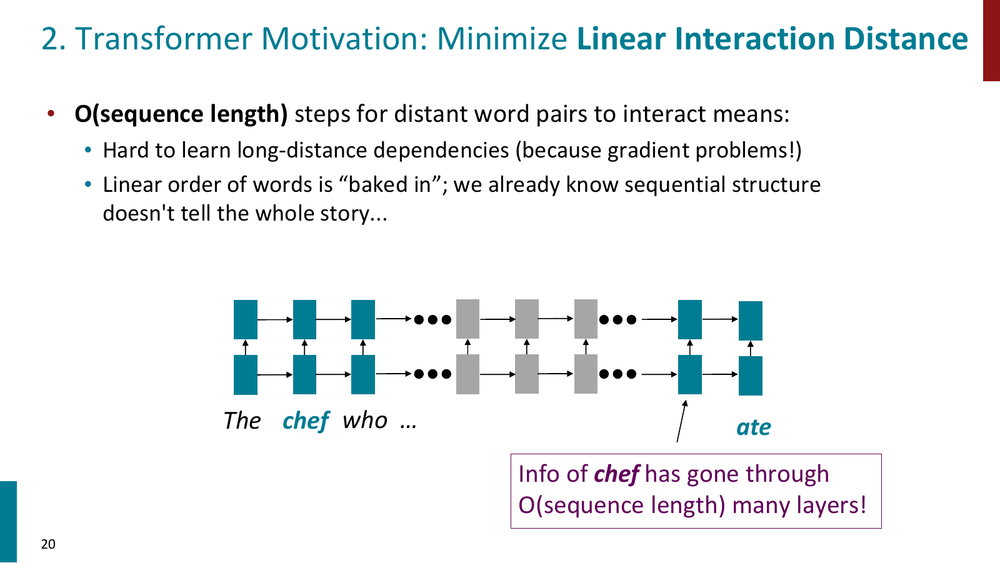

**同一序列的不同时间步难以并行计算。** 后一步必须等待前一步，限制了 GPU 等设备的并行能力。

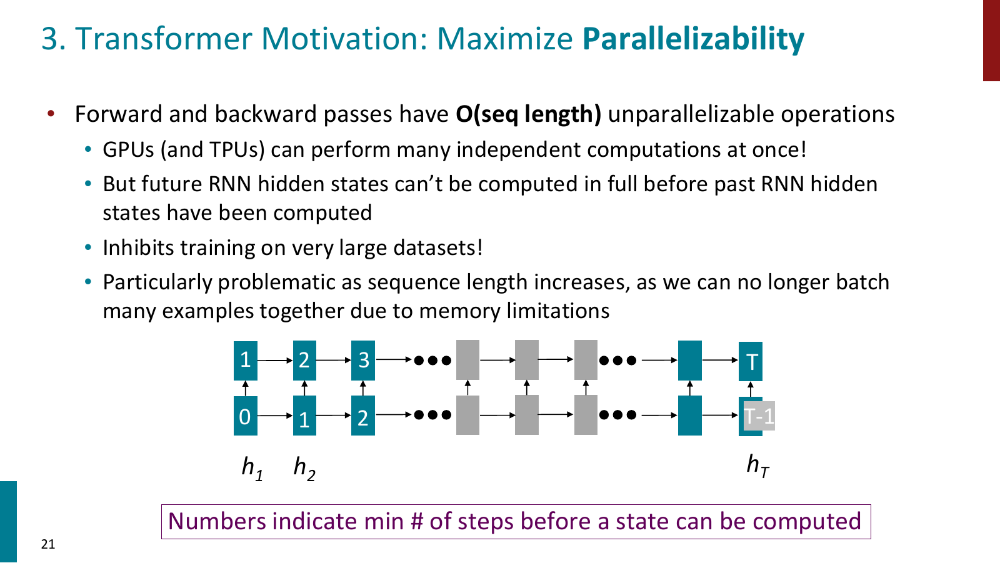

图中的数字表示得到相应状态至少需要经过多少步计算。同一层越靠后的位置，需要等待的步骤越多。

Transformer 的三个设计目标是：降低或至少不增加每层计算量、缩短词之间的交互路径，以及增加可并行计算的部分。

### 1.2 自注意力的直接连接

**自注意力（Self-attention）**让同一序列中的每个位置，根据其他位置的表示更新自己的表示。编码器中，每个词都可以直接读取整句各个位置的信息。

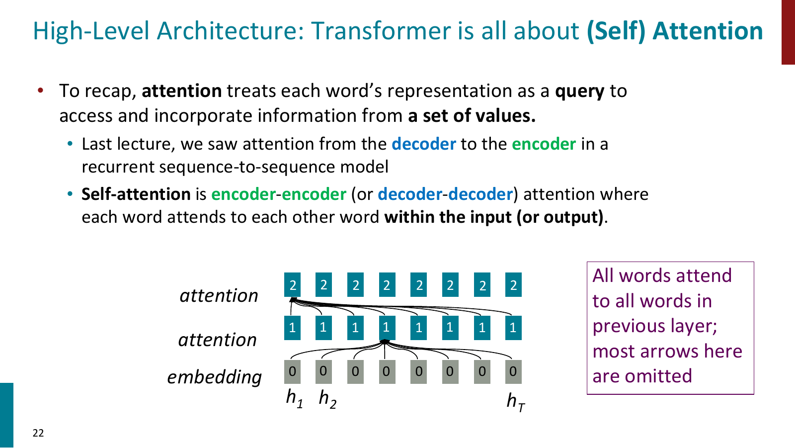

图中最下方是词嵌入，上方是两层自注意力。每个位置都读取上一层各位置的表示，图中省略了大部分连线；各层节点上的数字相同，表示同层各位置可以在同一步计算。

同一层的计算使用上一层已经得到的全部表示，因此不需要先算本层第一个位置，再算第二个位置；各位置可以并行计算。相隔很远的两个词，也能在一个注意力层中直接交互。

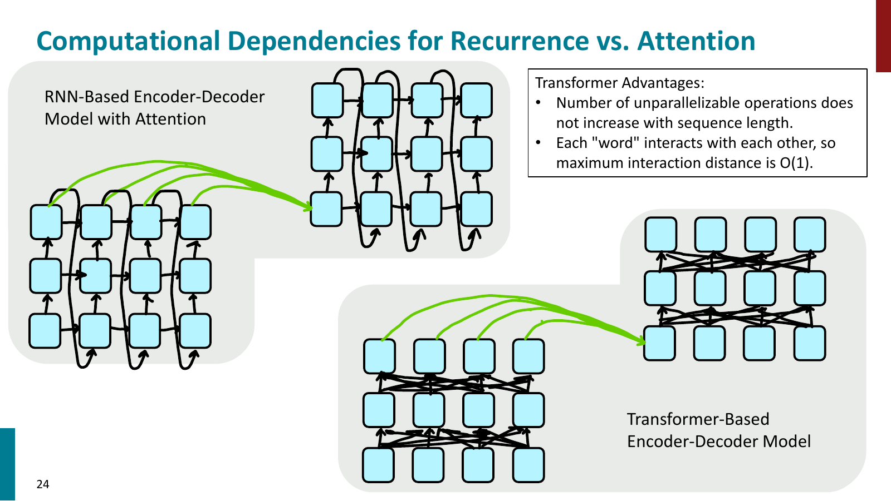

### 1.3 计算复杂度与交互路径

设序列长度为 $n$，表示维度为 $d$，主要计算的比较为：

| 层类型 | 每层计算复杂度 | 必须顺序执行的步数 | 最长交互路径 |
| --- | --- | --- | --- |
| 循环层 | $O(nd^2)$ | $O(n)$ | $O(n)$ |
| 自注意力的两两交互 | $O(n^2d)$ | $O(1)$ | $O(1)$ |

当 $n$ 小于 $d$ 时，注意力的两两交互计算可能比循环层更便宜。

## 2. 自注意力的计算

### 2.1 查询 Q、键 K 和值 V

注意力计算需要完成两件事：先确定各位置的权重，再按权重汇总这些位置的信息。

第七讲的点积注意力中，用当前解码状态 $\mathbf{s}_t$ 与各源端状态 $\mathbf{h}_i$ 做点积，经 Softmax 得到权重，再对同一组 $\mathbf{h}_i$ 加权求和。因此，$\mathbf{h}_i$ 同时参与匹配和信息汇总。

Transformer 将这两种用途分开：从每个位置的输入分别生成**键 $\mathbf{k}$ 和值 $\mathbf{v}$**。**键 $\mathbf{k}$ 用于与查询 $\mathbf{q}$ 计算匹配分数，决定该位置获得多大权重；值 $\mathbf{v}$ 用于加权求和，决定该位置提供什么信息。** 查询 $\mathbf{q}$ 也由当前位置的输入通过投影得到。

对于输入位置 $i$ 的表示 $\mathbf{x}_i$，通过三组可学习矩阵得到：

$$
\mathbf{q}_i=\mathbf{W}_Q\mathbf{x}_i,\qquad
\mathbf{k}_i=\mathbf{W}_K\mathbf{x}_i,\qquad
\mathbf{v}_i=\mathbf{W}_V\mathbf{x}_i.
$$

- **查询 $\mathbf{q}_i$（Query）**：用于位置 $i$ 发起匹配，与各位置的键 $\mathbf{k}$ 计算分数。
- **键 $\mathbf{k}_j$（Key）**：位置 $j$ 用来参与匹配的表示。
- **值 $\mathbf{v}_j$（Value）**：位置 $j$ 实际提供给加权求和的信息。

例如，更新 `ate` 的表示时，用 `ate` 对应的查询 $\mathbf{q}$ 与 `chef` 等各词的键 $\mathbf{k}$ 比较，再根据匹配权重汇总各词的值 $\mathbf{v}$。查询 $\mathbf{Q}$、键 $\mathbf{K}$ 和值 $\mathbf{V}$ 都来自同一个序列，所以称为自注意力。三组投影矩阵不同，同一个词也会得到不同的查询 $\mathbf{q}$、键 $\mathbf{k}$ 和值 $\mathbf{v}$。

可以把注意力理解为近似查表：普通查表根据查询 $\mathbf{q}$ 找到一个键 $\mathbf{k}$，例如 $\mathbf{k}_3$，就返回对应的值 $\mathbf{v}_3$；注意力则用查询 $\mathbf{q}$ 与所有键 $\mathbf{k}$ 比较，经 Softmax 得到权重，再对对应的值 $\mathbf{v}$ 加权求和。它返回的是多个值 $\mathbf{v}$ 按匹配程度组合的结果。

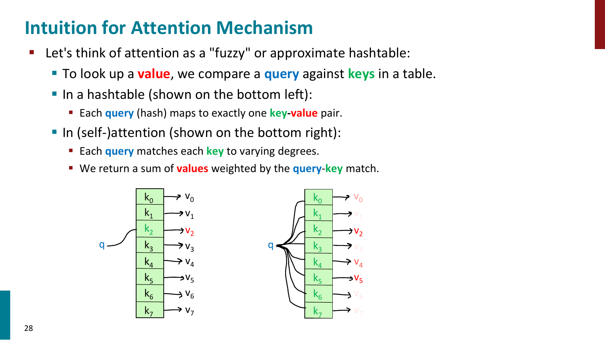

### 2.2 单个位置的注意力输出

对于每个词的输入表示 $\mathbf{x}_i$，先按上面的公式计算查询 $\mathbf{q}_i$、键 $\mathbf{k}_i$ 和值 $\mathbf{v}_i$。再用查询 $\mathbf{q}_i$ 分别与所有词的键 $\mathbf{k}_j$ 做点积，得到注意力分数：

$$
e_{ij}=\mathbf{q}_i^\top\mathbf{k}_j.
$$

对这一组分数做 Softmax，得到位置 $i$ 对各位置 $j$ 的权重：

$$
\alpha_{ij}=\frac{\exp(e_{ij})}{\sum_{r=1}^{n}\exp(e_{ir})}.
$$

再用这些权重对值 $\mathbf{v}$ 求和，得到位置 $i$ 的注意力输出：

$$
\mathbf{output}_i=\sum_{j=1}^{n}\alpha_{ij}\mathbf{v}_j.
$$

每个词都重复上述计算，得到各自的注意力输出。例如，计算 `chef` 的输出时，用它的查询 $\mathbf{q}$ 与句中所有词的键 $\mathbf{k}$ 比较，再对所有词的值 $\mathbf{v}$ 加权求和；其中也包括 `chef` 自己的键 $\mathbf{k}$ 和值 $\mathbf{v}$。

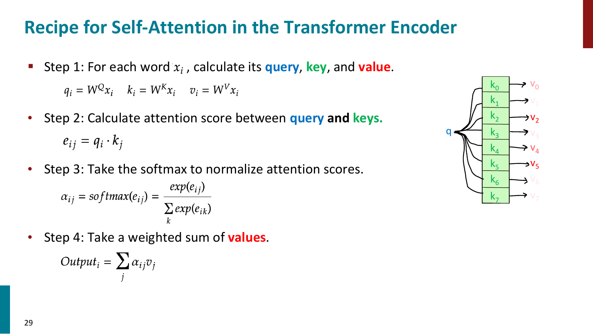

### 2.3 所有位置的矩阵计算

设序列有 $n$ 个词，每个词的输入表示 $\mathbf{x}_i$ 是一个 $d$ 维向量。按词在序列中的顺序，将这些向量横写成行，再从上到下排列，得到输入矩阵：

$$
\mathbf{X}=\begin{bmatrix}
\mathbf{x}_1^\top\\
\mathbf{x}_2^\top\\
\vdots\\
\mathbf{x}_n^\top
\end{bmatrix}\in\mathbb{R}^{n\times d}.
$$

每一行对应一个词，每一列对应输入表示的一个特征维度。用矩阵乘法可以一次计算所有词的查询 $\mathbf{Q}$、键 $\mathbf{K}$ 和值 $\mathbf{V}$：

**第一步：生成所有词的查询 $\mathbf{Q}$、键 $\mathbf{K}$ 和值 $\mathbf{V}$。**

$$
\mathbf{Q}=\mathbf{X}\mathbf{W}_Q,\qquad
\mathbf{K}=\mathbf{X}\mathbf{W}_K,\qquad
\mathbf{V}=\mathbf{X}\mathbf{W}_V.
$$

三个矩阵都按词序排列：第 $i$ 行分别是 $\mathbf{q}_i^\top$、$\mathbf{k}_i^\top$ 和 $\mathbf{v}_i^\top$。若查询 $\mathbf{q}$ 和键 $\mathbf{k}$ 的维度为 $d_k$，值 $\mathbf{v}$ 的维度为 $d_v$，则 $\mathbf{Q},\mathbf{K}\in\mathbb{R}^{n\times d_k}$，$\mathbf{V}\in\mathbb{R}^{n\times d_v}$。输入向量排成行后，投影矩阵写在右侧，完成对每一行的变换。

**第二步：计算每个查询 $\mathbf{q}$ 与所有键 $\mathbf{k}$ 的分数。**

$$
\mathbf{E}=\mathbf{Q}\mathbf{K}^\top\in\mathbb{R}^{n\times n},\qquad
E_{ij}=\mathbf{q}_i^\top\mathbf{k}_j.
$$

矩阵乘法中，$\mathbf{Q}$ 的第 $i$ 行与 $\mathbf{K}^\top$ 的第 $j$ 列相乘，就得到查询 $\mathbf{q}_i$ 与键 $\mathbf{k}_j$ 的点积分数。因此，$\mathbf{E}$ 的第 $i$ 行包含词 $i$ 对全部词的分数；一共有 $n$ 个查询 $\mathbf{q}$、$n$ 个键 $\mathbf{k}$，所以得到 $n\times n$ 个分数。

**第三步：将每一行分数转成注意力权重。**

$$
\mathbf{A}=\operatorname{softmax}_{\mathrm{row}}(\mathbf{E}),\qquad
A_{ij}=\frac{\exp(E_{ij})}{\sum_{r=1}^{n}\exp(E_{ir})}.
$$

分别对 $\mathbf{E}$ 的每一行做 Softmax。$A_{ij}$ 表示计算词 $i$ 的输出时，分给词 $j$ 的权重；同一行的 $n$ 个权重之和为 1。$\mathbf{A}$ 的形状仍为 $n\times n$。

**第四步：按权重对值 $\mathbf{V}$ 加权求和。**

$$
\mathbf{Output}=\mathbf{A}\mathbf{V}\in\mathbb{R}^{n\times d_v}.
$$

$\mathbf{A}$ 的第 $i$ 行有 $n$ 个权重，它们分别乘以 $\mathbf{V}$ 中对应的 $n$ 行，再相加，得到一个 $d_v$ 维输出：

$$
\mathbf{output}_i=\sum_{j=1}^{n}A_{ij}\mathbf{v}_j.
$$

$\mathbf{Output}$ 的第 $i$ 行就是 $\mathbf{output}_i^\top$，因此一次矩阵乘法得到了全部 $n$ 个词的注意力输出。

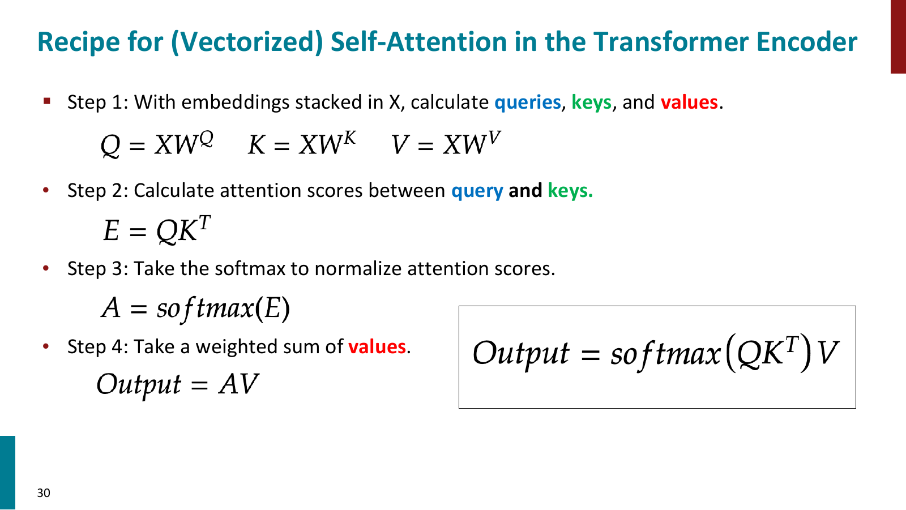

### 2.4 缩放点积注意力

查询 $\mathbf{q}$ 和键 $\mathbf{k}$ 的维度越大，点积相加的项越多，分数的幅度容易变大，使 Softmax 的权重过于集中，不利于训练。

在查询 $\mathbf{q}$、键 $\mathbf{k}$ 各分量近似独立、均值为 0、方差为 1 的假设下，$d_k$ 个乘积之和的方差为 $d_k$。因此，将点积分数除以 $\sqrt{d_k}$，使其尺度较稳定，得到**缩放点积注意力（Scaled Dot-product Attention）**：

$$
\operatorname{Attention}(\mathbf{Q},\mathbf{K},\mathbf{V})
=\operatorname{softmax}_{\mathrm{row}}\left(\frac{\mathbf{Q}\mathbf{K}^\top}{\sqrt{d_k}}\right)\mathbf{V}.
$$

缩放发生在 Softmax 之前，$d_k$ 是查询 $\mathbf{q}$ 和键 $\mathbf{k}$ 的维度。

## 3. 编码器中的其他组件

### 3.1 逐位置前馈网络

自注意力通过加权求和汇总各位置的值 $\mathbf{v}$，但缺少对输出向量各分量的非线性变换。为增强表达能力，在注意力之后加入**逐位置前馈网络（Position-wise Feed-forward Network，FFN）**：先做线性变换，经过 ReLU 非线性激活，再做一次线性变换。

$$
\operatorname{FFN}(\mathbf{output}_i)
=\mathbf{W}_2\operatorname{ReLU}(\mathbf{W}_1\mathbf{output}_i+\mathbf{b}_1)+\mathbf{b}_2.
$$

同一层中的所有位置使用相同的前馈网络参数，但分别处理各自的向量。这一步不在位置之间交换信息；最终输出回到模型的表示维度 $d$。

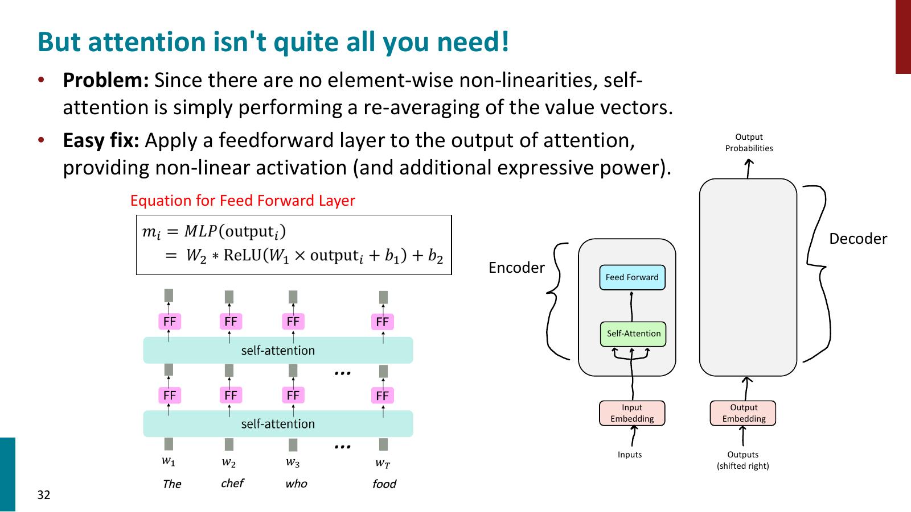

### 3.2 残差连接与层归一化

**残差连接（Residual Connection）**将子层的输入与计算结果相加：

$$
\mathbf{y}=\mathbf{x}+f(\mathbf{x}).
$$

这样，输入信息可以直接传到后面，子层学习在原表示上作出调整，有助于深层网络的训练。

**层归一化（Layer Normalization，LayerNorm）**对每个位置的向量单独处理：计算其各维分量的均值和标准差，再进行归一化，使数值尺度较稳定。

对一个 $d$ 维向量 $\mathbf{x}$，归一化的核心计算为：

$$
\mu=\frac1d\sum_{r=1}^{d}x_r,\qquad
\sigma^2=\frac1d\sum_{r=1}^{d}(x_r-\mu)^2,\qquad
\tilde{x}_r=\frac{x_r-\mu}{\sqrt{\sigma^2+\epsilon}}.
$$

$\epsilon$ 是防止分母为零的小常数。统计量在当前向量的特征维度上计算，不是把整句或整个批次混在一起。

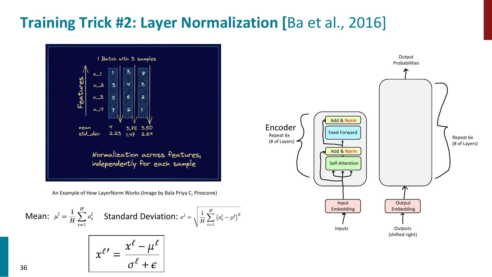

结构图中的 **Add & Norm** 表示先做残差相加，再做层归一化：

$$
\operatorname{LayerNorm}(\mathbf{x}+f(\mathbf{x})).
$$

自注意力和前馈网络各自配有这样的连接。

### 3.3 位置编码

自注意力用内容计算匹配，本身没有表示“哪个词在前、哪个词在后”。例如，`Man eats small dinosaur` 中，词序决定谁吃谁，只有词的内容不足以表达这种区别。

**位置编码（Positional Encoding）**为每个位置准备一个与词向量同维度的向量 $\mathbf{p}_i$，加到词向量上：

$$
\mathbf{x}_i=\mathbf{e}_i+\mathbf{p}_i.
$$

$\mathbf{e}_i$ 是词嵌入，$\mathbf{x}_i$ 是加入位置信息后的输入。查询 $\mathbf{q}$、键 $\mathbf{k}$ 和值 $\mathbf{v}$ 从这个输入计算，因此可以使用位置信息。位置编码在进入第一层之前加入。

原始 Transformer 使用不同频率的正弦和余弦函数组成位置向量。设特征维下标从 0 开始：

$$
p_{i,2r}=\sin\left(\frac{i}{10000^{2r/d}}\right),\qquad
p_{i,2r+1}=\cos\left(\frac{i}{10000^{2r/d}}\right),
\qquad r=0,\ldots,d/2-1.
$$

每一对特征使用相同频率的正弦和余弦，不同特征对使用不同频率。位置向量由这些函数直接计算，不需要学习参数。

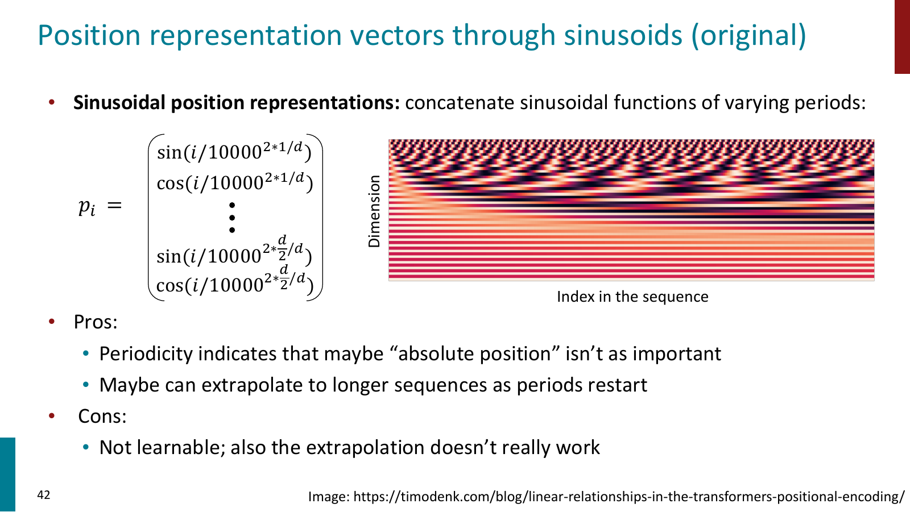

这些函数可以计算训练长度之外的位置，但并不保证模型在更长序列上仍能保持效果。

**相对位置表示（Relative Position Representation）**则关注词之间的位置关系，例如“在前一个位置”，而不只是“位于句子第几个位置”。它将这种相对关系加入注意力计算。

### 3.4 多头注意力

一个词可能出于不同原因，需要关注句子中的不同位置。例如，更新动词的表示时，既可能需要主语信息，也可能需要宾语信息。**多头注意力（Multi-head Attention）**通过并行计算多组注意力，再合并结果，使模型能够分别处理这些关系。

**第一步：建立多个注意力头。** 一个“头”是一套注意力计算，具有自己的一组查询 $\mathbf{Q}$、键 $\mathbf{K}$ 和值 $\mathbf{V}$ 投影矩阵。所有头接收同一个输入矩阵 $\mathbf{X}$，但各自学习不同的投影参数。

设头数为 $h$，模型维度为 $d$，每个头通常将输入投影到 $d/h$ 维。第 $\ell$ 个头的查询 $\mathbf{Q}$、键 $\mathbf{K}$ 和值 $\mathbf{V}$ 为：

$$
\mathbf{Q}_{\ell}=\mathbf{X}\mathbf{W}_Q^{(\ell)},\qquad
\mathbf{K}_{\ell}=\mathbf{X}\mathbf{W}_K^{(\ell)},\qquad
\mathbf{V}_{\ell}=\mathbf{X}\mathbf{W}_V^{(\ell)}.
$$

**第二步：各头独立计算注意力。** 每个头分别计算分数、Softmax 权重和加权和：

$$
\mathbf{Output}_{\ell}
=\operatorname{softmax}_{\mathrm{row}}\left(
\frac{\mathbf{Q}_{\ell}\mathbf{K}_{\ell}^\top}{\sqrt{d/h}}
\right)\mathbf{V}_{\ell}.
$$

由于投影参数不同，同一个词在不同头中可以得到不同的权重分布和输出。例如，一个头可能较关注主语，另一个头可能较关注宾语；这种分工由训练学得。

**第三步：拼接并组合各头输出。** 对于同一个词，将各头输出的向量首尾拼接，再通过一个可学习的输出矩阵：

$$
\mathbf{Output}
=\operatorname{Concat}(\mathbf{Output}_1,\ldots,\mathbf{Output}_h)\mathbf{W}_O.
$$

每个头为每个词输出 $d/h$ 维向量，$h$ 个头拼接后得到 $d$ 维向量。$\mathbf{W}_O\in\mathbb{R}^{d\times d}$ 再将各头的信息组合起来，得到该词最终的多头注意力输出。对全部 $n$ 个词一起计算，输出矩阵的形状为 $n\times d$。

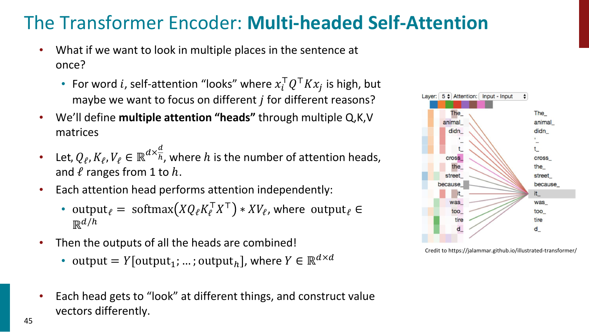

### 3.5 编码器的层结构

编码器先将每个源词的词嵌入与位置编码相加，再将整组表示送入第一层。每个编码器层依次执行：

1. **多头自注意力**：每个位置根据本层输入中各位置的信息，计算注意力输出。
2. **第一次 Add & Norm**：将注意力输出与本层输入相加，再做层归一化，得到中间表示。
3. **逐位置前馈网络**：分别对各位置的中间表示做非线性变换。
4. **第二次 Add & Norm**：将前馈网络的输出与其输入（第 2 步的中间表示）相加，再做层归一化，得到本层输出。

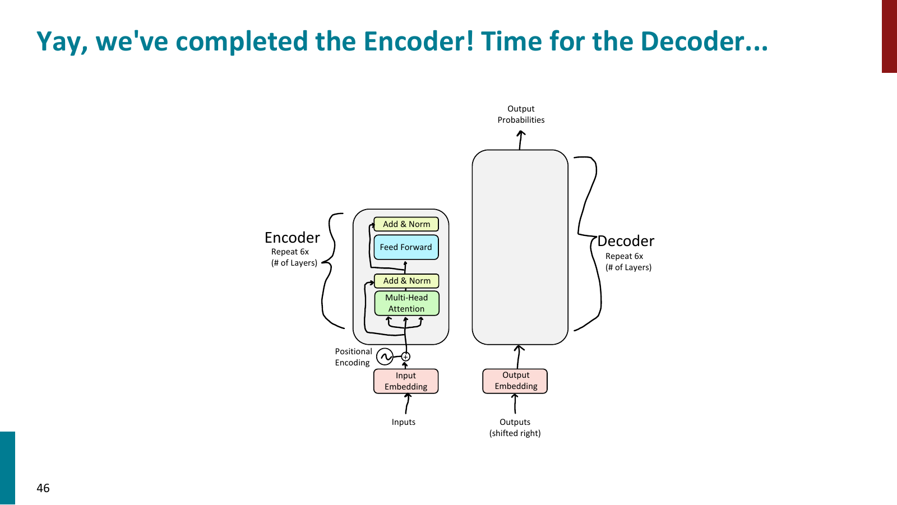

图中左侧框内的结构重复 6 次，即堆叠 6 个编码器层。上一层输出的整组词表示作为下一层输入，各层具有自己的参数。

每层都为每个源词输出一个 $d$ 维向量，因此输入和输出的形状均为 $n\times d$。顶层输出保留全部源位置的表示，供解码器通过交叉注意力读取。

## 4. Transformer 解码器

### 4.1 带掩码的多头自注意力

解码器逐词预测目标序列。训练时，将正确目标序列右移一位作为输入，例如：

| 位置 | 1 | 2 | 3 | 4 |
| --- | --- | --- | --- | --- |
| 输入 | `<START>` | `The` | `chef` | `who` |
| 预测目标 | `The` | `chef` | `who` | 下一个词 |

预测 `chef` 时，允许读取 `<START>` 和 `The`，但不能读取后面的输入 `chef`、`who`，否则答案会提前进入模型。

**带掩码的自注意力（Masked Self-attention）**在 Softmax 之前，将不允许读取的位置分数设为 $-\infty$，使其权重变为 0。用 $i$ 表示当前要预测的目标词位置，$j$ 表示可供读取的目标词位置，分数写为：

$$
e_{ij}=\begin{cases}
\mathbf{q}_i^\top\mathbf{k}_j,&j<i,\\
-\infty,&j\ge i.
\end{cases}
$$

这里从 1 开始编号目标词，`<START>` 的位置记为 0。例如，预测第 2 个目标词 `chef` 时，可以读取位置 0 的 `<START>` 和位置 1 的 `The`；位置 2 的 `chef` 及之后的词都被遮蔽。

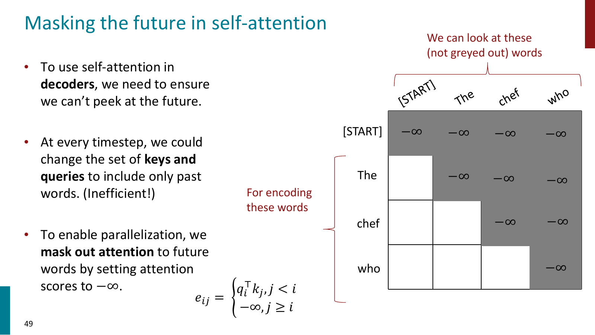

图中灰色区域对应分数为 $-\infty$ 的位置，经过 Softmax 后，这些位置的权重为 0。

一次计算所有位置时，可以用掩码矩阵 $\mathbf{M}$ 实现上述遮蔽。按前表右移后的输入位置编号，第 $i$ 行可以读取第 $i$ 列及之前的输入：

$$
M_{ij}=\begin{cases}
0,&j\le i,\\
-\infty,&j>i,
\end{cases}
\qquad
\mathbf{A}=\operatorname{softmax}_{\mathrm{row}}\left(
\frac{\mathbf{Q}\mathbf{K}^\top}{\sqrt{d_k}}+\mathbf{M}\right).
$$

允许读取的位置加 0，保留原分数；后续位置加 $-\infty$，使其注意力权重为 0。

训练时正确输入已知，可以一次计算所有位置，再用掩码阻止读取未来。生成新文本时，下一个输入取决于模型刚选出的词，仍需逐词生成。

### 4.2 编码器—解码器注意力

带掩码的自注意力让解码器读取已经输入的词；**交叉注意力（Cross-attention）**则让它读取编码器输出的词表示。

设编码器顶层在各源位置的输出为 $\mathbf{h}_1,\ldots,\mathbf{h}_n$，解码器经过带掩码自注意力处理后的各位置表示为 $\mathbf{z}_1,\ldots,\mathbf{z}_m$。交叉注意力从两侧分别计算查询、键和值：

- **键 $\mathbf{k}_j$ 和值 $\mathbf{v}_j$ 来自编码器**：将每个源位置的表示 $\mathbf{h}_j$ 分别投影，得到用于匹配的键和用于汇总信息的值。

$$
\mathbf{k}_j=\mathbf{K}\mathbf{h}_j,\qquad
\mathbf{v}_j=\mathbf{V}\mathbf{h}_j.
$$

- **查询 $\mathbf{q}_i$ 来自解码器**：将当前目标位置的表示 $\mathbf{z}_i$ 投影为查询。

$$
\mathbf{q}_i=\mathbf{Q}\mathbf{z}_i.
$$

这里的 $\mathbf{Q},\mathbf{K},\mathbf{V}$ 是可学习的投影矩阵；$\mathbf{q}_i,\mathbf{k}_j,\mathbf{v}_j$ 是投影后得到的查询、键和值向量。

用目标位置的查询 $\mathbf{q}_i$ 与所有源位置的键 $\mathbf{k}_j$ 计算分数，经 Softmax 得到权重，再对源位置的值 $\mathbf{v}_j$ 加权求和。解码器计算交叉注意力时，可以对编码器输出的全部词表示计算权重并加权求和。

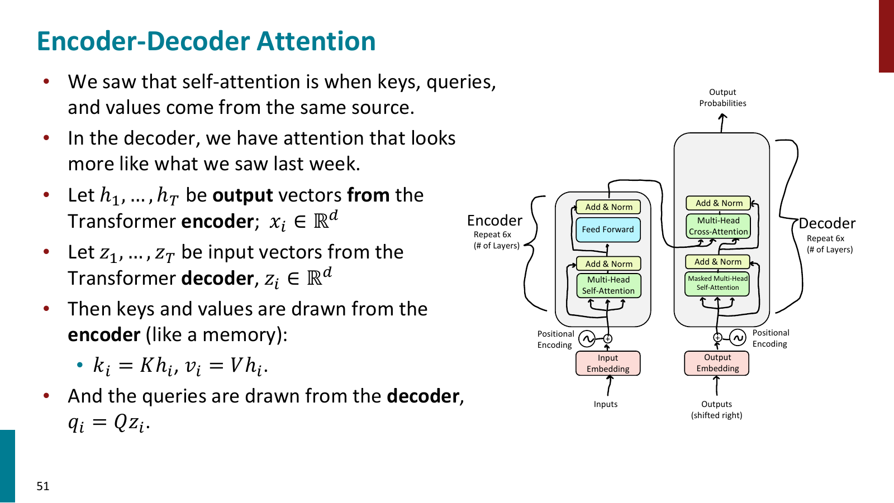

### 4.3 解码器的层结构与输出概率

解码器先将右移后的输入词转换为词嵌入，加上位置编码，再送入第一层。每个解码器层依次执行：

1. **带掩码的多头自注意力**：每个位置只能读取当前及更早的输入，不能读取后面的词。
2. **第一次 Add & Norm**：将自注意力输出与本层输入相加，再做层归一化，得到第一个中间表示。
3. **多头交叉注意力**：由第一个中间表示生成查询 $\mathbf{q}$，由编码器顶层输出生成键 $\mathbf{k}$ 和值 $\mathbf{v}$，计算对编码器信息的加权汇总。
4. **第二次 Add & Norm**：将交叉注意力输出与第一个中间表示相加，再做层归一化，得到第二个中间表示。
5. **逐位置前馈网络**：分别对各位置的第二个中间表示做非线性变换。
6. **第三次 Add & Norm**：将前馈网络输出与第二个中间表示相加，再做层归一化，得到本层输出。

原始模型堆叠 6 个解码器层，各层具有自己的参数。上一层输出作为下一层输入；每一层的交叉注意力都读取同一组编码器顶层输出。

顶层仍为每个输入位置保留一个 $d$ 维表示。随后，**Linear** 将它映射为词表大小 $|V|$ 的分数向量，**Softmax** 将分数转换为下一个词的概率分布：

$$
\boldsymbol{\ell}_t=\mathbf{W}_{\mathrm{vocab}}\mathbf{z}_t+\mathbf{b}_{\mathrm{vocab}}
\in\mathbb{R}^{|V|},\qquad
\hat{\mathbf{y}}_t=\operatorname{softmax}(\boldsymbol{\ell}_t).
$$

$\mathbf{z}_t$ 是顶层在位置 $t$ 的输出，$\boldsymbol{\ell}_t$ 中每个分量是一个候选词的分数，$\hat{\mathbf{y}}_t$ 中每个分量是对应词的预测概率。例如，词表有 1 万个词，概率向量就有 1 万个分量。训练时用正确的下一个词的概率计算交叉熵损失；生成时据此选择下一个词。

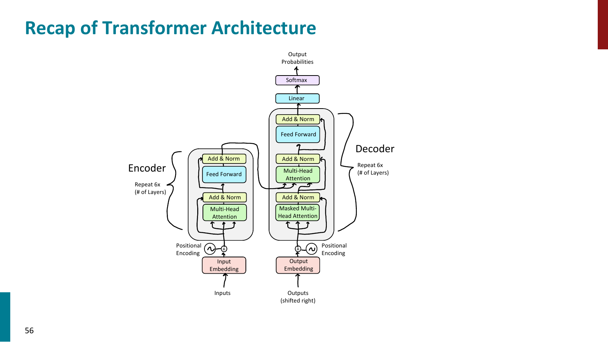

## 5. Transformer 的局限与改进

### 5.1 长序列计算开销与位置表示

**自注意力的计算量随序列长度平方增长。** 序列有 $n$ 个词，每个词的查询 $\mathbf{q}$ 都要与 $n$ 个键 $\mathbf{k}$ 比较，一共计算 $n^2$ 个分数。序列长度翻倍，分数数量就变为 4 倍，因此处理长序列的开销很大。

**绝对位置编码只直接表示词在第几个位置。** 词之间的前后距离或句法关系也可能有用，因此位置表示也是改进方向，例如相对位置表示、基于依存句法的位置表示和旋转位置编码（RoPE）。

### 5.2 减少注意力计算的方法

**Linformer：先压缩键 K 和值 V 的位置数量。** 原本 $\mathbf{K}$ 和 $\mathbf{V}$ 各有 $n$ 行，每行对应一个词。Linformer 通过投影，将这 $n$ 行组合成较少的 $r$ 行，再让全部 $n$ 个查询 $\mathbf{q}$ 对这些压缩后的表示计算注意力。这样，分数矩阵由 $n\times n$ 变为 $n\times r$，其中 $r\ll n$。

**BigBird：只保留一部分位置之间的注意力计算。** 大多数词只关注附近的词和少量随机选取的位置，另设少量全局位置与整段序列相连。这样仍能传递远距离信息，同时避免每个词都与全部词计算分数。
