**预训练（Pretraining）**先利用大量文本训练模型，再将学到的参数用于具体任务。它能利用远多于人工标注数据的文本，是提升 NLP 模型效果的重要方法。要处理这些来源广泛、用词多样的文本，首先需要解决文本如何表示的问题，尤其是如何处理训练词表中没有的词。

## 1. 子词建模与 BPE

### 1.1 固定词表与未知词

按完整单词建立词表时，模型通常只保留训练语料中的几万个词。测试时遇到词表以外的词，会将它映射为统一的未知词标记 **UNK（Unknown Token）**。这样，不同新词、拼写错误和词形变化就失去了区别。

例如，`taaaaasty`、`laern`、`Transformerify` 可能都被映射成 UNK。形态丰富的语言中，一个词根还可以产生大量不同词形，按完整单词收录更难覆盖。

**子词建模（Subword Modeling）**将词拆成词表中已有的较小片段。常见词可以保留为一个完整词元（Token），罕见词则由多个子词表示，而不必把整个词都变成 UNK。

### 1.2 字节对编码

**字节对编码（Byte-pair Encoding，BPE）**用来从训练语料中学习子词词表，以及将单词切成这些子词的规则。例如，词表不必收录完整的 `newest`，也可以把它表示成 `n`、`e`、`w`、`est` 四个词元，再分别查找它们的词向量。

如果只用字符作词元，词表很小，但每个词都要拆成很长的序列；如果把每个完整单词都收入词表，词表又会很大，还容易遇到未知词。BPE 从字符开始，将频繁一起出现的相邻片段合并成较大的词元，使常见词或片段可以用更少的词元表示。

**学习词表和合并规则的过程：**

1. **拆成字符。**将训练语料中的每个词拆成字符，并在末尾加上词尾标记。初始词表只包含这些字符和词尾标记。
2. **统计相邻对。**在各词内部统计相邻符号对的出现次数，按词在语料中的出现次数累计。
3. **合并最高频的一对。**例如，选中 `e s` 后，就把相邻的 `e` 和 `s` 合成一个词元 `es`，加入词表，并将语料中所有对应位置改为 `es`。
4. **重新统计并继续合并。**下一轮把 `es` 视为一个整体，它还可以与相邻符号合并。达到设定的词表大小后停止，并保存合并规则的先后顺序。

例如，训练词及出现次数为 `low: 5`、`lower: 2`、`newest: 6`、`widest: 3`。`newest` 和 `widest` 中各有一对相邻的 `e s`，因此它在语料中共出现 $6+3=9$ 次。合并为 `es` 后，这两个词中又都有相邻的 `es t`，可以进一步合并为 `est`。只看这两个词的字母部分，变化如下；空格分隔的是当前词元：

| 阶段 | `newest` | `widest` |
| --- | --- | --- |
| 初始拆分 | `n e w e s t` | `w i d e s t` |
| 合并 `e s` | `n e w es t` | `w i d es t` |
| 合并 `es t` | `n e w est` | `w i d est` |

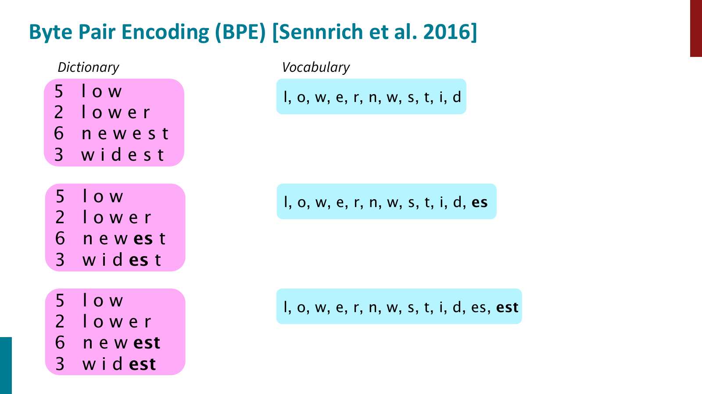

**使用学好的规则切分文本时**，同样先把词拆成字符，再按学习到的顺序应用合并规则。若规则只学到上表这一步，`newest` 就切成 `n`、`e`、`w`、`est`；后续若还学到了更大的组合，就继续合并。遇到未收录的完整单词，只要组成它的字符已在初始词表中，也能用已有词元表示，不必将整个词映射为 UNK。

不同语言的词边界和书写方式并不相同，例如中文没有依靠空格划分全部词语，德语复合词可以连写。子词建模也减少了对完整单词边界的依赖。WordPiece、SentencePiece 是预训练模型中常见的相关方法或工具。

## 2. 从词向量预训练到模型预训练

### 2.1 预训练词向量的局限

Word2vec 等方法先从大量文本中学习词向量，再用这些向量初始化具体任务模型的词嵌入层。但同一个词无论出现在哪里，查到的都是同一份静态词向量。例如，`I record the record` 中，第一个 `record` 是动词“录制”，第二个是名词“唱片”，两处的初始词向量却相同。

要区分这两处含义，还需要将词向量送入 LSTM 或 Transformer，由网络结合句中其他词计算各位置的表示。**如果只预训练词向量，这部分处理上下文的网络仍从随机参数开始**，需要依靠具体任务的标注数据训练；标注数据较少时，就难以充分学会怎样利用上下文。

**模型预训练（Model Pretraining）**不只提前训练词向量，还提前训练处理句子的 LSTM 或 Transformer。例如，将一句话中的某个词遮住，让模型根据其余词预测它。将预测结果与原词比较、计算损失后，通过反向传播同时更新词嵌入和网络中的参数。这样，用于具体任务时，词向量和处理句子的网络都已经经过训练，无须从随机参数开始学习。

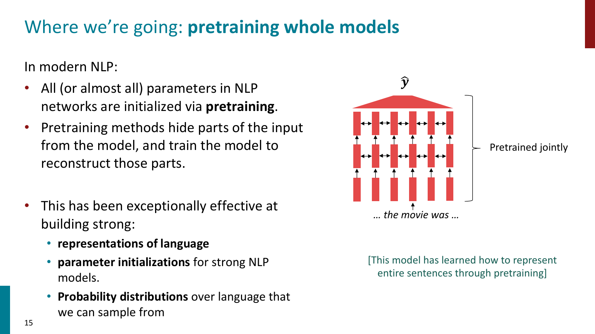

模型预训练的主要效果包括：

- **更好的语言表示。**模型能结合上下文计算词和句子的表示，例如为句中含义不同的两个 `record` 得到不同的表示。
- **更好的参数初值。**用于具体任务时，从预训练参数开始继续训练，而不是从随机参数开始。
- **可用于生成文本的语言概率分布。**以预测下一个词的语言模型为例，模型根据前文给出候选词的概率，按这个分布抽取一个词，再将它接到前文中继续预测，就能逐词生成文本。

这些任务的正确答案直接来自原始文本，不需要人工为每个样本另加标签，因此可以利用大规模、多样化的文本。这种训练通常称为**自监督学习（Self-supervised Learning）**。

### 2.2 预训练与微调

**预训练（Pretraining）**先用大量文本训练模型，保存学到的参数；**微调（Fine-tuning）**用这份参数初始化模型，再用具体任务的数据继续训练。

以语言模型预训练和情感分类微调为例：

1. **预训练：预测下一个词。**输入 `Iroh goes to make tasty tea`，模型在各位置根据前文预测后续词，例如根据 `Iroh` 预测 `goes`，根据 `Iroh goes` 预测 `to`。正确答案来自文本本身，训练后保存词嵌入和其余网络参数。
2. **微调：判断评论的情感。**载入预训练参数，接入情感分类输出层，输入带有正面或负面标签的电影评论。根据分类结果与真实标签计算损失，通过反向传播更新分类层和原有网络参数。新接入的分类层需要单独初始化。

两阶段的任务和损失不同，但微调继承了预训练参数。数量较少的任务标注数据可以用于学习情感分类，而不必从头训练整个网络来理解语言。

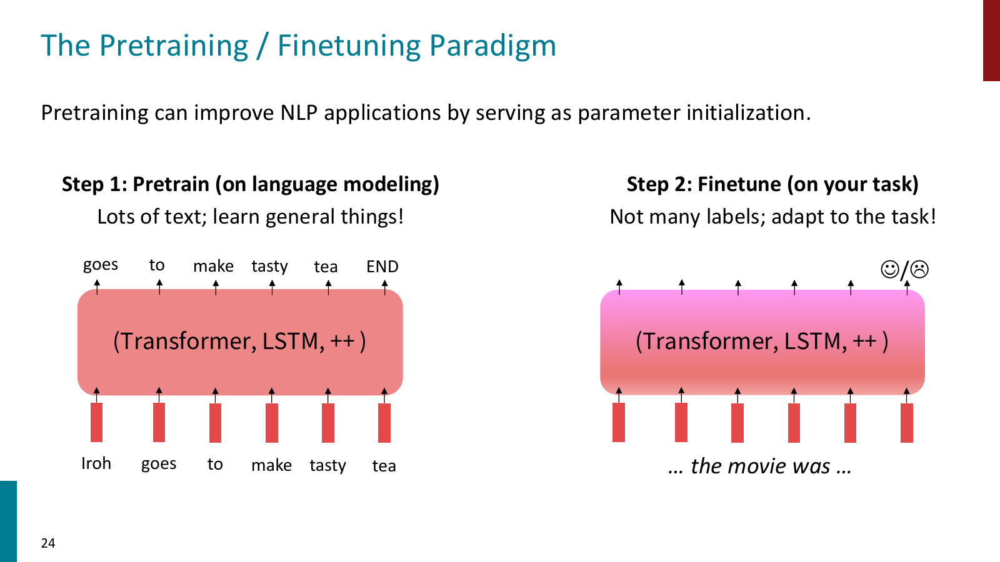

从优化过程看，用 $\boldsymbol{\theta}$ 表示模型参数，预训练通过减小预训练损失，得到参数 $\boldsymbol{\theta}_0$：

$$
\boldsymbol{\theta}_0\approx\arg\min_{\boldsymbol{\theta}}
\mathcal{L}_{\mathrm{pretrain}}(\boldsymbol{\theta}).
$$

微调则以 $\boldsymbol{\theta}_0$ 为初值，继续更新参数，减小具体任务的损失：

$$
\min_{\boldsymbol{\theta}}\mathcal{L}_{\mathrm{finetune}}(\boldsymbol{\theta}),
\qquad\text{初值为 }\boldsymbol{\theta}_0.
$$

**预训练为任务训练提供了一个已经学过语言的参数起点。**微调时，随机梯度下降得到的参数往往仍相对接近 $\boldsymbol{\theta}_0$；这附近可能存在泛化较好的解，也可能更有利于梯度传播。这是预训练有助于微调的可能解释。

## 3. 三类架构的预训练与使用

预训练需要确定模型根据哪些词、预测哪些词。模型在预测时能利用的上下文，取决于网络架构。用于预训练的三类架构分别是：

- **编码器（Encoder）**：计算一个位置的表示时，能够同时利用输入中该位置左右两侧的词，即双向上下文，适合结合完整输入分析词义和句意。
- **编码器—解码器（Encoder–Decoder）**：编码器先处理完整输入，解码器再结合编码器输出和已经给出的输出词，逐词预测后续内容。它将对完整输入的分析与逐词生成结合起来。
- **解码器（Decoder）**：预测下一个词时，只能利用前面已经给出的词，不能看到后续词。这与语言建模的预测方式一致，也适合逐词生成文本。

这些差异既影响模型适合的任务，也影响预训练任务的设计：需要让模型利用其能够看到的上下文进行预测，同时避免输入直接暴露预测答案。

### 3.1 编码器预训练

#### 3.1.1 遮蔽语言建模

编码器自注意力可以读取左右两侧的信息。如果直接让它预测输入中的下一个词，就可能读取到答案。因此，预训练时先隐藏一部分词，再让模型根据剩余上下文恢复它们，这称为**遮蔽语言建模（Masked Language Modeling，MLM）**。

例如，原句是 `I went to the store`，将 `went` 和 `store` 遮住：

| 编码器输入 | 要恢复的词 |
| --- | --- |
| `I [MASK] to the [MASK]` | 第一个遮蔽位置预测 `went`，第二个预测 `store`。 |

遮蔽后的句子经过编码器，得到各位置的隐藏状态 $\mathbf{h}_1,\ldots,\mathbf{h}_T$。每个状态都结合了该位置左右两侧的上下文。将需要预测的位置的状态 $\mathbf{h}_i$ 送入词表分类器：

$$
\hat{\mathbf{y}}_i=\operatorname{softmax}(\mathbf{A}\mathbf{h}_i+\mathbf{b}).
$$

$\mathbf{A}$ 和 $\mathbf{b}$ 是可学习的输出层权重和偏置，将隐藏状态转换为词表中各词的分数；Softmax 再将分数转换为概率。$\hat{\mathbf{y}}_i$ 的每一维对应一个候选词，例如词表有 3 万个词元，输出就有 3 万维。

在第一个遮蔽位置，正确答案是 `went`，因此从概率向量中取出 `went` 对应的概率，计算其负对数；第二个位置同样取出 `store` 的概率计算损失。模型给正确词的概率越大，损失越小。**只在选作预测目标的位置计算损失**，其余位置提供上下文。反向传播会更新词表分类器、编码器和词嵌入参数。

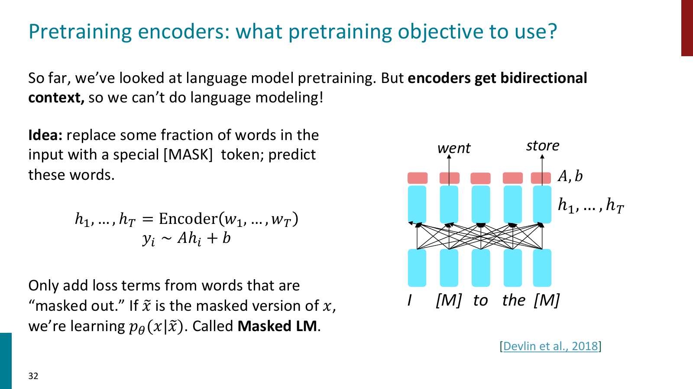

#### 3.1.2 BERT 与遮蔽策略

**BERT（Bidirectional Encoder Representations from Transformers）**使用 Transformer 编码器，通过 MLM 学习双向上下文表示。

BERT 随机选择 **15% 的词元位置**作为预测目标。在选中的位置中：

- 80% 的位置用 `[MASK]` 替换原词元。
- 10% 的位置用随机词元替换原词元。
- 10% 的位置保留原词元。

三种情况下，都要求模型预测该位置原来的词元。没有被选中的位置不计算 MLM 损失。

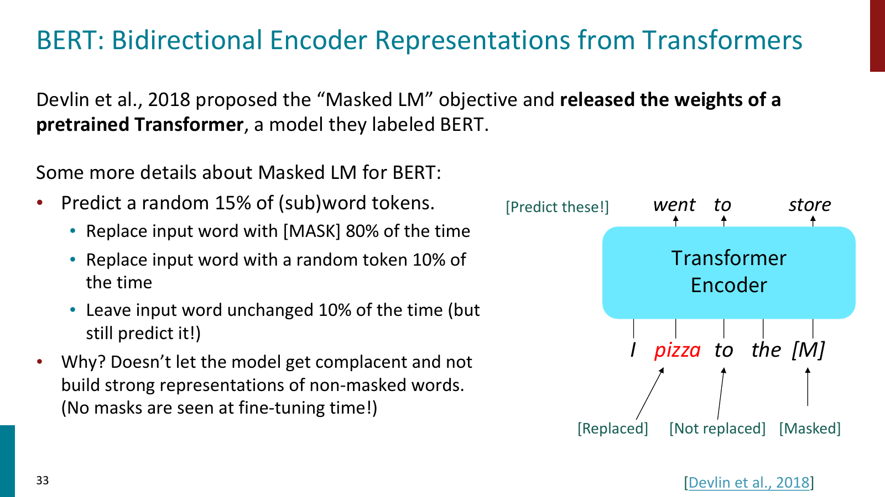

图中输入是 `I pizza to the [MASK]`，预测目标仍是原句相应位置的 `went`、`to` 和 `store`：`went` 被替换为随机词 `pizza`，`to` 保持不变，`store` 被遮住。

如果所有预测位置都替换为 `[MASK]`，模型就可能只学会在看到这个标记时预测原词，而微调时的正常文本中并没有 `[MASK]`。因此，一部分预测位置使用随机词元或保留原词元，使模型在没有 `[MASK]` 提示的位置也要预测原词，学习普通词元在上下文中的表示，而不只学习怎样处理遮蔽标记。

#### 3.1.3 BERT 的下一句预测

原始 BERT 还使用**下一句预测（Next Sentence Prediction，NSP）**。输入两段文本，判断第二段是否真的紧接第一段，还是从语料中随机抽取的另一段。

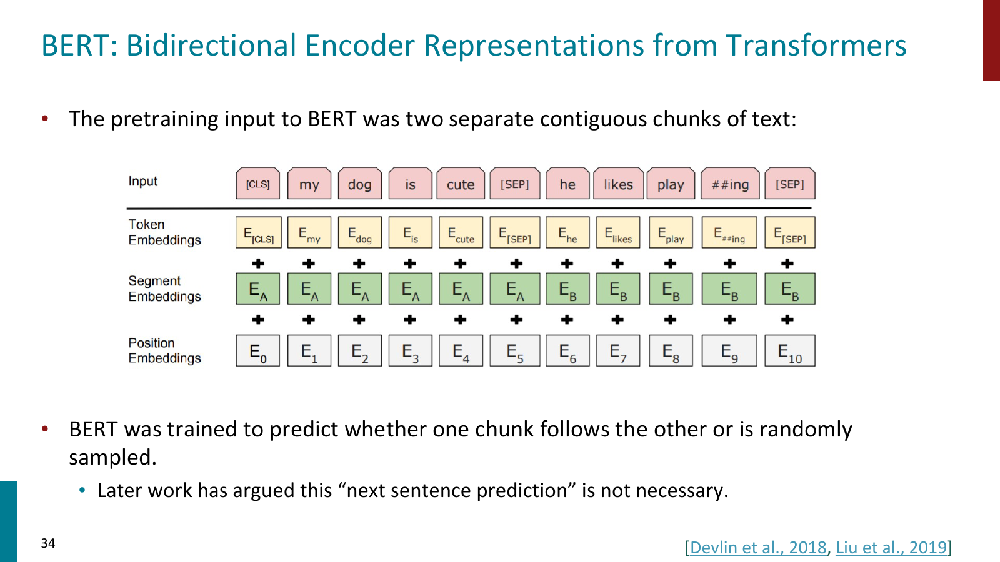

两段文本按 `[CLS] 第一段 [SEP] 第二段 [SEP]` 的形式组成一个输入。`[SEP]` 标记文本段的边界；位于开头的 `[CLS]` 经过编码器后得到一个结合两段内容的隐藏状态，分类器根据这个状态预测“第二段紧接第一段”或“第二段是随机抽取的”。后续研究发现，去掉下一句预测任务，只用遮蔽语言建模进行预训练，也能取得良好效果。

#### 3.1.4 BERT 的规模、使用与局限

原始 BERT 发布了两种配置：

| 模型 | 编码器层数 | 隐藏维度 | 注意力头数 | 参数量 |
| --- | ---: | ---: | ---: | ---: |
| BERT-base | 12 | 768 | 12 | 1.1 亿 |
| BERT-large | 24 | 1024 | 16 | 3.4 亿 |

预训练使用 BooksCorpus 和英文 Wikipedia。预训练开销较大，但已有模型的微调通常可以在单张 GPU 上进行。

在微调效果方面，BERT 在情感分类、句对是否表达相同含义、语义相似度、语法可接受性判断和自然语言推断等多种任务上，取得了当时领先的结果。

在文本生成方面，BERT 则存在局限：它利用双向上下文分析输入，但 MLM 的填空方式不直接对应逐词生成文本的过程。例如，对 `Iroh goes to [MASK] tasty tea`，BERT 可以同时利用左边的 `Iroh goes to` 和右边的 `tasty tea`，预测 `make`、`brew` 等词；解码器生成时，则只能根据已经给出的前文，预测下一个词，再继续向后生成。生成任务通常更适合使用预训练解码器。

#### 3.1.5 RoBERTa 与 SpanBERT

BERT 的后续改进包括：

- **RoBERTa**：增加训练数据和训练量，移除下一句预测任务。
- **SpanBERT**：遮蔽连续片段，而不只是分散的子词位置。例如，一个词被拆成多个子词时，遮住整个片段可以避免模型仅凭仍然可见的部分猜答案，使预测更依赖外部上下文。

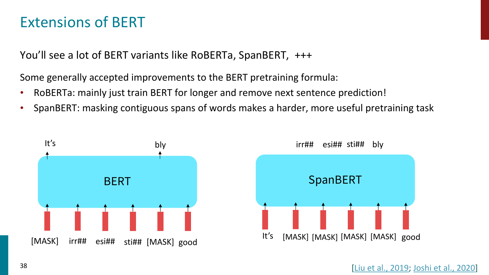

RoBERTa 的结果表明，即使不改变 Transformer 编码器的结构，增加训练数据和计算量，也能改善预训练效果。

### 3.2 编码器—解码器预训练

#### 3.2.1 用文本前缀预测后续内容

编码器—解码器也可以用语言建模方式预训练：将一段文本切成前缀和后续部分，前缀交给编码器，后续部分作为解码器的预测目标。例如，将 `Iroh goes to make tasty tea` 切为：

| 部分 | 文本 | 作用 |
| --- | --- | --- |
| 前缀 | `Iroh goes to` | 编码器的输入，不要求模型预测这部分。 |
| 后续部分 | `make tasty tea` | 解码器依次预测的内容。 |

设前缀为 $w_1,\ldots,w_T$，后续部分为 $w_{T+1},\ldots,w_{T+k}$。编码器先处理整个前缀，得到各位置的隐藏状态：

$$
\mathbf{h}_1,\ldots,\mathbf{h}_T
=\operatorname{Encoder}(w_1,\ldots,w_T).
$$

编码器可以同时利用前缀内部左右两侧的信息。解码器则接收后续部分的词，并通过交叉注意力使用编码器的全部输出，计算隐藏状态：

$$
\mathbf{h}_{T+1},\ldots,\mathbf{h}_{T+k}
=\operatorname{Decoder}\bigl(
 w_{T+1},\ldots,w_{T+k};\,
 \mathbf{h}_1,\ldots,\mathbf{h}_T
\bigr).
$$

解码器通过因果遮蔽，只利用已经给出的词计算各位置的隐藏状态 $\mathbf{h}_i$，再通过输出层得到下一个词的概率：

$$
\hat{\mathbf{y}}_i=\operatorname{softmax}(\mathbf{A}\mathbf{h}_i+\mathbf{b}),
\qquad i>T.
$$

$\mathbf{A},\mathbf{b}$ 是将解码器状态转换为词表分数的权重和偏置。

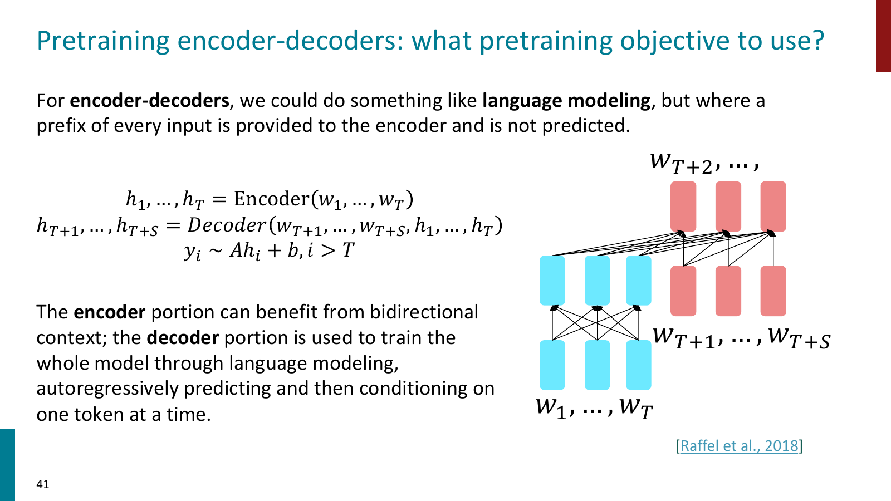

编码器利用前缀的双向上下文，解码器通过语言建模任务训练整个模型：每次预测一个词，再以这个词为条件预测后一个词，这称为**自回归（Autoregressive）预测**。例如，根据 `Iroh goes to` 预测 `make`，再结合 `make` 预测 `tasty`，以此类推。训练时，解码器输入正确的前序词，输入与预测目标错开一位；前缀只提供给编码器，不作为预测目标。

#### 3.2.2 T5 与连续片段恢复

**T5（Text-to-Text Transfer Transformer）**是一种采用 Transformer 编码器—解码器架构的预训练模型。它通过**片段损坏（Span Corruption）**任务进行预训练：从原文中移除若干连续片段，用不同的特殊占位标记替换，再让解码器恢复被移除的内容。

例如，原文是：

`Thank you for inviting me to your party last week.`

移除 `for inviting` 和 `last` 后：

| 用途 | 文本 |
| --- | --- |
| 编码器输入 | `Thank you <X> me to your party <Y> week.` |
| 解码器需要恢复的片段 | `<X>` 对应 `for inviting`，`<Y>` 对应 `last`。 |

`<X>` 和 `<Y>` 分别标记两个被移除片段的位置。编码器看到的是留下的文本和占位标记；解码器依次输出占位标记及其对应的缺失内容，将恢复出的各个片段区分开。

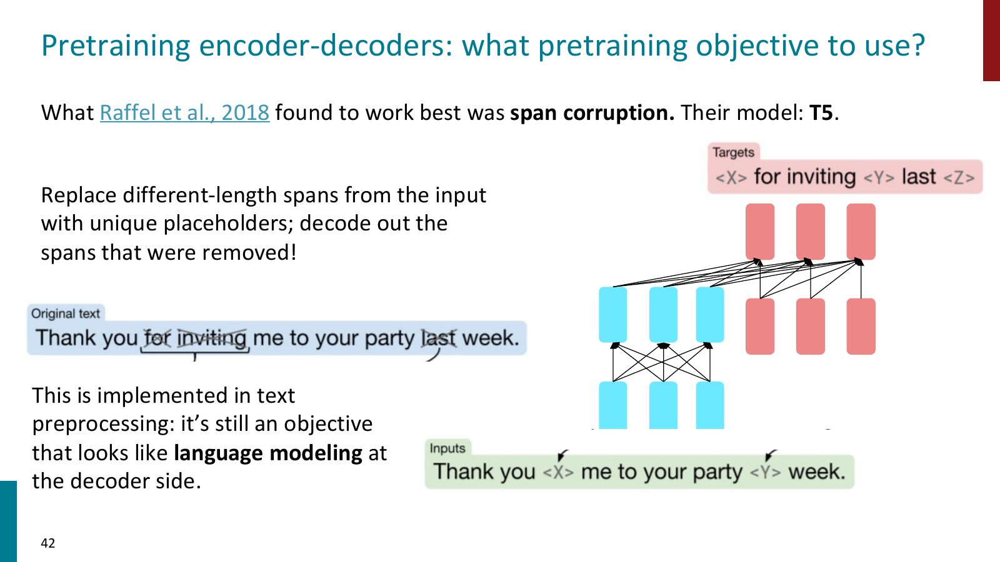

解码器将这些内容作为一个序列预测：先输出 `<X>`，接着输出 `for inviting`，再输出 `<Y>` 和 `last`。留下的 `Thank you`、`me to your party` 等文本只作为编码器输入，不需要在输出中重复。

训练时，将正确输出序列右移一位作为解码器输入：输入起始标记时预测 `<X>`，输入正确的 `<X>` 后预测 `for`，输入正确的 `for` 后预测 `inviting`，以此类推。每一步都用正确的下一个词元计算损失。因此，片段恢复改变了编码器输入和解码器需要预测的文本，解码器仍采用逐词预测的训练方式。

**实验比较。**T5 的实验比较了网络架构和预训练目标。在所测试的任务上，编码器—解码器优于仅使用解码器的模型；恢复被移除片段的预训练目标，也优于预测原文后续部分的语言建模目标。

**问答微调。**预训练完成后，T5 可以用问题和答案组成的数据进行微调，学习根据问题生成答案。使用时只输入问题，无须额外提供参考文档，模型利用预训练时学到的知识回答。

### 3.3 解码器预训练

#### 3.3.1 预测下一个词

解码器用**预测下一个词的语言建模任务**进行预训练。例如，对文本 `Iroh goes to make tasty tea`，根据 `Iroh` 预测 `goes`，根据 `Iroh goes` 预测 `to`，以此类推。

模型输出词表中各候选词的概率。对词序列 $w_1,\ldots,w_T$，给定前文后，词 $w_t$ 的概率写作：

$$
p_{\boldsymbol{\theta}}(w_t\mid w_1,\ldots,w_{t-1}),
$$

其中 $\boldsymbol{\theta}$ 表示模型参数。例如，根据 `Iroh goes to` 预测时，训练文本中的正确词是 `make`，目标就是提高模型给 `make` 分配的概率。因果遮蔽保证预测时不能看到后续文本。

在大量文本上训练时，用真实的下一个词作为标签，减小其负对数概率对应的损失，词嵌入和解码器其余参数一起更新。训练完成后保存这些参数，用于生成文本或任务微调。

#### 3.3.2 预训练解码器的微调

通过语言建模预训练的解码器，可以用具体任务的数据继续微调。任务既可以要求模型判断类别，例如评论的正面或负面情感，也可以要求模型生成文本，例如回复对话或概括文档。两类任务需要不同的输出层处理方式。

**分类任务**可以在输入末尾的隐藏状态上添加新的线性分类器：

$$
\mathbf{h}_1,\ldots,\mathbf{h}_T
=\operatorname{Decoder}(w_1,\ldots,w_T),\qquad
\hat{\mathbf{y}}=\operatorname{softmax}(\mathbf{A}\mathbf{h}_T+\mathbf{b}).
$$

末尾位置能够读取前面全部输入，适合用来判断整个输入的类别。分类层的参数 $\mathbf{A},\mathbf{b}$ 随机初始化，微调时与解码器参数一起训练。

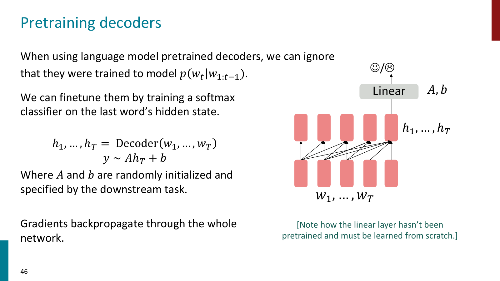

**生成任务**可以继续沿用语言模型的训练方式，通过微调，让解码器根据任务提供的上下文生成文本。这适用于输出仍是词序列、所用词表与预训练时相近的任务。例如：

- **对话生成**：以对话历史为上下文，生成回复。
- **摘要生成**：以文档为上下文，生成摘要。

模型仍根据已有的词预测下一个词。用前一个位置的隐藏状态 $\mathbf{h}_{t-1}$ 计算 $w_t$ 的概率：

$$
p(w_t\mid w_1,\ldots,w_{t-1})
=\left[\operatorname{softmax}(\mathbf{A}\mathbf{h}_{t-1}+\mathbf{b})\right]_{w_t}.
$$

方括号的下标 $w_t$ 表示取出词 $w_t$ 对应的概率。输出层的参数 $\mathbf{A},\mathbf{b}$ 已经过语言模型预训练，微调时保留这层，与解码器一起继续训练。

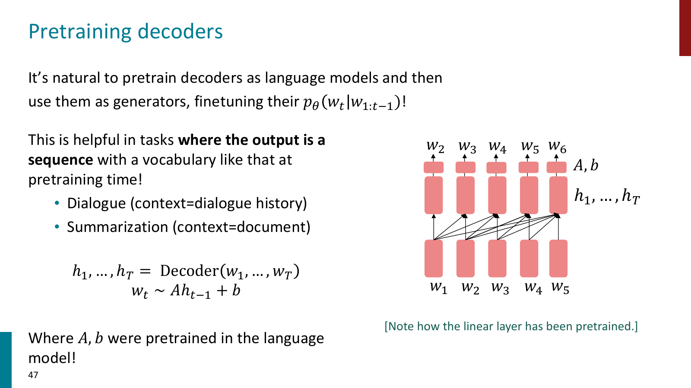

两种微调方式的区别在于输出层：分类任务需要输出具体任务的类别概率，因此新建分类层；生成任务仍然输出词表中各词元的概率，因此保留预训练时的词表输出层。两种情况下，输出层都与解码器一起训练。

#### 3.3.3 GPT

2018 年的原始 **GPT（Generative Pretrained Transformer）**采用 12 层 Transformer 解码器，隐藏状态为 768 维，前馈网络中间层为 3072 维，参数量约 1.17 亿。它使用执行 4 万次合并的 BPE 构建子词词表，在 BooksCorpus 的 7000 多本书上进行语言模型预训练。书籍包含较长的连续文本，有利于模型学习相隔较远的词之间的依赖关系。

预训练完成后，可以将两句话组织成一个输入序列，微调 GPT 来判断它们的关系。例如，**自然语言推断（Natural Language Inference，NLI）**根据前提判断假设属于哪一类：

- **蕴含**：前提支持假设。
- **矛盾**：假设与前提冲突。
- **中立**：仅凭前提无法确定假设是否成立。

对于前提 `The man is in the doorway` 和假设 `The person is near the door`，关系是蕴含。将它们用特殊标记连接：

`[START] The man is in the doorway [DELIM] The person is near the door [EXTRACT]`

`[START]` 标记序列开始，`[DELIM]` 分隔前提与假设，末尾的 `[EXTRACT]` 用于提取分类所需的表示。它位于两句话之后，能够结合前面的全部输入；在它的隐藏状态上接线性分类器，预测蕴含、矛盾或中立，并通过任务标注数据微调模型。GPT 在多个自然语言推断数据集上进行了评估。

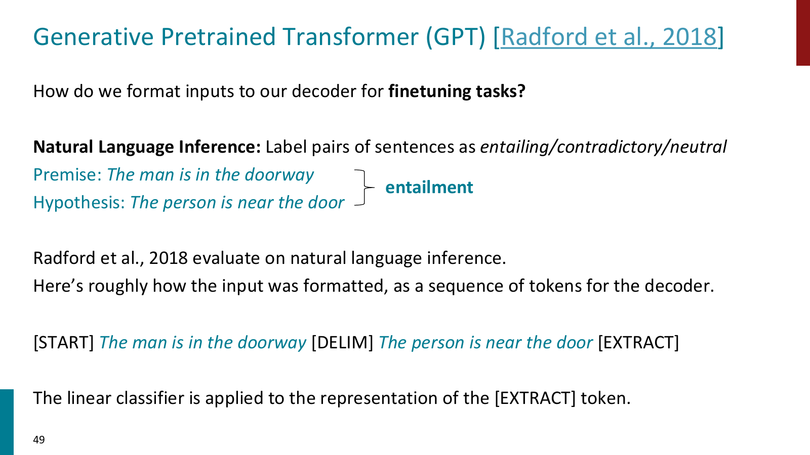

后续的 GPT-2 将参数量扩大到 15 亿，并使用更多训练数据。给定一段开头，它继续以语言模型的方式逐词生成后续文本。例如，输入“载有受管制核材料的火车车厢被盗、下落不明”的新闻开头，模型能够续写多段新闻式文本，包括事件经过、部门声明和引语。这展示了更大模型在长文本续写上的能力。

#### 3.3.4 大型解码器与上下文学习

已经完成预训练的模型，可以直接用于生成文本，也可以先针对具体任务微调，再用于预测：

- **直接生成**：给模型一段开头，让它接着写，不更新模型参数。
- **微调后使用**：用任务数据继续训练、更新模型参数，再让它完成任务。

GPT-3 的参数量达到 1750 亿。以 GPT-3 为代表的大型语言模型还可以采用另一种方式完成任务：不更新参数，只在输入中给出几个示例，模型就能完成同类任务。这称为**上下文学习（In-context Learning，ICL）**。

例如，要让模型将英语词语翻译成法语，可以将几个翻译示例和待翻译的词一起输入：

```text
thanks -> merci
hello -> bonjour
mint -> menthe
otter ->
```

前三行是已经完成的翻译示例，最后一行给出待翻译的 `otter`。这些内容作为同一段文本送入解码器，模型在最后一个箭头后继续生成，输出法语词 `loutre`。

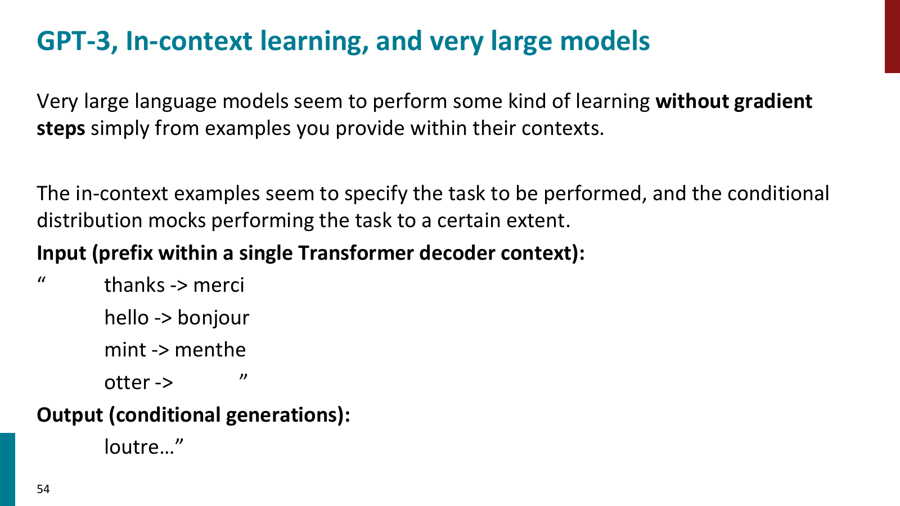

**这四行只是一次输入。**模型没有拿前三行做反向传播，也没有修改参数，而是读取整段文字后生成答案。大型语言模型仅凭输入中的示例，就表现出某种学习能力，而不需要梯度更新，这正是上下文学习的特点。

#### 3.3.5 缩放规律与计算效率

经验上，扩大模型规模能够稳定降低语言模型的困惑度，改善对后续词的预测。模型效果随规模变化呈现一定的规律，这称为**缩放规律（Scaling Laws）**。

这种变化具有一定的可预测性，可以帮助选择模型大小、训练数据量和网络架构。例如，在分配计算预算时，可以选择训练较大的模型，而不必将它训练到充分收敛，即继续训练也几乎不再改善损失。

训练大型 Transformer 的计算成本，大致随参数量与训练词元数量的乘积增长。因此，提高计算效率需要合理搭配模型规模和数据量。GPT-3 使用 1750 亿参数、3000 亿训练词元；图中的 Chinchilla 只有约 700 亿参数，但使用更多训练词元，在相近计算预算下取得了更好的效果。参数更多，并不意味着计算预算用得更有效。

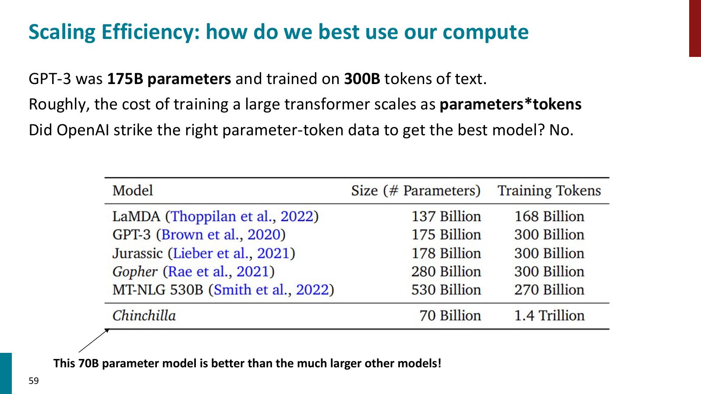

## 4. 预训练学到的能力与风险

越来越多的证据表明，预训练模型能学到语言的多种统计性质。恢复缺失词或预测后续文本时，模型需要利用事实知识、句法、指代关系等信息：

| 文本例子 | 所需信息 |
| --- | --- |
| `Stanford University is located in ___, California.` | 地点等事实知识。 |
| `I put ___ fork down on the table.` | 冠词等句法信息。 |
| `The woman walked across the street, checking for traffic over ___ shoulder.` | 指代关系：判断这里说的是谁的肩膀。 |
| `I went to the ocean to see the fish, turtles, seals, and ___.` | 词义及话题：根据海洋动物的语境预测后续词。 |
| 看电影两小时的价值只剩爆米花和饮料，`The movie was ___` | 情感：根据评价推断作者对电影的态度。 |
| Iroh 去厨房泡茶，Zuko 站在他旁边；随后 `Zuko left the ___` | 一定的推理：结合两人的位置推断离开的地点，这比前面的预测更难。 |
| `1, 1, 2, 3, 5, 8, 13, 21, ___` | 一定的算术能力：预测数列的下一项。 |

这些训练任务能够促使模型学习语言规律、知识和一定的推理能力，但预测某个例子正确，不等于已经掌握对应的通用规则。例如，即使能接出数列中的 `34`，也不能据此认定模型学会了计算任意斐波那契数的规则。

模型有时也会记住训练文本本身，在生成时复现其中的内容，包括受版权保护的材料。因此，生成出的文字可能来自对训练原文的记忆。

训练数据还可能包含来自网络的半私密信息，例如地址和邮箱。通过探查模型，有时可以恢复部分训练内容，使这些信息暴露出来。

模型也会学到训练文本中的人类偏见，包括种族和性别偏见，并可能在输出中进一步放大这些偏见。
