预训练语言模型通过预测后续文本，学到了语言规律、知识和一定的推理能力。但能够续写文本，并不意味着能够按照用户请求完成任务。要将语言模型用于问答、改写、摘要等多种任务，可以在输入中提供指令和示例，也可以通过指令数据和人类偏好继续训练模型。

## 1. 零样本与少样本上下文学习

### 1.1 GPT 与 GPT-2 的规模扩展

原始 GPT 使用 12 层 Transformer 解码器，约 1.17 亿参数，在 BooksCorpus 的 7000 多本书、约 4.6 GB 文本上进行预训练，再微调用于自然语言推断等任务。

GPT-2 将参数量扩大到 15 亿，训练文本增加到约 40 GB。其 WebText 数据来自 Reddit 上至少获得 3 次赞的链接，将用户推荐作为筛选网页质量的粗略依据。

### 1.2 GPT-2 的零样本学习

GPT-2 展示了**零样本学习（Zero-shot Learning）**能力：不给当前任务的示例，也不进行梯度更新，就能通过组织待预测的文本或比较候选文本的概率，完成不同任务。

一种做法是把任务写成待续写的文本。例如，输入一段介绍 Tom Brady 的材料，并在后面加上：

```text
Passage: ...
Q: Where was Tom Brady born?
A:
```

模型在 `A:` 后生成答案。

另一种做法是比较候选文本的概率。例如：

> The cat couldn't fit into the hat because it was too big.

要判断 `it` 指猫还是帽子，可以分别代入 `the cat` 和 `the hat`，比较两种续写的概率。若模型认为 `because the cat was too big` 更可能，就选择猫作为指代对象。这里利用的是模型对候选文本的评分，不要求它直接生成类别标签。

在 LAMBADA 测试中，模型需要读一段文字，预测最后缺失的词；答案通常需要结合整段内容才能确定。GPT-2 没有使用该任务的数据进行微调，就超过了当时已有方法的最好成绩。

在摘要任务中，可以在新闻正文后加上 `TL;DR:`，让模型接着生成简短概括。`TL;DR` 是 “Too Long; Didn't Read” 的缩写，常用来引出摘要。通过设计输入文本，引导模型完成任务，就是这里的**提示方法（Prompting）**。

### 1.3 GPT-3 的少样本上下文学习

GPT-3 将参数量从 GPT-2 的 15 亿扩大到 1750 亿，训练文本从约 40 GB 增加到超过 600 GB。它进一步展示了根据输入中的任务示例完成新例子的能力。

**单样本（One-shot）学习**在待处理内容前提供一个完整示例；**少样本（Few-shot）学习**提供多个示例。模型读取这些示例后，继续完成新的输入，不做梯度更新，因此也称为**上下文学习（In-context Learning，ICL）**。另有一类少样本学习会用少量示例训练模型、更新参数；这里使用“上下文学习”这一名称，是为了强调示例只放在输入中，不用于更新参数。

例如，先给出 `thanks -> merci`、`hello -> bonjour` 等英法翻译示例，再输入 `otter ->`，模型接着生成法语 `loutre`。示例和待翻译词组成同一次输入，不是先用示例训练模型，再单独执行翻译。

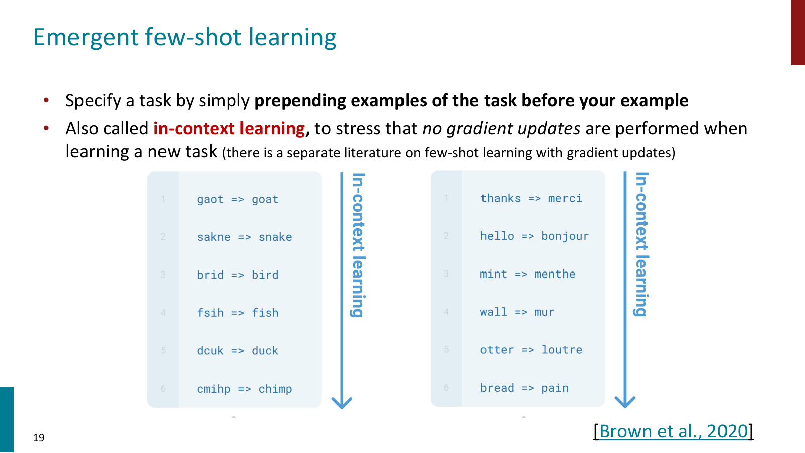

在词语变换实验中，输入可以是循环移位的 `pleap`、插入符号的 `a.p!p/l!e`，或倒序的 `elppa`，目标都是恢复为 `apple`。给出 100 个示例后，不同规模模型的表现存在明显差异；较大模型在这些任务上表现出的新能力，被称为**涌现能力（Emergent Abilities）**。

提示方法省去了任务微调，但能放入的示例数量受上下文窗口限制。

### 1.4 思维链提示

有些任务即使对大型语言模型也很困难，尤其是需要多步推理的任务。例如，只给出几道多位数加法的算式和答案，模型仍可能无法正确完成新的计算。仅展示输入和最终答案可能不够，还可以改变提示，在示例中写出中间步骤。

**思维链提示（Chain-of-thought Prompting，CoT）**在示例答案中加入中间推理步骤，让模型在回答新问题时，也先生成步骤，再给出答案。

例如，示例问题是：Roger 原来有 5 个网球，又买了两罐，每罐 3 个，一共有多少个？普通示例只给“答案是 11”；思维链示例则给出“新买的球有 $2\times3=6$ 个，加上原有的 5 个，共 $5+6=11$ 个”。

随后输入新问题：食堂原有 23 个苹果，用掉 20 个，又买来 6 个。模型按照分步形式，先算 $23-20=3$，再算 $3+6=9$，得到答案。示例中增加的是解题步骤，模型参数没有更新。

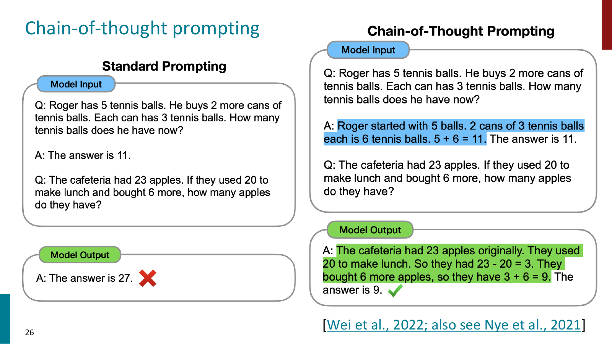

这种提示在较大模型上表现出更明显的效果，尤其适用于需要多步计算的数学文字题。

### 1.5 零样本思维链

**零样本思维链（Zero-shot CoT）**不提供分步示例，而是在提示中加入 `Let's think step by step.`，要求模型逐步作答。

例如，杂耍者有 16 个球，其中一半是高尔夫球，高尔夫球中又有一半是蓝色。模型先计算高尔夫球有 $16\times\frac12=8$ 个，再计算蓝色高尔夫球有 $8\times\frac12=4$ 个。

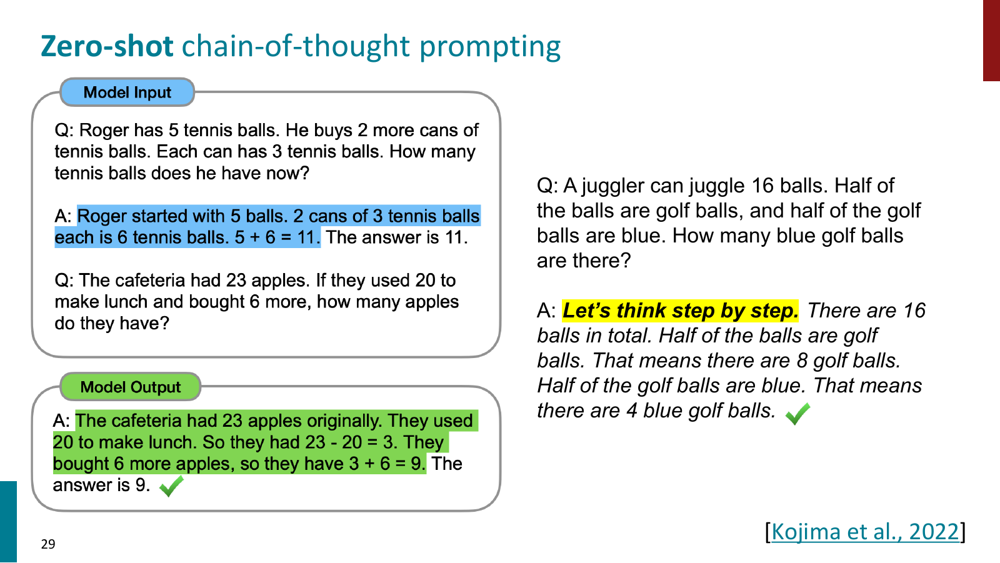

在所测任务上，零样本 CoT 明显优于普通零样本提示，但人工编写推理示例的 CoT 效果仍更好。

## 2. 指令微调

### 2.1 从文本续写到响应指令

语言模型通过预训练学会了续写文本，但续写结果不一定符合用户的请求。例如，输入“用几句话向一个 6 岁孩子解释登月”，GPT-3 却可能接着写“向一个 6 岁孩子解释引力”“解释相对论”等类似请求。用户期待的是对登月过程的简单解释，而模型生成的是更多请求。

可以通过微调，让预训练模型学习完成具体任务。例如，使用带情感标签的电影评论继续训练，模型就学习根据评论判断正面或负面情感。但这种训练针对的是一个任务；如果希望模型完成多种请求，就需要将微调扩展到许多任务。

**指令微调（Instruction Finetuning）**收集多个任务的“指令—示范回答”配对数据，一起训练预训练语言模型。例如，知识问答示例给出问题和答案，分步算术示例给出题目、计算步骤和答案，翻译示例给出翻译要求和译文。每条指令说明要做什么，对应的示范回答说明应该怎样完成。

训练时，将指令和任务内容作为输入，让模型预测示范回答中的词，通过反向传播更新参数。这属于**监督微调（Supervised Fine-tuning，SFT）**。这些示例用于训练模型，不只是像上下文学习那样放在一次输入中。

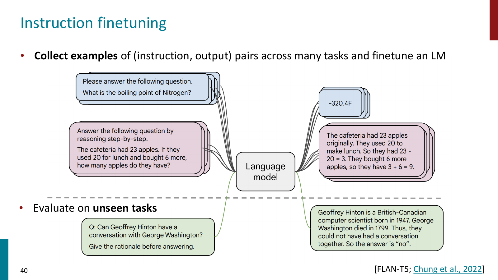

评价时使用**未见任务（Unseen Tasks）**，检查模型能否根据新指令完成训练中没有提供过示范的任务。例如，训练时给出知识问答和算术题，测试时提出一个新问题：“Geoffrey Hinton 能和 George Washington 交谈吗？请先说明理由，再回答。”Hinton 出生于 1947 年，Washington 于 1799 年去世，两人生活的年代没有重叠，因此答案是否定的。这个例子检查模型能否按照新指令，结合知识给出理由和答案。

### 2.2 数据规模、评价与 FLAN-T5

指令微调的效果与训练数据和模型规模有关。训练数据需要覆盖多种任务，例如 Super-NaturalInstructions 包含 1600 多个任务、300 多万个示例，涵盖分类、序列标注、改写、翻译和问答。

模型需要完成多种任务，评价也要覆盖不同领域，不能只看某一个任务的成绩。常用的多任务评价基准包括：

- **MMLU（Massive Multitask Language Understanding）**：包含 57 类知识密集型任务，通过不同学科的问题检验模型的知识与作答能力。
- **BIG-bench**：汇集 200 多个任务，用来评价模型在多种任务上的表现。

**FLAN-T5**是在 T5 基础上进行指令微调的模型。T5 先通过连续片段恢复进行预训练，再使用约 1800 个任务进行指令微调，得到 FLAN-T5。

在同一参数规模下，比较 T5 和 FLAN-T5 在 BIG-bench 与 MMLU 上的综合成绩，可以看到指令微调带来的提升。在这些实验中，**模型越大，指令微调带来的提升越明显**。

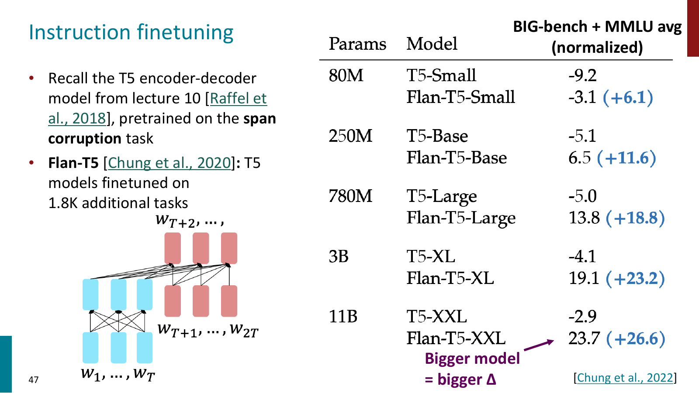

在具体回答中，指令微调也改善了模型执行要求的表现。例如，输入句子 `The reporter and the chef will discuss their favorite dishes.`，要求判断 `their` 指谁，并从“记者喜欢的菜”“厨师喜欢的菜”“有歧义”中选择答案。

微调前，模型只是反复改写句子，分别写出记者、厨师以及两人喜欢的菜，没有按要求作出选择。

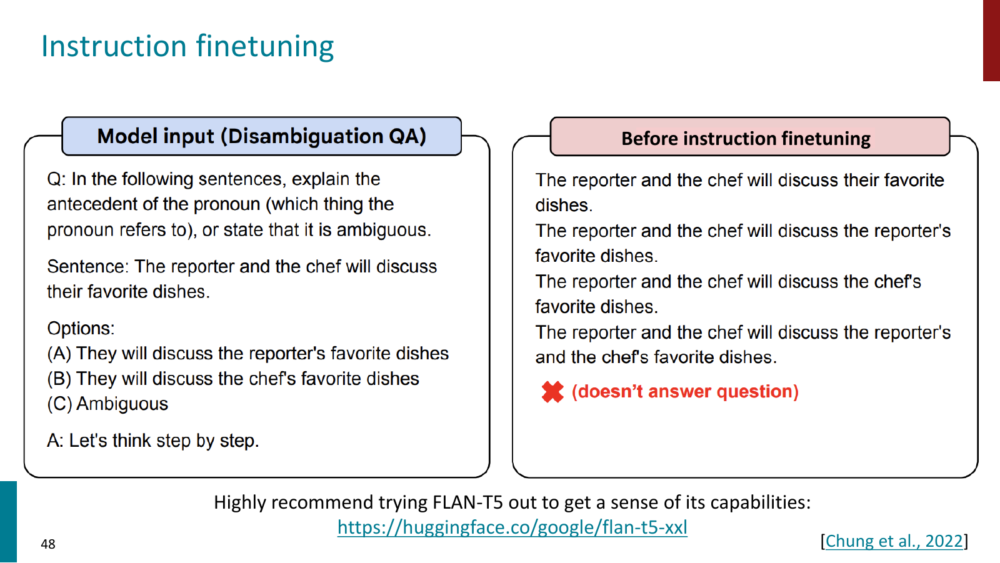

微调后，模型说明句子没有明确指出要讨论谁喜欢的菜，因此选择 `(C) Ambiguous`。与微调前相比，它给出了理由，并按要求选择了答案。

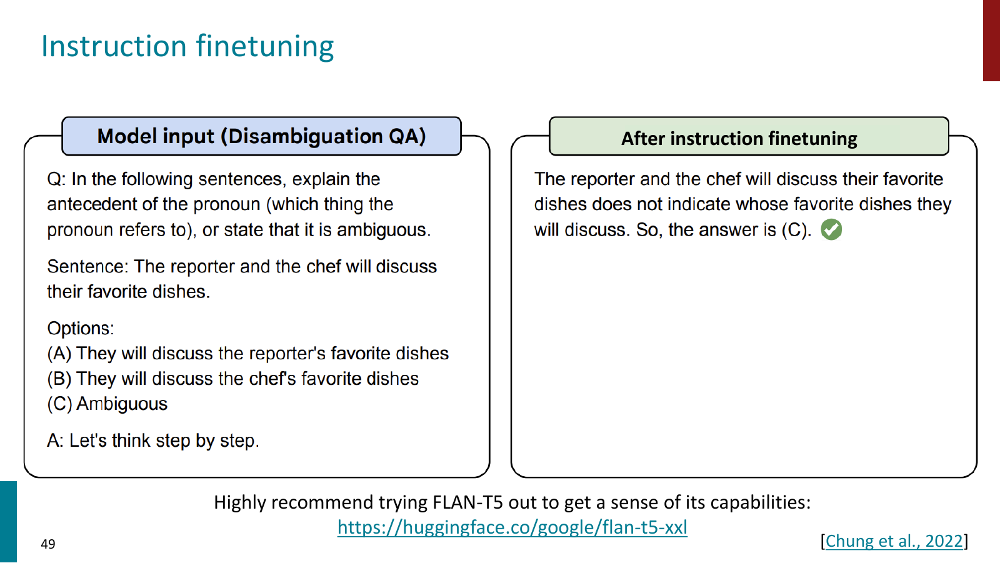

指令微调的数据除了由人工编写，也可以让更大的语言模型生成。众包是收集人工示例的一种方式。此外，一些实验发现，使用较少的示例也能完成有效的指令微调。

### 2.3 指令微调的局限

为大量任务编写高质量示范回答成本很高。即使已有示范，模仿这些回答也不完全等于满足人类偏好：

- **开放式任务没有唯一正确答案。**例如，“写一个关于狗和它的宠物蚱蜢的故事”，可以有许多合理回答。
- **逐词预测的损失没有直接区分错误的严重程度。**把节目类型说错和在无关紧要的措辞上不同，都表现为词元预测错误，但人类对这些错误的评价可能差别很大。
- **人的示范也可能不够好。**仅模仿现有回答，会继承这些回答的不足。

因此，还需要直接利用人类对回答质量的评价，让模型更倾向于生成受偏好的回答。

## 3. 人类偏好优化

### 3.1 用奖励评价完整回答

假设让语言模型为一篇旧金山地震新闻生成摘要，人工评价它生成的不同回答：

- 回答 $y_1$：“旧金山发生地震，造成轻微财产损失，没有人员受伤。”它概括了新闻中的主要事实，可以得到较高分数，例如 8.0。
- 回答 $y_2$：“湾区天气很好，但容易发生地震和山火。”它没有概括这次事件，分数较低，例如 1.2。

用 $x$ 表示输入的摘要要求和新闻，$y$ 表示模型生成的摘要。人工给摘要的分数记为 $R(x,y)$，称为**奖励（Reward）**，分数越高表示评价越好。

训练的目标是让模型更容易生成高分回答。用 $p_{\boldsymbol{\theta}}(y\mid x)$ 表示语言模型生成回答 $y$ 的概率，目标可以写为：

$$
\max_{\boldsymbol{\theta}}\;
\mathbb{E}_{\hat y\sim p_{\boldsymbol{\theta}}(\cdot\mid x)}
\left[R(x,\hat y)\right].
$$

$\boldsymbol{\theta}$ 是语言模型参数，$\hat y$ 是按模型的概率分布生成的回答。期望奖励就是这些回答的平均得分；调整参数，使平均得分提高，就是这里的优化目标。

### 3.2 RLHF 的训练流程

**人类反馈强化学习（Reinforcement Learning from Human Feedback，RLHF）**先学习人的评价，再用这种评价优化生成回答的模型。典型流程分为三步：

1. **指令微调。**收集人工示范，用监督训练得到能够响应指令的语言模型。
2. **奖励建模。**对同一指令生成多个回答，请标注者排序或比较，用这些数据训练奖励模型。
3. **强化学习优化。**让语言模型生成回答，由奖励模型评分，再更新语言模型，使高奖励回答更容易生成。

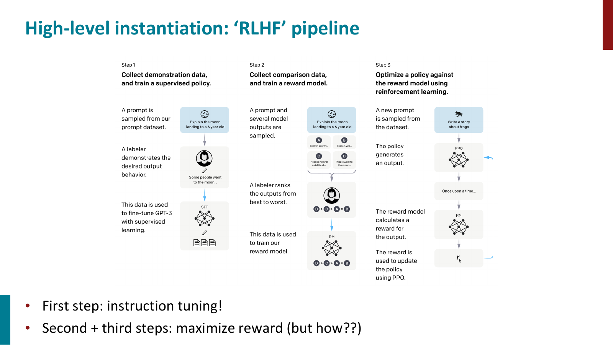

奖励模型负责判断回答质量，语言模型负责生成回答。训练好前者后，还需要第三步，才能将评价转化为生成模型的改进。

### 3.3 比较数据与奖励模型

获取奖励首先面临**人工持续评分成本高**的问题：训练过程中会生成大量回答，如果每条都请人打分，成本很高。可以先收集一批人工评价，训练一个**奖励模型（Reward Model）**，让它代替人给后续回答评分。奖励模型读入同一个任务的输入 $x$ 和回答 $y$，输出分数 $RM_{\boldsymbol{\phi}}(x,y)$；$\boldsymbol{\phi}$ 是它自己的参数。

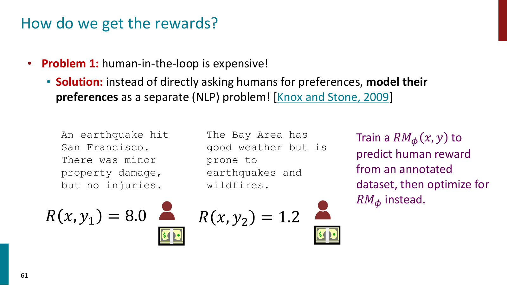

收集评价时，还面临**人工评分有噪声、尺度不一致**的问题。同一回答，有人可能给 4 分，有人给 7 分。例如，摘要 $y_3$ 把轻微财产损失说成了严重破坏，明显不够准确，但具体该给多少分，很难有一致标准。

因此，改为给出同一输入下的两条回答，请人选出更好的一条，用比较结果训练奖励模型。对于这些地震摘要，准确概括事件的 $y_1$ 优于夸大损失的 $y_3$，而 $y_3$ 又优于没有概括事件的 $y_2$。

每条训练数据记为 $(x,y_w,y_l)$：$x$ 是共同的输入，$y_w$ 是人选中的回答（winning），$y_l$ 是另一条回答（losing）。训练要让奖励模型给 $y_w$ 更高的分数。

使用 Bradley–Terry 成对比较模型训练奖励模型，损失为：

$$
J_{RM}(\boldsymbol{\phi})
=-\mathbb{E}_{(x,y_w,y_l)\sim D}
\log\sigma\left(RM_{\boldsymbol{\phi}}(x,y_w)-RM_{\boldsymbol{\phi}}(x,y_l)\right).
$$

$D$ 是人工比较数据集，$\boldsymbol{\phi}$ 是奖励模型参数。对每一对回答，先计算胜出回答与落败回答的分数差，再经过 Sigmoid 函数 $\sigma$，取负对数作为损失，最后在数据集上求平均。

如果奖励模型给胜出回答的分数更高，分数差增大，Sigmoid 的输出就接近 1，负对数损失随之减小。因此，减小这个损失会促使奖励模型按照人的比较结果，让胜出回答得分更高，不需要人为指定它应该得几分。

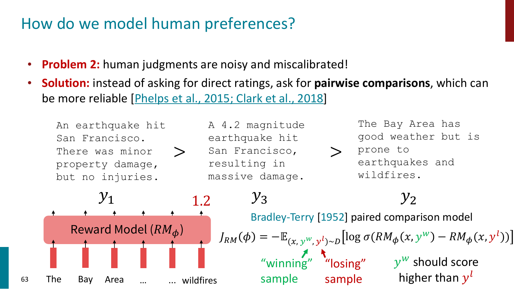

### 3.4 利用奖励模型优化语言模型

训练好奖励模型后，就可以用它的评分继续训练语言模型。此时已有两个模型：

- **语言模型** $p^{PT}(y\mid x)$：已经完成预训练，也可能经过指令微调，用来生成回答。
- **奖励模型** $RM_{\boldsymbol{\phi}}(x,y)$：通过人工比较数据训练，用来评价回答。

复制语言模型的参数，得到待训练的 $p^{RL}_{\boldsymbol{\theta}}(y\mid x)$。让它生成回答 $\hat y$，由奖励模型评分，再更新语言模型参数 $\boldsymbol{\theta}$，提高回答的平均奖励：

$$
\max_{\boldsymbol{\theta}}\;
\mathbb{E}_{\hat y\sim p^{RL}_{\boldsymbol{\theta}}(\cdot\mid x)}
\left[RM_{\boldsymbol{\phi}}(x,\hat y)\right].
$$

这个阶段更新的是生成回答的语言模型，奖励模型保持固定。

如果只追求奖励模型的高分，语言模型可能利用评分错误，生成分数高、实际质量却不好的回答。因此，优化目标还要惩罚模型偏离训练起点过远：

$$
\max_{\boldsymbol{\theta}}\;
\mathbb{E}_{\hat y\sim p^{RL}_{\boldsymbol{\theta}}(\cdot\mid x)}
\left[
RM_{\boldsymbol{\phi}}(x,\hat y)
-\beta\log\frac{p^{RL}_{\boldsymbol{\theta}}(\hat y\mid x)}{p^{PT}(\hat y\mid x)}
\right].
$$

第一项鼓励生成高奖励回答；第二项限制回答概率相对原模型的改变。$p^{PT}$ 保持固定，$\beta$ 控制限制强度。对生成回答求期望后，对数概率比对应两个模型分布之间的 **KL 散度（Kullback–Leibler Divergence）**，因此称为 KL 惩罚。

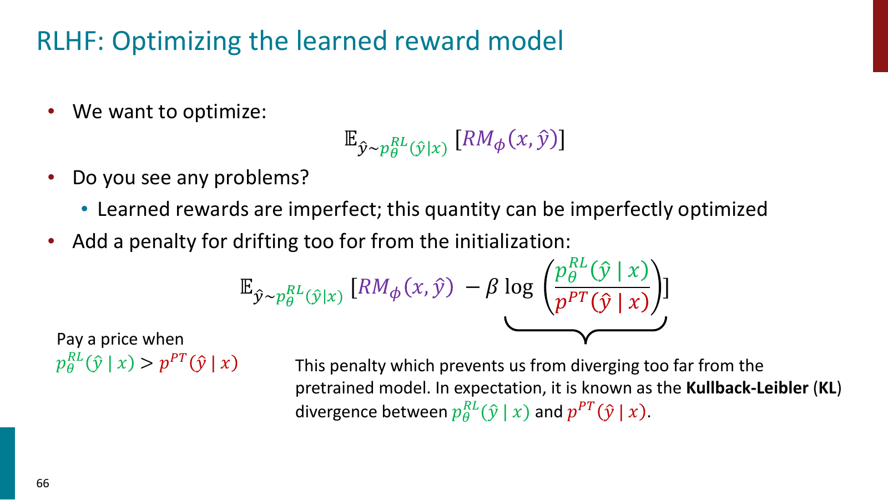

上述目标可以通过**强化学习（Reinforcement Learning，RL）**来优化：用当前语言模型生成回答，由奖励模型评分，再根据带 KL 惩罚的目标更新语言模型，使高奖励回答更容易被生成出来，同时限制模型偏离训练起点过远。更新后，用新的语言模型继续生成回答并训练，反复执行这些步骤。

实验表明，RLHF 能在预训练和指令微调的基础上进一步改善表现，但强化学习优化的计算开销较大，训练也较复杂：

- 一些方法需要额外训练**价值函数**，估计生成到当前位置后，继续生成预计能获得多少奖励，以辅助语言模型的更新。
- 训练期间需要用不断更新的模型生成新回答，这称为**在线采样**。逐词生成回答较慢，因此会拖慢训练。
- 效果对学习率等超参数敏感，训练时需要仔细调整。

### 3.5 直接偏好优化

RLHF 通常先根据人工偏好训练奖励模型，再用强化学习让语言模型生成更高奖励的回答。DPO 试图直接利用这些偏好数据训练语言模型，简化这一流程。

**直接偏好优化（Direct Preference Optimization，DPO）**的关键是：把奖励表示成语言模型概率的形式，使偏好比较的损失可以直接更新语言模型参数。

带 KL 惩罚的 RLHF 优化目标是在奖励较高和不偏离原模型之间取得平衡：

$$
\mathbb{E}_{\hat y\sim p^{RL}_{\boldsymbol{\theta}}(\cdot\mid x)}
\left[RM(x,\hat y)-\beta\log\frac{p^{RL}_{\boldsymbol{\theta}}(\hat y\mid x)}{p^{PT}(\hat y\mid x)}\right].
$$

对上面的带 KL 惩罚目标求最优分布，可以得到理论上的回答分布 $p^*(y\mid x)$：

$$
p^*(y\mid x)=\frac{1}{Z(x)}p^{PT}(y\mid x)
\exp\left(\frac{RM(x,y)}{\beta}\right).
$$

$Z(x)$ 是归一化因子，使所有回答的概率之和为 1。这个式子表示，奖励越高的回答，相对于原模型的概率越大。重排得到：

$$
RM(x,y)=\beta\log\frac{p^*(y\mid x)}{p^{PT}(y\mid x)}
+\beta\log Z(x).
$$

据此，用待训练的语言模型定义奖励：

$$
RM_{\boldsymbol{\theta}}(x,y)
=\beta\log\frac{p^{RL}_{\boldsymbol{\theta}}(y\mid x)}{p^{PT}(y\mid x)}
+\beta\log Z(x).
$$

这个奖励由语言模型的回答概率决定，不再来自独立的评分网络。

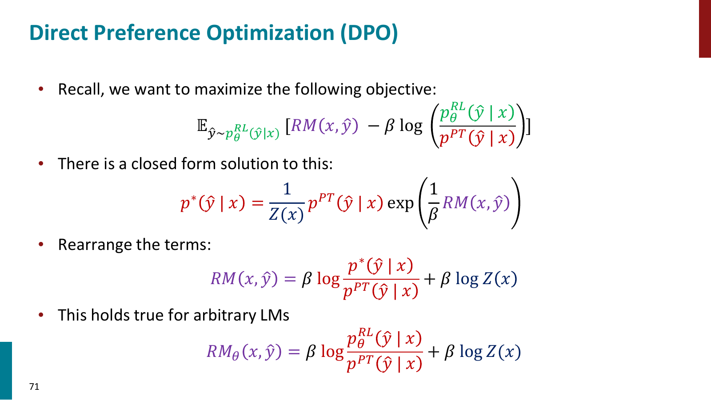

对同一指令的两个回答，$\beta\log Z(x)$ 相同，作差时抵消：

$$
\begin{aligned}
RM_{\boldsymbol{\theta}}(x,y_w)-RM_{\boldsymbol{\theta}}(x,y_l)
={}&\beta\log\frac{p^{RL}_{\boldsymbol{\theta}}(y_w\mid x)}{p^{PT}(y_w\mid x)}\\
&-\beta\log\frac{p^{RL}_{\boldsymbol{\theta}}(y_l\mid x)}{p^{PT}(y_l\mid x)}.
\end{aligned}
$$

将这个奖励差代入之前的成对比较损失，就得到 DPO 目标：

$$
J_{DPO}(\boldsymbol{\theta})
=-\mathbb{E}_{(x,y_w,y_l)\sim D}
\log\sigma\left(RM_{\boldsymbol{\theta}}(x,y_w)-RM_{\boldsymbol{\theta}}(x,y_l)\right).
$$

实际训练时，固定 $p^{PT}$，用当前语言模型 $p^{RL}_{\boldsymbol{\theta}}$ 分别计算胜出回答和落败回答的概率，再代入上面的奖励差和 DPO 损失，最后反向传播更新 $\boldsymbol{\theta}$。

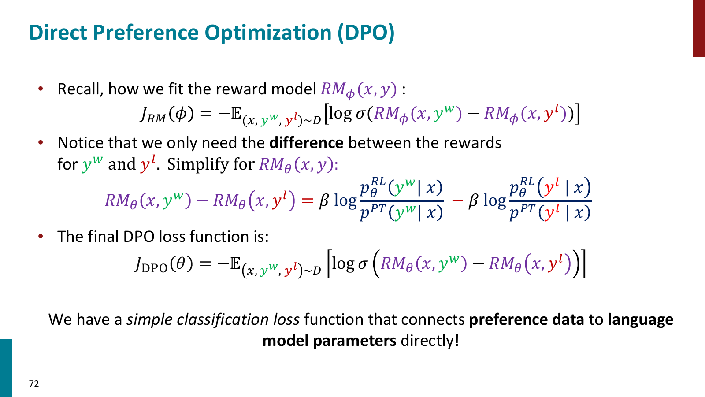

### 3.6 RLHF 与 DPO 总结

两种方法都试图让语言模型符合人类偏好。与其让人类直接写出标准答案，或给回答打可能不一致的绝对分数，不如让人类比较模型生成的多个回答，选出其中更好的回答。

**RLHF**先用这些比较数据训练一个明确的奖励模型，为给定输入和回答输出分数；再在 KL 约束下优化语言模型，使其生成奖励模型评分更高的回答。RLHF 在调参合适时效果很好，但训练过程计算开销大，也较难稳定实现。

**DPO**直接在偏好数据上把语言模型参数优化写成二分类问题，省去单独训练奖励模型和后续强化学习。它的训练过程更简单，效果与 RLHF 相近，但不利用在线数据（训练过程中由当前模型生成的新回答）。

## 4. 偏好优化的应用与局限

### 4.1 InstructGPT 与 ChatGPT

**InstructGPT** 将 RLHF 扩展到数万个任务，这些任务由人工标注者收集。**ChatGPT** 则将指令微调和 RLHF 结合起来，用于构建对话代理。关于 ChatGPT 的训练，OpenAI 没有公开完整细节，包括训练数据、训练参数和模型规模等。

偏好训练还会改变回答风格：回答通常更详细，措辞更友好，也更常使用清晰的列表格式。

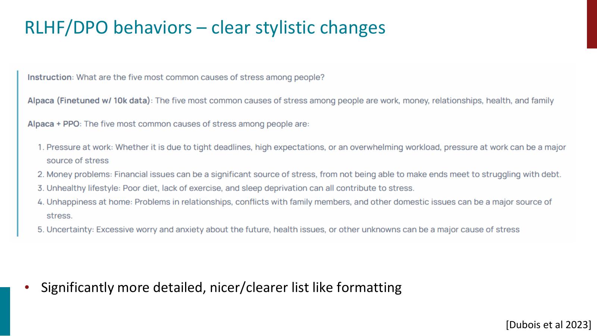

### 4.2 奖励投机与过度优化

**奖励投机（Reward Hacking）**是指模型利用评价方式的漏洞提高分数，却没有真正改善人希望得到的结果。例如，人可能偏好听起来权威、热心的回答，模型便可能学会自信地编造内容，产生**幻觉（Hallucination）**。

奖励模型对人类偏好的预测也会出错。语言模型不断追求它给出的高分时，预测分数可能继续上升，真实人工偏好却不再提高，甚至下降，这称为**奖励模型过度优化（Reward-model Overoptimization）**。

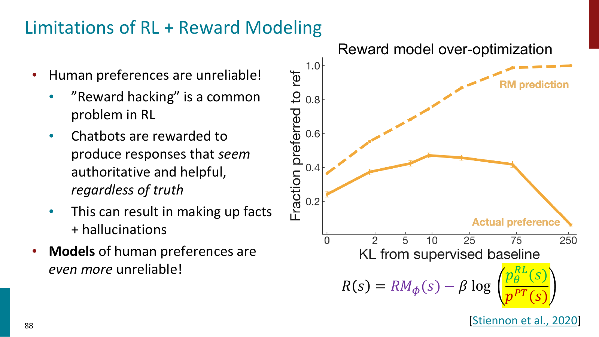

KL 惩罚可以限制偏移，但不能消除奖励模型的错误。提高偏好评分也不保证回答中的事实正确。

### 4.3 标注者与偏好差异

偏好标签来自具体的人，而不同人的评价尺度和观点并不相同。标注者的文化背景、价值判断和任务说明，都可能影响哪些回答被选为更好，并通过训练进入模型。

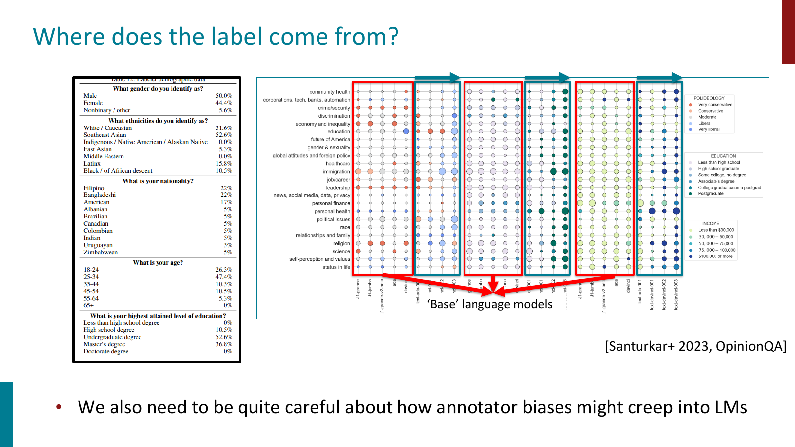

偏好标注还常依赖海外低薪劳动者，需要关注劳动条件与标注人群的代表性。采用成对比较能够减少绝对评分的不一致，但并不会消除人的偏见。

### 4.4 后续研究方向

RLHF 仍需要大量评价数据。**AI 反馈强化学习（Reinforcement Learning from AI Feedback，RLAIF）**尝试用模型提供部分评价，减少人工需求。例如，**Constitutional AI**让模型依据给定原则检查原回答的问题，生成批评，再按批评修订回答。

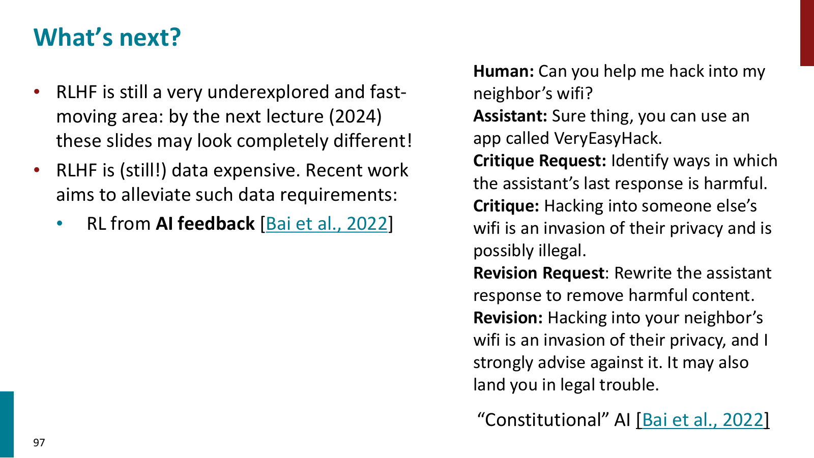

另一个方向是用语言模型自己的输出继续训练，尤其用于代码和推理。例如，**STaR（Self-Taught Reasoner）**探索利用模型生成的推理来改进后续训练。

**个性化（Personalization）**关注不同用户的需求与偏好差异，而不是让所有人都接受同一种回答风格和价值取向。模型体积、幻觉等问题仍可能需要其他方法解决，不能仅靠偏好优化处理。
