训练神经网络时，显存不仅用于存放模型参数，还要保存梯度、优化器状态和反向传播所需的中间结果。模型越大，训练所需的计算和存储资源也越多。混合精度训练通过改变数值格式节省资源，多 GPU 训练将计算和存储分配到多张显卡，参数高效微调则减少针对具体任务需要训练和保存的参数。

## 1. 混合精度训练

### 1.1 浮点数的范围与精度

计算机使用有限的位数表示实数。**单精度浮点数（FP32 / Single Precision）**占 32 位，即 4 字节，由三部分组成：

- **符号位（Sign）**：1 位，表示正负。
- **指数（Exponent）**：8 位，决定**数值范围（Range）**，即能表示多大和多小的非零数。
- **尾数（Mantissa）**：23 位，决定**精度（Precision）**，即在同一数量级内能把数值区分得多细。

对于规格化的 FP32 数，符号位、指数位和尾数位共同确定其数值：

$$
(-1)^S\times 2^{E-127}\times
\left(1+\sum_{i=1}^{23}F_i\,2^{-i}\right).
$$

$S$ 是符号位，$E$ 是 8 位指数存储的整数，$F_i$ 是第 $i$ 个尾数位。$(-1)^S$ 决定正负；指数减去偏置 $127$ 后得到实际指数；尾数部分以隐含的 $1$ 开头，再加上各个二进制小数位的贡献。

对于 FP32，从 $2^k$ 到下一个数量级 $2^{k+1}$，可表示的数依次为：

$$
2^k,\quad 2^k(1+\epsilon),\quad 2^k(1+2\epsilon),\quad\ldots,\quad 2^{k+1},
\qquad \epsilon=2^{-23}.
$$

其中 $k$ 决定数量级，相邻数的间隔为 $2^k\epsilon$；$\epsilon=2^{-23}$ 对应 FP32 的 23 位尾数，体现了这一数量级内的表示精度。

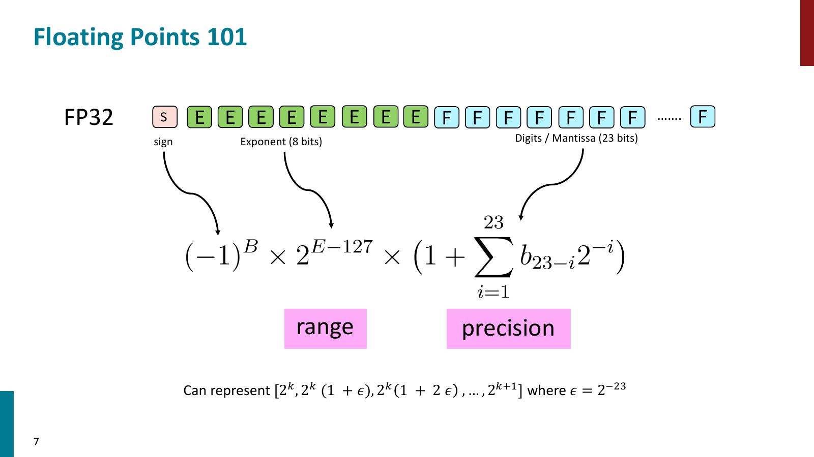

**半精度浮点数（FP16 / Half Precision）**只占 16 位，即 2 字节，但指数和尾数也相应减少。

| 格式 | 符号位 | 指数位 | 尾数位 | 每个数占用空间 |
| --- | ---: | ---: | ---: | ---: |
| FP32 | 1 | 8 | 23 | 4 字节 |
| FP16 | 1 | 5 | 10 | 2 字节 |

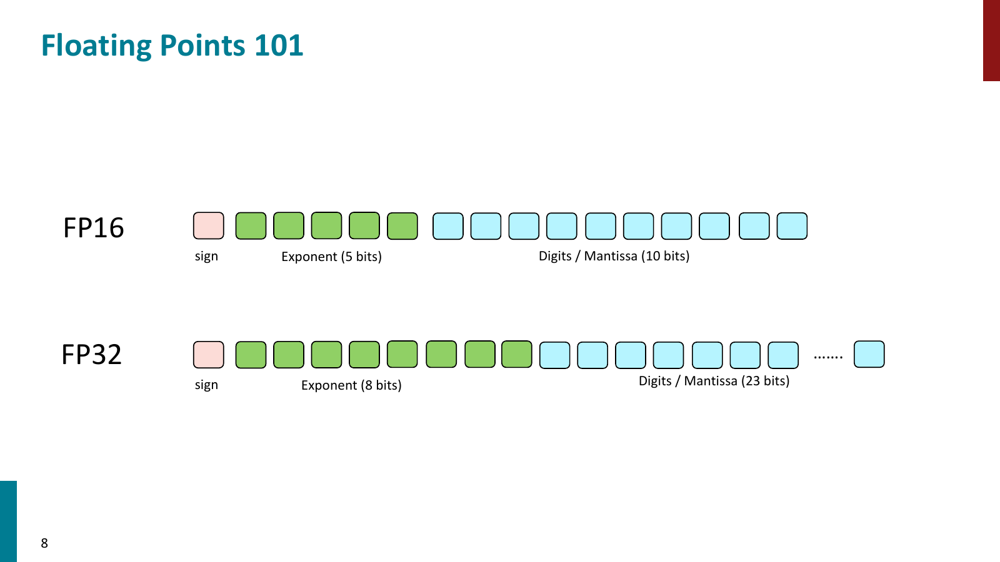

### 1.2 直接使用 FP16 的问题

通常可以用 FP32 保存模型参数和梯度，但大模型可能因此出现**显存不足（CUDA Out of Memory，OOM）**。改用 FP16，每个数占用的空间减半，但指数和尾数位数也更少：

- **数值范围（Range）更窄**：能表示的最大数更小，极小的数也更难保留下来。
- **精度（Precision）更低**：相邻可表示数之间的间隔更大，舍入误差更明显。例如，`1.0001` 转换为 FP16 后会舍入为 `1`。

这些限制会给训练带来两个问题：

- **梯度下溢（Gradient Underflow）**：反向传播得到的小梯度可能超出 FP16 能表示的范围，被舍入为 0，导致相应的更新消失。
- **权重更新不精确**：即使梯度不为 0，更新量相对于权重也可能太小。更新后的数再次舍入为原来的数，相当于这次没有更新。

前者发生在计算和保存梯度时，后者发生在用梯度更新权重时，因此需要分别处理。

### 1.3 混合精度训练的计算流程

**混合精度训练（Mixed Precision Training）**结合两种格式：前向和反向计算使用 FP16，参数更新使用 FP32。为此，额外保留一份 FP32 的**主权重（Master Weights）**，FP16 权重由这份主权重转换得到。

训练的一轮计算如下：

1. 用 FP16 权重完成前向传播，计算损失。
2. 用 FP16 完成反向传播，计算梯度。
3. 将梯度转换为 FP32，用它更新 FP32 主权重。
4. 将更新后的主权重转换为 FP16，供下一轮计算使用。

FP32 主权重能保留 FP16 无法保存的小变化，使多次小更新逐渐累积。不过，如果梯度已经在 FP16 反向传播中变成了 0，转换到 FP32 后仍是 0。因此，仅保留主权重还没有解决梯度下溢。

**损失缩放（Loss Scaling）**在反向传播之前，将损失乘以较大的正数，使计算出的梯度也随之放大。完整流程是：

1. 保留 FP32 主权重，用对应的 FP16 权重进行前向传播。
2. 将损失乘以缩放因子。
3. 对放大后的损失进行 FP16 反向传播。
4. 将梯度转换为 FP32，再除以同一个缩放因子，恢复原来的梯度尺度。
5. 用恢复后的梯度更新 FP32 主权重，再生成新的 FP16 权重。

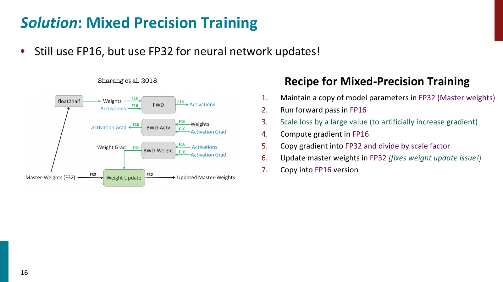

这样，FP32 主权重处理权重更新时的舍入问题，损失缩放处理 FP16 梯度过小的问题。放大梯度是为了让它能在低精度计算中保留下来，更新前仍要还原，不能直接用放大后的梯度更新参数。

### 1.4 PyTorch 自动混合精度

PyTorch 的**自动混合精度（Automatic Mixed Precision，AMP）**提供了相应工具：`autocast` 为适合的运算选择低精度格式，`GradScaler` 负责损失缩放和更新前的梯度还原。

使用时，在 `autocast` 范围内执行前向传播和损失计算，再通过 `GradScaler` 对损失进行缩放、反向传播和参数更新。

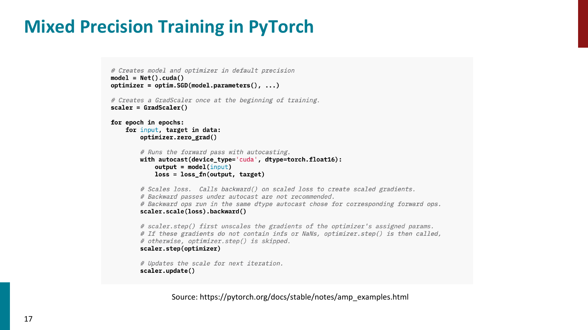

### 1.5 Bfloat16

FP16 需要损失缩放，主要是因为它的指数位少、数值范围窄。**Bfloat16（BF16）**同样只用 16 位，但给指数分配 8 位，与 FP32 相同；尾数则减少到 7 位。

| 格式 | 指数位 | 尾数位 | 每个数占用空间 |
| --- | ---: | ---: | ---: |
| FP32 | 8 | 23 | 4 字节 |
| FP16 | 5 | 10 | 2 字节 |
| BF16 | 8 | 7 | 2 字节 |

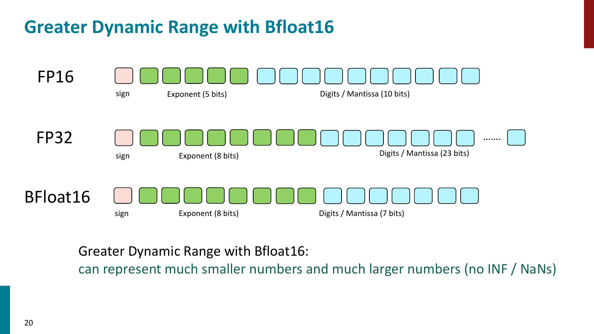

因此，BF16 兼有较小的存储开销和接近 FP32 的数值范围，能表示比 FP16 更小和更大的数，通常不需要 FP16 的损失缩放流程。代价是尾数精度更低：能表示的范围大，不代表每个数都表示得更精确。

PyTorch 可以在 `autocast` 中选择 `torch.bfloat16`，并使用 `torch.cuda.is_bf16_supported()` 检查显卡是否支持。硬件支持时，优先考虑 BF16 混合精度训练。

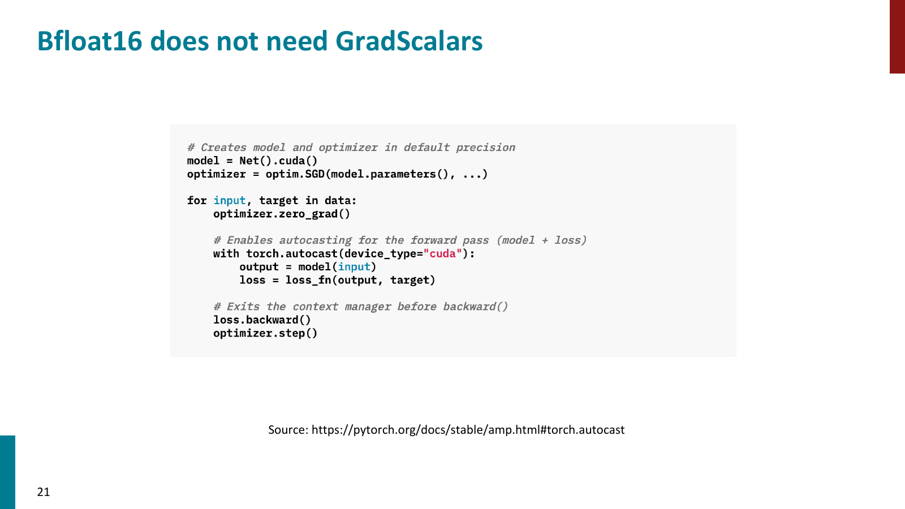

在单张 A100 上对 DistilBERT 进行情感分类微调的实验，比较了不同数值格式下的训练资源消耗和效果。

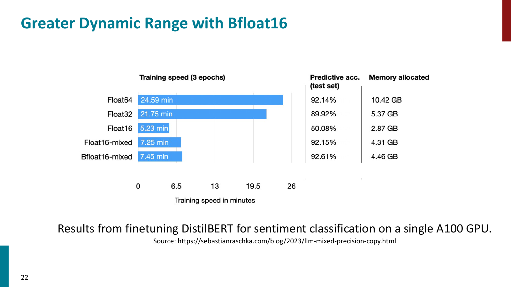

## 2. 多 GPU 训练

### 2.1 训练时的显存组成

以 FP16 混合精度和 Adam 优化器为例，训练一个参数不只是把它的数值放进显存。计算和更新时，还需要保存与它对应的梯度、主权重和 Adam 状态。

可以按用途分成两组：

- **模型计算使用的参数和梯度**：FP16 权重用于前向和反向计算；反向传播还会产生对应的 FP16 梯度，表示损失如何随这个参数变化。
- **优化器更新使用的状态**：FP32 主权重保留较精确的参数值；Adam 还为每个参数保存两项历史统计量，分别记录梯度及梯度平方的移动平均，用于决定更新量。

因此，每个参数对应以下存储开销：

| 内容 | 格式 | 每个参数对应的空间 |
| --- | --- | ---: |
| 计算用的权重副本 | FP16 | 2 字节 |
| 梯度 | FP16 | 2 字节 |
| 主权重 | FP32 | 4 字节 |
| Adam 动量：梯度的移动平均 | FP32 | 4 字节 |
| Adam 二阶矩：梯度平方的移动平均 | FP32 | 4 字节 |
| 合计 | | 16 字节 |

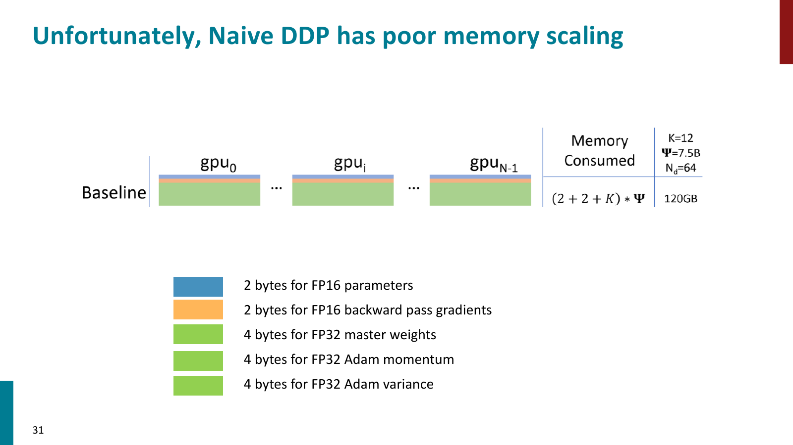

此外，还要保存**模型激活值（Model Activations）**，即前向传播产生、反向传播需要使用的中间结果。这部分显存会随批大小（Batch Size）增加，所以不能只根据模型参数大小判断训练能否放进显存。

### 2.2 分布式数据并行

**分布式数据并行（Distributed Data Parallel，DDP）**把数据分给多张 GPU，让它们同时训练同一个模型。每张 GPU 都保存完整的模型和自己的优化器，训练开始时，各份模型的参数相同；不同 GPU 处理的数据不同。

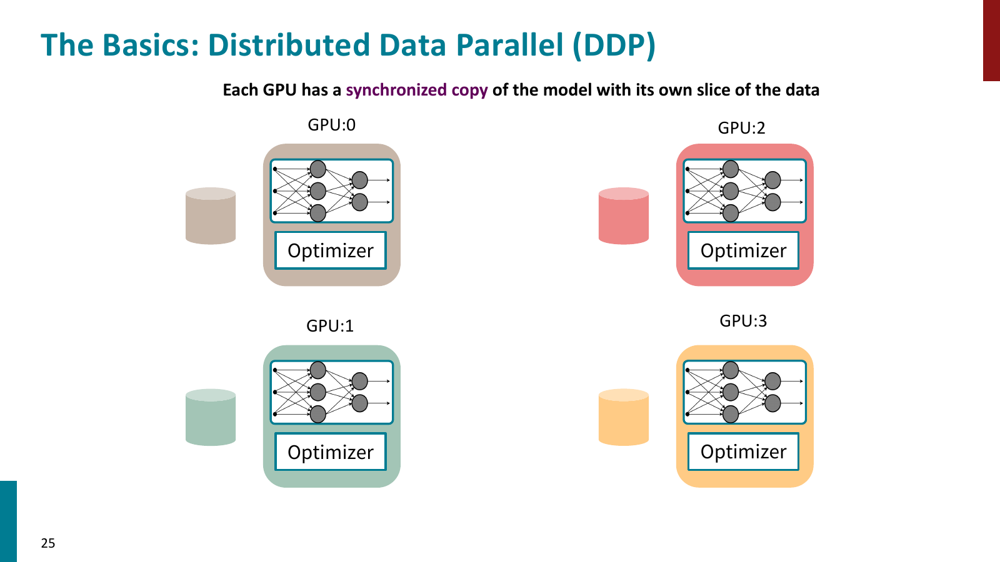

例如，将一批数据分给四张 GPU，一次更新依次进行：

1. **并行前向传播**：四张 GPU 分别用自己的完整模型处理分到的数据，计算各自的损失。
2. **反向传播与梯度通信**：每张 GPU 根据自己的损失计算参数梯度。由于数据不同，同一个参数在不同 GPU 上得到的梯度也可能不同；已经计算好的梯度可以开始通信，不必等整个反向传播结束。
3. **All-reduce 汇总梯度**：通过**全归约（All-reduce）**，合并各张 GPU 对相同参数算出的梯度，并让每张 GPU 都得到相同的聚合结果。此时，每张卡上的优化器都能利用全部四份数据的梯度信息。
4. **同步更新参数**：各张 GPU 的优化器用相同的聚合梯度更新模型。因为更新前参数相同、更新依据相同，更新后各份模型的参数仍然一致。

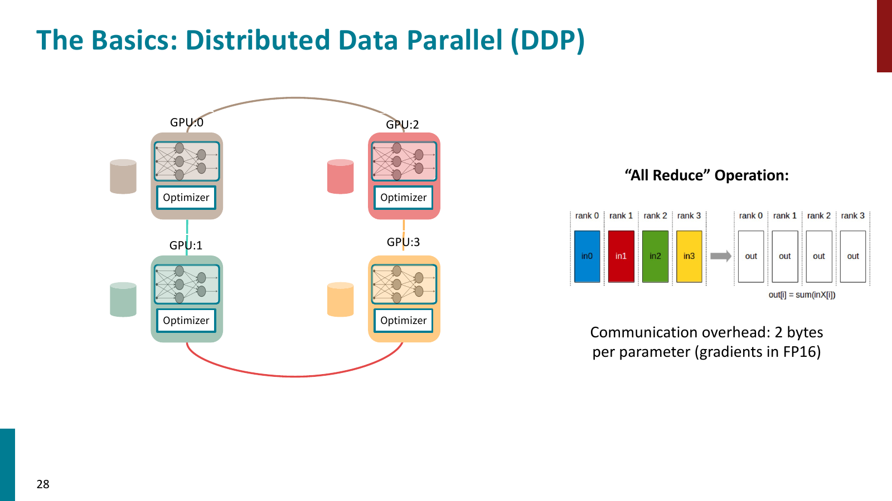

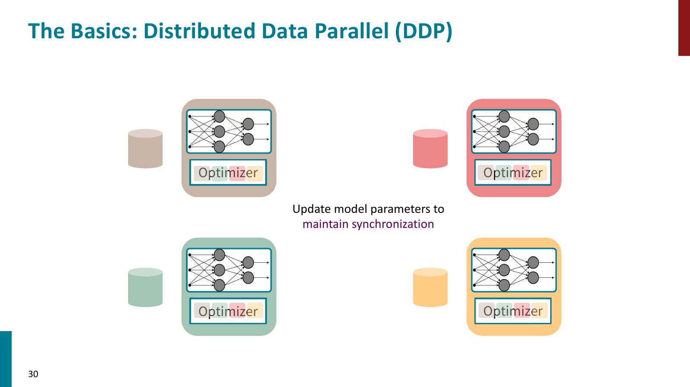

DDP 能让多张 GPU 同时处理数据，但每张卡仍保存完整参数、梯度和优化器状态。增加 GPU 数量，并不会自动减少每张卡保存这些内容所需的显存。

### 2.3 ZeRO 分片训练

**零冗余优化器（Zero Redundancy Optimizer，ZeRO）**通过分片，减少多张 GPU 之间重复保存的训练状态。这里的分片是将模型参数、梯度或优化器状态拆分到多张 GPU 上保存，而不是划分训练样本。ZeRO 分三个阶段逐步扩大分片范围：Stage 1 分片优化器状态，Stage 2 进一步分片梯度，Stage 3 再分片模型参数。

#### 2.3.1 优化器状态分片（Stage 1）

**ZeRO Stage 1**首先对**优化器状态（Optimizer State）**分片，包括 FP32 主权重和 Adam 状态。每张 GPU 仍有完整 FP16 模型，但只负责更新一部分参数。例如，四张 GPU 分别维护四分之一参数对应的主权重和 Adam 状态。

更新时：

1. 每张 GPU 根据自己的数据计算梯度。
2. 执行**归约后分散（Reduce-scatter）**：先汇总各张 GPU 对相同参数算出的梯度，再把每个参数分片对应的聚合梯度交给负责它的 GPU。
3. 每张 GPU 用自己的主权重和 Adam 状态，更新负责的参数分片。
4. 执行**全收集（All-gather）**：收集各张 GPU 更新后的参数分片，使每张 GPU 重新得到相同的完整 FP16 模型。

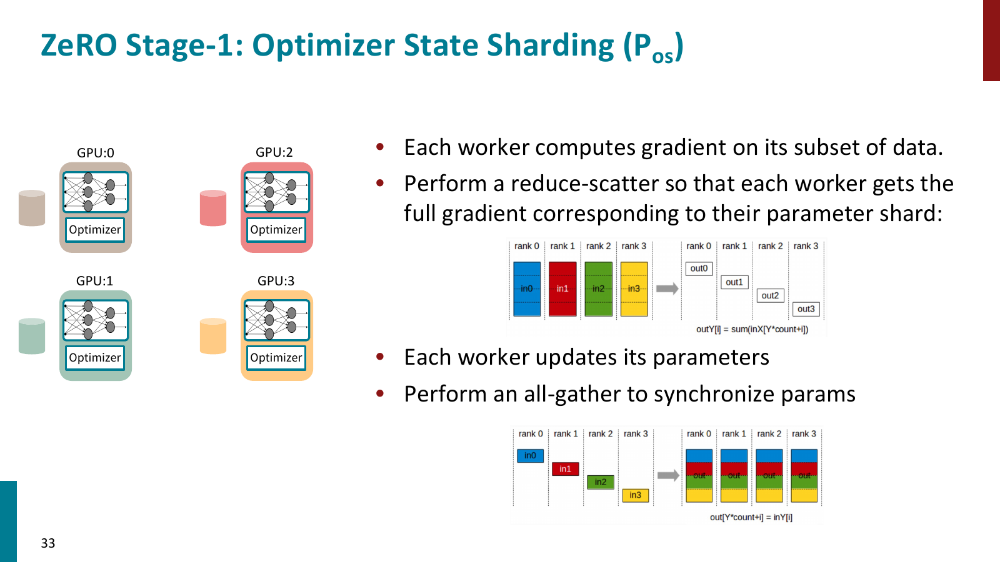

与 DDP 相比，Stage 1 不再要求每张 GPU 保存全部优化器状态。All-reduce 可以分解为 Reduce-scatter 和 All-gather，因此这种方式能在保持相近通信量的同时节省显存。

#### 2.3.2 优化器状态与梯度分片（Stage 2）

**ZeRO Stage 2**在优化器状态分片的基础上，进一步分片梯度。难点是，每张 GPU 都要对自己的数据执行完整模型的反向传播，因此仍会算到模型各部分的梯度。

解决方法是：不等完整梯度全部计算出来再保存和通信，而是在反向传播中逐层处理。某一层的参数梯度一旦算好，就立即汇总并发送到负责该参数分片的 GPU，然后释放本地不再需要的梯度内存。

每张 GPU 逐层进行反向传播。处理某一层时：

1. 接收上游梯度，计算当前层参数的梯度。
2. 立即将梯度发送给负责相应参数分片的 GPU，汇总各张 GPU 的梯度贡献。
3. 释放本地不再需要的参数梯度内存，再继续处理前一层。

反向传播完成后，每张 GPU 利用收到的聚合梯度和本地优化器状态，更新自己负责的参数分片；随后通过 All-gather 同步更新后的参数，使每张 GPU 上的完整模型再次保持一致。

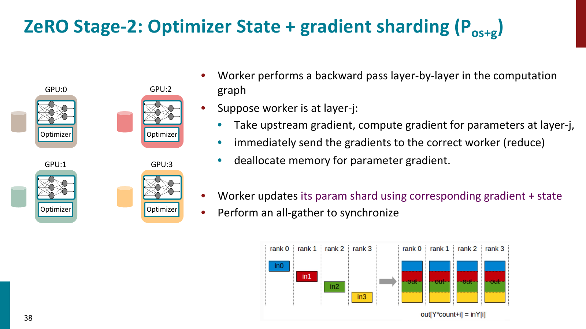

因此，梯度分片并不是只计算部分模型的梯度，而是不让每张 GPU 一直保存完整梯度。Stage 2 仍在每张 GPU 上保留完整的低精度模型参数。

#### 2.3.3 参数分片（Stage 3 / FSDP）

如果连完整模型参数都无法放入一张 GPU，仅分片优化器状态和梯度仍然不够。**ZeRO Stage 3**进一步分片模型参数，**完全分片数据并行（Fully Sharded Data Parallel，FSDP）**采用这种参数、梯度和优化器状态都分片的训练方式。

先将模型划分为若干 **FSDP 单元（FSDP Units）**，后续按单元收集参数和执行计算。

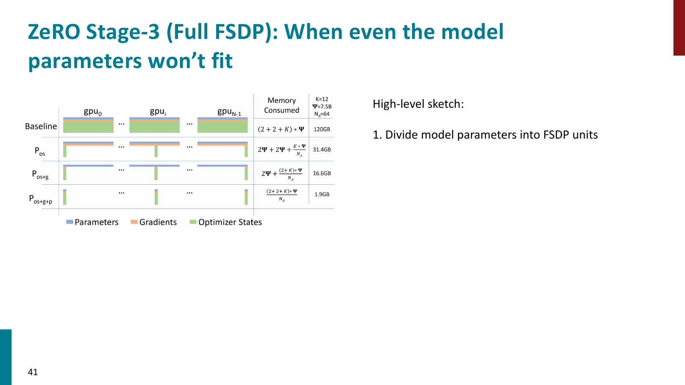

再把每个单元的参数分散到多张 GPU。每张 GPU 都保存各个单元的一部分参数，平时只保留自己的分片，计算某个单元时才临时收集它的完整参数。

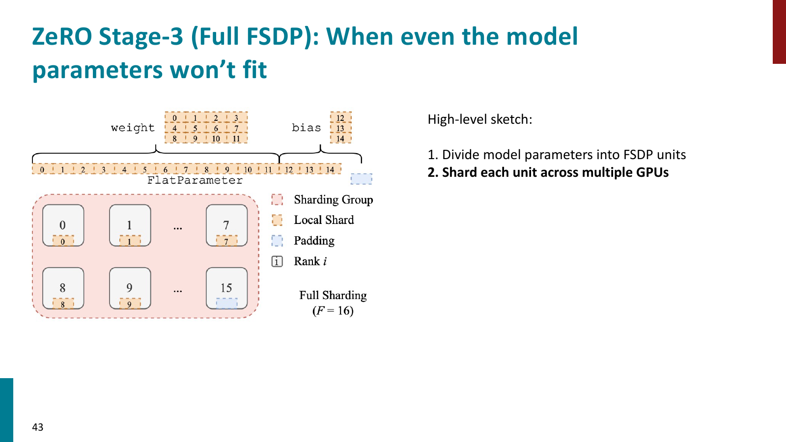

前向传播时：

1. 对即将计算的单元执行 All-gather，收集各张 GPU 上的参数分片。
2. 每张 GPU 使用该单元的完整参数，对自己的数据进行前向计算。
3. 计算结束后，释放临时收集的参数，继续保留本地分片。
4. 对后续单元重复上述过程。

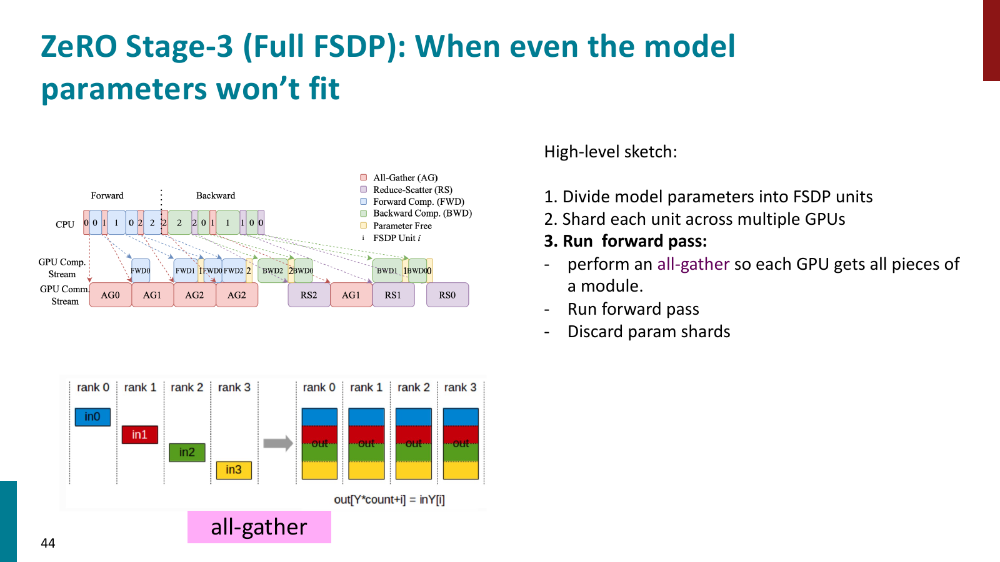

反向传播时：

1. 再次 All-gather，获得当前单元的完整参数。
2. 每张 GPU 根据自己的数据计算参数梯度，并向前一单元传递梯度。
3. 通过 Reduce-scatter 汇总参数梯度，将每个分片的聚合结果交给负责它的 GPU。
4. 释放不再需要的完整参数和临时梯度。

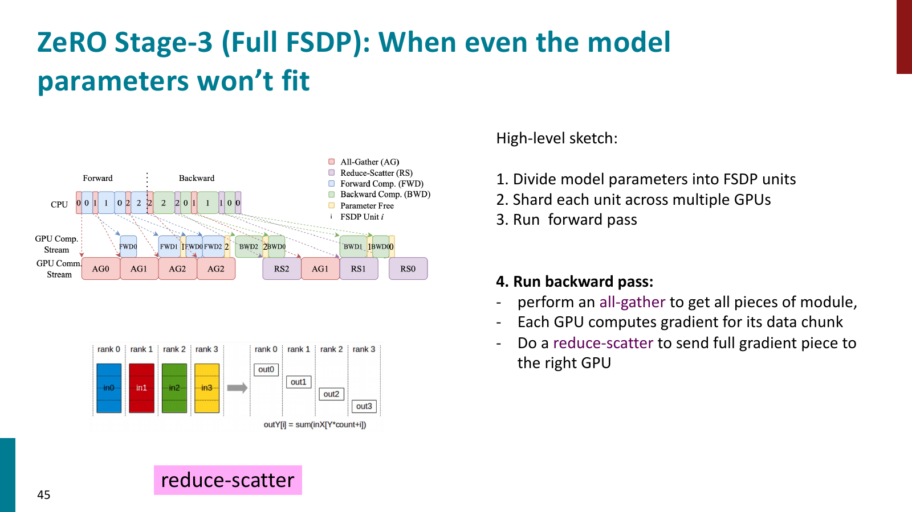

反向传播完成后，各张 GPU 用收到的聚合梯度和本地优化器状态，更新自己负责的参数分片。

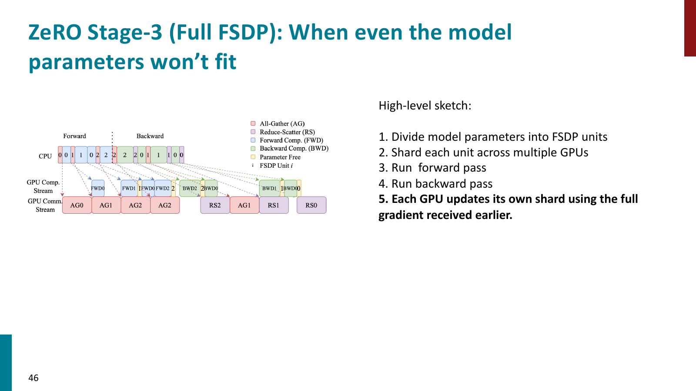

各张 GPU 仍处理不同数据，区别在于不再长期保存完整模型。代价是前向和反向计算前都要收集参数，通信开销增加。

### 2.4 分片方式与通信开销

| 训练方式 | 每张 GPU 长期保存的内容 | 主要通信操作 |
| --- | --- | --- |
| DDP | 完整参数、梯度、优化器状态 | All-reduce 汇总梯度 |
| ZeRO Stage 1 | 完整参数和梯度；优化器状态分片 | Reduce-scatter 梯度，All-gather 更新后的参数 |
| ZeRO Stage 2 | 完整参数；梯度和优化器状态分片 | 逐步归约分散梯度，All-gather 更新后的参数 |
| ZeRO Stage 3 / FSDP | 参数、梯度、优化器状态都分片 | 前向和反向时 All-gather 参数，反向时 Reduce-scatter 梯度 |

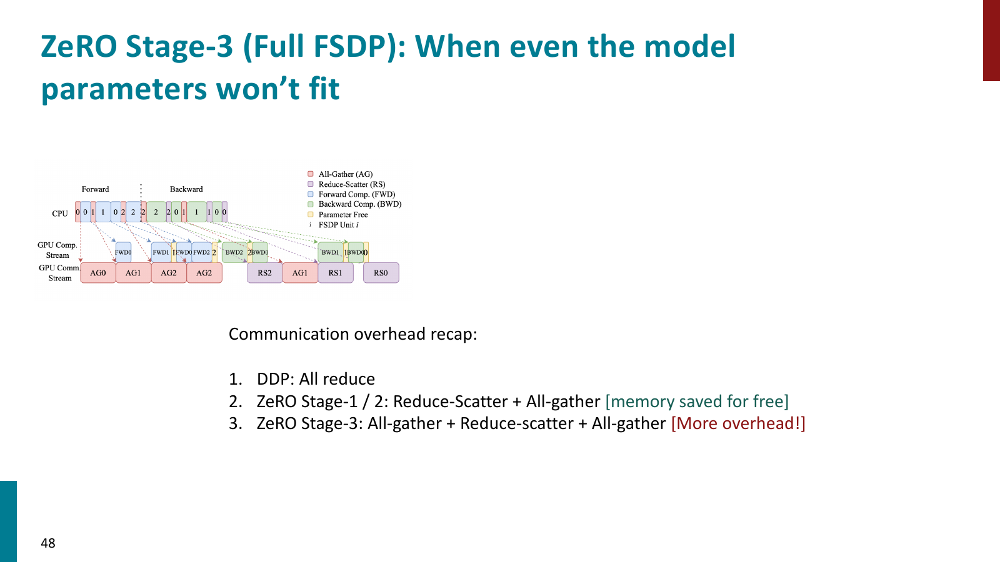

Stage 1 和 Stage 2 的 Reduce-scatter 与 All-gather 合起来，通信量与 DDP 的 All-reduce 相近，因此能在不明显增加通信量的情况下节省显存。Stage 3 则需要在前向和反向计算前分别收集参数，多了一次 All-gather，通信开销更大，也可能拖慢训练。

## 3. 参数高效微调（Parameter-Efficient Finetuning）

### 3.1 从全量微调到参数高效微调

**全量微调（Full Fine-tuning）**更新预训练模型的全部参数；**参数高效微调（Parameter-Efficient Fine-tuning，PEFT）**则只训练少量参数，使模型适应具体任务。

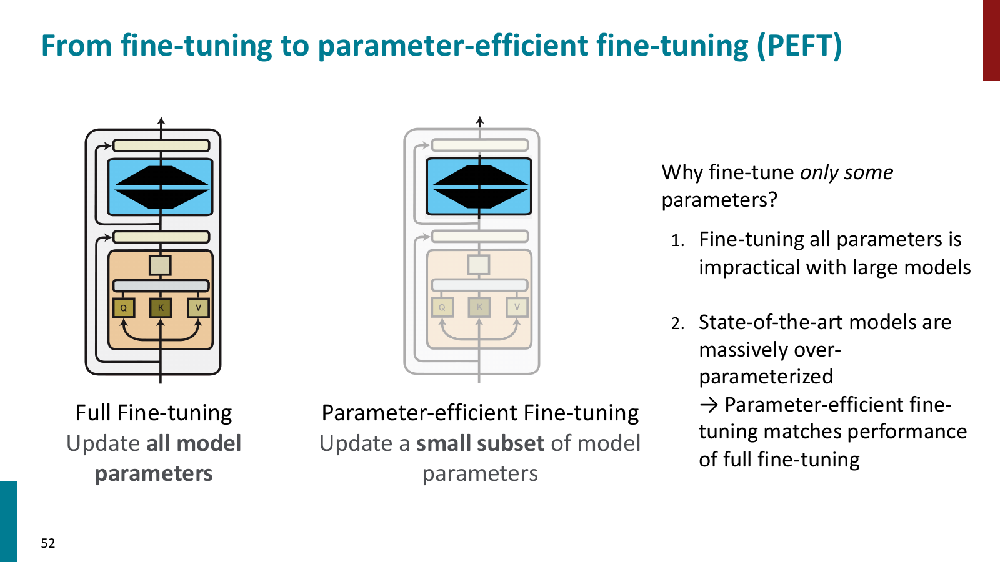

只微调少量参数有两个主要动机：

1. **全量微调大型模型的成本过高。** 更新全部参数需要大量计算与显存资源，在资源有限时难以实现。
2. **大型模型具有高度的过参数化（Over-parameterization）。** 适应具体任务未必需要调整全部参数，只训练少量参数也能达到与全量微调相当的效果。

提高训练与微调效率的必要性，还体现在计算需求和训练成本的增长上：

- **计算需求的增长难以持续。** 一项统计显示，最大 AI 模型的训练计算量约每 3.4 个月翻倍，而全球计算能力约每 1.5 年翻倍，两者的增长速度相差很大。
- **训练成本上升，使开发力量集中。** AI 开发越来越集中于资金最充足的组织，尤其是企业。少数利益主体可能因此主导这项全球性技术，并影响未来 AI 所体现的价值观。

模型训练与微调还存在两方面的问题：

1. **重视准确率，忽视效率。** 一项对顶级 AI 会议 60 篇论文的抽样统计，比较了以准确率、效率或两者为目标的论文比例，显示研究更倾向于追求准确率。
2. **环境成本缺乏透明度。** 大型语言模型的训练和微调会消耗能源、产生碳排放，但多数大型模型开发者并不充分公开这些成本。

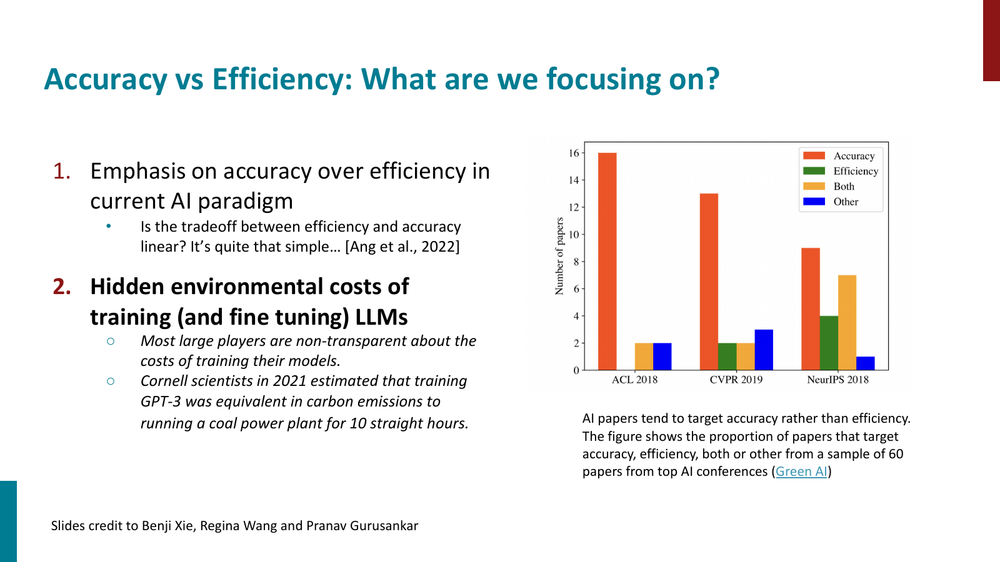

即使算法效果相近，能耗也可能差别很大。例如，斯坦福 CS234 的 200 多名学生实现强化学习算法时，两种算法表现相近，但其中一种耗电更多。研究者估计，如果全部采用更高效的算法，可合计节省约 880 kWh 的电量。

### 3.2 全量微调

以预训练的自回归语言模型为例，微调可以使它适应摘要、自然语言转 SQL（NL2SQL）、阅读理解等下游任务。训练数据由输入文本与目标文本对 $(x,y)$ 组成。例如，在摘要任务中，$x$ 是原文，$y$ 是对应的摘要。

设模型的预训练参数为 $\boldsymbol{\phi}_0$。全量微调从这些参数出发，根据任务数据计算梯度，更新全部模型参数。将微调后的参数与原参数之间的差记为 $\Delta\boldsymbol{\phi}$，则微调后的参数可以写成 $\boldsymbol{\phi}_0+\Delta\boldsymbol{\phi}$。

训练时，模型根据输入 $x$ 和目标文本中已有的词预测下一个词，最大化目标文本的条件对数概率：

$$
\max_{\Delta\boldsymbol{\phi}}
\sum_{(x,y)}\sum_{t=1}^{|y|}
\log P_{\boldsymbol{\phi}_0+\Delta\boldsymbol{\phi}}
(y_t\mid x,y_{<t}).
$$

其中，$y_t$ 是目标文本的第 $t$ 个词元，$y_{<t}$ 是它之前的正确词元，$|y|$ 是目标文本的长度。公式先累加一条目标文本中各词元的对数概率，再对训练样本求和；训练使这些正确词元获得更高的预测概率。

对不同下游任务分别进行全量微调，会得到不同的参数变化 $\Delta\boldsymbol{\phi}$。每个原参数都对应一个变化量，因此 $|\Delta\boldsymbol{\phi}|=|\boldsymbol{\phi}_0|$，这里的 $|\cdot|$ 表示参数数量。以具有 1750 亿参数的 GPT-3 为例，为多个任务分别保存和部署完整模型，成本很高。

减少可训练参数的一种思路是：**不直接训练完整的参数变化 $\Delta\boldsymbol{\phi}$，而是用一组更少的参数 $\boldsymbol{\Theta}$ 来表示它**：

$$
\Delta\boldsymbol{\phi}=\Delta\boldsymbol{\phi}(\boldsymbol{\Theta}),
\qquad |\boldsymbol{\Theta}|\ll|\boldsymbol{\phi}_0|.
$$

$\Delta\boldsymbol{\phi}(\boldsymbol{\Theta})$ 表示由 $\boldsymbol{\Theta}$ 计算出的参数变化。训练时保持预训练参数 $\boldsymbol{\phi}_0$ 不变，只调整 $\boldsymbol{\Theta}$，原来的优化目标相应改为：

$$
\max_{\boldsymbol{\Theta}}
\sum_{(x,y)}\sum_{t=1}^{|y|}
\log P_{\boldsymbol{\phi}_0+\Delta\boldsymbol{\phi}(\boldsymbol{\Theta})}
(y_t\mid x,y_{<t}).
$$

### 3.3 LoRA 的低秩更新

**低秩适配（Low-Rank Adaptation，LoRA）**是一种 PEFT 方法。研究发现，模型适应具体任务时，权重的变化具有较低的**内在秩（Intrinsic Rank）**，也就是说，虽然权重更新矩阵很大，但用两个较小矩阵的乘积就可能较好地表示它。LoRA 据此只训练这两个小矩阵，保持原权重不变。

对于预训练权重矩阵 $\mathbf{W}_0\in\mathbb{R}^{d\times k}$，将更新写为：

$$
\mathbf{W}_0+\Delta\mathbf{W}
=\mathbf{W}_0+\alpha\mathbf{B}\mathbf{A},
$$

$$
\mathbf{B}\in\mathbb{R}^{d\times r},
\qquad
\mathbf{A}\in\mathbb{R}^{r\times k},
\qquad
r\ll\min(d,k).
$$

$\mathbf{W}_0$ 保持固定，只有 $\mathbf{A}$ 和 $\mathbf{B}$ 参与训练。$r$ 是低秩更新的中间维度，$\alpha$ 控制任务增量的强度，调节预训练变换与任务适配之间的比重。

对于输入 $\mathbf{h}\in\mathbb{R}^{k}$，线性层的输出为：

$$
\mathbf{W}_0\mathbf{h}
+\alpha\mathbf{B}(\mathbf{A}\mathbf{h}).
$$

对于同一个输入 $\mathbf{h}$，一部分计算是用固定的预训练权重得到 $\mathbf{W}_0\mathbf{h}$；另一部分计算是先乘 $\mathbf{A}$ 得到 $r$ 维向量，再乘 $\mathbf{B}$ 得到 $d$ 维向量，并乘以 $\alpha$。将这两部分结果相加，就得到这一层的输出。

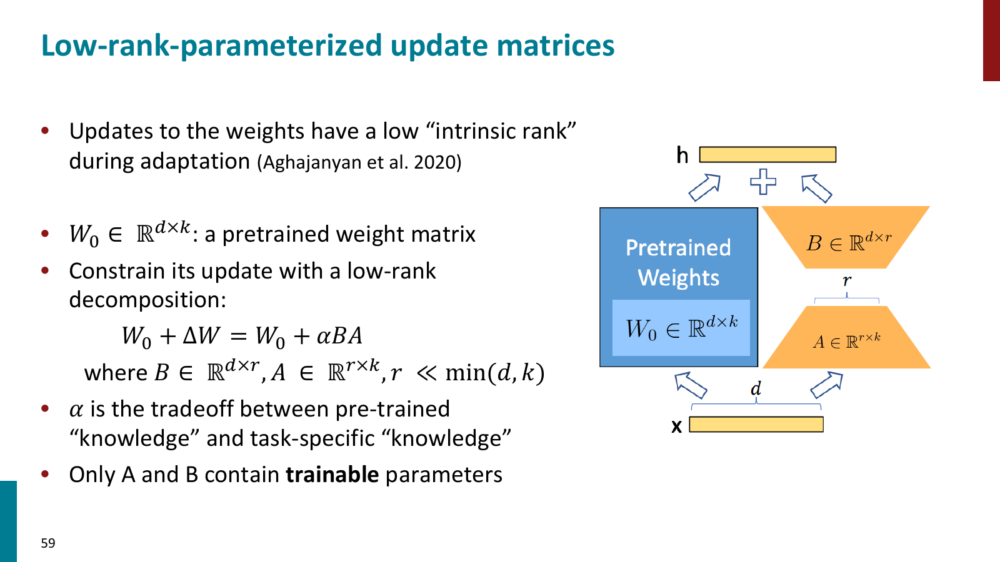

完整更新矩阵有 $dk$ 个参数，两个小矩阵只有 $rk+dr$ 个参数。由于 $r$ 远小于 $d$ 和 $k$，可训练参数数量大幅减少。约束的是权重的增量，而不是把原来的预训练权重矩阵替换成低秩矩阵。

随着可训练参数数量增加，LoRA 的训练会逐渐接近原模型的全量训练。

LoRA 常用于自注意力模块中的权重矩阵，在保留预训练模型的同时，为选定的线性变换增加低秩更新分支。

训练完成后，可以提前把增量加回原权重：

$$
\mathbf{W}_{\mathrm{merged}}
=\mathbf{W}_0+\alpha\mathbf{B}\mathbf{A}.
$$

合并后仍使用原来形状的一个权重矩阵进行计算，不需要在推理时额外执行低秩分支，因此没有额外推理延迟。

不同任务可以共享预训练权重，只分别保存自己的低秩矩阵。切换任务时，从合并权重中减去旧任务的增量，再加上新任务的增量，就能切换适配结果，无须为每个任务保存完整独立模型。

实验中，LoRA 使用较少的可训练参数，在所比较的三个数据集上达到或超过了全量微调的效果。

## 4. 训练方法的选择

先使用混合精度训练，硬件支持时优先考虑 BF16，再根据显存是否足够选择并行和微调方式：

1. **批大小为 1 时，模型能在单张 GPU 上训练**：尝试更大的批大小；多 GPU 训练时，可用 ZeRO Stage 2 减少优化器状态和梯度的重复存储。
2. **批大小为 1 时仍然显存不足**：尝试 ZeRO Stage 3 / FSDP，将模型参数也分片。
3. **完全分片后仍然显存不足**：尝试 LoRA，减少需要训练和保存的任务参数。

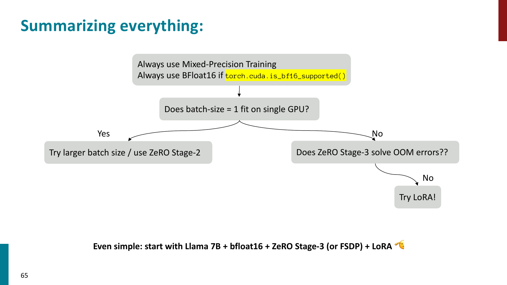
