本讲以语音脑机接口为应用背景。不研究脑机接口时，可重点关注第3节的 CTC 序列建模与训练目标，以及第4节的束搜索和语言模型辅助解码；这些方法也适用于语音识别等序列任务。脑机接口的生理背景、设备与具体系统可作概览。

## 1. 脑机接口与交流能力的恢复

### 1.1 脑机接口

脑干卒中、肌萎缩侧索硬化症（Amyotrophic Lateral Sclerosis，ALS）等神经系统疾病，可能使人失去说话和运动能力。即使仍然知道自己想说什么，也可能无法通过口部动作或手部操作表达出来。

**脑机接口（Brain–Computer Interface，BCI）**记录脑活动，并将其中的信息转换为计算机或其他设备能够使用的指令。例如，使用者尝试移动手臂时，系统可以根据相应的脑活动控制屏幕上的光标，使其选择文字、与他人交流。

### 1.2 神经活动的记录与解码

脑活动可以通过电信号测量。**脑电图（Electroencephalogram，EEG）**在头皮上记录电活动；植入脑内的微电极则可以记录附近神经元的活动。神经元产生的短暂电脉冲称为**动作电位或脉冲（Spike）**。

运动皮层中的一些神经元，其脉冲发放情况会随尝试运动的方向变化。例如，同一个神经元在某个方向的运动中活动较强，在其他方向中活动较弱。

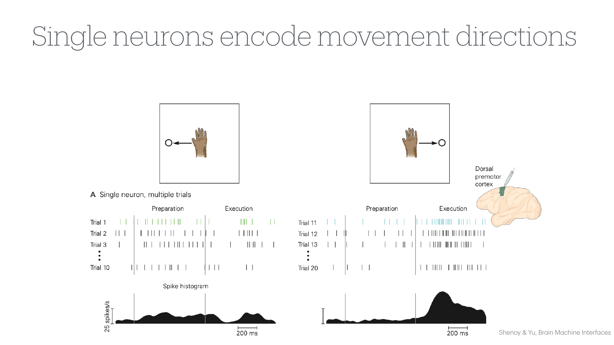

单个神经元的活动存在波动，相近的活动水平也可能对应不同方向。联合多个神经元的活动，可以更准确地判断运动方向。**解码（Decoding）**就是根据记录到的神经活动，推断相应的运动或交流内容。

### 1.3 从运动控制到文字交流

脑机接口的输出不仅可以是二维光标，还可以用于控制机械臂、辅助恢复行走，以及将尝试书写时的神经活动转换为字符。手写脑机接口的一项研究达到了每分钟 90 个字符、95% 的准确率。

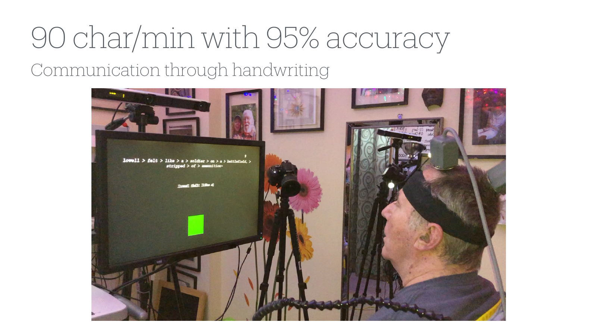

手写输入仍然需要逐个写出字符。**语音脑机接口（Speech BCI）**则利用尝试说话时产生的神经活动，直接解码交流内容，使使用者不必先通过手写或光标选择来表达。

## 2. 从言语运动到神经信号

### 2.1 言语产生与音素

理解语言、组织要表达的内容，以及控制发音动作，涉及不同的处理过程。产生语音时，需要协调嘴唇、舌头、下颌等部位的运动；运动皮层中包含与这些发音动作和音素有关的信息。

**音素（Phoneme）**是语音中能够区分词义的基本声音单位，不等同于字母。例如，英语词的拼写和实际发音之间并不是逐字母对应的关系。语音脑机接口可以先判断使用者尝试发出的音素，再把音素组合解码为词。

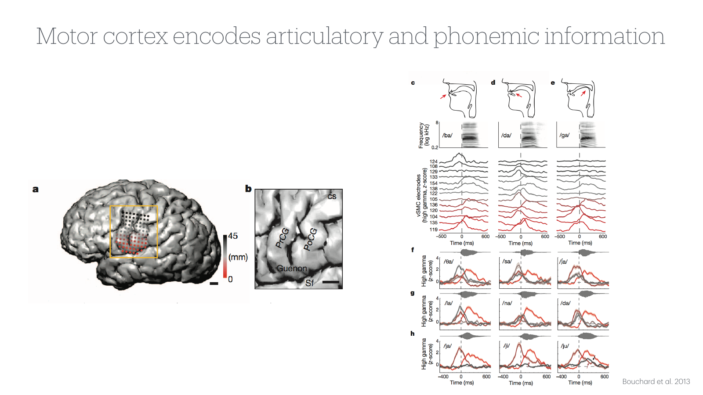

**皮层脑电（Electrocorticography，ECoG）**使用放置在大脑皮层表面的电极记录信号。小词表语音脑机接口已经利用这类信号，将尝试说话的活动解码为文字。

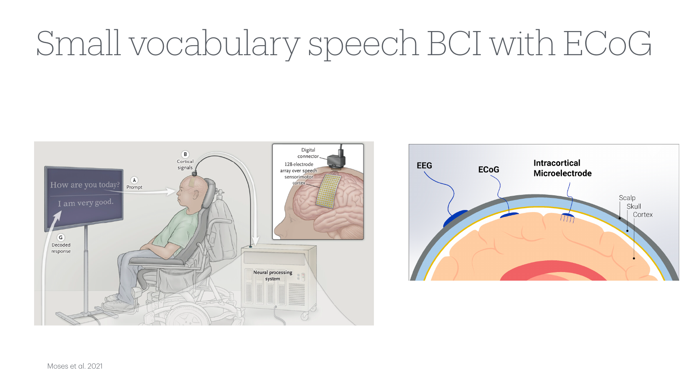

### 2.2 高性能语音神经假体

**语音神经假体（Speech Neuroprosthesis）**通过神经信号帮助恢复言语交流功能。Willett、Kunz、Fan 等人的研究中，参与者 T12 患有延髓起病的 ALS，仍能进行有限的口面运动和发声，但无法说出可理解的言语。

研究使用四个各含 64 个通道的 **Utah 微电极阵列（Utah Microelectrode Arrays）**记录活动：

- 两个植入腹侧运动皮层的 6v 区。
- 两个植入 44 区，即 Broca 区的一部分。

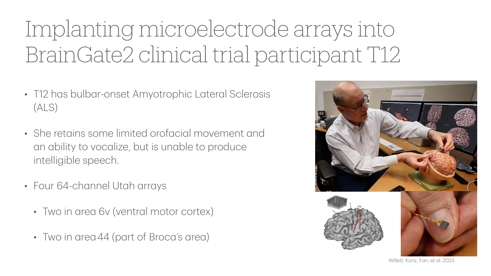

参与者尝试进行口面运动、发出单个音素或说出词时，记录到的神经活动随这些行为变化。解码器利用这些记录学习神经活动与言语之间的关系，并在使用时将新的神经活动转换为文字。

### 2.3 训练数据的采集

训练需要成对的数据：**尝试说一句话时记录的神经活动，以及这句话的正确文本**。采集时给参与者指定句子，参与者尝试说出句子，同时记录神经信号。

训练和评价句子随机选自 **Switchboard 电话会话语料（Switchboard Corpus of Telephone Conversation）**。采集按每批 40 句话进行，训练数据采集约 100 分钟，随后训练解码器，再进行约 30 分钟的评价。

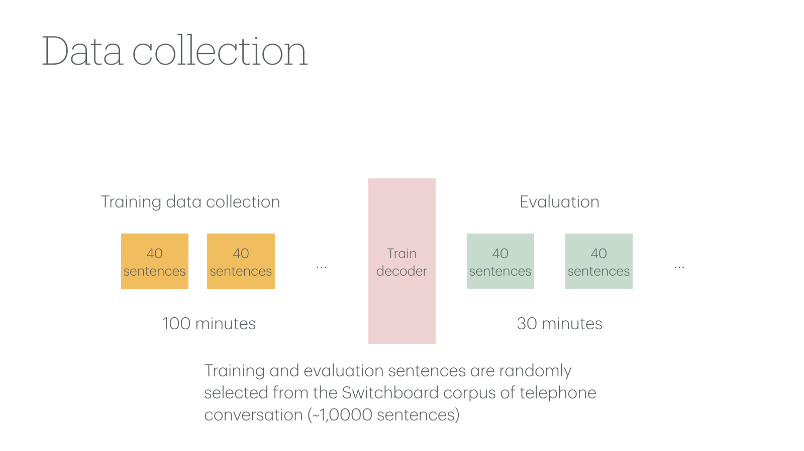

### 2.4 神经信号到词的两级解码

模型输入是按时间排列的神经特征：

$$
X=(\mathbf{x}_1,\mathbf{x}_2,\ldots,\mathbf{x}_n),
\qquad \mathbf{x}_i\in\mathbb{R}^{d\times1}.
$$

其中，$n$ 是时间步数，$\mathbf{x}_i$ 是第 $i$ 个时间步记录得到的 $d$ 维神经特征。输出是词序列 $Y=(\mathbf{y}_1,\ldots,\mathbf{y}_m)$，每个词按词表维度表示为 $\mathbf{y}_i\in\mathbb{R}^{V\times1}$；$m$ 是输出词数，$V$ 是词表大小。

解码分为两个阶段：

1. **神经信号到音素解码器（Neural-to-Phonemes Decoder）**：根据随时间变化的神经特征，预测尝试发出的音素。
2. **音素到词解码器（Phonemes-to-Words Decoder）**：根据音素及语言规律，确定对应的词序列。

例如，输出句子为 `I can speak` 时，中间先预测这些词对应的发音，再恢复为文字。图中的 `SIL` 表示静音。

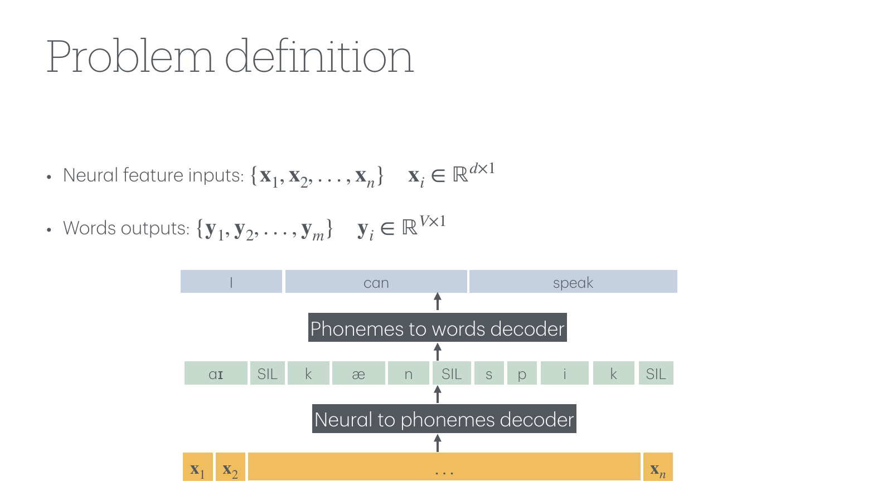

神经信号到音素属于**序列到序列（Sequence-to-Sequence）**问题，但输入时间步与输出音素并不一一对应：一个音素可能持续多个时间步，音素之间还可能有停顿。训练时知道整句话，却通常不知道每个音素的准确起止时间。

这里需要的是**单调对齐（Monotonic Alignment）**：音素按发音先后顺序出现，不需要像某些翻译任务那样重新排列输入中的内容。

## 3. CTC 序列建模

### 3.1 逐时间步输出与后处理

**连接时序分类（Connectionist Temporal Classification，CTC）**是一种序列模型的训练方法，适用于输入与输出顺序一致、但不知道每个输出对应哪一段输入的任务。训练时只需提供输入序列和正确的输出序列，不必逐段标注它们的对应关系。例如，根据神经信号识别音素时，只需给出正确的音素序列，不必标出每个音素的起止时间。

以识别单词 `hello` 为例，RNN 或 Transformer 读取输入序列，在每个时间步通过 Softmax 给出各个字母的概率。除了字母，模型也会给出**空白符（Blank）**的概率，表示这个时间步没有字母需要输出。逐时间步得到的序列可能包含重复字母和空白符，需要经过后处理才能得到最终文字。

得到逐时间步的字母和空白符后，按以下顺序处理：

1. 把连续重复的字母合并为一个，例如 `h h` 变成 `h`。
2. 删除空白符，将剩下的字母连起来。

例如，用 `_` 表示空白符：

| 步骤 | 标签序列 |
| --- | --- |
| 逐时间步输出 | `h h _ e _ l l _ l _ o o` |
| 合并连续重复标签 | `h _ e _ l _ l _ o` |
| 删除空白符 | `hello` |

`l l` 会被合并成一个 `l`，而 `l _ l` 中的两个 `l` 被空白符隔开，不会合并。随后删除 `_`，就能保留 `hello` 中的两个 `l`。

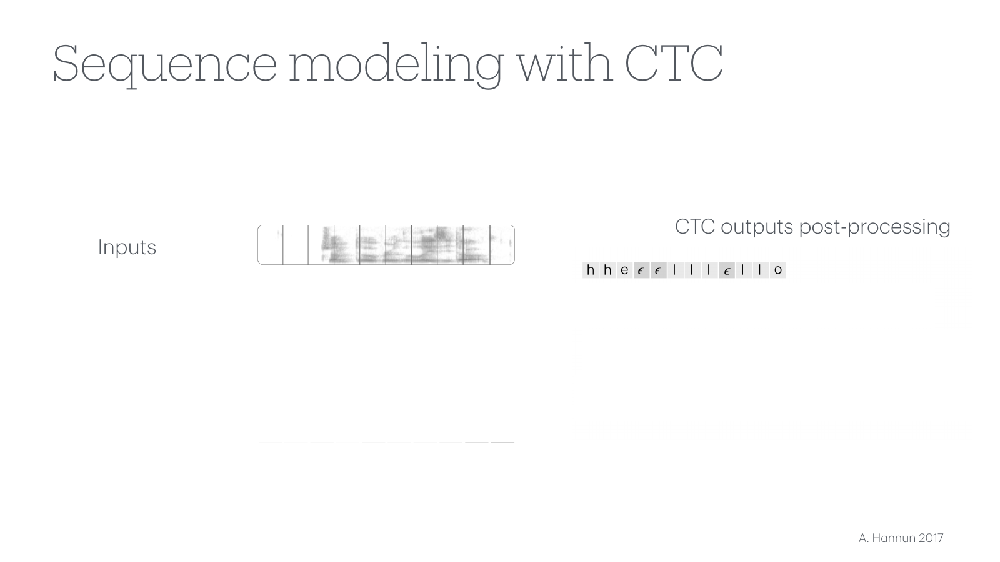

### 3.2 CTC 的训练目标

假设一条训练样本的正确文本是 `hello`，网络有 7 个输出时间步。下面两串输出经过合并重复、删除空白符后，都得到正确文本：

- `h h e l _ l o`：`h` 占两个时间步。
- `h e e l _ l o`：`e` 占两个时间步。

训练数据没有说明应该采用哪一种。CTC 不要求事先确定每个字母出现的时间，而是把所有能得到 `hello` 的输出串都纳入计算。这样的逐时间步输出串称为一条**对齐路径（Alignment）**。

计算分两步：

1. **计算一条路径的概率。** 例如，对 `h h e l _ l o`，取第 1 步输出 `h` 的概率、第 2 步输出 `h` 的概率、第 3 步输出 `e` 的概率，以此类推，将这 7 个概率相乘。
2. **计算正确文本的概率。** 把所有经过后处理能得到 `hello` 的路径概率相加。

写成公式就是：

$$
P(Y\mid X)
=\sum_{A\in\mathcal{A}_{X,Y}}\prod_t p_t(a_t\mid X).
$$

- $X$ 是输入序列，$Y$ 是正确文本，例如 `hello`。
- $A$ 是一条对齐路径，$a_t$ 是这条路径在第 $t$ 步的字母或空白符。
- $p_t(a_t\mid X)$ 是网络在第 $t$ 步给这个字母或空白符的概率；$\prod_t$ 将各步概率相乘。
- $\mathcal{A}_{X,Y}$ 包含所有能得到正确文本的路径；$\sum$ 将这些路径的概率相加。

训练通过调整网络参数，提高正确文本的这个总概率。因此，只知道完整文本 `hello`，也可以训练网络，不必再标出每个字母对应哪些时间步。

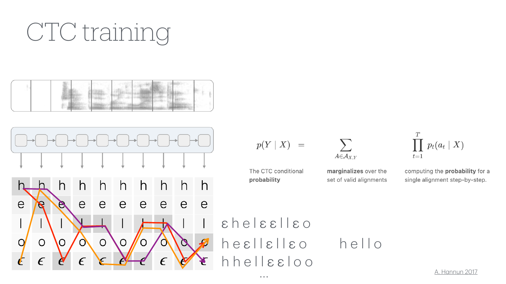

### 3.3 神经信号到音素的循环网络

CTC 规定怎样计算训练目标，逐时间步的概率仍需要由神经网络给出。选择网络时，Transformer 的优势是利用大规模数据和长距离依赖；RNN 则适合数据量较小、主要依赖较近时间信息且需要实时处理的情况。这个语音脑机接口采用 RNN 中的**门控循环单元（Gated Recurrent Unit，GRU）**。

GRU 用隐藏状态保存此前输入的信息。每个时间步，它将新输入与上一步隐藏状态结合，用门控制保留多少旧信息、加入多少新信息。与 LSTM 不同，GRU 不再单独维护一份细胞状态。

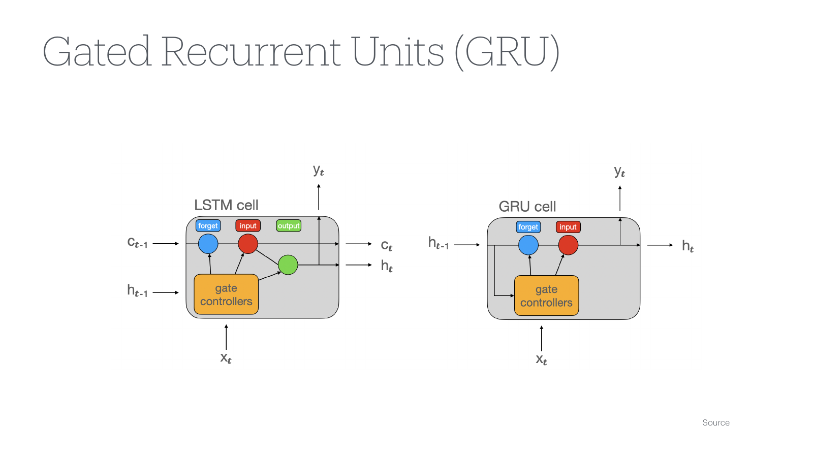

在音素识别中，每个时间步的计算是：读入新的神经特征向量，更新 GRU 的隐藏状态，再通过输出层和 Softmax 得到各音素及空白符的概率。训练时，将这些概率和正确音素序列交给 CTC 计算训练目标，再反向传播更新网络参数。

## 4. CTC 解码与语言模型

### 4.1 束搜索

使用模型时，要根据输入 $X$ 找到概率最高的输出序列 $Y$：

$$
Y^*=\arg\max_Y P(Y\mid X).
$$

最简单的做法是在每个时间步选择概率最大的标签，再合并重复、删除空白符。但这样选出的是一条高概率路径，而同一个输出序列可以对应多条路径，**单条路径的概率最高，不代表它对应的输出序列总概率最高**。

**束搜索（Beam Search）**每一步保留几个可能的识别结果，等读到后面的输入后再继续比较。**束宽（Beam Width）**就是每一步最多保留的候选数量。例如，束宽为 3，就保留得分最高的三个候选，让它们都能继续尝试后续输出，而不是只留下当前最好的一个。

下图从左向右展示搜索过程。每步可输出的标签只有 $\epsilon$、`a` 和 `b`，其中 $\epsilon$ 是空白符：

1. **从空字符串开始。** 此时还没有识别出任何字母，图中标为 `empty string`。
2. **扩展候选（proposed extensions）。** 对当前保留的每个候选，分别尝试本步输出空白符、`a` 或 `b`，并结合本步的标签概率计算得分。原来只有几个候选，扩展后会产生更多种可能。
3. **合并相同的识别结果。** 例如，两步输出 `a a`、`a ε`、`ε a`，经过 CTC 后处理都得到 `a`。它们不是三个不同的文字结果，而是得到同一个结果的三条路径，因此要把它们的概率相加。
4. **筛选并保留候选（current hypotheses）。** 合并后按得分排序，只留下前三个候选，带到下一个时间步，再重复扩展、合并和筛选。

图中的 `current hypotheses` 指截至当前已经识别出的候选文字，还不是完整答案；`Multiple extensions merge to the same prefix` 指多条扩展路径得到相同的候选文字，需要合并概率。所有时间步处理完后，再从保留下来的候选中选择最终结果。

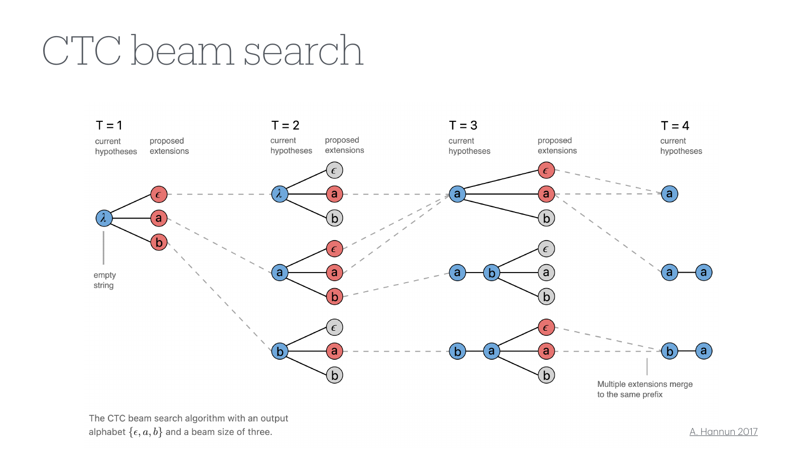

### 4.2 加入语言模型

仅凭音素概率，可能难以确定对应的词。例如，`I` 和 `eye` 的发音相同，但它们在句子中的使用情况不同。**语言模型（Language Model，LM）**根据词语及其上下文为候选句子评分，帮助选择更合理的词序列。

加入语言模型后，搜索同时考虑神经信号、句子的语言模型概率，以及**词插入奖励（Word Insertion Bonus）**：

$$
Y^*=\arg\max_Y P(Y\mid X)\times P(Y)\times L(Y).
$$

- $P(Y\mid X)$：根据神经信号得到的候选序列概率。
- $P(Y)$：语言模型给候选句子的概率。
- $L(Y)$：词插入奖励，用于调节加入词时的得分，避免搜索过于偏向少输出词的结果。

语言模型将句子的概率写成各词条件概率的乘积：

$$
P(Y)=P(y_1)P(y_2\mid y_1)P(y_3\mid y_2,y_1)\cdots.
$$

例如，对 `I can speak`，依次计算 `I` 的概率、在 `I` 后出现 `can` 的概率，以及在 `I can` 后出现 `speak` 的概率，再将它们相乘。

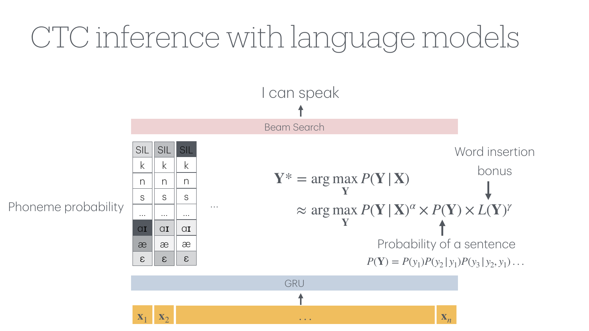

### 4.3 实时搜索与第二遍重评分

实时解码按 **20 毫秒的时间窗**处理新的神经特征：

1. 将当前特征 $\mathbf{x}_t$ 输入 GRU，更新音素概率。
2. 束搜索结合 **n-gram 语言模型**扩展候选词序列；该语言模型利用前面的有限个词预测下一个词。
3. 保留得分最高的 $k$ 个候选，供下一个时间窗继续扩展。

例如，神经信号支持同一发音时，语言模型可以为 `I` 和 `eye` 给出不同的分数，从而影响搜索保留哪些候选。

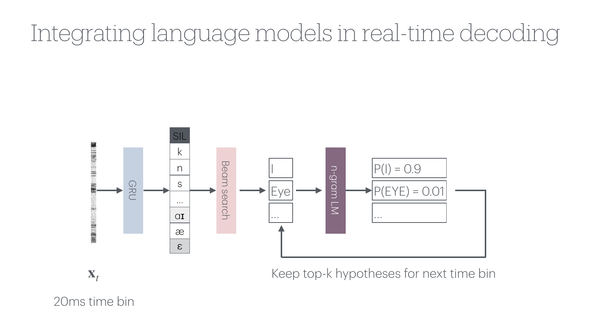

第一遍搜索结束后，把得分靠前的若干候选句子，即 **n-best 候选（n-best Hypotheses）**，交给 Transformer 语言模型进行**第二遍重评分（Second-pass Rescoring）**。

例如，候选中包含 `I can speak` 和 `I can spoke` 时，Transformer 语言模型根据整个句子的用词和语法，为前者给出更高的概率，并据此选择最终输出。

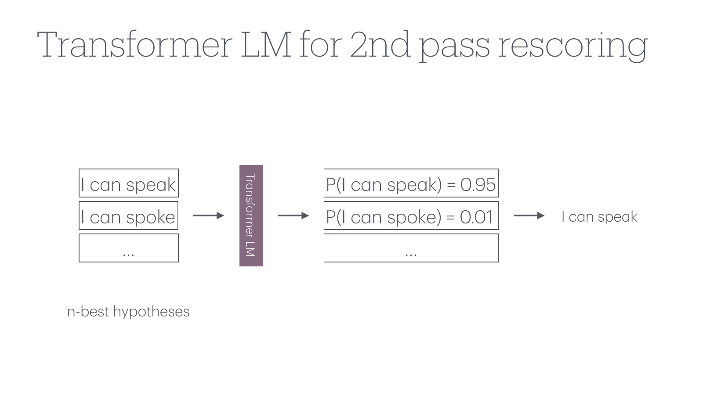

完整系统将这些步骤连接起来：神经特征经神经网络变成音素概率，5-gram 语言模型参与第一遍搜索，保留 100 个最可能的词序列，再由 Transformer 语言模型选出最终文字。文字还可以送入**文本转语音（Text-to-Speech）**系统，以合成语音播放。

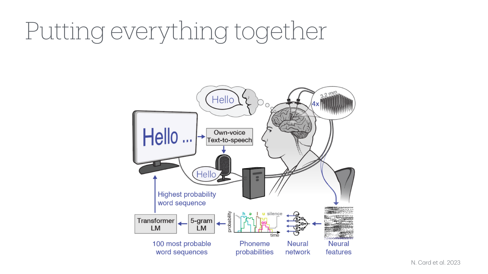

## 5. 词错误率评价

**词错误率（Word Error Rate，WER）**衡量预测文本与正确文本之间有多少词级错误：

$$
\operatorname{WER}(\widehat{Y},Y)
=\frac{\operatorname{distance}(\widehat{Y},Y)}{\operatorname{length}(Y)}.
$$

$\widehat{Y}$ 是预测词序列，$Y$ 是正确词序列。分子是把预测文本改成正确文本所需的最少词级编辑次数，包括替换、删除和插入；分母是正确文本的词数。WER 越低，识别错误越少。

例如，正确文本为 `I can speak`，预测为 `I can spoke`，只需把 `spoke` 替换为 `speak`，因此 WER 为 $1/3$，约 33.3%。

## 6. 后续方向与神经伦理

### 6.1 多模态输出与个人使用

**多模态语音脑机接口（Multimodal Speech BCI）**不只输出文字，还尝试恢复合成语音和虚拟人物的发音动作，使交流同时包含文字、声音和面部动作。

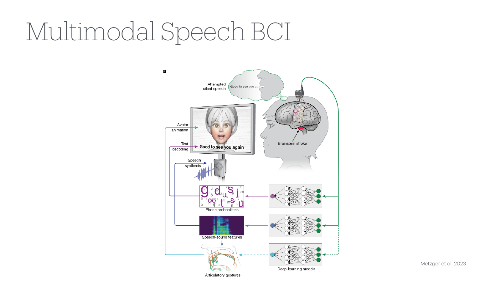

面向个人使用的研究进一步关注系统能否在持续使用中保持较高的识别准确性，让使用者将脑机接口用于日常交流。

**内言语（Inner Speech）**是没有实际说出口、在心中进行的言语。解码内言语的研究希望减少使用者尝试发音的负担，使交流更轻松自然。

### 6.2 神经伦理

脑机接口的发展带来**神经伦理（Neuroethics）**问题，主要涉及两个方面：

- **思想与记忆的读取**：是否允许读取本来不会说出口的内言语，读取可能因阿尔茨海默病丧失的记忆，或读取潜意识恐惧来辅助心理治疗。
- **超出自然水平的能力增强**：是否允许用脑机接口控制比原生手臂更快、更准确的机械臂，或通过技术获得原本需要学习的知识与记忆。

这些问题涉及对未来能力的设想，同时，帮助严重神经疾病或损伤者恢复交流是现实需求。研究与应用需要科学家、医生和工程师同伦理学者、监管机构及患者倡议团体共同讨论，兼顾功能恢复和伦理边界。

## 7. 总结

AI 与 NLP 的进展，结合神经科学和神经工程研究，为言语障碍者恢复自然交流提供了可能。语音脑机接口既有望帮助言语障碍和瘫痪者交流，也能帮助研究大脑如何处理语言。
