## 1. 文本卷积网络

循环神经网络按词序逐步计算隐藏状态。只用最后一个状态表示整句时，表示容易偏重句末；而单个时间步的状态也不直接表示一个不带前缀语境的短语。**卷积神经网络（Convolutional Neural Network，CNN）**提供了另一种做法：在序列的每个局部窗口上应用同一个变换，得到窗口特征，再将这些特征汇总。

例如，对 `tentative deal reached to keep government open` 使用宽度为 3 的窗口，会分别处理 `tentative deal reached`、`deal reached to`、`reached to keep`、`to keep government` 和 `keep government open`。这些窗口按连续位置取得，不要求本身构成语法短语。

### 1.1 一维卷积的计算

将 `tentative deal reached to keep government open` 中的每个词表示为一个 4 维词向量，按词序排成矩阵，每一行对应一个词。**滤波器（Filter，也称卷积核 Kernel）**的宽度为 3，表示每次处理三个相邻的词；它覆盖词向量的全部 4 个维度，因此具有一个 3×4 的权重矩阵。

第一个窗口是 `tentative deal reached`。它的词向量与滤波器权重分别为

$$
\begin{bmatrix}
0.2&0.1&-0.3&0.4\\
0.5&0.2&-0.3&-0.1\\
-0.1&-0.3&-0.2&0.4
\end{bmatrix},\qquad
\begin{bmatrix}
3&1&2&-3\\
-1&2&1&-3\\
1&1&-1&1
\end{bmatrix}.
$$

计算时，将两个矩阵对应位置的数相乘，再把 12 个乘积相加，得到 −1.0；加上偏置 b=1，得到 0.0；再经过非线性函数，得到图中的 0.50。图右侧的三列依次记录这三个阶段的结果。

窗口随后向右移动一个词，处理 `deal reached to`，并重复上述计算。各个窗口使用同一个滤波器和偏置。七个词共有五个宽度为 3 的窗口，一个滤波器便产生五个输出，组成一个**特征图（Feature Map）**。

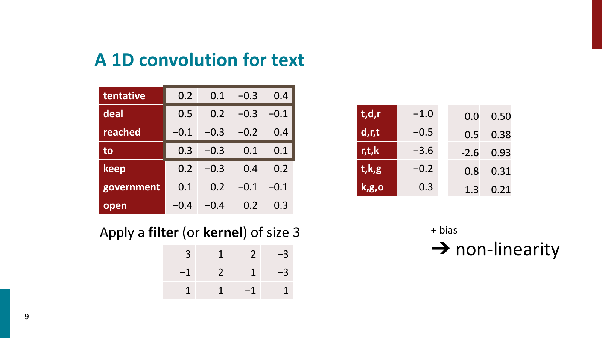

**填充（Padding）**是在序列两端补零向量。两端各补一个零向量后，第一个窗口变为“零向量、tentative、deal”，最后一个窗口变为“government、open、零向量”，窗口总数从五个增加到七个。下面的图只列出与滤波器对应相乘并求和的结果，尚未列出加偏置和非线性变换后的数值。

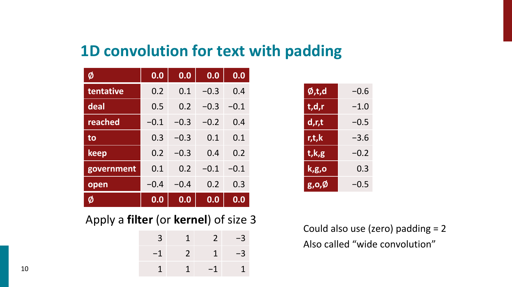

如果使用三个滤波器，每个滤波器都有自己的一组权重，并分别处理这七个窗口。这样，每个窗口产生三个数，全部窗口的结果组成七行三列的表：每行对应一个窗口，每列对应一个滤波器。后面的池化示例便使用这张表。

### 1.2 最大池化与平均池化

卷积产生的结果仍随句子长度变化。**池化（Pooling）**将多个位置的特征值汇总，得到更短的表示。

**时间维最大池化（Max-over-time Pooling）**沿每一列取最大值。以七行三列的卷积结果为例，第一列的七个数是 −0.6、−1.0、−0.5、−3.6、−0.2、0.3、−0.5，最大值为 0.3；另外两列的最大值分别为 1.6 和 1.4。三列分别取最大值后，得到句子向量

$$
\hat{\mathbf c}=[0.3,\ 1.6,\ 1.4].
$$

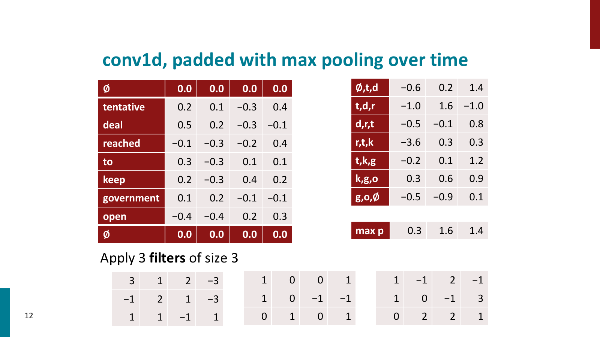

每个滤波器最终保留一个最大的响应值，而不保留这个值来自哪个窗口。因此，即使句子的词数不同，只要滤波器数量相同，池化后向量的维度就相同。

**平均池化（Average Pooling）**同样沿每一列汇总，但计算的是所有位置的平均值。上述三列分别求平均，得到约 [−0.87, 0.26, 0.53]。

### 1.3 步幅、局部池化与膨胀

**步幅（Stride）**是卷积窗口起点每次移动的距离。步幅为 1 时，每个相邻窗口都计算一次；步幅为 2 时，窗口每次向右移动两个位置。在两端各补一个零向量的例子中，原来的七个窗口只计算第1、3、5、7个，得到四行结果。

**局部最大池化（Local Max Pooling）**则先有卷积结果，再对相邻位置分组取最大值。下面的例子将七行结果每两行分为一组，对组内的每一列分别取最大值，得到四行三列的结果。

例如，前两行是 [−0.6, 0.2, 1.4] 和 [−1.0, 1.6, −1.0]，逐列取最大后为 [−0.6, 1.6, 1.4]。最后一行没有配对行，图中补上 −∞，使它不改变原有的最大值。

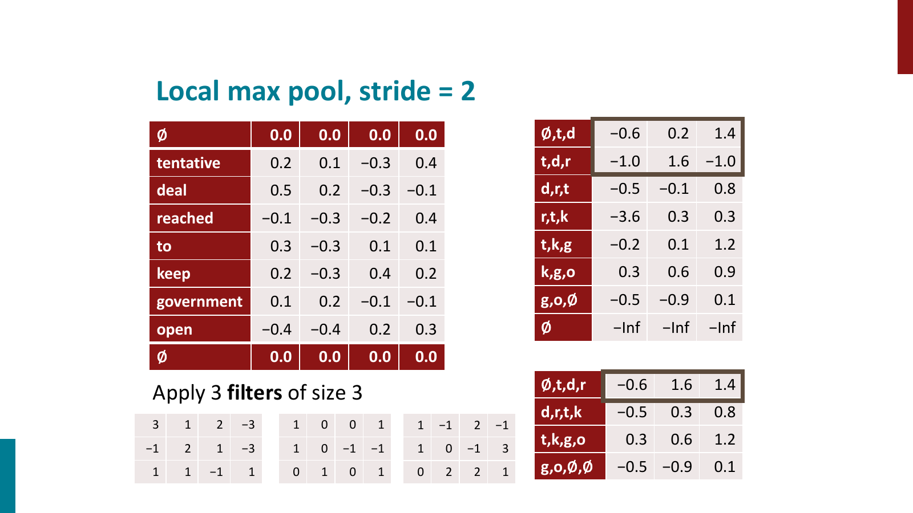

**k-max池化（k-max Pooling）**在每一列保留 k 个最大值。k=2 时，第一列保留 0.3 和 −0.2，第二列保留 1.6 和 0.6，第三列保留 1.4 和 1.2，得到两行三列的结果。

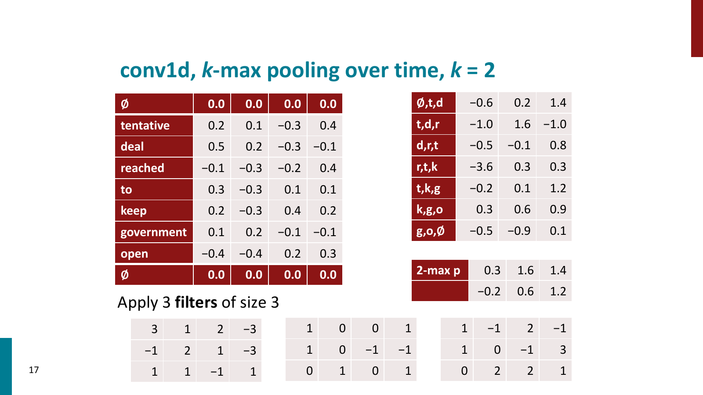

**膨胀（Dilation）**控制一个卷积窗口内部读取位置的间隔。膨胀率为 2 时，宽度为 3 的滤波器依次读取第1、3、5个词，随后读取第2、4、6个词，再读取第3、5、7个词。滤波器仍使用三个词的向量，但覆盖了五个词的位置范围。

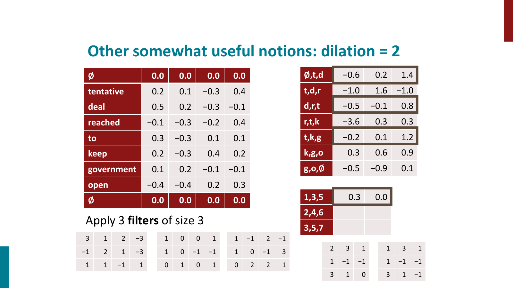

## 2. CNN用于句子分类

**句子分类（Sentence Classification）**是为整个句子预测一个类别。例如，输入一条电影评论，输出“正面”或“负面”；输入一个问题，判断它询问的是人物、地点还是数量。Yoon Kim（2014）的模型使用一层卷积和最大池化完成这类任务。

### 2.1 单层CNN的计算

模型的计算过程为：

1. **词向量输入。** 将句子中的每个词转换为词向量，按词序排列。
2. **多组卷积。** 用不同宽度的滤波器分别扫描句子。例如，宽度为 3、4、5 的滤波器分别处理连续的三个、四个、五个词。每种宽度可使用多个滤波器，每个滤波器都有自己的权重，产生一列特征值。
3. **最大池化。** 对每个滤波器产生的一列取最大值，每个滤波器保留一个数。
4. **拼接与分类。** 把这些最大值排成一个向量，作为整句的表示，再送入分类层，计算各类别的概率。

例如，三种窗口宽度各使用 100 个滤波器，一共得到 300 列特征；每列取最大值后，就得到 300 个数，组成一个 300 维句子向量。最大池化使不同长度的句子都能得到相同维度的表示。这个向量经过分类层和 Softmax，得到各类别的概率；训练时，对池化后拼接的向量使用 Dropout，减少过拟合。

### 2.2 微调词向量的问题

模型可以用预训练词向量初始化输入。训练分类模型时，可以固定这些词向量，只训练卷积层和分类层；也可以让词向量一起更新，以适应当前任务。

微调也可能改变原有的词语相似关系。例如，`tedious`、`dull` 和 `plodding` 都表示乏味，预训练向量原本相近。如果训练评论只出现前两个词，它们的向量会更新，而 `plodding` 的向量不变；测试时遇到 `plodding`，模型就未必能像处理前两个词那样处理它。

### 2.3 双通道词向量

**双通道词向量（Multichannel Embeddings）**从同一套预训练向量复制出两份：一份保持固定，另一份参与训练。对于同一个窗口，滤波器分别处理两份词向量，将两份结果相加后再进行最大池化。固定副本保留预训练得到的词语关系，可训练副本则适应当前任务。

完整模型从两套词向量出发，用不同宽度的滤波器提取特征，再通过最大池化和拼接得到句子向量，最后预测类别。

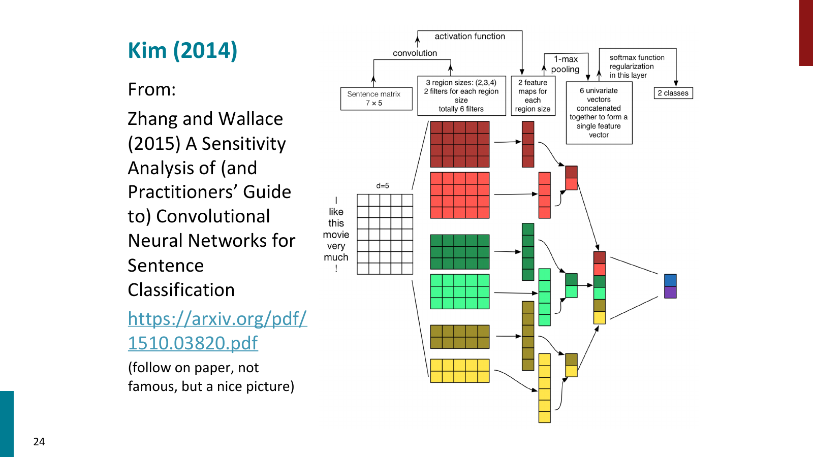

实验比较了随机初始化、固定预训练向量、微调预训练向量和双通道四种配置。使用预训练词向量通常优于随机初始化，但双通道并非在所有数据集上都最好。比较不同模型的结果时，也要考虑训练设置：Kim 的模型使用了 Dropout，而部分较早的对比系统没有使用相同的正则化方法。

## 3. 模型比较与CNN补充

### 3.1 不同模型的特点

| 模型 | 特点与适用任务 |
| --- | --- |
| **词向量平均（Bag of Vectors）** | 简单分类任务中的有效基线；平均后可再接若干 ReLU 层，形成深度平均网络。 |
| **窗口模型（Window Model）** | 适用于不需要大范围上下文的词级分类，如词性标注（POS）和命名实体识别（NER）。 |
| CNN | 适合分类，易于在 GPU 上并行计算；短序列需要补零，局部窗口特征较难按语言结构解释。 |
| RNN | 按词序处理，适用于序列标注、分类和语言模型；计算比 CNN 慢，只用最后状态做分类有局限，注意力可改善这一点。 |
| Transformer | 适用于语言模型和句子表示；与 CNN 也可能具有互补优势。 |

### 3.2 批归一化

**批归一化（Batch Normalization，BatchNorm）**常用于 CNN。它对每个特征分别计算一个批次中的均值和方差，将卷积输出标准化。

BatchNorm 与 Transformer 中常用的**层归一化（Layer Normalization，LayerNorm）**使用不同的统计范围：

- **BatchNorm**：固定一个特征，跨批次中的样本和位置计算统计量，再标准化这个特征。
- **LayerNorm**：固定一个样本中的位置，在其特征维度之间计算统计量，独立完成标准化。

BatchNorm 会自动调整输出的尺度，能降低模型对参数初始化的敏感度，也使学习率更容易调节。PyTorch 中对应的模块为 `nn.BatchNorm1d`。

### 3.3 核大小为1的卷积

**核大小为1的卷积（1×1 Convolution）**也称 **Network-in-Network（NiN）**。它每次只读取一个位置，但会读取该位置的全部通道，对这些通道做全连接线性变换。

例如，一个位置原有许多通道，可以用核大小为1的卷积将它映射为较少的通道。它在各位置共享权重，能用较少的参数增加网络层，与 Transformer 的逐位置前馈层类似。

## 4. 用于文本分类的深层卷积网络

Conneau 等人（2017）提出的**深层卷积网络（Very Deep CNN，VD-CNN）**尝试将视觉网络中堆叠多层卷积的做法用于文本分类。它从字符级输入开始，逐层学习文本特征。

输入文本被截断或填充到 1024 个字符，每个字符表示为 16 维向量。在各阶段之间，局部池化将序列长度减半，同时将特征通道数加倍。

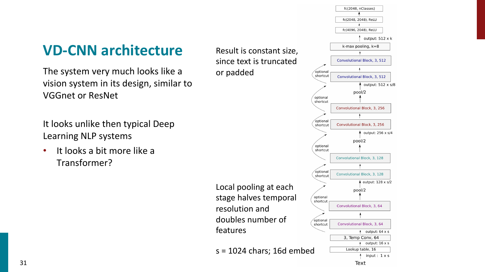

每个卷积块包含两层宽度为3的卷积，每层后接 BatchNorm 和 ReLU。卷积通过补零保持序列长度，局部池化时再缩短序列。

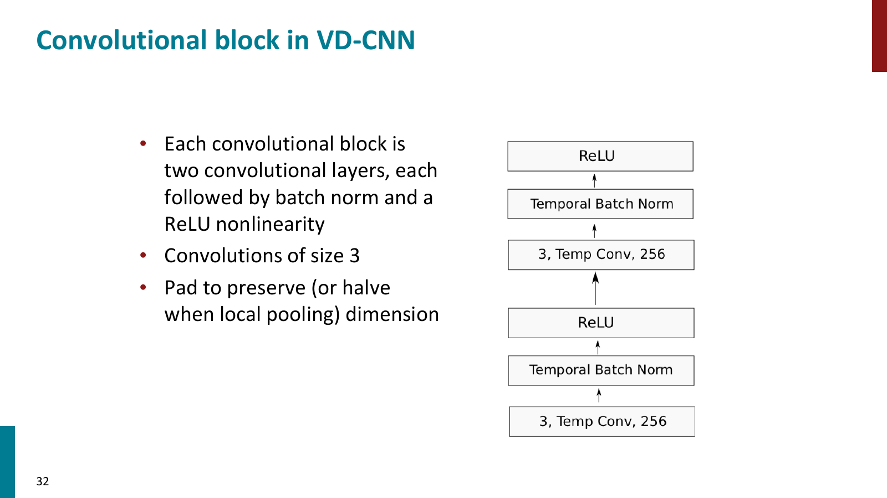

实验使用大型文本分类数据集，规模显著大于 Kim 的单层 CNN 所用的数据集。

## 5. 树递归神经网络

### 5.1 语言的递归结构与短语表示

语言中的短语可以递归嵌套。例如，`the person standing next to the man from the company` 中，表示人的名词短语内又包含 `the man from the company`，后者又包含 `the company`。**成分句法树（Constituency Tree）**用树结构表示词如何组成短语、短语如何组成更大的短语和句子。

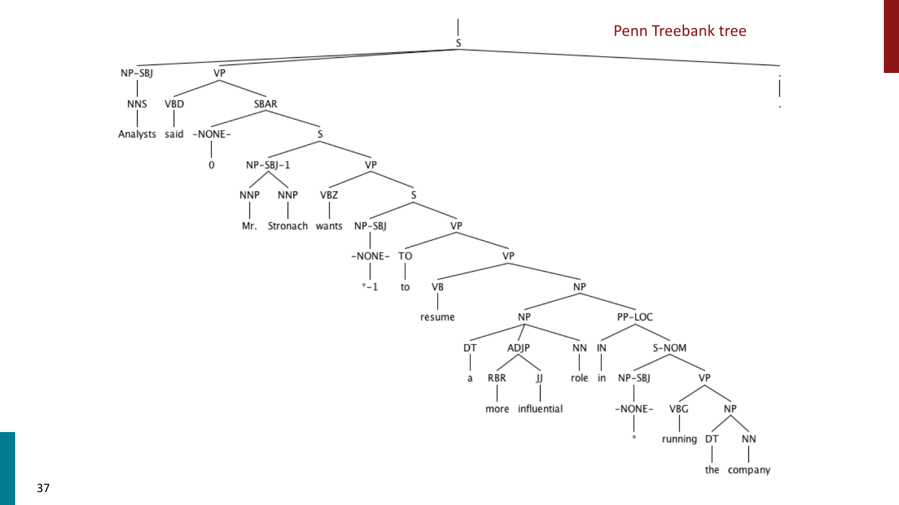

**组合性原则（Principle of Compositionality）**认为，短语或句子的意义由组成部分的意义及组合规则共同决定。要得到一个短语的向量，可以先得到其组成部分的向量，再按树结构将它们组合。

**树递归神经网络（Tree Recursive Neural Network，TreeRNN）**反复使用同一个组合函数，自底向上计算树中各节点的向量。例如，先组合 `my` 和 `birth`，得到 `my birth` 的向量，再与其他节点继续组合，最终得到整句表示。

TreeRNN 的节点对应树中的词或短语；**序列循环神经网络（Recurrent Neural Network，RNN）**则按词序更新状态，某一步的状态还包含此前读过的词。因此，序列 RNN 的状态不直接对应一个独立短语的表示。

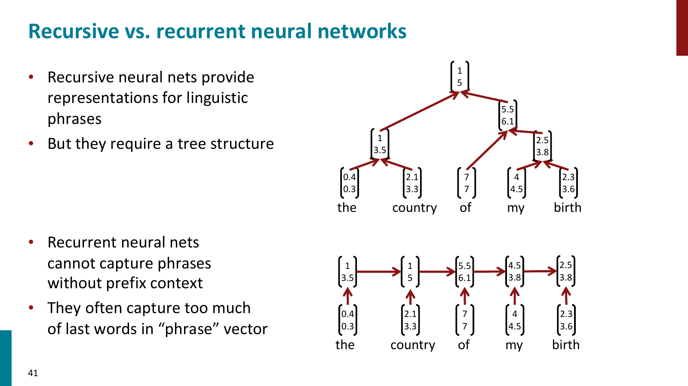

### 5.2 子节点组合与合并评分

构造句法树时，需要比较哪些相邻节点适合组成短语。节点可以是一个词，也可以是已经合成的短语。例如，`the` 和 `mat` 可以作为两个候选子节点；得到 `the mat` 后，这个短语又可以与 `on` 组成新的候选。

对每一对子节点，模型计算两个结果：**父节点向量**表示合并后的短语，**合并分数**用于比较这次合并与其他候选合并的合理性。

首先，设左右两个子节点的向量分别为 $\mathbf c_1,\mathbf c_2\in\mathbb R^d$，计算父节点向量：

$$
\mathbf p=\tanh\!\left(W[\mathbf c_1;\mathbf c_2]+\mathbf b\right).
$$

其中的计算按以下顺序进行：

1. **拼接**：将两个 d 维子向量上下排列，得到一个 2d 维向量 $[\mathbf c_1;\mathbf c_2]$。
2. **线性变换**：用 $W\in\mathbb R^{d\times2d}$ 将它映射回 d 维，再加上偏置 $\mathbf b\in\mathbb R^d$。
3. **非线性变换**：对各个分量应用 tanh，得到父节点向量 $\mathbf p\in\mathbb R^d$。

父向量与子向量具有相同维度，所以一个已经合成的短语可以继续作为输入，与另一个词或短语组合。

接着，用可学习的评分向量 $\mathbf U\in\mathbb R^d$ 计算合并分数：

$$
\mathrm{score}=\mathbf U^\top\mathbf p.
$$

点积将 d 维父向量转换成一个数。图中，两个子向量经过组合得到父向量，旁边的 1.3 是这次合并的分数。解析时比较不同候选的分数，选择下一步合并哪一对；选中后，父向量用于后续组合。

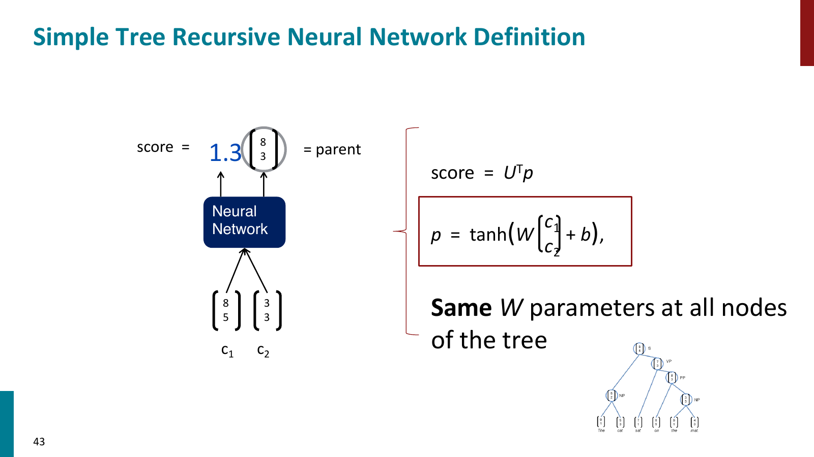

树中各个位置使用相同的组合权重 $W$、偏置 $\mathbf b$ 和评分向量 $\mathbf U$，词与词、词与短语、短语与短语的组合都重复使用这一计算。

### 5.3 贪心构造句法树

以 `The cat sat on the mat` 为例，开始时只有六个词向量，尚未组成短语。**贪心解析（Greedy Parsing）**按以下步骤构造树：

1. 对所有相邻节点对计算候选父向量和合并分数。最初的候选包括 `The + cat`、`cat + sat`、`sat + on`、`on + the` 和 `the + mat`。
2. 选择当前分数最高的一对合并。例如，先合并 `The + cat`，用新的短语向量替代这两个词向量。
3. 将新短语作为一个节点，与相邻节点继续计算候选合并。示例随后合并 `the + mat`，再逐步组成更大的短语。
4. 重复评分与合并，直到只剩一个根节点，得到整句的树和向量表示。

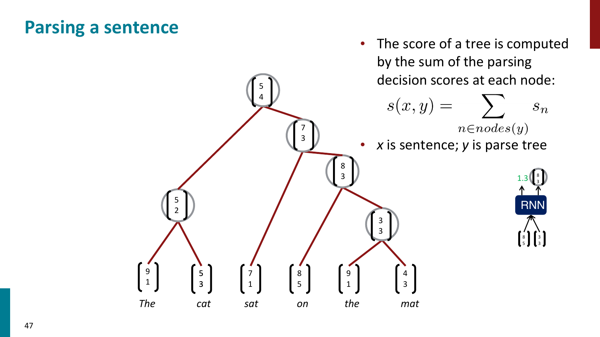

一棵树的分数是各个内部节点的合并分数之和：

$$
S(x,T)=\sum_{v\in\operatorname{Internal}(T)}s_v.
$$

这里 x 是句子，T 是候选句法树，$s_v$ 是形成内部节点 v 时的合并分数。模型由此同时得到树结构和树中各短语的向量表示。

### 5.4 简单TreeRNN的局限

简单 TreeRNN 能学习一些组合关系，但仍有以下局限：

- **复杂组合与长句处理能力有限**：单层组合网络难以表达更复杂的高阶组合，也难以解析长句。
- **两个输入缺少直接的乘法交互**：两个子向量分别经过线性变换后相加，没有输入分量之间直接相乘的项。RNTN 在组合函数中加入这种乘法交互。
- **所有类别使用相同的组合函数**：不同句法类别和标点都使用同一个组合矩阵，没有针对这些差异采用不同的组合方式。

## 6. 递归神经张量网络与情感分析

**递归神经张量网络（Recursive Neural Tensor Network，RNTN）**允许两个词或短语向量发生乘法交互，用于学习比简单 TreeRNN 更复杂的组合关系。情感分析可用于检验这种组合能力。

### 6.1 情感分类与短语级监督

**情感分类（Sentiment Classification）**判断文本是正面、负面还是中性。长篇评论中可能反复出现 `loved`、`great`、`impressed`、`marvelous` 等明显的情感词，因此即使主要依靠词袋特征，也可能取得较高准确率。这并不能说明模型理解了词语组合后的情感。

**Stanford Sentiment Treebank（SST）**为 11,855 个句子中的 215,154 个短语标注了情感。标注沿成分句法树展开：不仅整句有情感标签，树中的子短语也有各自的标签。因此，可以用短语标签训练模型，并检验它在组合各级短语时是否得到了正确的情感判断。

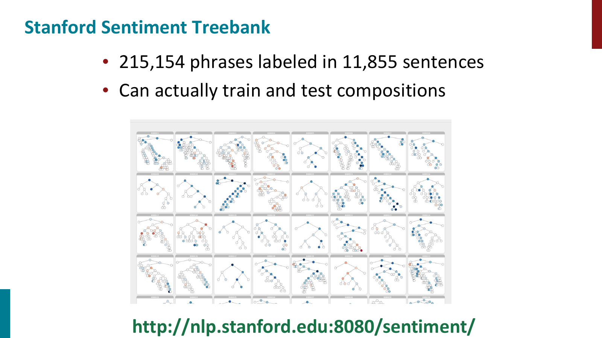

将训练数据从整句标签扩充为树库中的短语标签后，多种模型的表现都得到提升。但困难的否定案例仍常被判断错误，说明还需要表达能力更强的组合模型。

### 6.2 RNTN的组合与分类

RNTN 在普通 TreeRNN 的线性组合之外加入乘法项。设两个子节点的向量为 $\mathbf c_1,\mathbf c_2\in\mathbb R^d$，拼接为 $\mathbf z=[\mathbf c_1;\mathbf c_2]$，父节点向量为

$$
\mathbf p=\tanh\!\left(\mathbf z^\top\mathcal V^{[1:d]}\mathbf z+W\mathbf z+\mathbf b\right).
$$

其中，$W\mathbf z+\mathbf b$ 是普通 TreeRNN 已有的线性变换；$\mathbf z^\top\mathcal V^{[1:d]}\mathbf z$ 是新增的**张量交互项**。张量 $\mathcal V$ 为父向量的每个维度提供一组权重，对输入分量相乘的结果进行加权。这样，组合结果不只取决于两个输入分别提供什么特征，也取决于这些特征怎样搭配。

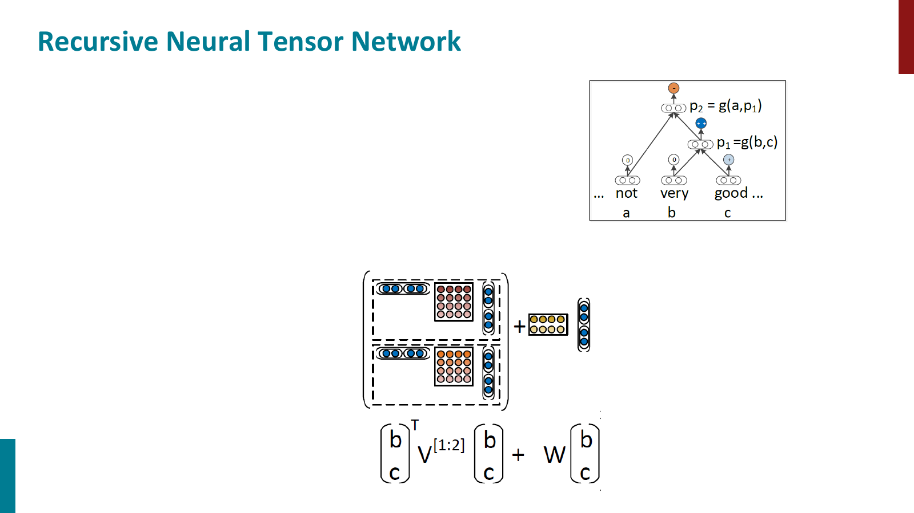

树中每个节点的向量都送入情感分类器。例如，节点 v 的向量为 $\mathbf p_v$，则其类别概率为

$$
P(y_v\mid\mathbf p_v)=\operatorname{softmax}(W_s\mathbf p_v+\mathbf b_s).
$$

分类器对词、子短语和整句分别预测情感，并与相应节点的标签比较。组合网络与分类器的权重通过梯度下降联合训练。

### 6.3 情感分类实验

- **整句分类**：RNTN 在 SST 的正负二分类任务中达到 85.4% 的准确率。
- **转折结构**：对 `X but Y` 句子，RNTN准确率为 72%，高于 MV-RNN 的 65%、词对朴素贝叶斯的 58% 和普通 RNN 的 54%。
- **否定表达**：对负面表达进行否定时，模型的正面情感激活应当增加，用于检验它是否捕捉到否定带来的情感变化。
