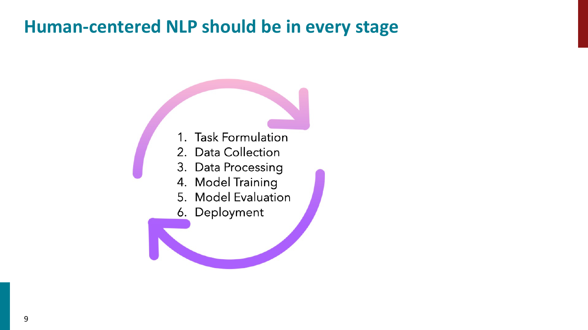
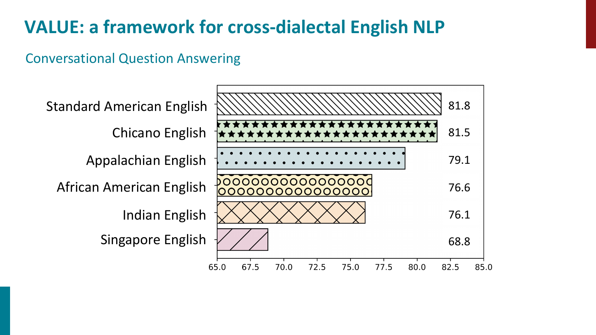
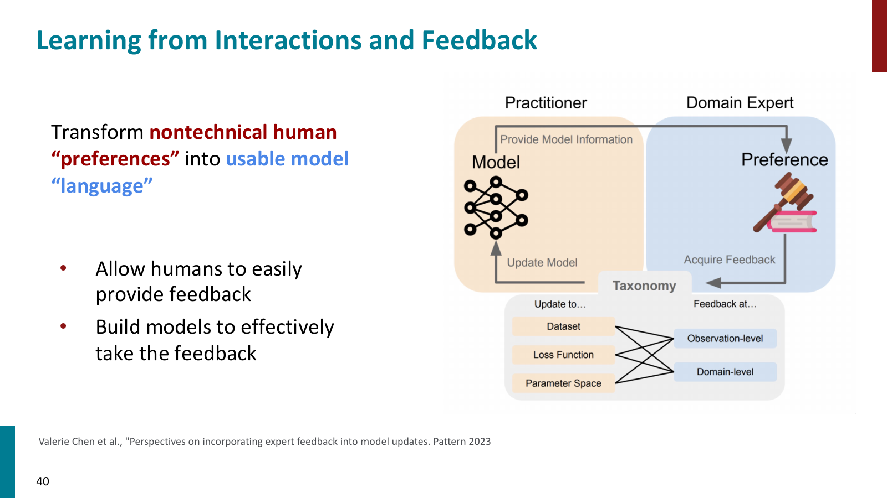
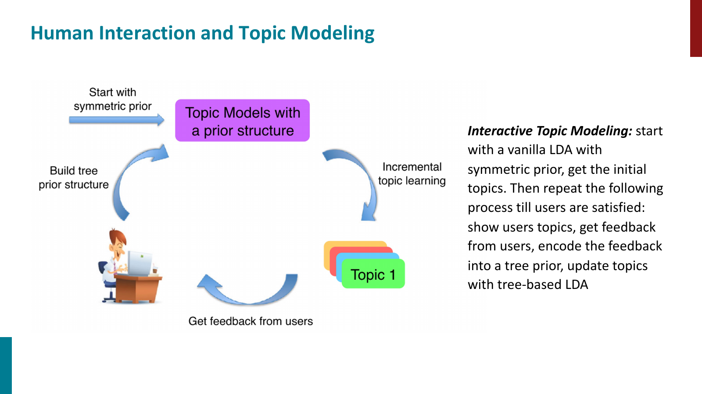
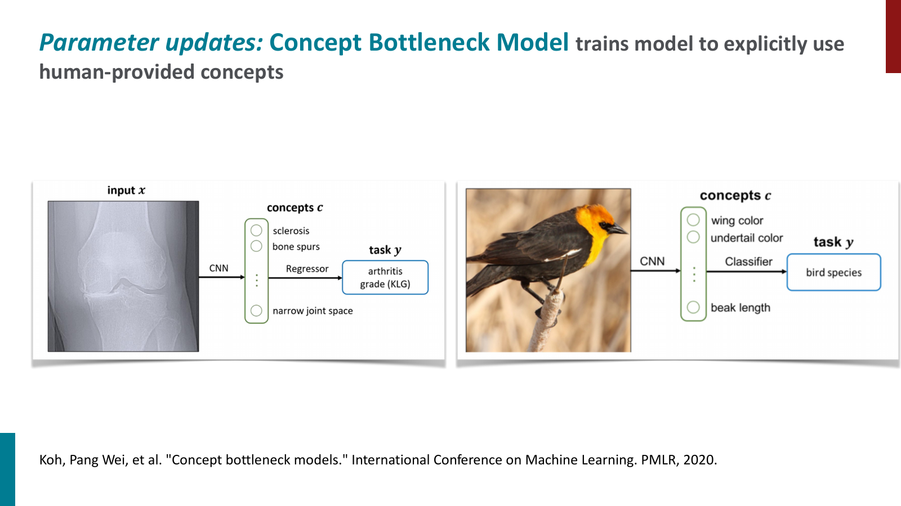
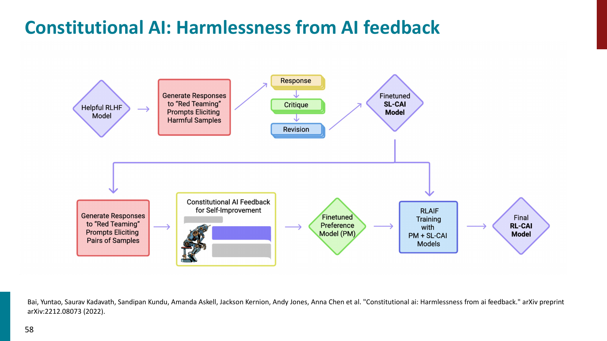
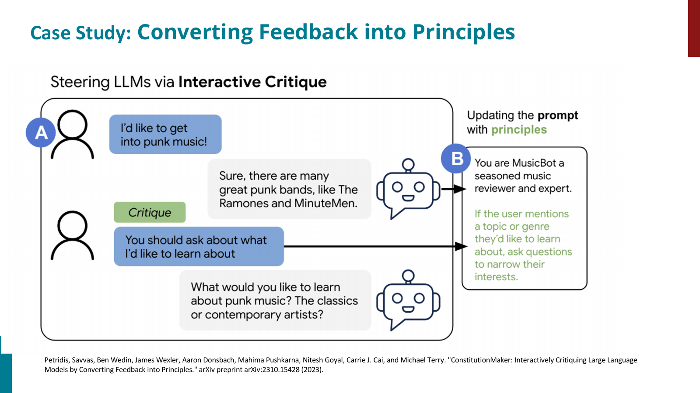

## 1. 以人为中心的NLP

语言模型的能力提高后，偏见、有害输出和实际使用中的风险仍然存在。例如，让模型逐步推理，并不保证它会拒绝有害请求；它也可能为有害行为生成详细步骤。设计 NLP 系统时，除了模型能完成什么任务，还需要考虑它服务哪些人、怎样被使用，以及可能对人产生什么影响。

**以人为中心的自然语言处理（Human-centered NLP）**是在设计和开发 NLP 系统时，适应人的需求与偏好，并考虑系统的伦理和社会影响。这里的“人”包括使用者、提供数据与反馈的人，以及受到系统影响的人；系统也应当便于不同群体使用，具有**可访问性（Accessibility）**和**包容性（Inclusiveness）**。

人的需求应贯穿任务定义、数据收集、数据处理、模型训练、模型评价和部署，而不只在最后设计交互界面时考虑。

### 1.1 数据收集

数据应尽量反映真实使用情境。例如，众包标注者在受限任务中编写的问题，可能与用户实际提出的问题不同。数据来源还可能带来以下偏差：

- **自选择偏差（Self-selection Bias）**：主动在 Twitter、Reddit 等平台发帖的人并不代表所有人；谁选择发帖、为什么发帖，会影响收集到的内容。
- **报告偏差（Reporting Bias）**：人们谈论某件事的频率，不一定与它在现实中发生的频率相同。
- **动机偏差（Motivational Bias）**：付费、无偿以及在不知不觉中提供数据的参与者，可能有不同的行为动机。

以人为中心的数据收集应尽量模拟真实使用场景，使数据反映实际需求，并覆盖容易被忽略的群体。

### 1.2 模型训练与部署

**人在回路中的训练（Human-in-the-loop Model Training）**让终端用户、众包标注者、领域专家和开发者参与模型改进。开发者通常更关注模型结构和训练，领域专家、标注者等则更多参与数据和部署后的反馈。

部署时需要明确四件事：

- 谁设计系统；
- 谁使用系统；
- 用户怎样使用系统；
- 怎样的界面能支持这些交互。

忽略这些问题，可能造成带偏见的结果、错误理解、文化理解不足、缺乏个性化和安全风险。

## 2. 评价与伦理

### 2.1 以人为中心的评价

标准评价分数未必能揭示模型是否依赖捷径完成任务。**以人为中心的评价（Human-centered Evaluation）**需要考虑用户特征、交互目标，以及用户理解和操作系统时的**认知负荷（Cognitive Load）**，设计更细的指标和分析方法。

人的判断可以用于三个方面：

1. **评价模型输出**：用户是否认可 AI 系统给出的内容。
2. **检验自动指标**：自动评分是否与人工评价相关。
3. **直接改进模型**：将人类偏好用于训练，例如 RLHF。

评价还需要明确：谁适合做判断，应评价哪些方面，以及除了准确率和任务表现之外，怎样检查风险、伤害与安全。

**BBQ** 和 **StereoSet** 用于检验刻板印象与偏见。例如，BBQ 给出信息不足或信息充分的情境，检查模型能否依据已有信息作答，而不是根据群体身份猜测；StereoSet 则比较刻板印象、反刻板印象和不相关的文本选项。**HELM**从多个场景和指标综合评价模型，避免只用单一分数描述表现。

### 2.2 人工参与研究的伦理要求

设计涉及人的评价实验时，需要了解适用的机构审查、伦理委员会和数据收集法律要求。参与者应当在理解研究及数据使用方式后作出选择，即提供**知情同意（Informed Consent）**；收集和保存数据时，也要考虑匿名化。

### 2.3 AI辅助邮件与信任

AI 辅助写作的评价不只取决于文字质量。以邮件为例，有参与者认为邮件写得不错，但知道它由 AI 撰写后，会产生不同的感受。

一项研究设置了产品咨询、聚会邀请、宠物离世安慰三种情境，比较不同 AI 参与程度和人际关系需求下的**感知信任（Perceived Trust）**。研究结合问卷与访谈，考察 AI 态度、计算机态度、信任倾向，并从三个维度评价可信赖性：

- **能力（Ability）**：是否能胜任写作任务。
- **善意（Benevolence）**：是否被认为关心收信人。
- **诚信（Integrity）**：是否符合对诚实与行为原则的期待。

这类评价将文本放回具体的人际交往情境中，同时考察内容和用户对其来源的认知。

## 3. 面向社会影响的NLP

### 3.1 不同群体的使用需求

系统可能无法服务某些群体，甚至对其造成歧视或伤害。例如，聊天机器人可能不理解数据中代表不足的群体，智能音箱可能无法识别有言语障碍者的语音。

社会受益应用包括疾病暴发监测、心理监测与咨询，以及为残障人士提供辅助。语音识别可以为听障人士生成视频字幕，也可以帮助有认知障碍的人交流。设计这些应用时，需要将相关群体的需求纳入系统开发。

### 3.2 跨方言评价与适配

**VALUE／Multi-VALUE**是跨英语方言的 NLP 框架，覆盖 50 种英语方言和 189 项语言特征，包括非裔美国英语、奇卡诺英语、印度英语、阿巴拉契亚英语和新加坡口语英语。

框架强调四个特点：

- **可解释（Interpretable）**：通过明确的语言特征描述方言变化。
- **灵活（Flexible）**：可以调节语言特征出现的密度。
- **可扩展（Scalable）**：可以与不同数据集组合。
- **负责任（Responsible）**：采用参与式设计，让相关人群参与设计过程。

在对话问答评价中，标准美式英语的分数为 81.8，而新加坡英语为 68.8；模型对不同方言的表现存在差距。

**方言适配器（Dialect Adapters）**在语言模型上加入适配模块，让主要使用标准美式英语训练的模型适应低资源方言，也可用于低资源语言。

### 3.3 用价值目标数据适配模型

**PALMS（Process for Adapting Language Models to Society）**使用**价值目标数据集（Values-targeted Datasets）**，使预训练语言模型的行为更符合预先定义的规范。构造数据分为三个步骤：

1. 选择敏感主题。
2. 描述模型在这些主题上的期望行为。
3. 编写体现这些行为要求的问题—回答对，用于适配模型。

## 4. 人类反馈的形式与使用

### 4.1 反馈的不同形式

**人类反馈（Human Feedback）**不只包括回答好坏的二选一标签，还可以直接涉及数据、特征、目标函数和参数：

- 为样本提供标签、编辑样本或调整数据权重；
- 提供二元反馈、等级评分、自然语言评论或代码反馈；
- 定义、增加或删除特征；
- 直接修改目标函数或模型参数。

利用反馈需要同时解决两个问题：让人容易表达意见，以及让模型能够利用这些意见。对非专家而言，自然语言反馈通常比标注更容易提供，标注又比直接操纵模型容易；但模型需要将这些意见转成可用于更新的信息。

### 4.2 交互式主题建模

**主题模型（Topic Model）**从文档中学习主题，每个主题可用一组相关词表示。**交互式主题建模（Interactive Topic Modeling）**允许用户查看并修正这些主题。

一种做法先用具有对称先验的 LDA（潜在狄利克雷分配）得到初始主题，再重复以下过程：展示主题、收集用户反馈、将反馈编码为树形先验，再用基于树的 LDA 更新主题，直到用户满意。

### 4.3 将反馈用于模型更新的三种方式

| 更新方式 | 反馈怎样被使用 |
| --- | --- |
| **数据集更新（Dataset Updates）** | 改变训练数据。 |
| **损失函数更新（Loss Function Updates）** | 在训练目标中加入约束或惩罚。 |
| **参数空间更新（Parameter Space Updates）** | 通过编辑、干预或适配调整模型参数和行为。 |

## 5. 从反馈中学习

### 5.1 数据集更新

反馈可以通过**数据增强（Data Augmentation）**、**弱监督（Weak Supervision）**、**主动学习（Active Learning）**和**模型辅助对抗标注（Model-assisted Adversarial Labeling）**改变训练数据。

数据增强增加训练样本；弱监督利用规则等不完全准确的信号提供监督；模型辅助对抗标注则利用模型的表现，引导人构造模型容易判断错误的样本。

主动学习不被动接受全部可用数据，而是由学习系统主动选择需要标注的数据点，再向人获取标签，使人工标注集中于选中的样本。

### 5.2 损失函数更新

**非似然学习（Unlikelihood Learning）**通过惩罚不希望出现的生成结果，降低这些结果的概率。例如，模型不遵循生成要求，或反复重复此前内容时，可针对这些行为加入惩罚。

专家反馈也可以转成模型行为约束。**反事实或对照样本（Counterfactual or Contrasting Examples）**修改输入中的关键内容，使标签发生变化，再通过辅助训练目标要求模型学会这种差别。例如，将“我喜欢它，剪辑很好，配乐运用出色”改成“我讨厌它，剪辑很差，配乐运用糟糕”，情感标签也从正面改为负面。

### 5.3 参数空间更新

参数更新方法包括模型编辑、概念瓶颈模型、参数高效微调、RLHF，以及从修改或纠错中学习。

**模型编辑（Model Editing）**使用一个期望的输入—输出对，对预训练模型进行快速、局部的修改。MEND 对监督微调得到的梯度进行变换，并利用梯度的低秩分解，使这种变换能够以可处理的参数规模实现。

**概念瓶颈模型（Concept Bottleneck Model）**让模型显式使用人提供的概念：先根据输入预测概念，再根据概念预测任务标签。例如，从鸟类图片中预测翅膀颜色、尾部颜色和喙长，再据此判断鸟类物种；人可以检查或修改中间概念。

**参数高效微调（Parameter-Efficient Fine-tuning，PEFT）**可利用少量交互数据，通过 Adapter、Prefix 等方式引导模型表现出期望行为。

## 6. 不同层次的人类反馈与AI反馈

### 6.1 局部与全局反馈

对话摘要可以同时使用两种层次的反馈：

- **局部反馈（Local Feedback）**：标出关键字词、说话者意图、事件或主题。
- **全局反馈（Global Feedback）**：评价摘要的连贯性、覆盖度和整体质量。

训练时，先收集两个层次的反馈，再分别设计或学习相应的奖励模型，最后利用奖励训练摘要生成策略。

**人类反馈强化学习（Reinforcement Learning from Human Feedback，RLHF）**的基本流程是：先用人工示范进行监督微调，再用人工比较数据训练奖励模型，最后让语言模型生成回答，由奖励模型评分，并据此更新语言模型。

### 6.2 Constitutional AI

**宪法式AI（Constitutional AI）**用一组行为原则指导 AI 反馈，以训练更无害的模型，主要包含两个阶段：

1. **监督学习阶段**：让模型回答容易诱发有害行为的提示，再依据原则批评和修订回答，用修订后的回答微调模型。
2. **强化学习阶段**：生成成对回答，依据原则由 AI 给出偏好，用这些偏好训练偏好模型，再通过强化学习更新语言模型。

### 6.3 AI反馈强化学习

**AI反馈强化学习（Reinforcement Learning from AI Feedback，RLAIF）**用 AI 提供的评价代替逐项人工评价，以扩展反馈规模。以摘要为例，将原文和两份候选摘要交给评价模型，要求它比较连贯性、准确性、覆盖度和整体质量，给出偏好。偏好数据用于训练奖励模型，再通过奖励模型优化摘要生成模型。

在摘要实验中，人工评价者更偏好 RLHF 和 RLAIF 的结果，而不是仅经过监督微调的结果；该实验中，RLAIF 与 RLHF 的偏好胜率没有显著差异。

### 6.4 将交互批评转成原则

**ConstitutionMaker**将用户对回答的批评转换为可复用的行为原则，再更新模型的提示。

例如，用户说想了解朋克音乐，模型立即推荐乐队；用户批评它应该先询问自己的兴趣。系统据此形成原则：“用户提到想了解某个主题或流派时，先通过提问缩小其兴趣范围。”模型之后便先询问用户想了解经典作品还是当代音乐。

## 7. 人类反馈的局限

- **偏好可能不可靠**：人提供的判断未必稳定或准确。
- **奖励投机（Reward Hacking）**：模型可能追求奖励分数，而没有满足真实目标。
- **表面表现可能受到奖励**：回答即使不真实，也可能因为显得权威、冗长或热心而获得好评。
- **反馈者决定被代表的价值**：需要明确谁提供反馈，最终对齐的是谁的偏好、代表的是谁的价值。
