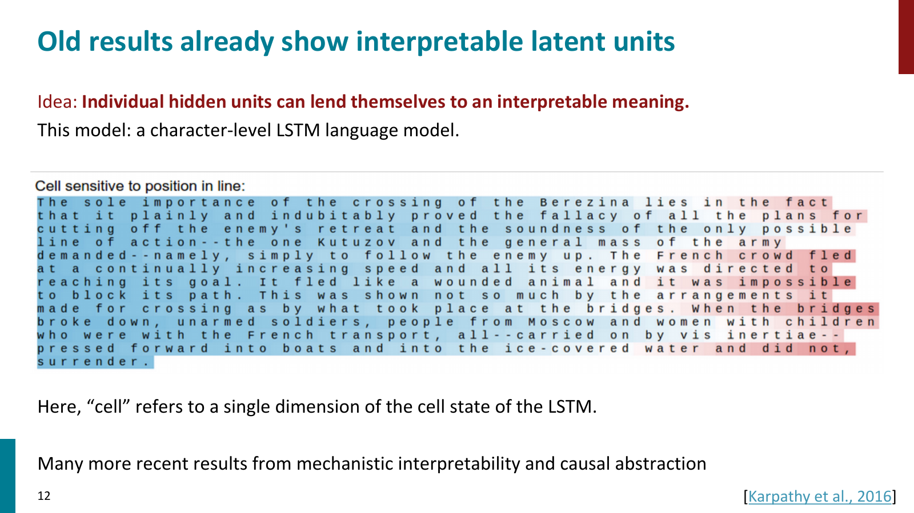
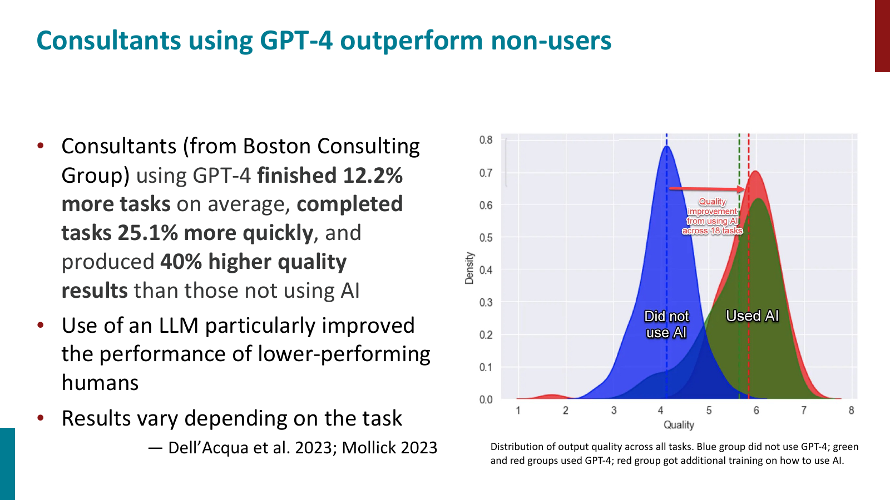
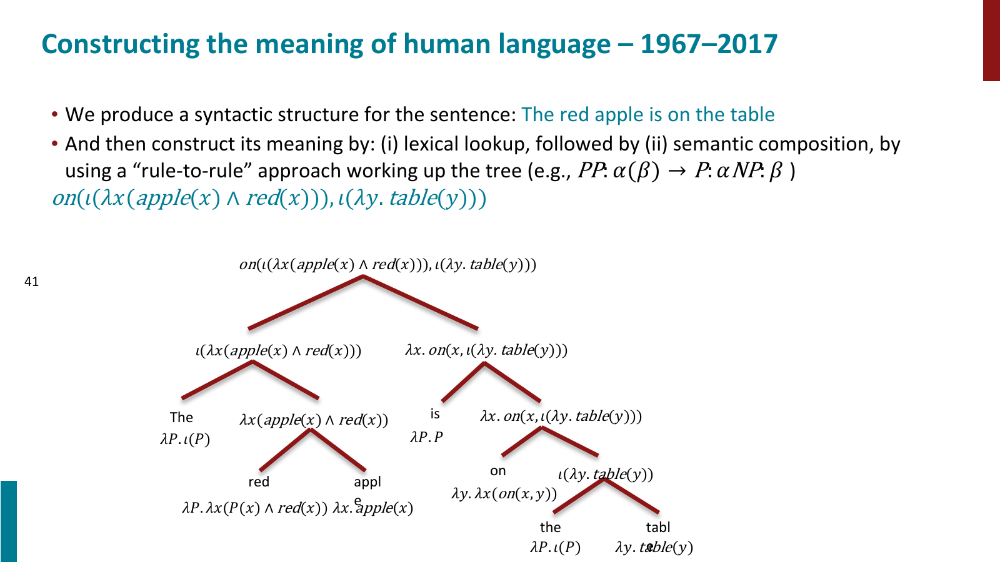
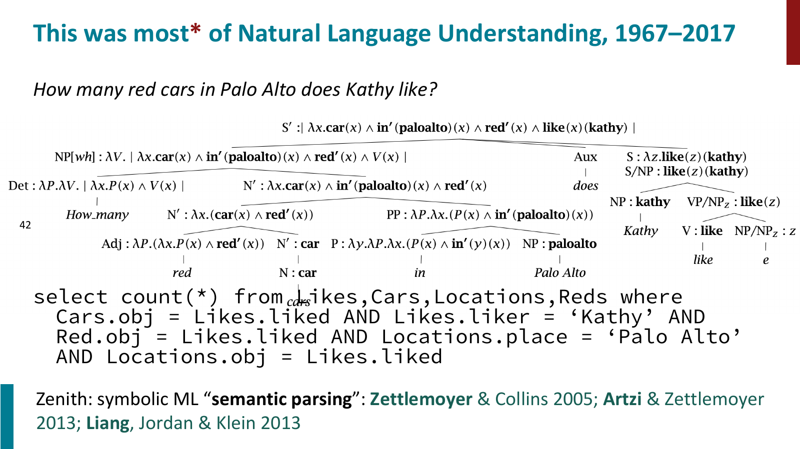
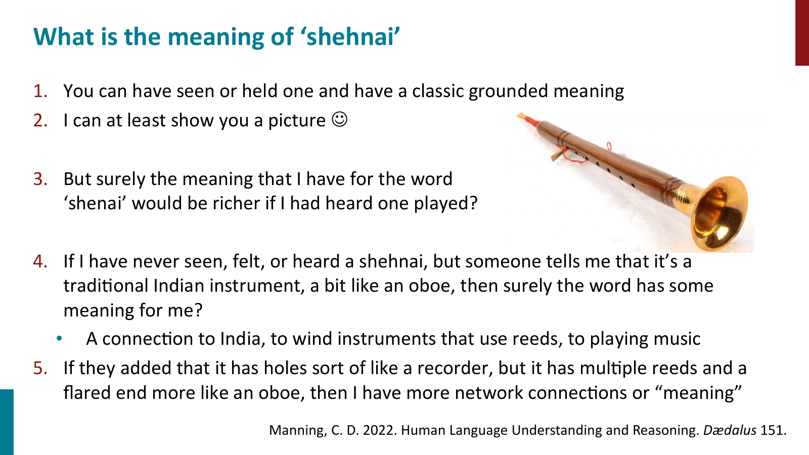

## 1. 神经NLP的核心思想

神经 NLP 的发展可以归纳为四个核心思想：

- **稠密表示与分布语义（Dense Representations and Distributional Semantics）**：用向量表示词，通过预测邻近词等任务，从上下文中学习词语的意义关系。
- **深度与神经网络（Depth and Neural Networks）**：用多层网络学习表示，同时借助残差连接等结构解决大型深层网络的训练困难。
- **序列模型与计算效率（Sequence Models and Computational Efficiency）**：处理梯度消失和信息传播问题，并改进计算的并行性及位置间的依赖路径。Transformer 在后两方面具有优势。
- **语言建模与预训练（Language Modeling and Pretraining）**：用语言建模作为可迁移到多种任务的预训练目标，再将训练规模扩展到大模型和互联网级数据。

评价、推理、负责任的 NLP 和脑机接口等方向，进一步涉及这些模型的能力检验、实际应用和社会影响。

## 2. NLP的开放问题

### 2.1 泛化与模型内部机制

**泛化（Generalization）**涉及模型能否将训练中学到的规律用于新情况。高分未必意味着模型掌握了所需规则，它也可能利用表面线索完成任务。例如，在从有限示例学习有限自动机输出的实验中，Transformer 的表现弱于 LSTM，研究者发现了模型学习捷径的现象。

评价模型时，除了准确率，还需要分析它学到了什么，以及成功或失败的原因。字符级 LSTM 的早期研究已经发现，一些隐藏单元具有可解释的活动模式。例如，某个记忆状态维度会随字符在一行中的位置变化。

这里的 **cell** 指 LSTM 记忆状态的一个维度。**机制可解释性（Mechanistic Interpretability）**与**因果抽象（Causal Abstraction）**也是研究模型内部计算的方向。

### 2.2 多语言与极低资源语言

即使是表现较好的模型，高资源语言英语与 Telugu（泰卢固语）等语言之间仍存在显著差距。模型在英语上的表现不能代表其对所有语言的支持程度。

极低资源语言还面临更基础的困难：许多语言缺少机器可读的书面文本，一些语言面临消亡风险，商业机构也缺乏为其开发技术的动力，使资源不足的状态持续下去。

### 2.3 评价、领域应用与社会因素

基准和评价方式会影响整个领域的研究方向。互联网级预训练使建立隐藏测试集更加困难：测试材料可能已经出现在训练数据中，损害**基准完整性（Benchmark Integrity）**。

领域应用也有各自的要求：

- **生物医学与临床NLP**：可用于记录、问答和非正式咨询，同时具有较高风险。
- **法律NLP**：可能帮助难以获得法律服务的人，缓解**司法服务缺口（Justice Gap）**；但系统需要理解复杂术语并提供可靠回答，幻觉仍是障碍。
- **社会因素**：需要考虑文化、宗教、社会规范和数据中代表不足的群体。

## 3. GPT-4的能力与局限

GPT-4 已能按复杂要求生成文本，例如用每行以 T 开头的十四行诗解释 Transformer。它也能提高部分实际任务的完成效率。

在一项咨询顾问实验中，使用 GPT-4 的参与者平均多完成 12.2% 的任务，完成速度提高 25.1%，结果质量提高 40%。原本表现较弱的参与者受益尤其明显，但效果随任务变化。

创意写作仍存在差距。一项研究使用 **Torrance Test of Creative Writing（TTCW）**，从流畅性、灵活性、原创性和细节展开等方面设置14项二元测试，由创意写作者评价作品；LLM生成故事通过的测试项少于专业作者作品。

2023年的一篇《金融时报》评论还指出，模型在不常见任务、自行识别错误和纠错方面存在局限。它引用的客服辅助研究报告约14%的生产力提升，收益主要集中在新手和较低技能人员，经验丰富的人员改善较少。该研究与咨询顾问实验属于不同任务，不能将增益视为所有工作的统一结果。

## 4. 符号系统与神经系统

### 4.1 符号与处理符号的系统

**符号系统（Symbolic Systems）**使用有意义的符号表示世界，例如人类语言、逻辑和程序语言。研究符号系统，也包括研究处理这些符号的脑、计算机和社会系统。

人工智能历史上有符号 AI 与控制论、神经网络等不同路线。**符号人工智能（Symbolic AI）**通过符号及其操作进行计算；神经网络路线则通过网络和学习机制构造系统。感知机是早期神经网络的代表。

语言具有符号结构，但这不意味着处理语言的人脑必须实现为**物理符号系统（Physical Symbol System）**，也不意味着 NLP 系统必须显式使用符号规则来实现。Manning 主张研究并利用语言的符号结构，同时采用能够扩展的神经模型来处理语言及其所表示的世界。

### 4.2 语言学在NLP中的作用

语言学提供研究语言、语言习得和语言处理的问题、概念与区别。这些工具也适合分析计算机怎样生成和学习语言。

尤其重要的概念包括：

- **组合性（Compositionality）**：各部分怎样组合为整体意义。
- **系统泛化（Systematic Generalization）**：已掌握的表达能否用于新的结构位置或组合。
- **符号的稳定意义（Stable Meanings for Symbols）**：符号是否保有可重复使用的意义。
- **指称（Reference）**：表达怎样指向所谈论的对象。

语言学还能用于确定模型目标、分析错误和设计评价。例如，句子结构、篇章结构、自然语言推断、形态、韵律、隐喻、预设和风格，都可以帮助区分模型掌握了哪些语言现象。

### 4.3 语言与思维

Humboldt 的“**用有限手段作无限使用（Make Infinite Use of Finite Means）**”被 Chomsky 用来说明语言的递归性：有限的表达手段能够形成无限多的表达。

Manning 对 Humboldt 的另一种解读强调，语言不仅是将已有思想传达出去的工具，也是活动本身。人借助已有语言进行重组和延伸，使更复杂的思考成为可能。

## 5. 语言意义与组合语义

### 5.1 模型论语义与分布语义

**模型论语义（Model-theoretic Semantics）**将表达的意义解释为它在世界模型中的指称。例如，名词对应对象或对象集合，关系表达对应对象间的关系。

**分布语义（Distributional Semantics）**通过表达出现的上下文理解其意义。一个词与哪些词共同出现、出现在怎样的句子中，可以提供它的意义关系。

传统形式语义可以将 `The red apple is on the table` 表示为涉及苹果、红色、桌子及位置关系的逻辑表达。但还需要解决一个计算问题：怎样从原句得到这个意义表示。

### 5.2 组合性与系统泛化

**组合性原则（Principle of Compositionality）**认为，整体的意义由各组成部分的意义及组合方式决定。因此，已经学会的部分可以重新组合，用于理解新句子和更长的句子。

**系统泛化**关注已掌握的表达能否迁移到新位置。例如，理解某个名词短语作主语的用法后，也应能理解它作宾语的用法。这种能力支持人利用有限经验快速学习语言。

Montague 的形式语义将句法和语义分别看作具有组合操作的系统，要求二者之间存在**同态（Homomorphism）**：句法中的组合操作，应当对应语义中的组合操作。也就是说，句子的结构怎样逐级组成，其意义就应怎样逐级计算。

### 5.3 从句法结构构造意义

传统的组合语义处理分为三个步骤：

1. 为句子构造句法树，确定各部分怎样组成短语。
2. **词汇查找（Lexical Lookup）**：为词取得对应的意义表示。
3. **语义组合（Semantic Composition）**：沿树自底向上，按句法规则对应的语义规则合并各部分，得到整句意义。

**语义解析（Semantic Parsing）**还可以将自然语言映射为可执行查询。例如，`How many red cars in Palo Alto does Kathy like?` 要查询满足以下条件的对象数量：它是汽车、颜色为红色、位于 Palo Alto，并且被 Kathy 喜欢。语义解析将这些条件组合成数据库计数查询。

人类语言处理研究也提供了层级计算的证据：理解句子时，人会进行按结构组织的、自底向上的计算。对神经模型，相应的问题是：它能否学到合适的意义表示和组合函数。

## 6. 从感知与语言使用中获得意义

### 6.1 意义与使用的联系

Wittgenstein 用“钱与它的用途”作类比，反思是否必须在词之外再寻找一个独立的“意义物体”。

对于分布语义能否构成意义理论，学界存在分歧。Manning 的观点是：意义来自词与其他事物之间的联系；现实世界具有特殊地位，但虚拟世界和人类语言本身也能提供这种联系。**理解具有程度差异**，可以讨论一个人对某个词理解了多少，而不只是判断“理解或不理解”。

### 6.2 Shehnai的例子

**Shehnai**是一种印度传统管乐器。人可以通过不同经验获得关于它的意义联系：

1. 见过或拿过实物，知道其外观和触感。
2. 看过图片，获得外观信息。
3. 听过演奏，知道声音。
4. 没有直接感知过，但听说它是类似双簧管的印度传统乐器，便能将它与印度、簧片管乐器和演奏联系起来。
5. 进一步得知它有指孔、多个簧片和喇叭状末端，又能增加结构方面的联系。

仅从使用语境也能获得信息。例如，一段小说写到 shehnai 演奏者在婚礼前来到房屋入口，吹奏管乐，以满足新郎家庭对传统仪式的期待。读者由此可以知道它是管乐器，并了解它与婚礼习俗的联系。

只读过这段文字的人可能不知道乐器的真实声音和触感，却知道一些音乐与文化信息；只是拿过实物的人未必知道这些信息。两者的理解各有缺少和额外部分，不能简单排成“有直接感知就完全理解、没有就毫无意义”。这个例子支持的是将意义看作多种联系，并承认理解程度存在差异的观点。

## 7. AI的未来与社会风险

### 7.1 就业与收益分配

AI 对工作的影响既涉及岗位变化，也涉及收益归属。1961年的自动化讨论已担忧，新产业未必能为被替代的非熟练、半熟练劳动者提供足够岗位。当前仍需考虑哪些工作会被替代，以及收益是否集中到少数大型科技企业。

### 7.2 生存风险争论

**奇点（Singularity）**讨论机器获得超越人类的**通用人工智能（Artificial General Intelligence，AGI）**后可能出现的变化。**生存风险（Existential Risk，X-risk）**争论则涉及这种发展是否可能威胁人类生存。

相关论证存在分歧。批评者认为，部分灭绝论证仍是推测，缺少具体机制；将这类风险赋予无限成本，会妨碍对其他结果的理性比较。另一项批评是，远期风险讨论可能转移对当前伤害的关注，例如带偏见的系统、劳动剥削、版权侵害、虚假信息、权力集中和监管俘获。

### 7.3 当前伤害与隐藏成本

AI 开发与使用中的成本包括低薪劳动、能源和水消耗、硬件制造资源，以及提高行业进入门槛。NLP 系统本身还可能造成三类伤害：

- **冒犯性内容（Offensive Content）**：生成带歧视或污名化的表达。
- **不真实内容（Untruthful Content）**：编造事实或给出错误叙述。
- **促成虚假信息传播（Enabling Disinformation）**：帮助制造和传播误导性内容。

### 7.4 说服力与虚假信息

模型更擅长处理现实文本，也可能更擅长编造看似可信的知识，或针对用户生成有说服力的错误信息和政治宣传。一些研究发现 AI 生成的虚假信息具有说服效果，但具体结论仍有争论。

音频和视觉生成还可能增强内容的可信外观和传播能力。缓解方向包括标注 AI 生成内容、追踪内容来源、使用水印和加强用户教育。风险分析也需要关注拥有权力的人与组织会怎样使用 AI。
