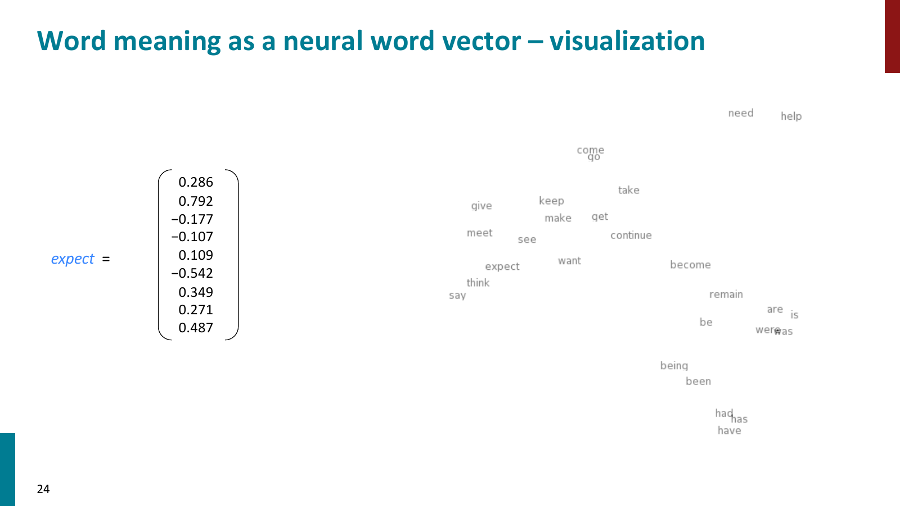
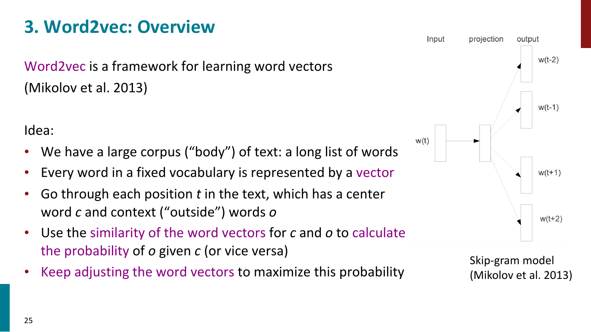
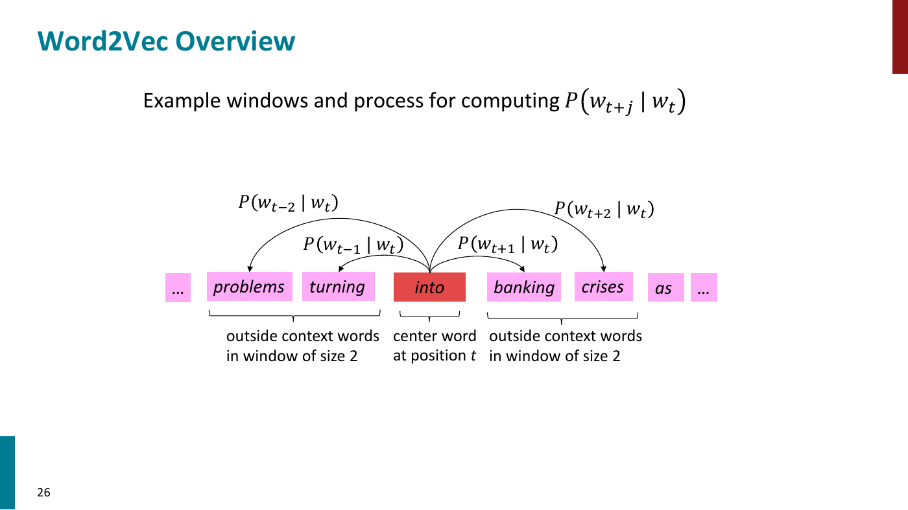
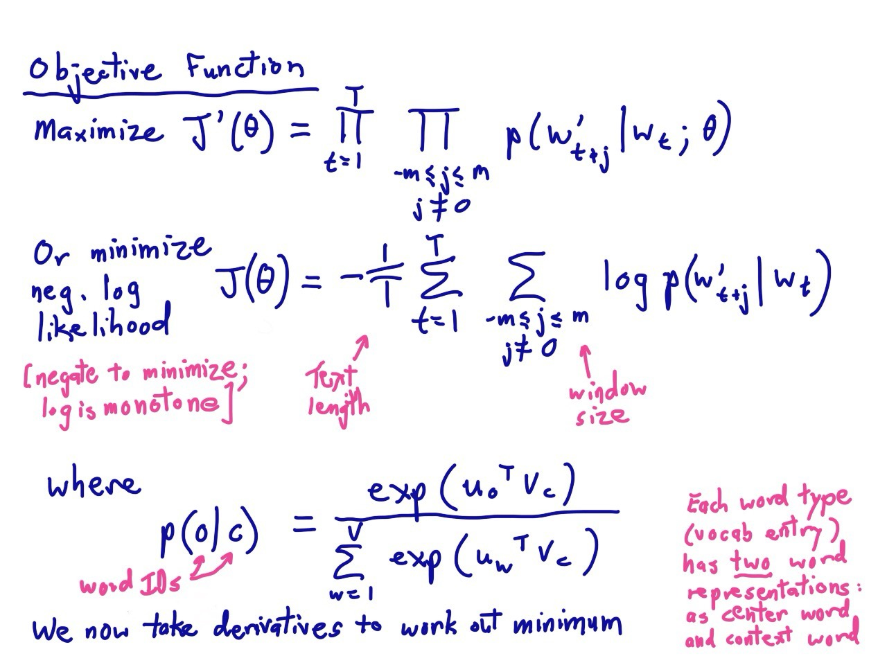
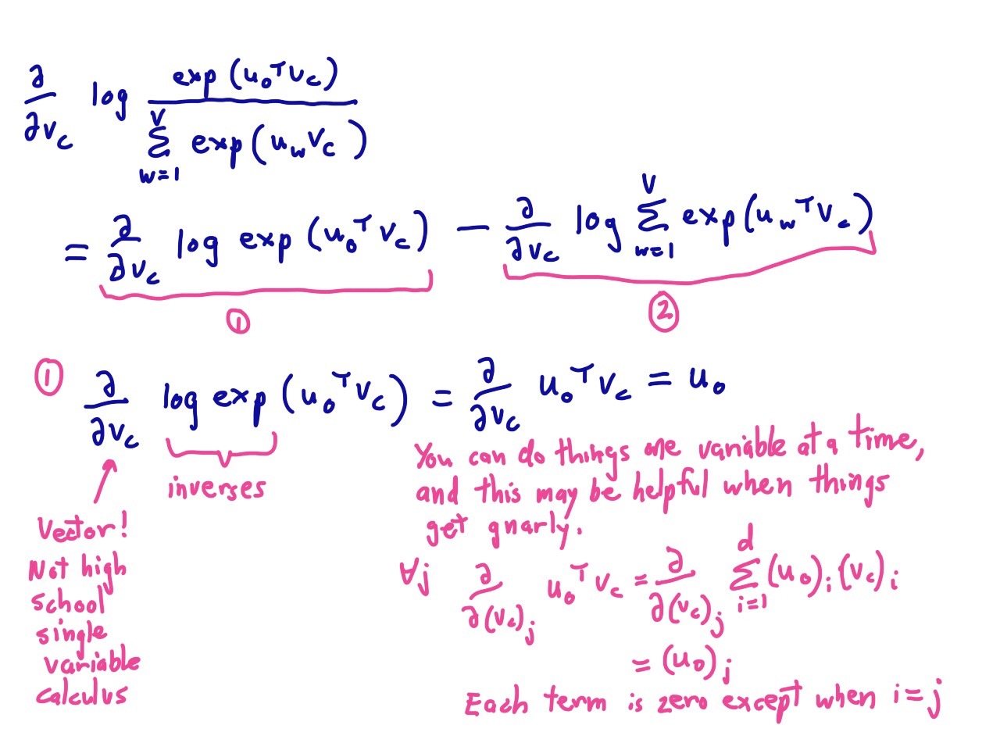
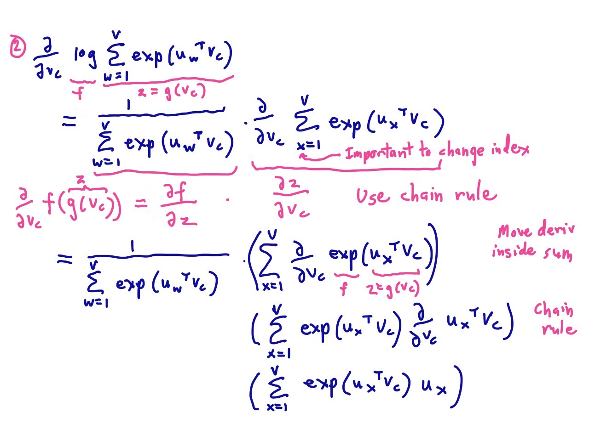
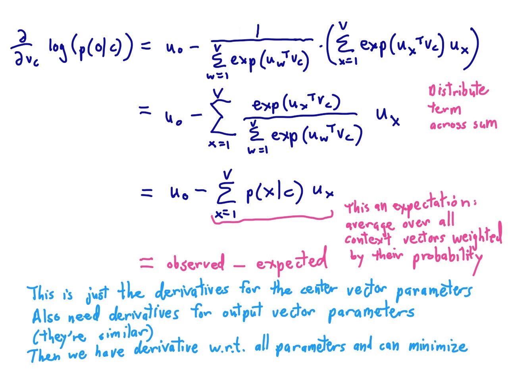
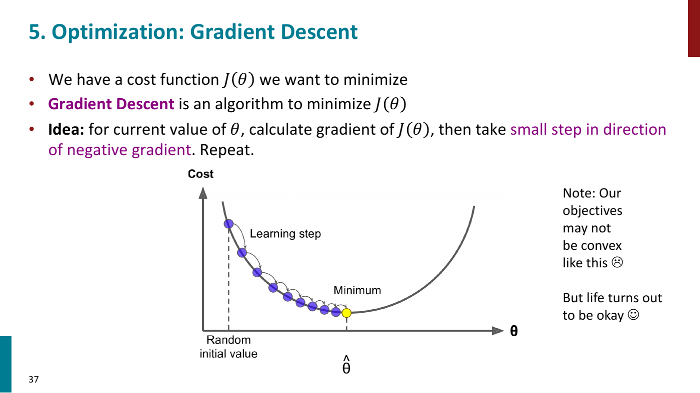

> 整理状态：可读取的正文与相关作业已整理。P33–36 手写推导保留原图，公式依据随课讲义和A2确认；部分图片无法逐符号核对，按用户要求跳过，不再进行OCR。

## 1. 核心问题

来源：P2、P5。

本讲的核心判断是：**词义可以用一个高维实数向量相当好地表示（Word meaning can be represented rather well by a high-dimensional vector of real numbers）**。

课程先建立词向量、前馈网络、循环网络、Attention 等基础，再进入 Transformer、Encoder–Decoder、预训练（Pretraining）、后训练（Post-training）、高效适配和语言模型智能体。需要同时掌握三层内容：

- 语言本身的结构，以及让计算机理解和生成语言的困难。
- 模型的表示、目标函数、训练算法和计算机制。
- 用 PyTorch 构建词义建模、依存句法分析、机器翻译、问答等系统。

## 2. NLP 应用展示与基础模型

来源：P10–16。

- **神经机器翻译（Neural Machine Translation）**：P12 强调它是神经 NLP 较早取得显著成功的任务。
- **自由文本问答（Free-text Question Answering）**：P13 以 Kendrick Lamar 首张专辑发行时间为例，介绍 YONO 使用经过多次问答微调的 T5-Large 运行整个问答流程。
- **文本续写（Text Completion）**：P14 给出 GPT-2 在“装载受管制核材料的火车车厢失窃”提示下生成新闻式文本的例子。这里展示的是语言生成能力，生成文本中的人物、机构与事件不应当作事实材料。
- **聊天与指令跟随（Chat / Instruction Following）**：P15 左侧展示把“为陪伴孩子旅行而请假”的非正式请求转成给上司的礼貌邮件，包含原因、请假时长和工作安排。
- **视觉问答（Visual Question Answering）**：P15 右侧询问图像中的异常之处，GPT-4 的回答指出有人在行驶出租车车顶连接的熨衣板上熨衣服；这展示了将视觉内容与语言问题结合。
- **文本条件图像示例（Text-Conditioned Image Example）**：P16 渲染页的 OCR 读到的是月夜繁忙街道、红发女子、披风、摊贩和蒸汽朋克电话等复杂场景提示。该页可提取文本层另含 DALL·E 2、金门大桥、火车和铅笔画提示，二者不一致，因此不能直接用文本层断言当前显示的图片内容。

P10–11 的文字识别仍不足，P15–16 的具体图像内容仍需目视确认；此处将已识别文字与尚未确认画面区分记录。

## 3. 如何表示词义

### 3.1 指称语义与词汇资源

来源：P17–19。

**指称语义（Denotational Semantics）**把意义理解为符号和所指概念或事物之间的联系：

$$
\text{signifier (symbol)}\longleftrightarrow\text{signified (idea or thing)}.
$$

例如 `tree` 是能指（Signifier），树这一概念或它指向的事物是所指（Signified）。课件先用字典定义说明“意义”可以是词语表达的思想、说话者试图表达的思想，或作品表达的思想。

早期计算机处理词义的一种常见做法是采用 **WordNet**，人工组织：

- **同义词集（Synsets）**：将特定词义下相关的词放在一起。一个词可能出现在多个词集，且词性不同。
- **上位词关系（Hypernym / “is-a” Relation）**：以更一般的概念组织词汇层次，例如从具体动物逐步到哺乳动物、动物、实体等类别。

课件指出的局限：

1. **语义细微差别（Nuance）不足**：`proficient` 在部分上下文中可与 `good` 对应，但不能任意替换。
2. 同义词列表可能包含冒犯性词，却没有充分表示语气、隐含意义和适用场合。
3. 新词和旧词新义持续产生，人工资源难以及时更新；课件列举 `wicked`、`badass`、`wizard`、`ninja` 等。
4. 资源具有主观性，需要人工建立和维护。
5. 词汇关系的存在并不能直接给出可靠、连续的词相似度。

### 3.2 独热表示为何不能表达语义相似性

来源：P20–21。

传统做法把词当作**离散符号（Discrete Symbols）**。词表大小为 $|V|$，每个词对应一个独热向量（One-hot Vector）：

$$
e_i\in\mathbb R^{|V|},\qquad
(e_i)_j=\begin{cases}1,&j=i,\\0,&j\ne i.\end{cases}
$$

每个词只有自己的坐标为 1，因此又称**局部表示（Localist Representation）**。词表有五十万词，向量就有五十万维，绝大多数分量为零。

对于不同的词 $i\ne j$：

$$
e_i^\top e_j=0,\qquad \|e_i\|_2=\|e_j\|_2=1.
$$

所以 `hotel` 与 `motel` 的向量正交，其他任何两个不同词也正交。表示只告诉模型“是否同一个词”，没有让近义词在向量空间中更接近。

课件的检索例子是：查询 `Seattle motel` 时，希望匹配含 `Seattle hotel` 的文档。独热表示本身没有编码 `motel` 与 `hotel` 的联系；人工同义词表又有覆盖不足等问题。接下来的目标是：**让相似性编码在向量本身中（Learn to encode similarity in the vectors themselves）**。

### 3.3 分布语义与上下文

来源：P22。

**分布语义（Distributional Semantics）**：一个词的意义由经常在附近出现的词刻画。

> “You shall know a word by the company it keeps.” — J. R. Firth
>
> 通过一个词经常与哪些词相伴，认识这个词。

**上下文（Context）**是词出现位置附近、固定大小窗口内的词。不能只依靠一次出现，而要聚合语料中许多次出现的上下文。课件通过 `banking crises`、`banking regulation`、`banking system` 展示：这些共同上下文提供 `banking` 的表示信号。

### 3.4 稠密分布式表示

来源：P23–24。

给每个词一个**稠密向量（Dense Vector）**，使出现在相似上下文中的词得到相似表示。课件使用点积（Dot / Scalar Product）衡量向量匹配程度：

$$
s(u,v)=u^\top v=\sum_{k=1}^{d}u_kv_k.
$$

**词向量（Word Vectors）**也称**词嵌入（Word Embeddings）**或**神经词表示（Neural Word Representations）**。它是**分布式表示（Distributed Representation）**：一个词由多个实数共同表示，而不是独占一个坐标。课件用 `banking`、`monetary` 的数值向量和词向量可视化说明这种表示。

这里不要求每个坐标都对应一个可命名的人类概念；需要学习的是整个向量在模型中的作用与词之间的关系。



来源：Lecture 1，PDF P24。该页将 `expect` 的数值向量与包含 `want`、`think`、`need` 等词的空间图并置。数值向量是模型的表示，低维图是帮助观察词之间关系的展示；不能由图中的两个坐标认定原向量只有两维。原图的具体投影方式未在本页正文中说明，不擅自标为 PCA 或 t-SNE。

## 4. Word2Vec：用中心词预测外围词

### 4.1 数据与预测任务

来源：P25–27。

**Word2Vec** 是学习词向量的一组方法；本讲展开的是 **Skip-gram**：给定中心词，预测附近的外围词。



来源：Lecture 1，PDF P25。结构图由输入词 $w(t)$ 经投影层（Projection）连接到多个输出位置 $w(t-2)$、$w(t-1)$、$w(t+1)$、$w(t+2)$。多个输出共享同一中心词的表示，训练信号来自不同外围词；输出位置不是按自回归顺序逐个生成的句子。

设语料（Corpus）是词序列 $w_1,\ldots,w_T$，固定词表为 $V$，窗口半径为 $m$。在位置 $t$：

- **中心词（Center Word）**为 $w_t$。
- **外围词（Outside / Context Words）**为 $w_{t+j}$，其中 $-m\le j\le m$、$j\ne0$，且索引在语料范围内。
- 对每个合法词对计算 $P(w_{t+j}\mid w_t;\theta)$。



来源：Lecture 1，PDF P26；P27 是相同窗口示意的后续展示，仍需核对图中动画增量。

例子中中心词为 `banking`、$m=2$，外围词为 `turning`、`into`、`crises`、`as`；`problems` 在该窗口之外。一个中心位置会产生多个中心—外围训练词对。

### 4.2 为什么每个词有两套向量

来源：P29–31。

对每个词 $w\in V$ 学习两套参数：

- $v_w\in\mathbb R^d$：作为中心词时的向量。
- $u_w\in\mathbb R^d$：作为外围词时的向量。

同一个词在不同位置可以担任不同角色；使用哪套向量由预测中的角色决定。把所有向量拼为总参数向量：

$$
\theta=\begin{bmatrix}
v_1\\\vdots\\v_{|V|}\\u_1\\\vdots\\u_{|V|}
\end{bmatrix}\in\mathbb R^{2d|V|}.
$$

因此参数量是 $2d|V|$。本讲只确立双向量的参数化；选择两套向量的优化理由将在第 2 讲继续说明。

### 4.3 Softmax 条件概率

来源：P29–30。

给定中心词 $c$，候选外围词 $o$ 的概率：

$$
P(o\mid c;\theta)
=\frac{\exp(u_o^\top v_c)}{\sum_{w\in V}\exp(u_w^\top v_c)}.
$$

计算顺序：

1. 用 $u_w^\top v_c$ 为每个候选词计算分数。
2. 指数函数将任意实数分数变成正数。
3. 除以对整个词表求和的分母，得到归一化分布。

$$
\sum_{o\in V}P(o\mid c;\theta)=1.
$$

对于有限实数分数且候选类别多于一个，概率严格位于 $(0,1)$。**Softmax** 的一般形式为：

$$
\operatorname{softmax}(z)_i=\frac{e^{z_i}}{\sum_{j=1}^{|V|}e^{z_j}}.
$$

“max” 表示较大分数获得较大概率，“soft” 表示其他候选仍保留概率；它返回整个分布，不是只返回最大值或最大值的索引。在其他候选分数不变时，提高 $u_o^\top v_c$ 会提高 $P(o\mid c)$。

### 4.4 从似然到损失函数

来源：P28–29、P32。

课件将语料中所有窗口词对的预测概率相乘，作为**似然（Likelihood）**：

$$
L(\theta)=\prod_{t=1}^{T}
\prod_{\substack{-m\le j\le m\\j\ne0\\1\le t+j\le T}}
P(w_{t+j}\mid w_t;\theta).
$$

**目标函数（Objective Function）**采用按中心位置数 $T$ 归一化的**负对数似然（Negative Log-likelihood）**：

$$
J(\theta)=-\frac1T\log L(\theta)
=-\frac1T\sum_{t=1}^{T}
\sum_{\substack{-m\le j\le m\\j\ne0\\1\le t+j\le T}}
\log P(w_{t+j}\mid w_t;\theta).
$$

这里将边界合法条件显式写出；课件的紧凑记法省略了边界处理。分母是 $T$，不要误写成已经按全部词对数量求平均。

- 对数把概率连乘转成求和，便于求导和累计。
- 负号把最大化似然转为最小化损失。
- 真实外围词的预测概率越高，该词对的 $-\log P(o\mid c)$ 越小。

单个词对的损失可代入 Softmax 写为：

$$
J_{c,o}=-\log P(o\mid c)
=-u_o^\top v_c+\log\sum_{w\in V}\exp(u_w^\top v_c).
$$

这是对上式直接进行代数展开，不是新增训练目标。课件用“提高预测准确性”概括优化目的；数学上直接优化的是这些观测词对的对数概率，不是另一个分类准确率指标。

## 5. Word2Vec 梯度：从对数概率到参数更新

P33–36 为手写图片，OCR 只能辨认少数片段，无法可靠转录完整推导。以下公式依据随课材料 `cs224n_winter2023_lecture1_notes_draft.pdf` §3.4（PDF P10–11）交叉核对，并结合 A2 Part 1 的矩阵记法整理；四页原图保留在本节后半部分。尚未完成与每一处手写符号的视觉比对。

### 5.1 点积的导数：逐坐标计算，再组成向量

将向量视为列向量。对标量输出，梯度采用与参数相同的形状约定（Shape Convention）。

$$
u_o^\top v_c=\sum_{i=1}^{d}u_{o,i}v_{c,i},\qquad
\frac{\partial(u_o^\top v_c)}{\partial v_{c,j}}=u_{o,j}.
$$

因为求关于 $v_{c,j}$ 的偏导时，只有和式中第 $j$ 项依赖它；其余项的导数为零。将各坐标导数堆叠：

$$
\nabla_{v_c}(u_o^\top v_c)=u_o\in\mathbb R^d.
$$

不要把 $v_c$ 的梯度写成行向量 $u_o^\top$；第3讲会进一步区分 Jacobian 的布局和参数梯度的形状。

### 5.2 中心词向量的梯度

先求对数概率，再转换为负对数损失，避免负号混淆。记归一化项为：

$$
Z_c=\sum_{w\in V}\exp(u_w^\top v_c).
$$

$$
\log P(o\mid c)=u_o^\top v_c-\log Z_c.
$$

第一项求导得到 $u_o$。第二项应用链式法则（Chain Rule）：对数求导、求和求导、指数求导、点积求导：

$$
\begin{aligned}
\nabla_{v_c}\log Z_c
&=\frac1{Z_c}\nabla_{v_c}\sum_{w\in V}\exp(u_w^\top v_c)\\
&=\frac1{Z_c}\sum_{w\in V}\exp(u_w^\top v_c)u_w\\
&=\sum_{w\in V}P(w\mid c)u_w.
\end{aligned}
$$

因此对数概率的梯度是：

$$
\boxed{\nabla_{v_c}\log P(o\mid c)=u_o-\sum_{w\in V}P(w\mid c)u_w}.
$$

课程讲义概括为 **“observed − expected”（观测值减期望值）**：观测到的外围词向量，减去模型当前分布下所有外围词向量的期望。

训练最小化的是 $J_{c,o}=-\log P(o\mid c)$，所以其梯度符号相反：

$$
\boxed{\nabla_{v_c}J_{c,o}=\sum_{w\in V}P(w\mid c)u_w-u_o}.
$$

一次梯度下降更新：

$$
v_c\leftarrow v_c+\alpha\left(u_o-\mathbb E_{w\sim P(\cdot\mid c)}[u_w]\right).
$$

更新使中心向量向实际观察到的外围向量靠近，并减去模型当前的平均预测方向。这里的“期望”是向量的概率加权平均，不是概率最大的那个词。

### 5.3 外围词向量与矩阵形式（A2 Part 1 补充）

A2 将外围向量作为矩阵的列：

$$
U=[u_1,\ldots,u_{|V|}]\in\mathbb R^{d\times|V|},\quad
z=U^\top v_c\in\mathbb R^{|V|},\quad
\hat y=\operatorname{softmax}(z).
$$

注意课程讲义前文也使用过按行存储的记法；必须随矩阵定义调整转置，不能混用。真实外围词的标签为独热向量 $y$，$y_o=1$。于是：

$$
J_{c,o}=-\sum_{w\in V}y_w\log\hat y_w=-\log\hat y_o.
$$

这说明单词对的负对数似然等于真实独热分布与预测分布的**交叉熵（Cross-entropy）**。它不意味着整个语料中同一中心词的真实外围词分布是独热的；独热标签针对当前这一条词对样本。

对任意外围向量：

$$
\nabla_{u_w}J_{c,o}=(\hat y_w-y_w)v_c
=\begin{cases}(\hat y_o-1)v_c,&w=o,\\\hat y_wv_c,&w\ne o.\end{cases}
$$

矩阵形式为：

$$
\boxed{\nabla_{v_c}J_{c,o}=U(\hat y-y)},\qquad
\boxed{\nabla_UJ_{c,o}=v_c(\hat y-y)^\top}.
$$

形状检查：$U(\hat y-y)$ 为 $d$ 维；外积 $v_c(\hat y-y)^\top$ 为 $d\times|V|$，分别与原参数一致。即使当前词对只有一个真实外围词，完整 Softmax 的分母仍依赖所有 $u_w$，所以其他外围词向量通常也有非零梯度。

**零梯度条件（Zero-gradient Condition）**是 $U(\hat y-y)=0$，即误差向量属于 $U$ 的零空间（Null Space）。不能只回答“预测完全正确”：当列向量存在相关性时，不同概率误差可能在投影后抵消。有限分数、多个类别的 Softmax 本身也不会精确输出独热分布。

整个窗口的梯度是窗口内各词对梯度之和；整个语料梯度再累加各中心位置，并保留目标函数中的 $1/T$ 系数。参数共享意味着同一个词的同一套向量被多次使用时，所有使用位置的梯度都要相加。

### 5.4 A2 中的向量归一化问题

来源：A2 Part 1(c)。词向量 $u$ 的 L2 归一化为 $\bar u=u/\|u\|_2$，要求 $u\ne0$。若 $u_x=\lambda u_y$ 且 $\lambda>0$，则：

$$
\frac{u_x}{\|u_x\|_2}=\frac{u_y}{\|u_y\|_2}.
$$

因此归一化保留方向、删除模长（Magnitude）。若短语分类把词向量求和，模长代表不同词对情感判断的权重，归一化会改变相互抵消的比例，可能丢失信息；若有用信息只在方向中，模长只是无关尺度，则这种删除不损害所需信号。

### 5.5 原始推导图



来源：Lecture 1，PDF P33。待视觉核对推导步骤。



来源：Lecture 1，PDF P34。待视觉核对推导步骤。



来源：Lecture 1，PDF P35。待视觉核对推导步骤。



来源：Lecture 1，PDF P36。待视觉核对推导步骤。

## 6. 用梯度下降训练参数

来源：P31、P37–39。

### 6.1 梯度下降

**梯度下降（Gradient Descent）**在当前参数处计算损失对参数的梯度，再向负梯度方向走一小步：

$$
\theta\leftarrow\theta-\alpha\nabla_\theta J(\theta),
$$

其中 $\alpha>0$ 是**步长／学习率（Step Size / Learning Rate）**。单个参数的写法为：

$$
\theta_i\leftarrow\theta_i-\alpha\frac{\partial J}{\partial\theta_i}.
$$

梯度是所有参数偏导数组成的向量，不是只更新一个预先选中的坐标。对于非零梯度和足够小的步长，负梯度给出局部下降方向；步长过大则不能保证每次损失都下降。课件特别提醒：示意图中的凸碗形目标只是直观例子，实际神经网络目标可能**非凸（Non-convex）**。



来源：Lecture 1，PDF P37。图中的随机初值（Random Initial Value）、学习步骤（Learning Step）和最低点（Minimum）说明优化过程；不能据此推出一般神经网络训练一定达到全局最小值。

P38 的印刷算法框经 OCR 确认采用“计算梯度 → 更新参数 → 重复”的结构。按上面的符号整理为：

```text
repeat:
    g ← ∇θ J(θ)
    θ ← θ − αg
```

每次先在同一组旧参数处计算完整梯度，再更新参数。这里是算法步骤的规范化表达；OCR 未可靠识别原框中全部字符，不能视为逐字转录。

### 6.2 随机梯度下降与小批量

完整 $J(\theta)$ 涉及整个语料的所有窗口；语料可能有数十亿个窗口。若每次更新前都计算全部梯度，一次更新就需要很长时间。

**随机梯度下降（Stochastic Gradient Descent, SGD）**反复抽样窗口，在局部样本上计算梯度并更新。**小批量梯度下降（Mini-batch Gradient Descent）**一次使用一批窗口，在更新频率和批量计算之间折中。

用 $\mathcal B$ 表示抽取的中心位置批次，相应批次损失写为：

$$
J_{\mathcal B}(\theta)
=-\frac1{|\mathcal B|}\sum_{t\in\mathcal B}
\sum_{\substack{-m\le j\le m\\j\ne0\\1\le t+j\le T}}
\log P(w_{t+j}\mid w_t;\theta).
$$

$$
\theta\leftarrow\theta-\alpha\nabla_\theta J_{\mathcal B}(\theta).
$$

此批次公式用于明确表达课件的窗口抽样方法。P39 的印刷算法框经 OCR 确认按窗口计算梯度并立即更新，可整理为：

```text
repeat:
    window ← sample_window(corpus)
    g ← ∇θ Jwindow(θ)
    θ ← θ − αg
```

单窗口 SGD 使用当前窗口的全部中心—外围词对，并非每次都重新遍历整个语料。课件还标出 Mini-batch Gradient Descent，将单窗口换成一批窗口即可；没有在本页规定具体批大小、学习率调度或停止准则。

## 7. 与作业及词向量演示的衔接

来源：P40、本地 A1 和 Gensim 演示。

本讲结束后课件指向 Jupyter Notebook。相关材料不是额外的模型理论，而是观察已学习词向量的行为：

- **A1 Part 1**：通过共现计数与 SVD 构造向量，观察上下文统计如何形成表示；具体算法归入第 2 讲。
- **A1 Part 2**：用 GloVe 检查相似词、多义词、类比、异常类比与偏差；详细分析也归入第 2 讲，避免本讲提前展开未讲的方法。
- **Gensim 2024 演示**：载入 `glove-wiki-gigaword-100`，查看词向量，使用 `most_similar` 查近邻和做正负向量组合；用 PCA 投影展示相近词群。

### 7.1 A1 要观察的表示性质

以下为 A1 Part 2 的题目目标与必要解释，不是课件新增实验结果，也没有把未运行的 Notebook 当成已获得结果。

**余弦相似度（Cosine Similarity）**只比较非零向量的方向：

$$
\operatorname{cos}(p,q)=\frac{p^\top q}{\|p\|_2\|q\|_2}\in[-1,1],\qquad
\operatorname{distance}_{\cos}(p,q)=1-\operatorname{cos}(p,q).
$$

与未经归一化的点积相比，余弦删除模长的影响。A1 的 `most_similar` 和 `distance` 因而是在检查方向相似性。第4节 Softmax 内部仍使用原始点积分数，不应把两种计算混为一谈。

- **多义词（Polysemy / Homonymy）**，Q2.2：寻找一个词，使前十个近邻同时包含两个词义的相关词。作业举 `leaves` 的“离开”和“植物叶片”、`scoop` 的不同含义。单个静态词向量合并了该词的多种使用环境，某一常见义可能主导近邻；未在前十中出现某词义，不能证明该词没有该含义。
- **同义词与反义词（Synonyms and Antonyms）**，Q2.3：作业要求找到反义词比同义词更近的例子，给定示例是 `happy` 与 `sad` 比与 `cheerful` 更近。分布相似表示相似使用环境，正反义词可能出现在相同句法位置和话题中；语义接近不等于情感方向相同。
- **词类比（Word Analogies）**，Q2.4–2.5：对 $a:b::c:x$ 构造目标方向 $v_b-v_a+v_c$，寻找与它余弦最相似的候选词。示例 `man : grandfather :: woman : x` 对应 $v_{\mathrm{grandfather}}-v_{\mathrm{man}}+v_{\mathrm{woman}}$，预期答案为 `grandmother`。输入词需从候选答案中排除。
- **类比失败（Analogy Failure）**，Q2.6：预期 `hand : glove :: foot : sock` 不代表模型一定返回 `sock`；作业示例出现 `45,000-square`。向量算术是一种经验观察，不能当作精确符号规则。题目要求同时记录预期答案和实际错误答案，不能只挑成功例子。
- **词向量偏差（Bias in Word Embeddings）**，Q2.7–2.9：比较 $v_{\mathrm{profession}}+v_{\mathrm{man}}-v_{\mathrm{woman}}$ 与反向组合的近邻，检查职业词的性别关联。进一步分析训练文本如何把已有社会关联带入向量，以及如何减轻偏差；不能把语料中的关联解释为职业或能力的客观属性。

### 7.2 实验边界

A1 中二维图用于观察聚类、比较基于计数的表示与 GloVe。二维投影会丢失高维信息，因此“图上看起来相近”不能替代在原空间中计算相似度。具体共现矩阵、Truncated SVD 和 GloVe 方法留在第2讲说明。

**本地版本注意**：A2 中相关数学题使用 Naive Softmax。不能将其他年份的负采样代码任务误认为本课程 A2 的要求；负采样本身在第 2 讲讲授。

## 来源

- 主课件：`slides/lecture01-wordvecs1.pdf`，Christopher Manning，40 页。
- 公式交叉核对：`readings/notes/cs224n_winter2023_lecture1_notes_draft.pdf` §3.4，PDF P10–11。
- 作业对应：A1；A2 Part 1(a–e)。第5.3–5.4节的矩阵梯度、零梯度条件和归一化分析为明确标注的作业补充。
- 演示：`materials/gensim_2024.zip` 中的 Gensim Notebook。
