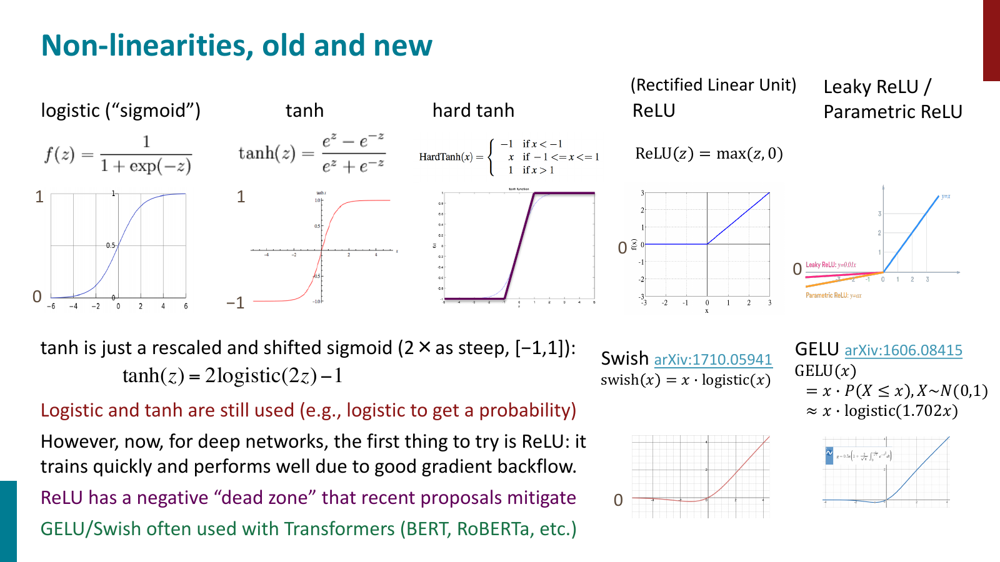
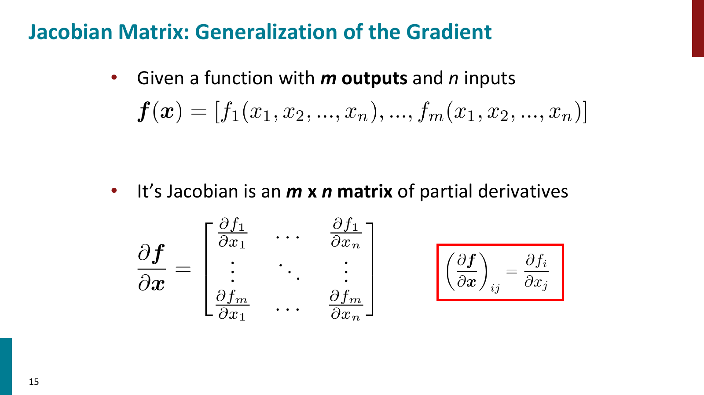
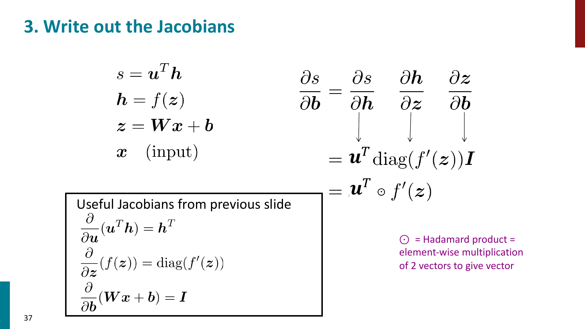
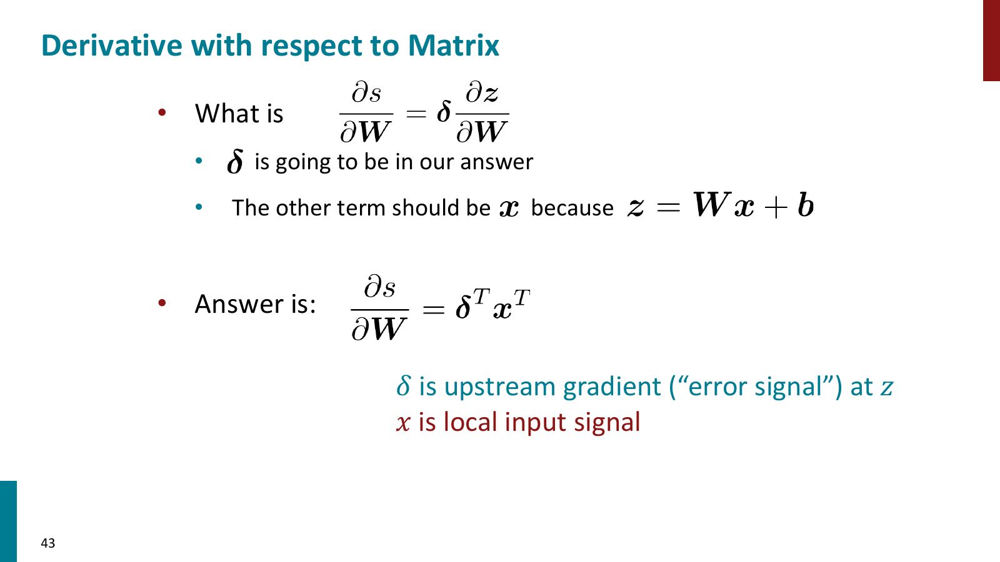
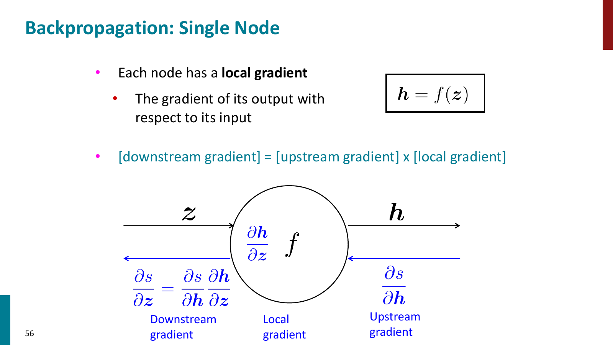
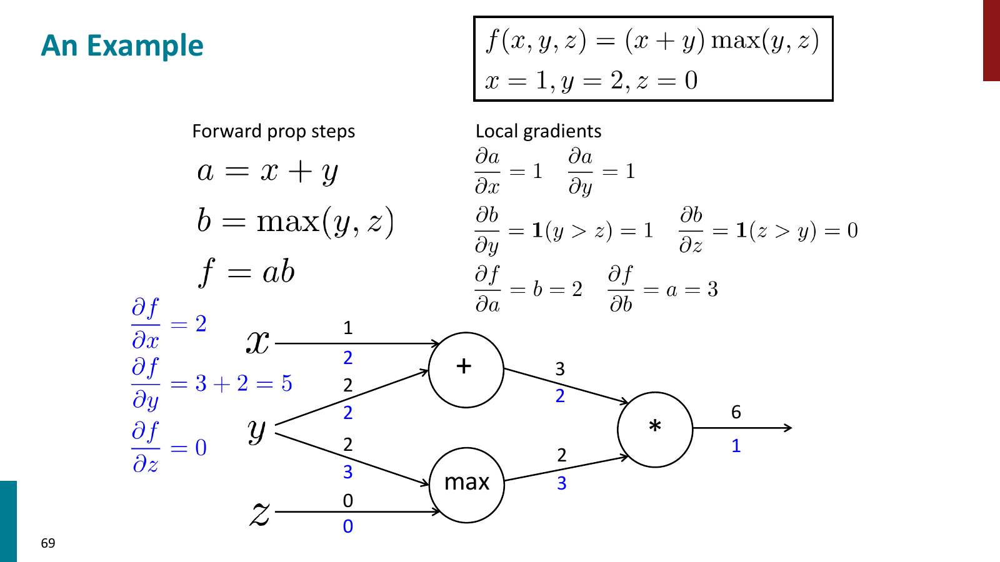
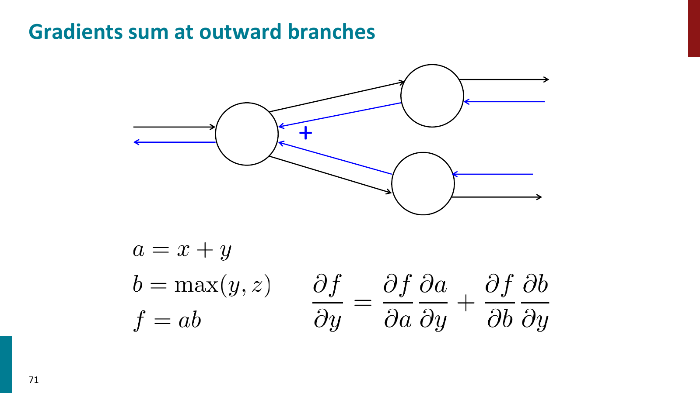
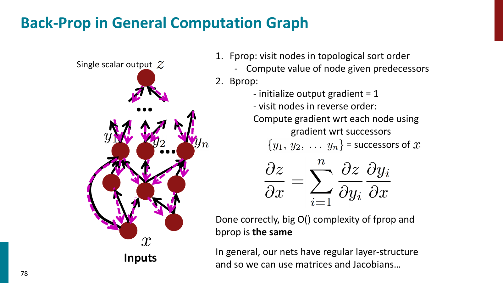
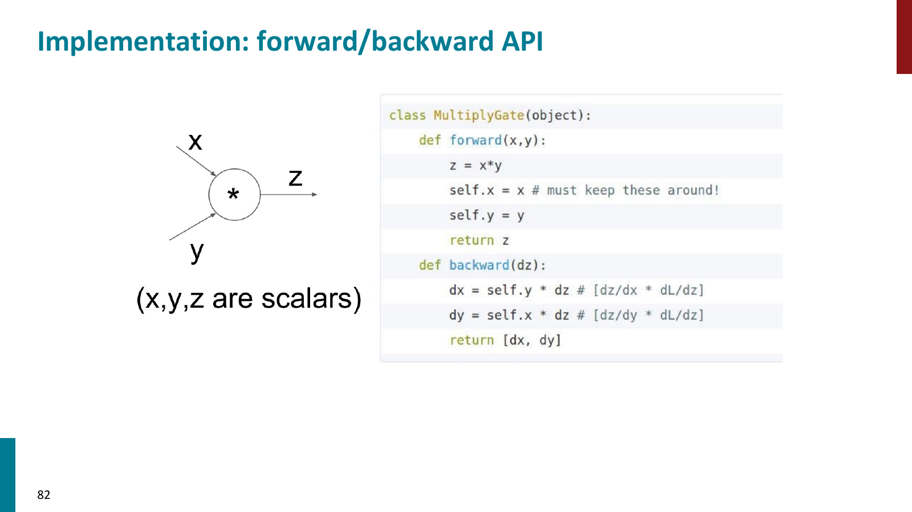
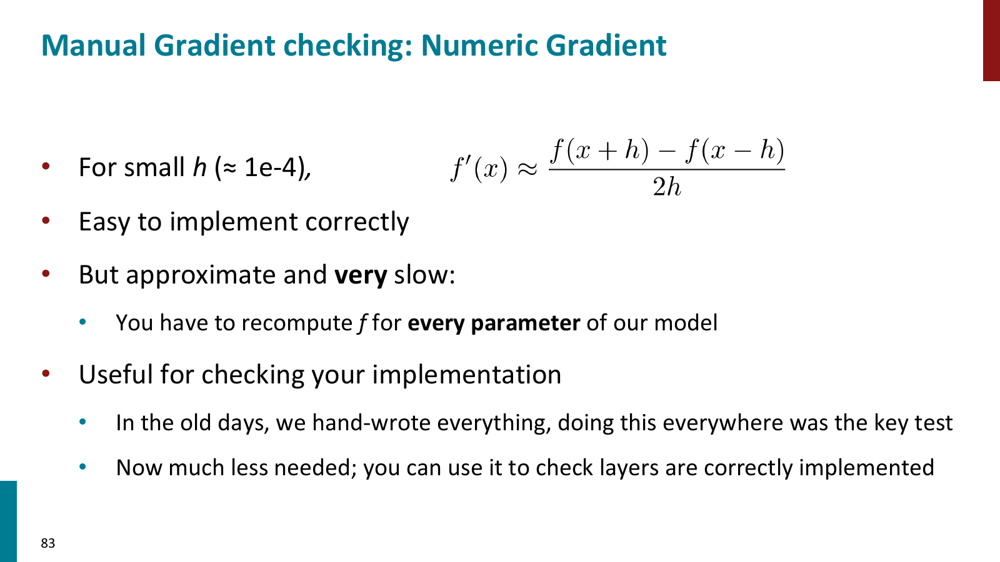

> 整理状态：全讲可读取技术正文及A2相关题目已整理。图片公式无法直接转录的部分，依照随课 `gradient-notes.pdf` 核对并统一符号；无法读取的图像和代码截图保留原页，不做OCR。

## 1. 神经网络、激活与训练目标

来源：PDF P3–11。P1–2封面与行政提示跳过，P10提纲不单独转录。

一层神经网络由仿射变换（Affine Transformation）与逐元素非线性（Element-wise Nonlinearity）组成：

$$
z=Wx+b,\qquad h=f(z).
$$

多个这样的层反复组合表示；最后的线性分类器虽然相对于最终隐藏表示是线性的，整个网络相对于原始输入通常是非线性的。

NER窗口模型将中心词与左右各两个词的向量拼接为 $x\in\mathbb R^{5d}$，用隐藏层计算地点类别的分数，再以Sigmoid变为二分类概率。输入词向量也是可训练参数，不只训练输出分类权重。

### 1.1 非线性函数与梯度

来源：P6–8。

早期McCulloch–Pitts阈值单元（Threshold Unit）按输入是否越过阈值输出0或1；其输出几乎处处对输入没有变化，阈值处不连续，无法提供有用的常规梯度学习信号。



来源：Lecture 3，PDF P7。图中公式部分文本编码损坏；以下给出与课件函数名称相应的统一表达，原图保留。

| 激活函数 | 定义或关系 | 课件说明 |
| --- | --- | --- |
| Logistic / Sigmoid | $\sigma(z)=1/(1+e^{-z})$ | 可用于输出概率，仍有使用场景 |
| 双曲正切，tanh | $\tanh z=2\sigma(2z)-1$ | 是缩放平移的Sigmoid，范围为$[-1,1]$ |
| Hard tanh | 将输入截断在$[-1,1]$ | 课件展示分段曲线 |
| 整流线性单元，ReLU | $\max(z,0)$ | 训练快，正区间梯度传回直接；负区间存在死区 |
| Leaky / Parametric ReLU | 负区间保留斜率的ReLU变体 | 缓解负区间死区；本页未固定斜率值 |
| Swish | $z\sigma(z)$ | 课件列举的新激活函数 |
| GELU | $z\Phi(z)$，$\Phi$为标准正态CDF | 课件列出近似$z\sigma(1.702z)$，常见于Transformer |

课件建议普通深层网络可先尝试ReLU，也指出BERT、RoBERTa等Transformer使用GELU/Swish。该建议是本课程背景下的起点，不意味着所有结构和任务都必须用同一激活函数。

若去掉非线性，多层仿射变换仍可合并为一次仿射变换，深度无法单独增加这种模型的函数类型。保留非线性才能表达更复杂的函数；这不等于任意给定的有限网络都能精确表示任意函数。

### 1.2 为什么学习矩阵求导

SGD更新为：

$$
\theta\leftarrow\theta-\alpha\nabla_\theta J(\theta).
$$

计算梯度有两条途径：手工矩阵求导（Matrix Calculus）与反向传播（Backpropagation）。二者使用同一个链式法则；后者把过程组织成可复用中间结果的算法。

逐坐标求偏导有助于建立直觉，但逐个参数独立推导或实现容易重复计算。向量化梯度（Vectorized Gradients）将整层的计算写成矩阵操作，能同时得到全部参数的梯度。

## 2. 导数、梯度与Jacobian的布局

来源：P12–16；核对 `gradient-notes.pdf` §2，PDF P1–2。P12没有可提取正文，不推断图中内容。

### 2.1 从一个输入到多个输入

标量函数 $f(x)=x^3$ 的导数为 $f'(x)=3x^2$，表示输入轻微变化时输出的局部变化率。P13例子中，在$x=1$附近导数为3，在$x=4$附近导数为48；这是局部近似，不是任意跨度都使用同一斜率。

对于标量函数 $J:\mathbb R^n\to\mathbb R$，每个输入坐标都有偏导。后续采用**参数同形状约定（Shape Convention）**，把列向量参数的梯度写成列：

$$
\nabla_xJ=
\begin{bmatrix}
\partial J/\partial x_1\\\vdots\\\partial J/\partial x_n
\end{bmatrix}\in\mathbb R^n.
$$

### 2.2 Jacobian：输出数乘输入数

对 $f:\mathbb R^n\to\mathbb R^m$，**Jacobian矩阵（雅可比矩阵）**定义为：

$$
J_f(x)=\frac{\partial f}{\partial x}
=\left[\frac{\partial f_i}{\partial x_j}\right]_{i,j}
\in\mathbb R^{m\times n}.
$$

行对应输出、列对应输入。标量输出的Jacobian是 $1\times n$ 行向量，等于上述列梯度的转置。它们包含同一组偏导，区别是排列方向；不要把“梯度一定是行”或“Jacobian一定与输入同形状”当成普遍规则。



来源：Lecture 3，PDF P15。

### 2.3 链式法则就是Jacobian相乘

令 $y=f(x)\in\mathbb R^m$，$z=g(y)\in\mathbb R^r$，则：

$$
\frac{\partial z}{\partial x}
=\frac{\partial z}{\partial y}\frac{\partial y}{\partial x},
\qquad(r\times n)=(r\times m)(m\times n).
$$

中间维度对应链式法则对中间变量求和。对标量损失$J$，若改用列梯度表示：

$$
\nabla_xJ=\left(\frac{\partial y}{\partial x}\right)^\top\nabla_yJ.
$$

转置来自梯度布局变化，不是随意交换矩阵顺序。先定义布局，再检查乘法维度，可以避免大多数转置错误。

## 3. 常用局部Jacobian

来源：P17–25；对照 `gradient-notes.pdf` §3，PDF P2–4。动画页合并为以下结论，不能从文本层确认的原图细节不补写。

### 3.1 逐元素激活产生对角Jacobian

若 $h_i=f(z_i)$，则$h_i$只依赖$z_i$：

$$
\frac{\partial h_i}{\partial z_j}
=\begin{cases}f'(z_i),&i=j,\\0,&i\ne j,\end{cases}
\qquad
\frac{\partial h}{\partial z}=\operatorname{diag}(f'(z)).
$$

与对角矩阵相乘等价于逐元素相乘（Hadamard Product）：

$$
\nabla_zJ=\nabla_hJ\odot f'(z).
$$

不用显式构造$n\times n$对角矩阵。Sigmoid导数可写为$\sigma(z)(1-\sigma(z))$；tanh导数为$1-\tanh^2z$，都能复用前向激活值。

### 3.2 线性变换、恒等与点积

| 函数 | Jacobian | 列梯度视角下的反向传播 |
| --- | --- | --- |
| $z=Wx$ | $\partial z/\partial x=W$ | $\nabla_xJ=W^\top\nabla_zJ$ |
| $z=x$ | $I$ | 梯度原样传回 |
| $z=x+b$，对$b$求导 | $I$ | $\nabla_bJ=\nabla_zJ$ |
| $s=u^\top h$，对$h$求导 | $u^\top$ | $\nabla_hs=u$ |

随课讲义也列出行向量形式$z=xW$，其关于行向量$x$的Jacobian为$W^\top$。使用哪一条公式取决于原函数的定义，不能只记“矩阵乘法求导要不要转置”。

## 4. 手工求窗口网络的梯度

来源：P26–47；对照 `gradient-notes.pdf` §3–4 的恒等式和布局约定。课件此处为简化推导，先对**分数（Score）**求导，而不是直接对最终损失求导。

### 4.1 拆分计算并写清维度

统一使用列向量，设输入维度为$n$、隐藏宽度为$m$：

$$
x\in\mathbb R^n,\quad W\in\mathbb R^{m\times n},\quad b,u\in\mathbb R^m,
$$

$$
z=Wx+b,\qquad h=f(z),\qquad s=u^\top h\in\mathbb R.
$$

分开写$z,h,s$使每一步都只包含简单操作。NER例子中$n=5d$；不能因为隐藏层和输入恰巧设成同一维，就忽略乘法方向。

### 4.2 用链式法则得到输入梯度

Jacobian布局下：

$$
\frac{\partial s}{\partial x}
=\frac{\partial s}{\partial h}\frac{\partial h}{\partial z}\frac{\partial z}{\partial x}
=u^\top\operatorname{diag}(f'(z))W.
$$

输出是$1\times n$。按参数同形状约定，将其转置：

$$
\nabla_xs=W^\top\bigl(u\odot f'(z)\bigr).
$$



来源：Lecture 3，PDF P37；P28–37依次展开变量拆分、链式法则和各局部Jacobian。

### 4.3 误差信号复用

定义传到预激活$z$处的**误差信号／上游梯度（Error Signal / Upstream Gradient）**：

$$
\delta=\nabla_zs=u\odot f'(z)\in\mathbb R^m.
$$

于是：

$$
\nabla_bs=\delta,\qquad \nabla_xs=W^\top\delta,\qquad \nabla_us=h.
$$

计算关于$b$、$W$和$x$的导数都会用到同一个$\delta$。缓存它一次，而不是每条求导链重新计算，就是反向传播复用中间结果的关键。

### 4.4 矩阵参数的梯度为何是外积

按参数同形状约定，$\nabla_Ws$应为$m\times n$，而不是把全部权重展平后的$1\times mn$行向量。

单个权重$W_{ij}$只直接影响$z_i$，且：

$$
\frac{\partial z_k}{\partial W_{ij}}
=\begin{cases}x_j,&k=i,\\0,&k\ne i.\end{cases}
$$

因此：

$$
\frac{\partial s}{\partial W_{ij}}=\delta_i x_j,\qquad
\boxed{\nabla_Ws=\delta x^\top}.
$$

这是**外积（Outer Product）**：每个输出单元的误差信号乘上每个输入分量。它与向量点积不同，产生整个矩阵。形状为$(m\times1)(1\times n)=m\times n$，与$W$一致。



来源：Lecture 3，PDF P43；P41–47讨论输出布局、转置和单权重推导。

### 4.5 从分数梯度接到真实损失

以上为$s$的梯度。如果真实损失为$J(s)$，再乘$\partial J/\partial s$，即：

$$
\delta_J=\nabla_zJ=\frac{\partial J}{\partial s}\bigl(u\odot f'(z)\bigr).
$$

把上面的$\delta$替换为$\delta_J$，即可求$\nabla_WJ$、$\nabla_bJ$、$\nabla_xJ$；$\nabla_uJ=(\partial J/\partial s)h$。不要把“为了展示而求的分数梯度”直接作为最小化分类损失的梯度。

P46–47强调两种合法求导方式：先按Jacobian布局相乘，最后转成参数形状；或始终按参数同形状约定推导。最终作业答案要求梯度与被求导参数的形状一致。

## 5. 计算图与反向传播

### 5.1 前向计算与逆向传梯度

来源：P48–58。

**计算图（Computation Graph）**把复杂函数拆成节点与边：源节点（Source Nodes）保存输入或参数，内部节点（Interior Nodes）执行加法、乘法、激活等操作，边传递操作结果。

- **前向传播（Forward Propagation）**：沿依赖顺序计算各节点值，保存反向计算所需的输入、输出或其他中间结果。
- **反向传播（Backpropagation）**：从最终标量输出出发，沿边反向传递导数，应用链式法则，把已计算的上游梯度用于较早节点。

对于一个标量节点 $y=f(x)$，若已知上游梯度 $\partial J/\partial y$，则：

$$
\underbrace{\frac{\partial J}{\partial x}}_{\text{downstream gradient}}
=\underbrace{\frac{\partial J}{\partial y}}_{\text{upstream gradient}}
\underbrace{\frac{\partial y}{\partial x}}_{\text{local gradient}}.
$$

**局部梯度（Local Gradient）**只描述当前操作；**上游梯度（Upstream Gradient）**包含从最终目标到该节点的影响。不能只算局部导数而忘记乘上游信号。向量情形使用第2节的Jacobian乘法或转置后的列梯度规则。



来源：Lecture 3，PDF P56；P53–56逐步引入上游、局部、下游梯度。多个输入的节点需要对每个输入分别计算局部梯度，再各自传回。

### 5.2 三类节点的直觉

来源：P59–69、P72–74。P59–69为同一例子的前向值、局部梯度和反向信号的动画增量；文本层不能完整恢复所有节点标签，保留最终图，不凭残缺文字重造数值例子。



来源：Lecture 3，PDF P69。

设传到输出$z$的标量梯度为$g=\partial J/\partial z$：

| 节点 | 局部导数 | 反向传播直觉 |
| --- | --- | --- |
| $z=a+b$ | $\partial z/\partial a=\partial z/\partial b=1$ | 加法把上游梯度分发给每个加数，二者都收到$g$ |
| $z=ab$ | $\partial z/\partial a=b$，$\partial z/\partial b=a$ | 乘法交换两个局部输入作为缩放系数，分别传回$gb$、$ga$ |
| $z=\max(a,b)$，且$a>b$ | 对$a$导数为1，对$b$为0 | 最大值节点把梯度路由给获胜输入，其余为0 |

“交换（Switches）”不是交换参数或上游梯度，而是每个输入梯度乘上另一个输入值。最大值相等处不可用上述唯一赢家公式给出普通导数；具体实现需要约定，此页未展开并列时的处理。

### 5.3 分支必须累加

来源：P70–71。

同一个变量若被多个后续节点使用，每条路径都可能影响损失。对直接后继节点集合$\operatorname{succ}(x)$：

$$
\frac{\partial J}{\partial x}
=\sum_{y\in\operatorname{succ}(x)}
\frac{\partial J}{\partial y}\frac{\partial y}{\partial x}.
$$

因此反向传播中的操作通常是**累加（Accumulate）**，不是把新到的梯度覆盖旧值。这也解释了共享词向量、重复使用参数为何需要汇总所有使用位置的贡献。



来源：Lecture 3，PDF P71。

### 5.4 一次反向遍历求全部梯度

来源：P75–78。

错误做法是分别从头计算每个参数的完整导数链，导致共享路径被反复求导。正确做法是一次逆向遍历，计算并复用各节点的梯度；这与手工推导中缓存$\delta$是同一个思想。

对有向无环计算图（Directed Acyclic Computation Graph）及标量输出$J$：

```text
按拓扑顺序前向计算所有节点，保存必要中间结果
将所有节点的梯度累加器初始化为0
设置最终输出的梯度为1
按逆拓扑顺序遍历节点y：
    对y的每个输入节点x：
        grad[x] += 由grad[y]与当前操作的局部导数得到的贡献
```

输出梯度初始化为1是因为$\partial J/\partial J=1$。逆拓扑顺序确保节点向输入传回梯度时，来自其全部后继的贡献已经到齐。



来源：Lecture 3，PDF P78。课件强调，正确实现时前向和反向具有相同量级的时间复杂度；这不表示每个操作的反向耗时与前向逐条完全相同。常见规则层结构可用矩阵和Jacobian高效组织，而不显式展开每个标量节点。

## 6. 自动微分与forward/backward接口

来源：P79–82。

**自动微分（Automatic Differentiation）**由前向表达式中的操作规则推导梯度计算。每种操作需要知道：

1. 如何从输入计算输出。
2. 如何在给定输出梯度时，计算关于各输入的梯度贡献。

框架依据计算图安排这些局部反向规则，完成整个网络的反向传播。它不是通过给每个参数加一个微小扰动来近似导数；数值差分是下一节独立的检查方法。



来源：Lecture 3，PDF P82。P80–82涉及实现及接口，但代码截图没有可读取文本；按用户要求保留原图，不猜测类名、字段或API细节。

现代PyTorch等框架负责自动组织反向计算，但自定义层或新操作的作者仍需理解局部导数。前向应保存哪些值，由反向规则决定，例如乘法需要输入值，Sigmoid导数可以复用输出值。

## 7. 数值梯度检查

来源：P83。

对标量函数$J(\theta)$，在第$i$个参数方向使用中心差分（Centered Finite Difference）：

$$
\frac{\partial J}{\partial\theta_i}
\approx\frac{J(\theta+\varepsilon e_i)-J(\theta-\varepsilon e_i)}{2\varepsilon}.
$$

$e_i$为第$i$个单位坐标向量，课件给出的小步长量级为$10^{-4}$。这与手工推导或反向传播得到的解析梯度比较，用来发现实现错误。



来源：Lecture 3，PDF P83。公式采用统一参数符号整理，原页保留。

优点是容易独立实现，适合作为局部反向规则的参照；缺点是近似且很慢。若检查$P$个参数，中心差分约需$2P$次完整函数计算，而一次反向传播能共同求出这些参数的梯度。它适合检查实现，不能作为大型网络日常训练的梯度计算方式。

步长有限会有近似误差，浮点计算也有舍入误差，所以数值梯度不是无限精确的“真值”。在max或ReLU的折点附近，普通导数可能不存在，差分与实现选用的局部规则也可能不同；比较时需要区分这种情况与实际链式法则错误。

## 8. 随课讲义：完整一层分类网络的反向公式

来源：`gradient-notes.pdf` §5，PDF P5–7。此节是对本讲矩阵求导与反向算法的整合，使用讲义给出的Softmax交叉熵模型，并非声称P59–69图中就是此网络。

设输入维度为$D_x$，隐藏维度为$D_h$，类别数为$C$：

$$
\begin{aligned}
z&=Wx+b_1, &W&\in\mathbb R^{D_h\times D_x},\\
h&=\operatorname{ReLU}(z), &b_1&\in\mathbb R^{D_h},\\
\ell&=Uh+b_2, &U&\in\mathbb R^{C\times D_h},\\
\hat y&=\operatorname{softmax}(\ell), &b_2&\in\mathbb R^C,\\
J&=-\sum_{c=1}^{C}y_c\log\hat y_c.
\end{aligned}
$$

$y$为独热真实标签。按列梯度约定定义两层误差信号：

$$
\delta_{\ell}=\nabla_{\ell}J=\hat y-y,\qquad
\delta_z=\nabla_zJ=(U^\top\delta_{\ell})\odot\mathbf1_{z>0}.
$$

这里采用讲义的ReLU零点导数取0的实现约定。所有参数与输入梯度为：

$$
\boxed{\nabla_UJ=\delta_{\ell}h^\top},\qquad
\boxed{\nabla_{b_2}J=\delta_{\ell}},
$$

$$
\boxed{\nabla_WJ=\delta_zx^\top},\qquad
\boxed{\nabla_{b_1}J=\delta_z},\qquad
\boxed{\nabla_xJ=W^\top\delta_z}.
$$

先算输出误差，再算隐藏误差，两次外积得到权重梯度。$\delta_{\ell}$同时用于$U$、$b_2$和隐藏层，$\delta_z$同时用于$W$、$b_1$和输入，体现了共享中间计算。

对窗口拼接输入，$\nabla_xJ$按原拼接位置切成对应词向量的梯度；若同一个词出现多次，切片贡献需要累加到同一词向量参数。梯度完成后才执行优化器更新，不应边反传边改动仍需使用的旧参数。

## 9. A2补充：优化器与Dropout

来源：A2 Part 2(a–b)，PDF P4。只整理作业明确提出的两种训练机制；依存分析器实现归入第4讲。

### 9.1 动量与自适应缩放

记小批量梯度为$g_t=\nabla_\theta J_{\mathrm{minibatch}}(\theta_t)$。作业首先使用**动量（Momentum）**：

$$
m_{t+1}=\beta_1m_t+(1-\beta_1)g_t,\qquad
\theta_{t+1}=\theta_t-\alpha m_{t+1}.
$$

指数移动平均（Exponential Moving Average）平滑各批次的噪声：反复同向的梯度会累积，方向交替的波动会部分抵消，因此更新通常不必随每个小批量剧烈摆动。它仍受当前和历史梯度影响，不保证每步全局损失单调下降。

作业的简化Adam再维护逐元素梯度平方的平均：

$$
v_{t+1}=\beta_2v_t+(1-\beta_2)(g_t\odot g_t),\qquad
\theta_{t+1}=\theta_t-\alpha\frac{m_{t+1}}{\sqrt{v_{t+1}}}.
$$

平方、开方、除法均逐元素。**在动量分子相同的条件下**，历史平方梯度较小的坐标得到较大的缩放更新；历史梯度较大的坐标被缩小，减轻不同参数梯度尺度差异的影响。不能只看分母就断言某坐标的实际更新一定更大，因为分子也不同。

这严格对应作业为解释直觉而给出的简化式。作业脚注说明实际Adam有额外处理，故不能把这里省略偏差修正和数值稳定项的表达直接称为完整实现。作业示例取$\beta_1=0.9$、$\beta_2=0.99$，并非要求所有项目固定如此。

### 9.2 Dropout的期望保持

训练中每个隐藏单元以$p_{\mathrm{drop}}$概率被置零，掩码为$d_i\sim\operatorname{Bernoulli}(1-p_{\mathrm{drop}})$。作业定义：

$$
h_{\mathrm{drop}}=\gamma(d\odot h).
$$

要求给定$h$时每个分量的期望不变：

$$
\mathbb E[(h_{\mathrm{drop}})_i\mid h]
=\gamma(1-p_{\mathrm{drop}})h_i=h_i,
\qquad
\boxed{\gamma=\frac1{1-p_{\mathrm{drop}}}}.
$$

要求$p_{\mathrm{drop}}<1$。训练时不断更换掩码，使模型不能持续依赖同一组隐藏单元，有助于缓解过拟合；评估时关闭随机丢弃，使用完整隐藏表示，得到确定的预测。因为训练已使用上述期望保持缩放，评估时不再重复乘这个因子。

## 10. 本讲结论与来源

来源：P84–85。

反向传播是沿计算图递归应用链式法则，并复用上游梯度的高效算法。前向保存中间值，反向计算梯度；训练还需要优化器随后更新参数，二者不是同一步。

框架能自动求导，仍需理解内部机制来调试错误、检查自定义层和分析训练问题。P85将梯度消失与爆炸作为后续讲次的例子，本讲不提前展开RNN相关推导。

- 主课件：`slides/lecture03-neuralnets.pdf`，85页。P10提纲误写Lecture 4，但文件、标题及内容对应第3讲，按本地文件顺序整理。
- 矩阵求导与完整网络公式：Kevin Clark，`readings/notes/gradient-notes.pdf`，7页。
- 对应作业：`assignments/a2.pdf` Part 1要求向量化及参数同形状约定；Part 2(a–b)为Adam与Dropout。Part 1的Word2Vec具体梯度已在第1讲整理。
- 无法读取的图像与代码截图保留原页，不做OCR，不虚构完整标签和数值。
