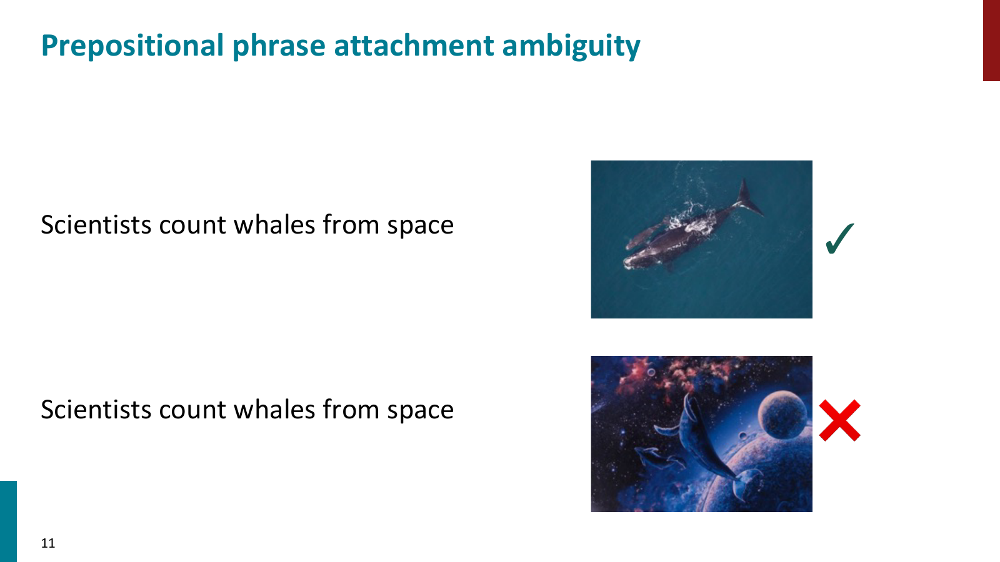
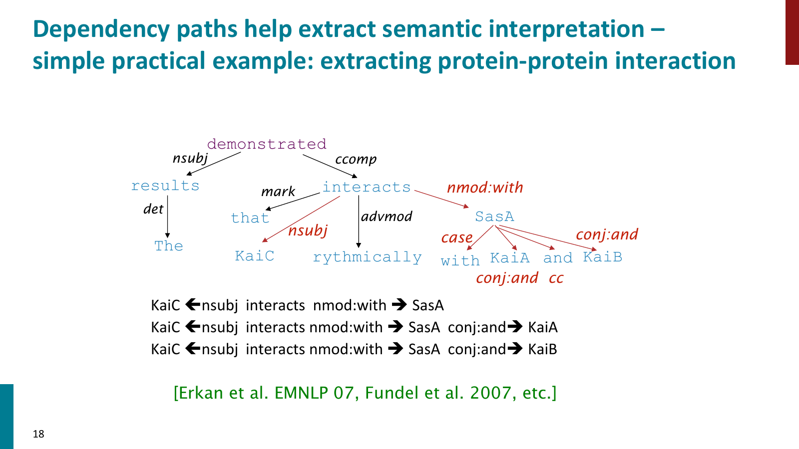
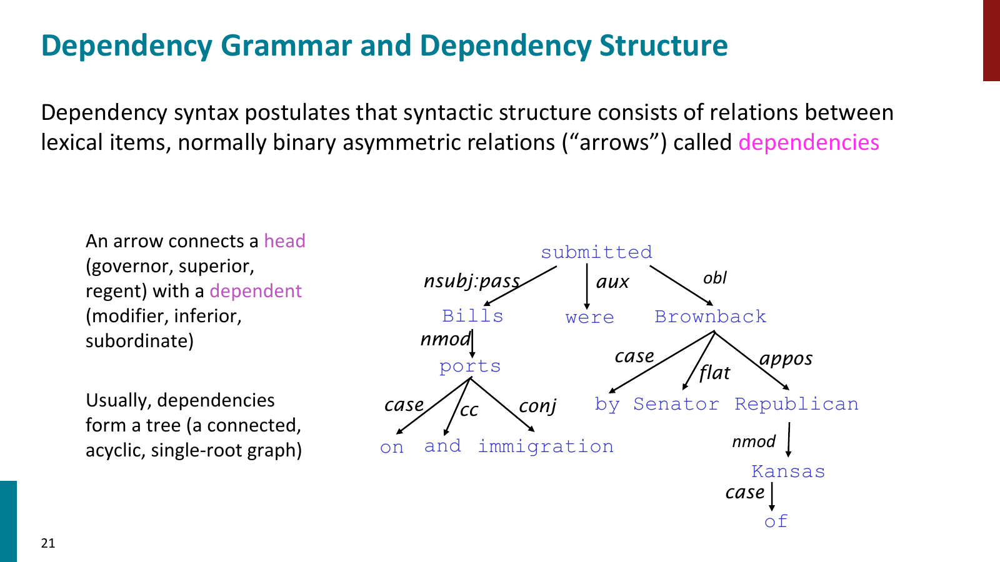
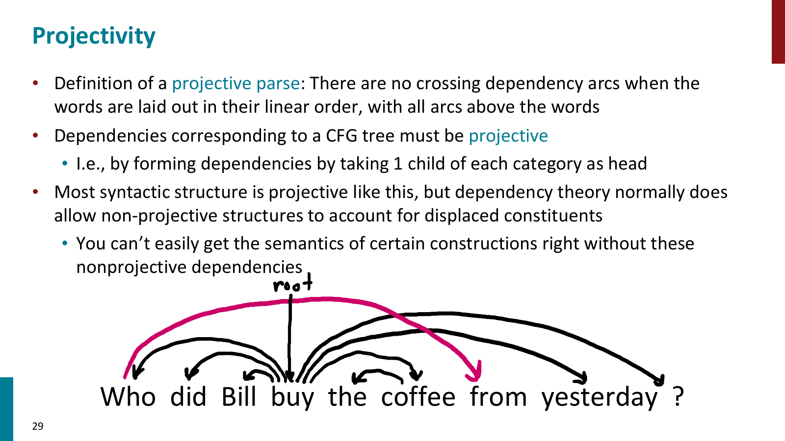
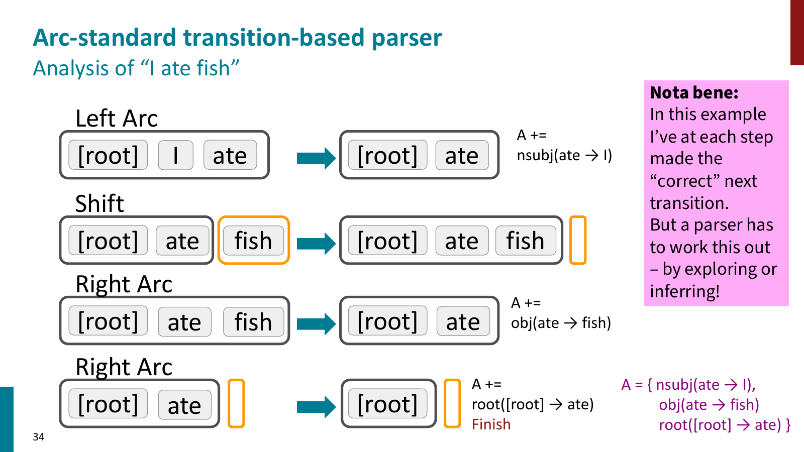
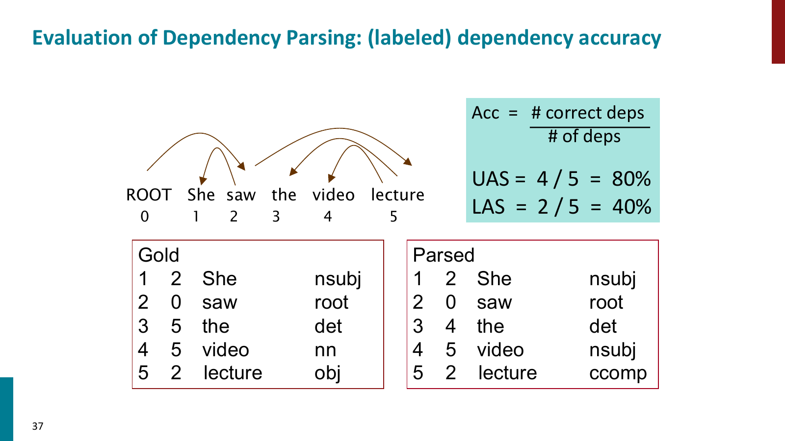
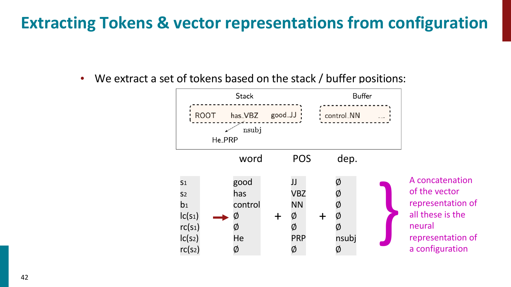
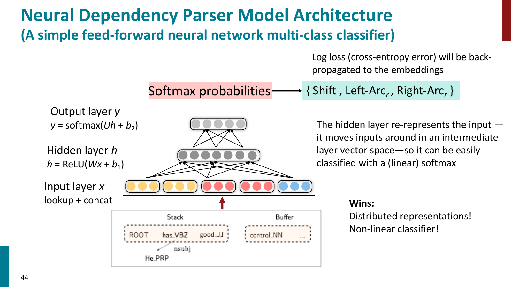
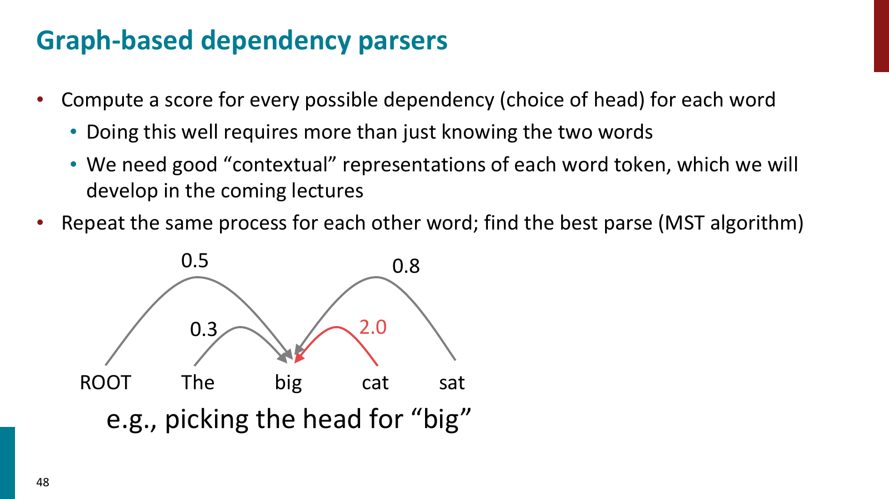

> 整理状态：全讲可读取技术正文与A2对应知识已整理。不做OCR；无法识读的图像细节保留限制，不猜测。

## 1. 句法结构的两种视角

来源：PDF P3–6。页码均指PDF物理页，课件印刷页码不连续，不能混用。

**成分结构（Constituency / Phrase Structure）**把词组织为嵌套的短语。例如：

- 词：`the`、`cat`、`cuddly`、`by`、`door`。
- 短语：`the cuddly cat`、`by the door`。
- 更大的短语：`the cuddly cat by the door`。

不同词可以出现在相同结构槽位，短语又能作为更大结构的组成部分。课件以短语结构语法／上下文无关语法（Phrase Structure Grammar / Context-free Grammar, CFG）说明这一视角。

**依存结构（Dependency Structure）**直接表示词与词之间的关系：哪个词修饰、附着于或作为哪个词的论元（Argument）。两种视角关注同一语言结构的不同组织方式：一者突出嵌套成分，一者突出词间的中心—从属关系。

人通过组合词语表达复杂意义，听者必须判断“什么修饰什么（What Modifies What）”。句法分析的作用，是将这些附着关系显式化，支持正确解释语言，而非只给句子加一张装饰性的树图。

## 2. 结构歧义为何难

### 2.1 附着与作用域

来源：P7–13。

**介词短语附着歧义（Prepositional Phrase Attachment Ambiguity）**：同一介词短语可以修饰不同成分。`Scientists count whales from space` 中，`from space`可以描述科学家从太空进行计数的方式，也可能被结构错误地连到`whales`上，产生不同解释。



来源：Lecture 4，PDF P8。P7、P11–13的部分示例为图像且文本不足，不尝试OCR或补造图中句子。

本讲还区分：

- **并列作用域歧义（Coordination Scope Ambiguity）**：修饰语作用于单个并列项，还是整个并列结构。P10使用`Shuttle veteran and longtime NASA executive Fred Gregory appointed to board`展示结构解释问题。
- **形容词／副词修饰歧义（Adjectival / Adverbial Modifier Ambiguity）**：同一修饰语可能作用于不同词或不同大小的成分。
- **动词短语附着歧义（Verb Phrase Attachment Ambiguity）**：动词性短语附着于哪个谓词，会改变动作之间的关系。

### 2.2 候选结构数量增长

来源：P9。

多个介词短语及其他可附着成分会使候选树数量迅速增长。课件用**Catalan数（卡特兰数）**说明许多树形组合问题的增长：

$$
C_n=\frac{(2n)!}{(n+1)!n!}.
$$

同一数列也计数凸多边形三角剖分等结构。这里用于解释组合歧义，不意味着任意实际句子的合法句法树数量都恰好等于同一个$C_n$；词类、语法和语义约束会限制候选集合。

## 3. 依存路径与语义解释

来源：P14。

依存结构可以把相隔多个词、甚至跨过嵌套从句的参与者联系起来。课件以蛋白质相互作用抽取为例，句子包含`KaiC rhythmically interacts with SasA`，并通过并列结构连接`KaiA`、`KaiB`。



来源：Lecture 4，PDF P14。

`KaiC`经`nsubj`关系与`interacts`连接，再经`nmod:with`到达`SasA`；结合并列边，还能联系`KaiA`和`KaiB`。路径比简单检查两个实体之间的原始连续词串更明确地表达“谁与谁发生作用”。

这里保留原课件的依存标签，不将不同版本标注体系的标签无说明地替换为当前命名。不同任务可以基于这类路径抽取关系，但本讲没有展开完整的蛋白质关系分类模型。

## 4. 依存语法与树约束

### 4.1 中心词、从属词和边标签

来源：P15–20。

**依存语法（Dependency Grammar）**把句法结构看成词汇项之间的二元非对称关系。依存弧（Dependency Arc）连接：

- **中心词（Head / Governor）**：被修饰或支配其他词的词。
- **从属词（Dependent / Modifier）**：依赖中心词的修饰语或论元。

本课程沿用从中心词指向从属词的箭头约定：

$$
h\longrightarrow d.
$$

不同资料可能反向画箭头，因此阅读图时必须先确认约定。边通常带语法关系标签（Grammatical Relation Labels），例如主语、被动主语、助动词、修饰和同位语关系。



来源：Lecture 4，PDF P17；P15–17分别引入边、标签及树的解释。图中`submitted`支配`Bills`、`were`等词，展示关系并不要求依赖词在句中紧邻中心词。

加入人工节点 **ROOT** 后，每个真实词恰好依赖一个其他节点，包括句子的主中心词依赖ROOT。通常还要求只有一个真实词直接依赖ROOT。

依存树应连通（Connected）、无环（Acyclic）、有单一根（Single-rooted）。给每个词独立选择最高分中心词，并不能自动保证这些全局条件，例如可能产生$A\to B$且$B\to A$的环。

P18介绍依存思想的历史及对自由语序、丰富屈折语言的适用性；P19为历史手稿图片，无需为学习解析算法转录年代和图片细节。

### 4.2 为什么需要树库

来源：P21–22。

**树库（Treebank）**是带句法结构标注的语料。课件提到Penn Treebank和Universal Dependencies等资源。相比手写语法规则，初期人工标注似乎慢，但有多方面价值：

- 标注劳动可复用：同一数据能训练多个分析器、词性标注器，也服务语言学研究。
- 覆盖真实语言现象，避免只覆盖少量人工构造的直觉例句。
- 提供频率和分布信息，而不仅是判断结构是否允许。
- 提供可比较的系统评估标准。

**Universal Dependencies（通用依存，UD）**提供跨语言依存标注框架。本地作业注明使用UDv1；课件中的标签也并非每处都与最新版本一致，因此不跨版本强行统一。

### 4.3 判断依存关系的线索

来源：P23。

| 线索 | 含义 | 不能误解为 |
| --- | --- | --- |
| 双词亲和性，Bilexical Affinities | 某些中心词与从属词的组合更合理，如`discussion → issues` | 仅靠两词就足以解析全部句子 |
| 依存距离，Dependency Distance | 大部分关系连接距离较近的词 | 长距离依存不合法 |
| 中间成分，Intervening Material | 跨过动词、标点的依存较少见 | 标点两侧永远不能连接 |
| 中心词配价，Valency of Heads | 某词通常带多少依赖项、位于哪一侧 | 所有中心词有固定数量的从属词 |

这些是选择偏好而非绝对语法禁令，解析器需要结合上下文。

## 5. 投射性与解析方法

### 5.1 什么是投射树

来源：P24–25。

将词按线性顺序排在一行，依存弧都画在上方，若没有交叉弧，称为**投射分析（Projective Parse）**。将CFG树的每个成分选定一个子成分作为中心词并转换成依存结构，会得到投射结构。

但语言存在位移成分（Displaced Constituents），有些依存必须非投射（Non-projective）才能正确表达关系。课件例子为`Who did Bill buy the coffee from yesterday?`。不能为维持一张无交叉图就随意改变真实修饰关系。



来源：Lecture 4，PDF P25。

### 5.2 方法分类

来源：P26。

| 解析方法 | 核心机制 | 课件列举 |
| --- | --- | --- |
| 动态规划，Dynamic Programming | 复用局部解析项，组合最优结构 | Eisner算法以端点中心词组织解析项，$O(n^3)$ |
| 图算法，Graph Algorithms | 给候选依存边打分，在树约束下选择整体结构 | McDonald等MSTParser，课件给出$O(n^2)$；后续神经图模型 |
| 约束满足，Constraint Satisfaction | 删除不满足硬约束的候选边 | Karlsson等方法 |
| 转移式分析，Transition-based Parsing | 连续选择动作，逐步建立结构 | MaltParser，贪心分类器决定附着，速度快 |

图模型通常最大化边分数之和；课件使用“Minimum Spanning Tree”的名称，可以通过对分数取负转成最小成本形式。依存树是有根、有向的树，不能直接用不满足方向和根约束的无向生成树替代。

## 6. Arc-standard转移式依存分析

### 6.1 状态与初始化

来源：P27–28；同时对照A2 Part 3，PDF P5–6。

解析状态写成$(\sigma,\beta,A)$：

- **栈（Stack）**$\sigma$：栈顶在右侧，初始为$[\mathrm{ROOT}]$。
- **缓冲区（Buffer）**$\beta$：下一个待处理词在左侧，初始包含整个句子。
- **依存弧集合（Arc Set）**$A$：初始为空。

设$\sigma|i|j$表示栈顶为$j$、次栈顶为$i$。带标签$r$的转移为：

$$
\begin{aligned}
\operatorname{SHIFT}:\quad
&(\sigma,k|\beta,A)\to(\sigma|k,\beta,A),\\
\operatorname{LEFT\!\text{-}\!ARC}_r:\quad
&(\sigma|i|j,\beta,A)\to(\sigma|j,\beta,A\cup\{(j,r,i)\}),\\
\operatorname{RIGHT\!\text{-}\!ARC}_r:\quad
&(\sigma|i|j,\beta,A)\to(\sigma|i,\beta,A\cup\{(i,r,j)\}).
\end{aligned}
$$

**LEFT-ARC**让栈顶$j$支配次栈顶$i$，删除从属词$i$；**RIGHT-ARC**让次栈顶$i$支配栈顶$j$，删除从属词$j$。两种动作都是删除从属词，保留中心词，而不是都简单弹出栈顶。

SHIFT要求缓冲区非空；弧动作至少需要两个栈元素，ROOT不能成为普通词的从属词。实际分类应限制在当前合法动作中。终止时缓冲区为空、栈只剩ROOT。

### 6.2 `I ate fish`完整过程

来源：P29–30。

| 步骤 | 动作 | 动作后的栈 | 动作后的缓冲区 | 新依存弧 |
| --- | --- | --- | --- | --- |
| 0 | 初始 | `[ROOT]` | `[I, ate, fish]` | — |
| 1 | SHIFT | `[ROOT, I]` | `[ate, fish]` | — |
| 2 | SHIFT | `[ROOT, I, ate]` | `[fish]` | — |
| 3 | LEFT-ARC | `[ROOT, ate]` | `[fish]` | `ate → I`，nsubj |
| 4 | SHIFT | `[ROOT, ate, fish]` | `[]` | — |
| 5 | RIGHT-ARC | `[ROOT, ate]` | `[]` | `ate → fish`，obj |
| 6 | RIGHT-ARC | `[ROOT]` | `[]` | `ROOT → ate`，root |



来源：Lecture 4，PDF P30。示例手工给出正确动作；真正的解析器必须从当前状态预测动作，不能把演示步骤当成模型已经知道答案。

### 6.3 动作数与批量解析

来源：A2 Part 3(b–d)，PDF P6，作业补充。

$n$个真实词各SHIFT一次，共$n$步；每个真实词最终作为从属词被弧动作移出栈，共$n$步，因此总计$2n$步。ROOT初始就在栈中，不需要SHIFT，也不会被移除。

**小批量依存解析（Minibatch Dependency Parsing）**并非一次预测一个句子的所有动作：每个未完成句子保留各自状态，把多句的当前状态组成一批，同时预测下一步，再逐句更新状态；完成的句子移出未完成列表。

```text
为每句初始化PartialParse，并保留原始句序
unfinished ← 全部解析状态的浅拷贝
while unfinished非空：
    batch ← unfinished中至多batch_size个状态
    actions ← model.predict(batch)
    对每个状态执行对应的一步动作
    从unfinished移除缓冲区为空且栈长为1的状态
按原始句序返回全部依存弧
```

保留原始状态列表用于恢复输入顺序。每句内部动作依赖前一步，不能把其后续动作视为独立样本并行；批处理并行的是不同句子的当前状态。

## 7. 从当前状态预测下一步动作

来源：P31–32。

MaltParser使用**判别式分类器（Discriminative Classifier）**根据当前状态选择合法动作。无标签版本至多3种动作；若弧关系标签集合为$R$，则有SHIFT，以及每种标签对应的LEFT-ARC与RIGHT-ARC，最多$2|R|+1$个输出类别。

输入特征可以包括栈顶词及其词性（Part of Speech, POS）、缓冲区首词及其词性等。传统模板组合1–3个状态元素，形成维度约$10^6$–$10^7$的二元稀疏指示特征（Sparse Indicator Features）。

**贪心解析（Greedy Parsing）**每步只保留当前最高分动作，没有搜索其他前缀。动作错误会改变后续状态，即使之后各步都很合理，也可能无法撤销早期错误。

**束搜索（Beam Search）**每步保留$k$个较好的解析前缀，可以保留暂时分数较低但后续更合理的路径；代价是更慢且消耗更多资源。分类器预测与搜索策略是两个不同层面的选择。

对基本arc-standard系统，每句动作数为$2n$；若每步固定大小特征提取与分类成本视为常数，贪心解析对句长为线性时间。不能把这个结论直接推广到任意复杂上下文编码器或任意束宽配置。

## 8. 解析质量与非投射结构

### 8.1 UAS与LAS

来源：P33。

设评估范围内有$N$个真实词，$h_i,r_i$分别为真实中心词索引与关系标签，$\hat h_i,\hat r_i$为预测结果：

$$
\operatorname{UAS}=\frac1N\sum_{i=1}^{N}\mathbf1[\hat h_i=h_i],
$$

$$
\operatorname{LAS}=\frac1N\sum_{i=1}^{N}
\mathbf1[\hat h_i=h_i\ \land\ \hat r_i=r_i].
$$

**无标签附着分数（Unlabeled Attachment Score, UAS）**只要求中心词正确；**有标签附着分数（Labeled Attachment Score, LAS）**同时要求中心词和关系标签正确。标签碰巧正确而中心词错误，不计为LAS正确；同一评估范围下$\operatorname{LAS}\le\operatorname{UAS}$。

P33的`She saw the video lecture`示例为UAS $4/5=80\%$、LAS $2/5=40\%$。人工ROOT节点不是需要预测其中心词的真实词；实际报告还需确认是否排除标点及使用何种标注版本，不把不同设置的数值直接等同。



来源：Lecture 4，PDF P33。

### 8.2 基本arc-standard为何不能覆盖全部语言结构

来源：P34。

本讲基本arc-standard系统只生成投射依存树。课件列出处理非投射的方向：

1. 放弃处理非投射弧，接受覆盖限制。
2. 使用只产生投射表示的形式体系，调整中心词选择，使表示满足投射性。
3. 先投射解析，再用后处理识别、修复非投射关系。
4. 增加转移，例如SWAP，通过改变处理顺序表达非投射结构。
5. 使用不要求投射性的解析机制，例如相应的图式生成树解析器。

这些方法改变的是覆盖能力、表示约定或解码机制，不能仅靠提高基本三动作分类器的准确率突破其结构限制。SWAP也会改变动作序列，前面基本系统的$2n$步计数不能不加说明地照搬。

## 9. 神经依存解析器的两项收益

### 9.1 稠密表示替代稀疏指示特征

来源：P35–38。

传统指示特征存在稀疏（Sparse）、覆盖不完整（Incomplete）以及计算昂贵（Expensive to Compute）的问题。课件引用的系统中，特征计算消耗超过95%的解析时间；这是所述传统配置的测量，不是所有解析器的固定比例。

神经方法学习稠密紧凑表示，配置向量维度约为千量级。除了词向量，POS标签和已预测的依存关系标签也可使用嵌入表示。课件的直觉例子是NN与NNS、amod与nummod等离散类别间可能存在可学习的共性；不是预先规定它们必须具有固定距离。

从栈、缓冲区及已建立的依赖结构中抽取词元，例如栈顶$s_1$、次栈顶$s_2$、缓冲区首词$b_1$，以及相关节点的最左／最右孩子，再查表并拼接：

$$
x=\operatorname{concat}(E_{w_1},\ldots,E_{w_m}).
$$

若各嵌入维度为$d$，则输入维度为$md$。拼接保留各状态槽位，不等于将一组特征向量直接求平均。



来源：Lecture 4，PDF P38。图中各槽位细节无法完全由文本层恢复，保留原图，不编造全部模板清单。

### 9.2 非线性动作分类器

来源：P39–41。

本讲将配置表示送入前馈网络（Feed-forward Neural Network）：

$$
h=\operatorname{ReLU}(Wx+b_1),\qquad
\ell=Uh+b_2,\qquad
\hat y=\operatorname{softmax}(\ell).
$$

输出为SHIFT及带标签的左右弧类别。对真实动作标签$a$，交叉熵损失为$-\log\hat y_a$；损失梯度反向传播到隐藏权重及输入嵌入。隐藏层重新组织状态表示，最终Softmax可以在这个表示上进行线性打分。



来源：Lecture 4，PDF P40。

课件以固定稀疏特征的线性分类器作对照，突出神经模型的非线性能力。不能将P39对传统方法的概括理解成“所有SVM都只能线性分类”：带非线性核的SVM不属于这里讨论的线性特征打分配置。

### 9.3 历史速度与准确率结果

来源：P36、P41–42。

P36为英语Stanford Dependencies解析实验：

| 方法 | UAS | LAS | 每秒句数 |
| --- | ---: | ---: | ---: |
| MaltParser | 89.8 | 87.2 | 469 |
| MSTParser | 91.4 | 88.1 | 10 |
| TurboParser | 92.3 | 89.6 | 8 |
| Chen & Manning 2014 | 92.0 | 89.7 | 654 |

该神经转移式模型同时取得很快的解析速度和有竞争力的准确率；UAS并非全表最高，不能把结论写成每项指标全部领先。速度值依赖当时实现与硬件，仅作为课件实验记录。

后续工作采用更大更深网络、调参、束搜索以及对整个决策序列进行全局CRF式推断（Global CRF-style Inference）。P42列出PTB WSJ SD 3.3上的结果：

| 方法 | UAS | LAS |
| --- | ---: | ---: |
| Chen & Manning 2014 | 92.0 | 89.7 |
| Weiss等 2015 | 93.99 | 92.05 |
| Andor等 2016 | 94.61 | 92.79 |

这些工作通向SyntaxNet及Parsey McParseFace。课件引用当年的宣传名称，不将其当成当前最高水平的判断。

## 10. 图式神经依存解析

来源：P43–45。

**图式解析（Graph-based Parsing）**为每个真实词的每个候选中心词计算分数，再在树约束下寻找整体最优解析。核心形式可概括为：

$$
T^*=\operatorname*{arg\,max}_{T\in\mathcal T}
\sum_{(h\to d)\in T}s(h,d),
$$

其中$\mathcal T$是满足所选根、无环及其他约束的依存树集合。该式表达课件的“边打分＋全局选树”，不是引入新的高阶评分模型。



来源：Lecture 4，PDF P44。

只知道两个词的孤立词向量往往不够，需要**上下文化词元表示（Contextual Token Representations）**区分句中角色。课件预告后续讲次的神经序列模型；这里不提前展开其结构。

Dozat和Manning（2017）使用**双仿射评分（Biaffine Scoring）**并结合神经序列表示，重新推动神经图式解析。课件没有在本讲给出完整双仿射公式，不额外展开。长度$n$的句子有$O(n^2)$个候选依存边，模型通常慢于简单的转移式解析器，但报告的准确率更高：

| 方法 | UAS | LAS，PTB WSJ SD 3.3 |
| --- | ---: | ---: |
| Chen & Manning 2014 | 92.0 | 89.7 |
| Weiss等 2015 | 93.99 | 92.05 |
| Andor等 2016 | 94.61 | 92.79 |
| Dozat & Manning 2017 | 95.74 | 94.08 |

转移式模型对动作序列做局部或束搜索决策；图式模型对候选边打分并受整体树约束解码。两者都可以使用神经表示，不能把“神经”与“图式”误认为互斥类别。

## 11. A2：模型实现与错误分析

来源：A2 Part 3(e–g)，PDF P6–10。本节补充对应技术要求，不转录提交和评分安排。

### 11.1 行向量版本与批维度

作业嵌入矩阵$E\in\mathbb R^{|V|\times d}$按行存储，$m$个特征词元查表后拼成$x\in\mathbb R^{md}$。作业采用行向量前向记法：

$$
h=\operatorname{ReLU}(xW+b_1),\qquad
\ell=hU+b_2,\qquad \hat y=\operatorname{softmax}(\ell).
$$

隐藏宽度为$H$时，$W\in\mathbb R^{md\times H}$、$U\in\mathbb R^{H\times3}$。这与第9节的列向量记法等价，但权重布局相互转置，不能将两套式子混用。

对于批大小$B$，嵌入查表先得到$B\times m\times d$，按每句特征顺序展平为$B\times md$，输出logits为$B\times3$。本地作业只预测三种**无标签动作**，因此用UAS评估，不等于实现了课件全部$2|R|+1$个带标签动作。

作业要求手工实现线性变换和嵌入查表，不能用`torch.nn.Linear`或`torch.nn.Embedding`直接替代。此要求用于练习张量与参数，不是说实际项目不能使用这些模块。

题目求导可用第3讲规则：令$z=xW+b_1$，则在$z_i\ne0$处：

$$
\frac{\partial h_i}{\partial x_j}
=\mathbf1[z_i>0]W_{ji},\qquad
\frac{\partial\operatorname{CE}(y,\hat y)}{\partial\ell_i}
=\hat y_i-y_i.
$$

数据集训练损失是样本交叉熵的平均。梯度回到查表输出后，共享同一个词元索引的贡献要累加到$E$的同一行。

### 11.2 四类附着错误

作业要求说明错误类型、错误中心词以及正确中心词；只检查依存关系标签不足以诊断附着错误。

| 错误类型 | 需要判断的结构 | 作业解释示例 |
| --- | --- | --- |
| 介词短语附着错误，PP Attachment Error | PP应修饰哪个词 | `Moscow sent troops into Afghanistan`中应为`sent → Afghanistan`，不是`troops → Afghanistan` |
| 动词短语附着错误，VP Attachment Error | 动词短语关联哪个主句动作 | `Leaving the store unattended, I went outside...`中的离店动作应关联`went` |
| 修饰语附着错误，Modifier Attachment Error | 程度等修饰语作用于哪个词 | `I am extremely short`中应为`short → extremely` |
| 并列附着错误，Coordination Attachment Error | 后一个并列项依赖哪个前项 | `brown rice or garlic naan`中后项中心词`naan`连接前项中心词`rice` |

A2另给四张待诊断依存图，但图中边端点无法从文本层可靠还原，因此不猜测各题的错误边。保留上述明确可读的类型、例子和诊断方法。

### 11.3 为什么加入词性

POS特征概括词的句法角色，对低频词和词汇变化提供共享信号。例如名词与动词通常具有不同的论元和修饰模式。词性不是完整句法分析的替代品，但与词汇嵌入、已有依存结构共同输入时，可帮助分类器判断合法且合理的下一步。

## 来源与范围

- 主课件：`slides/lecture04-dep-parsing.pdf`，45个PDF物理页。课件印刷页码从3跳到6等，本文统一按物理页引用。
- 作业：`assignments/a2.pdf` Part 3，PDF P5–10。A2 Part 2的Adam与Dropout已在第3讲整理。
- 本章整理算法与题目知识，不运行或代写完整训练工程，不把未运行的训练目标当成实测成绩。
- 9张知识图来自相应课件页，无法识读的图像细节按用户要求跳过，不做OCR。
