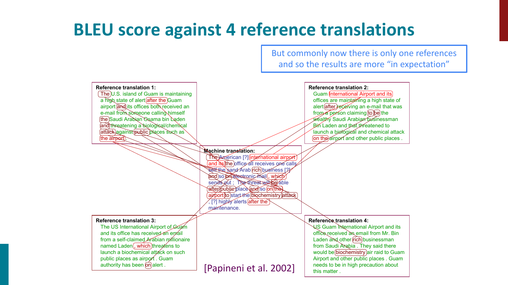
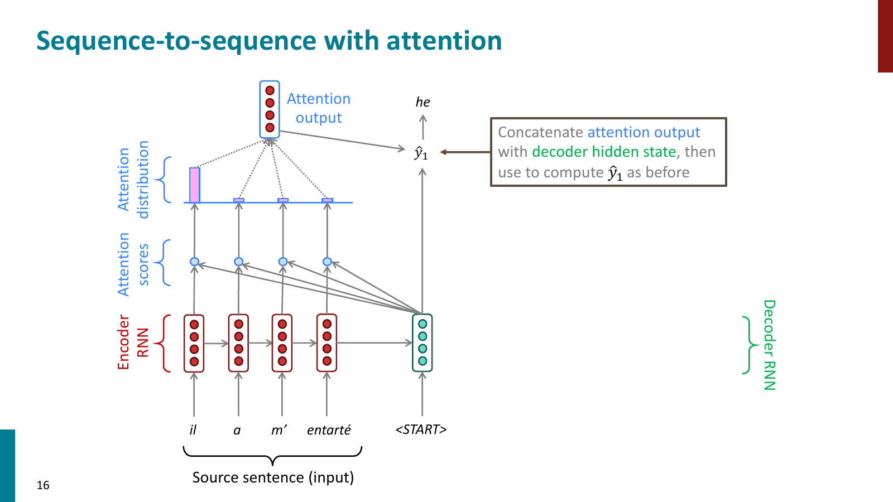
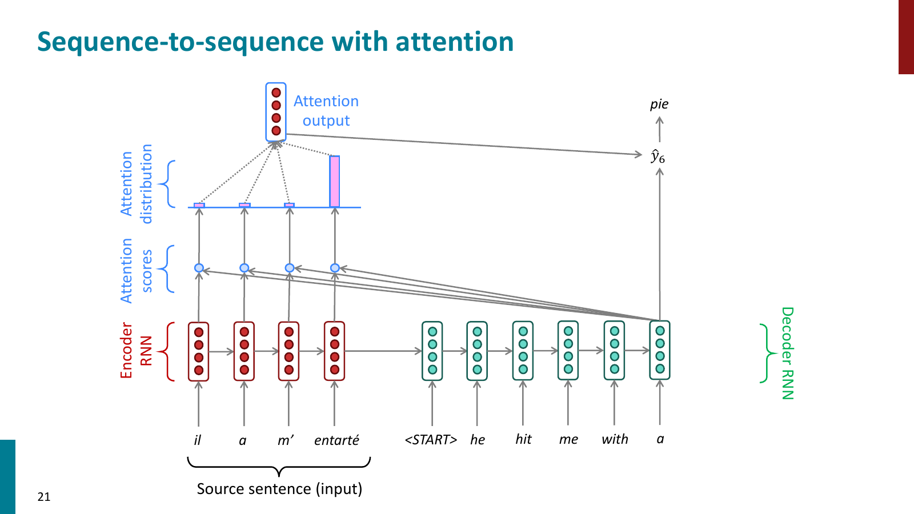
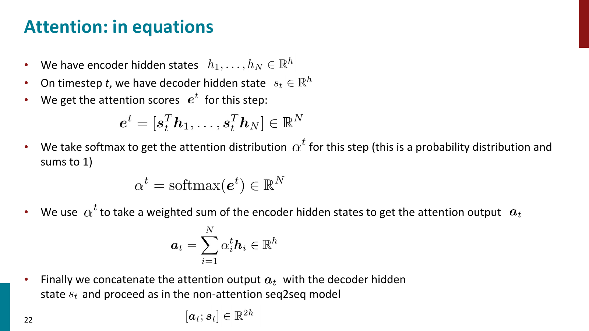
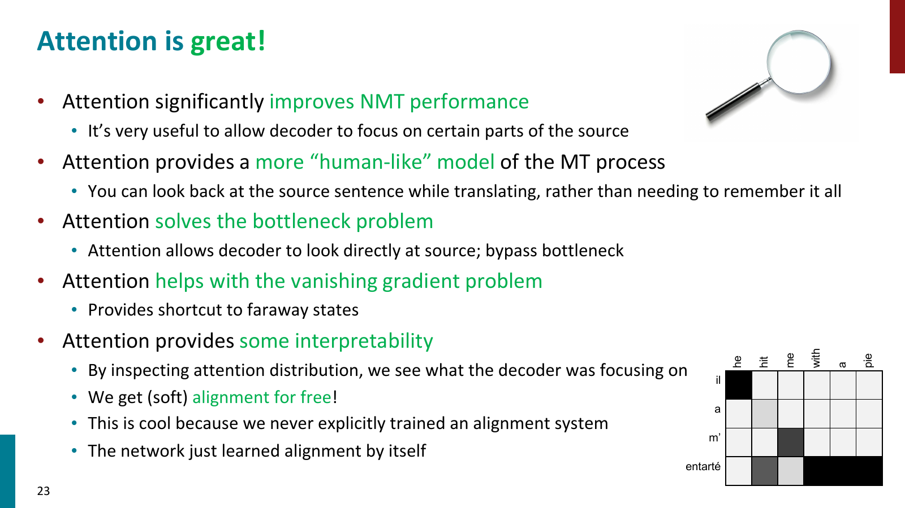
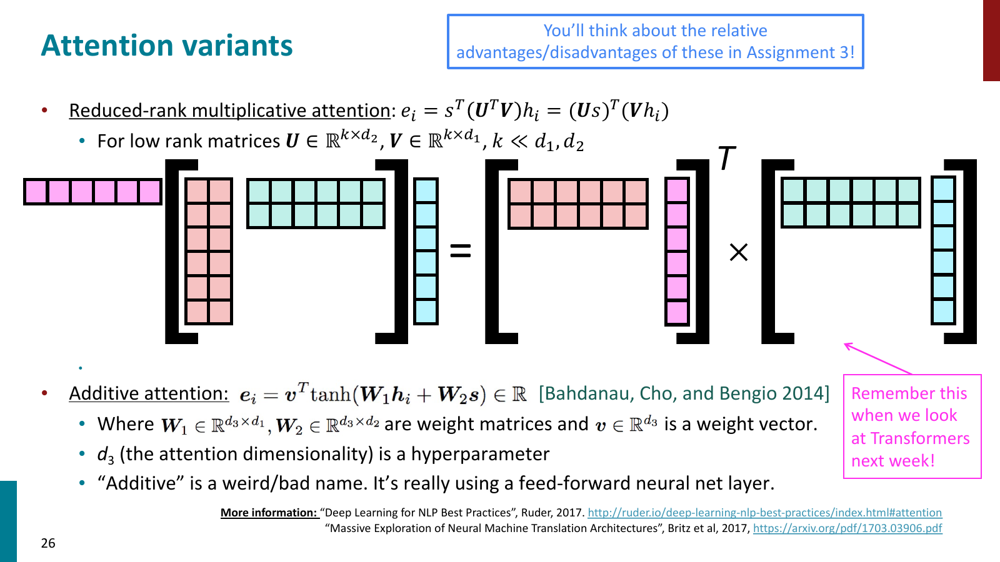
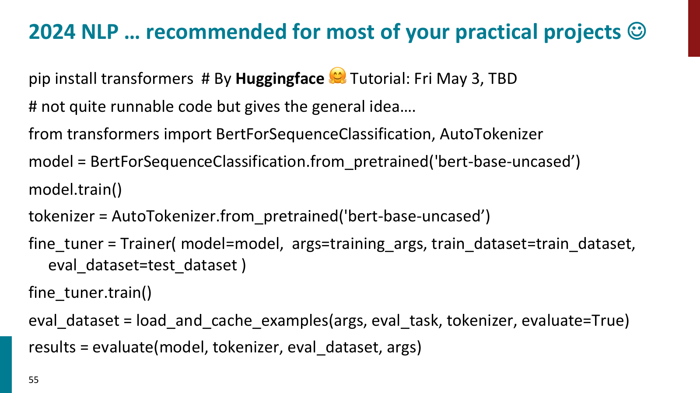
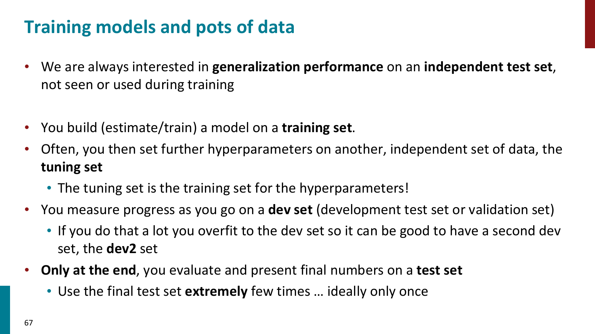
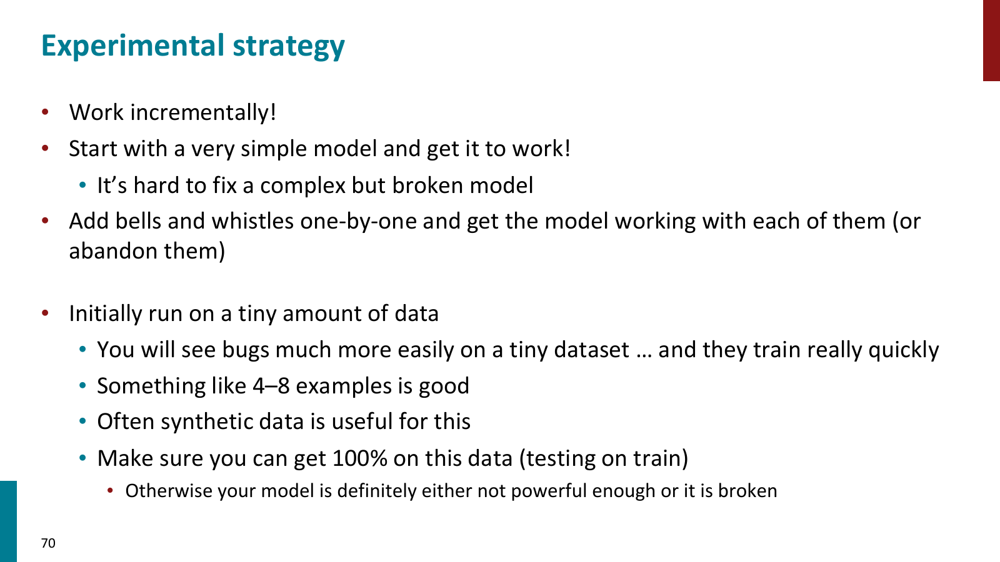

> 来源：`lecture07-final-project.pdf`，73页；A3说明P1–8。可读技术内容按主题合并，关键词中英双语，保留9张知识图。评分、提交安排、算力赠送、项目宣传及无法识读的项目海报不展开，不做OCR。

## 1. 翻译评估：BLEU测什么

### 1.1 参考译文与n-gram精确率

来源：课件P3–6。P3重复第6讲编码器—解码器瓶颈。

**BLEU（Bilingual Evaluation Understudy）**比较机器候选译文（Candidate Translation / Hypothesis）与一个或多个**参考译文（Reference Translations）**的n-gram重叠。通常计算1至4-gram的修正精确率，取几何平均，再惩罚过短输出。

它主要衡量表面片段是否与参考表达相符。翻译可以有不同但同样正确的措辞与词序，因此低重叠不必然等于语义错误。P5对同一内容列出4个人工版本：多参考扩大了允许匹配的表达范围；只有一个参考时，正确改写更容易被低估。

来源：Lecture 7，PDF P5。无需背诵段落，重点是参考表达差异。

P6展示SMT到NMT时期的历史进展曲线，但图注混合了不同年份测试集来源。这里只保留历史趋势，不将跨测试集曲线差值直接解释成严格同条件增益，也不转录不可读取的曲线数值。

### 1.2 修正精确率：计数必须裁剪

来源：A3 Part 2(c)，PDF P6–7；补全课件P4概述。

候选为$c$，参考为$r_1,\ldots,r_k$。令$\operatorname{Count}_s(g)$为n-gram $g$在序列$s$出现次数，则：

$$
p_n=\frac{\sum_{g\in\mathcal G_n(c)}\min\left(\operatorname{Count}_c(g),\max_{1\le j\le k}\operatorname{Count}_{r_j}(g)\right)}{\sum_{g\in\mathcal G_n(c)}\operatorname{Count}_c(g)}.
$$

$\mathcal G_n(c)$取候选中不同的n-gram类型，计数保留重复出现次数。分母是候选n-gram总数；分子为**裁剪匹配数（Clipped Match Count）**：某个片段最多获得任一单条参考中该片段的最大次数，不能通过不断重复一个正确词无限增加匹配。

多参考允许不同片段分别匹配不同参考，但不会把各参考中同一片段的次数直接相加。$p_n$是精确率（Precision），不是参考片段召回率；候选越短可能越容易获得高精确率，因此需要长度惩罚。

### 1.3 长度惩罚与几何平均

设$c_{\mathrm{len}}=|c|$，参考长度$r_{\mathrm{len}}$选与候选长度最接近的一条，若同样接近则选较短者。**简短惩罚（Brevity Penalty, BP）**为：

$$
\operatorname{BP}=\begin{cases}
1,&c_{\mathrm{len}}\ge r_{\mathrm{len}},\\
\exp\left(1-\dfrac{r_{\mathrm{len}}}{c_{\mathrm{len}}}\right),&c_{\mathrm{len}}<r_{\mathrm{len}}.
\end{cases}
$$

$$
\operatorname{BLEU}=\operatorname{BP}\cdot\exp\left(\sum_{n=1}^{N}w_n\log p_n\right),\qquad \sum_nw_n=1.
$$

常用$N=4$且$w_n=1/4$，作业算例仅使用$w_1=w_2=1/2$。对数为自然对数；几何平均要求各阶同时匹配，无平滑时某个正权重$p_n=0$会使整体得分为0。BLEU可写为0–1或乘100的0–100数值，比较时需统一。

作业为便于手算定义单句BLEU；课件与实际模型报告通常使用**语料级BLEU（Corpus BLEU）**，先跨句汇总各阶裁剪计数和总计数，再计算精确率及语料长度惩罚，不是简单平均各句BLEU。

### 1.4 A3算例：参考集合能改变排序

来源：A3 Part 2(c)(i–ii)，P7。保持原文小写及空格分词：

- $r_1$：`resources have to be sufficient and they have to be predictable`，11词。
- $r_2$：`adequate and predictable resources are required`，6词。
- $c_1$：`there is a need for adequate and predictable resources`，9词。
- $c_2$：`resources be sufficient and predictable to`，6词。

只计算1-gram和2-gram，$\operatorname{BLEU}=\operatorname{BP}\sqrt{p_1p_2}$：

| 参考 | 候选 | $p_1$ | $p_2$ | $|c|$ | 选定$|r|$ | BP | BLEU |
| --- | --- | --- | --- | ---: | ---: | ---: | ---: |
| $r_1,r_2$ | $c_1$ | $4/9$ | $3/8$ | 9 | 11 | 0.801 | 0.327 |
| $r_1,r_2$ | $c_2$ | $6/6$ | $3/5$ | 6 | 6 | 1 | 0.775 |
| 仅$r_2$ | $c_1$ | $4/9$ | $3/8$ | 9 | 6 | 1 | 0.408 |
| 仅$r_2$ | $c_2$ | $3/6$ | $1/5$ | 6 | 6 | 1 | 0.316 |

计数解释：$c_1$的匹配词是`adequate, and, predictable, resources`；匹配二元组为`adequate and`、`and predictable`、`predictable resources`。$c_2$在双参考下所有词均匹配，匹配二元组为`be sufficient`、`sufficient and`、`and predictable`；只用$r_2$时，仅`resources, and, predictable`及`and predictable`匹配。

$c_1$长度9，到11和6的距离分别为2和3，双参考时必须选11；不能为了得分更高而挑更短参考。双参考下BLEU偏好语法不自然的$c_2$，只用$r_2$后排序反转。较流畅、较忠实的表达可能因词面不同得分偏低，评估结果还依赖参考集合。

### 1.5 与人工评估的关系

来源：课件P4–5；A3 Part 2(c)(iii–iv)。

优势是自动、快速、可重复，并可在相同测试集及配置下比较大量模型。局限是不能充分判断语义、事实关系、漏译和语用；不同合法表达的n-gram重叠可能很低，参考数量及分词又会影响结果。因此BLEU适合统一条件下的自动比较，还需检查实际译文和错误类型。

## 2. Attention：每一步重新读取源句

### 2.1 固定编码瓶颈

来源：P7–9。

基础Seq2Seq把整个源句压缩为固定宽度编码，再用它初始化解码器。这个表示需要同时携带所有实体、修饰和关系，目标端越往后生成，越依赖经多步递归保留下来的信息。

**注意力（Attention）**在每个解码步建立到编码端各位置的直接连接。核心原文为“on each step of the decoder, use direct connection to the encoder to focus on a particular part of the source sequence”。每步根据当前解码状态选择性读取源句，不再要求一个最终向量独自承担全部信息传递。

### 2.2 分数、分布、加权和、输出

来源：P10–22，重复动画按新增操作合并。令源端状态$h_1,\ldots,h_m\in\mathbb R^{d_h}$，当前解码状态$s_t\in\mathbb R^{d_s}$。

1. **注意力分数（Attention Scores）**：衡量当前位置$i$对当前生成步骤$t$的相关性，$e_{t,i}=\operatorname{score}(s_t,h_i)$。
2. **注意力分布（Attention Distribution）**：沿源位置做Softmax，$\alpha_{t,i}=\exp(e_{t,i})/\sum_{j=1}^{m}\exp(e_{t,j})$。
3. **注意力输出／上下文向量（Attention Output / Context Vector）**：$a_t=\sum_{i=1}^{m}\alpha_{t,i}h_i\in\mathbb R^{d_h}$。
4. 将$a_t$与$s_t$拼接，映射到目标词表分布，预测本步目标词。

$$
\alpha_t\in\mathbb R^m,\qquad \alpha_{t,i}\ge0,\qquad \sum_{i=1}^{m}\alpha_{t,i}=1.
$$

权重是在同一解码步的源位置之间归一化，不是跨目标步归一化。原始分数可以为负，不是概率；加权和的维度与被加权的源状态一致，与源句长度无关。

来源：Lecture 7，PDF P16，保留P10–16逐步构造后的完整流程。

P14说明第一个输出倾向于读取与`he`有关的源状态；P17–21展示生成`hit, me, with, a, pie`时重新计算分布。目标词与源词不必一一对应，一个词可以拆成多个目标词，多步可关注相同源位置。

来源：Lecture 7，PDF P21。图中具体权重未识读，不补造数值。

来源：Lecture 7，PDF P22。部分公式未进入文本层，正文使用P24–26的操作描述及A3式(7–13)交叉确认。

### 2.3 为什么有用：信息、梯度与软对齐

来源：P23。

- **缓解瓶颈（Bypassing the Bottleneck）**：每一步可以直接访问全部源状态，不仅依赖编码终态。
- **改善梯度通路（Gradient Shortcuts）**：输出误差可经注意力直接到达较早源位置，无须全部绕过很长的递归链。
- **软对齐（Soft Alignment）**：查看$\alpha_{t,i}$可观察目标步$t$对源位置$i$的关注。模型只用翻译损失训练，没有单独提供对齐标签，却学得位置对应关系。
- **改善翻译效果（Improved NMT Performance）**：生成时能够“回看”源句，接近人翻译时按需要检索原文的方式。

来源：Lecture 7，PDF P23。权重是可检查的内部计算信号，课件以此说明部分可解释性；不能仅凭某个高权重断言模型已正确翻译该源词。

## 3. 注意力评分函数与通用形式

### 3.1 点积、双线性与加性评分

来源：P24–26；A3 Part 1(i)，P5。

查询（Query）为$q\in\mathbb R^{d_q}$，源表示$h_i\in\mathbb R^{d_h}$。共同流程始终是评分、Softmax、加权求和，区别在评分函数。

| 方法 | 分数$e_i$ | 参数与维度 | 特点 |
| --- | --- | --- | --- |
| 点积，Dot-product | $q^Th_i$ | 要求$d_q=d_h$ | 无额外评分参数，简单快速；要求两个表示可直接在同一空间比较 |
| 乘性／双线性，Multiplicative / Bilinear | $q^TWh_i$ | $W\in\mathbb R^{d_q\times d_h}$ | 可学习两个空间的对应，允许维度不同；增加参数和计算 |
| 低秩乘性，Reduced-rank Multiplicative | $(Aq)^T(Bh_i)$ | $A\in\mathbb R^{r\times d_q}$、$B\in\mathbb R^{r\times d_h}$ | 等效$W=A^TB$，限制秩不超过$r$；在较小空间比较 |
| 加性，Additive | $v^T\tanh(W_hh_i+W_qq)$ | $W_h\in\mathbb R^{d_a\times d_h}$、$W_q\in\mathbb R^{d_a\times d_q}$、$v\in\mathbb R^{d_a}$ | 前馈网络评分，$d_a$为注意力内部宽度 |

课件称“Additive”不是非常贴切的名称：它实际用一个带非线性的前馈层计算相容性，而非只把查询和值直接相加。双线性评分是Luong等2015的一类方法，加性评分对应Bahdanau等2014。

来源：Lecture 7，PDF P26。正文统一矩阵维度和符号，不声称损坏文本已逐字符识读。

A3比较题的关键：点积相对乘性更省参数和投影计算，但表达能力及维度匹配更受限；加性相对双线性提供非线性的匹配函数，但需要逐查询—源位置计算中间激活，通常有额外计算与内存开销。更灵活不保证在任意数据上更好，最终需要同条件实验。

低秩形式的评分参数量为$r(d_q+d_h)$，完整双线性为$d_qd_h$；只有$r$足够小时才节省参数。两个投影后的向量都在$r$维空间点积，是下一讲理解投影式注意力的准备。

### 3.2 与任务无关的定义

来源：P27–28。

给定一组向量值（Values）与一个查询，注意力生成依赖查询的加权和。可理解为**选择性摘要（Selective Summary）**：查询决定该关注哪些信息，输出宽度固定，输入项数可以变化。

Seq2Seq中每个$s_t$是查询，全部$h_i$是值，源表示同时参与评分。注意力不限于RNN、翻译或Seq2Seq，还可作为更一般的指针、记忆读取与信息组合机制。本讲止于查询和值的抽象，Transformer的独立键／值投影在第8讲展开。

## 4. A3完整注意力计算、Mask与输出反馈

来源：A3 Part 1模型说明式(5–14)，PDF P2–3；Part 1(g)，P4。第6章已整理输入卷积、双向编码、解码初态和教师强制。

### 4.1 维度贯通

每方向LSTM宽度$H$，源端拼接状态$h_i^{\mathrm{enc}}\in\mathbb R^{2H}$，解码隐藏状态$h_t^{\mathrm{dec}}\in\mathbb R^H$。使用乘性注意力：

$$
e_{t,i}=(h_t^{\mathrm{dec}})^TW_{\mathrm{attProj}}h_i^{\mathrm{enc}},\qquad
W_{\mathrm{attProj}}\in\mathbb R^{H\times2H}.
$$

$$
\alpha_t=\operatorname{softmax}(e_t),\qquad
a_t=\sum_{i=1}^{m}\alpha_{t,i}h_i^{\mathrm{enc}}\in\mathbb R^{2H}.
$$

$W_{\mathrm{attProj}}$仅使源状态在评分时与解码状态维度兼容；最终加权的是原始$2H$维源状态，故$a_t$不是$H$维。

$$
u_t=[a_t;h_t^{\mathrm{dec}}]\in\mathbb R^{3H},\qquad
v_t=W_uu_t\in\mathbb R^H,\qquad W_u\in\mathbb R^{H\times3H},
$$

$$
o_t=\operatorname{dropout}(\tanh(v_t)),\qquad
P_t=\operatorname{softmax}(W_{\mathrm{vocab}}o_t),\qquad
W_{\mathrm{vocab}}\in\mathbb R^{|V_y|\times H}.
$$

本步交叉熵$J_t=-\log P_t[y_t^*]$同时训练编码器、解码器、注意力投影、组合输出层和词表输出层。源位置不需要正确对齐标签。

### 4.2 Input Feeding：上一时刻组合输出进入下一步

来源：课件P17；A3 P2式(5)。

**输入反馈（Input Feeding）**把目标嵌入与上一时刻组合输出拼接送入解码LSTM：

$$
\bar y_t=[E_y[y_{t-1}];o_{t-1}]\in\mathbb R^{e+H},\qquad o_0=0.
$$

因此下一步除了通过LSTM状态传递历史，还能获得上一时刻已整合的源端注意力信息。这里反馈的是$o_{t-1}$，不是单独的$2H$维$a_{t-1}$。课件P17沿用了“Assignment 4”的旧编号，本地2024实际对应A3，以作业正文为准。

### 4.3 Padding Mask必须在Softmax之前使用

批大小$B$、最长源长度$M$时，A3的`enc_masks`形状为$B\times M$，**1代表填充，0代表真实词元**。将填充位置分数设为$-\infty$：

$$
\tilde e_{t,i}=\begin{cases}e_{t,i},&\text{真实源位置},\\-\infty,&\text{填充位置},\end{cases}
\qquad \alpha_t=\operatorname{softmax}(\tilde e_t).
$$

这样填充位置权重为0，其余真实位置权重之和为1。若不遮蔽，模型会把部分概率质量分给并不存在的词，改变上下文表示；即使填充向量是零，也会稀释真实词的权重。若先Softmax再直接把填充权重清零，剩余权重一般不再归一化，不能替代上述计算。

## 5. A3的解码搜索与翻译错误分析

### 5.1 贪心与束搜索

来源：A3 Part 2(d)，PDF P7–8。课件没有单独展开搜索算法，本节仅补作业诊断所需的过程。

译文搜索希望得到$\arg\max_yP(y\mid x)$。由于前缀会影响后续预测，逐步选当前最可能词不保证全句概率最大。

**束搜索（Beam Search）**每一步保留$K$个高分候选前缀，分别扩展下一词，再按累计分数选保留项。基本前缀分数为：

$$
S(y_{1:t})=\sum_{j=1}^{t}\log P(y_j\mid y_{<j},x).
$$

$K=1$退化为贪心搜索；$K>1$可以保留暂时分数稍低、后续更好的路径，但仍是近似搜索，不保证全局最优。具体结束处理及长度调整需查看实现，本地缺代码包，不推定作业用了某种额外评分修正。

作业保存束宽10的诊断结果，包含源句`example_source`、真实目标`example_target`及10条`hypotheses`。检查同一源句在迭代200、3000及训练末期的首条候选，可观察词汇、语法和忠实性是否改善；比较末期多条候选可观察搜索在措辞与结构上的变化。模型概率较高不代表人工质量必然更好，BLEU也不能替代具体阅读。

没有实际训练日志，不能编造指定迭代的翻译结果。

### 5.2 按错误类型诊断

来源：A3 Part 2(b)，PDF P6。原题要求分析下划线处，但文本提取无法保留下划线；这里按可读英文对比记录明确可见差异，不声称恢复了指定标记范围。以下原因与改进是可能的分析，不是已通过实验确认的因果。

| 参考与模型中的差异 | 可见问题 | 可能原因与对应尝试 |
| --- | --- | --- |
| `the culprits ... convicted` → `the culprit ... sentenced to theft` | 复数变单数；法律表达`sentenced to theft`不当 | 数与语义关系未保留，目标端局部搭配错误；检查对应词频和上下文、补相关平行例子并检查对齐 |
| `almost no space ... and resources have run out` → 两遍`resources have been exhausted` | 漏掉空间不足，重复资源耗尽 | 源信息覆盖不完整、反复关注相同部分；检查注意力是否重复，可尝试改进关注历史／覆盖处理 |
| `a national mourning today` → `today's day` | 漏掉“全国哀悼”核心意义，留下泛化表达 | 低频表达或上下文表示不足；检查训练中相关片段、补数据或调整表示能力 |
| `act not, err not` → `it's not wrong` | 谚语的条件和行为内容丢失 | 非字面表达或源域差异；该例源语为粤语，需检查其与训练资料的分布差异，补相关表达与语域数据 |

先识别具体错在哪里，再提出与该错误相符的原因和改动。只写“增大模型”不能解释为何某类错误应改善；需通过对齐、数据频次、输出与对照实验继续验证。

## 6. 从课件提炼研究问题与实验设计

### 6.1 论文阅读与研究计划

来源：P38–39、P41–43。只保留研究方法，省略提案评分及提交安排。

阅读论文要回答：主要新贡献是什么；有效机制是可复用的一般方法还是特例；是否有缺陷或值得借鉴的细节；与相关工作的关系；能提出什么进一步检验的问题。

研究计划需要把“好想法”落实到模型、可获得的数据、可执行的评价，以及合理**基线（Baselines）**和**消融实验（Ablation Studies）**。消融通过移除或替换某个组件，与完整系统比较，检验收益是否来自声称的设计。还应考虑部署后的伦理风险及可实际采取的缓解办法。

P41给论文组织线索：摘要、引言、相关工作、模型、数据、实验、结果、分析和结论。重点是把问题、方法与证据连接起来。

P42给两个选题入口：从**问题（Problem / “Nail”）**出发，寻找更有效的解决方法；或从**方法（Method / “Hammer”）**出发，研究如何改进、理解或用于新问题。P43列出应用任务、架构实现、提示／语言模型程序、分析解释以及理论／语言学研究等类型。实验性项目需要数值比较及消融；分析项目要明确研究模型的哪些表示、现象或错误。

### 6.2 2024课件中的实践路径

来源：P32、P51–58。

P32的minBERT项目技术路径是：完成BERT实现，微调情感分类，再探索对比学习、复述任务或正则化优化等方向。BERT结构与项目细节在预训练章节结合项目说明整理。

P54对比两个时期：早期深度学习NLP常以架构改进为中心，例如为摘要加入复制注意力和概率门；2024课件更强调使用大型预训练模型，在微调、领域适配及周边系统上开展工作。这是当时实践建议，不把课件的修辞表述理解为架构研究永久失效。

P55展示预训练实践的一般顺序：加载预训练分类模型与匹配的Tokenizer，准备训练参数和数据，训练／微调，再评价。原页明确写“not quite runnable code”，缺少若干变量定义；保留流程，不将截图当作可直接执行脚本。

来源：Lecture 7，PDF P55。截图中的`test_dataset`变量名不能作为反复用最终测试集调参的依据，数据隔离要求见第7节。

P56–58列出的方向包括：

- **鲁棒性与领域偏移（Robustness / Domain Shift）**：准确率之外，评估换领域后的表现与适配。
- **知识与表示分析（Knowledge / Representation Analysis）**：模型学到了什么、如何学到。
- **少数据学习（Learning with Limited Data）**：上下文学习、迁移学习，如何以少量标注获得任务能力。
- **偏差、可信度与可解释性（Bias / Trustworthiness / Explainability）**，以及低资源语言和罕见长尾现象。
- **数据增强（Data Augmentation）**与大型语言模型程序，包括课件提到的RAG、LangChain、DSPy，不展开教程。
- **高效模型（Efficient Models）**：剪枝、量化、参数高效微调、低秩适配；在给定内存和算力下评估任务能力。
- **组合性与系统泛化（Compositionality / Systematic Generalization）**、快速学习；课件列COGS、ReCOGS、gSCAN作例子。

使用大模型API时，应提出可检验的分析、提示或系统改进，并以实验显示自己的方法贡献。算力规划需考虑训练、加载及推断的可行性；不转录当年的免费额度与供应商促销信息。

### 6.3 文献与数据来源

来源：P51–53、P59–65。这里只记录本地课件给出的入口，未额外联网检索。

| 用途 | 课件列举来源 | 使用要点 |
| --- | --- | --- |
| NLP论文 | [ACL Anthology](https://aclanthology.org/) | 查相关问题、方法、资料与比较基线 |
| ML论文 | NeurIPS、ICML、ICLR / OpenReview；arXiv预印本 | 将相关工作放入同一问题背景；预印本不等于已完成同行评议 |
| 任务与结果索引 | Papers with Code、NLP-progress、GLUE、CoNLL shared tasks | 聚合结果不一定正确，需回到原论文确认实验条件 |
| 通用数据集 | Hugging Face Datasets、Kaggle、论文所用数据及数据集列表 | 明确任务、划分和基线后再选数据 |
| 语言学语料 | Linguistic Data Consortium, LDC | 树库、NER、共指、新闻、转写语音、平行翻译等；需遵守获取与使用许可 |
| 机器翻译 | [statmt.org](https://statmt.org/)、WMT shared tasks | 获取相关翻译任务与评价背景 |
| 依存分析 | [Universal Dependencies](https://universaldependencies.org/) | 多语言依存标注数据 |
| 课件其他例子 | Stanford Sentiment、bAbI、GLUE | 按实际研究问题选择，不能只因为容易下载 |

自己采集数据可以使用未标注文本、小规模人工标注，或网站已有的评分、星级、回应等信号。但数据获取和标注可能占掉大部分时间；已有整理数据更容易迅速建立基线。已有公司或研究资料也需确保允许使用、可提供所需样例。P53的名言只表达选题要有前瞻性，不作为技术结论展开。

## 7. 数据划分、泛化与实验调试

### 7.1 Train、Tune、Dev、Test各自做什么

来源：P66–68。

**泛化性能（Generalization Performance）**必须在训练中没有使用过的独立数据上测量。

| 数据 | 主要用途 | 会影响哪些选择 |
| --- | --- | --- |
| 训练集，Training Set | 估计模型参数 | 通过梯度更新权重 |
| 调参集，Tuning Set | 选择超参数 | 学习率、正则化强度、模型配置等 |
| 开发／验证集，Development / Validation Set | 监控迭代和比较设计 | 提前停止、选择实验方向；反复使用也会过拟合 |
| 第二开发集，Dev2 | 在大量使用第一个开发集后复核 | 降低只迎合某一个开发集特性的风险 |
| 测试集，Test Set | 开发结束后的最终独立评价 | 应极少使用，课件建议理想上一次 |

课件将Tune和Dev拆开解释，实际任务未必提供四五套数据；若需额外调参集，可从训练资料中划出，权衡评价稳定性与训练数据减少。小数据情形可考虑**交叉验证（Cross-validation）**，本讲仅提及不展开算法。

来源：Lecture 7，PDF P67。

“Tuning set is the training set for the hyperparameters”：超参数虽然不一定通过梯度更新，但多次试验选择使系统逐渐适应该集合。反复在同一评价集上查看结果并据此改模型，也等效利用了该集合的信息。

因此训练、独立调参／开发及最终测试数据应分离。训练集上的高分说明拟合能力，不是有效的独立测试分数；最终测试也不能反复参与设计选择。固定测试集便于公平比较，但若其有异常特征，也可能让整个研究方向适应不具代表性的分布。

### 7.2 先让简单模型拟合极小数据

来源：P69–70。

采用**增量实验策略（Incremental Experimental Strategy）**：先让简单基线正常工作，每次增加一个组件，单独确认它是否有效。复杂模型同时出现多个问题时很难定位。

先选4–8个例子，必要时用合成数据，检查模型能否在这些训练例子上接近完全拟合。数据很小，训练快，便于检查标签、输入输出和更新行为；若始终拟合不了，需判断模型容量是否足够，或实现／训练配置是否有误。这是调试训练管线的检查，不是泛化评估。

来源：Lecture 7，PDF P70。

### 7.3 再扩大数据并控制泛化误差

来源：P71–72。

扩大到正式数据后，先确认模型确实在优化训练目标。课件以“训练数据接近100%”强调深度网络的拟合能力；应结合任务、标签噪声和容量理解，不能对任意生成任务都机械要求100%准确率。

若训练拟合好而开发表现差，采用**正则化（Regularization）**改善泛化，课件列L2和Dropout，并强调Dropout在当时深度模型中的实际作用。是否过拟合要比较训练与开发表现，不能只因训练分数高就判定模型不可用。

最后的实践要求是：查看原始数据并统计分布；阅读模型输出，做**错误分析（Error Analysis）**；认真调学习率、超参数与初始化。模型代码能运行只是起点，数据、优化细节和实验对照往往决定结果。
