> 主要来源：`lecture08-transformers.pdf`，61页。公式对照`cs224n-self-attention-transformers-2023_draft.pdf` §2–3和A4。全文按PDF物理页标来源，课件页脚从中途开始与物理页相差1。原图中无法读取的表格数值不补造，不做OCR；保留13张知识图。

## 1. 为什么从RNN走向Transformer

### 1.1 影响与本讲问题

来源：P4–13。P1–3封面与重复提纲合并。

第7讲在RNN编码器—解码器之间加入注意力，本讲进一步问：**“Is Attention All We Need?”** Transformer用自注意力替代递归作为上下文交互的核心，但仍需要前馈网络、位置表示、残差与归一化等组件，因此课件回答“Not Quite”。

P6–9展示原始Transformer在WMT 2014英德、英法翻译的质量与训练效率，以及后续SuperGLUE、Chatbot Arena上的影响。SuperGLUE包括问答、词义消歧、共指消解、自然语言推断等任务。排行榜属于课件当时的历史快照，未识读的具体数值不转录。P10–12说明相关注意力架构思想还用于蛋白质结构预测和Vision Transformer图像分类，不展开这些领域的模型细节。

P13的**缩放规律（Scaling Laws）**指出：同时增加模型规模、训练数据与计算量时，语言建模性能可呈现较平滑的幂律变化。课件据此提出继续放大模型能达到什么能力的问题；它是经验观察与研究问题，不是无限扩展必然达到某种能力的证明。

### 1.2 三个设计目标

来源：P15–23。P14、P24为重复提纲。

2016年前后常见做法是双向LSTM编码、LSTM解码，再用注意力访问源端。本讲指出三个改进目标：

1. 降低或至少不增加**每层计算复杂度（Computational Complexity per Layer）**。
2. 缩短任意词对间的**交互路径长度（Path Length）**，有利于长距离依赖学习。
3. 最大化**可并行计算（Parallelizable Computation）**。

RNN按时间递归，$h_t$依赖$h_{t-1}$；即使GPU一次能执行许多独立运算，也不能在前序状态算完前完整算出后序状态。相隔很远的两个词需要经过$O(n)$步才能交互，梯度也必须沿这条长链传播。局部词通常相关这一**线性局部性（Linear Locality）**是有用先验，但线性距离不能完整反映语义／句法关系，如`The chef who ... ate`中`chef`与`ate`的远距离关联。

自注意力使一个位置在一层内直接读取其他位置上一层的表示，各位置的本层输出可以一起计算。

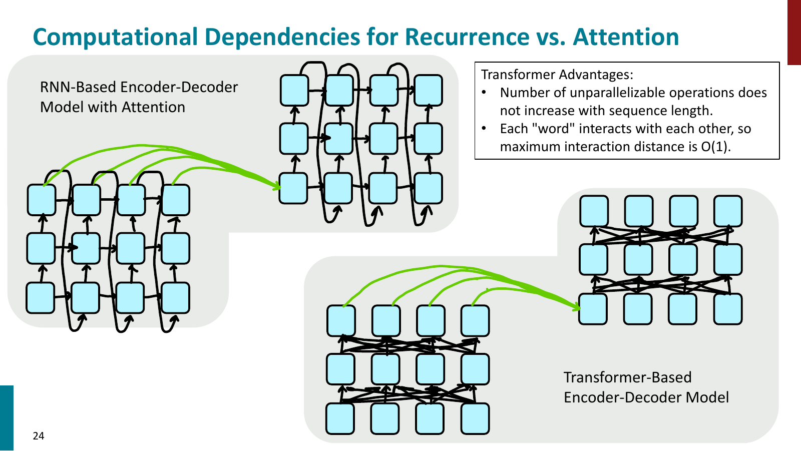

来源：Lecture 8，PDF P23；P22为同图引入。

### 1.3 复杂度比较的适用范围

来源：P16–17、P57。设序列长$n$、表示宽度$d$。

| 核心计算 | 每层主要复杂度 | 顺序依赖步数 | 最长交互路径 |
| --- | --- | --- | --- |
| 稠密循环变换 | $O(nd^2)$ | $O(n)$ | $O(n)$ |
| 全连接自注意力的两两交互 | $O(n^2d)$ | $O(1)$ | $O(1)$ |

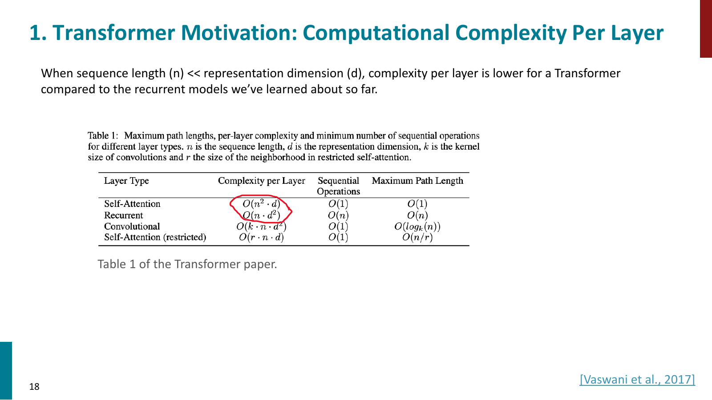

来源：Lecture 8，PDF P17。表中不可读取的额外条目不转录；正文比较本讲展开的递归与全注意力。

当$n\ll d$时，两两注意力交互项相对循环矩阵乘法可能更便宜。但完整Transformer还包括Q/K/V投影和前馈网络，均有与$nd^2$相关的计算，不能把$O(n^2d)$当成整个模型唯一成本。

$O(1)$路径表示词对在固定层内可直接交互；不表示整个网络只需常数时间，矩阵规模和算力仍影响实际耗时。训练时目标序列已知，可并行计算所有位置；自回归生成时下一个词尚未确定，仍有逐步输出的依赖。

## 2. Query、Key、Value与向量化自注意力

### 2.1 模糊查询表的直觉

来源：P21、P25–28。

课件把注意力比作**模糊／近似哈希表（“Fuzzy” / Approximate Hashtable）**：普通查表定位一个键值项；注意力用**查询（Query）**与所有**键（Keys）**匹配，再按匹配程度对**值（Values）**加权求和。

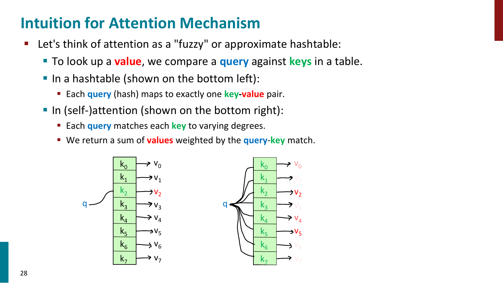

来源：Lecture 8，PDF P27。

三个角色不同：Query表达当前位置要找什么，Key表达各位置可供匹配的特征，Value是实际被读取和汇总的信息。它们从同一输入产生时称**自注意力（Self-attention）**；来自同一序列不等于三个投影必须相同。

### 2.2 单位置公式与矩阵形状

来源：P28–29；随课讲义§2.1，P4–5。采用每行一个词元的约定：

$$
X\in\mathbb R^{n\times d},\qquad
Q=XW_Q\in\mathbb R^{n\times d_k},\quad
K=XW_K\in\mathbb R^{n\times d_k},\quad
V=XW_V\in\mathbb R^{n\times d_v}.
$$

其中$W_Q,W_K\in\mathbb R^{d\times d_k}$，$W_V\in\mathbb R^{d\times d_v}$。对位置$i$：

$$
e_{ij}=q_i^Tk_j,\qquad
\alpha_{ij}=\frac{\exp(e_{ij})}{\sum_{\ell=1}^{n}\exp(e_{i\ell})},\qquad
h_i=\sum_{j=1}^{n}\alpha_{ij}v_j.
$$

$q_i,k_j$在单位置式中按列向量理解，对应矩阵$Q,K$各行的转置。所有位置一起算：

$$
A=\operatorname{softmax}_{\mathrm{row}}(QK^T)\in\mathbb R^{n\times n},\qquad H=AV\in\mathbb R^{n\times d_v}.
$$

每行对应一个查询，每列对应一个被访问的源位置；Softmax沿键所在的列轴归一化，每行和为1。输出的第$i$行汇总所有位置的信息，而不只是复制输入第$i$行。

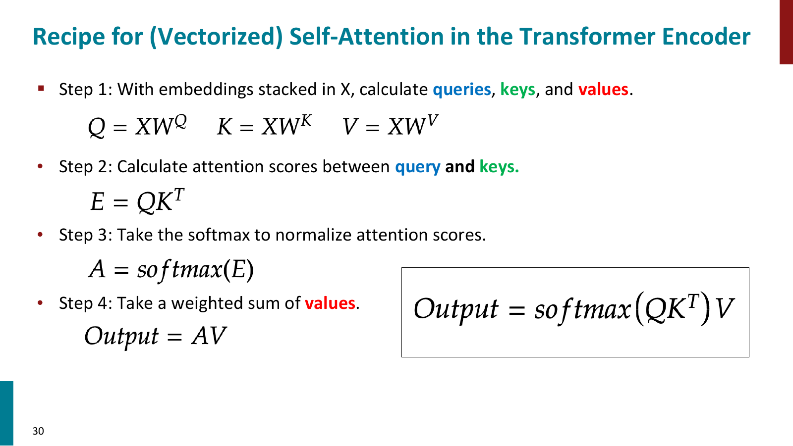

来源：Lecture 8，PDF P29。P30回顾阶段性结构，无新增公式。

### 2.3 为什么要除以平方根维度

来源：P36；随课讲义§3.4，P12。

假设初始化附近$q,k$的坐标近似独立、零均值、单位方差，且坐标乘积之间独立，则：

$$
q^Tk=\sum_{r=1}^{d_k}q_rk_r,\qquad
\mathbb E[q^Tk]=0,\qquad
\operatorname{Var}(q^Tk)=d_k.
$$

维度越高，原始分数的标准差约为$\sqrt{d_k}$，容易把Softmax推向过于尖锐的区域。其Jacobian为$\operatorname{diag}(\alpha)-\alpha\alpha^T$，当分布接近独热时许多导数很小。**缩放点积注意力（Scaled Dot-product Attention）**使用：

$$
\boxed{\operatorname{Attention}(Q,K,V)=\operatorname{softmax}_{\mathrm{row}}\left(\frac{QK^T}{\sqrt{d_k}}\right)V.}
$$

缩放的是分数，除数是Query/Key每个头的宽度平方根；不是除以序列长度，也不是除以Value维度。

课件用LayerNorm后的单位尺度解释这一直觉。实际Q/K还经过可学习投影，坐标也未必严格独立，故这是一种初始化量级分析，不能声称训练全程分数精确服从单位方差。

## 3. 注意力之外：FFN、残差和LayerNorm

### 3.1 逐位置前馈网络

来源：P31；随课讲义§2.3，P7–8。

自注意力在位置间混合Value信息；Transformer另用**逐位置前馈网络（Position-wise Feed-forward Network, FFN）**对每个位置做非线性特征变换：

$$
\operatorname{FFN}(x)=W_2\operatorname{ReLU}(W_1x+b_1)+b_2,
$$

$$
W_1\in\mathbb R^{d_{\mathrm{ff}}\times d},\qquad W_2\in\mathbb R^{d\times d_{\mathrm{ff}}}.
$$

同一层的各位置共享FFN参数，各位置分别计算，不在此处混合其他词；常先扩宽再投影回$d$维，使残差相加的形状一致。对行矩阵输入，对应$\operatorname{ReLU}(XW_1^T+\mathbf1b_1^T)W_2^T+\mathbf1b_2^T$。

课件说自注意力缺少“element-wise nonlinearities”，意在强调需要这样的逐位置非线性变换。注意力权重本身依赖输入且经过Softmax，因此不能据此把整个自注意力函数说成线性函数。

### 3.2 残差连接

来源：P32–33；讲义§3.3，P12。

**残差连接（Residual Connections）**为子层增加恒等通路：

$$
y=x+f(x),\qquad \frac{\partial y}{\partial x}=I+J_f(x).
$$

模型只需学习相对于输入的变化，而不是每层重新构造全部信息；恒等路径也提供直接的梯度传播通道。课件从避免深层处理遗忘／扭曲信息、使优化更容易解释其作用。

### 3.3 LayerNorm沿哪个维度归一化

来源：P34–35；讲义§3.2，P11–12。

**层归一化（Layer Normalization, LayerNorm）**对每个样本、每个位置的$d$维向量分别计算统计量：

$$
\mu_i=\frac1d\sum_{r=1}^{d}x_{ir},\qquad
\sigma_i^2=\frac1d\sum_{r=1}^{d}(x_{ir}-\mu_i)^2,
$$

$$
\operatorname{LN}(x_i)=\gamma\odot\frac{x_i-\mu_i}{\sqrt{\sigma_i^2+\epsilon}}+\beta.
$$

$\epsilon$用于数值稳定，$\gamma,\beta\in\mathbb R^d$为常见的可学习缩放和偏移。讲义为说明核心归一化省略这两个仿射参数，正文保留标准实现形式作区分。

统计量沿隐藏特征维计算，不是跨批样本，也不是把整句所有位置混为一组。归一化核心使向量近似零均值、单位尺度；再经过$\gamma,\beta$后不必保持严格零均值和单位方差。

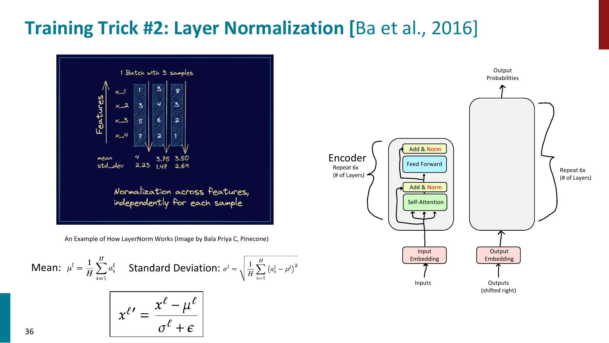

来源：Lecture 8，PDF P35；P34为原理引入。

### 3.4 Add & Norm与层的顺序

来源：P32–35、P55；讲义§3.3，P12。

课件原始Transformer图使用**后归一化（Post-LN）**：

$$
y=\operatorname{LN}(x+f(x)).
$$

随课讲义另列**前归一化（Pre-LN）**：

$$
y=x+f(\operatorname{LN}(x)).
$$

二者都结合残差与LayerNorm，但顺序不同，不能把“Add & Norm”一律改写成任意顺序。讲义指出Pre-LN在初始化时的梯度通常更有利于深层训练；本章整体结构按课件Post-LN图展开，不额外讨论后续变体。

## 4. 位置表示：序列顺序从哪里来

### 4.1 没有位置时的置换等变性

来源：P37–40；A4 Part 2(a)，P3–4。

`Man eats small dinosaur`与换序后的句子可以有不同意思。只用词嵌入和无Mask自注意力，操作本身没有“第几个词”的概念。

准确说法是**置换等变（Permutation Equivariance）**：输入行重排，输出行相应重排，而不是输出所有位置都相同。设$P$为置换矩阵，$X'=PX$：

$$
Q'=PQ,\quad K'=PK,\quad V'=PV,\qquad Q'K'^T=P(QK^T)P^T.
$$

逐行Softmax满足$\operatorname{softmax}(PSP^T)=P\operatorname{softmax}(S)P^T$，且$P^TP=I$，故：

$$
H'=\operatorname{softmax}\left(\frac{PQK^TP^T}{\sqrt{d_k}}\right)PV
=P\operatorname{softmax}\left(\frac{QK^T}{\sqrt{d_k}}\right)V=PH.
$$

对A4简化FFN，$P\mathbf1=\mathbf1$且ReLU逐元素作用：

$$
Z'=\operatorname{ReLU}(PHW_1+\mathbf1b_1)W_2+\mathbf1b_2
=P\bigl(\operatorname{ReLU}(HW_1+\mathbf1b_1)W_2+\mathbf1b_2\bigr)=PZ.
$$

这里沿用作业行向量权重布局。模型不能仅凭这种处理区分某个词之前或之后是谁。同一词元交换位置时，其表示跟着移动，语序关系并未被编码。此推导针对无位置、无顺序相关Mask的层；因果Mask本身包含顺序约束。

### 4.2 绝对位置：加到输入

来源：P39–41；A4 Part 2(b)，P4。

为每个序列索引$t$准备$d$维**位置编码（Positional Encoding）**$p_t$，在最初输入层加入：

$$
\tilde x_t=x_t+p_t.
$$

维度与词嵌入相同，保留模型宽度；也可以拼接，但本讲使用相加。相加发生在Q/K/V投影之前，因此三个角色都能利用位置信息，而非只给某一个投影加位置。

随课讲义§2.2还说明可学习位置嵌入：用参数矩阵$P_{\mathrm{pos}}\in\mathbb R^{N\times d}$按位置查表，$N$为支持长度。A4的vanilla模型采用可学习位置嵌入，原始Transformer采用下一小节的固定正弦位置编码。

### 4.3 正弦与余弦位置编码

来源：P41；A4 Part 2(b)，P4。令$d$为偶数，$t=0,\ldots,n-1$，$i=0,\ldots,d/2-1$：

$$
p_{t,2i}=\sin\left(\frac{t}{10000^{2i/d}}\right),\qquad
p_{t,2i+1}=\cos\left(\frac{t}{10000^{2i/d}}\right).
$$

同一对维度用相同频率的正弦和余弦，不同维度对使用不同频率。位置由多个周期共同表示；编码不依赖词本身，因此不同词在相同索引可拥有相同位置向量。

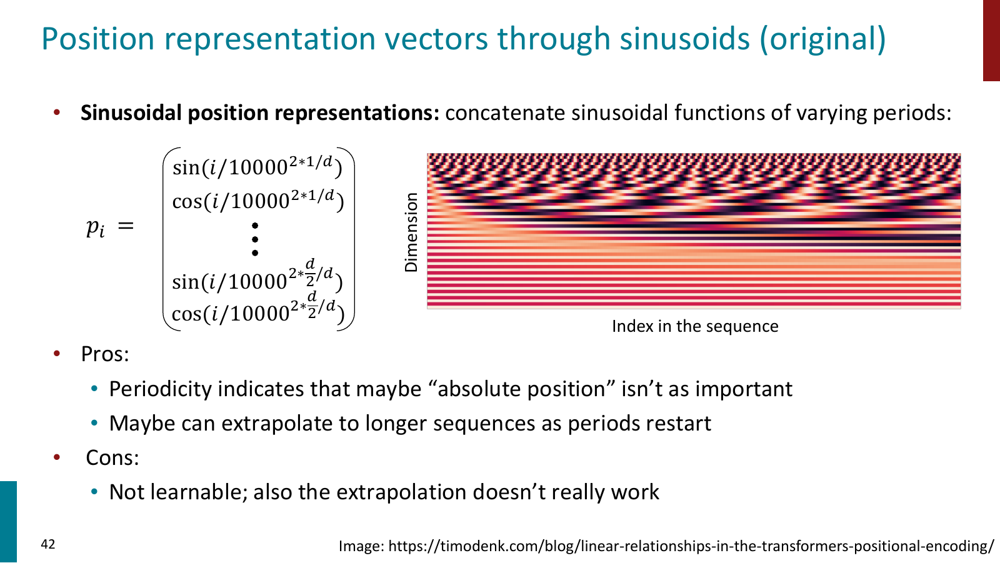

来源：Lecture 8，PDF P41。

A4问同一序列两个不同位置是否可拥有完全相同的位置向量。在理想实数运算、整数位置下，第一对$\sin t,\cos t$相等就要求$t-s=2\pi k$；整数差无法等于非零的$2\pi k$，所以$t\ne s$不可能完全相同。单个正弦维度可以重复；不能由一个维度重复推出整个位置向量相同。有限精度的数值近似与理想结论需分开。

固定函数可对训练长度以外的位置继续求值，但**可计算（Computable）**不等于**能可靠外推（Reliable Extrapolation）**。课件明确指出原先周期性带来的外推设想在实践中并不自动成立。

### 4.4 相对位置与RoPE

来源：P42、P57；A4 Part 3(g)，P7–8。

**相对位置表示（Relative Position Representations）**强调“某词在另一词前一位／后若干位”，而非只强调绝对索引。P42介绍Shaw等2018的关系感知自注意力，将词间相对关系纳入评分及值的聚合。该页公式文本缺失，保留原图，不猜其具体剪裁范围或参数设置。

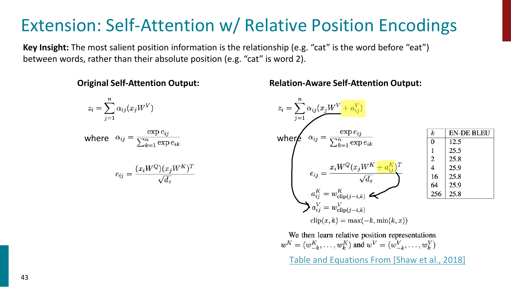

来源：Lecture 8，PDF P42。

P57列出相对线性位置、依存句法位置与**旋转位置编码（Rotary Positional Embedding, RoPE）**。RoPE在A4实际实现，下面按作业给出必要公式。

对一对特征，在位置$t$旋转角度$t\theta$：

$$
R(t\theta)=\begin{bmatrix}\cos(t\theta)&-\sin(t\theta)\\\sin(t\theta)&\cos(t\theta)\end{bmatrix},\qquad
\operatorname{RoPE}(x,t)=R(t\theta)x.
$$

$d$维向量按相邻两维分组，每组角频率$\theta_i=10000^{-2(i-1)/d}$，$i=1,\ldots,d/2$。每组分别旋转。用复数$z=a+\mathrm i b$表示一对特征时：

$$
z'=ze^{\mathrm i t\theta}=(a\cos t\theta-b\sin t\theta)+\mathrm i(a\sin t\theta+b\cos t\theta).
$$

实部与虚部分别恢复旋转后的两个坐标；重新排列各组即可与实矩阵块对角旋转一致，不需要显式构造$d\times d$大矩阵。

对位置$t,s$的查询与键：

$$
(R(t\theta)q)^T(R(s\theta)k)=q^TR((s-t)\theta)k
=(R((t-s)\theta)q)^Tk.
$$

位置影响仅通过相对差出现。复数形式对应：

$$
\operatorname{Re}\left((z_1e^{\mathrm i t\theta})\overline{z_2e^{\mathrm i s\theta}}\right)
=\operatorname{Re}\left(z_1\overline{z_2}e^{\mathrm i(t-s)\theta}\right).
$$

RoPE不是把一个位置向量加到输入：A4要求在**每层、每个注意力头的Query和Key上**应用旋转，Value不做这一步旋转。旋转保留各向量范数，改变与其他位置匹配时的相对相位。相对结构有助于缓解绝对位置分布变化，但不保证任意长上下文可靠外推。

## 5. 多头注意力与作业中的动机分析

### 5.1 多个独立的信息读取子空间

来源：P43–44；随课讲义§3.1，P9–11。

**多头注意力（Multi-head Attention）**用多组不同的Q/K/V投影并行读取同一序列，让每个头形成自己的关注分布与Value表示，再组合结果。

令头数为$h$，模型宽度$d$，常取$d_k=d_v=d/h$：

$$
\operatorname{head}_r=\operatorname{Attention}(XW_Q^{(r)},XW_K^{(r)},XW_V^{(r)})\in\mathbb R^{n\times d_v},
$$

$$
\operatorname{MHA}(X)=\operatorname{Concat}(\operatorname{head}_1,\ldots,\operatorname{head}_h)W_O,
\qquad W_O\in\mathbb R^{hd_v\times d}.
$$

每头有独立投影参数，但所有位置共享该头参数。拼接沿特征轴，不沿序列长度轴；输出投影混合各头信息并回到$d$维。

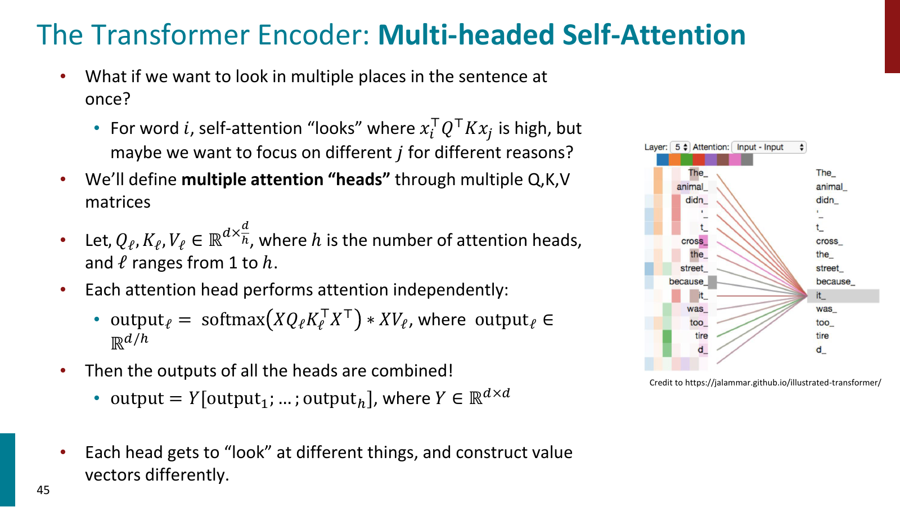

来源：Lecture 8，PDF P44。

批大小$B$时，投影结果常从$B\times n\times d$重排为$B\times h\times n\times d_k$；分数形状$B\times h\times n\times n$，Softmax仍沿最后的键位置维。$h$增大时每头宽度缩小，因此并非把$h$个完整$d$维单头成本原样叠加；但注意力权重矩阵有$h$份，不能据此忽略内存成本。

### 5.2 A4：注意力为什么容易复制

来源：A4 Part 1(a–b)，P2。此题使用未缩放分数$e_i=k_i^Tq$。

想复制$v_j$，需要$e_j$相对所有其他分数有足够大的正间隔：

$$
\alpha_j=\frac1{1+\sum_{i\ne j}\exp(e_i-e_j)}\approx1,\qquad c=\sum_i\alpha_iv_i\approx v_j.
$$

决定因素是相对分数，而不是$e_j$单独很大。若其他分数也同样大，仍会分散权重。

想平均$v_a,v_b$，假定键互相正交且单位范数，取：

$$
q=\lambda(k_a+k_b),\qquad \lambda>0.
$$

则$e_a=e_b=\lambda$、其余分数为0：

$$
\alpha_a=\alpha_b=\frac{e^\lambda}{2e^\lambda+n-2}\longrightarrow\frac12,\qquad
c\longrightarrow\frac12(v_a+v_b).
$$

$\lambda$需使$e^\lambda$远大于$n-2$，且有限值不会让其他权重严格为零。若采用缩放点积，可相应增大查询系数以获得同样分数间隔。

### 5.3 单头对平衡扰动敏感，多头可以分开读取

来源：A4 Part 1(c–e)，P2–3。

键从均值$\mu_i$附近随机采样，均值互相正交且单位范数。各向同性噪声很小时，用$q=\lambda(\mu_a+\mu_b)$可近似平均两个值；需要噪声造成的分数差仍足够小，而两目标相对其他键的间隔足够大。不能在固定噪声下无条件把$\lambda$推到无穷大，因为它也会放大目标间的细小分数差。

若$k_a$沿$\mu_a$方向有明显的长度波动，$e_a$会明显变化而$e_b$较稳定。即使两者仍远大于其他分数，二者权重比也为：

$$
\frac{\alpha_a}{\alpha_b}=\exp(e_a-e_b).
$$

一次采样可能偏$v_a$，另一次偏$v_b$，输出不再稳定接近等权平均；Softmax的指数使维持两个分数精确平衡较脆弱。

A4用一个简化双头模型：$q_1=\lambda\mu_a$，$q_2=\lambda\mu_b$，最终输出为$(c_1+c_2)/2$。第一个头只需明显偏好$a$，第二个只需明显偏好$b$；在作业允许忽略目标匹配为负等异常情形、噪声不破坏各自胜出间隔时：

$$
c_1\approx v_a,\qquad c_2\approx v_b,\qquad \tfrac12(c_1+c_2)\approx\tfrac12(v_a+v_b).
$$

这比一个Softmax内维持两个键同分更稳健。作业用两个头输出平均说明动机；真实Transformer是拼接加$W_O$，不是固定平均。该例不证明多头对任意噪声都稳健，也不要求每个头只能关注一个位置。

## 6. 完整编码器与解码器

### 6.1 编码器Block

来源：P25–45；讲义§3.5，P13。

输入嵌入加位置后，通过多层独立参数的编码器Block。课件原图重复6次，是原始配置示例，不是定义要求。

按Post-LN写第$\ell$层：

$$
U^{(\ell)}=\operatorname{LN}_1\left(H^{(\ell-1)}+\operatorname{MHA}_{\mathrm{self}}(H^{(\ell-1)})\right),
$$

$$
H^{(\ell)}=\operatorname{LN}_2\left(U^{(\ell)}+\operatorname{FFN}(U^{(\ell)})\right).
$$

为突出计算结构省略Dropout。编码器自注意力没有未来遮蔽，任一真实位置可读取整句；Padding Mask仍需阻止访问补齐位置。输出保留$n\times d$的逐位置上下文化表示，而非只留下一个句向量。

### 6.2 解码器必须遮蔽未来

来源：P46–49；讲义§2.4，P8–9。

训练目标为下一词预测，若允许当前位置读取后续真实目标，就会泄露答案。**因果／未来Mask（Causal / Future Mask）**在Softmax之前加到分数上：

$$
A=\operatorname{softmax}_{\mathrm{row}}\left(\frac{QK^T}{\sqrt{d_k}}+M\right),\qquad
M_{ij}=\begin{cases}0,&j\le i,\\-\infty,&j>i.\end{cases}
$$

这里第$i$个输入位置可以看见自身与更早输入。目标序列已右移：输入为`<START>, y_1, ..., y_{T-1}`，输出标签为`y_1, ..., y_T`。因此看到当前输入不是看到本步标签。若采用不同下标约定，要同步调整不等号，不能脱离移位关系照抄。

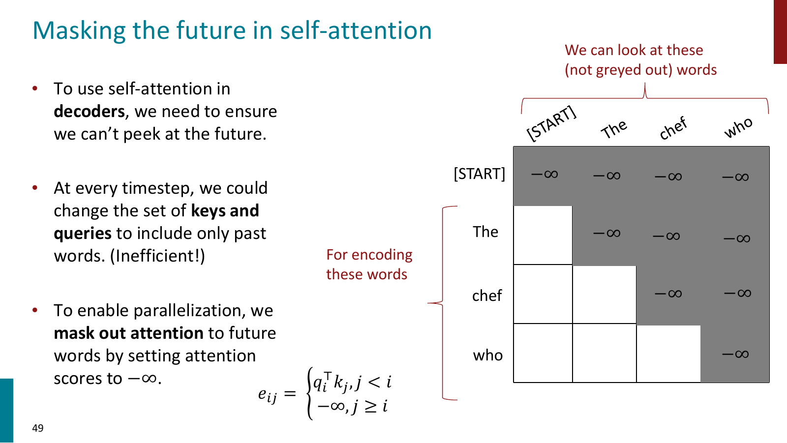

来源：Lecture 8，PDF P48。公式文本有损，正文按图中“隐藏未来”及随课讲义统一。

整个分数矩阵可一次计算，再用三角Mask屏蔽未来；训练时无需为每个前缀分别重新运行一次网络。所有解码自注意力层都需要保持这一约束。因果Mask与Padding Mask用途不同，批处理时可能需要同时使用。

数学上用$-\infty$表达禁止访问；实际实现可用库的布尔Mask或相应数值处理，避免出现整行无可访问位置。Mask施加在Softmax前，不能仅在最终输出上抹掉未来信息。

### 6.3 编码器—解码器交叉注意力

来源：P50；讲义§3.7，P13–14。

**交叉注意力（Cross-attention / Encoder–Decoder Attention）**使解码端访问源端记忆。编码器最终输出$H_x\in\mathbb R^{n\times d}$，解码器当前中间表示$D\in\mathbb R^{T\times d}$：

$$
Q=DW_Q,\qquad K=H_xW_K,\qquad V=H_xW_V,
$$

$$
\operatorname{CrossAttn}(D,H_x)=\operatorname{softmax}\left(\frac{QK^T}{\sqrt{d_k}}\right)V.
$$

分数形状为$T\times n$：行是目标查询位置，列是源位置。Query来自解码器，Key和Value来自编码器；每个解码层通常有自己的投影，但读取的是编码器最顶层输出。

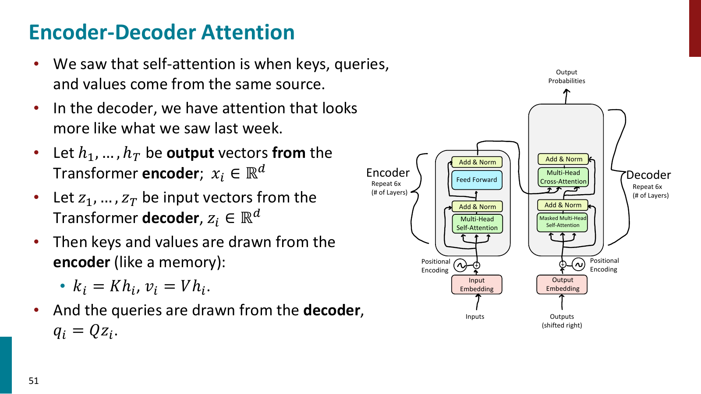

来源：Lecture 8，PDF P50。

源句在翻译开始前已给定，因此不需按目标时间遮蔽未来源词；仍需源端Padding Mask。它与第7讲RNN解码器访问编码器的注意力角色相同，区别在于两侧表示由Transformer构建。

### 6.4 解码Block与词表分布

来源：P51–55。

原始Encoder–Decoder Transformer的每个解码Block依次包含：

1. 带因果Mask的多头自注意力，残差与LayerNorm。
2. 到编码器输出的多头交叉注意力，残差与LayerNorm。
3. 逐位置FFN，残差与LayerNorm。

最后把$d$维隐藏表示线性映射到词表宽度，再做Softmax：

$$
\ell_t=W_{\mathrm{vocab}}h_t+b_{\mathrm{vocab}}\in\mathbb R^{|V_y|},\qquad
p_t=\operatorname{softmax}(\ell_t).
$$

$\ell_t$是未归一化**Logits**，$p_t$才是概率。以正确下一词交叉熵训练；结束符与输入目标错位关系同第6讲。

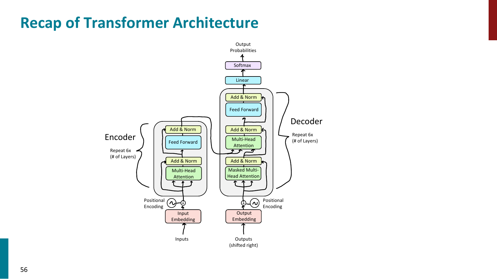

来源：Lecture 8，PDF P55；P51–54逐步添加FFN、词表线性层与Softmax，合并至完整图。

随课讲义还区分三种用途：Encoder-only用于需要双向上下文的表示任务；Decoder-only保留因果自注意力、不需要独立源编码器和交叉注意力，用于自回归语言模型；Encoder–Decoder在源端双向编码后生成目标序列。课件本讲主要展示第三种，不能由“Decoder”一词推定所有模型都有交叉注意力。

## 7. 二次成本与课件列出的变体

来源：P57–60。P56为提纲，P61结束与行政提醒跳过。

### 7.1 长序列的代价

全自注意力对所有位置两两计算，分数矩阵为$n\times n$，交互计算约$O(n^2d)$。常规显式存储注意力权重的内存还随批大小、头数与层数增加。序列长度翻倍，单个头的权重矩阵元素数变成4倍。

这与RNN随长度线性增长形成取舍：Transformer缩短依赖路径、改善训练并行性，却付出全连接交互成本。P57同时列位置表示问题：绝对索引是否最佳，能否用相对位置、句法或RoPE更好表达关系。

### 7.2 Linformer：压缩序列维

来源：P58，Wang等2020。

核心想法是把Key与Value的**序列长度维（Sequence-length Dimension）**投影到较小空间，再做注意力。若压缩后长度为$r\ll n$，查询可与$r$个压缩位置交互，而非$n$个原始位置。

这与第7讲低秩双线性评分不同：那里投影查询／键的特征宽度，这里压缩Key/Value的序列轴。课件仅介绍动机和图表，不展开训练细节或未读出的速度数值。

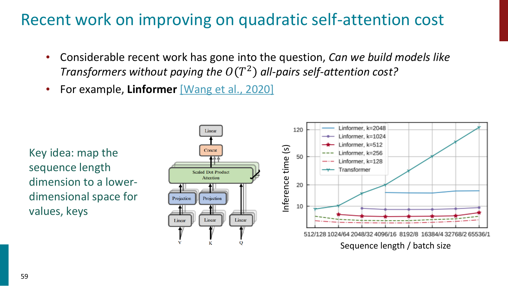

来源：Lecture 8，PDF P58。

### 7.3 BigBird：改变连接模式

来源：P59，Zaheer等。

BigBird用稀疏交互替代全部两两连接，包括**局部窗口（Local Windows）**、**全局连接（Global Interactions）**和**随机连接（Random Interactions）**。局部窗口保留邻近信息，全局节点帮助跨范围访问，随机连接增加其他远距离交互。课件不展开具体窗口宽度、理论证明或实现配置。

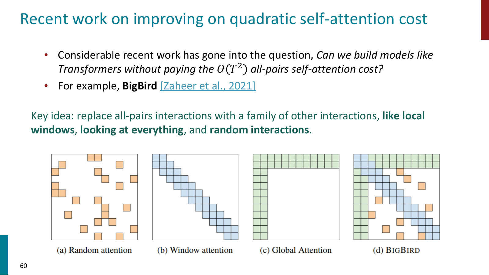

来源：Lecture 8，PDF P59。

### 7.4 变体是否真的更好需要验证

P60的结论原文为“Surprisingly, we find that most modifications do not meaningfully improve performance.” 它提醒：结构改动在一个设置中有效，不代表自动迁移到其他任务与规模。应在相同数据、算力和评价条件下比较基线；不能只看一种理论复杂度就断言整体质量或实际速度更优。

## 8. 作业4对应范围

- Part 1，PDF P2–3：复制、平均、键扰动与多头动机，见第5节。
- Part 2，P3–4：置换等变证明、正弦位置编码及不同位置的区分，见第4节。
- Part 3(g)，P7–8：RoPE旋转、复数等价、相对位置推导和在各层Q/K上的应用，见第4.4节。
- Part 3其余内容及Part 4：预训练、Span Corruption、出生地知识访问与风险，随第9讲整理。本章不提前扩写。

以上为课件与作业技术内容整理，未执行A4训练或报告模型分数。
