> 主要来源：`lecture09-pretraining-updated.pdf`，64页；A4说明与原始代码包；minBERT项目说明的技术部分。按PDF物理页标记来源，重复提纲合并，行政要求跳过。课件图表无法读取的数值不猜测，不做OCR；本章保留13张课件知识图。

## 1. 子词：开放词汇如何映射到有限词表

### 1.1 整词词表与UNK的损失

来源：P5–6、P9–11。

传统整词模型从训练文本建立几万词的固定词表，测试时新词统一映射到**未知词标记（Unknown Token, UNK）**。这使不同新词、拼写变体与构词形式丢失区别，例如`taaaaasty`、`laern`、`Transformerify`可能都成为同一个UNK。

形态丰富的语言尤其突出：一个词根经时态、语气、否定、宾语等变化产生大量低频词形。课件用斯瓦希里语动词`ambia`的许多变位说明，有限整词表难覆盖所有合法形式。

不同书写系统对“词”的边界也不一致：有的没有空格分词，附着成分可能连写或分写，复合词可写成多个空格分隔词，也可像德语`Lebensversicherungsgesellschaftsangestellter`连写。文字还可能主要表示音位、音节／拍，或组合不同单位。不能把英语空格切分当作所有语言天然共享的标准。

### 1.2 BPE训练词表

来源：P7–8。

**子词建模（Subword Modeling）**将词分成已知片段，片段可以涉及词的一部分、字符或字节。**字节对编码（Byte-pair Encoding, BPE）**的一种经典词级版本：

1. 初始词表由字符及词尾标记组成。
2. 在训练语料中统计相邻符号对，选择频次最高的一对$(a,b)$。
3. 把新符号$ab$加入词表，在语料符号序列中合并该对。
4. 重复到期望词表大小，保存合并规则及其顺序。

“符号”在第一次合并后就可能是多字符片段，后续统计不是永远只统计原始字符对。训练频次还要考虑每种词在语料中出现次数。

P8的小例子以词频字典`low:5, lower:2, newest:6, widest:3`开始，图中展示合并`e s → es`，然后`es t → est`：`newest`与`widest`共同支持这两个高频合并。

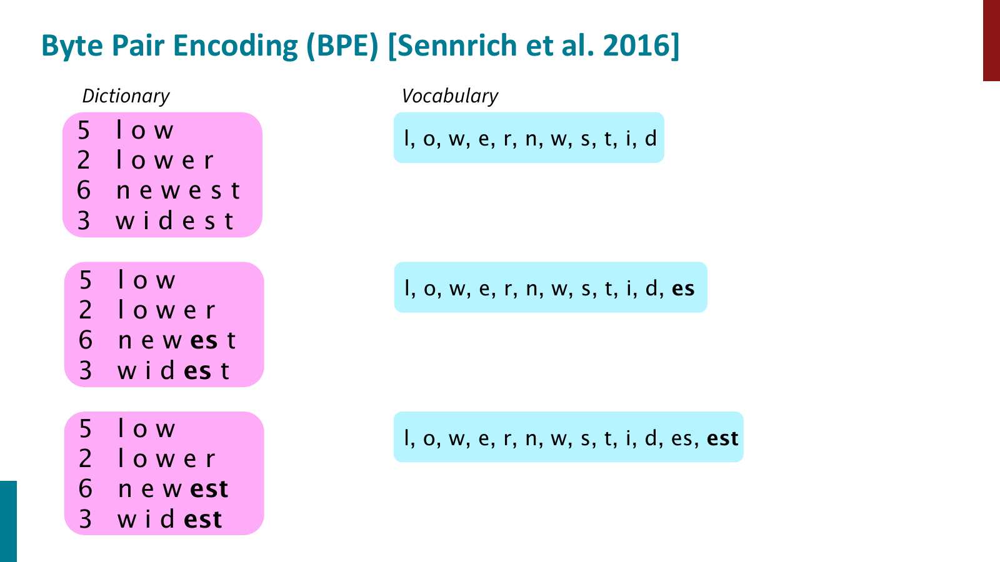

来源：Lecture 9，PDF P8；页面仅展示部分合并过程，不推定完整词表。

### 1.3 使用子词后的变化

常见词可成为一个完整Token；罕见词被拆成多个片段。新拼写不再一定整体变成UNK，模型可组合已有片段表示；字符覆盖完整时，最坏可逐字符拆分。字符集本身不覆盖的新符号仍需相应处理，不能把有限字符词表说成绝对没有未知项。

课件还提到WordPiece、SentencePiece。它们属于相关子词工具／方法，不能把名称视为完全相同的BPE算法。BERT的`##`是词内延续片段的表示约定；图示切分帮助理解机制，不代表所有Tokenizer都输出同一片段。

## 2. 从静态词向量到整个模型预训练

### 2.1 上下文决定当前词义

来源：P13–15。

分布语义的“a word by the company it keeps”启发了Word2Vec，但完整词义还取决于当前语境。`I record the record`中两个`record`扮演不同角色，静态词向量查表仍给同一拼写相同初始向量。

约2015年的常用方法是预训练词嵌入，再在下游任务监督下从随机初始化学习LSTM或Transformer的上下文组合。问题是：下游标注数据必须教会绝大多数上下文规律，而模型的大部分参数尚未预训练。

现代**模型预训练（Model Pretraining）**联合学习整个网络或其中绝大部分参数，再迁移到下游任务。通过遮蔽部分输入并恢复，或预测尚未看见的下一词，形成不需人工逐项标注的训练信号。

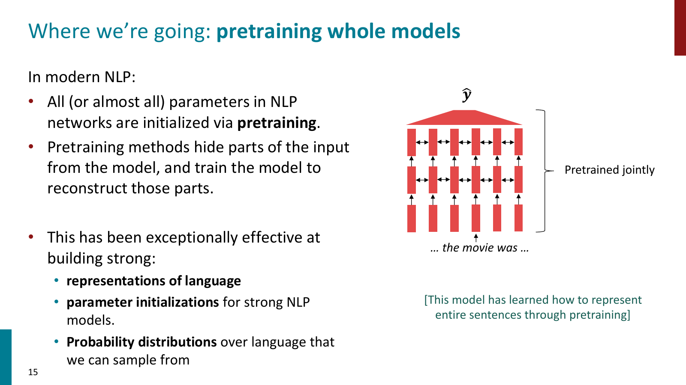

来源：Lecture 9，PDF P15。

### 2.2 自监督目标为何可规模化

来源：P2–3、P15、P23。

预训练的关键是处理大规模、多样文本，尽量不依赖难以扩展的人工标签，并按计算资源规划模型和数据。标签由文本自身构造，因此常称**自监督学习（Self-supervised Learning）**；课件也以“unsupervised”描述其不使用人工任务标签。

预训练可以得到三类产物：更有用的语言表示、下游优化的参数初始化，以及可用于抽样生成的语言概率分布。三者相关，但不同架构与目标的自然用途不同。

### 2.3 Pretrain → Finetune的优化视角

来源：P24–25。

$$
\theta_{\mathrm{pre}}\approx\arg\min_\theta L_{\mathrm{pre}}(\theta),\qquad
\theta_{\mathrm{task}}\leftarrow\operatorname{Optimize}\bigl(L_{\mathrm{task}},\ \theta_{\mathrm{init}}=\theta_{\mathrm{pre}}\bigr).
$$

第一阶段用大量文本学习一般规律；第二阶段用较少任务标签适配。下游损失可以与预训练损失不同，也可以增加随机初始化的任务输出层。

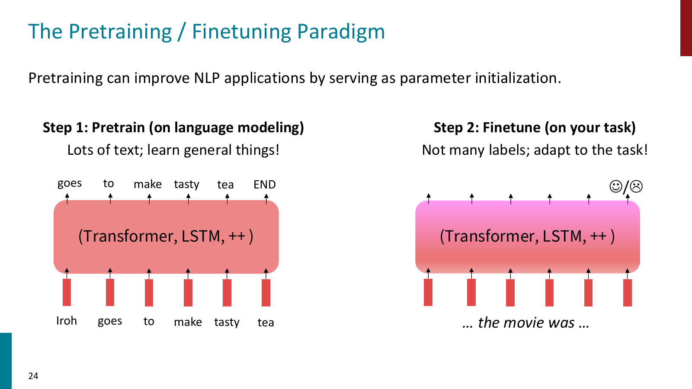

来源：Lecture 9，PDF P24。

课件给出的解释包括：微调SGD可能停留在预训练参数附近，附近的解更易泛化，或附近的梯度更适合优化。这些是理解收益的可能机制，而非保证微调参数永远不远离初态。**“Pretrain once, finetune many times”**概括了昂贵预训练可被多个下游任务复用的价值。

### 2.4 数据来源也是模型设计的一部分

来源：P26–28。

课件列BookCorpus、英文Wikipedia、Common Crawl、WebText及书籍数据等来源，较新商业模型的细节可能不披露。图中表格文本排列有损，不据此硬配每一行完整训练集。BERT与GPT-1的明确资料分别见后文可读参数页。

BookCorpus涉及网上抓取电子书；P27–28讨论授权、合理使用及其他争议。能够下载的文本不自动等于允许任意使用；数据来源影响覆盖范围、偏差和权利风险。

## 3. 三种架构，对应不同预训练目标

来源：P30–31、P40、P45、P64，重复比较表合并。

| 架构 | 信息访问 | 典型目标 | 自然用途 |
| --- | --- | --- | --- |
| 编码器，Encoder | 同一输入中双向上下文 | 遮蔽语言建模 | 文本分析、分类、匹配、逐位置表示 |
| 编码器—解码器，Encoder–Decoder | 源端双向，目标端因果 | 条件生成、去噪／片段恢复 | 输入文本条件下的序列输出 |
| 解码器，Decoder | 当前位置只能使用前缀 | 自回归语言建模 | 连续文本生成，也可适配分类等任务 |

这里Encoder的“双向”指全上下文自注意力，不是内部放入双向LSTM。无因果约束的编码器若直接读取要预测的真实词，普通下一词目标就会泄露答案；需更改可见输入或目标。

课件最后按当时实践总结：编码器适合分析文本，编码器—解码器在部分理解任务上有优势证据，解码器在大规模生成模型中占主流。它不是对任意规模与任务的严格性能排序。

## 4. BERT：双向编码与Masked LM

### 4.1 遮蔽语言建模目标

来源：P32–33。

**遮蔽语言模型（Masked Language Model, MLM）**随机选择位置集合$M$，将原序列$x$扰动为$\tilde x$，用双向编码器预测这些位置原本的Token：

$$
H=\operatorname{Encoder}_\theta(\tilde x),\qquad
p_i=\operatorname{softmax}(Wh_i+b),
$$

$$
L_{\mathrm{MLM}}=-\sum_{i\in M}\log P_\theta(x_i\mid\tilde x).
$$

损失只加在被选作预测目标的位置；这些位置不一定都显示为`[MASK]`。编码器可以利用左右两侧可见上下文，重建原词。该目标不是直接按从左到右链式分解得到整句概率，也不自然提供常规自回归生成过程。

### 4.2 15%与80/10/10分别指什么

原始BERT随机选**15%的子词位置**作为预测目标，再在选中位置中：

- 80%替换为`[MASK]`。
- 10%替换为随机Token。
- 10%保留原Token，但仍计算该位置预测损失。

相对于所有位置，三者约为12%、1.5%、1.5%；不是80%的整句词都被遮蔽。未选中的85%不贡献MLM位置损失。

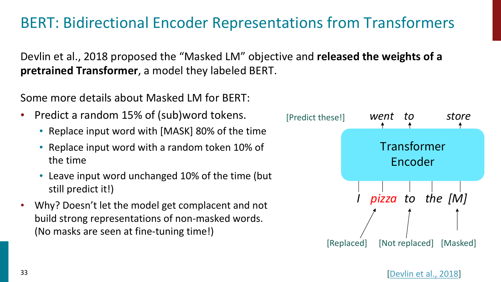

来源：Lecture 9，PDF P33。

微调任务通常没有`[MASK]`，混合策略减少模型只在特殊遮蔽输入上学习表示的倾向。保留Token的预测更容易，但它只占被选位置的小部分，不能因此把整个目标视为复制可见输入。

### 4.3 下一句预测与句对输入

来源：P34；minBERT说明§3.1，P8–11。

原始BERT还使用**下一句预测（Next Sentence Prediction, NSP）**：给两个文本块，判断第二块是否为第一块实际后续，或随机抽取。项目说明写明两类各50%。NSP是原始预训练目标的一部分，不是必须先完成MLM再单独微调NSP；课件指出后续研究发现它并非必要。

典型输入为：

`[CLS] segment A [SEP] segment B [SEP]`

`[CLS]`是用于汇总／分类的特殊位置，`[SEP]`分隔文本段；段类型嵌入用于区分A/B。输入表示通常由Token、位置和段类型嵌入相加而成。

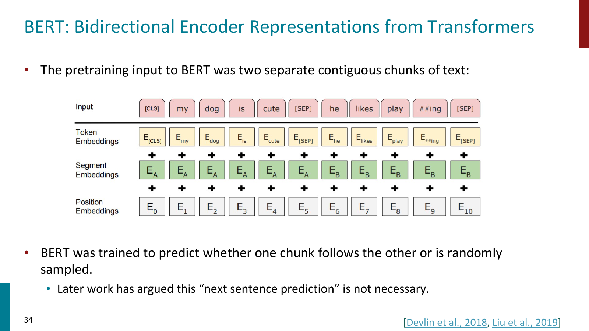

来源：Lecture 9，PDF P34。

### 4.4 原始规模与语料

来源：P35。

| 模型 | 编码层 | 隐藏宽度 | 注意力头 | 参数量 |
| --- | ---: | ---: | ---: | ---: |
| BERT-base | 12 | 768 | 12 | 110M |
| BERT-large | 24 | 1024 | 16 | 340M |

训练文本为BooksCorpus约800M词与英文Wikipedia约2,500M词。课件记录64个TPU芯片、4天的预训练成本，用来说明预训练昂贵，而微调通常可在单GPU进行。这里的词数不等于任意Tokenizer输出的Token数。

### 4.5 下游任务与局限

来源：P36–37。

BERT微调广泛用于：QQP问题复述检测、QNLI问答转化的自然语言推断、SST-2情感分类、CoLA语言可接受性、STS-B语义相似度、MRPC复述检测、RTE推断。

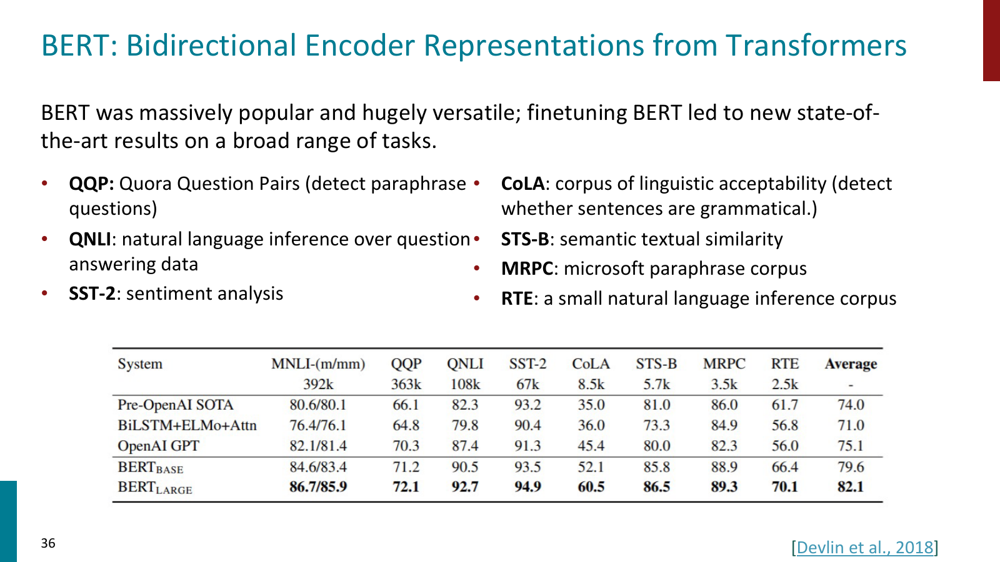

来源：Lecture 9，PDF P36。不可读取的表格分数不转录。

编码器擅长使用全上下文表示输入，但填补`Iroh goes to [MASK] tasty tea`不等于具备自然逐词生成器；需要生成序列时，预训练解码器更直接。

### 4.6 RoBERTa与SpanBERT

来源：P38–39。

课件概括**RoBERTa**改进包括更久训练与移除NSP，强调在不改变Transformer编码器主体时，更多计算与数据仍可改善表示。

**SpanBERT**遮蔽连续片段（Contiguous Spans），而非仅独立位置。例如一个多子词词的多数片段仍可见时，BERT可能凭剩余片段猜答案；遮蔽整段使恢复更依赖外部上下文，任务更难且可能更有用。课件未在此完整展开SpanBERT其他目标，不扩写。

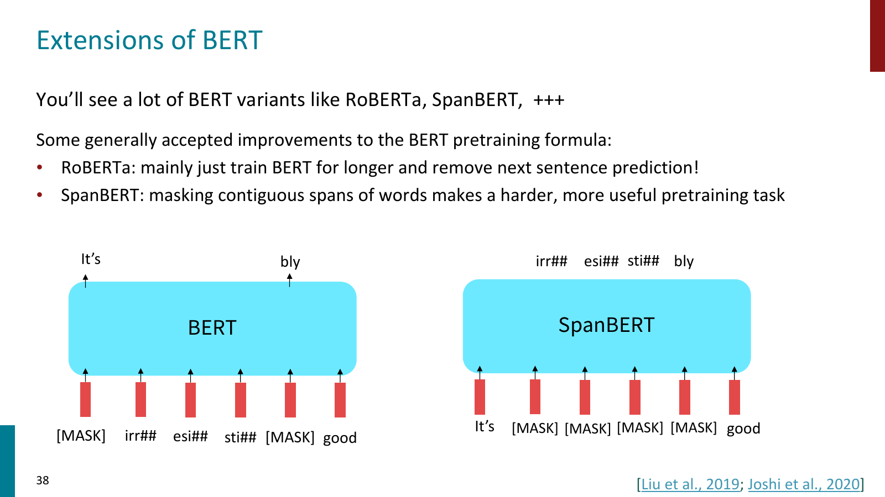

来源：Lecture 9，PDF P38。

## 5. T5：编码器—解码器去噪预训练

### 5.1 前缀条件化的语言建模

来源：P41。

一种目标把$x_{1:m}$交给双向编码器，只预测后缀$x_{m+1:T}$：

$$
L=-\sum_{t=m+1}^{T}\log P_\theta(x_t\mid x_{m+1:t-1},\operatorname{Encoder}(x_{1:m})).
$$

编码部分不作为这个目标的预测标签，解码部分仍逐步预测并依赖前面真实输出。源端可利用完整前缀的双向信息，输出端保持因果约束，损失端到端训练整个系统。

### 5.2 Span Corruption与Sentinel

来源：P42–43。

**片段损坏／遮蔽（Span Corruption）**从输入中移除若干不同长度片段，用各不相同的**哨兵标记（Sentinel Tokens）**替代，解码器按标记顺序输出被移除内容。

示意：原文`A B C D E F G`，移除`B C`与`F`，可构造编码输入`A <s1> D E <s2> G`，目标包含`<s1> B C <s2> F`等被移除片段；终止哨兵及结束符按具体格式处理。该序列仅说明机制，不冒称课件图的逐字转录。

$$
L_{\mathrm{denoise}}=-\sum_t\log P_\theta(y_t\mid y_{<t},\tilde x).
$$

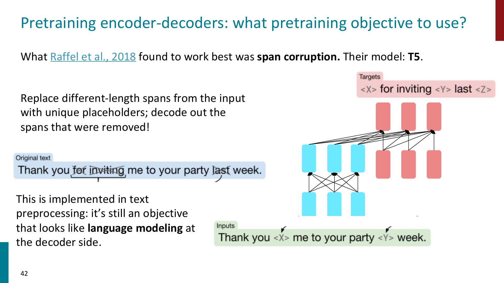

来源：Lecture 9，PDF P42。

输入扰动主要在预处理阶段完成，解码侧仍使用条件自回归损失。课件报告其比较中，编码器—解码器优于解码器，Span Corruption优于普通语言建模；这是特定实验结论，不泛化为所有任务。

### 5.3 参数中的知识访问

来源：P44。

T5可微调为问答器，回答来自NQ（Natural Questions）、WQ（WebQuestions）、TQA（TriviaQA）等开放域任务的问题，表现出从预训练参数中访问知识的能力。课件图列220M、770M、3B、11B规模，不转录不可读的各任务分数。

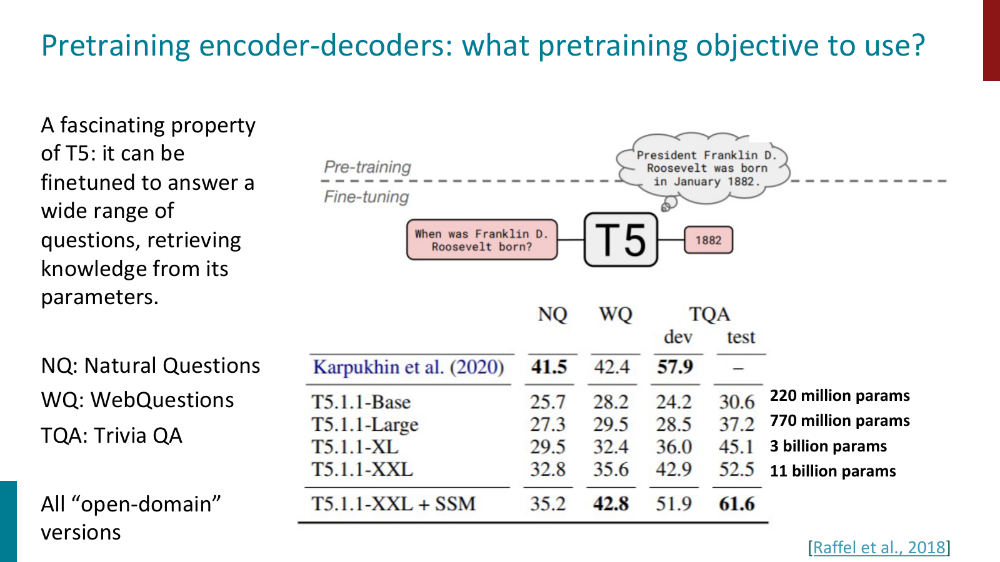

来源：Lecture 9，PDF P44。回答由参数生成不等于实时检索到可核验文档，也不保证知识始终正确。

## 6. 解码器预训练：GPT与任务适配

### 6.1 自回归语言模型目标

来源：P23、P45–47。

$$
P_\theta(x_{1:T})=\prod_{t=1}^{T}P_\theta(x_t\mid x_{<t}),\qquad
L_{\mathrm{LM}}=-\sum_{t=1}^{T}\log P_\theta(x_t\mid x_{<t}).
$$

Transformer解码器用因果Mask避免看到未来，预训练后可直接采样生成，也可作为下游任务初始化。

两种适配方式：

- **分类头（Classification Head）**：读取输入末尾位置的隐藏状态，使用新线性层与Softmax预测类别。主干预训练过，新增类别输出层随机初始化；分类梯度可以回传整个网络。
- **生成式微调（Generative Finetuning）**：输入对话历史或文档等上下文，预测回复或摘要。输出仍是预训练词表中的Token，词表输出层也能复用。

区别在于任务输出是否沿用语言模型Token空间，不是解码器只能生成、不能分类。

### 6.2 GPT-1与NLI格式

来源：P48–50。

原始GPT：12层、117M参数、隐藏宽度768、FFN宽度3072；BPE使用40,000次合并。BooksCorpus包含7,000多本独特书籍，连续长文本有助于提供长距离依赖训练信号。“合并次数”与最终词表大小不是同一个量。

**自然语言推断（Natural Language Inference, NLI）**判断假设相对前提是蕴含、矛盾还是中立。课件给输入格式：

`[START] The man is in the doorway [DELIM] The person is near the door [EXTRACT]`

在末尾`[EXTRACT]`的隐藏表示上分类。因果解码器末尾位置能读取前面两句，故适合汇总句对信息；不把第一位置当作天然看过整段的双向`[CLS]`。

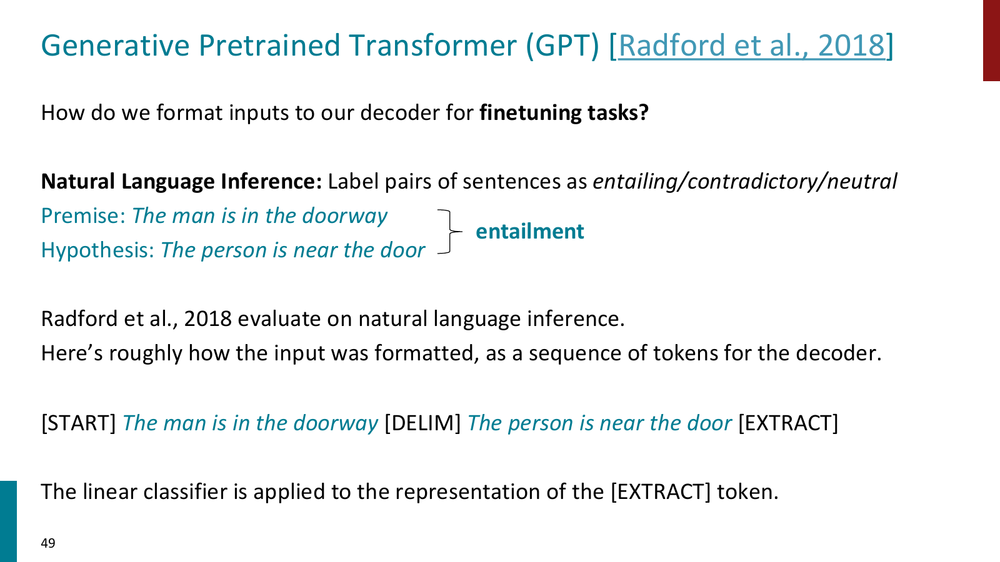

来源：Lecture 9，PDF P49；P50历史结果表不可读分数跳过。P48页脚的引用与标题不一致，模型介绍按页标题Radford等2018理解。

### 6.3 GPT-2生成与GPT-3上下文学习

来源：P51–55。

课件用1.5B参数GPT-2及一段新闻续写展示更连贯的文本生成：人给出列车核材料失窃的提示，模型接着编写部门、声明和地名。它是模型样例，不是真实新闻或事实来源；语言连贯不能证明内容真实。

**上下文学习（In-context Learning, ICL）**是在同一个输入上下文提供任务样例，固定模型参数进行条件生成，不在这些演示上执行梯度更新。课件例子：

```text
thanks -> merci
hello -> bonjour
mint -> menthe
otter ->
```

模型续写`loutre`，样例让上下文指定“英译法”任务。它与微调不同：微调改变参数，ICL改变本次条件上下文。这里的“学习”描述行为，不应解释成每个提示都永久写入权重。

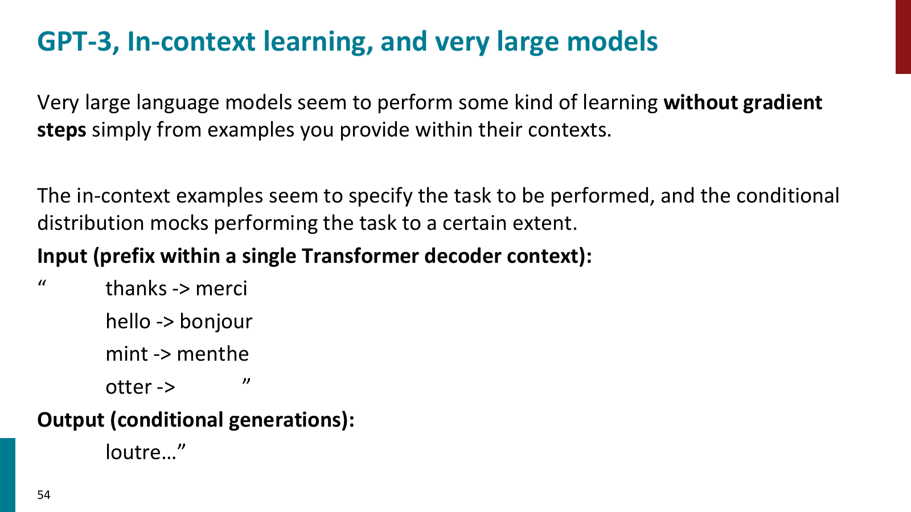

来源：Lecture 9，PDF P54。P53对比T5最大11B与GPT-3的175B规模，P55重复ICL概念；不可读图示实验细节跳过。指令微调是下一讲主题。

## 7. 缩放规律：参数、数据与算力一起选择

来源：P56–59。

**经验缩放规律（Empirical Scaling Laws）**帮助预测增加规模后困惑度／损失的变化，并用于选择模型大小、数据量及架构等。P57提出在给定预算下，训练更大但未充分收敛的模型有时有效；它是预算分配问题，不能只看某个模型是否“完全收敛”。

P59给粗略成本关系：

$$
C_{\mathrm{train}}\propto N_{\mathrm{params}}\times D_{\mathrm{tokens}}.
$$

相同训练算力下，增大参数会减少可负担的数据量，反之亦然。GPT-3用175B参数、300B训练Token；课件指出这并非最佳参数—数据配比，并展示70B模型可优于更大模型的例子。重点是**计算最优分配（Compute-efficient Allocation）**，不是单纯参数越多越好。

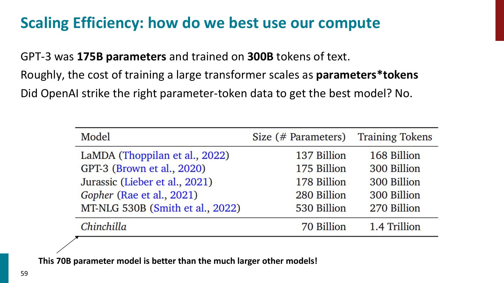

来源：Lecture 9，PDF P59。图表未能读取的训练Token及性能数字不补入，避免从粗略比例推导出课件未给的精确最优公式。

## 8. 预训练学到什么，又可能暴露什么

### 8.1 重建任务需要的能力

来源：P16–22、P61；前面七页例子与P61解释合并。

| 原例 | 需要利用的信息 |
| --- | --- |
| `Stanford University is located in ___, California.` | 事实知识，Factual Knowledge / Trivia |
| `I put ___ fork down on the table.` | 句法与限定词，Syntax |
| `The woman ... checking for traffic over ___ shoulder.` | 指代／共指，Coreference |
| `fish, turtles, seals, and ___` | 词汇语义及主题，Lexical Semantics / Topic |
| 两小时电影只值爆米花和饮料，`The movie was ___` | 情感和语用线索，Sentiment |
| Iroh和Zuko在厨房，`Zuko left the ___` | 跨句状态与一定推理，Reasoning；较难 |
| `1, 1, 2, 3, 5, 8, 13, 21, ___` | 数列／算术模式，Arithmetic Patterns |

这些例子说明语言预测目标可施加多种能力需求，不是每个模型都真正掌握了对应的一般算法。课件特别提醒数列续写不等于学会通用Fibonacci算法。

### 8.2 记忆、版权、隐私与偏见

来源：P62–63。

模型可能记住受版权保护的文本，或网络中的半私密材料，如地址、邮箱；还可能学习并放大种族主义、性别歧视等偏见。统计学习不会自动区分应当泛化的语言规律与不应泄露／强化的内容。

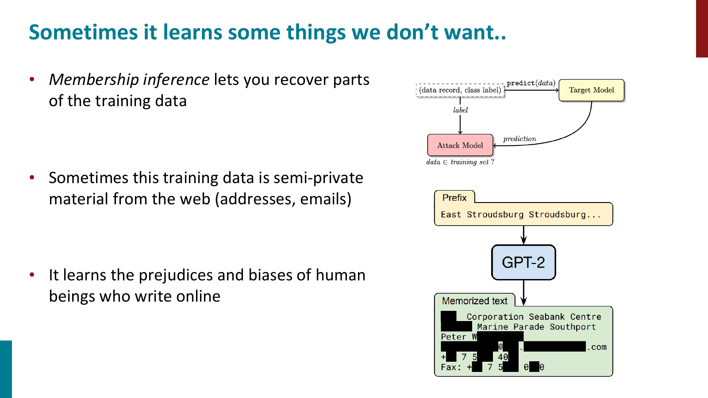

来源：Lecture 9，PDF P63。

该页将“membership inference”与恢复训练数据放在一起讨论；术语应区分：**成员推断（Membership Inference）**判断样本是否参与过训练，**训练数据提取（Training-data Extraction）**尝试恢复具体内容。不能把两者直接等同。P62版权案例为图片独有内容，无法识读的具体引文不转录。

## 9. A4：通过预训练学习并访问出生地知识

来源：A4 Part 3–4，PDF P4–9；只读`a4_spr24_student_code.zip`中的`src/dataset.py`、`run.py`、`models.py`、`utils.py`，未解压修改源资料。

### 9.1 实验问题与对照

给人物名，回答出生地；任务输入不提供含答案的百科段落。对照流程为：

1. 随机初始化模型，直接在名字—出生地对上训练。
2. 先在Wikipedia文本做预训练，再在同一问答任务微调。
3. 以始终预测`London`的频率基线比较，检查模型是否只利用常见答案分布。
4. 以同样配置比较可学习绝对位置的vanilla与RoPE模型，RoPE原理见第8章。

在训练问答以外的人物上，直接监督难以凭空知道事实；预训练百科可能已提供对应信息，微调则教会模型按问答格式访问这些信息。单独看预测正确不一定能证明“记住了哪一句”，还需考虑事实出现、姓名线索与答案频率。

### 9.2 实际模型是字符级因果解码器

代码固定上下文块长128、4层、8头、隐藏宽度256。FFN扩到$4\times256$，使用GeLU；Block是Pre-LN残差：

$$
x\leftarrow x+\operatorname{Attn}(\operatorname{LN}_1(x)),\qquad
x\leftarrow x+\operatorname{MLP}(\operatorname{LN}_2(x)).
$$

末尾还有LayerNorm及词表线性层。vanilla把可学习位置加到字符嵌入；RoPE不加该绝对位置表，转而旋转Q/K。这里的模型远小于GPT-1，不因沿用GPT类名就把它称为117M原模型。

词表由`wiki.txt`字符集合统一构造，另加`⁇`作为Mask／分隔字符、`□`作为Padding。即使不预训练也读百科文件以固定字符到ID的映射，不代表随机初始化对照已用百科优化过参数。

### 9.3 简化Span Corruption的精确数据形式

`CharCorruptionDataset`规范要求：从文档随机截取长度至少4、至多$\lfloor128\times7/8\rfloor=112$的片段；划分为`prefix + masked_content + suffix`，随机被移除长度平均约占截取长度四分之一。

重排为：

```text
prefix ⁇ suffix ⁇ masked_content □□□...
```

补到`block_size + 1`长度，再令输入为前面所有字符、目标为去掉第一个字符后的序列，即相差一位的下一字符预测。`models.py`的交叉熵使用`ignore_index=0`，而0对应PAD，因此填充目标不计损失。

这借鉴片段恢复，但**不是T5同构模型**：只有一个因果解码器，通过把可见前后片段放到被恢复内容之前，使恢复部分可访问它们；没有独立双向编码器。该实现对重排串中所有非PAD目标计算下一字符损失，不是只对最后被移除内容计算损失。`__getitem__`仍为待填空代码，本次只整理规范，未实现或训练。

### 9.4 微调损失只监督问答格式的输出部分

`NameDataset`构造问题、`⁇`、出生地、`⁇`并补齐；标签把问题前缀位置置为PAD，以免模型把主要优化预算花在重建问题文字上。模型在问题末尾后学习分隔符和出生地的自回归输出。损失可写为：

$$
L=-\sum_{t:y_t\ne\mathrm{PAD}}\log P_\theta(y_t\mid x_{\le t}).
$$

这里$x,y$已按代码错位，不代表模型读取本步目标本身。评估给定问题与分隔符，贪心续写32字符，再提取两个`⁇`间的结果；`evaluate_places`按预测字符串与真实出生地**精确相等（Exact Match）**计数：

$$
\operatorname{Accuracy}=\frac{\#\{\hat a_i=a_i\}}{N}.
$$

未自动归一化别名、大小写或拼写；语义相近但字符串不同也可能不计正确。常量London基线的正确率就是开发集中出生地精确为`London`的比例，不应凭印象假设。

### 9.5 为什么输出看起来可信仍有风险

A4 Part 4要求检查正确与错误答案：仅凭一条流畅出生地输出，用户难以知道它来自已学事实还是模式猜测。可能后果包括传播错误人物信息，或在高影响决策中把不可靠答案当事实。

若人物从未出现在预训练或微调中，模型不能声称学过该人的真实出生地；它仍可能根据名字的语言／文化线索或高频城市先验输出答案。这可能强化姓名到国籍、族群或地域的刻板关联。需要把“可生成答案”与“有证据知道答案”分开。

本次未运行GPU训练、未报告实测分数；作业预期阈值是考核条件，不当作实验结果写入。

## 10. minBERT项目：预训练表示如何适配任务

来源：`default-final-project-handout-minbert-spr2024-updated.pdf`，技术部分P3–5、P8–15、P17–23。代码包本地缺失，不声称运行实现。

### 10.1 分词、输入和编码层

WordPiece词表约30K，示例`[snow, ##ing]`、`[fight, ##ing]`、`[snow, ##board]`。特殊标记包括`[UNK]`、`[PAD]`、`[CLS]`、`[SEP]`；最大支持长度512。输入是Token、位置及段类型嵌入之和，base宽度768；项目单句情感部分的段类型嵌入为占位处理。

12个编码层采用多头注意力、残差／LayerNorm、GeLU FFN及第二组残差／LayerNorm；每个子层输出在相加前使用Dropout，说明中$p_{\mathrm{drop}}=0.1$，输入嵌入也使用Dropout。与第8章原始ReLU FFN示例区分。

项目输出包括逐词元`last_hidden_state`及用于句级分类的`pooler_output`。说明将后者概括为`[CLS]`表示；具体是否另经池化投影需查看缺失代码，不能仅凭名称断言与原始隐藏向量逐项相等。

### 10.2 冻结主干与全模型微调

句子经BERT得到池化表示$r$，分类头为：

$$
p(y\mid x)=\operatorname{softmax}(W\operatorname{Dropout}(r)+b).
$$

**只训练最后线性层（Last-linear-layer）**冻结BERT；**全模型微调（Full-model Finetuning）**同时更新主干。项目给学习率示例分别$10^{-3}$和$10^{-5}$，体现微调预训练权重通常使用更谨慎的步长，不是任意任务通用最优值。

| 数据 | 类别 | Train / Dev / Test | 仅线性层Dev | 全模型Dev |
| --- | --- | --- | --- | --- |
| SST | 5档情感 | 8544 / 1101 / 2210 | 0.390 ± 0.007 | 0.515 ± 0.004 |
| CFIMDB | 二元情感 | 1701 / 245 / 488 | 0.780 ± 0.002 | 0.966 ± 0.007 |

数值是项目给的10个随机种子参考均值／标准差，不是本次复现结果。SST包含句子与短语标注背景，项目实际划分按上述句级数据使用。

### 10.3 多任务：情感、复述与语义相似度

**复述检测（Paraphrase Detection）**判断两句是否表达等价内容；**语义文本相似度（Semantic Textual Similarity, STS）**允许连续相似程度，不是简单Yes/No。项目STS的0–5级解释依次为不同主题、同主题、共享一些细节、粗略相同但关键信息不同、大体相同但小细节不同、完全等价。

Quora共404,298句对，划分283,010 / 40,429 / 80,859，用准确率评价。STS共8,628句对，划分6,040 / 863 / 1,725，使用预测与真实分数的**Pearson相关系数（Pearson Correlation）**，不是分类准确率：

$$
\rho=\frac{\sum_i(s_i-\bar s)(\hat s_i-\overline{\hat s})}{\sqrt{\sum_i(s_i-\bar s)^2}\sqrt{\sum_i(\hat s_i-\overline{\hat s})^2}}.
$$

共享BERT再接任务专用头是项目组织方式之一；可探索共享部分头参数、不同句向量提取及训练调度。不能只完成情感训练循环就声称已进行三任务联合训练。

### 10.4 项目列出的表示改进目标

**领域继续预训练（Domain-adaptive Pretraining）**：在目标领域训练文本上继续MLM，减少原预训练领域与任务分布差异。

**多负例排序损失（Multiple Negatives Ranking Loss）**：一批$K$个正句对$(a_i,b_i)$，其余批内$b_j$充当负例：

$$
L=-\frac1K\sum_{i=1}^{K}\log\frac{\exp S(a_i,b_i)}{\sum_{j=1}^{K}\exp S(a_i,b_j)}.
$$

既提高正对相似度，又相对压低批内其他配对；前提是这些其他配对确实适合充当负例。项目还建议用余弦相似度微调句嵌入，令等价句更接近、不相关句更远；STS连续分数不能不经设计就直接当成二元`CosineEmbeddingLoss`标签。

**SimCSE对比学习（Contrastive Learning）**：无监督版本对同一句子使用不同Dropout噪声形成两次表示作为正对；监督版本使用NLI蕴含对作正例、矛盾对作困难负例。项目只列方向，不在此引入额外论文实验。

**多任务损失（Multitask Loss）**可为$L=L_1+L_2$等。若任务梯度冲突，即$g_i^Tg_j<0$，项目建议**梯度手术（Gradient Surgery）**：

$$
g_i\leftarrow g_i-\frac{g_i^Tg_j}{\|g_j\|^2}g_j.
$$

只在冲突且$\|g_j\|>0$时进行该投影；去掉$g_i$在另一个冲突梯度方向的分量，避免任务互相抵消。并不保证任意联合训练优于单任务。

### 10.5 SMART：控制扰动敏感性与过猛更新

项目P20给监督损失与**平滑诱导正则（Smoothness-inducing Regularization）**：

$$
F(\theta)=L(\theta)+\lambda_sR_s(\theta),\qquad
L(\theta)=\frac1n\sum_i\ell(f(x_i;\theta),y_i),
$$

$$
R_s(\theta)=\frac1n\sum_i\max_{\|\tilde x_i-x_i\|_p\le\epsilon}\ell_s(f(\tilde x_i;\theta),f(x_i;\theta)).
$$

$x_i$是嵌入层表示，在小邻域寻找令输出变化较大的扰动，再惩罚这种变化。分类时$\ell_s(P,Q)=D_{\mathrm{KL}}(P\|Q)+D_{\mathrm{KL}}(Q\|P)$。

另用**Bregman近端点优化（Bregman Proximal Point Optimization）**限制相邻迭代模型的预测变化：

$$
\theta_{t+1}=\arg\min_\theta\left[F(\theta)+\mu D_{\mathrm{Breg}}(\theta,\theta_t)\right].
$$

项目把$D_{\mathrm{Breg}}$写为当前与前一步模型在扰动／原始输入上的输出距离。这里的约束是预测行为不要更新过猛，不应直接替换为未给出的参数欧氏距离。

### 10.6 LoRA与DoRA：少量可训练参数

项目P21–22列**低秩适配（Low-Rank Adaptation, LoRA）**：冻结预训练$W_0\in\mathbb R^{d\times k}$，用

$$
W=W_0+BA,\qquad B\in\mathbb R^{d\times r},\quad A\in\mathbb R^{r\times k},\quad r\ll\min(d,k).
$$

新增可训练量为$r(d+k)$，远少于$dk$，还减少优化器对可训练参数保存的状态；主干仍需加载，不能把可训练参数减少等同于整个模型内存同比减少。

**权重分解低秩适配（Weight-Decomposed Low-Rank Adaptation, DoRA）**分离每列的幅值$m$与方向$V$：

$$
W=m\odot\frac{V}{\|V\|_c},\qquad V=W_0+BA.
$$

$\|V\|_c$是逐列范数形成的$1\times k$向量，广播到各行；$m$也是$1\times k$。方向用低秩增量适配，幅值单独可学习。项目说明文字先称$m$可学习、后又说“only B and A receive updates”，表述不一致；按幅值—方向分解解释$m$的角色，实际更新集合须由所采用实现确认。说明还提到将范数归一化因子从反传图分离以降低开销，本地缺代码，不宣称已验证这一实现。

### 10.7 Adam偏置修正与权重衰减的区别

来源：项目§4.3，P14。与A2的简化Adam相比，这里加入零初始化矩估计的偏置修正：

$$
m_t=\beta_1m_{t-1}+(1-\beta_1)g_t,\quad
v_t=\beta_2v_{t-1}+(1-\beta_2)g_t^{\odot2},
$$

$$
\hat m_t=\frac{m_t}{1-\beta_1^t},\qquad
\hat v_t=\frac{v_t}{1-\beta_2^t},\qquad
\theta_t=\theta_{t-1}-\eta\frac{\hat m_t}{\sqrt{\hat v_t}+\epsilon}.
$$

项目要求实现其“efficient”变体并应用权重衰减。需要注意两点：把偏置修正移到步长时，分母的$\epsilon$放置／缩放会影响与上述公式的精确等价；应按实际实现规范核对，而非声称任何改写都逐项相同。

更重要的是：对损失加$\lambda\|\theta\|^2/2$使梯度变为$g+\lambda\theta$，而**解耦权重衰减（Decoupled Weight Decay）**单独施加$-\eta\lambda\theta$。两者在普通SGD中可对应，在Adam自适应缩放下通常不等价。项目把“加L2损失”与“最后独立衰减”说成等价，这一点不宜照抄；应区分所用优化器的实际更新。

项目其他建议包括更多合适训练资料、POS／NER等输入特征、正则化、头部共享、模型层数与宽度、优化器和学习率、集成及超参数搜索。它们是待用开发集验证的选项，不是默认必然提高所有任务；最终测试集仍需隔离。
