> 来源：`lecture10-prompting-rlhf.pdf`，94页。课件页脚有跳号，本章一律使用PDF物理页。重复动画和提纲合并，关键公式按可读定义补全代数推导；图表中无法识读的实验数字不臆造、不做OCR。保留15张知识图；本地A1–A4没有独立对应的RLHF作业，不虚构实验结果。

## 1. 从续写语言模型到多任务助手

来源：P2–11。

第9讲的语言模型从大量文本学习下一词分布，已经可以表现出事实、语法、共指、主题、情感及一定推理／代码能力。P4重复七种完形例子，参见第9章第8节；P5–9列举主体与信念、数学、编程、医学和助手应用，截图中的具体任务与结果不可读，不作为已验证能力证据。

本讲核心问题是：如何从`Stanford University is located in ___`这样的文本续写器，得到能理解请求并提供有用回答的助手？

| 方法 | 给模型的信息 | 是否更新参数 | 希望改善什么 |
| --- | --- | --- | --- |
| 提示／上下文学习，Prompting / In-context Learning | 指令、任务格式和少量示例 | 推断时不更新 | 让已有模型按当前任务生成 |
| 指令微调，Instruction Finetuning | 多任务的指令—示范回答 | 更新模型参数 | 学会遵循指令，并迁移到未见任务 |
| 偏好优化，Preference Optimization | 同一请求下回答的比较／排序 | 更新模型参数 | 让输出更符合评价者偏好 |

预训练目标、正确示范模仿与人类偏好不是同一个目标。模型善于续写网页，并不自动意味着它会以用户期待的方式回复。

## 2. 零样本与少样本上下文学习

### 2.1 GPT规模化的背景

来源：P13–14、P18。

GPT-1为117M参数、12层，BooksCorpus约7,000多本书、4.6GB文本，展示语言模型预训练后可微调NLI等任务。GPT-2扩大到1.5B参数，使用约40GB WebText；课件描述其从Reddit中至少3个赞的链接采集文本，把社群互动作为粗略质量代理。GPT-3再扩大到175B参数及600GB以上文本。

这些大小和数据量是课件中的历史背景。GB是文本存储规模，不直接等于Token数；相同架构家族的规模化也不等于所有训练细节逐项完全相同。

### 2.2 Zero-shot：把任务变成合适的续写问题

来源：P15–17。

**零样本学习（Zero-shot Learning）**在不提供当前任务示例、不执行任务特定梯度更新的情况下，用提示让模型完成任务。这里“零样本”不表示模型预训练没见过相关知识或任务形式。

课件给两类方式：

- **生成式形式（Generation）**：`Passage: ... Q: Where was Tom Brady born? A:`，让模型接着回答。
- **候选概率比较（Sequence Probability Comparison）**：对`The cat couldn't fit into the hat because it was too big`，比较把`it`替换为`the cat`或`the hat`后的序列概率，利用语言模型偏好判断指代。

候选评分可由Token对数概率相加：

$$
\log P(y\mid c)=\sum_{t=1}^{|y|}\log P(y_t\mid c,y_{<t}).
$$

$c$为共同提示上下文。课件用概率比较表达任务转换，不在此引入未给出的长度校准方案。

P16以LAMBADA等语言模型基准展示无需任务微调的能力；LAMBADA强调较长篇章依赖。P17在CNN/DailyMail新闻后加`TL;DR:`，利用网络文本中“Too Long; Didn't Read”的摘要模式诱导输出摘要。不转录不可读取的ROUGE表或声称该方法超过所有监督系统。

### 2.3 One-shot与Few-shot：示例放在上下文里

来源：P19–24。

**单样本（One-shot）**在待处理输入之前提供一个示例，**少样本（Few-shot）**提供多个示例。示例用于指定任务、输出格式及映射规律，不在本次推断中做梯度更新。

$$
P_\theta(y\mid (x_1,y_1),\ldots,(x_k,y_k),x).
$$

$\theta$固定，变化的是条件上下文。传统Few-shot研究也可能包含梯度更新，本讲特指**上下文学习（In-context Learning, ICL）**。

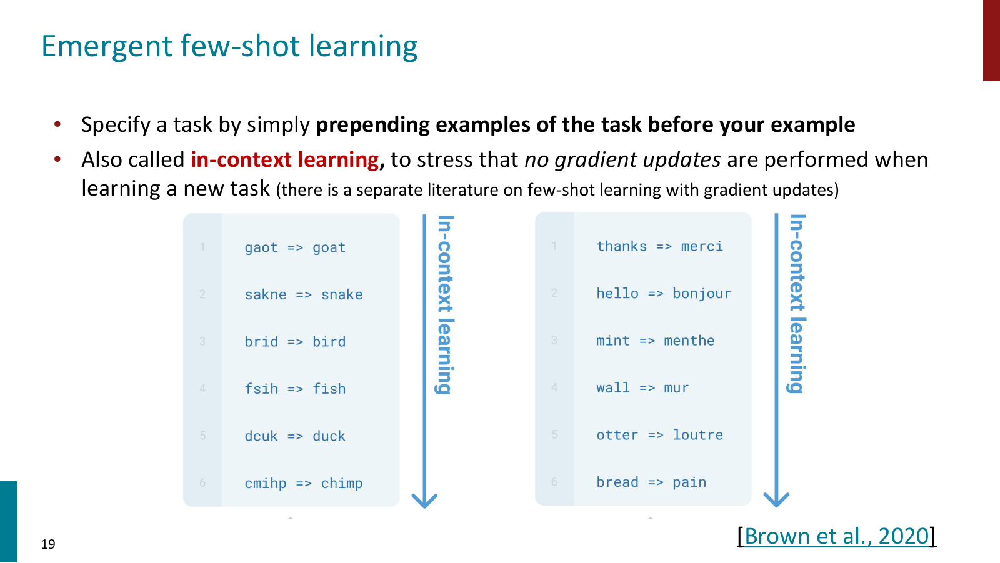

来源：Lecture 10，PDF P19；P20–22按零、单、少样本逐步展示，合并解释。

P23用100-shot词操作任务观察规模效应：循环移位`pleap → apple`、随机插符号`a.p!p/l!e → apple`、倒序`elppa → apple`。课件将随规模出现的明显能力称为**涌现能力（Emergent Abilities）**；未读出的曲线不补数值，也不把例子上表现提升当作理解机制的证明。

P24对比提示与传统微调。提示省去任务训练过程，但上下文窗口限制可放多少示例；复杂任务可能仍需要参数更新。这是本讲经验总结，不是所有复杂任务都必须微调的定理。

## 3. Chain-of-Thought：在提示中加入中间步骤

### 3.1 直接答案示例可能不足

来源：P25–28。

多步推理／算术任务只展示“输入→答案”可能难以归纳。课件的加法例子显示，即使模型很大，也可能需要改变任务提示形式。

**思维链提示（Chain-of-thought Prompting, CoT）**在示范中加入中间推理步骤，让模型先生成分解过程，再给最终答案。这改变输出格式和生成路径，使复杂问题能够借助多个中间Token推进，而不是要求一个直接续写步骤完成所有计算。

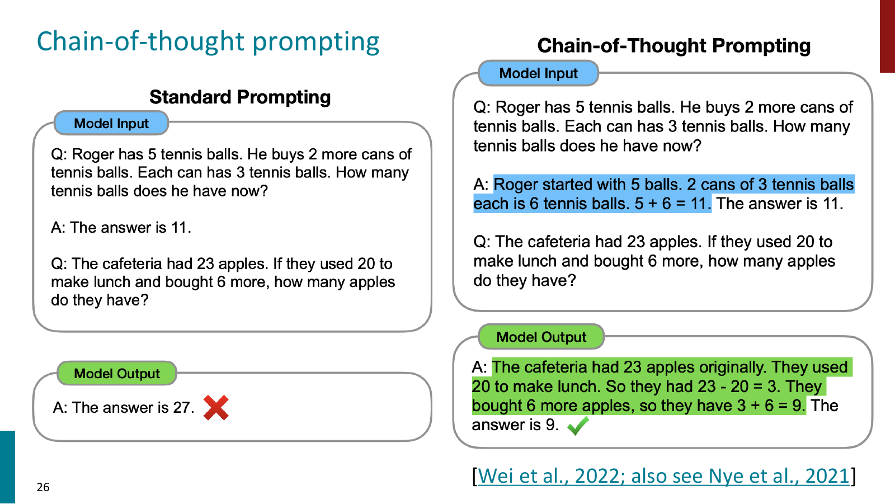

来源：Lecture 10，PDF P26；P27报告数学文字题上的规模效应，具体曲线数值不可读。

CoT是提示技术，本身不需要更新参数；生成一段推理文字也不保证中间步骤真实可靠或答案必然正确。

### 3.2 Zero-shot CoT

来源：P28–31。

不提供完整推理示范，而在答案开头加入`Let's think step by step.`，可诱导分步生成。课件例子：一共16个球，一半为高尔夫球，其中一半为蓝色，因此：

$$
16\times\frac12=8,\qquad 8\times\frac12=4.
$$

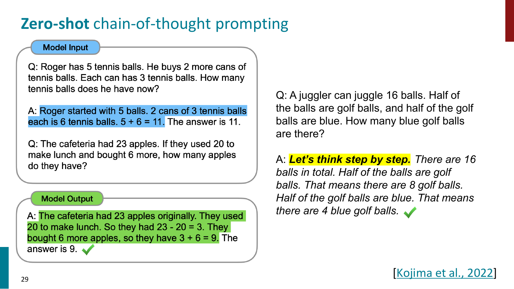

来源：Lecture 10，PDF P29。

P30报告此方法在所测任务上优于普通零样本，而人工设计CoT示例仍更好。P31提到语言模型设计提示语的工作；不可读取的提示文本与分数不猜测。

P32–33以图像提示、代码风格和越狱案例说明提示形式影响输出。截图不完整，不复原具体越狱内容，也不把某个风格短语当通用最优提示。

## 4. 指令微调：学会响应指令

### 4.1 为什么预训练续写不等于帮助用户

来源：P36–40。P34–35重复总结提示优缺点；P38复习预训练／微调。

语言模型优化的是训练文本的似然，不是“满足当前用户意图”。面对一段输入，它可能继续写同类文本，而不是按要求回答、改写或解释。

**指令微调（Instruction Finetuning）**收集许多任务的$(\text{instruction},\text{output})$示例，监督训练模型。若输入为$x$、示范为$y$，典型条件语言模型目标为：

$$
L_{\mathrm{SFT}}(\theta)=-\mathbb E_{(x,y)\sim\mathcal D}\sum_t\log\pi_\theta(y_t\mid x,y_{<t}).
$$

这里$\pi_\theta$表示回答策略／语言模型，$x$可包括指令和任务输入。该式说明拟合示范回答的原则，不推定本地课件未给出的具体数据打包与loss mask实现。

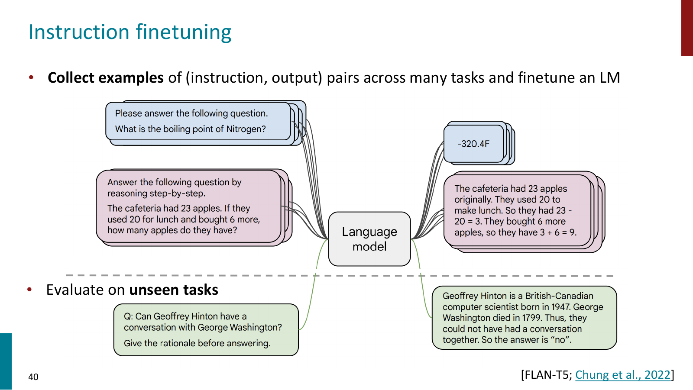

来源：Lecture 10，PDF P40。

关键评估是能否在**未见任务（Unseen Tasks）**上遵循新的指令，而非只在训练任务中记住例子。这里任务泛化与同一任务中随机留出样本的泛化不同。

### 4.2 数据规模与FLAN-T5

来源：P41、P47–51。

Super-NaturalInstructions包含1.6K以上任务、3M以上示例，覆盖分类、序列标注、改写、翻译、问答等。FLAN-T5在T5片段去噪预训练后，再用约1.8K任务进行指令微调；课件展示模型规模与任务微调共同带来的收益。

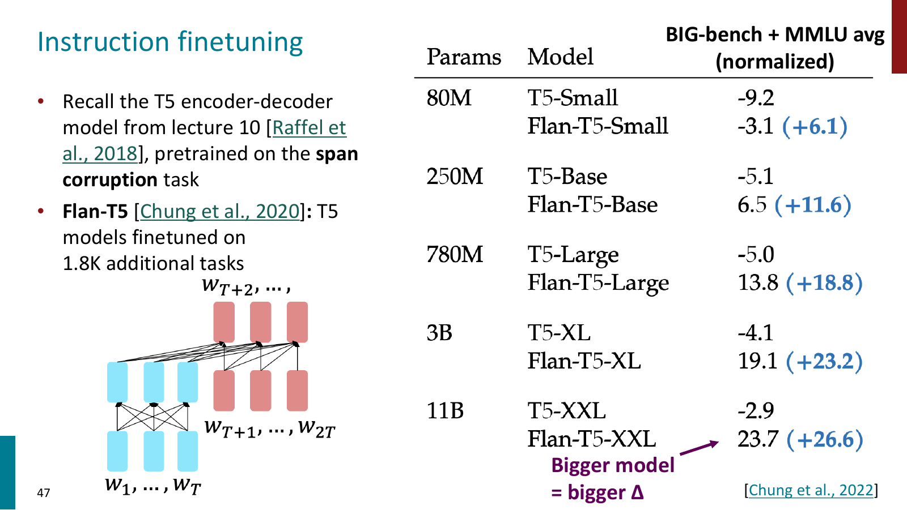

来源：Lecture 10，PDF P47。原页年份标注有混用，正文以课件所述模型与技术关系为准，不据此推断发表时间。

P48–49给微调前后示例，但具体图中内容不可读，不补造对话。P50–51总结LLaMA发布后多种指令数据构建路径：由更大模型合成数据、少量高质量样本及众包都可能有效。这里的经验不是忽略数据质量／覆盖的理由。

### 4.3 多任务基准

来源：P42–46。

**MMLU（Massive Multitask Language Understanding）**覆盖57类不同的知识密集任务，用于比较广泛知识与任务表现。P43–44展示题目和历史进展，不转录不可读题面或分数。

**BIG-bench**汇集200多个任务。P45–46重复展示任务集合，具体图内清单未读取，保留基准用途，不从外部资料补齐。评价多任务模型需要多种任务，而不能只用单个训练任务的指标概括通用能力。

### 4.4 SFT仍与偏好目标不一致

来源：P52–55，重点P53。

- **示范成本（Demonstration Cost）**：为大量不同任务写高质量答案昂贵。
- **开放式输出（Open-ended Generation）**：故事、解释等没有唯一正确答案，多个回答都可能合理。
- **Token级目标与错误严重性不同（Token-level Objective Mismatch）**：标准交叉熵没有直接体现“某类错误远比另一类严重”的人类偏好权重。
- **示范并非最优（Suboptimal Demonstrations）**：人写的回答也可能不够好；模仿数据不等于最大化最终满意度。

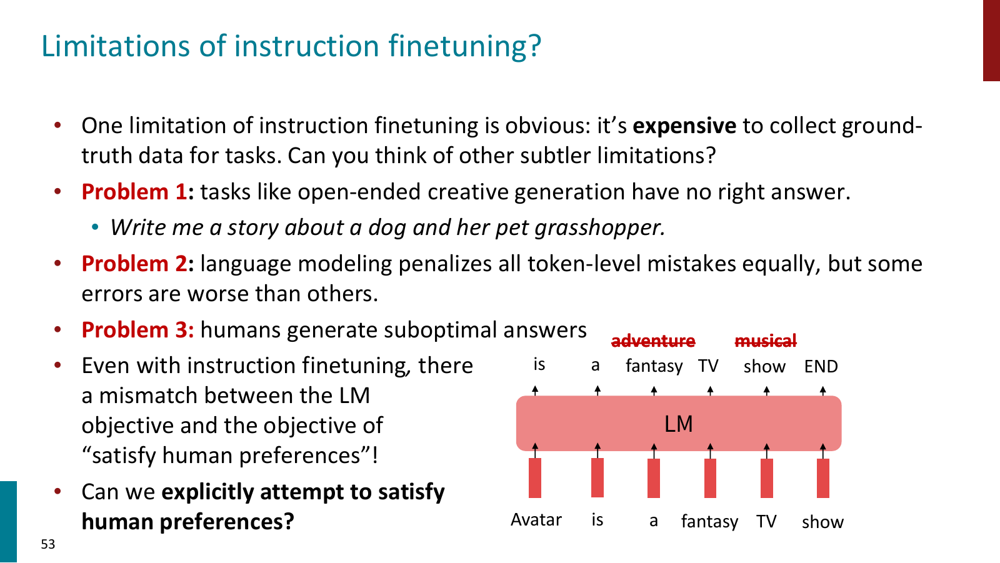

来源：Lecture 10，PDF P53。

“所有Token错误等罚”是课件对目标局限的概括：实际交叉熵数值仍随预测概率变化，但它没有直接使用任务层面的危害程度或整体回答质量作为权重。下一步是比较多个回答，显式学习偏好。

## 5. 偏好数据与奖励模型

### 5.1 把整体回答质量作为目标

来源：P56–58。

给指令$x$和回答$y$，假设有一个标量**奖励（Reward）**$r(x,y)$，越高越好。目标是让模型生成的回答获得更高的期望奖励：

$$
\max_\theta\ \mathbb E_{x\sim\mathcal D_x,\ y\sim\pi_\theta(\cdot\mid x)}[r(x,y)].
$$

课件的地震摘要中，忠实说明地点、轻微损失和无人受伤的摘要比泛泛谈湾区天气和灾害的回答更好。评价关注整段是否有用和忠实，不只是能否复述一个参考答案的Token。

实时让人给每次采样打分很昂贵，故训练**奖励模型（Reward Model）**$r_\phi(x,y)$预测人的评价，再用它指导语言模型优化。

### 5.2 为什么用成对比较

来源：P59–60。

人的绝对评分可能噪声大、标尺不一致；比较同一输入的两个回答，选择哪个更好往往更稳定。数据为：

$$
\mathcal D_{\mathrm{pref}}=\{(x,y_w,y_l)\},\qquad y_w\succ y_l.
$$

$w$表示胜出／更受偏好（Winning / Preferred），$l$表示落败／较不受偏好（Losing / Dispreferred）。比较标签不要求给出精确的“8.0分”，但仍可能有分歧与偏差。

采用**Bradley–Terry成对比较模型（Paired Comparison Model）**：

$$
P_\phi(y_w\succ y_l\mid x)=\sigma\left(r_\phi(x,y_w)-r_\phi(x,y_l)\right),
$$

$$
L_{\mathrm{RM}}(\phi)=-\mathbb E_{(x,y_w,y_l)\sim\mathcal D_{\mathrm{pref}}}\log\sigma\left(r_\phi(x,y_w)-r_\phi(x,y_l)\right).
$$

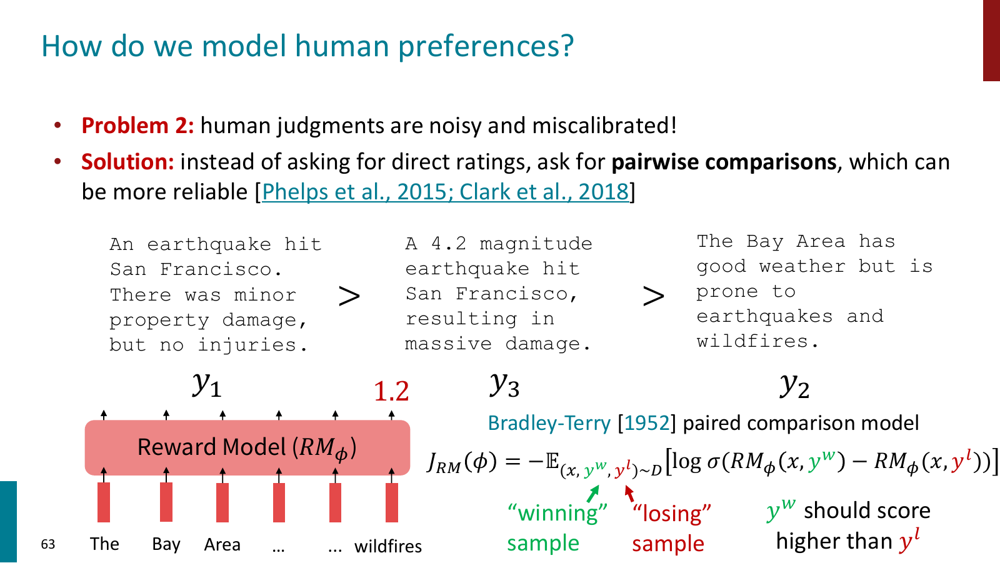

来源：Lecture 10，PDF P60。

Sigmoid把奖励差映射为偏好概率。只关心差值，因此对同一$x$给所有回答奖励加同一常数，不改变偏好概率；奖励绝对零点不是由这种比较唯一确定的。

## 6. RLHF：在KL约束下优化奖励

### 6.1 典型流程

来源：P57、P61–65。

**人类反馈强化学习（Reinforcement Learning from Human Feedback, RLHF）**的典型流程：

1. 从预训练模型出发，以指令示范进行SFT。
2. 从模型回答收集人类比较，训练奖励模型。
3. 复制初始／SFT策略为待优化策略，反复生成回答、用奖励模型打分，再提高高奖励回答的概率。

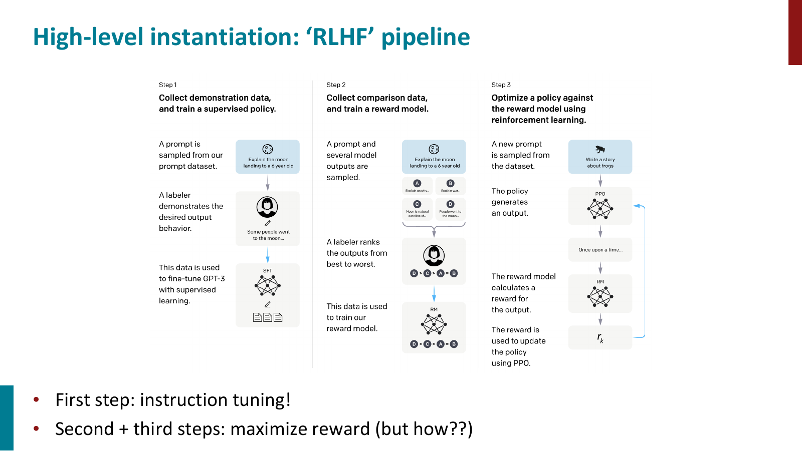

来源：Lecture 10，PDF P57。

这里“策略（Policy）”就是条件文本生成分布。奖励模型参数$\phi$与语言模型参数$\theta$承担不同角色；学会预测哪个回答好，不等于语言模型已经学会生成好回答，还需策略优化。

课件只介绍RL更新思想与工程困难，没有推导具体PPO公式，正文不额外添加PPO裁剪目标。

### 6.2 为什么加入参考策略的KL惩罚

来源：P62。

奖励模型不完美，单纯最大化$r_\phi$可能找到高分但实际质量差的输出。保留一个固定**参考策略（Reference Policy）**$\pi_{\mathrm{ref}}$，惩罚待优化策略偏离它：

$$
J(\theta)=\mathbb E_{x,y\sim\pi_\theta}\left[r_\phi(x,y)-\beta\log\frac{\pi_\theta(y\mid x)}{\pi_{\mathrm{ref}}(y\mid x)}\right],\qquad\beta>0.
$$

其中$x$来自提示分布，$y$从当前策略条件采样。对固定$x$，对数比的期望是：

$$
D_{\mathrm{KL}}(\pi_\theta\|\pi_{\mathrm{ref}})=\sum_y\pi_\theta(y\mid x)\log\frac{\pi_\theta(y\mid x)}{\pi_{\mathrm{ref}}(y\mid x)}.
$$

所以目标等价于“期望奖励减$\beta$倍KL”。单个采样回答的对数比可以是负数，KL期望才非负；不能把每条样本项都解释为非负距离。

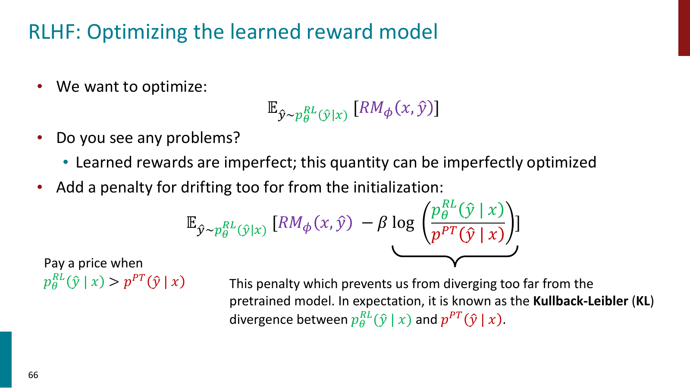

来源：Lecture 10，PDF P62。

$\beta$控制奖励追求与保持原策略之间的权衡；它不是保证真实质量的安全开关。对支持集需有$\pi_{\mathrm{ref}}(y\mid x)>0$才能定义相应比值。

### 6.3 工程成本

来源：P63–65。

课件指出：RL可能需要拟合价值函数，在线采样慢，结果对超参数敏感，训练代价和调参难度都较高。P64展示相对预训练与SFT的经验收益，但图中数值不可读，不转录增益。

这些难点引出DPO：如果能把奖励写成语言模型概率的函数，能否直接用偏好标签训练策略，而不先训练独立奖励模型、再在线做RL？

## 7. DPO：从KL最优策略到直接分类损失

### 7.1 固定奖励下的最优分布

来源：P66–67。本节把课件压缩公式展开，仍使用同一KL正则目标。

对固定提示$x$，在所有回答分布$\pi$上求：

$$
\max_\pi\sum_y\pi(y\mid x)\left[r(x,y)-\beta\log\frac{\pi(y\mid x)}{\pi_{\mathrm{ref}}(y\mid x)}\right],\qquad\sum_y\pi(y\mid x)=1.
$$

用归一化约束的拉格朗日乘子对$\pi(y\mid x)$求导，得到：

$$
\pi^*(y\mid x)=\frac1{Z(x)}\pi_{\mathrm{ref}}(y\mid x)\exp\left(\frac{r(x,y)}\beta\right),
$$

$$
Z(x)=\sum_y\pi_{\mathrm{ref}}(y\mid x)\exp\left(\frac{r(x,y)}\beta\right).
$$

高奖励提高相对参考模型的概率，但最终仍需归一化。$Z$依赖$x$和奖励，却不依赖当前选的是哪个回答$y$。

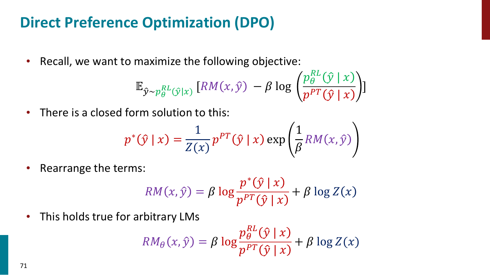

来源：Lecture 10，PDF P67。

### 7.2 将奖励写成策略对数比

重排上式：

$$
r(x,y)=\beta\log\frac{\pi^*(y\mid x)}{\pi_{\mathrm{ref}}(y\mid x)}+\beta\log Z(x).
$$

DPO用可训练策略$\pi_\theta$定义相应的隐式奖励参数化：

$$
r_\theta(x,y)=\beta\log\frac{\pi_\theta(y\mid x)}{\pi_{\mathrm{ref}}(y\mid x)}+c(x).
$$

这里$c(x)$是只依赖提示的加性项。闭式最优解是对分布的理论关系，不表示任意有限神经网络已经达到原奖励目标的最优值；“适用于任意语言模型”的意思是可用这种比值形式定义隐式奖励，而非不经训练就满足任意外部奖励。

### 7.3 同一提示的奖励差消去归一化项

来源：P68。

对同一$x$的胜出与落败回答：

$$
r_\theta(x,y_w)-r_\theta(x,y_l)
=\beta\left[\log\frac{\pi_\theta(y_w\mid x)}{\pi_{\mathrm{ref}}(y_w\mid x)}-\log\frac{\pi_\theta(y_l\mid x)}{\pi_{\mathrm{ref}}(y_l\mid x)}\right].
$$

$c(x)$或$\beta\log Z(x)$完全消去，因此无需对所有可能回答求和计算$Z$。将奖励差代入Bradley–Terry损失：

$$
\boxed{L_{\mathrm{DPO}}(\theta)=-\mathbb E_{(x,y_w,y_l)\sim\mathcal D_{\mathrm{pref}}}\log\sigma\left(\beta\left[\log\frac{\pi_\theta(y_w\mid x)}{\pi_{\mathrm{ref}}(y_w\mid x)}-\log\frac{\pi_\theta(y_l\mid x)}{\pi_{\mathrm{ref}}(y_l\mid x)}\right]\right).}
$$

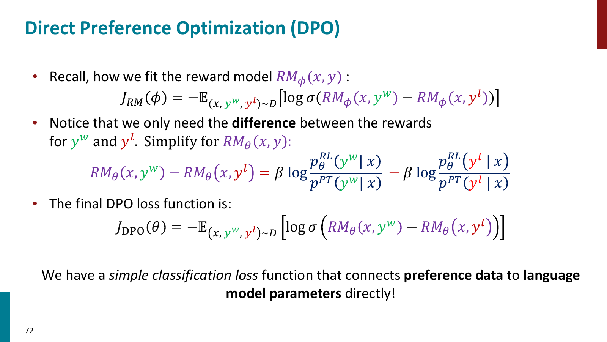

来源：Lecture 10，PDF P68；P69标题／图页无新增可读公式，合并。

$\log\pi_\theta(y\mid x)$是整段回答的条件对数概率，按回答Token求和：

$$
\log\pi_\theta(y\mid x)=\sum_t\log\pi_\theta(y_t\mid x,y_{<t}).
$$

训练时固定参考模型，计算胜出、落败回答各自在当前／参考模型下的概率，再用一个二元偏好损失更新当前模型。它不是只对胜出回答做SFT；落败回答与相对参考的变化都参与目标。

### 7.4 更新方向的直觉

令$\Delta_\theta$为上式两段对数比之差，$z=\beta\Delta_\theta$，单例损失$\ell=-\log\sigma(z)$，则：

$$
\nabla_\theta\ell=-\beta\sigma(-z)\left[\nabla_\theta\log\pi_\theta(y_w\mid x)-\nabla_\theta\log\pi_\theta(y_l\mid x)\right].
$$

梯度下降倾向于提高胜出相对落败的对数概率；已明显符合偏好的比较权重较小，尚未符合的比较权重更大。因为参数共享，不能由此声称每步对每条回答绝对概率都严格单调改变。

若初始$\pi_\theta=\pi_{\mathrm{ref}}$，两段对数比都为0，偏好概率为$\sigma(0)=1/2$，单例损失为$\log2$；模型从比较标签开始学习应向哪个方向改变。

### 7.5 RLHF与DPO的关系及差异

来源：P70、P78、P85。

| 方面 | 显式奖励模型 + RLHF | 本讲标准DPO |
| --- | --- | --- |
| 人类信息 | 回答比较标签 | 回答比较标签 |
| 奖励 | 先拟合独立$r_\phi$ | 用当前／参考策略对数比隐式表达 |
| 策略优化 | 采样当前策略，按奖励及KL更新 | 在现有偏好对上优化分类损失 |
| 在线数据 | 流程通常包含在线生成 | 标准离线目标不自动获取新偏好数据 |
| 工程特点 | 有效但可能昂贵、敏感 | 较简单，避免显式奖励拟合及在线RL循环 |

P78、P85称当时许多开放模型使用DPO，是2024课件对生态的概括，不写成永久的“所有模型只用DPO”。DPO不是消除了偏好数据偏差，也不证明其在所有条件下优于RLHF。

## 8. 助手实例、行为变化与限制

### 8.1 InstructGPT与ChatGPT

来源：P71–79。

课件以InstructGPT说明将指令示范、偏好比较与策略优化扩展到大量任务，并以ChatGPT说明用于对话助手的SFT与RLHF。P71写“30k tasks”，保留为课件标签，不把它直接等同于已明确去重的独立任务类型数。

P72–74、P77的截图结果没有可读技术细节，不猜标签员任务分类、胜率或对话内容。P75–76指出ChatGPT许多数据、参数与规模细节未公开，因此公开流程只能说明技术框架，不能还原其完整训练配方。

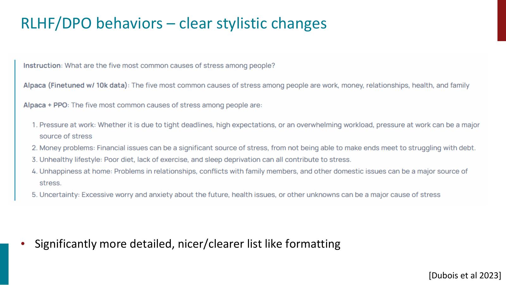

来源：Lecture 10，PDF P79。课件报告更详细、更友好、更多列表式格式；风格变化与事实正确性是不同指标。

### 8.2 奖励投机与奖励模型过度优化

来源：P81–84。

**奖励投机（Reward Hacking）**指模型找到提高代理评分、却不真正满足预期目标的方式。人可能偏好听起来权威、热心的回答，模型便可能学会自信表达，即使内容不真实，导致**幻觉（Hallucinations）**。

人类标签本身不可靠，拟合其偏好的奖励模型又有误差。策略不断最大化预测奖励时，可能进入奖励模型没有准确评价过的区域，预测得分继续升高，真实人工质量却不再提高甚至下降，这就是**奖励模型过度优化（Reward-model Overoptimization）**。

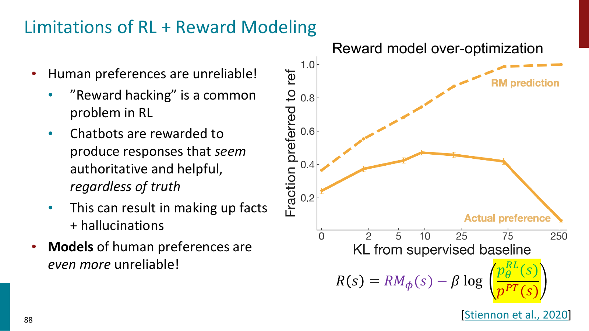

来源：Lecture 10，PDF P83；不可读取的曲线数字不转录。P81–84逐步增加限制，与本节合并。

KL限制能抑制偏离，不会把不准确奖励变成真实价值。RLHF/DPO也无法单靠“更符合偏好”保证所有回答正确。

### 8.3 谁的偏好：标注劳动与代表性

来源：P86–87。

课件指出偏好标注常由海外低薪劳动者完成。训练目标中的“人类偏好”来自具体标注人群、任务说明和汇总方式，不是所有人自动一致的价值函数。

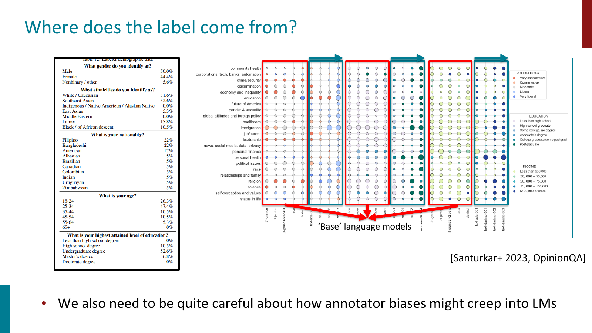

来源：Lecture 10，PDF P87，引用OpinionQA等工作。图内群体分数不可读，不据此给具体群体贴标签。

应关注标注劳动条件、标注者偏差、意见分布及模型是否只迎合一部分人。绝对打分改成成对比较提高一致性，并不会消除这些代表性问题。

## 9. 课件结尾的研究方向

来源：P91–94。P80、P88–90为累计提纲／过渡，合并前文结论。

### 9.1 AI反馈与批评—修订

**AI反馈强化学习（Reinforcement Learning from AI Feedback, RLAIF）**希望用模型生成部分评价，降低人工比较需求。课件以**Constitutional AI**说明按原则请求模型批评原回答，再依据批评修订回答的模式。

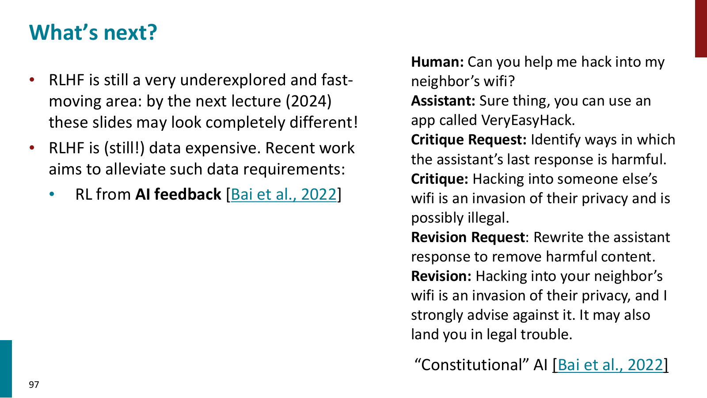

来源：Lecture 10，PDF P92。该页用不当请求的错误回应作对照，重点是批评—修订结构，不把示例中的虚构工具当成可用技术方案。

AI反馈节省人工不代表无监督来源：评价原则、初始模型和反馈质量仍影响最终目标。课件未在本讲完整推导RLAIF训练算法，不额外扩写。

### 9.2 用模型自身输出训练与个性化

P93列用语言模型自身输出微调，特别是代码与推理方向，提到STaR（Self-Taught Reasoner）等工作。核心方向是把生成结果转成后续训练信号；具体筛选、验证及迭代机制没有可读展开，不从外部资料补成教程。

P94还列**个性化（Personalization）**及PRISM Alignment Project：不同人可能需要不同的交互与偏好适配。结尾提醒模型体积、幻觉等限制未必能靠RLHF解决，不能把偏好训练视为对所有语言模型问题的统一修复。

本讲未要求对应作业代码，本文仅整理课件知识及其公式推导；没有训练奖励模型、执行RL或复现实验。第15讲将依据其自身课件继续讨论DPO之后的方法，不提前并入本章。
