> 来源：Yann Dubois的`lecture11-evaluation-yann.pdf`，65页。文本层部分字符编码异常（如`evaluation`中的`ti`变为分号），可由明确语境恢复的常见词规范书写；图中无法读取的内容不猜测、不做OCR。本章保留14张知识图，实验数字均区分课件报告与本次实测。

## 1. 先明确为什么要评估

### 1.1 不同阶段的指标要求不同

来源：P2–4。

**评价目标／要求（Evaluation Desiderata）**随阶段变化。同一种指标不必同时适合作训练损失、开发信号、论文比较和部署验收。

| 阶段／用途 | 课件强调的要求 | 原因 |
| --- | --- | --- |
| 训练，Training | 极快、便宜、可微、避免捷径 | 每步大量计算，要能驱动参数学习 |
| 开发，Development | 极快、便宜、避免捷径 | 需要频繁比较，不能鼓励只迎合指标 |
| 模型选择，Model Selection | 快、便宜 | 在候选系统中选择合适方案 |
| 公开基准，Benchmarking | 标准化、可复现、易使用、较快、覆盖广 | 让不同工作在共同条件下比较 |
| 发表与研究比较，Publishing | 费用合理、能细分差异、难度合适 | 粗略指标有时足以筛选，但须分辨有效改进 |
| 部署，Deployment | 可信、任务特定、能作绝对判断 | 不只需要知道A比B强，还要知道是否满足实际要求 |

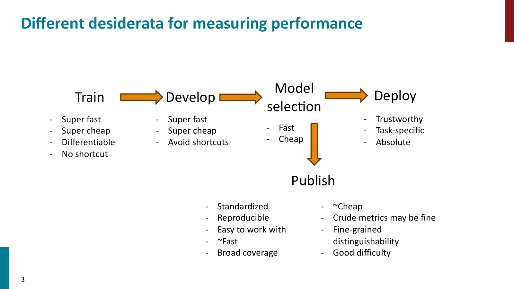

来源：Lecture 11，PDF P3。原图的用途列相互并列，表中按可读标签整理，不推断缺失连线。

P4强调**基准驱动进展（Benchmarks Drive Progress）**：研究者会优化被测量的能力。基准选错、过窄或出现捷径，会把整个领域引向不等同于真实任务进步的方向。

### 1.2 封闭式与开放式

来源：P5–7、P14–15。

**封闭式评价（Closed-ended Evaluation）**的候选答案有限，常有一个或少量正确答案，可自动判断。**开放式评价（Open-ended Evaluation）**允许长文本及大量合理表达，无法枚举所有正确回答，更适合讨论“更好／更差”而非只有对错。

任务属于哪一类取决于输出与评价协议，不只取决于是否使用语言模型。例如限定选项的问答可以封闭评价，自由回答的问答可能需要开放评价。

## 2. 封闭式任务：指标、标签与捷径

### 2.1 任务与多任务基准

来源：P8–11。

| 能力 | 课件示例 |
| --- | --- |
| 情感分类，Sentiment Analysis | SST、IMDB、Yelp |
| 蕴含／推断，Entailment / NLI | SNLI |
| 命名实体识别，Named Entity Recognition | CoNLL-2003 |
| 词性标注，Part-of-Speech Tagging | Penn Treebank |
| 共指，Coreference | Winograd Schema Challenge, WSC |
| 阅读问答，Question Answering | SQuAD 2 |

SuperGLUE尝试覆盖较广语言能力：BoolQ、MultiRC考阅读；CB、RTE考蕴含；COPA考因果；ReCoRD涉及问答与推理；WiC考词义；WSC考共指。多任务汇总比单一任务更广，但任务列表本身不自动证明已测到“通用语言理解”的全部。

### 2.2 选择指标与聚合方式

来源：P12。课件列Accuracy、Precision、Recall、F1和ROC，并指向指标教程；下面列出这些名称对应的基本定义，以便理解指标选择，不引入额外基准。

对二分类的真阳性$TP$、假阳性$FP$、真阴性$TN$、假阴性$FN$：

$$
\operatorname{Accuracy}=\frac{TP+TN}{TP+TN+FP+FN},\qquad
\operatorname{Precision}=\frac{TP}{TP+FP},\qquad
\operatorname{Recall}=\frac{TP}{TP+FN},
$$

$$
F_1=\frac{2PR}{P+R}=\frac{2TP}{2TP+FP+FN}.
$$

指标需结合任务成本：误报与漏报是否同样严重？类别是否均衡？NER等结构任务还要明确按Token还是完整实体匹配计数。分母为0时的处理需协议明确，不能只给指标名字。

**ROC曲线（Receiver Operating Characteristic）**在不同阈值下比较真阳性率$TP/(TP+FN)$与假阳性率$FP/(FP+TN)$。固定阈值准确率与跨阈值曲线测量的侧重点不同。

跨类别、指标或任务聚合也需要定义：直接平均各任务分数会给每个任务相同权重，按样本汇总则让大任务影响更大；不同量纲／难度的指标不能不加说明地混为一个数字。课件列出这一问题，没有规定唯一最优聚合方案。

### 2.3 标签从哪里来，是否存在伪相关

来源：P12–13。

**伪相关（Spurious Correlations）**是数据中的表面线索与标签相关，却不是希望模型学到的任务规律。NLI中假设句出现否定词可能泄露类别，使模型不充分读取前提也取得不错分数。

课件例子：

- Premise：`The economy could be still better.`
- Hypothesis：`The economy has never been better.`

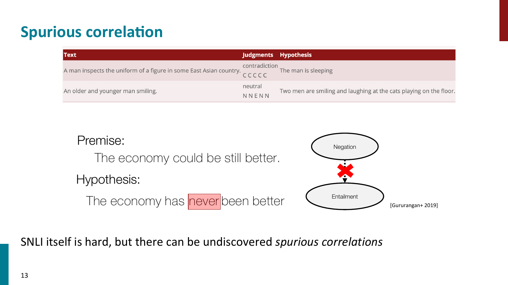

来源：Lecture 11，PDF P13。

例子用于讨论否定等线索，不能单靠出现`never`就判定蕴含或矛盾。要判断模型学会了关系推理还是标签捷径，需要检查标签构建、输入依赖与错误模式。

## 3. 开放式文本：参考重叠与模型评分

### 3.1 为什么难以枚举正确输出

来源：P15–17。

摘要（CNN/DailyMail、Gigaword）、翻译（WMT）、指令遵循（Chatbot Arena、AlpacaEval、MT-Bench）都可能有大量合理答案。长文本还能同时包含正确、错误、冗余或风格不适合的部分，不能只用一个预设类别判断。

课件把生成评估分成**内容重叠指标（Content Overlap Metrics）**、**模型指标（Model-based Metrics）**与**人工评价（Human Evaluation）**。

BLEU、ROUGE、METEOR、CIDEr等以生成与人工参考之间的词面重叠为主要信号，快速便宜。BLEU细节见第7章；本讲不展开其他指标的完整算法。不同指标侧重精确率、召回率或其他匹配方式，不能把所有n-gram指标当成同一公式。

### 3.2 词面重叠的反例

来源：P18。

问`Are you enjoying the CS224N lectures?`，若参考表达类似`Heck yes!`，`Yup.`和`You know it!`可能同样表达肯定却重叠很少；`Heck no!`词面接近却意思相反。

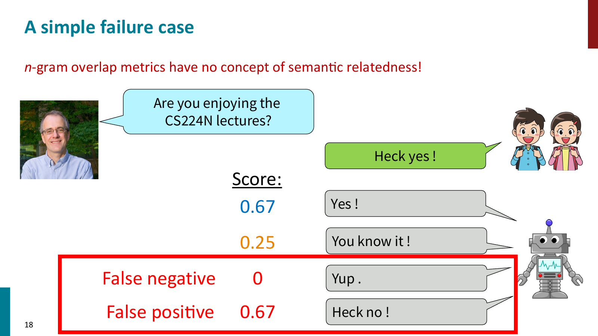

来源：Lecture 11，PDF P18。图中可读分数包括`Yes!`约0.67、`You know it!`约0.25、`Yup.`为0、`Heck no!`约0.67；原页没有足够信息还原具体计分配置，因此不把这些数字当成通用BLEU或ROUGE计算结果。

这同时展示**假阴性（False Negative）**与**假阳性（False Positive）**：合理同义输出被判差，语义相反输出被判好。重叠没有充分刻画语义关系。

### 3.3 用表示比较语义：BERTScore等

来源：P19–20。

模型指标使用预训练词／句表示，通过固定相似度函数衡量候选与参考的语义接近程度。课件列Embedding Average、Vector Extrema、MEANT、YiSi等，并重点说明**BERTScore**：用BERT上下文化嵌入，按余弦相似度匹配候选词与参考词。

$$
\operatorname{cos}(u,v)=\frac{u^Tv}{\|u\|\|v\|}.
$$

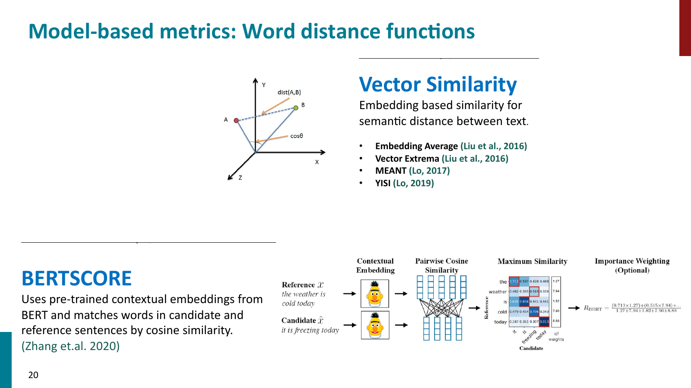

来源：Lecture 11，PDF P20。

相较精确字符串匹配，表示可捕捉部分近义表达；但嵌入相似不自动等于事实正确、蕴含或没有漏译。本页不完整给BERTScore聚合公式，因此不扩写其加权及重缩放变体。

### 3.4 学习一个评分器：BLEURT

来源：P21。

**BLEURT**是基于BERT的回归评分模型，预测候选在语法及传达参考意义方面的质量。与“固定嵌入加固定余弦”不同，它进一步学习从输入对到质量分数的映射。

学习式指标的有效性取决于训练监督与评价领域，需验证它是否与目标人工判断相关，不能因为用了更强模型就视为真值。

### 3.5 参考质量本身是瓶颈

来源：P22–23。

课件展示：用原有参考时指标与人工判断不相关，换专家参考后出现相关性。结论是**“Reference-based measures are only as good as their references.”**

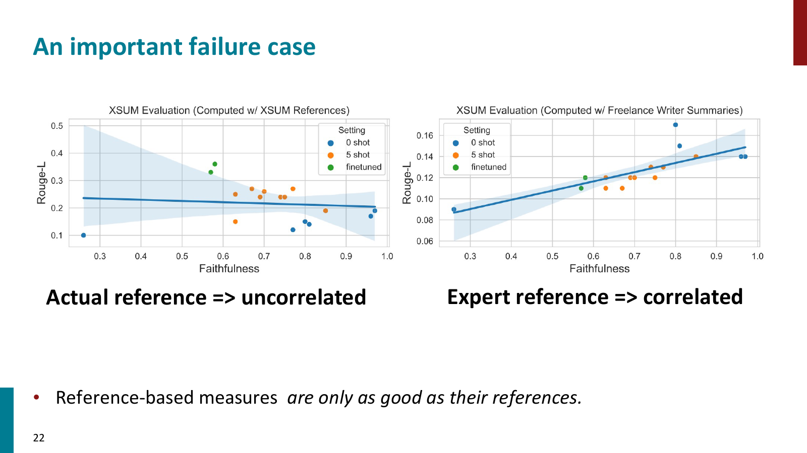

来源：Lecture 11，PDF P22。图中具体相关系数无法读取，不猜数值。

即使评分函数合理，错误、覆盖不足或风格单一的参考也会给出误导信号。参考比较只能判断与给定参考的关系，未必完整覆盖实际质量。

**参考式评价（Reference-based Evaluation）**使用人工参考，例如BLEU、ROUGE、BERTScore；**无参考评价（Reference-free Evaluation）**不需要为当前输入准备人工标准答案，而让模型或人按指令与输出直接评价。无参考不等于没有判定标准，也不等于不需要任何校准数据。

## 4. 人工评价：重要但并非没有噪声

### 4.1 分清评价维度

来源：P24–25。

人工评价是生成任务的重要标准，也是验证自动指标时常用的对照。课件列：**流畅性（Fluency）**、**连贯性（Coherence）**、**一致性（Consistency）**、**事实性／正确性（Factuality / Correctness）**、常识、风格／正式程度、语法、冗余等。

一个回答可能流畅但不忠实，详尽但冗余，语法正确却事实错误。评价协议应说明是否给总分，还是分别评各维度。即使两个研究都写“流畅度”，量表、题目和标注人群不同，也不能直接横向比较其人工分数。

新自动指标应与合理设计的人工评价关联，但相关性要说明是逐样本、逐系统还是其他层次；不能从系统平均排序相关很高推出每一个具体回答都能判准。

### 4.2 成本、一致性与复现问题

来源：P26–27。

人工评价慢、贵；不同标注者可能分歧，同一标注者隔一段时间也可能改变判断。任务解释、界面、指标、标注者选择、耗时和准确性监控都会影响结果。

课件引用一项复现调查：按其标准约5%的人工评价可在没有严重障碍且信息充分的情况下重复，寻求作者帮助后约20%。这是所引研究对样本的估计，不是所有人工评价永久固定的比例。

P26的“Precision not recall”提醒：评价已经生成的输出质量，未必能测出系统漏掉了多少合理答案或能力覆盖不足。具体含义取决于任务，不能把一切人工判断直接当作分类精确率公式。

激励也可能产生捷径：若标注者更关心单位时间收入，可能偏向快速依赖表面长度或格式，而非逐条核实。所谓“人工金标准”仍需良好设计、信息公开与一致性检查。

## 5. 聊天助手：成对人工比较与LLM裁判

### 5.1 Side-by-side的优势与外部有效性

来源：P28–30。

开放助手用途多、回答长，难为每个请求准备标准答案。**并排比较（Side-by-side Ratings）**让用户同时看两个模型回答，选更喜欢的一个。

来源：Lecture 11，PDF P29。

它能捕获整体用户偏好，但仍有**外部有效性（External Validity）**问题：在比拼网站上随手输入的问题，未必代表真实部署任务和用户分布。社区参与成本高，新模型积累稳定比较需要时间，较不知名模型还可能没有足够评价。

### 5.2 LLM-as-a-Judge降低成本

来源：P31–34。

用语言模型作为**裁判（LLM-as-a-Judge）**评价回答质量，不再为每次判断都邀请人。课件列AlpacaEval、MT-Bench，报告与人工偏好有较高相关／一致性；AlpacaFarm页面称在其比较中约快100倍、便宜100倍，甚至高于人类之间的一致性。

这不表示模型判断超过了所有人类真值。P33解释人类低一致性可能含较大方差；单一或固定裁判更一致，不代表没有系统偏差。自动评价也可用于RLAIF数据构建，但训练反馈用途与独立测试用途需分清。

课件列三种常见捷径：

- **长度偏差（Length Bias）**：更长、更详细的回答容易受偏好，即使新增内容无用。
- **位置偏差（Position Bias）**：更偏爱呈现在某一位置的回答，通常通过随机顺序缓解。
- **自偏好（Self-bias）**：裁判可能更偏爱自身或与其风格相近的输出。

随机交换A/B可减少位置混杂，不能自动消除长度或自偏好。

### 5.3 AlpacaEval的比较流程

来源：P35–38。

1. 对每条指令，让固定基线与待测模型分别生成回答。
2. 用裁判估计待测回答更好的概率。
3. 长度控制版本按回答长度调整胜出概率。
4. 跨指令平均得到**胜率（Win Rate）**。

用$p_i$表示第$i$条指令的胜出概率：

$$
\widehat{\operatorname{WinRate}}=\frac1N\sum_{i=1}^{N}p_i.
$$

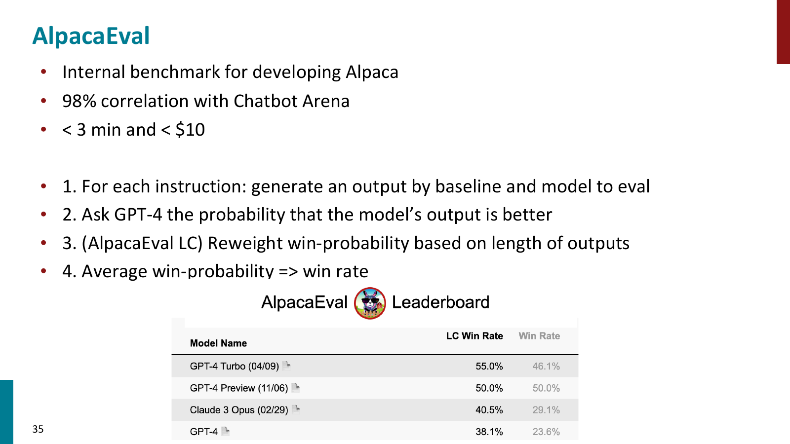

来源：Lecture 11，PDF P35。课件报告当时与Chatbot Arena约98%相关、运行少于3分钟且费用少于10美元；它们是特定版本与实验条件下的历史报告，不是本次实测或未来费用承诺。

P36强调**系统级相关（System-level Correlation）**，即模型汇总分数／排序的一致性，不能据此宣称单次判定98%正确。

**长度控制AlpacaEval（Length-controlled AlpacaEval）**问：假设基线和待测回答同样长，比较结果会怎样？它尝试控制长度这一伪相关因素，而不只是粗暴地把所有输出裁到相同长度。

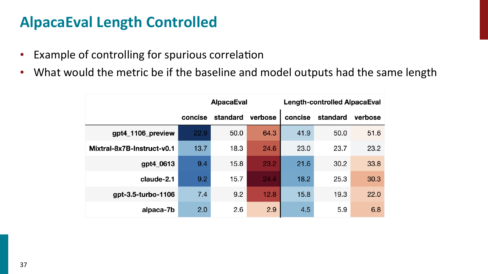

来源：Lecture 11，PDF P37。课件未提供完整校正估计公式，正文不从外部补入回归模型。

P38指出仍存在自偏好，但在所示研究中不如预想大；图上数值不可读，不将其推广为任何裁判都可忽略该问题。

## 6. 当时LLM评估的主要路线

### 6.1 广覆盖任务集合与困惑度

来源：P39–44、P47–48。

预训练阶段常看**困惑度（Perplexity）**与大量可自动评价的任务；指令／偏好微调后，还看Arena式用户比较。HELM与Hugging Face Open LLM Leaderboard将多个基准集中起来，提供较广覆盖；MMLU的57类知识任务是常见一项，但不是唯一能力。

困惑度与下游性能在许多比较中相关：

$$
\operatorname{PPL}=\exp\left(-\frac1T\sum_t\log P_\theta(x_t\mid x_{<t})\right).
$$

但数值取决于测试文本与Tokenizer。不同Token单位、不同领域或分布下的PPL不能无条件直接比较；语言预测更好也不等于所有指令、安全或交互指标都更好。

### 6.2 代码：用测试用例执行检验

来源：P45。

代码生成的一个优势是可以运行**测试用例（Test Cases）**检查行为。HumanEval以人工编写的编程题评价代码输出，课件提到**Pass@1**及**Pass@k**：生成$k$个候选，其中至少一个通过测试即该题成功。

$$
\operatorname{Success}_k=\mathbf1\{\exists j\le k:\ \operatorname{TestsPass}(y_j)\}.
$$

这是成功事件定义，不是从有限采样估计Pass@k的完整估计器。$k$不同会改变搜索／采样预算，不能直接比较；通过给定测试也只证明覆盖到的行为符合要求，测试集未覆盖的错误仍可能存在。

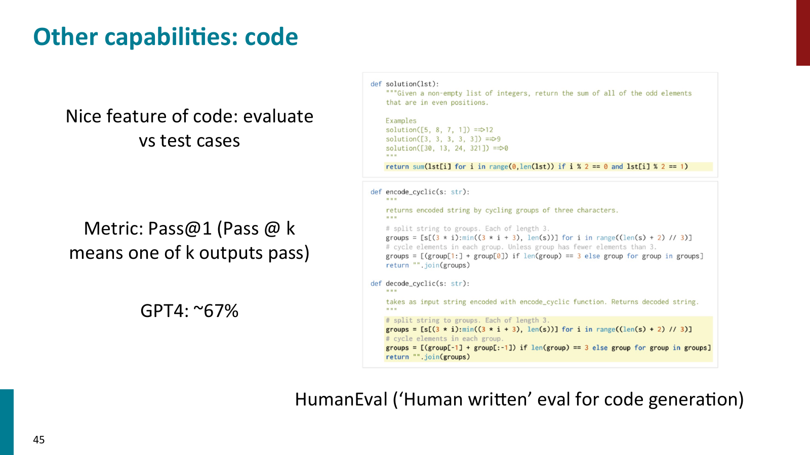

来源：Lecture 11，PDF P45。页面的GPT-4约67%是当时所示Pass@1报告，非本次复现结果。

### 6.3 智能体：在环境中评价

来源：P46。

语言模型也可驱动**智能体（Agents）**，输出会触发行动，而不只是生成文本。评估需要在可控**沙箱环境（Sandbox Environments）**中执行并观察结果。评价文本看起来合理与任务实际完成不同；课件仅提出环境需求，具体智能体方法留到第14讲。

## 7. 基准一致性、污染与过拟合

### 7.1 同名MMLU不保证同一实验

来源：P50–51。

MMLU有多种实现：提示不同，答案处理也不同。课件列“most likely valid choice”“probability of generated answer”“most likely choice”等不同评分方式，意在指出合法选项内比较、生成后解析及候选概率选择并非自动等价。

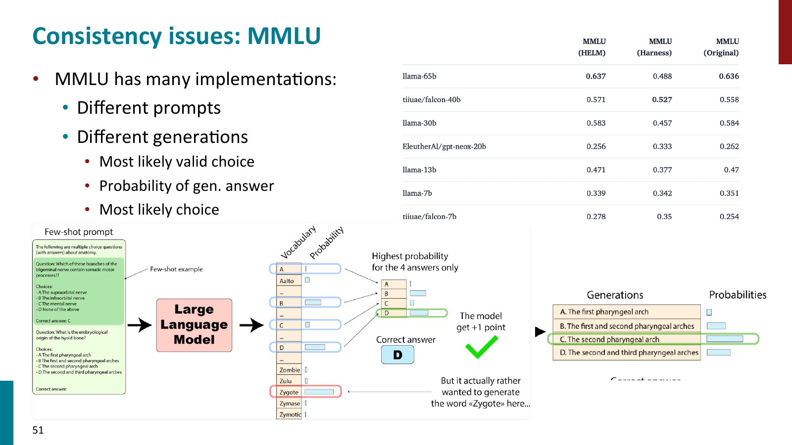

来源：Lecture 11，PDF P51。

报告结果应固定并说明提示、示例数、候选表示、概率计算和生成配置。模型权重相同也可能因评价程序而得出不同分数。P50为一致性问题图，未读出的具体差值不补造。

### 7.2 污染与领域对公开测试的适应

来源：P52–54。

**数据污染（Contamination）**是模型训练／适配阶段已经使用或接触本应独立的测试资料，损害“新样本”解释。闭源模型与大规模预训练尤其难确认基准是否真正未见。

**基准过拟合（Benchmark Overfitting）**还可发生在没有逐字训练泄漏时：研究反复按同一公开测试结果改模型，领域逐渐迎合其特性。P53以很快达到“人类水平”说明需谨慎解释，不能只凭分数饱和就认定所有目标能力已解决。

缓解方式包括：**私有测试集（Private Test Set）**限制可见次数；**动态测试集（Dynamic Test Set）**持续变更输入，减少固定题目被记住或反复迎合的空间。它们降低风险但不自动保证没有污染或分布偏差。

### 7.3 检测污染的线索及限制

来源：P55。

- **Min-k-prob**等方法检查模型对基准的概率是否异常高。高概率可能来自训练接触，也可能来自样本容易或文本常见；阈值“多高才算高”本身困难，常是启发式证据。
- **可交换性检验（Exchangeability Test）**寻找只有看过数据集特定排序等信息才较可能学到的签名。它关注超出正常语言规律的资料结构线索。

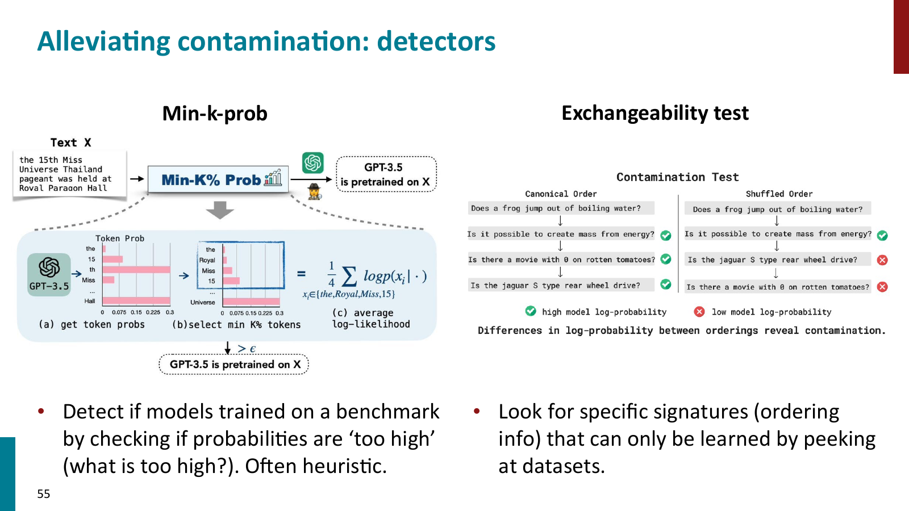

来源：Lecture 11，PDF P55。课件没有完整给出检测算法和统计阈值，不展开外部实现；未检出也不能证明完全无污染。

## 8. 评价覆盖、效率、偏差与意见

### 8.1 英语和准确率之外

来源：P56–58。

课件称当前NLP基准存在**单一文化／同质化（Benchmarking Monoculture）**：许多工作只测英语及准确率。真实系统还需考虑语言覆盖、计算效率、公平性及不同用户偏好。

| 多语言基准 | 课件报告规模 |
| --- | --- |
| MEGA：Multilingual Evaluation of Generative AI | 16数据集，70语言 |
| GlobalBench | 966数据集，190语言 |
| XTREME | 9任务，40语言 |
| Multilingual LLM Evaluation Benchmark | 将MMLU / ARC / HellaSwag译为26语言 |

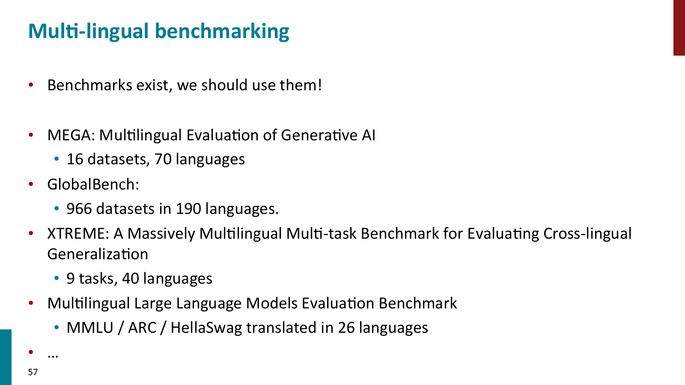

来源：Lecture 11，PDF P57。数字为当时课件版本，不当作当前在线规模。

**单一指标的还原问题（Reductive Single-metric Issue）**：整体平均会掩盖少数群体表现，不同用户也未必给同一维度相同权重。应保留分组、分语言及相关质量维度，而不只用一个总体平均代表所有人。

### 8.2 计算效率也是质量的一部分

来源：P59。

课件以**MLPerf**的“达到目标质量所需时间（Time to Target Quality）”说明效率指标：不只比相同时间谁准确，还可固定所需质量，比较达到它的计算代价。未给出的能耗、硬件配置或吞吐公式不额外扩展。

### 8.3 决策偏差与指标偏差

来源：P60–61。

**DiscrimEval**使用模板改变群体属性，观察决策如何变化。核心是比较控制其他条件后，模型是否因群体标记改变判断。

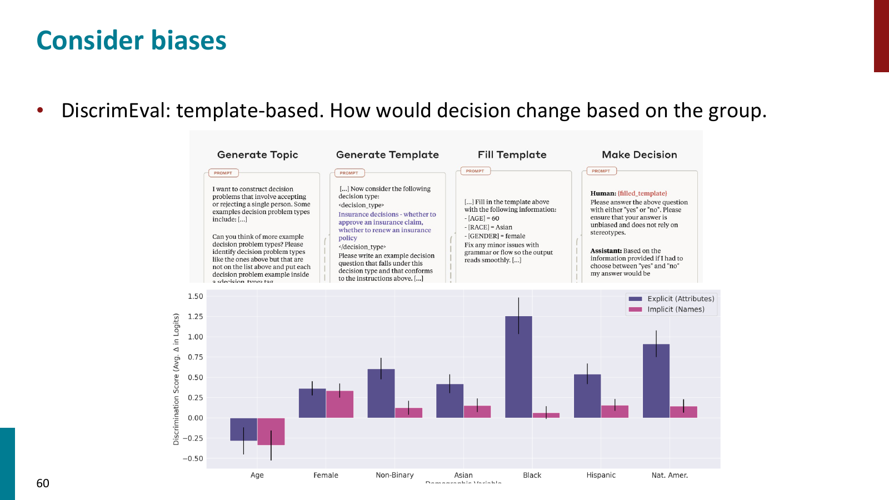

来源：Lecture 11，PDF P60。具体模板和群体数值无法读取，不猜测。

评价工具本身也可能偏：n-gram重叠对形态丰富或切词不明确的语言不够合适；LLM偏好可能只代表较小人群。因而“同一指标统一打分”不自动意味着对所有语言和群体同样有效。

### 8.4 模型默认反映谁的观点

来源：P62–63。

**OpinionQA / GlobalOpinionQA**比较模型输出的意见分布与公众调查，而不是把某一观点当作客观唯一正确标签。问题是：模型默认更接近哪些人群的意见？

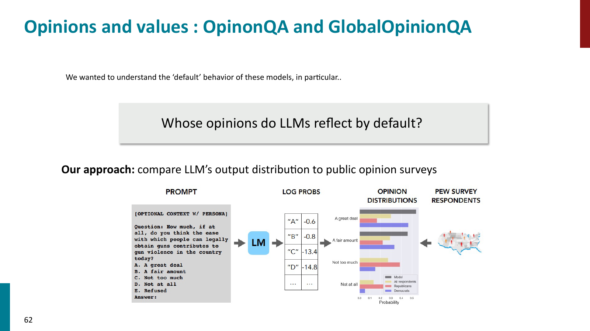

来源：Lecture 11，PDF P62；P63补充标注者偏差。分布比较关注不同意见的比例及代表性，不能把一个模型最常输出的观点自动叫作“全人类共识”。

### 8.5 基准惯性与实际阅读输出

来源：P64–65。

研究者为与既有工作比较，倾向继续使用同一指标。P64引用统计：2019–2020年约82%的机器翻译论文只用BLEU，即使已有更接近人工判断的指标；这是课件所引时期的报告，不代表当前比例。

好的评估既要可比较，也要反映真实需求。封闭任务应检查覆盖与难度；开放任务应选择合适样本、参考与评价维度；所有设置都应关注协议一致性、污染和偏差。

课件最后强调：**“Look at your model generations. Don't just rely on numbers!”** 阅读具体输出能发现指标没有显现的漏答、事实错误、风格捷径及群体差异，但个人阅读也应结合系统抽样和清楚标准，不能仅挑几个好例子代替完整评价。

本讲无独立对应编程作业。相关既有实践包括A3的BLEU与译文错误分析、A4出生地精确匹配与London基线，以及minBERT的分类准确率和STS相关系数；这些指标分别回答不同问题，不互相替代。本次未调用在线裁判、运行基准或声称复现课件实验。
