> 来源：Shikhar Murty的`lecture12-training-shikhar.pdf`，65页。主线为混合精度、多GPU数据并行与状态分片、LoRA。课件中的代码与结果截图保留原图，不对无法读取的细节做OCR或猜测。下面的显存公式由课件逐项字节数相加得到，明确区分模型状态与激活值；不是本次训练测量。

## 1. 浮点格式：范围和精度是两件事

### 1.1 FP32如何分配32位

来源：P4–7。

**单精度浮点数（FP32 / Single Precision）**使用1位符号、8位指数、23位显式尾数。对于正常数，可写成

$$
x=(-1)^s\,2^{e-\mathrm{bias}}(1.f)_2.
$$

$s$决定正负，指数决定数量级，尾数决定同一数量级内可区分多少数。这里仅用标准形式解释课件的位布局，不展开浮点标准全部特殊编码。

- **动态范围（Dynamic Range）**：能表示多大与多小的非零数，主要由指数位数决定。
- **精度（Precision）**：相邻可表示数的间隔有多细，主要由尾数位数决定。
- **内存需求（Memory Requirement）**：FP32每个数32位，即4字节。

在$[1,2)$内，FP32相邻正常数间隔为$2^{-23}$；换到更大的数量级，绝对间隔也随之放大。因此不能把浮点误差理解为所有数都保留固定小数位数。

### 1.2 FP16节省空间，也更容易损失小数值

来源：P8–12。

| 格式 | 符号位 | 指数位 | 显式尾数位 | 每个数的存储 |
| --- | ---: | ---: | ---: | ---: |
| FP32 | 1 | 8 | 23 | 4字节 |
| FP16 / Half Precision | 1 | 5 | 10 | 2字节 |
| BF16 / Bfloat16 | 1 | 8 | 7 | 2字节 |

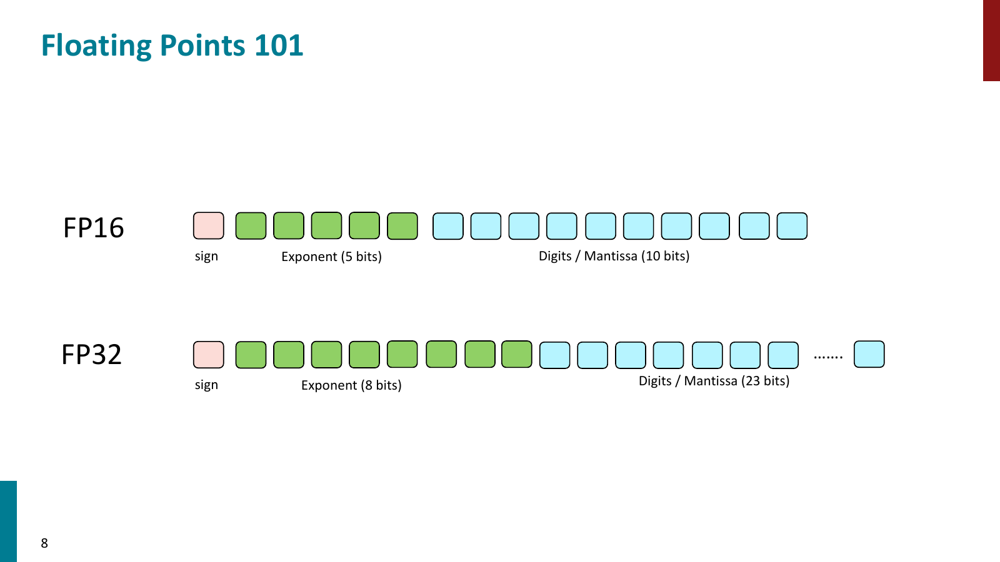

来源：Lecture 12，PDF P8。

传统训练常以FP32保存参数和梯度，大模型容易出现**显存不足（CUDA Out of Memory, OOM）**。改成FP16可以减少相应张量的空间，但指数与尾数都减少：

1. 范围变窄，足够小的梯度可能变成0，即**下溢（Underflow）**；足够大的数可能**上溢（Overflow）**。
2. 精度变粗，小更新可能无法改变权重的表示值。课件例子：`1.0001`转成FP16会舍入为`1`。

P10–12文本层把范围显示成`2e-14 to 2e15`，不能按十进制科学计数法照抄。结合5位指数的格式，正常FP16数的最小正值是$2^{-14}$，最大有限值是$(2-2^{-10})2^{15}=65504$；若包含次正规数，最小正值可到$2^{-24}$。这一区别是解释“范围”所必需，不应将$2^{-14}$误认为全部非零数的下界。

在$[1,2)$内，FP16间隔为$2^{-10}$。若更新量相对权重过小，即使梯度本身非零，舍入后的$\theta-\eta g$仍可能等于原$\theta$。因此“梯度能表示”与“权重能累积该更新”是两个问题。

## 2. 混合精度：低精度计算，高精度维护更新

### 2.1 FP32主权重解决小更新被舍入

来源：P13–15。

**混合精度训练（Mixed Precision Training）**不要求所有数据统一使用一种格式。课件先提出以下流程：

1. 保存一份FP32的**主权重（Master Weights）**。
2. 将权重转换为FP16，用于前向传播。
3. 低精度反向计算梯度。
4. 将梯度转换为FP32。
5. 用FP32梯度更新FP32主权重。
6. 将更新后的主权重转换回FP16，供下一轮计算。

记FP32主权重为$\theta^{(32)}$，低精度副本为$\theta^{(16)}$：

$$
\theta^{(16)}=\operatorname{cast}_{16}(\theta^{(32)}),
\qquad
\theta^{(32)}\leftarrow\operatorname{OptimizerUpdate}\bigl(\theta^{(32)},\operatorname{cast}_{32}(g^{(16)})\bigr).
$$

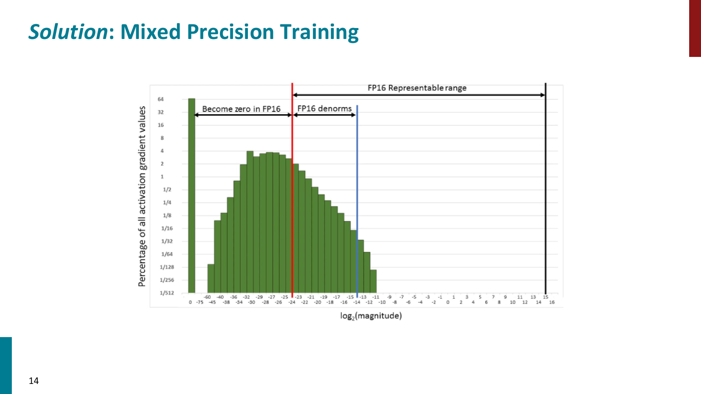

来源：Lecture 12，PDF P14。保留课件流程图；实现内部的全部算子精度不由该示意图唯一决定。

FP32主权重允许多次小更新逐渐累积，解决每次直接写回FP16时可能丢失的变化。但**把已经为0的FP16梯度转成FP32，仍然是0**：主权重本身不能补救反向计算期间发生的下溢。

### 2.2 损失缩放解决小梯度的下溢

来源：P15–16。

**损失缩放（Loss Scaling）**先将损失乘较大的正数$S$，再反向传播：

$$
\widetilde L=S L,
\qquad
\nabla_\theta\widetilde L=S\nabla_\theta L.
$$

计算时把梯度整体放大，降低极小梯度被舍入为0的风险；转换到FP32后，再除回$S$：

$$
g^{(32)}=\frac{\operatorname{cast}_{32}(\widetilde g^{(16)})}{S}.
$$

然后用$g^{(32)}$更新主权重，而不是用放大后的梯度直接更新。这样在精确算术下，优化目标与学习率不变；实际作用是改变低精度计算中的数值范围。

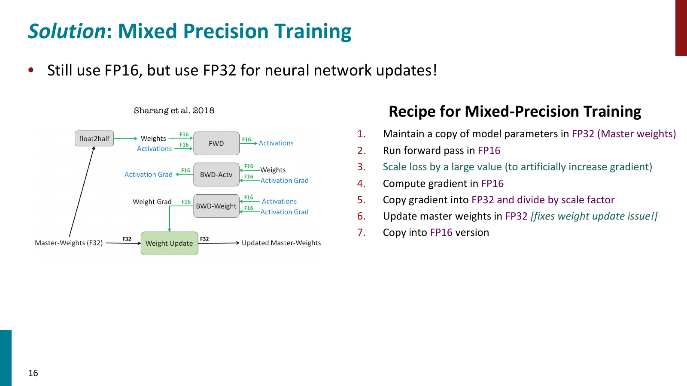

来源：Lecture 12，PDF P16。

主权重与损失缩放分别处理不同问题：前者减少**更新时的舍入损失（Update Rounding）**，后者减少**梯度计算时的下溢（Gradient Underflow）**。缩放因子也不能无限大，否则可能转而上溢；课件未展开缩放因子的完整自动调整算法。

### 2.3 PyTorch中的AMP示意

来源：P17、P21。

课件使用PyTorch的**自动混合精度（Automatic Mixed Precision, AMP）**。关键职责是：`autocast`控制适合低精度执行的算子，`GradScaler`为FP16路径进行损失缩放及相应更新处理。实际实现不是简单把每个算子、每个优化器状态都强制转换成FP16。

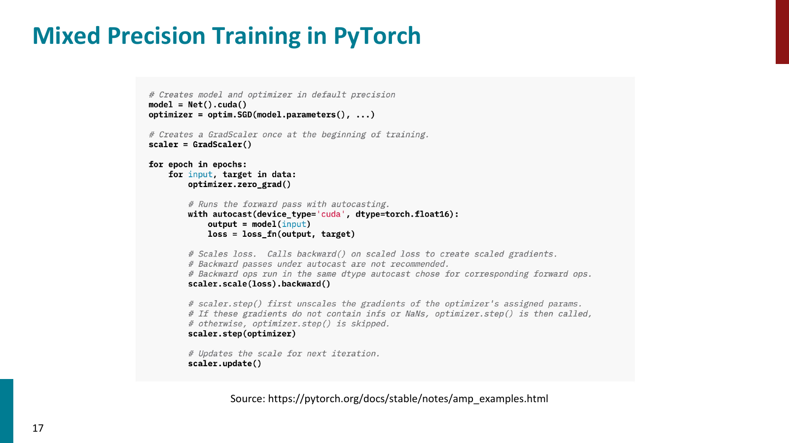

来源：Lecture 12，PDF P17；原页指向PyTorch的`amp_examples`文档。代码截图无法完整可靠读取，保留原图，不给出声称已运行的转录代码，也不把2024年接口当成所有PyTorch版本的固定写法。

### 2.4 BF16：用尾数精度换更大的范围

来源：P18–22。

FP16需要缩放的重要原因是指数位少。**Bfloat16（BF16）**仍为16位，但将指数改为与FP32相同的8位，尾数减少为7位。它获得与FP32相近的指数范围，代价是较低尾数精度；在$[1,2)$内间隔为$2^{-7}$。

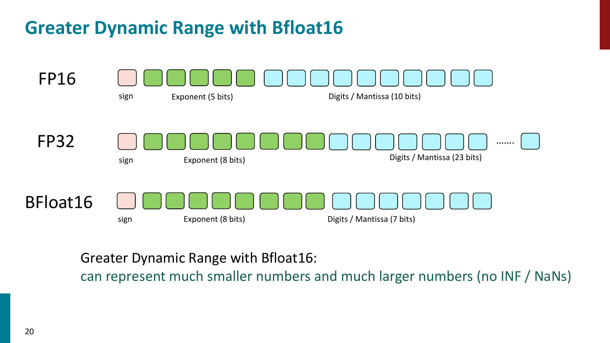

来源：Lecture 12，PDF P20。

课件建议在硬件支持时用BF16，并指出其通常不需要FP16式梯度缩放。应准确理解P20的简写`no INF / NaNs`：BF16降低了因范围过窄导致的溢出风险，**不能保证所有运算永远没有Inf或NaN**；除零、无效运算或超出其范围等问题仍可能发生。更大的范围也不等于更高精度。

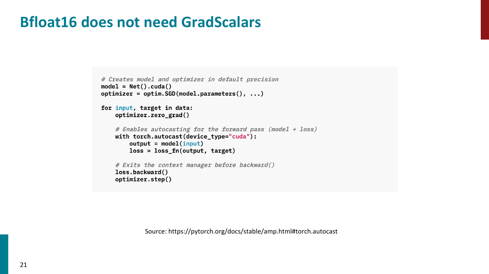

来源：Lecture 12，PDF P21。课件写`GradScalars`，对应PyTorch组件名为`GradScaler`；BF16示例强调不需要同样的缩放流程。

P22展示在单张A100上对DistilBERT进行情感分类微调的比较，用来说明格式选择对训练资源与表现的影响。它是特定模型、硬件及任务的结果，不能推出所有模型都具有相同加速比或显存下降比例。

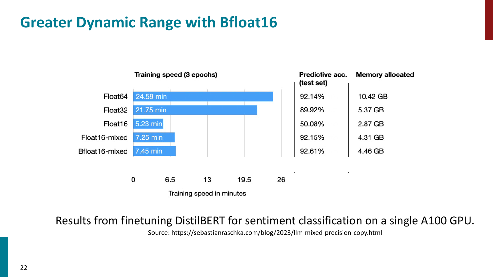

来源：Lecture 12，PDF P22；原页引用Sebastian Raschka的2023年混合精度实验文章。截图具体数值未可靠读取，不补造表格，也未在本机复现。

## 3. 多GPU之前，先把显存账算清楚

来源：P24、P31、P49。

训练不仅需要模型权重，还需要梯度和优化器状态。课件按混合精度Adam列出：

| 项目 | 每个参数的字节数 | 含义 |
| --- | ---: | --- |
| FP16模型参数 | 2 | 前向／反向使用的低精度权重副本 |
| FP16参数梯度 | 2 | 对权重的梯度 |
| FP32主权重 | 4 | 高精度维护更新 |
| FP32 Adam一阶矩 | 4 | 梯度的动量估计 |
| FP32 Adam二阶矩 | 4 | 梯度平方的移动平均 |
| 合计 | 16 | 尚未计激活值和临时缓冲区 |

设参数量为$P$，按上述格式，未分片的**模型状态（Model States）**约为

$$
M_{\mathrm{states}}=(2+2+4+4+4)P=16P\ \text{bytes}.
$$

例如$P=10^9$时，这部分本身已是$16\times10^9$字节，即十进制16GB；这是表中假设的算术结果，不是某框架实测峰值。若梯度采用其他精度，或没有显式保存相同副本，数字会变化。

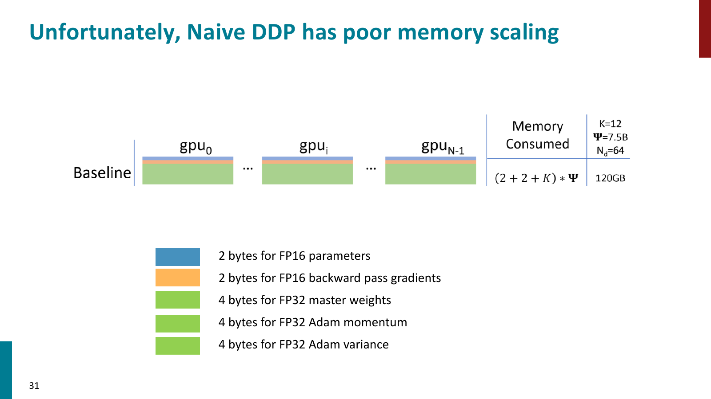

来源：Lecture 12，PDF P31。

还必须加上**模型激活值（Model Activations）**：反向传播需要的中间结果。P49特别强调激活显存随批大小增加。因而即使模型状态能放下，更大的Batch仍可能OOM；仅按参数量估算不能保证训练能运行。课件没有展开激活检查点等其他技术，本章不另加。

## 4. DDP：模型完整复制，数据分开处理

### 4.1 每张GPU有什么

来源：P25–30。

**分布式数据并行（Distributed Data Parallel, DDP）**让每张GPU拥有同步的完整模型副本，各自处理不同的数据切片。每张GPU通常还拥有完整优化器状态，所以它增加并行计算能力，却不会自动把单张GPU上的模型状态缩小为原来的$1/N$。

设$N$个工作进程，各自处理等大的小批量$\mathcal B_i$。若本地损失定义为均值：

$$
L_i(\theta)=\frac1{|\mathcal B_i|}\sum_{x\in\mathcal B_i}\ell(\theta;x),
\qquad
g_i=\nabla_\theta L_i(\theta).
$$

同步后使用

$$
g=\frac1N\sum_{i=1}^{N}g_i.
$$

等大小批次时，这与合并数据后的平均损失梯度一致。若本地批量大小不同，需要按样本量加权，不能无条件平均各局部均值。课件用“cumulated gradient”概括梯度聚合，实际求和或平均要与损失缩放约定一致。

### 4.2 前向、反向与All-reduce

课件过程：

1. 相同模型分别在本地数据上并行前向。
2. 各自反向计算参数梯度。
3. 梯度准备好后进行跨GPU通信，可与其余反向计算重叠。
4. 用**全归约（All-reduce）**使每张GPU获得聚合梯度。
5. 各GPU用相同梯度及同步的优化器状态执行更新，维持参数一致。

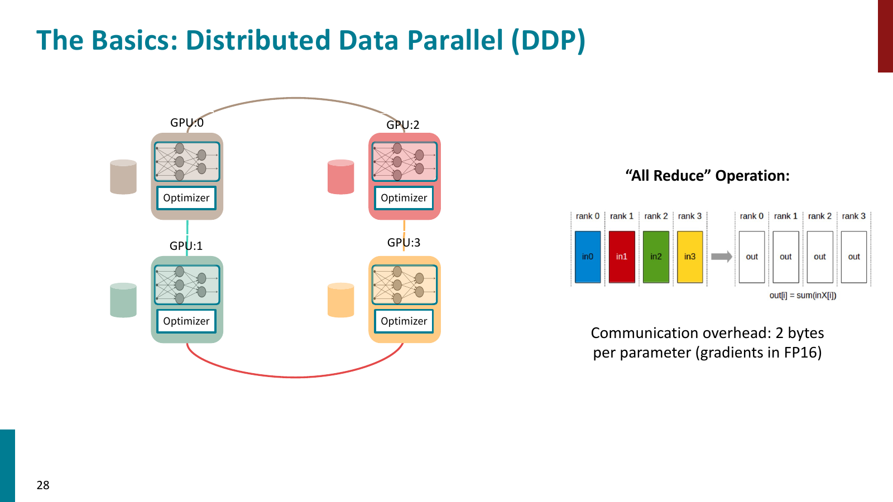

来源：Lecture 12，PDF P28。

同步的是各个参数上的梯度，不是将不同数据的激活全部集中到一张GPU。数据分开，但模型和优化器状态仍然复制。

### 4.3 通信数字的口径

P28、P34用“FP16梯度每个参数2字节”说明待交换张量大小。它不是所有网络拓扑下每张卡的精确收发总量。实际通信流量取决于工作进程数、集体通信算法及实现，时间还受链路与计算重叠影响。后面“memory saved for free”比较的是主要通信量级，不意味着通信没有耗时。

## 5. ZeRO Stage 1：分片优化器状态

来源：P32–34。

**零冗余优化（Zero Redundancy Optimizer, ZeRO）**逐步去掉每张GPU上重复保存的状态。**第一阶段（Stage 1 / Optimizer State Sharding）**保留完整低精度模型参数与本地梯度，将优化器状态分摊到$N$张GPU：每张只负责一部分参数的主权重和Adam状态，并更新该部分。

一次更新的逻辑是：

1. 各工作进程在自身数据上计算梯度。
2. **归约后分散（Reduce-scatter）**：将各进程对相同参数的梯度聚合，再按参数分片交给负责的进程。
3. 每张GPU用自己的状态，更新负责的参数分片。
4. **全收集（All-gather）**：收集各进程更新后的参数，让每张GPU重新得到同步的完整低精度权重。

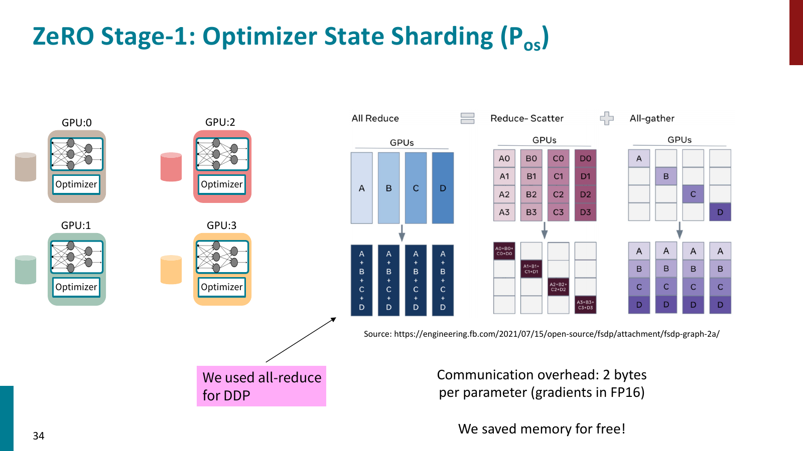

来源：Lecture 12，PDF P34。

沿用第3节字节约定，将FP32主权重和Adam两项共$12P$字节分片：

$$
M_{\mathrm{Stage1}}\approx 2P+2P+\frac{12P}{N}
=4P+\frac{12P}{N}.
$$

这里不计激活与临时通信缓冲区。与DDP比较，主要省掉优化器状态的复制；$N$增大时仍有完整参数与梯度两项，故不会无限趋近于0。

**All-reduce可以由Reduce-scatter与All-gather组成**。Stage 1把先分片更新、再同步参数融入流程，课件因此称与DDP相比“免费”节省显存：核心通信量级可相近。这里的“免费”不承诺实际壁钟时间绝无变化。

## 6. ZeRO Stage 2：进一步分片梯度

来源：P35–38。

第一阶段仍保留完整本地梯度。**第二阶段（Stage 2 / Optimizer State and Gradient Sharding）**将长期保留的梯度也按参数归属分片。

难点：每张GPU都在完整模型上计算自己数据的梯度，如何不保存一整个完整梯度向量？课件的回答是**“Never instantiate the full gradient vector!”**：按反向传播的层或分片逐步处理，而不是等所有参数梯度都齐了再统一通信。

在第$j$层：

1. 接收来自后续计算的上游梯度。
2. 计算当前层参数梯度。
3. 立即将其归约并送给负责该参数分片的GPU。
4. 释放不再需要的本地参数梯度内存。
5. 最后各GPU更新自己的参数分片，再All-gather同步权重。

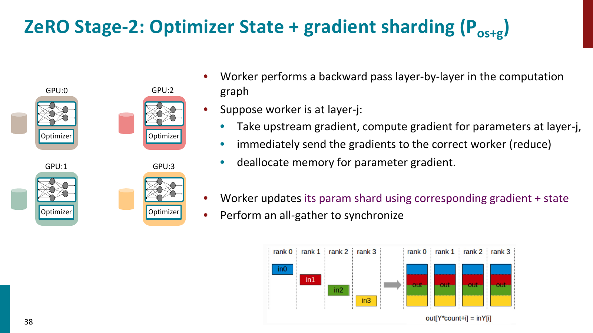

来源：Lecture 12，PDF P38。

“梯度分片”不表示某张GPU完全不计算其他参数对本地数据的梯度，而是**不在每个进程持续保存完整聚合梯度**。短暂的层级梯度和通信缓冲区仍可能存在。

模型状态的理想化主要项为

$$
M_{\mathrm{Stage2}}\approx 2P+\frac{2P+12P}{N}
=2P+\frac{14P}{N}.
$$

完整低精度参数仍每卡一份；如果仅参数本身就放不下，Stage 2还不够。课件将其主要通信归为Reduce-scatter加All-gather，与Stage 1相同量级，具体速度取决于分桶、调度与通信重叠。

## 7. ZeRO Stage 3与FSDP：连模型参数也分片

### 7.1 FSDP单元与即时重建

来源：P39–46。

**第三阶段（ZeRO Stage 3）**进一步分片低精度模型参数。课件以**完全分片数据并行（Fully Sharded Data Parallel, FSDP）**解释这种训练方式；它们共享分片参数、梯度与优化器状态的核心思想，不应把所有具体实现配置当作完全同一个软件接口。

将模型分为若干**FSDP单元（FSDP Units）**，每个单元内部的参数分到多个GPU。常驻的是各自分片，需要计算某个单元时才重建其完整参数。

前向流程：

1. 对当前单元执行All-gather，收集其所有参数分片。
2. 每张GPU用完整单元参数处理自己的数据。
3. 计算完后释放临时收集到的完整参数，保留自己负责的常驻分片。
4. 对后续单元重复。

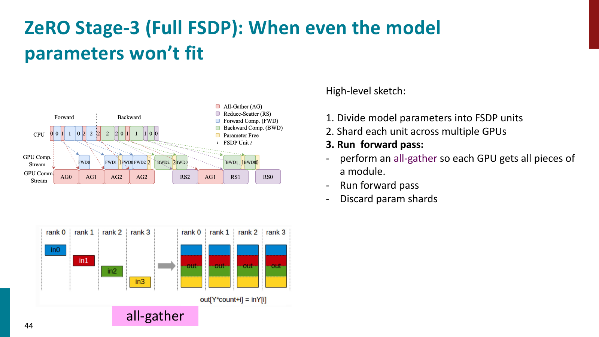

来源：Lecture 12，PDF P44。原页写`Discard param shards`，在此上下文应理解为丢弃临时聚合的完整参数／非本地部分，不能理解为把唯一的常驻参数分片也删除。

### 7.2 反向重建、梯度归约和本地更新

反向过程：

1. 再All-gather获得当前单元完整参数。
2. 根据本地数据计算该单元参数梯度和向前一单元传播的梯度。
3. Reduce-scatter聚合各GPU的参数梯度，将对应分片送到负责的GPU。
4. 释放不再需要的完整参数及临时梯度。
5. 各GPU用聚合后的梯度与本地优化器状态更新自身参数分片。

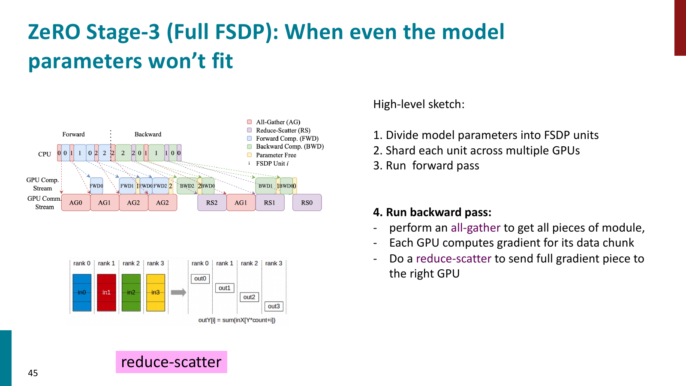

来源：Lecture 12，PDF P45；P46补充各GPU更新自身分片。

理想化常驻模型状态约为

$$
M_{\mathrm{Stage3,persistent}}\approx\frac{16P}{N}.
$$

实际峰值还包括至少当前计算单元重建出的参数、激活、通信和其他临时张量。因此$16P/N$是主要常驻项，不是精确峰值或足以保证单卡一定能容纳的公式。分片参数也不是将不同层永久交给不同GPU独占计算；各GPU仍主要对自己的数据执行模型计算。

### 7.3 节省显存的代价：额外参数通信

来源：P40、P47–48。

| 方法 | 课件概括的集体通信 | 与显存的关系 |
| --- | --- | --- |
| DDP | All-reduce梯度 | 模型、梯度、优化器状态复制 |
| ZeRO Stage 1 / 2 | Reduce-scatter梯度 + All-gather更新后参数 | 分片优化器状态，Stage 2再分片梯度 |
| ZeRO Stage 3 / Full FSDP | All-gather参数 + Reduce-scatter梯度 + 额外All-gather参数 | 前向后释放的完整参数，反向前需重建 |

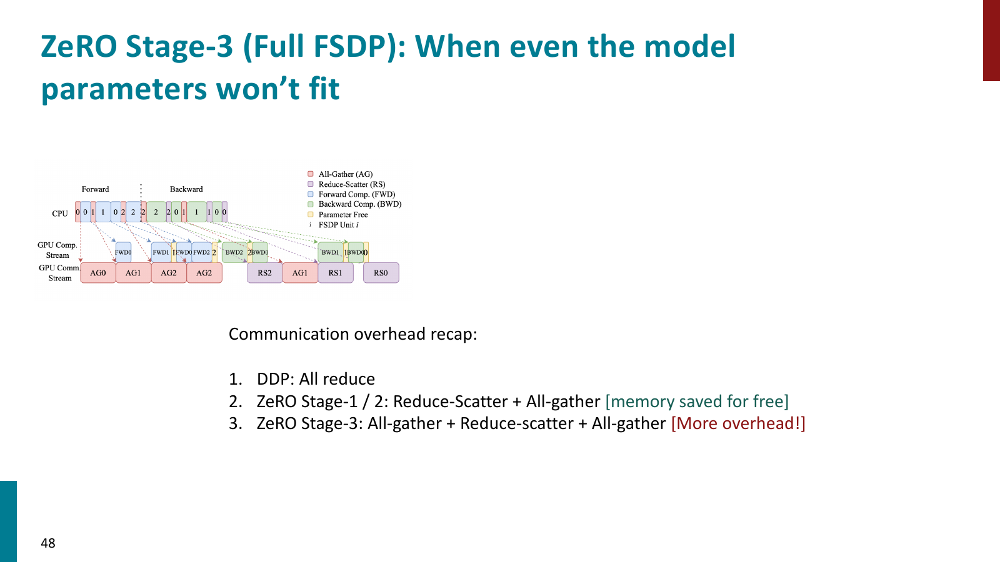

来源：Lecture 12，PDF P48。表按每步的操作类型概括，不把列表顺序当成所有单元执行的唯一时间线。

课件强调Stage 3不再是“免费”的：相较只分片状态／梯度，它需要额外取回计算所需参数。更多显存节省与更多通信之间存在取舍；不是分片程度越高就一定越快。

### 7.4 显存主要项汇总

由课件P31、P32–49的状态划分可得：

| 方案 | 低精度参数 | 梯度 | 主权重+Adam状态 | 每GPU主要常驻状态 |
| --- | --- | --- | --- | --- |
| DDP | 复制 | 复制 | 复制 | $16P$ |
| ZeRO 1 | 复制 | 复制 | 分片 | $4P+12P/N$ |
| ZeRO 2 | 复制 | 分片 | 分片 | $2P+14P/N$ |
| ZeRO 3 | 分片 | 分片 | 分片 | $16P/N$ |

单位均为字节，假设参数与梯度2字节、主权重及Adam两项各4字节。它们用于解释减少冗余的来源，不包括激活、临时完整单元、通信缓冲区等，不能直接用作设备峰值显存承诺。

## 8. 为什么还需要参数高效微调

### 8.1 全量微调的任务成本

来源：P51–58。

**全量微调（Full Fine-tuning）**更新模型全部参数。设预训练参数为$\theta_0$，训练数据为上下文与目标对$\mathcal D=\{(x,y)\}$，目标为

$$
\max_{\Delta\theta}\sum_{(x,y)\in\mathcal D}\sum_{t=1}^{|y|}
\log p_{\theta_0+\Delta\theta}(y_t\mid x,y_{<t}).
$$

课件举摘要、自然语言转SQL（NL2SQL）、阅读理解作为下游任务。每个任务学习一个与原模型同维度的参数增量：

$$
|\Delta\theta|=|\theta_0|.
$$

P57以1750亿参数的GPT-3说明：若每个任务都保存和部署一个完整独立模型，任务数增加会带来很大存储与维护成本。

**参数高效微调（Parameter-Efficient Fine-tuning, PEFT）**用少量可训练参数编码任务适配。它可能在一些设置中接近全量微调的效果，但不能将P52的经验描述理解为所有任务均保证相同表现。

### 8.2 效率、可及性与环境成本

来源：P53–55。

课件指出最大模型的训练计算需求增长快于整体计算供给，会提高门槛并使技术集中于资金最充足的组织；模型承载谁的价值观，也与谁有能力训练和适配模型有关。

P53引用当时“最大训练计算约每3.4个月翻倍、全球计算能力约每1.5年翻倍”的趋势，属于所引用时期的观察，不是持续到当前的普遍规律或未来定律。P54引用Green AI对60篇论文的抽样，指出研究常更重视准确率，效率和环境成本的披露不足。

相同性能也可能对应不同能耗：P55举CS234约200名学生的算法实现为例，所引研究估算若使用更高效算法，可合计节省约880kWh。它说明选择算法具有实际资源代价，不是本章任务的测量结果。P54对GPT-3与煤电厂运行的类比只是历史估计，不能脱离硬件、能源结构和计量边界作为通用换算。

### 8.3 将高维增量改为低维参数化

来源：P58。

将任务增量写为较小参数集合$\phi$的函数：

$$
\Delta\theta=\Delta\theta(\phi),\qquad |\phi|\ll|\theta_0|.
$$

冻结预训练参数，转而优化

$$
\max_\phi\sum_{(x,y)\in\mathcal D}\sum_{t=1}^{|y|}
\log p_{\theta_0+\Delta\theta(\phi)}(y_t\mid x,y_{<t}).
$$

损失仍是同一个条件语言建模目标，改变的是允许更新的参数化空间。PEFT节省可训练参数的梯度和优化器状态，并减少每个任务必须保存的增量；基础模型权重仍需使用，冻结也不意味着完全不用反向传播中间信息。

## 9. LoRA：把权重增量约束为低秩

### 9.1 分解的是增量，不是原始模型权重

来源：P59。

**低秩适配（Low-Rank Adaptation, LoRA）**假设许多下游适配所需的权重变化具有较低的有效维度／**内在秩（Intrinsic Rank）**。它不是声称原始权重本身一定低秩。

为与第9章minBERT说明统一，令预训练权重$W_0\in\mathbb R^{d\times k}$，使用

$$
W=W_0+\Delta W=W_0+\lambda BA,
\qquad
B\in\mathbb R^{d\times r},\quad A\in\mathbb R^{r\times k},
\quad r\ll\min(d,k).
$$

$W_0$冻结，只训练$A,B$；$\lambda$表示增量的缩放强度，用于表达原模型与任务适配之间的取舍。这里用$\lambda$规范化课件难以提取的缩放符号，不补其未给出的具体数值或配置。

对输入$h\in\mathbb R^k$：

$$
Wh=W_0h+\lambda B(Ah).
$$

原分支保留预训练变换，旁路先由$A$映射到$r$维，再由$B$映射回$d$维，输出形状与原线性层一致。

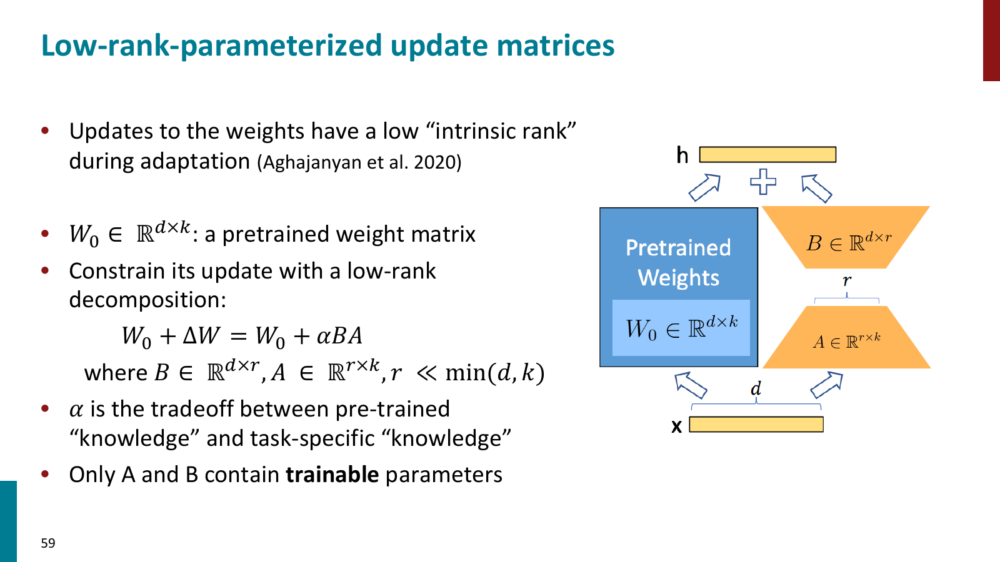

来源：Lecture 12，PDF P59。公式按上述统一维度书写；矩阵名称可以互换，但乘法顺序和维度必须一致。

### 9.2 参数量与表达空间

完整矩阵有$dk$个可训练参数；LoRA两个矩阵合计

$$
P_{\mathrm{LoRA}}=rk+dr=r(d+k),
\qquad
\frac{P_{\mathrm{LoRA}}}{P_{\mathrm{full}}}=\frac{r(d+k)}{dk}.
$$

同时

$$
\operatorname{rank}(BA)\le r.
$$

对于方阵$d=k$，参数量比为$2r/d$，说明$r$远小于$d$时的节省来源。这只是矩阵参数计数，不代表总显存或全部训练计算也按同一比例下降。

P60说增加可训练量时LoRA趋近原模型训练。应分清：$r$足够大时，单个矩阵增量的可表示秩限制会减弱；这不保证因子化优化轨迹与直接训练完整矩阵相同，也不表示只适配少数层就等于更新全部模型。

### 9.3 插入位置与部署合并

来源：P60–61。

课件说LoRA常用于自注意力模块中的权重矩阵。具体选择哪些投影属于适配配置；本讲没有要求对每一层所有矩阵都加LoRA。

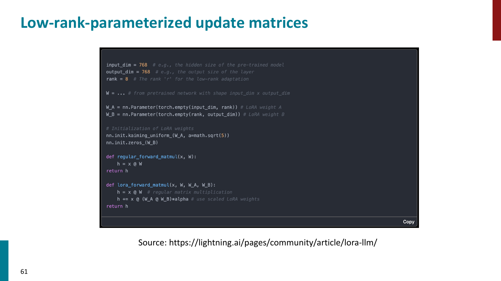

来源：Lecture 12，PDF P61；原页引用Lightning的LoRA图示。

训练后可将增量预先合并：

$$
W_{\mathrm{merged}}=W_0+\lambda BA.
$$

推理仍执行一次原形状矩阵变换，所以课件称**没有额外推理延迟（No Additional Inference Latency）**。该说法的前提是已经合并；若运行时保留单独旁路，不能直接套用同样结论。

多个任务共享$W_0$，分别保存各自的$A,B$。切换任务可以在原权重上替换适配增量；若从已合并任务$i$切到$j$，代数上为

$$
W_j=W_i-\lambda_iB_iA_i+\lambda_jB_jA_j.
$$

这是课件“减去旧增量、加上新增量”的含义；它不把合并操作本身的耗时或存储带宽视为0。

### 9.4 课件结果及可读取限制

来源：P62–64。

P62比较GPT-2 Medium／Large在E2E NLG Challenge上的不同适配方法，说明LoRA能以相近或更少可训练参数超过若干基线；这些生成指标在该表中均是越高越好。P63报告所示三个数据集上LoRA达到或超过全量微调基线，作为有效适配的经验证据。

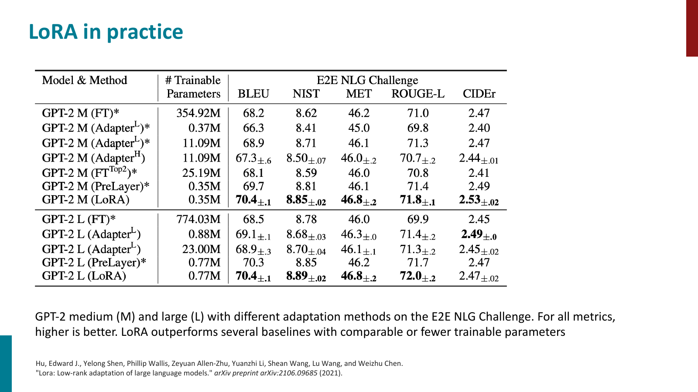

来源：Lecture 12，PDF P62，引用Hu等人的LoRA论文。具体单元格未可靠读取，不转录分数。

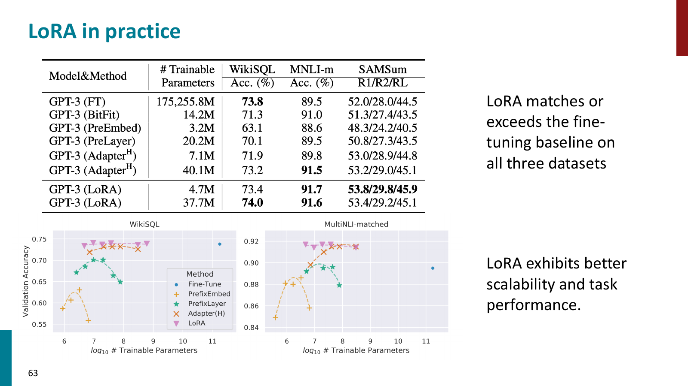

来源：Lecture 12，PDF P63。正文只保留可读结论，未确认的任务名、超参数和分数不补造。

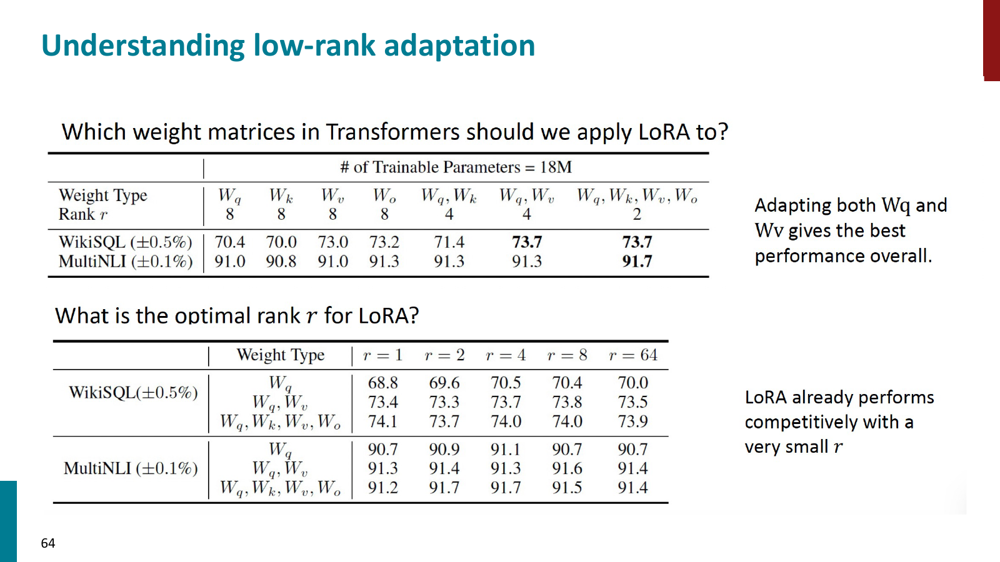

来源：Lecture 12，PDF P64。该页除标题外无可提取正文，按用户要求保留原图，不猜测图中曲线、坐标或结论，不做OCR。

这些是特定模型和数据上的历史实验，并非低秩适配在任意任务上严格优于全量微调的证明。本章未下载、微调或测试任何模型。

## 10. 把课件决策流程连起来

来源：P49–50、P65。

1. 先用混合精度；硬件支持时优先考虑BF16，课件用`torch.cuda.is_bf16_supported()`检查支持情况。实际格式选择仍受硬件与算子支持约束。
2. 看单GPU上Batch Size为1是否能训练。能放下时，可尝试更大Batch；多GPU下可用ZeRO Stage 2减少状态与梯度冗余。
3. 如果最小Batch仍放不下，考虑Stage 3／FSDP，把参数也分片；仍须计入完整单元和激活的临时峰值。
4. 如果全量微调仍超出资源，考虑LoRA等PEFT，以减少可训练增量、梯度和优化器状态。

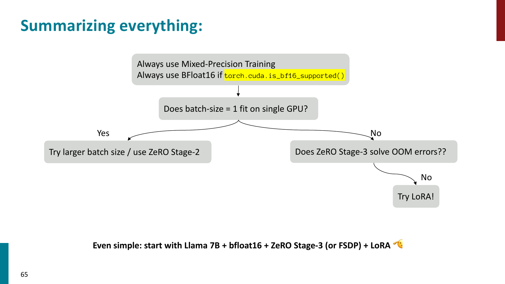

来源：Lecture 12，PDF P65。课件最后举`Llama 7B + bfloat16 + ZeRO Stage-3 (or FSDP) + LoRA`作为起点，不是对任意显卡数量、显存或序列长度都能运行的保证。

三种办法改变的是不同部分：**混合精度**改变数值表示，**分片数据并行**减少跨GPU重复状态，**LoRA**减少任务适配的可训练自由度。它们可以组合，但都不能让激活、通信及基础模型本身的成本自动消失。

本地没有独立的DDP／FSDP对应作业。默认minBERT项目P21–22的LoRA已在第9章§10.6整理，与本章的冻结基座、低秩增量和参数计数一致；A2中的Adam可帮助理解为什么优化器需要一阶／二阶状态。这里不重复扩写课件未讲的DoRA，也未声称执行多GPU训练或复现性能数字。
