> 来源：Chaofei Fan的`lecture13-speech-bci.pdf`，75页，主题为“Speech Brain-Computer Interfaces for Restoring Natural Communication”。本讲文本层把许多字母`a`移到页尾；明确可恢复的术语规范化书写。大量页面只有图像或演示，按用户要求不做OCR、不猜图中数值；保留26张关键技术图。公式采用统一符号解释课件已有的序列解码、CTC、语言模型和WER，不补额外脑科学或医学知识。

## 1. 目标：让失去言语能力的人恢复交流

来源：P3–6、P25–29。

**脑机接口（Brain–Computer Interface, BCI）**把可测量的脑活动转换为外部设备的控制信号或交流输出。脑干卒中（Brainstem Stroke）、肌萎缩侧索硬化症（Amyotrophic Lateral Sclerosis, ALS）等可能导致严重言语和运动障碍，患者仍可能保留认知、交流意图，却无法通过原有运动通路表达。

本讲关注**恢复自然交流（Restoring Natural Communication）**，而不是把所有脑活动等同于可直接读取的文字。现有辅助交流设备、二维光标、机械臂和运动恢复展示了不同输出接口；语音BCI尝试进一步减少逐个选择字符的间接操作。

P27–28展示**通过手写交流（Communication through Handwriting）**：把尝试书写所对应的神经活动解码成字符。课件报告90字符／分钟、95%准确率，这是该页引用研究的结果；不是90词／分钟，也不应直接当成后续语音系统的性能。

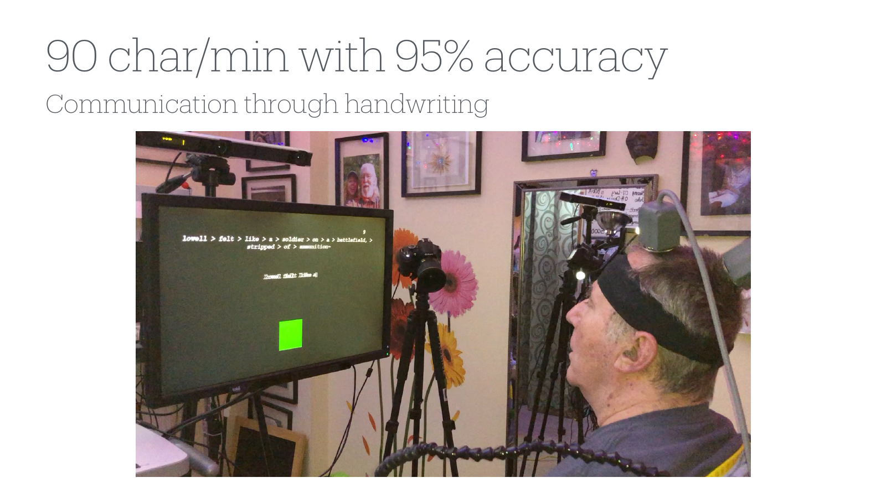

来源：Lecture 13，PDF P28；相邻P27引用Willett等人2021年的工作。课件本页未充分说明95%是哪个具体评价协议下的准确率，不擅自改写为WER。

P29把二维光标、脑到文本与自然语音恢复并列，提出进一步的问题：能否直接利用言语生成相关神经活动，而不先借助手写或光标选择？

## 2. 神经信号与群体解码

### 2.1 从脑电到单神经元

来源：P7–16。

P8从**脑内电活动（Electricity in the Brain）**引入测量。P9–10介绍**脑电图（Electroencephalogram, EEG）**，从脑外记录电活动；P11转向运动皮层中的单神经元记录，P12强调神经元通过**脉冲／动作电位（Spikes）**交流。

这些记录层级不同。EEG测量不能直接等同于植入式单神经元脉冲，也不能假定不同传感器拥有相同空间与时间信息。课件P16概括测量神经活动的方法，但图中的全部分类、尺寸和性能值无法从文本层确认，保留原图。

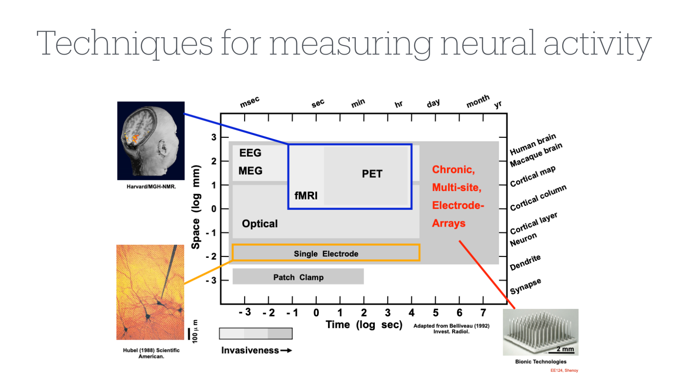

来源：Lecture 13，PDF P16。未可靠读取的技术标签、分辨率与侵入性排序不转录为精确表格。

### 2.2 单神经元方向编码与群体信息

来源：P13–15。

课件先展示**单神经元编码运动方向（Single Neurons Encode Movement Directions）**，再转向**多个神经元用于准确解码（Multiple Neurons for Accurate Decoding）**。关键逻辑是：个体神经元活动可能随运动变量变化，联合多个神经元的响应可提供更充分的观测。

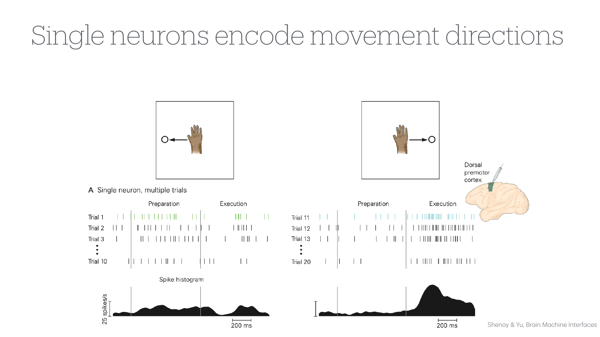

来源：Lecture 13，PDF P13，引用Shenoy与Yu的Brain Machine Interfaces材料。

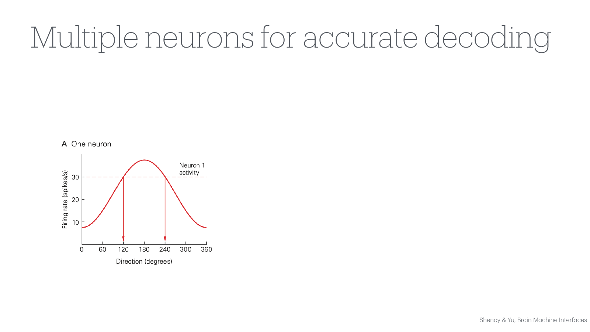

来源：Lecture 13，PDF P14；P15为同一主题续页。图中无法确认的方向角、放电率和具体解码公式不补造。

这一部分说明为何输入可以是每个时间窗内多个通道组成的特征向量，而不是一个神经元对应一个词。后面的序列模型还要利用时间上下文；传感器读数与语言标签之间没有天然逐时刻的一一对应。

P17–24主要为缺少可提取技术正文的历史／控制演示页，按用户授权不猜测演示动作、模型或性能。P24可确认引用Pandarinath、Nuyujukian等人的2017年eLife工作，但仅凭引用不恢复视频内容。

## 3. 为什么能从言语运动活动解码语言

### 3.1 语言处理与发音控制不是同一层次

来源：P30–33、P68。

P30展示**脑中的语言处理（Language Processing in the Brain）**，引用Fedorenko等人2024年材料；P31转向**如何产生语音（How Do We Produce Speech Sound）**；P32指出运动皮层包含**发音动作与音素信息（Articulatory and Phonemic Information）**。

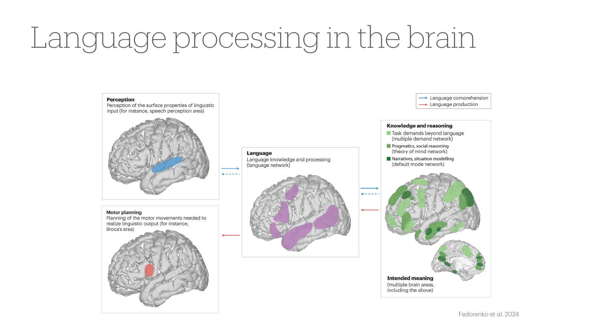

来源：Lecture 13，PDF P30；P68再次出现相同主题。脑区标签与图中连线未可靠识读，不擅自据此列出完整神经解剖通路。

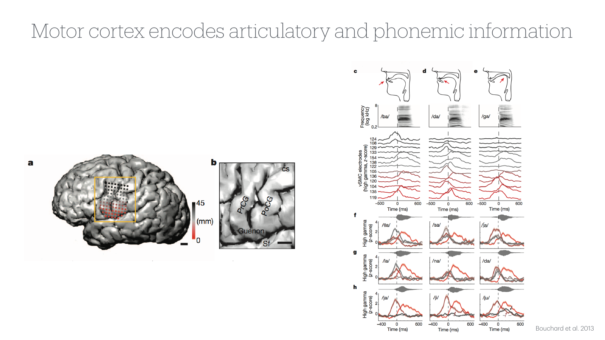

来源：Lecture 13，PDF P32，引用Bouchard等人2013年的工作。

**音素（Phoneme）**是用于区分语音的基本单位，不等于书写字母。语音BCI可先解码音素，再用词典和语言约束恢复词序列。该分工允许神经模型关注时间变化的发音相关信号，而语言模型处理词与句的先验。

P33介绍**皮层脑电（Electrocorticography, ECoG）**的小词表语音BCI，引用Moses等人2021年的工作。课件文本仅确认“小词表”和方法类别，未可靠读取的词表大小、错误率或传感器布局不猜。

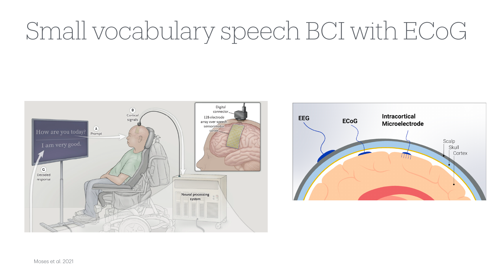

来源：Lecture 13，PDF P33。

### 3.2 高性能语音神经假体的采集设置

来源：P34–40。

**高性能语音神经假体（High-Performance Speech Neuroprosthesis）**案例来自Willett、Kunz、Fan等人2023年的工作。参与者T12患有**延髓起病ALS（Bulbar-onset ALS）**，仍保留有限口面运动和发声能力，但不能产生可理解的言语。

P35明确列出4个64通道的**Utah微电极阵列（Utah Microelectrode Arrays）**：

- 两个植入6v区，即腹侧运动皮层（Ventral Motor Cortex）。
- 两个植入44区，即Broca区的一部分（Part of Broca's Area）。

总通道数的硬件计数为$4\times64=256$；这不自动等于后续输入向量的维度$d$，因为特征提取可能改变维度，课件可读文本未给出其完整构造。

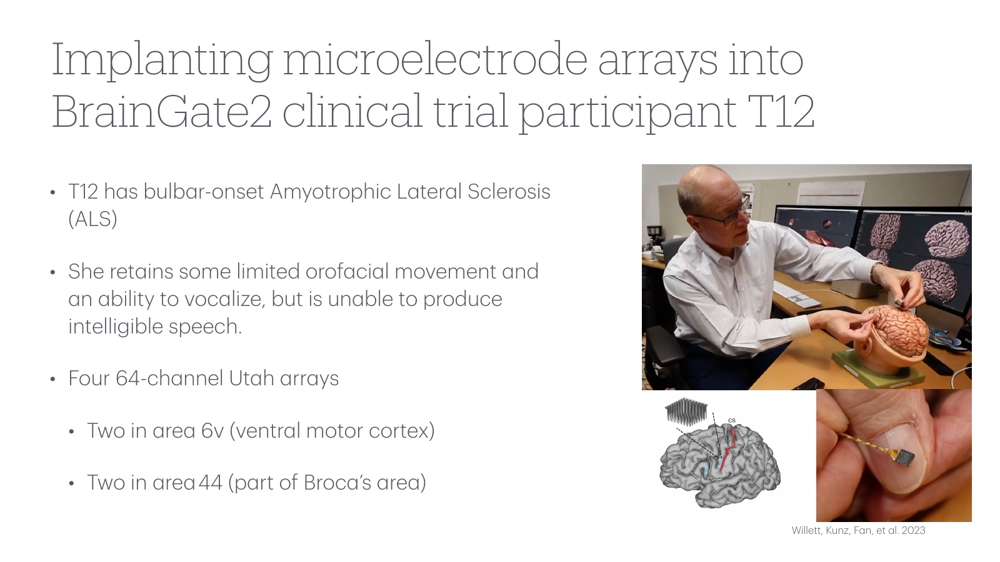

来源：Lecture 13，PDF P35。

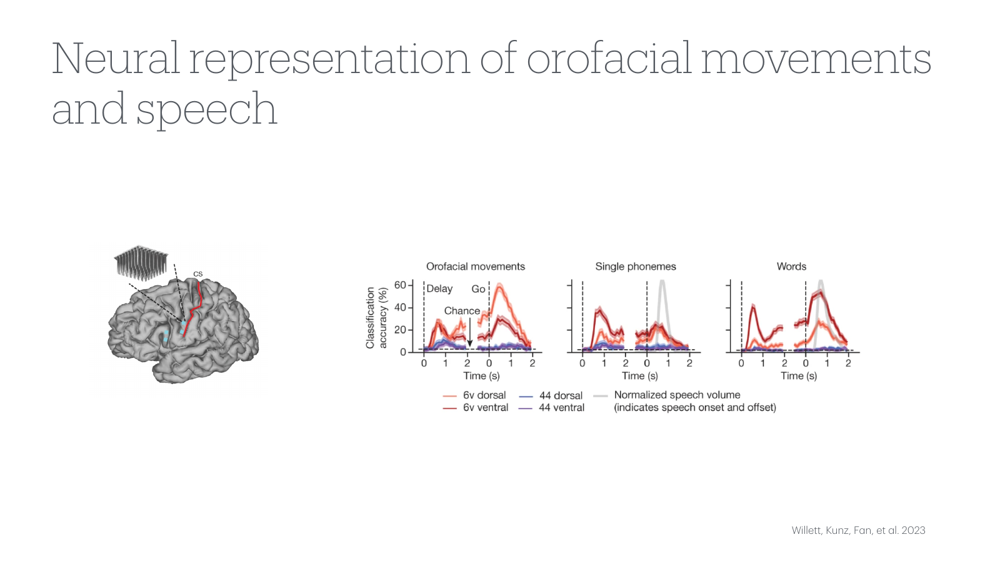

来源：Lecture 13，PDF P36。图中实验条件、神经元数值及统计结果未可靠读取，不补推断。

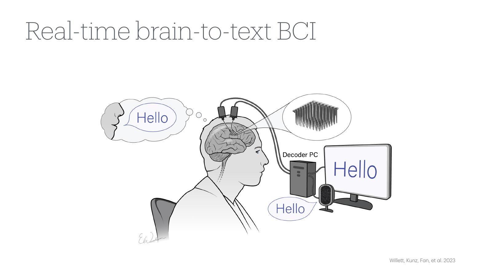

来源：Lecture 13，PDF P37。P38–40主要是临床系统演示，无法从文本层确认具体输出与性能，按用户要求跳过视频细节。

## 4. 数据与问题定义：时间序列到词序列

### 4.1 训练与评价句子

来源：P41–42。

课件展示分批采集句子、训练解码器，再执行评价的流程。P42可读取到若干“40 sentences”批次，以及100分钟和30分钟的时长标注。训练与评价句子随机选择自**Switchboard电话会话语料（Switchboard Corpus of Telephone Conversation）**。

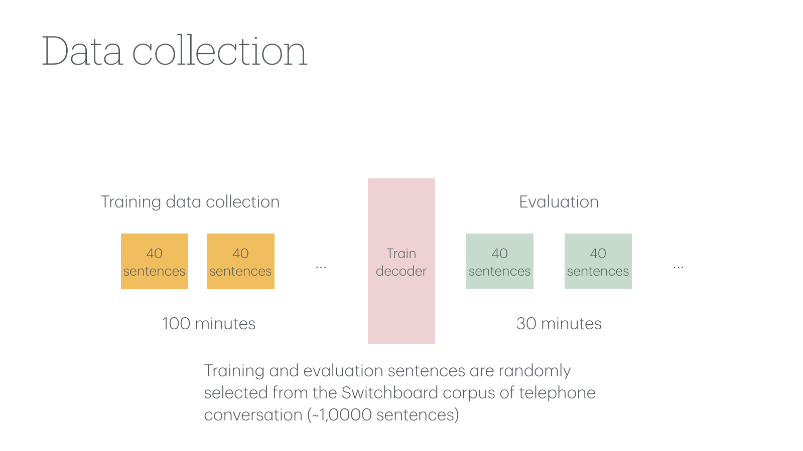

来源：Lecture 13，PDF P42。文本层的语料规模写作`~1,0000 sentences`，数字有排版歧义；不擅自将其当成1万或10万，也不在无法目视确认时把时长强配给全部阶段。

数据采集不是普通文本预训练：监督配对需要神经活动序列与目标句子，但神经时间点对应哪个音素通常没有逐帧标签。这引出后面的潜在对齐问题。

### 4.2 两阶段分解

来源：P43–45。

输入神经特征为

$$
X=(x_1,x_2,\ldots,x_T),\qquad x_t\in\mathbb R^d,
$$

输出词序列为

$$
Y=(y_1,y_2,\ldots,y_M),\qquad y_i\in\mathcal V.
$$

课件用大小为词表维度的向量记法表示词输出；这里直接用词表中的离散标签，避免把词编号误写为任意实数向量。

中间引入音素序列$Z$：

$$
\text{神经特征 }X
\ \longrightarrow\ \text{音素序列 }Z
\ \longrightarrow\ \text{词序列 }Y.
$$

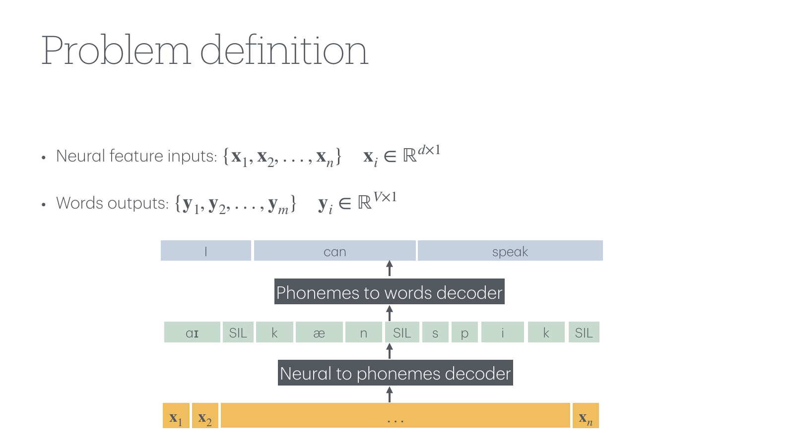

来源：Lecture 13，PDF P44；P43先给输入输出及`I can speak`示例。

第一阶段是**神经到音素解码器（Neural-to-Phonemes Decoder）**；第二阶段是**音素到词解码器（Phonemes-to-Words Decoder）**。`SIL`表示静音标签，供音素序列表示使用；后面的CTC blank是对齐机制中的特殊符号，不能无条件把两者混同。

### 4.3 只需要单调对齐

普通编码器—解码器可允许输入与输出任意关系，适合重排序任务。神经到音素解码仍是**序列到序列（Sequence-to-Sequence）**问题，但目标发音随时间推进，主要需要**单调对齐（Monotonic Alignment）**，而不是把后面的音素移到前面。

困难在于一个音素可能持续多个时间窗，音素之间可能有停顿，输入长度$T$与音素长度$U$不同。若只有整句标签而没有逐帧起止标注，就不能直接把第$t$个神经输入与第$t$个音素做普通独立分类。

## 5. CTC：把未知时间对齐纳入训练

### 5.1 每个时间步分类，输出经折叠变成标签串

来源：P46–48。

**连接时序分类（Connectionist Temporal Classification, CTC）**对单调序列问题引入潜在帧级路径。网络在每个输出时间步给出音素集合$\mathcal P$及一个特殊**空白符（Blank）**的概率：

$$
p_t(c\mid X),\qquad c\in\mathcal P\cup\{\varnothing\}.
$$

网络可以是RNN或Transformer，末端Softmax产生逐时间步分类分布；CTC规定这些帧级输出怎样对应较短标签串。

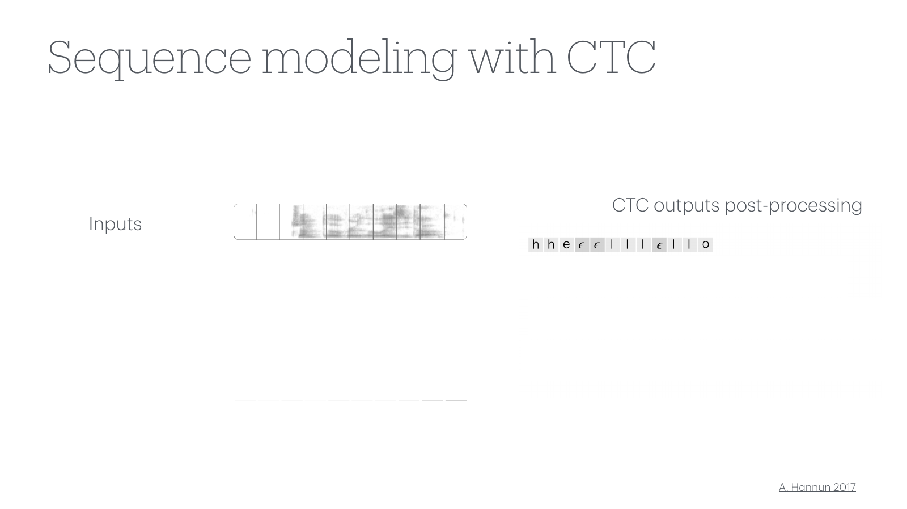

来源：Lecture 13，PDF P47，引用A. Hannun 2017年的CTC材料。

定义**折叠映射（Collapse Mapping）**$\mathcal B$：先合并相邻重复标签，再删除blank。例如用`_`表示blank：

- `h h _ e _ l l _ l _ o o`先合并为`h _ e _ l _ l _ o`，再去blank，得到`hello`。
- `h e l l o`中的相邻两个`l`会合并，得到`helo`，不能表示目标中两个独立的`l`。
- `h e l _ l o`可得到`hello`：blank把两个相同标签隔开。

因此blank不只是“静音”的英文名称，它还承担分隔重复标签和吸收未发出新标签时间步的作用。若标签集另外含`SIL`，它仍是普通可输出标签，是否保留／如何解释由系统定义。

### 5.2 一条目标序列对应许多对齐路径

令目标音素串$Z=(z_1,\ldots,z_U)$，帧级路径$\pi=(\pi_1,\ldots,\pi_{T'})$包含音素或blank。CTC在给定神经网络输出的条件下，用逐时间步概率乘积给路径计分：

$$
p(\pi\mid X)=\prod_{t=1}^{T'}p_t(\pi_t\mid X).
$$

这里$T'$表示网络输出的时间长度，不强行假定所有网络都与原始输入$T$等长。条件独立假设针对输出路径的概率分解，并不表示RNN／Transformer编码器完全不看其他时间信息。

CTC对所有折叠为同一目标的合法路径求和：

$$
p_{\mathrm{CTC}}(Z\mid X)
=\sum_{\pi:\,\mathcal B(\pi)=Z}\prod_{t=1}^{T'}p_t(\pi_t\mid X),
\qquad
\mathcal L_{\mathrm{CTC}}=-\log p_{\mathrm{CTC}}(Z\mid X).
$$

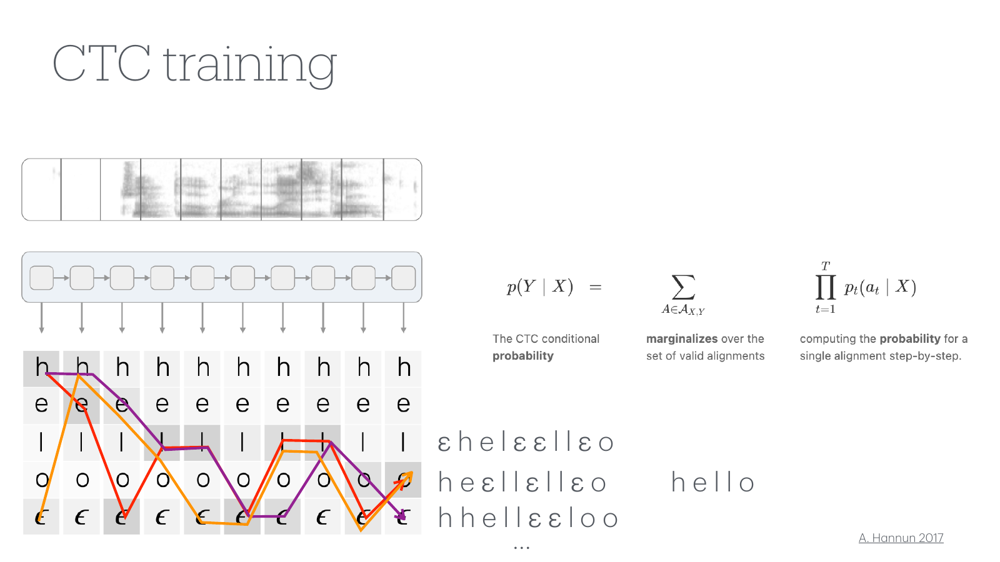

来源：Lecture 13，PDF P48。课件使用`hello`及若干重复／空白对齐示例；上面的公式是该训练机制的规范表达，不声称原图全部路径已逐字读取。

训练监督不要求先手工挑出唯一正确的音素时间边界。模型通过总概率得到信号，让所有与目标一致的对齐共同贡献；它不是先对每帧取最大标签、折叠后再计算普通文本损失。课件未展开完整动态规划递推，本章不额外推导其状态机。

## 6. 神经到音素网络：为什么使用递归结构

来源：P49–52。

P50对比：Transformer适合大数据及长程依赖，RNN适合较小数据、较短程依赖，并利于高效实时处理。这是本讲对实验需求的取舍，不是数学上的排他限制：RNN也能利用较长上下文，Transformer是否流式还取决于其结构和掩码。

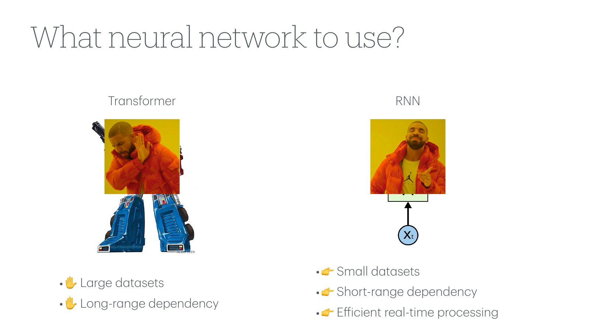

来源：Lecture 13，PDF P50。

P51回顾LSTM，P52介绍**门控循环单元（Gated Recurrent Unit, GRU）**；完整LSTM机制见第6章。这里的关键是递归隐藏状态随神经时间窗更新，输出音素概率，再交给CTC，而不是把每一帧当作完全无上下文的样本。

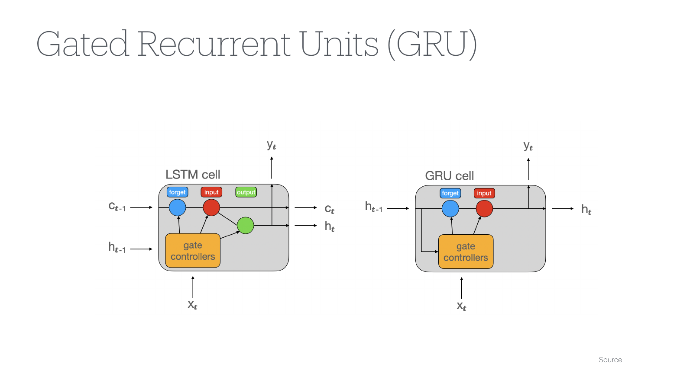

来源：Lecture 13，PDF P52。该页除标题及来源链接外无可提取正文，图中门的具体公式与符号未可靠读取，不从其他教材补写一套并声称来自此页。后续P53、P57明确将GRU放入实时解码流程。

## 7. 推理：CTC搜索与语言模型

### 7.1 最大概率路径不一定对应最大概率序列

来源：P53–55。

课件目标为

$$
Z^*=\arg\max_Z p_{\mathrm{CTC}}(Z\mid X).
$$

若每个时间步直接取最大概率标签再折叠，相当于先找最优路径，而CTC序列概率需要将多条路径相加：

$$
\mathcal B\!\left(\arg\max_\pi p(\pi\mid X)\right)
\quad\text{不一定等于}\quad
\arg\max_Z\sum_{\pi:\mathcal B(\pi)=Z}p(\pi\mid X).
$$

**束搜索（Beam Search）**保留若干候选前缀，逐步扩展和筛选，近似寻找高概率输出。不同路径折叠成相同前缀时，不能仅把它们当作互不相关的新句子；CTC还需要区别末尾blank与非blank造成的重复标签行为。

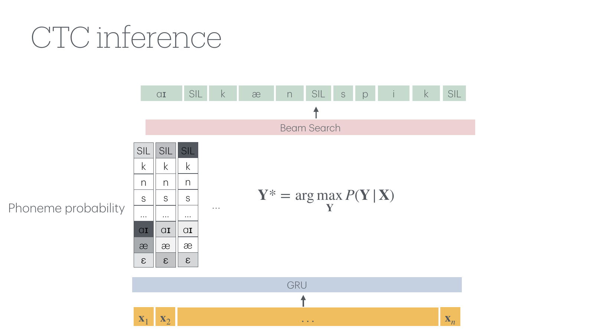

来源：Lecture 13，PDF P53。

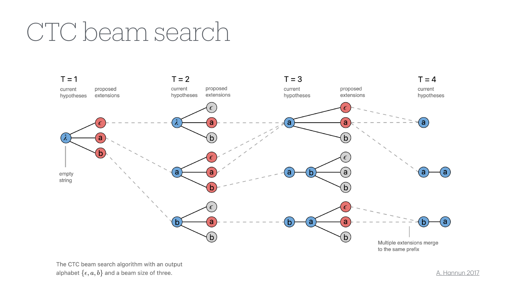

来源：Lecture 13，PDF P55；P54是同主题续页。原图的各步候选与概率未可靠读取，不补数值轨迹。本章解释搜索的必要性，不扩写课件未给出的完整前缀束搜索实现。

### 7.2 用语言模型约束音素到词的恢复

来源：P56。

神经信号有噪声，局部音素概率也可能对应多个词。课件在神经解码概率之外加入**语言模型（Language Model, LM）**的句子概率以及**词插入奖励（Word Insertion Bonus）**。用统一符号写成

$$
Y^*=\arg\max_Y\left[
\log p_{\mathrm{neural}}(Y\mid X)
+\alpha\log p_{\mathrm{LM}}(Y)
+\beta |Y|
\right].
$$

这表示课件乘法打分在对数域的一般形式：第一项概括通过音素与词映射得到的神经证据，第二项加入词序列先验，第三项调节插词／长度倾向。$\alpha,\beta$用于明确两项的权重；原页未给其数值，不声称训练中用了某一配置。若按原页$L(Y)$的一般乘法奖励表述，最后一项也可保留为$\log L(Y)$，不能不加条件地认为它只有一种实现。

语言模型按链式法则计算

$$
p_{\mathrm{LM}}(Y)=\prod_{i=1}^{M}p_{\mathrm{LM}}(y_i\mid y_{<i}).
$$

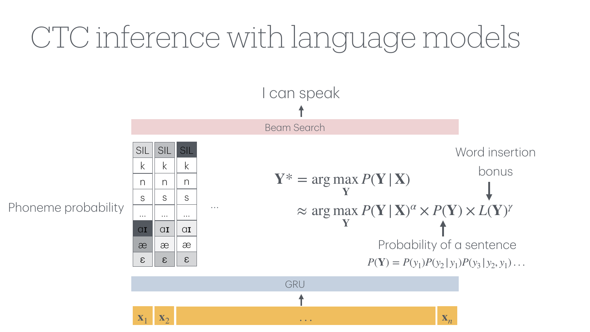

来源：Lecture 13，PDF P56。式中的神经证据与语言先验有不同职责：后者使更合理的词串得分更高，但不能保证它与参与者实际想说的内容相同。

插入奖励用于调整解码长度倾向，不应把它直接叫作某一固定WER组成项；它是搜索打分中的调节项，WER是生成结果后的评价。

### 7.3 第一遍：小时间窗、n-gram与流式束搜索

来源：P57。

**实时解码（Real-time Decoding）**在每个20ms时间窗读入新神经特征，GRU更新状态和音素分布，束搜索结合**n-gram语言模型（n-gram LM）**扩展候选，保留前$k$个假设供下一时间窗继续。

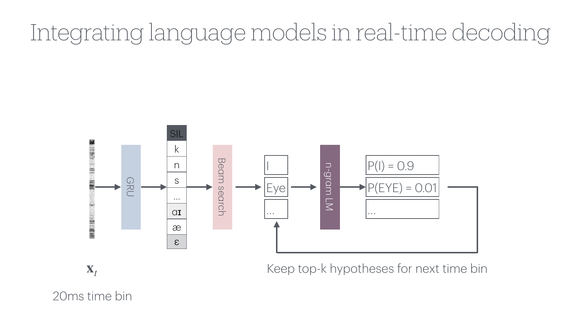

来源：Lecture 13，PDF P57。图中以`I`与`Eye`等候选展示语言先验影响，不能把其示意概率当成实际临床测量。

20ms是这里的输入／更新时间窗，不自动等于端到端延迟20ms；系统还需要采集、特征处理、模型计算、搜索和输出。每步保留多个候选，是为避免过早把含噪证据固定成唯一词序列。

### 7.4 第二遍：Transformer语言模型重评分

来源：P58。

第一遍保留的**n个最佳假设（n-best Hypotheses）**交给Transformer LM进行**第二遍重评分（Second-pass Rescoring）**。课件用`I can speak`与`I can spoke`说明不同句子在更强语言模型下的相对合理性。

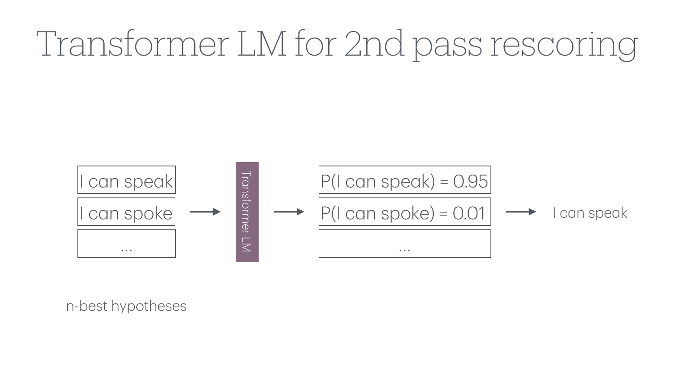

来源：Lecture 13，PDF P58。图中0.95与0.01用于解释候选打分，不是该系统总体正确率。

重评分只在候选集合内选择或重新排序，不能凭空恢复第一遍完全漏掉的正确句子。若早期搜索已剪去正确假设，第二遍语言模型再强也受候选覆盖限制。语言流畅性提升也必须与保留原意一起评价，避免把罕见但真实表达改成常见却错误表达。

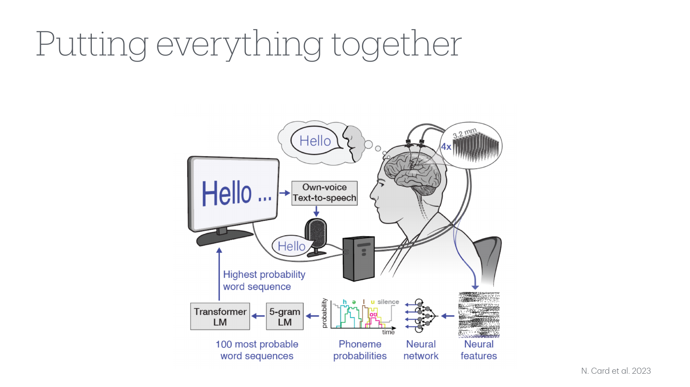

来源：Lecture 13，PDF P59，引用N. Card等人2023年的材料。图中不可提取的实现细节不转录；可读主线为神经信号、音素解码、语言模型搜索和文字输出。

## 8. 评价：词错误率

来源：P60。

**词错误率（Word Error Rate, WER）**是预测与参考词序列之间的归一化编辑距离。设参考有$N$个词，最小编辑对齐中替换、删除、插入数量分别为$S,D,I$：

$$
\operatorname{WER}(\widehat Y,Y)
=\frac{\operatorname{EditDistance}(\widehat Y,Y)}{|Y|}
=\frac{S+D+I}{N}.
$$

- **替换（Substitution）**：把参考词识别成其他词。
- **删除（Deletion）**：漏掉参考中的词。
- **插入（Insertion）**：额外生成参考没有的词。

分母是参考长度，不是预测长度，也不是字符数。插入很多时WER可超过100%，因此不能一概把$1-\mathrm{WER}$称作一般分类准确率。比较结果还应固定分词、大小写及标点等规范化规则，否则同一输出可能得到不同编辑计数。

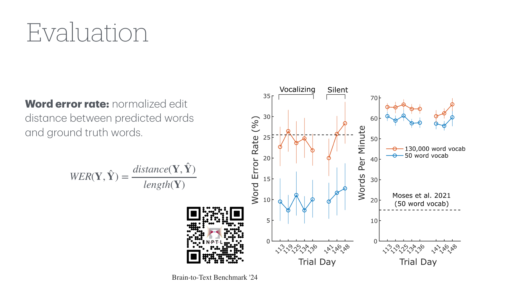

来源：Lecture 13，PDF P60，页面提及Brain-to-Text Benchmark '24。图中具体成绩未可靠读取，正文不从论文常见数字补入该系统速度或WER，未声称本次跑过基准。

WER回答“输出词串与目标相差多少”，不是完整临床效益评价，也不能单独说明是否实时、是否能长期稳定使用。这里仅解释课件实际采用的文本指标，不额外建立医疗评估体系。

## 9. 后续方向与神经伦理

### 9.1 多模态与个人使用

来源：P62–66。

课件提出**多模态语音BCI（Multimodal Speech BCI）**与**用于个人使用的准确语音BCI（An Accurate Speech BCI for Personal Use）**。P63引用Metzger等人2023年的工作，P65引用Card等人2024年的工作。

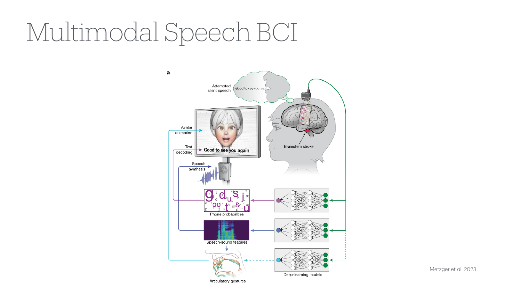

来源：Lecture 13，PDF P63。图中具体输出模态、架构与数值未可靠读取，不凭标题推演完整系统。

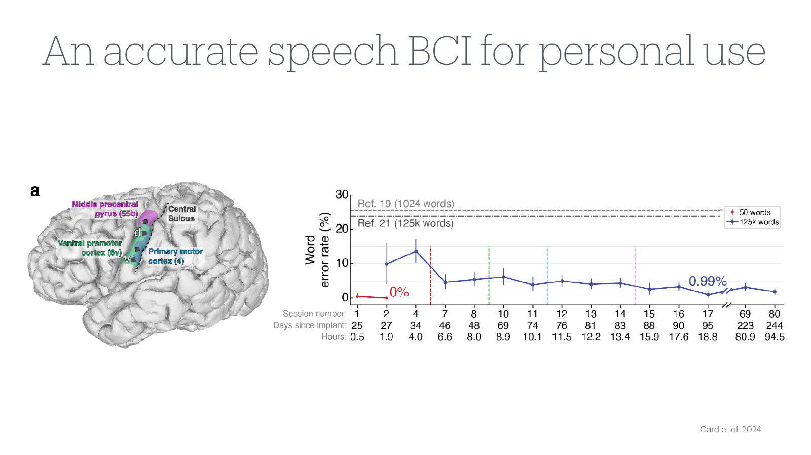

来源：Lecture 13，PDF P65。P64、P66为无可提取正文的演示／图像页，按用户要求跳过无法识读内容。

### 9.2 内言语仍须区分条件与证据

来源：P67–68。

**内言语（Inner Speech）**方向尝试减少外显发音动作，使交流更自然。P67标题为通过解码内言语恢复轻松自然交流，图中出现尝试、默动、发声、想象、聆听等相关条件以及T12与6v标记，但横轴文字交错，不能可靠一一对应数值。

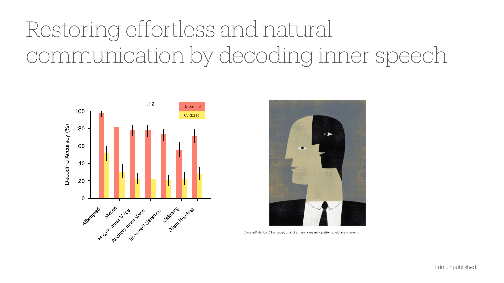

来源：Lecture 13，PDF P67，原页标`Erin, unpublished`。未发表结果仅按课件状态记录，不提取不可确认的准确率，也不将部分实验条件下的解码扩张为“能任意读取所有思想”。

### 9.3 恢复功能、隐私与增强的边界

来源：P69–71。

**神经伦理（Neuroethics）**问题包括：

- 是否允许读取本来不会说出口的内言语？
- 是否允许读取可能因阿尔茨海默病而丧失的记忆？
- 是否允许读取潜意识恐惧来辅助脱敏心理治疗？
- 是否允许把运动或认知能力增强到自然水平之上，例如机械臂超过原生手臂的速度与准确性，或通过外部技术直接获得记忆？

课件将这些作为需要讨论的问题，而非声称相关能力已经实现。即使长远设想仍不确定，帮助严重神经损伤者恢复交流具有现实需求；推进时需与伦理学者、监管机构、患者倡议团体合作，而不是只按离线准确率判断是否应部署。

P72的技术结论是：AI／NLP、神经科学与神经工程共同推动自然交流恢复，并可能帮助理解脑如何处理语言。课件对未来系统的预期属于当时展望，不当作当前已经普及的临床事实。参与者感言、社交信息及致谢不转录为知识笔记。

本地没有本讲对应的独立作业。与此前课程的联系是第5–6章的RNN／LSTM与序列建模、第7章的束搜索，以及第9–10章的语言模型先验；CTC解决的是单调时间对齐，不应被写成Attention重排序的另一种名称。本次未运行脑信号数据、模型训练或临床实验。
