> 来源：Shikhar Murty的`lecture14-agents-shikhar-updated.pdf`，75页。以2024年课件为准，整理推理提示、推理蒸馏／自训练、反事实评价，以及语言模型智能体、BAGEL和多模态界面。图表中的未识读数值不补造；25张技术图保留在对应段落，不做OCR。公式是对课件已描述流程的规范化表达，不引入额外算法。

## 1. 推理究竟指什么

来源：P4–9。

课件定义：**“Using facts and logic to arrive at an answer.”（使用事实和逻辑得出答案。）**

| 类型 | 中英术语 | 推进方向 | 课件例子 |
| --- | --- | --- | --- |
| 演绎 | Deductive Reasoning | 从前提及逻辑规则到必然结论 | 所有哺乳动物有肾；鲸是哺乳动物；所以鲸有肾 |
| 归纳 | Inductive Reasoning | 从观察预测可能结论 | 有翅膀的生物通常是鸟；看到有翅膀的生物；推测它可能是鸟 |
| 溯因 | Abductive Reasoning | 从现象寻找可能解释 | 汽车不能启动且发动机下有液体；推测散热器泄漏 |

演绎的确定性取决于前提成立且推导有效；归纳和溯因给的是可能性，不把“最可能解释”当作唯一已证实事实。

**形式推理（Formal Reasoning）**依据形式逻辑规则与公理推导；**非形式推理（Informal Reasoning）**借助直觉、经验和常识。P8说明，本讲大部分“推理”指多步骤的非形式演绎推理，而不是完整形式证明系统。

语言模型擅长预测合理续文、满足输入约束和生成符合偏好的回答。但这些能力本身不能直接证明模型在所有问题上都进行系统推理。本讲先看改善行为的方法，再检查这些行为是否可靠、是否超出记忆。

## 2. 通过提示改善推理

### 2.1 CoT与零样本CoT

来源：P10–11。

**思维链提示（Chain-of-Thought Prompting, CoT）**给出问题、分步求解过程与答案的示范，让模型为新问题也生成中间步骤。**零样本思维链（Zero-shot CoT）**不提供完整任务示范，而用分步求解指令激发中间过程。基础概念见第10章§3。

两者在这里都属于推理时提示，不是对当前问题训练新权重。生成更多文字可为后续Token提供中间信息，但写出长解释不自动意味着每一步正确或解释忠实。

### 2.2 Self-consistency：在不同路径之间聚合答案

来源：P12–14。

**自一致性（Self-consistency）**用多条采样推理路径替代单条贪心路径。课件直觉：正确的不同推理过程更容易落到相同答案，而错误过程可能分散。

设输入为$x$，第$j$次生成推理文字$r^{(j)}$及答案$a^{(j)}$：

$$
(r^{(j)},a^{(j)})\sim p_\theta(r,a\mid x),\qquad j=1,\ldots,K.
$$

从答案频数选择

$$
\widehat a=\arg\max_a\sum_{j=1}^{K}\mathbf1\{a^{(j)}=a\}.
$$

比较的是最终答案是否一致，不要求不同推理路径逐字相同；等价答案需要按任务规范提取和归一化，否则格式差异会人为拆分票数。

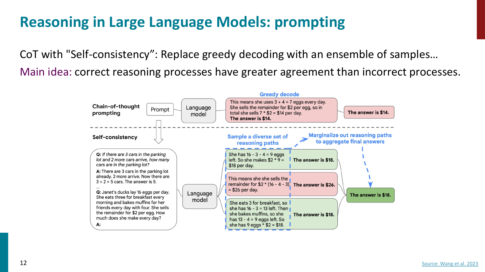

来源：Lecture 14，PDF P12，引用Wang等人2023年的材料。

P13报告它在多种基准上超过普通CoT，P14强调它不只是简单重复同一推理。路径多样性使不同分解方式有机会支持同一答案；但错误也可能高度相关，多数票不是正确性的证明。

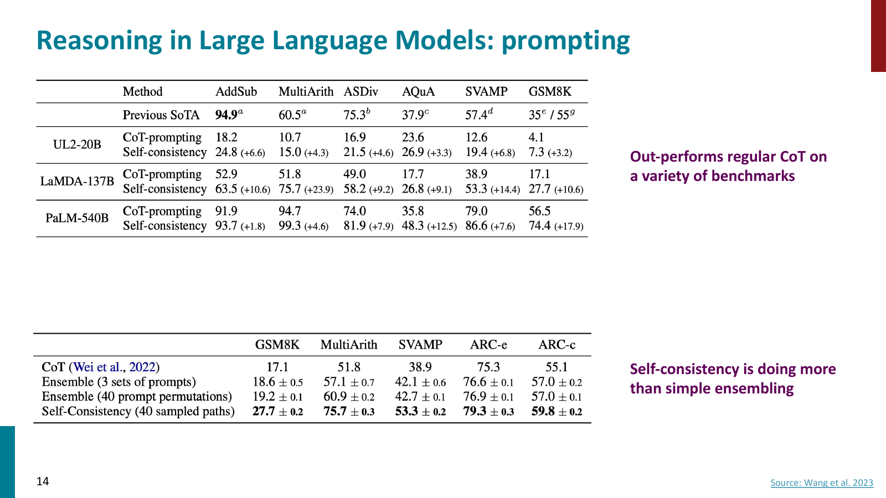

来源：Lecture 14，PDF P14。图中具体分数未可靠读取，不转录；不将图上方法比较解释成所有任务均严格提升。

计算上，$K$次采样增加推理预算；比较效果时应同时说明采样次数，而不是只比较一个输出分数。

### 2.3 Least-to-Most：先分解，再按依赖解决

来源：P15–19。

**由简到繁提示（Least-to-Most Prompting）**将复杂问题拆成较简单的子问题，再逐个求解，并把已解决的子问题及结果提供给后续步骤。

可写成两阶段：

$$
x\longrightarrow(q_1,\ldots,q_m),
\qquad
a_i\sim p_\theta(a_i\mid x,q_{\le i},a_{<i}).
$$

第一阶段负责**问题分解（Problem Decomposition）**；第二阶段按依赖递进求解。与一次性直接生成整条CoT相比，它把子问题及其答案的递进关系显式组织起来。

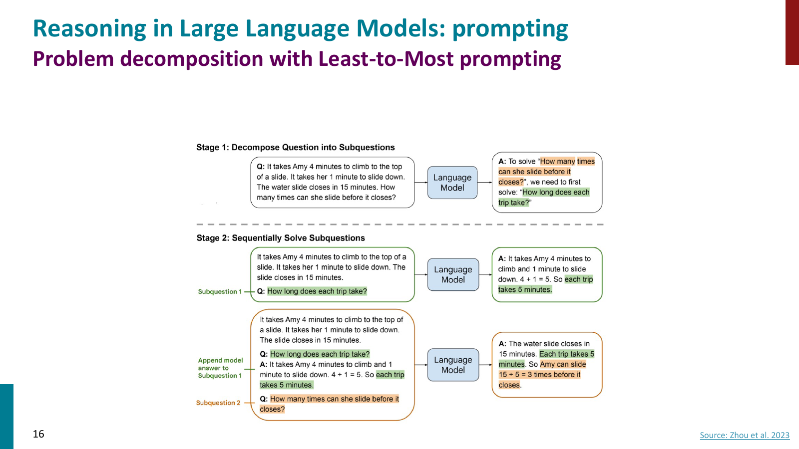

来源：Lecture 14，PDF P16，引用Zhou等人2023年的材料。

P17–18展示数学推理，报告可推广到比上下文示范更多步骤的问题。P19同时提醒，充分提示工程下CoT也可能达到相近效果；不能把某次提示模板差异都归因于方法具有绝对能力差距。

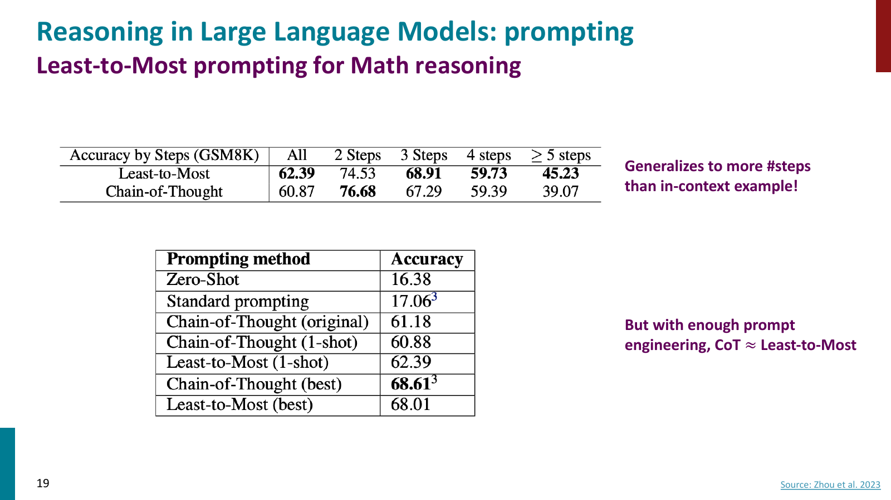

来源：Lecture 14，PDF P19。原文本层的CoT与Least-to-Most之间符号丢失，正文不擅自恢复成严格相等或大于关系，只保留“提示选择影响比较”的结论。

## 3. 不只提示：把推理行为教给模型

### 3.1 Orca：蒸馏大模型的解释过程

来源：P20–28。

**推理蒸馏（Reasoning Distillation）**尝试让较小模型模仿较大模型产生的解释与答案，而不只在推理时调用大模型。

课件的**Orca**流程：

1. 从FLAN-v2收集多样指令。
2. 用这些指令和系统消息提示GPT-4或ChatGPT，生成回答／推理解释。
3. 用ChatGPT与GPT-4生成的输出微调Llama-13B。

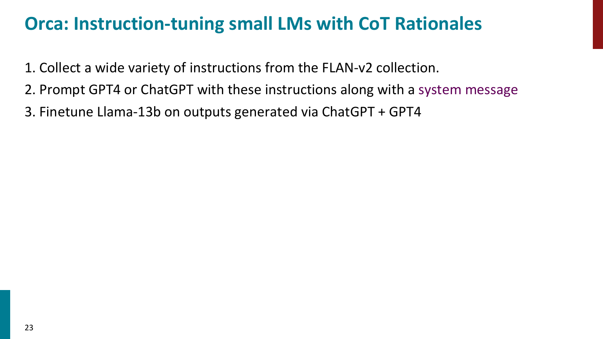

来源：Lecture 14，PDF P23，引用Mukherjee等人2023年的工作。图中系统消息细节未可靠读取，不编造其完整提示。

若教师输出为$r,a$，学生参数为$\phi$，其监督训练可概括为

$$
\mathcal L_{\mathrm{distill}}(\phi)
=-\sum_{(x,r,a)\in\mathcal D_{\mathrm{teacher}}}
\log p_\phi(r,a\mid x).
$$

它改变模型参数；与只把示例放在上下文的**上下文学习（In-context Learning）**不同。模仿教师文字能迁移解题行为，但也可能继承教师错误；解释详细不自动等于可靠。

### 3.2 BigBench-hard评价与污染限制

P24–27介绍**BigBench-hard, BBH**：从BIG-bench选出的23个任务，特别关注多步推理。课件例子包括布尔表达式（Boolean Expressions）、日期／数据理解页面（原页标题为`Data Understanding`）和几何形状（Geometric Shapes）。题面截图的完整条件未可靠读取，不重新构造题目答案。

P28报告Orca在所展示设置中超过Vicuna-13B与ChatGPT，同时提示GPT-4可能与BBH存在**数据污染（Data Contamination）**问题。不能将该页的局部基准结论扩张为所有任务上的模型总排名，也不能把“可能污染”写成已证实逐题泄漏。

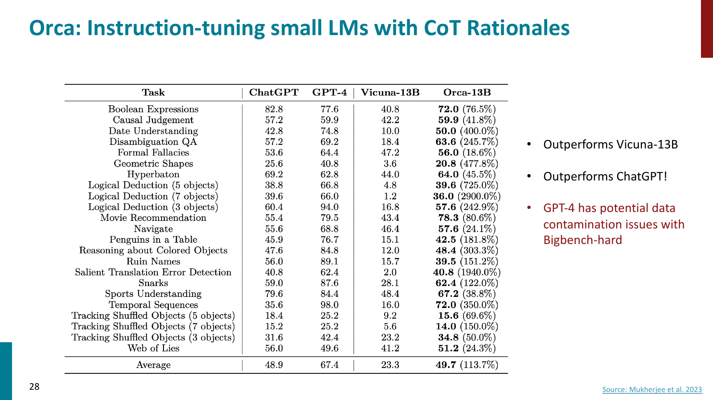

来源：Lecture 14，PDF P28。

### 3.3 ReSTEM：生成、筛选、再训练

来源：P29–30。

**ReSTEM**交替执行两个步骤：

- **生成步骤（Generate / E-Step）**：对推理问题采样多个解答，用任务相关函数筛选；数学题可用最终答案是否正确作为筛选标准。
- **改进步骤（Improve / M-Step）**：对筛选通过的解答进行监督微调，提高这些输出的概率。

设第$t$轮模型为$\theta_t$，检查函数为$v(x,r,a)$，保留集为

$$
\mathcal D_t^+=\{(x,r,a):(r,a)\sim p_{\theta_t}(\cdot\mid x),\ v(x,r,a)=1\}.
$$

然后优化

$$
\theta_{t+1}\approx\arg\max_\theta
\sum_{(x,r,a)\in\mathcal D_t^+}\log p_\theta(r,a\mid x).
$$

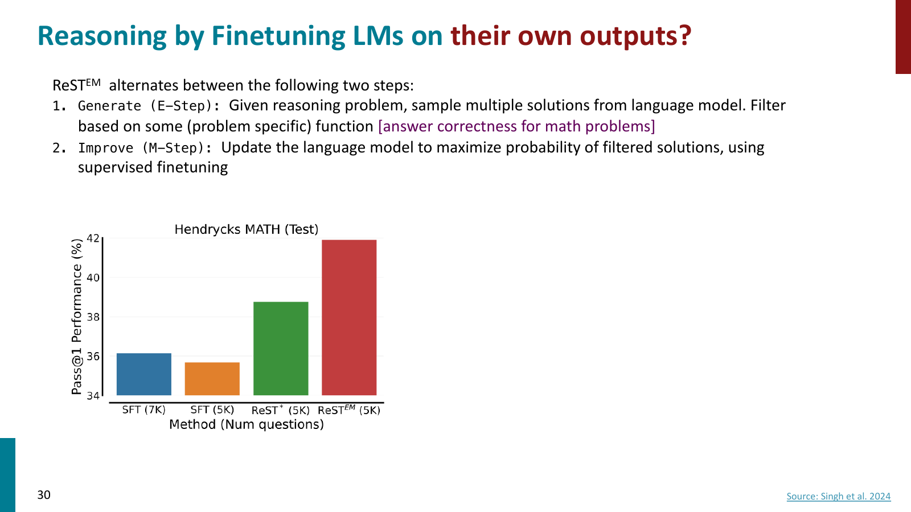

来源：Lecture 14，PDF P30，引用Singh等人2024年的工作。E/M是课件采用的流程命名，此处不把它扩写成未给出的精确潜变量EM推导。

与Orca的主要区别是数据来源：前者依靠外部较强教师，本方法使用模型自己的候选，再通过检查函数过滤。关键瓶颈转到**筛选器（Verifier / Filter）**：最终答案正确未必保证全部中间步骤正确；无法可靠验证的任务也不能无条件套用“正确答案过滤”。

## 4. 会写推理文字，是否就会系统推理

### 4.1 推理解释的忠实性

来源：P31–32。

**忠实性（Faithfulness）**关注解释是否反映真正影响答案的过程，而不只检查文字听起来是否合理。课件指出：有时不需要完整解释也能回答正确；有时错误解释仍可伴随正确答案。

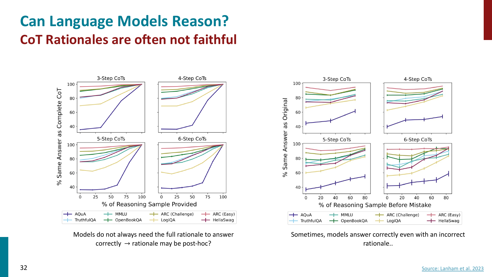

来源：Lecture 14，PDF P32，引用Lanham等人2023年的工作。图中具体干预与分数未可靠读取，不补实验细节。

这使**事后解释（Post-hoc Rationale）**成为一种可能：答案和解释的相关性不等于解释是答案的完整因果来源。但也不能反过来从某些不忠实例子推出所有模型的全部CoT都毫无作用。

### 4.2 用反事实区分规则应用与记忆

来源：P33–37。

**反事实评价（Counterfactual Evaluation）**修改问题中的常见规则、条件或映射，检查模型是否遵守本题的新条件，而不是只复用训练中熟悉的模式。评价时需保证修改后任务定义清楚，否则变化可能混入表述歧义。

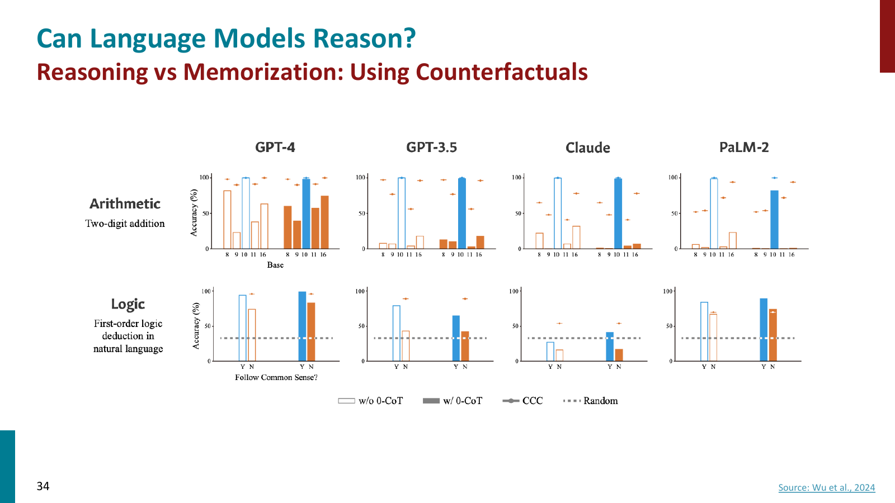

来源：Lecture 14，PDF P34，引用Wu等人2024年的工作。原图具体任务与规则无法可靠读取，不补一个外部常见案例代替。

P35–37进一步看**类比推理（Analogical Reasoning）**，课件报告某些反事实变体下GPT-4表现明显下降，而人类没有对应下降，提示模型可能利用伪线索而非稳定关系规则。它是该研究条件下的证据，不是对所有模型和所有推理任务的总证明。

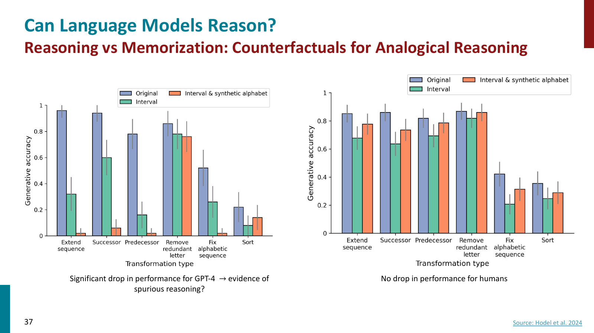

来源：Lecture 14，PDF P37，引用Hodel等人2024年的工作。

推理评价因此至少要分开：最终答案、解释正确性、解释忠实性、对未见规则／更多步骤的泛化。一个维度的提升不能自动代替其他维度。

## 5. 智能体：让语言模型通过动作改变环境

### 5.1 环境、动作、观察、指令

来源：P39–45。

**智能体（Agent）**接收**观察（Observation）**，选择**动作（Action）**，环境执行动作后产生新观察。**语言条件策略（Language-conditioned Policy）**还接收自然语言目标$g$，如“预订旧金山到纽约的航班”。课件也称其为指令遵循智能体（Instruction-following Agent）或数字智能体（Digital Agent）。

令历史为

$$
h_t=(g,o_1,a_1,o_2,a_2,\ldots,o_t),
\qquad a_t\sim\pi_\theta(\cdot\mid h_t).
$$

环境根据当前状况及动作变化，给出$o_{t+1}$。观察未必是完整真实状态，所以只依赖当前画面与利用历史可能产生不同决策；这里不展开课件未推导的完整部分可观测决策过程。

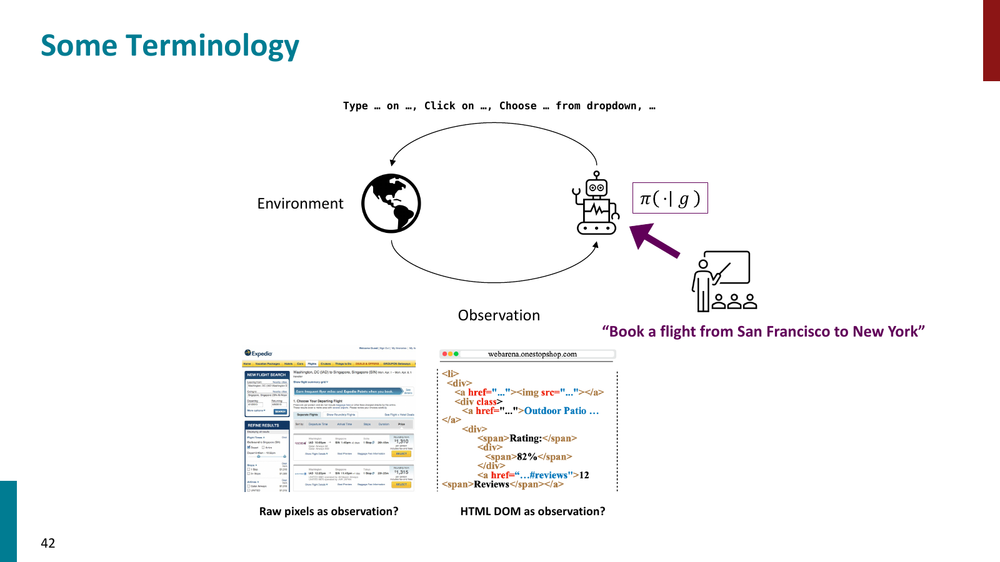

来源：Lecture 14，PDF P42。

网页动作可包括在指定位置输入、点击、从下拉框选择。观察可用**原始像素（Raw Pixels）**或**HTML DOM**。选择观察／动作接口直接影响可见信息和操作难度，不只是模型大小的问题。

P43–45列出虚拟助手、自然语言编程、UI自动化和多步工具使用。例如设置闹钟、排序列表、复制文件、导出CSV；这些是课件应用例子，不是本次实际执行的操作。

### 5.2 LLM以前的三条路线

来源：P46–48。

| 路线 | 课件核心思路 |
| --- | --- |
| 指令到动作序列 | 类似机器翻译，直接从语言预测动作序列；简单且有明确落地语义的环境如Text-to-SQL、知识图谱查询较合适 |
| 结构化可执行计划 | 从“指令—轨迹”对推断计划，再训练语言到计划的模型 |
| 强化学习 | 用交互与奖励学习指令到动作的映射 |

这些方法的差别在于是否显式形成计划、如何获得监督及反馈，而不只是模型换了名称。

### 5.3 用因果Transformer建模轨迹

来源：P49–51。

课件将现代方法概括为**生成式轨迹建模（Generative Trajectory Modeling）**：把观察与动作组织成序列，用因果Transformer预测后续内容。动作预测对应**智能体策略（Agent Policy）**，环境后续变化对应**转移动态（Transition Dynamics）**。

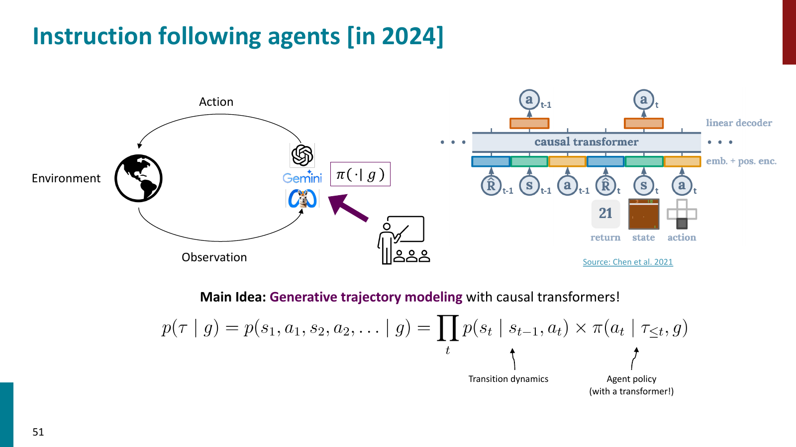

来源：Lecture 14，PDF P51，引用Chen等人2021年的材料。

概念上可将轨迹分成

$$
p(\tau\mid g)
=p(o_1\mid g)\prod_t\pi_\theta(a_t\mid h_t)\,
p_{\mathrm{env}}(o_{t+1}\mid h_t,a_t).
$$

这个分解用于分清动作选择与环境响应，不表示每一个LLM智能体都必须学习环境模型；实际网页循环通常执行动作，再读取真实环境反馈，不能把预测出来的页面当成已经发生的事实。

## 6. ReAct：思考、行动、观察的循环

来源：P52。

**ReAct（Reasoning and Acting）**在提示中提供动作空间、当前目标、历史观察／动作及当前状态，让模型生成`Thought`与`Action`。执行动作，更新环境，再将新观察放回上下文。

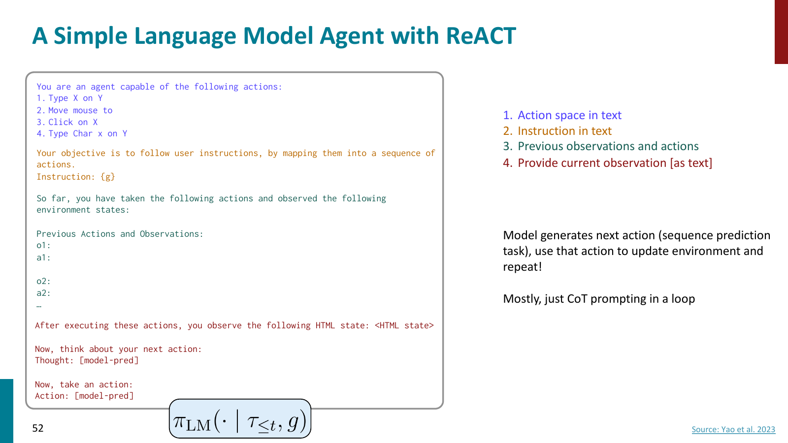

来源：Lecture 14，PDF P52，引用Yao等人2023年的工作。

课件的基本循环：

1. 用文字说明可用动作及参数格式。
2. 给出用户指令$g$。
3. 放入此前观察与动作，以及当前HTML状态。
4. 生成下一步思考和可执行动作。
5. 在环境中执行，读取真实新观察，继续下一步。

它可被概括为“CoT prompting in a loop”，但与单次纯文本CoT的区别在于真实环境反馈会改变后续决策。文字写“点击成功”不等于实际成功，需以动作执行后的观察判断。

动作还必须能被接口解析并落到具体对象。思考文字本身不是浏览器命令，也不能替代参数是否合法、目标元素是否存在的检查。

## 7. 智能体基准测量什么

来源：P53–55。

| 基准 | 环境／数据 | 交互特点 | 评价与限制 |
| --- | --- | --- | --- |
| MiniWoB++ | 沙箱中的基础浏览器任务 | 社交、邮件等简化交互；相对短程 | 评价功能正确性；功能有限，非完整真实世界；零样本仍不完美 |
| WebArena | 电商、社交等真实站点的沙箱近似 | 多标签页，地图、计算器、草稿纸、Wikipedia等工具，长程任务 | 评价任务实际功能正确性，需完成完整目标 |
| WebLINX | 真实网站上的交互轨迹集合 | 对话式，新增向人询问信息的`say`动作，多标签页 | 按回合评价；它是交互数据集，不是可直接执行任意新动作的环境 |

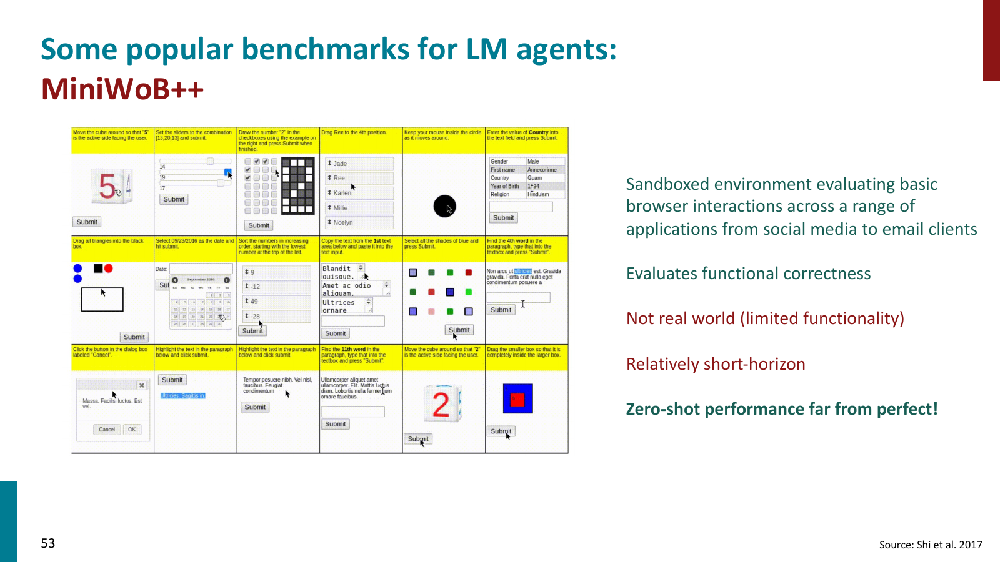

来源：Lecture 14，PDF P53。

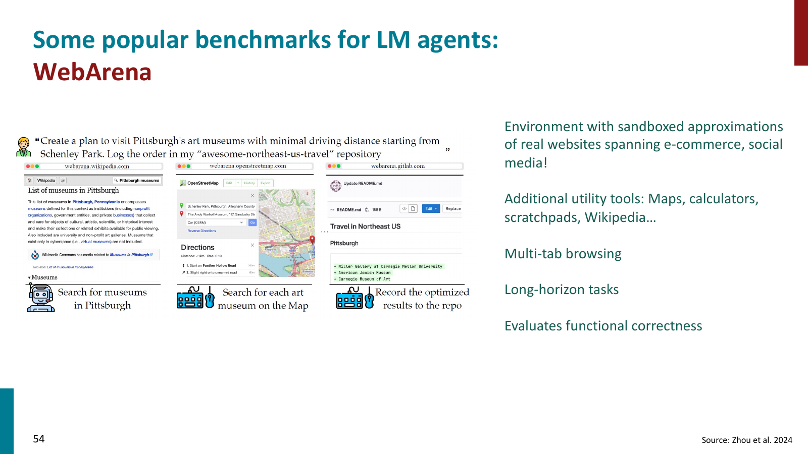

来源：Lecture 14，PDF P54。

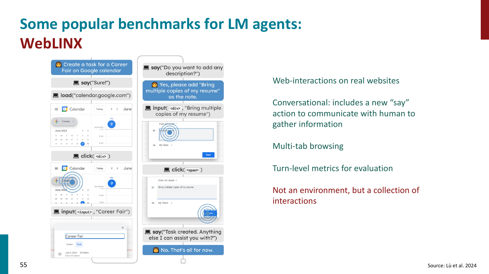

来源：Lecture 14，PDF P55。

**功能正确性（Functional Correctness）**问环境是否达到目标，而不只问生成的动作文字是否像参考。反之，离线回合指标便于比较每一步，却不能自动代表自由运行的整段任务成功率。不同基准的数字不应混在一起当成同一成功率。

## 8. BAGEL：用探索与语言重标注构造示范

### 8.1 为什么少样本人工示范不够

来源：P56–60。

常见做法是在上下文中放入人类完成相似任务的少量示范。网站和动作组合很多，这种做法难以扩展，也不稳定。课件提出：能否让智能体自主探索环境，构造高质量合成示范？

先让模型在网站上尝试指定格式的动作，得到**轨迹（Trajectory）**，包括动作及对应HTML状态；再让模型描述这段交互实际完成了什么。语言成为“轨迹是否有意义”的标签，例如把一串操作概括为“设置某日期”或“设置起点和终点”。

自动生成的目标标签必须以轨迹实际变化为依据，不应只把原本想完成的目标复制上去。

### 8.2 生成轨迹、验证、重新命名目标

来源：P61–65。

课件同时展示两个方向：

- **指令→轨迹**：根据指令逐步生成思考与动作。
- **轨迹→指令**：根据动作和观察描述它实际完成的目标。

还用模型判断轨迹是否满足指令。如果没有完成较大目标，轨迹可能完成了较小目标；通过重标注仍可成为有用的示范。

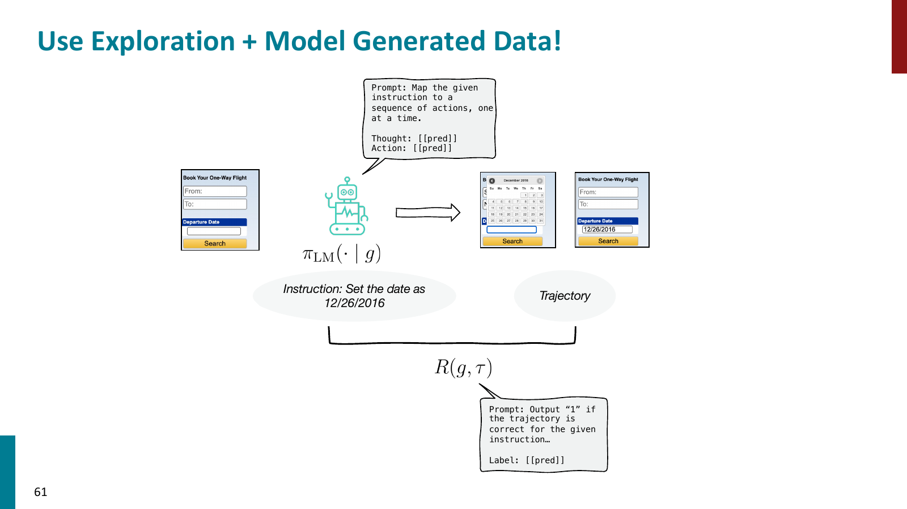

来源：Lecture 14，PDF P61。示例目标是设置日期，图中提示用`1`标记轨迹是否正确。

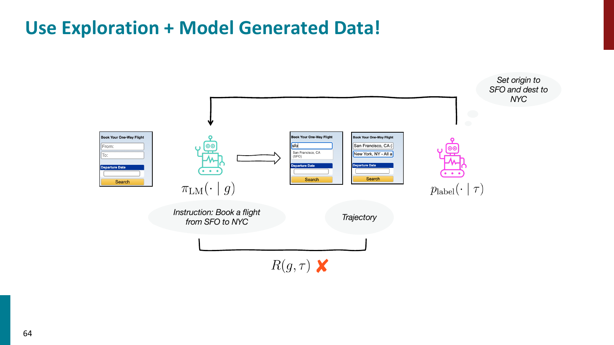

来源：Lecture 14，PDF P64；P63–64示例将“预订SFO到NYC航班”的轨迹描述为“设置出发地SFO与目的地NYC”。这是保留实际完成的子目标，不是把子目标宣称为整项任务成功。

P65给出方法名：**BAGEL（Bootstrapping Agents by Guiding Exploration with Language）**。语言既用于指定探索目标，也用于从行为中重新提炼目标。

### 8.3 完整流程与使用示范

来源：P66–67。

1. **探索环境（Explore）**：收集行动和观察轨迹。
2. **迭代重标注（Iterative Relabeling）**：用语言概括、修正轨迹的目标，形成合成“指令—动作”示范。
3. **推理时检索（Retrieval at Inference Time）**：为新指令寻找相关示范，放到上下文中指导行动。课件也说明可以微调，但并不要求所有结果都来自微调。

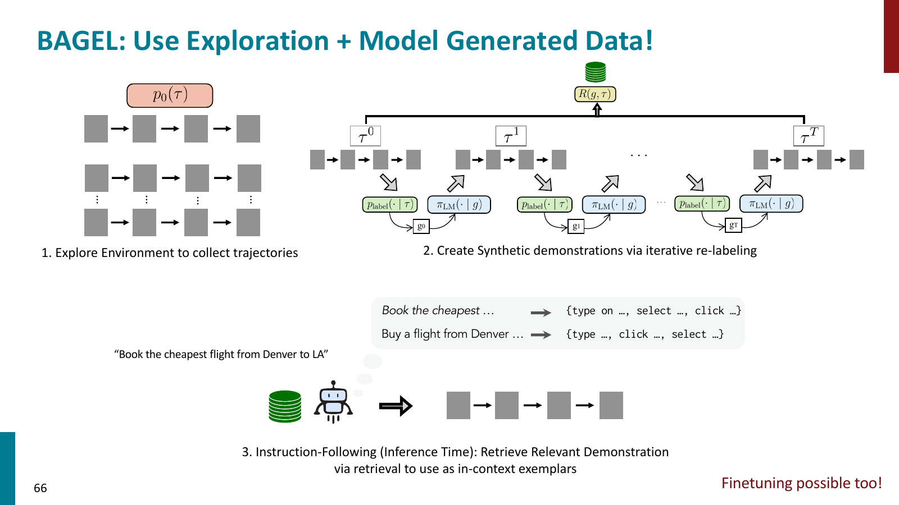

来源：Lecture 14，PDF P66。

课件报告使用PaLM-2、没有人工监督时，MiniWoB++提高13个百分点，多步工具使用提高2.5%；后一项原文未充分区分相对百分比和百分点，保留其表述，不擅自统一成同一口径。

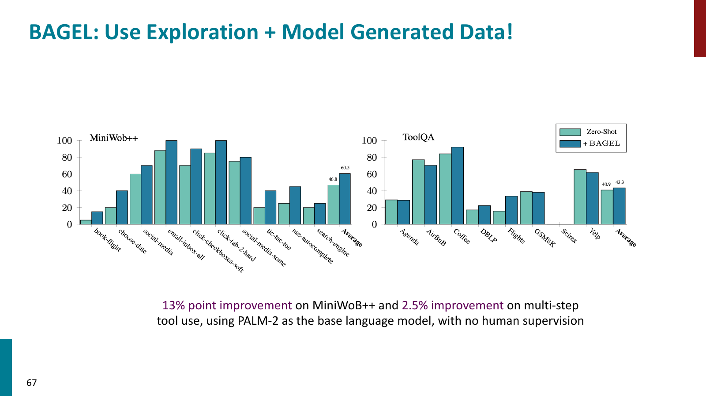

来源：Lecture 14，PDF P67。以上为课件历史报告，不是本次运行结果。

“无需人工监督”针对该探索／示范构造设置，不等于基础语言模型从未用人类数据训练。模型自产的目标、验证和行动也可能共享错误，不能把自我评价当成真实任务完成的绝对证明。

## 9. 多模态：从HTML转向像素观察

来源：P68–70。

课件指出真实UI的HTML可能非常长，纯文本观察难以处理，因而考虑直接使用像素。像素可保留布局与视觉内容，但模型仍需把视觉位置对应到可执行动作；从文字换成图像不会自动解决交互可靠性。

### 9.1 LLaVA

P69用**LLaVA**说明视觉—语言模型：根据图像的文字描述提示GPT-4生成指令与回答，再训练由CLIP视觉编码器和Vicuna-13B语言解码器组成的系统。

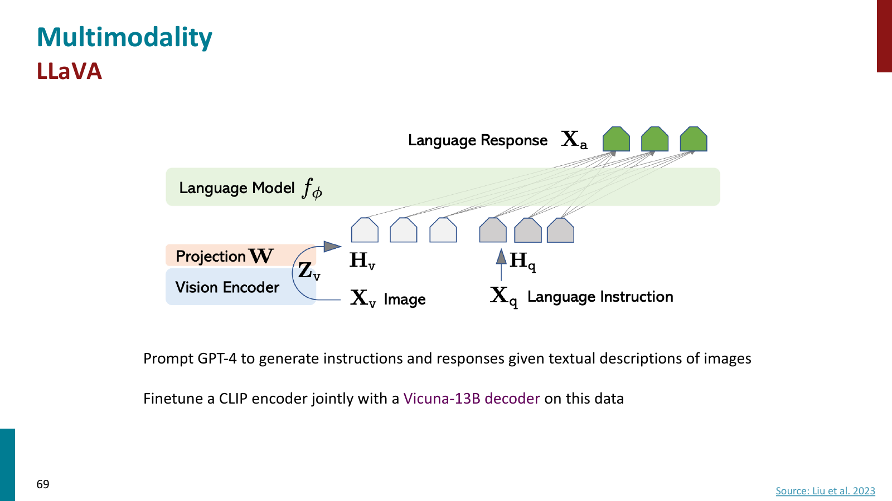

来源：Lecture 14，PDF P69，引用Liu等人2023年的工作。

本页把训练概括为联合微调。可读材料不足以逐阶段确认哪些模块冻结或更新，因此不从这句简写推断全部阶段都更新完整CLIP；这里只保留组件、合成视觉指令数据及对齐训练的主线。

### 9.2 Pix2Struct

P70介绍**Pix2Struct**：使用ViT编码器及Transformer解码器，在HTML截图解析任务上训练，把图像界面映射到结构化文本表示。

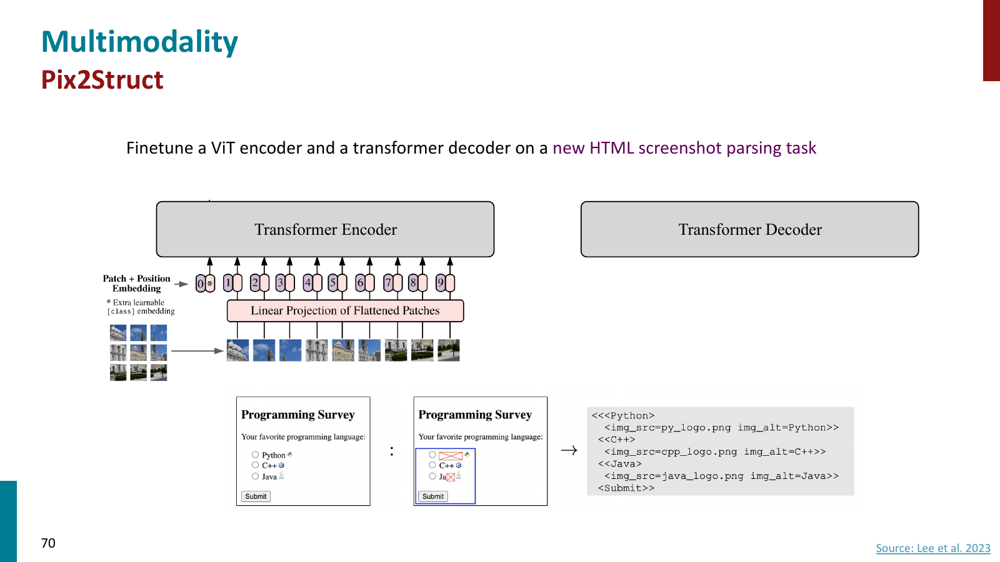

来源：Lecture 14，PDF P70，引用Lee等人2023年的工作。该预训练／微调任务为视觉界面理解提供表示，不等于模型仅凭此任务就自动获得完整的交互策略。

## 10. 当前局限：提示依赖与长程任务

来源：P71–75。

**提示差距（Prompting Gap）**：没有大量定制提示或专门少样本示范，即使较强模型在简单环境上也远非完美。结果可能同时依赖基础模型、示范检索、提示模板，以及观察和动作接口工程。

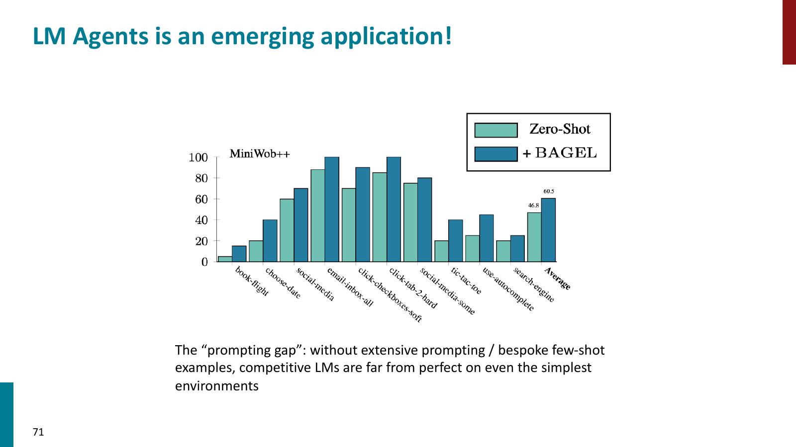

来源：Lecture 14，PDF P71。

**长程规划（Long-horizon Planning）**更难：需要更多步骤的任务表现明显下降。即使每一步大多正确，早期状态误判或动作失误也可能改变后续观察并累积，短任务成功率不能直接代表长任务表现。

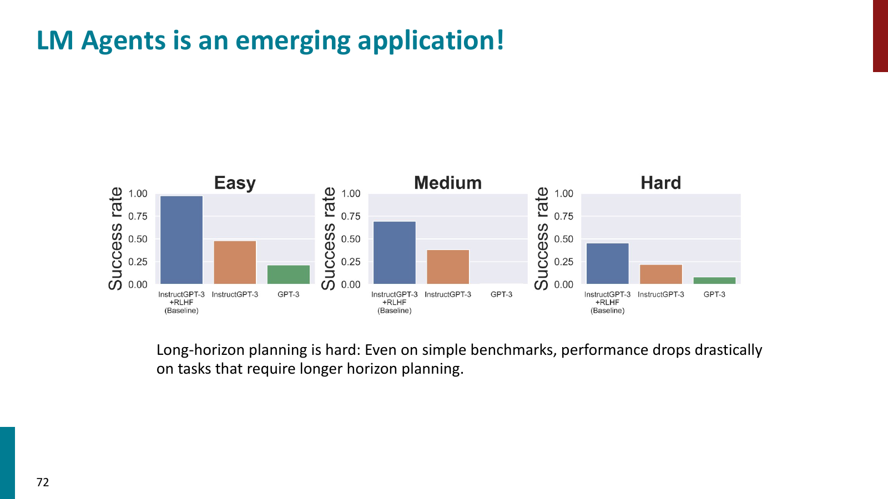

来源：Lecture 14，PDF P72。曲线中未可靠读取的数值不猜。

P73提到当时BrowserGym工作约25%的结果，并强调更多提示及观察／动作接口工程。页面可读文本没有足够说明这一百分比的完整任务集合和条件，所以不把它当作所有网页智能体的统一上限或当前最好成绩。

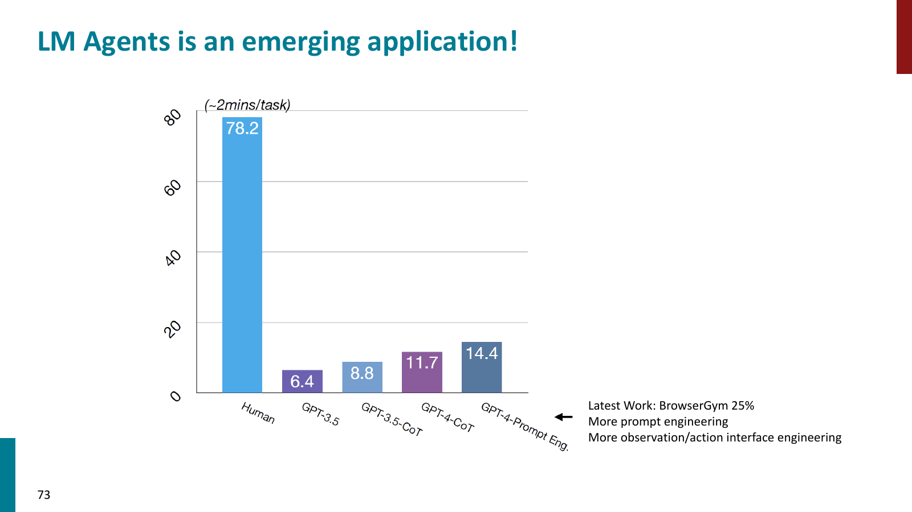

来源：Lecture 14，PDF P73。P74没有可提取技术正文，按用户要求跳过无法识读部分。

P75归纳的研究方向是：提示、教师推理蒸馏、自生成推理训练；反事实检验系统性；智能体的上下文示范、BAGEL、多模态，以及仍具挑战的交互基准。模型能输出动作格式或长解释，距离稳定完成复杂目标仍有差距。

本地无本讲对应的独立作业。相关基础来自第10章CoT与监督微调、第11章评价协议／污染，以及第7章搜索与错误分析；本章不新增外部智能体框架、工具安装或在线实验，也未执行任何网页任务。
