> 来源：Christopher Manning的`lecture16-CNN-TreeRNN.pdf`，60页。按一维卷积、句子分类、深层字符CNN、树递归组合与情感分析组织。22张知识图保留相应页码；P20–21存在重复文字叠加，P53–56公式主要在图像中，无法识读部分不做OCR、不猜测。卷积及池化可读数字已用Python标准库核算。本讲仅提及Tree-LSTM，不扩写其门控公式。

## 1. 从序列递归到局部窗口特征

来源：P6–8。

左到右RNN的隐藏状态依赖整个前缀；某段短语的表示通常同时包含它前面的语境。只用最后状态做句子分类，还可能偏重句末信息。课件用它引出CNN，不应将这些倾向理解为所有RNN变体都无法表示短语或进行分类。

**卷积神经网络（Convolutional Neural Network, CNN / ConvNet）**在不同位置应用同一个局部变换，对每个固定长度子序列提取特征，再聚合。窗口不必是语法成分，例如

`tentative deal reached to keep government open`

宽度3的连续窗口为：

- `tentative deal reached`
- `deal reached to`
- `reached to keep`
- `to keep government`
- `keep government open`

**权重共享（Weight Sharing）**使同一模式可在不同位置检测。卷积输出随位置变化；进一步做全局池化才去掉大量位置信息，因此“卷积本身的位置不变”只是简写，更准确地说它在位置间共享检测规则。

## 2. 文本一维卷积：形状、计算与边界

### 2.1 一个滤波器如何计算

来源：P8–9、P20。

令输入词向量为$x_i\in\mathbb R^d$，窗口宽度为$h$。拼接窗口

$$
z_i=[x_i;x_{i+1};\ldots;x_{i+h-1}]\in\mathbb R^{hd}.
$$

一个**滤波器／卷积核（Filter / Kernel）**的参数$w\in\mathbb R^{hd}$，在位置$i$产生

$$
c_i=f(w^Tz_i+b).
$$

等价地把$w$写成$h\times d$矩阵，对窗口与权重逐元素相乘再求和。这里的“1D”指沿序列轴滑动，滤波器同时覆盖输入的全部$d$个嵌入通道；不是只看一个标量词特征。

深度学习库通常实现不翻转卷积核的**互相关（Cross-correlation）**，但沿用卷积名称。本文使用与课件窗口计算及PyTorch一致的顺序。

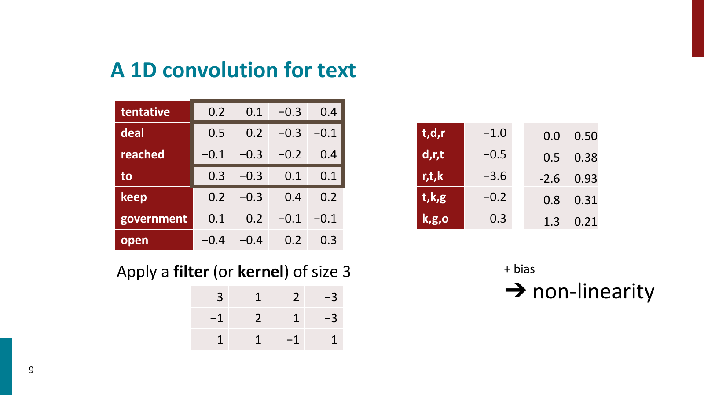

来源：Lecture 16，PDF P9。

可读例子中，输入嵌入维度$d=4$、宽度$h=3$，卷积核为

$$
W=\begin{bmatrix}3&1&2&-3\\-1&2&1&-3\\1&1&-1&1\end{bmatrix}.
$$

五个非填充窗口的原始点积依次为

$$
[-1.0,\,-0.5,\,-3.6,\,-0.2,\,0.3].
$$

图中下一列为加偏置$b=1$后的$[0,0.5,-2.6,0.8,1.3]$。末列数值与$\sigma(-a)$形式相符，但该页可读标签只写`non-linearity`，未充分确定函数及符号约定；正文不将它强行转录为标准$\sigma(a)$算例。后续池化表使用的是图中给定特征表，也不擅自说这些值已经经过ReLU。

### 2.2 输出长度、Padding、Stride、Dilation

来源：P10、P15、P18。

对输入长度$n$、两侧对称填充$p$、步幅$s$、膨胀率$\delta$，输出长度为

$$
L_{\mathrm{out}}=
\left\lfloor\frac{n+2p-\delta(h-1)-1}{s}\right\rfloor+1.
$$

这是对课件四项操作的统一维度表达。无填充、$s=\delta=1$时为$n-h+1$；$h=3,p=1$时保持长度；较宽填充允许边缘词出现在更多窗口中。

**填充（Padding）**在边界加入零向量。课件7词例子左右各填1个零向量后，第一个滤波器点积为

$$
[-0.6,-1.0,-0.5,-3.6,-0.2,0.3,-0.5].
$$

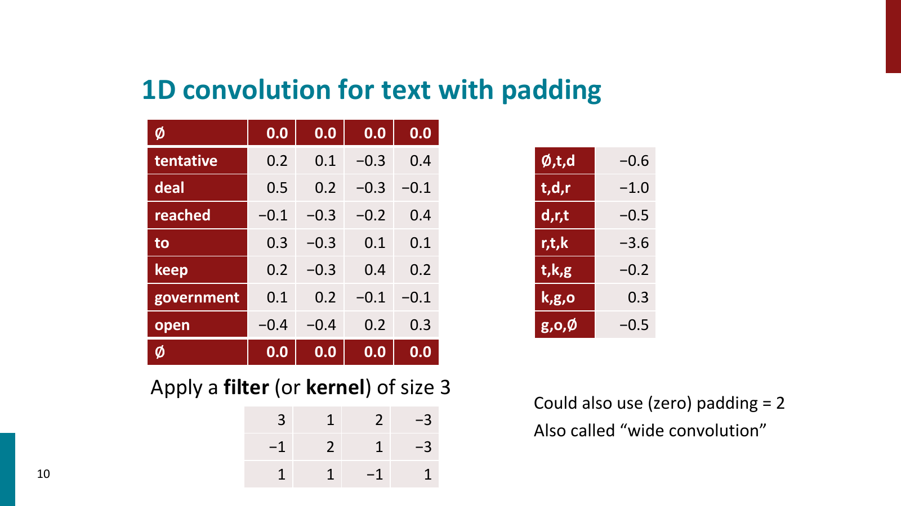

来源：Lecture 16，PDF P10。原页还提到$p=2$及`wide convolution`；对宽度3的核，$p=h-1=2$时输出$n+h-1$，不应把所有$p=1$的同长卷积也无条件称为该特定宽卷积。

**步幅（Stride）**是窗口起点每次移动的距离。$s=2$会跳过部分起点并下采样。对上述7行结果，从首行起每隔一行选择，得到第1、3、5、7行；它与先算相邻最大值的池化不是同一运算。

**膨胀（Dilation）**在核取样点之间留间隔；$h=3,\delta=2$时取位置$(i,i+2,i+4)$，有效覆盖宽度为

$$
h_{\mathrm{effective}}=1+\delta(h-1)=5.
$$

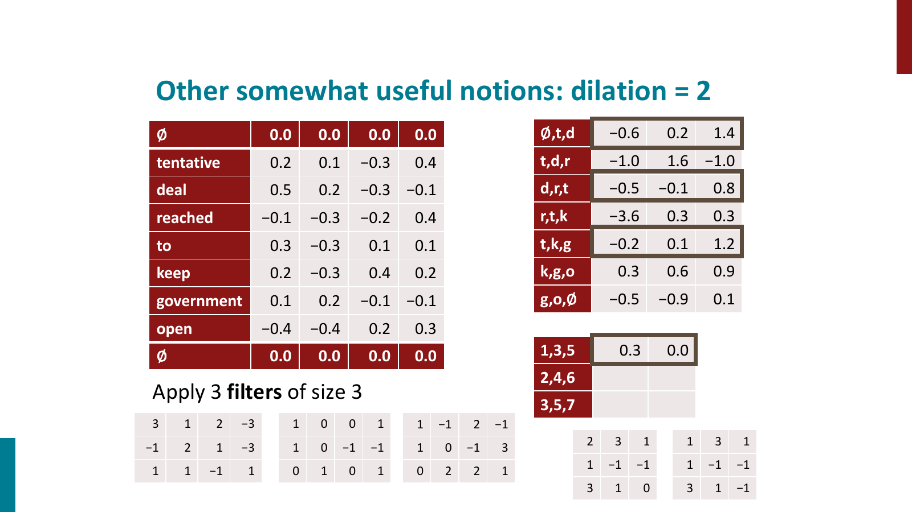

来源：Lecture 16，PDF P18。与Stride区别：Dilation改变窗口内部取哪些位置，Stride改变相邻窗口起点如何移动。图中未完整读取的其他卷积核结果不补造。

### 2.3 多滤波器与通道

来源：P11–14。

用$m$个滤波器得到$m$个**特征图／输出通道（Feature Maps / Output Channels）**，输出为长度$L$、通道数$m$的序列。每个滤波器可学习不同局部模式。

课件P11标题中的“3 channel”对应所展示的3个输出滤波器；实际输入嵌入有4维，在PyTorch中应是`in_channels=4,out_channels=3`，不能把输入通道也设成3。

PyTorch `Conv1d`采用形状

$$
X\in\mathbb R^{B\times d\times n},
\qquad W\in\mathbb R^{m\times d\times h},
\qquad C\in\mathbb R^{B\times m\times L}.
$$

P14例子：$B=16,d=4,n=7,m=3,h=3$，无填充输出为$(16,3,5)$；`padding=1`时为$(16,3,7)$。在时间轴`dim=2`取最大得到每例3个特征。`torch.max(tensor, dim=2)`返回值和索引，不是只返回一个张量，取特征应使用返回值中的`values`或第一个元素。

## 3. 池化：保留什么，丢掉什么

### 3.1 全局最大与平均池化

来源：P12–13。

**时间维最大池化（Max-over-time Pooling）**对每个通道独立取最大：

$$
\widehat c_j=\max_{1\le i\le L}C_{i,j}.
$$

它回答“该局部特征是否曾强烈出现”，把变长输入压成固定$m$维，同时丢掉峰值位置和出现次数的大量信息。

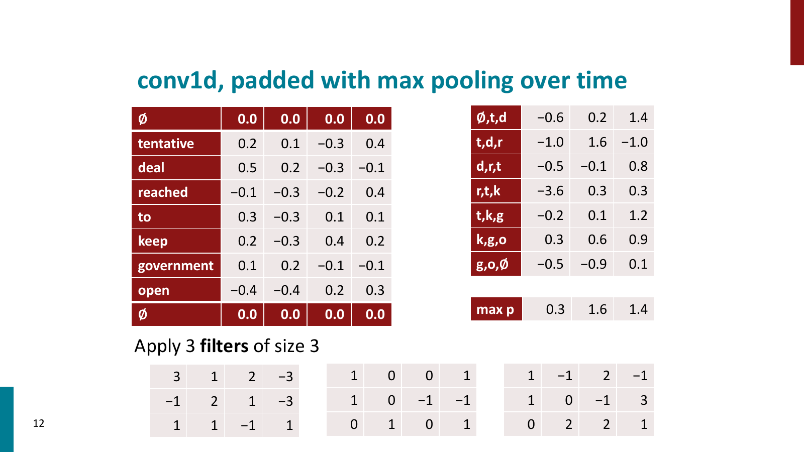

来源：Lecture 16，PDF P12。

课件三通道特征表的最大值为$[0.3,1.6,1.4]$。**平均池化（Average Pooling）**则对每个通道求时间均值：

$$
\overline c_j=\frac1L\sum_{i=1}^LC_{i,j},
$$

相同表得到约$[-0.8714,0.2571,0.5286]$，对应P13四舍五入后的$[-0.87,0.26,0.53]$。最大强调最强证据，平均更反映整体激活，但可能稀释局部强信号。

可变长度批处理时，应明确真实长度与填充是否进入池化；零值不一定比真实负激活更小。该问题与P16使用$-\infty$补最大池化边界的逻辑一致。

### 3.2 局部最大池化

来源：P16。

**局部最大池化（Local Max Pooling）**在短窗口内逐通道取最大，保留一个更短的序列，供后续卷积继续处理。课件用宽度2、步幅2，把7行压成4行，末尾缺位视为$-\infty$：

$$
\begin{bmatrix}
-0.6&1.6&1.4\\
-0.5&0.3&0.8\\
0.3&0.6&1.2\\
-0.5&-0.9&0.1
\end{bmatrix}.
$$

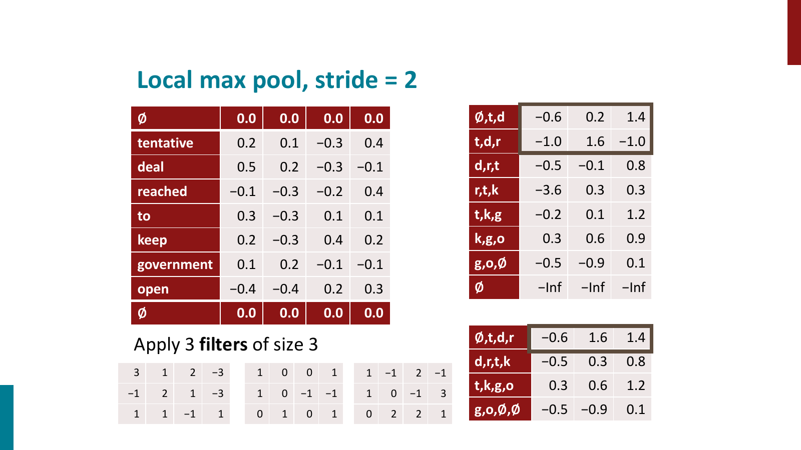

来源：Lecture 16，PDF P16。以上数字已核算。最后补$-\infty$不会改变已有最大值；若补0，最后一行负数会被错误改成0。

### 3.3 k-max池化

来源：P17。

**k最大值池化（k-max Pooling）**保留每个通道的$k$个强激活，而不是只保留一个。$k=2$时，课件按数值大小列出

$$
\begin{bmatrix}0.3&1.6&1.4\\-0.2&0.6&1.2\end{bmatrix}.
$$

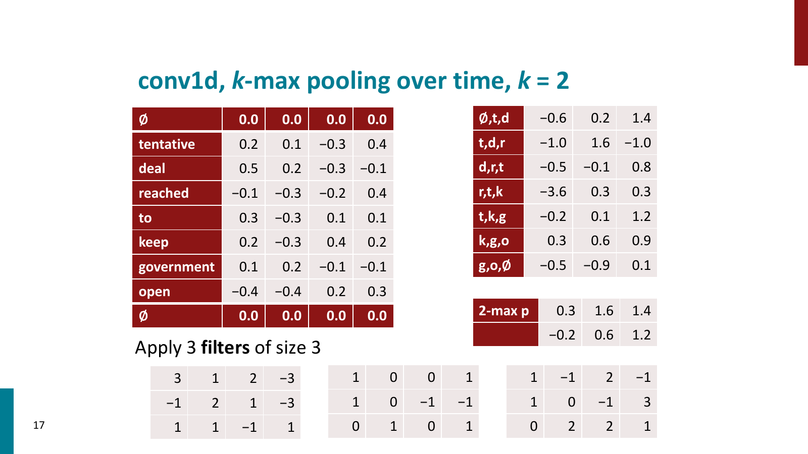

来源：Lecture 16，PDF P17。这里按原页降序表格记录；某些序列CNN的k-max实现会保留选中项在原序列中的相对顺序，不能仅凭同一名称假定两种输出排列完全一致。

## 4. Kim 2014：简单CNN句子分类

### 4.1 卷积—全局池化—分类器

来源：P19–21、P24。

任务包括句子正负情感、主观／客观分类、问题类型分类。基本流程：

1. 将句子表示为词向量序列。
2. 对多个窗口宽度使用多组滤波器。
3. 每个滤波器的特征图做Max-over-time Pooling。
4. 拼接各滤波器的最大值形成句子向量。
5. 加Dropout等正则化，用Softmax预测类别。

若窗口宽度为3、4、5，每种100个滤波器，则池化后拼接为300维向量；这是课件可读配置的参数计数，不要求卷积输出长度相同。

$$
v=[\widehat c^{(1)};\ldots;\widehat c^{(m)}],
\qquad p(y\mid x)=\operatorname{softmax}(W_cv+b_c).
$$

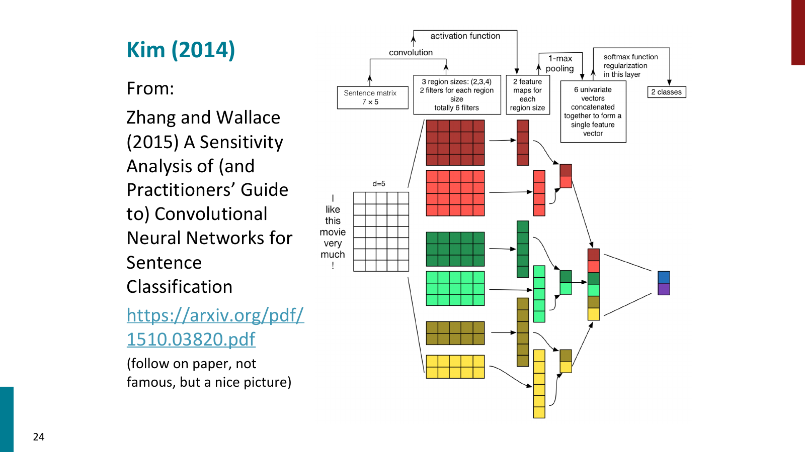

来源：Lecture 16，PDF P24，图来自Zhang与Wallace 2015年的解释材料。P20–21文字重叠严重，公式按可辨认卷积/池化说明统一，不逐字复制损坏层。

与早期逐词窗口分类不同，这里用多个滤波器在整句扫描并全局聚合，输出句子标签；不是给每个词独立预测一个标签。

### 4.2 微调词向量的覆盖问题与双通道

来源：P22–23。

训练电影情感分类时，`tedious`与`dull`出现，`plodding`只在测试出现。预训练向量原本相近；任务训练会移动出现过的词，未出现词仍留在旧位置。这可能破坏它们原有邻域关系，影响对测试词的迁移。

**双通道词向量（Multichannel Embeddings）**使用两份相同预训练初始化：一份**静态（Static）**冻结，另一份**非静态（Non-static）**接收梯度。卷积对两份输入的响应在池化前汇合，兼顾通用关系和任务适配。

“通道”在这里指两套输入嵌入来源，与某个卷积层有多少输出滤波器不是同一计数。冻结一份不代表整个CNN冻结，滤波器与分类器仍训练。

### 4.3 课件实验与公平比较

来源：P25–26。

| 模型 | MR | SST-1 | SST-2 | Subj | TREC | CR | MPQA |
| --- | ---: | ---: | ---: | ---: | ---: | ---: | ---: |
| CNN-rand | 76.1 | 45.0 | 82.7 | 89.6 | 91.2 | 79.8 | 83.4 |
| CNN-static | 81.0 | 45.5 | 86.8 | 93.0 | 92.8 | 84.7 | 89.6 |
| CNN-non-static | 81.5 | 48.0 | 87.2 | 93.4 | 93.6 | 84.3 | 89.5 |
| CNN-multichannel | 81.1 | 47.4 | 88.1 | 93.2 | 92.2 | 85.0 | 89.4 |

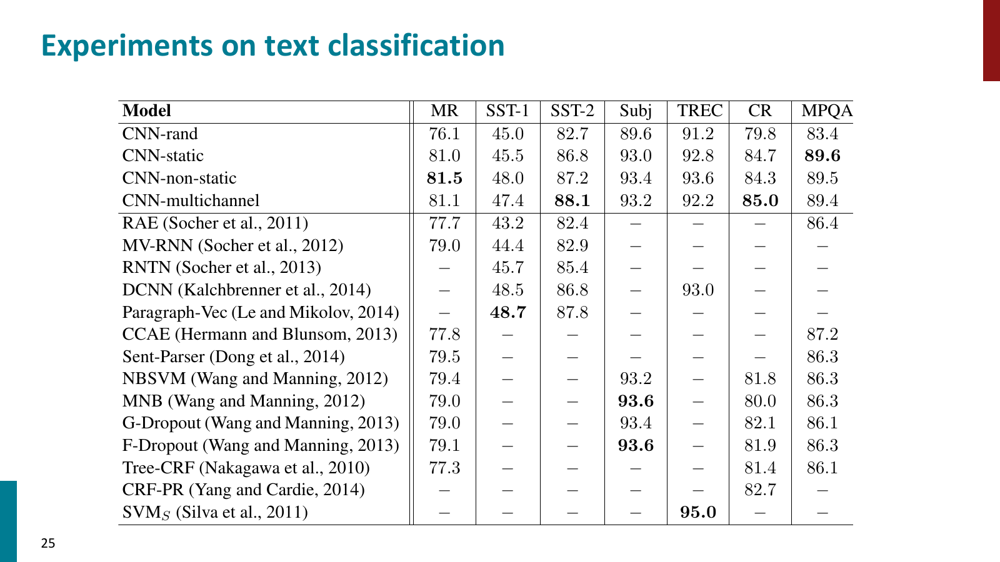

来源：Lecture 16，PDF P25。上表转录四种CNN行，其他模型原表保留于图，不扩写其未讲解方法。它展示预训练的价值，也说明双通道并非每项都优于单份微调。

P26提醒Dropout在该工作报告约2%–4%的准确率改善；某些更早基线没有同样正则化，也可能从它受益。因此不能将所有分数差都归因于CNN架构，而忽略训练配方、数据处理及预训练条件。

## 5. CNN工具补充与深层字符网络

### 5.1 各模型的适用偏置

来源：P27。

| 模型 | 课件强调的特点 |
| --- | --- |
| 向量袋／深度平均网络，Bag of Vectors / Deep Averaging Networks | 简单分类中是强基线，平均后加ReLU层可有效 |
| 窗口模型，Window Model | 不需要广上下文的逐词POS、NER等任务 |
| CNN | 局部模式、并行高效、分类方便；短序列需处理边界，较难直接按句法解释 |
| RNN | 顺序建模、标注与LM；时间轴顺序计算较慢，仅最后状态分类有局限，Attention可改善 |
| Transformer | 强上下文交互与语言建模；与CNN也可有互补优势 |

这是设计选择的归纳，不将课件对Transformer的赞誉理解为任何预算、任何任务下都严格占优。

### 5.2 BatchNorm与LayerNorm的统计轴

来源：P28。

**批归一化（Batch Normalization, BatchNorm）**对每个特征／通道，跨批内样本及相应位置统计均值方差；**层归一化（Layer Normalization, LayerNorm）**通常对每个位置／实例的特征维统计，不依赖其他批样本。

对CNN形状$(B,C,L)$，BatchNorm1d的通道$c$可写成

$$
\mu_c=\frac1{BL}\sum_{b,t}x_{bct},\qquad
\sigma_c^2=\frac1{BL}\sum_{b,t}(x_{bct}-\mu_c)^2,
$$

$$
\widehat x_{bct}=\frac{x_{bct}-\mu_c}{\sqrt{\sigma_c^2+\epsilon}},
\qquad y_{bct}=\gamma_c\widehat x_{bct}+\beta_c.
$$

标准化的是每通道统计，再有可学习缩放平移；不能说最终输出必定严格零均值单位方差。课件指出它减弱初始化敏感性、便于学习率选择，PyTorch组件为`nn.BatchNorm1d`。本讲未展开训练与推理统计量管理，不额外扩写。

### 5.3 核大小1也是有效卷积

来源：P29。

**1×1卷积／Network-in-Network, NiN**在每个位置混合通道：

$$
y_t=Wx_t+b.
$$

它不访问相邻时间位置，但能改变通道数、增加逐位置变换。参数量为$C_{\mathrm{out}}C_{\mathrm{in}}+C_{\mathrm{out}}$，不随序列长度变化；与把整条序列展开后接全连接不同。它类似Transformer逐位置FFN中的线性层，若要形成非线性多层映射，还需配合激活等组件。

### 5.4 Very Deep CNN：从字符向上组合

来源：P30–34。

**很深的卷积网络（Very Deep Convolutional Networks for Text Classification, VD-CNN）**由Conneau等人2017年提出，用更接近视觉VGG／ResNet的层级结构，从字符原始输入逐层学习。

课件配置：输入截断／填充到1024字符，每个字符16维嵌入。局部池化在阶段之间将时间分辨率减半，同时增加通道数（课件描述为翻倍），让更高层组合更广范围的信息。

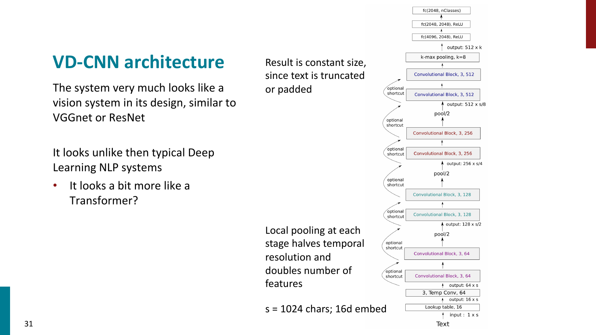

来源：Lecture 16，PDF P31。固定输入长度与后续聚合使分类器获得固定尺寸，不代表网络能无条件接受任意长文本而没有截断损失。

每个卷积块有两层卷积，各自后接BatchNorm和ReLU；卷积核宽度3，用填充保持时间长度，局部池化时再缩短。

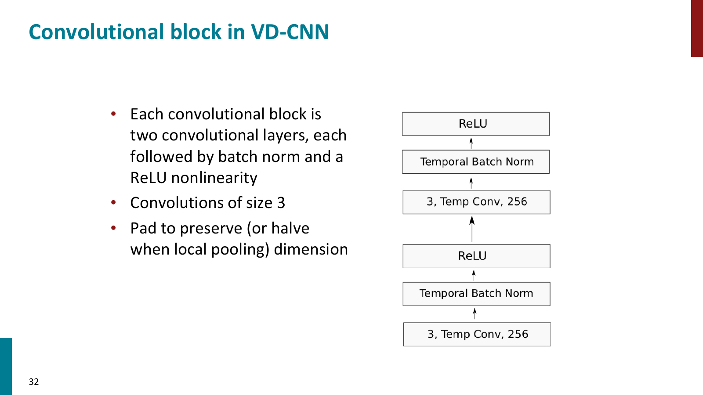

来源：Lecture 16，PDF P32。

P33强调使用比Kim 2014更大的分类数据集，不能只从小数据实验推断深模型无价值；但P34实验表只有图像，无法可靠读取具体模型深度、数据集单元格或分数。

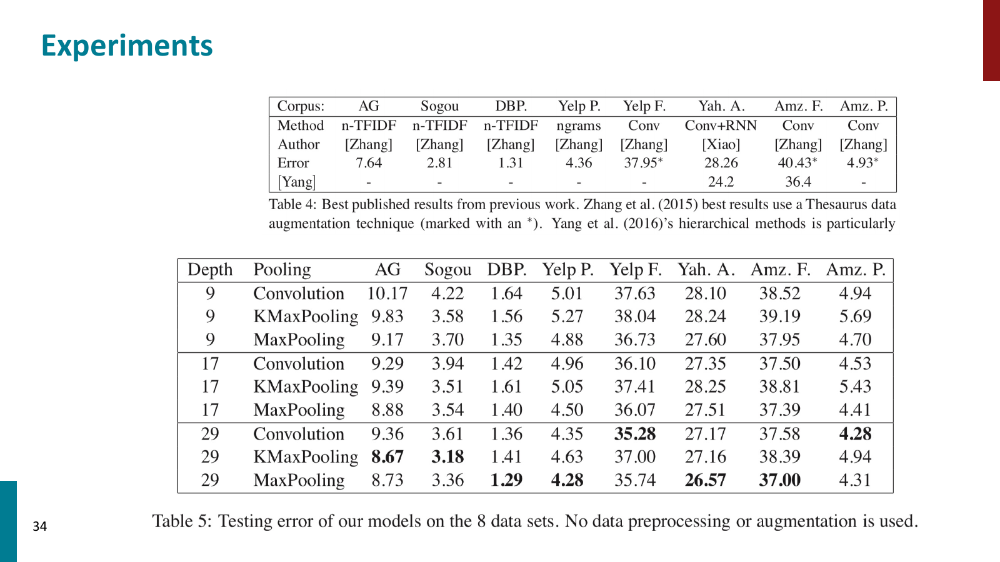

来源：Lecture 16，PDF P34。不从外部论文补写该页不可读数字。

## 6. 树递归网络：按句法结构组合意义

### 6.1 递归结构与组合性

来源：P35–40。

语言可用递归嵌套描述，例如名词短语内部再包含名词短语。是否把无限递归当成认知事实可讨论，但树结构是强而自然的语言结构先验。

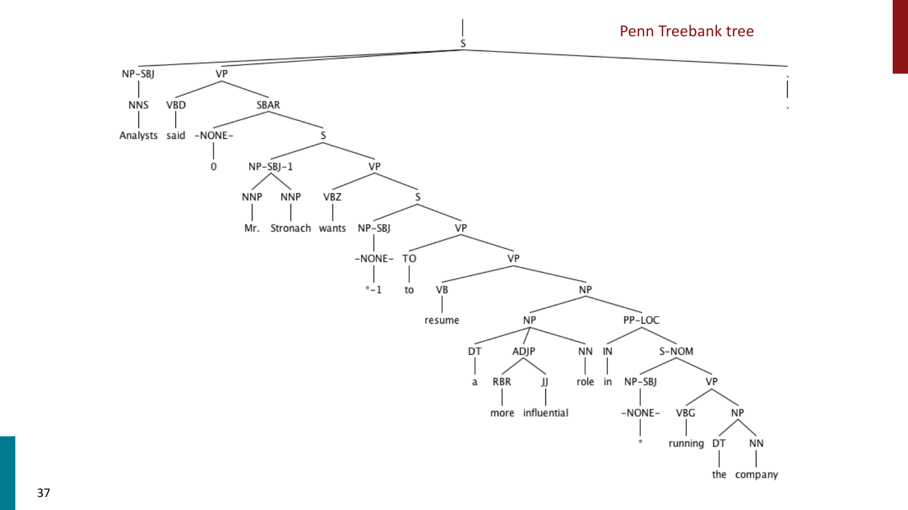

来源：Lecture 16，PDF P37。

**组合性原则（Principle of Compositionality）**：短语／句子的意义由组成部分的意义及组合规则共同决定。只平均词向量会丢掉大量组合关系；树递归模型用结构决定哪些表示先结合。

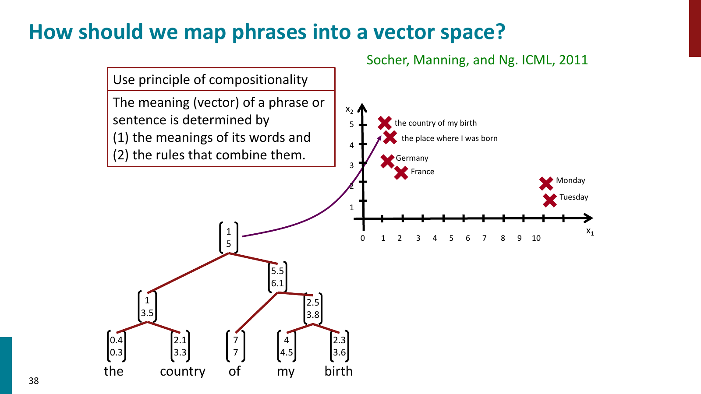

来源：Lecture 16，PDF P38。例子将`the country of my birth`与`the place where I was born`放在相关语义区域，图中坐标是示意，不能当作实际嵌入值。

P39–40展示为词、NP、PP、VP及S建立向量：可以给定树计算组合，也可以同时评分候选结构、学习表示。两种设定需区分；后面情感任务用树不等于每次都重新联合学习解析器。

### 6.2 Recursive与Recurrent不是同一结构

来源：P41。

- **树递归网络（Recursive Neural Network / TreeRNN）**：沿树的父子关系复用组合函数，为每个子树得到一个短语向量，需要已有或预测的结构。
- **序列循环网络（Recurrent Neural Network）**：沿时间／词序列复用递归单元，隐藏状态通常包含前缀语境。

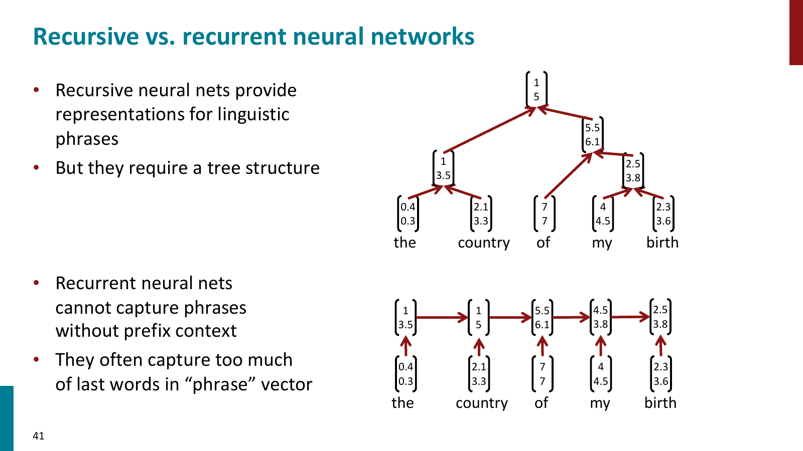

来源：Lecture 16，PDF P41。两者都可能简称RNN，本文用TreeRNN避免歧义。

### 6.3 简单二叉组合与局部评分

来源：P42–43。

两个子节点$c_1,c_2\in\mathbb R^d$拼接为$z=[c_1;c_2]\in\mathbb R^{2d}$，父向量

$$
p=\tanh(Wz+b),\qquad
W\in\mathbb R^{d\times2d},\quad b\in\mathbb R^d.
$$

用$u\in\mathbb R^d$对合并打分：

$$
s=u^Tp.
$$

所有树节点共享同一$W,b,u$，既学习组合后的语义表示，也评价该合并的合理性。

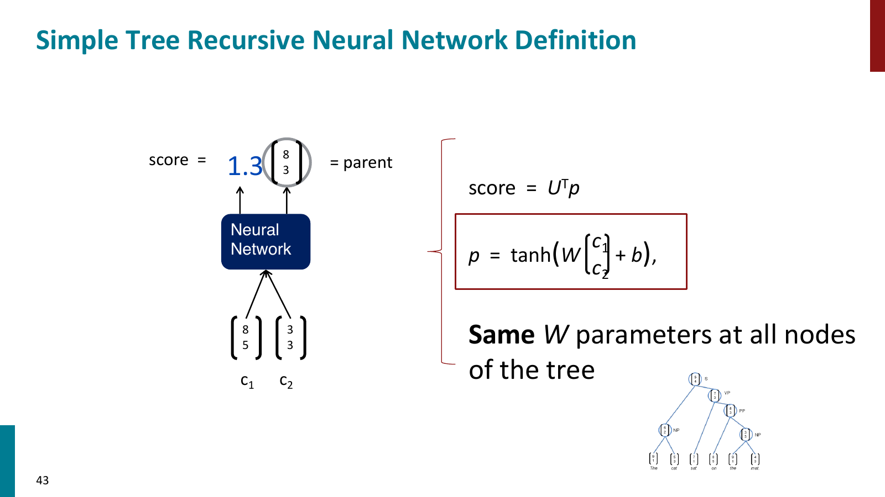

来源：Lecture 16，PDF P43。拼接括号在文本层有断裂，上式按两个子向量输入的结构规范化。

### 6.4 贪心合并与整树得分

来源：P44–47。

从词向量序列开始，给相邻候选子节点对计算父向量与得分；每次选择一个高分合并，形成更短的节点序列，再对受影响候选重新评分，直到得到根节点。

课件以`The cat sat on the mat`展示：先形成如`The cat`、`the mat`等局部短语，继续组合PP、VP与句子。具体图中所有中间向量数值未可靠读取，不逐步补造计算。

整树分数为所有内部合并节点的局部分数和：

$$
S(x,T)=\sum_{v\in\operatorname{Internal}(T)}u^Tp_v.
$$

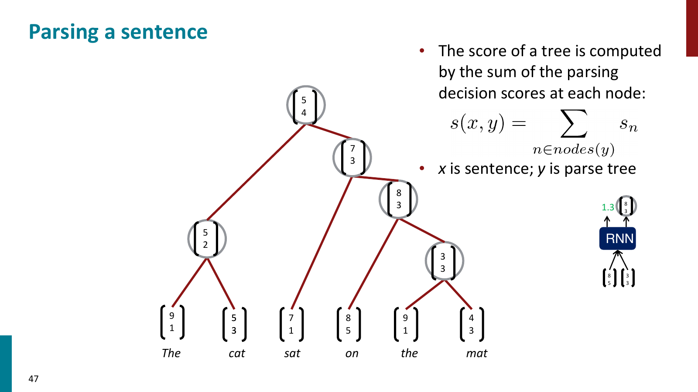

来源：Lecture 16，PDF P47。

贪心选当前最高分合并不保证整树总分最高。课件这里只演示贪心解析，不引入未展开的全局解析算法。二叉树中$n$个叶子需$n-1$次合并；共享参数的梯度会从多个节点累计，组合向量的误差信号沿树向叶子传播。

### 6.5 单矩阵组合的限制

来源：P48–49。

同一个组合矩阵用于所有句法类别、标点及语义关系，难表达复杂高阶组合。虽然拼接后接非线性已能让父表示依赖两个输入，但在线性预激活中

$$
W[c_1;c_2]=W_1c_1+W_2c_2,
$$

没有显式的$c_{1,i}c_{2,j}$乘法交互项。课件“no real interaction”应理解为缺少这种显式高阶交互，而不是说输入在整个非线性网络里完全互不影响。

## 7. 情感树库与递归神经张量网络

### 7.1 长文词袋表现好，不代表会组合

来源：P50–52。

情感检测问文本是正面、负面还是中性。长评论中可能重复出现`loved`、`great`、`impressed`、`marvelous`等强线索，词袋也能取得较高成绩；这不证明模型理解否定、转折或局部作用域。

**Stanford Sentiment Treebank, SST**含11,855个句子和215,154个带情感标签的短语。短语级标签让训练与测试能直接观察组合过程，而不只是对整句结果评分。

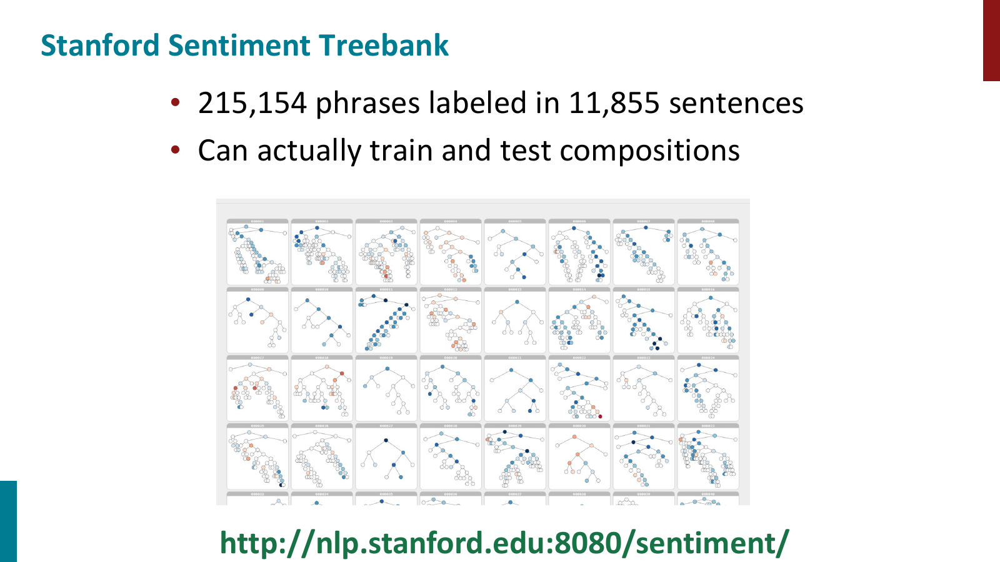

来源：Lecture 16，PDF P51。

P52显示更好的树库监督使多种模型受益，但困难否定仍常错，说明“更多／更细标签”与“更有表达力的组合函数”是两个问题。

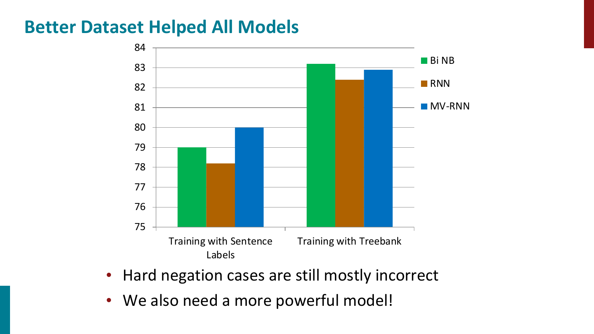

来源：Lecture 16，PDF P52。不可读柱高不转录数值。

### 7.2 RNTN：增加显式乘法交互

来源：P49、P53–56。

**递归神经张量网络（Recursive Neural Tensor Network, RNTN）**允许词／短语向量之间有加法及乘法交互。其标准二叉组合可用与简单TreeRNN一致的$z=[c_1;c_2]$写成

$$
p=\tanh\!\left(z^T\mathcal V^{[1:d]}z+Wz+b\right).
$$

这里$\mathcal V\in\mathbb R^{2d\times2d\times d}$，不是一个普通二维矩阵；每个输出维度$j$有一个切片$V^{[j]}$：

$$
p_j=\tanh\!\left(z^TV^{[j]}z+W_{j,:}z+b_j\right),
\qquad
z^TV^{[j]}z=\sum_{a=1}^{2d}\sum_{b'=1}^{2d}V^{[j]}_{ab'}z_a z_{b'}.
$$

第二式中的$b'$是求和索引，与偏置$b$不同。二次项显式允许两个输入分量相乘，使一个词对组合结果的作用取决于另一词／短语，而不只是两个线性贡献相加。

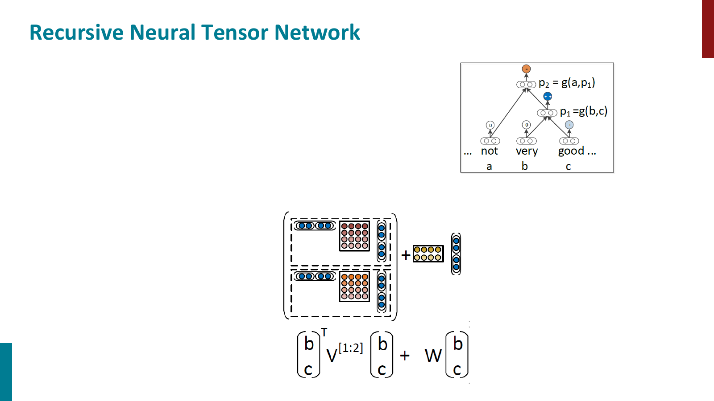

来源：Lecture 16，PDF P55；P53–55为逐步介绍图。原PDF公式未能从文本层可靠提取，上式是对本页“加法与乘法交互”结构的标准规范表达，不声称已经逐符号目视核对图中张量标记。

每个节点的向量还可输入共享分类器：

$$
p(y_v\mid v)=\operatorname{softmax}(W_s p_v+b_s).
$$

课件P56说明联合用梯度下降训练全部权重。对有标签节点的交叉熵可概括为$-\sum_v\log p(y_v^{\mathrm{gold}}\mid v)$；监督从分类器进入各层组合函数与词向量，而不只是给根节点单独拟合一个后处理分类器。

张量提高表达能力，也增加参数：仅该二次项就有$(2d)^2d=4d^3$个参数，明显高于简单组合矩阵的$2d^2$。这是维度计数，用于解释模型复杂性，不是课件另一个实验配置。

### 7.3 整句、转折与否定结果

来源：P57–59。

P57报告在树库正负二分类中，RNTN整句准确率达到85.4；不要把它混同于P25的SST-1细粒度多分类准确率。

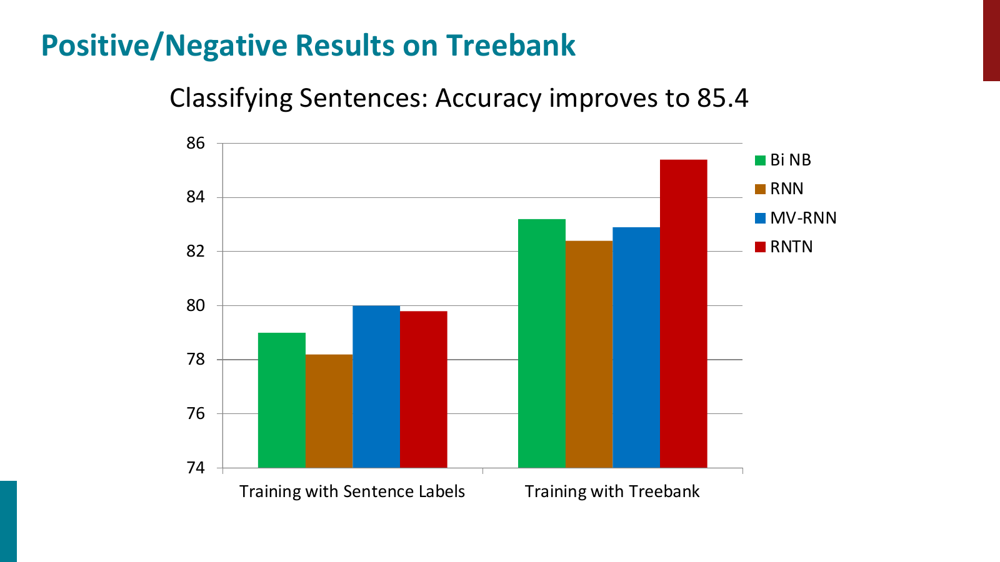

来源：Lecture 16，PDF P57。

P58特别分析`X but Y`转折：RNTN为72%，MV-RNN为65%，Biword NB为58%，普通RNN为54%。这类句子不能只数正负词，需要建模组合与后半句的作用；结果属于该类构造的分析，不是全部测试集准确率。

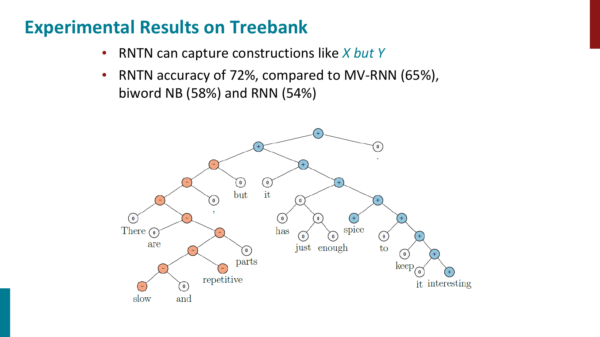

来源：Lecture 16，PDF P58。

P59指出：**“When negating negatives, positive activation should increase!”（否定负面表达时，正面激活应增加。）** 否定不是简单删除一个负面词，它改变组合后的倾向；也不能直接推成“所有否定都把情感精确翻转为同等强度的正面”。

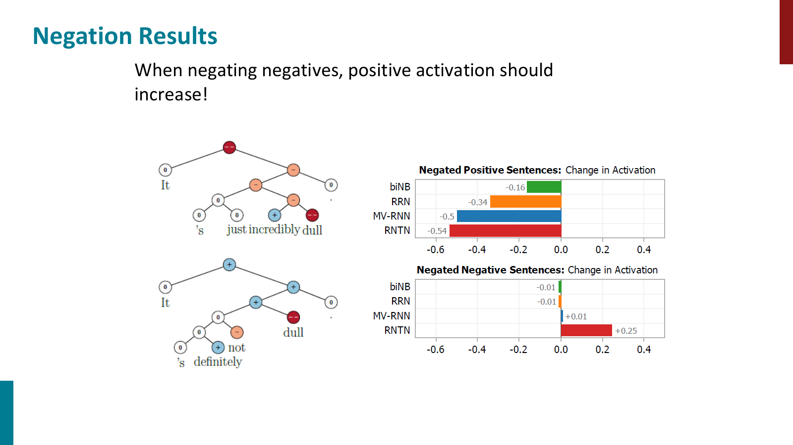

来源：Lecture 16，PDF P59。不可可靠读取的曲线、具体短语及强度不补造。

本地无本讲独立对应作业。此前A3说明中的词表示／局部卷积与本章共享“窗口特征”思想，但不据此填补缺失的A3代码包。SST作为minBERT分类数据已在第9章整理；这里新增的是短语级监督与显式树组合。P49只推荐Tai、Socher、Manning 2015年的Tree-LSTM，未展开，故不另加一套门控网络推导。行政安排、算力优惠及结束页跳过。
