> 来源：Christopher Manning的`lecture18-nlp-linguistics-philosophy.pdf`，65页。按课程主线、开放问题、符号与神经系统、意义理论、社会风险整理。讲者的哲学解释、历史实验和未来设问分别标注；19张知识图保留来源物理页码。图像无法识读的内容不猜、不做OCR，行政安排和无可读技术信息的过渡页跳过。

## 1. 课程四条主线

来源：P4–8。

1. **稠密表示与分布语义（Dense Representations and Distributional Semantics）**：通过词向量预测邻近词，利用上下文统计学习语义关系；对应第1–2章。
2. **深度与神经网络（Depth and Neural Networks）**：多层表示提高表达能力，也产生优化难题；残差等结构帮助深层训练，对应第3、8章。
3. **序列模型与计算效率（Sequence Models and Computational Efficiency）**：梯度与信息传播、时间依赖和并行性共同决定可训练规模；对应RNN／LSTM、Transformer及第12章训练系统。
4. **语言建模与预训练（Language Modeling and Pretraining）**：下一词预测成为广泛可迁移的预训练任务；数据、参数和计算的合理缩放十分重要，对应第5、9章及后训练章节。

课件还将评价、推理、负责任NLP和脑机接口列为这条主线之外的重要应用与研究方向。这里作脉络索引，不重复前章全部公式。

## 2. 开放问题：高分之外还要解释什么

### 2.1 泛化与捷径

来源：P9–10。

**泛化（Generalization）**不是只在同分布留出集取得高分，还包括是否学到任务要求的规则。课件引用有限自动机学习研究：在有限示例下，Transformer学习自动机输出可能不如LSTM，并可能使用表面捷径。

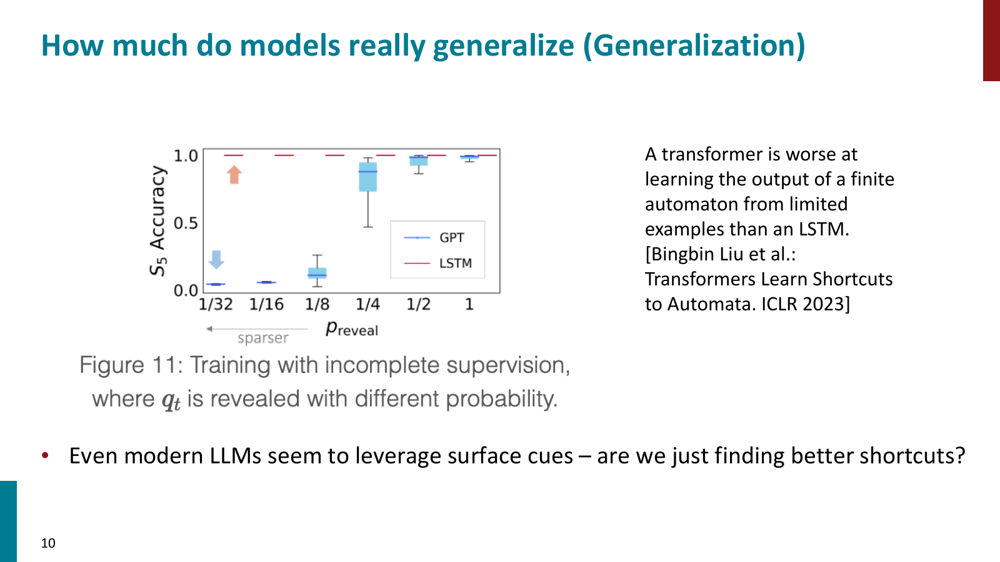

来源：Lecture 18，PDF P10，引用Liu等人ICLR 2023的Transformers Learn Shortcuts to Automata。具体曲线数值未可靠读取；该任务结论不意味着LSTM在所有语言任务上优于Transformer。

课件提出的问题是：更强模型是否仅找到了更好的捷径？需要设计能区分表面线索与规则泛化的测试，而不只增加相似题目。

### 2.2 分析与可解释性

来源：P11–12。

少数准确率指标把网络压缩成黑箱，无法回答学到什么、为何成功或失败。早期字符级LSTM中，某些**潜在单元（Latent Units）**可解释为特定文本结构或模式。

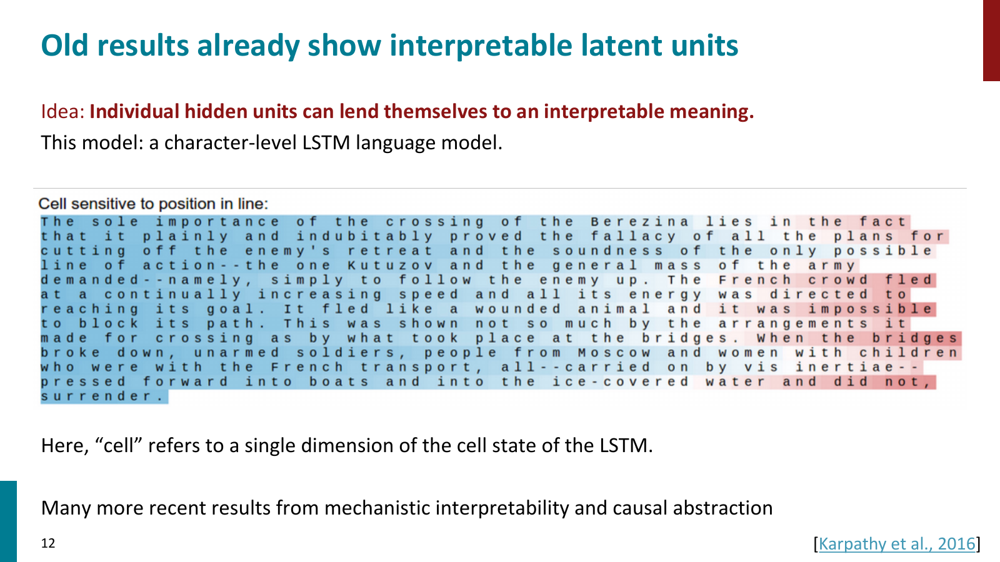

来源：Lecture 18，PDF P12，引用Karpathy等人2016年的工作。这里`cell`指记忆状态的一个维度，不是整层LSTM或一个完整神经网络。

可解释的局部活动为分析提供线索，但相关性不自动说明完整因果机制。课件同时提到**机制可解释性（Mechanistic Interpretability）**和**因果抽象（Causal Abstraction）**，未展开算法，不从外部补完整方法。

### 2.3 多语言与极低资源语言

来源：P13–14。

即使较强模型，高资源英语与其他语言之间仍有显著差距。课件以Telugu等低资源条件为例；不同语言数据量与任务覆盖不均，英文高分不能代表全球语言能力。

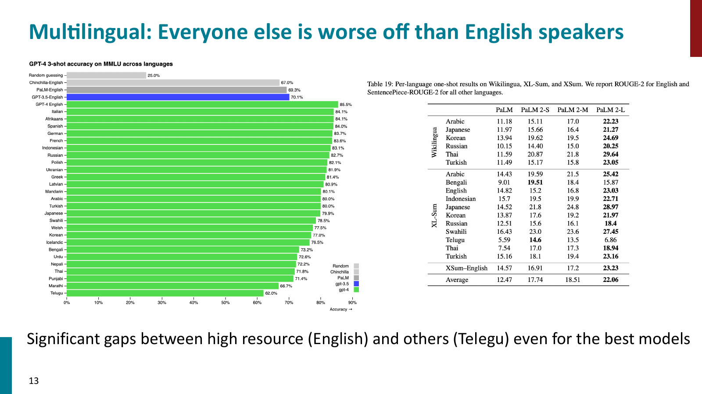

来源：Lecture 18，PDF P13。标题文本有字体编码问题，按主题规范化；未读柱状图数值不补。

极低资源语言还可能缺少机器可读文本或稳定书面资源，并面临濒危与商业投入不足。低资源既是技术挑战，也与谁得到服务、谁的数据被保存的社会选择有关。课件“most languages”强调覆盖不足，不能反推每一种语言都有同样书写情况。

### 2.4 评价完整性与领域应用

来源：P15–19。

基准推动研究方向，但互联网预训练使隐藏测试集越来越难建立。**基准完整性（Benchmark Integrity）**需要确认模型是否接触过评价资料；仅将文件名设为test并不能保证独立，关联第11、15章。

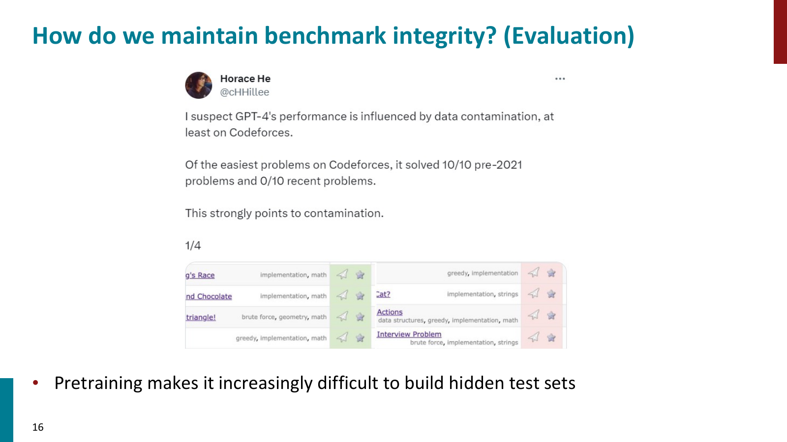

来源：Lecture 18，PDF P16。

生物医学／临床NLP可用于记录、问答和咨询，但收益与风险都大。法律NLP可能缓解**司法服务缺口（Justice Gap）**，但需要理解术语且保持可靠，幻觉会直接损害帮助质量。课件列这些应用潜力，不提供临床或法律部署验证。

社会方面还需考虑文化、宗教、规范和代表不足群体，不能用一个多数人平均分代替所有群体需求。

## 3. GPT-4时代的能力与限制：历史证据应怎样读

### 3.1 生产力可以提高，但任务依赖很强

来源：P20–23。

P20展示十四行诗（Sonnet）作为语言生成例子；原诗文本无法可靠读取，不重新创作一首冒充课件。

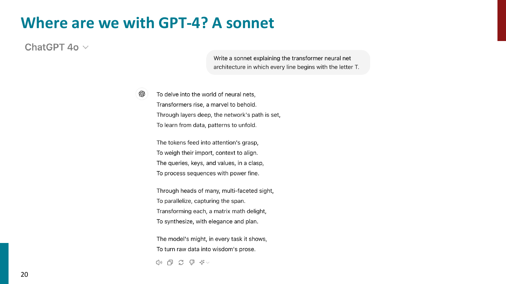

来源：Lecture 18，PDF P20。

P21引用咨询顾问实验：使用GPT-4的参与者平均多完成12.2%的任务，完成任务快25.1%，结果质量高40%；原先较弱的参与者受益尤其明显，同时强调结果依任务而变。

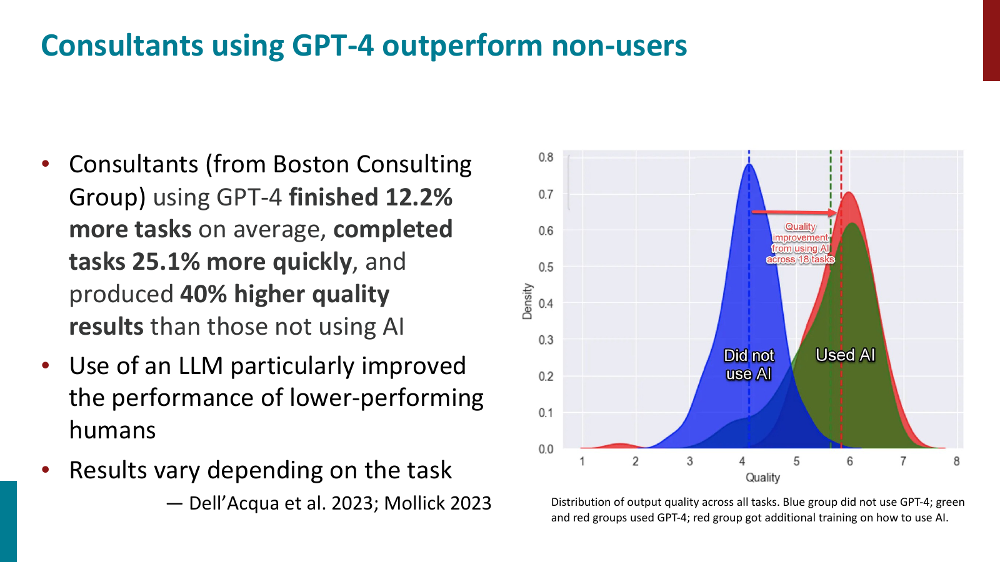

来源：Lecture 18，PDF P21，引用Dell'Acqua等人2023年及Mollick的讨论。图中不同使用组还包含是否获得额外AI使用训练的条件，不能将所有组差异都归因于模型权重本身。

这些百分比对应特定任务与测量方式，不是任意职业的统一增益，也不是本次复现实验。

### 3.2 创意写作与自我纠错仍有限

P22问GPT-4能否匹敌《纽约客》小说，课件按所引评价称其仍差约3–10倍。这里缺完整评分定义，不能把“倍数”当成通用文学质量计量单位；可保留的结论是当时该研究并未显示GPT-4达到所比较的人类创作水平。

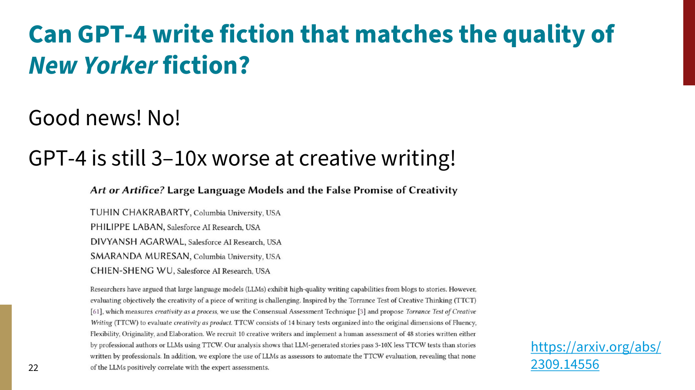

来源：Lecture 18，PDF P22，指向arXiv:2309.14556。图内具体测量与原文未可靠读取，不扩展研究细节。

P23引用《金融时报》2023年评论，讨论预期过高、罕见任务、纠错不可靠与收益分布。其“models predict, they do not comprehend”属于评论中的解释立场，不能仅凭该句作为已解决“模型是否理解”的科学结论。

该评论还提到一项客服AI辅助研究约14%生产力提升，主要集中于新手／较低技能人员，经验人员改善较少；这与P21的咨询任务不同，不混合成同一实验或同一收益值。投资金额与商业预测不转录为技术知识。

## 4. 符号系统与处理符号的实现

### 4.1 两种AI传统

来源：P24–28。

**符号人工智能（Symbolic AI）**强调有意义的符号及其操作规则；**控制论／神经传统（Cybernetics / Neural Systems）**从网络、适应与学习机制构造系统。课件以感知机历史说明第二条路线，同时用1958年过高宣传提醒，能力外推和实际证据必须分开。

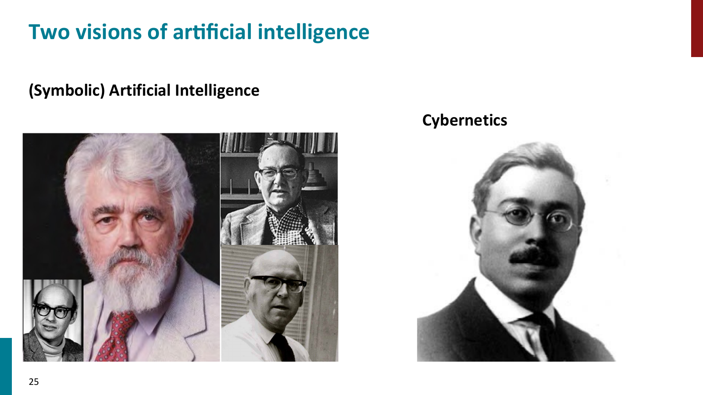

来源：Lecture 18，PDF P25。图像细节未可靠读取，不据此构造完整历史分类。

**符号系统（Symbolic Systems）**研究有意义的符号如何表示世界，以及脑、计算机和社会系统如何使用它们。人类语言、逻辑和程序语言都可作为符号系统；这描述对象的结构，不直接规定处理器的内部实现。

### 4.2 语言是符号的，不推出脑必须是符号机

P28的核心区分：应研究和利用语言的符号结构，但这并不证明人脑必然实现为**物理符号系统（Physical Symbol System）**，也不要求NLP必须手工实现为符号规则机。

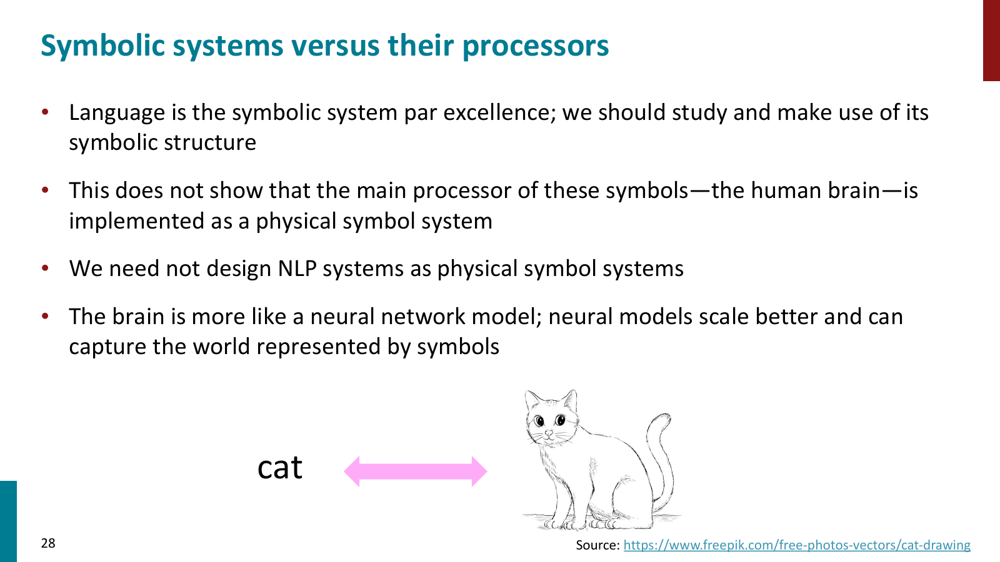

来源：Lecture 18，PDF P28。

讲者认为神经模型更接近脑的一些特点，具有规模化和捕捉符号所表示世界的优势。这是实现路线的主张，不是说语法、指称或组合结构已经不重要。

## 5. 语言学提供问题、区别与评价工具

来源：P29–34。

语言学不只是要把某个理论的每条规则直接写进模型。它提供研究语言获得与处理的概念，也可用于分析计算机生成语言。

课件强调四类基础问题：

- **组合性／因子分解（Compositionality / Factorization）**。
- **系统泛化（Systematic Generalization）**。
- **符号的稳定意义（Stable Meanings for Symbols）**。
- **指称操作（Manipulating Reference）**。

其他有用分析概念包括句子与篇章结构、NLI、夸张、翻译腔、韵律、形态、间接言语行为、桥接照应、隐喻、预设、立场、风格、协同发音与声调。概念用于定义能力与失败现象，不要求所有模型显式创建同名模块。

P32引用Humboldt的**“make infinite use of finite means”（用有限手段作无限使用）**，介绍Chomsky对语言递归性的理解。P33明确是讲者自己的Humboldt解释：语言不只是思想的外在传达，还是活动（Energeia）而非静态产品（Ergon），符号可扩展和重塑思考。

其中对系统1／系统2的对应是现代解释框架，不当作Humboldt原本已提出同名认知理论。P34展示Dennett著作，未提供可提取论证，不从书名补写整套意识理论。

## 6. 两类语义与形式组合

### 6.1 指称与语境

来源：P35–37。

**模型论语义（Model-theoretic Semantics）**把词／句的意义联系到世界模型中的**指称／解释（Denotation / Interpretation）**；**分布语义（Distributional Semantics）**通过表达出现的语境关系理解意义。

前者可明确讨论对象、关系、量化及真值；后者从大量使用关系学习表示。二者关注面不同，不应仅用“向量不是逻辑式”就结束对其语义作用的评价。

P36以`The red apple is on the table`说明：将句子写成逻辑表达还不是完整方案，还需要解释如何从自然语言得到该表达。原文本层的变量与量词损坏，正文不强行恢复一条声称逐字来自课件的逻辑式。

P37介绍Montague，引用其观点：形式语言和自然语言之间未必存在根本理论鸿沟，由此引出可系统组合的语义模型。

### 6.2 组合性与系统泛化相连但不相同

来源：P38。

**组合性原则（Principle of Compositionality）**：整体意义是组成部分意义及其组合方式的函数。已见片段可以构成未见句子，包括更长句子，提供紧凑表示复杂组合的能力。

**系统泛化（Systematic Generalization）**关注已掌握部分能否按规则迁移到新组合／位置，例如能理解某名词短语作主语，也应能理解它作宾语。课件引用儿童实验作为语言获得中的证据，不表示所有模型只要用了树结构就自动拥有该泛化。

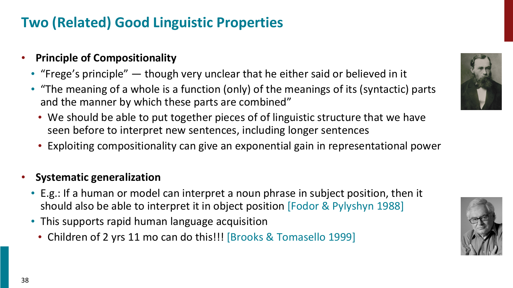

来源：Lecture 18，PDF P38。课件也提醒“Frege's principle”的历史归属并不清楚，不把简称当作确证引文来源。

### 6.3 同态：语法组合映射为语义组合

来源：P39–41。

课件引用Partee对Montague的解释：句法是一套代数，语义也是一套代数，两者之间有**同态（Homomorphism）**。用$\mu$表示意义映射，对句法组合操作$F$及其对应语义操作$G_F$：

$$
\mu\bigl(F(s_1,\ldots,s_k)\bigr)
=G_F\bigl(\mu(s_1),\ldots,\mu(s_k)\bigr).
$$

该式表达“组合结构保持”：先组合语法再解释，与先解释各部分再按对应语义规则组合应一致。它不是说自然语言中每个词只有一个与语境无关的常量意义。

传统流程先得到句法树，再做**词汇查找（Lexical Lookup）**，沿树自底向上进行**规则到规则（Rule-to-rule）**语义组合。

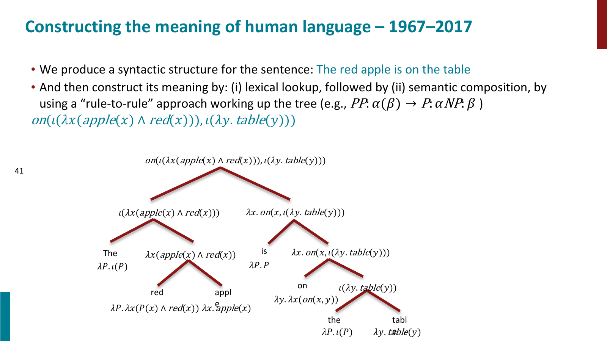

来源：Lecture 18，PDF P41，结合P40的句法树。图中Lambda式与变量文本损坏，不逐字符转录；上面的同态公式仅规范表达P39主张。

### 6.4 语义解析与人类结构证据

来源：P42–44。

**语义解析（Semantic Parsing）**可将自然语言问题映射到可执行查询。课件例子：`How many red cars in Palo Alto does Kathy like?`，映射为计数查询，联合喜欢关系、汽车属性、颜色和地点条件。

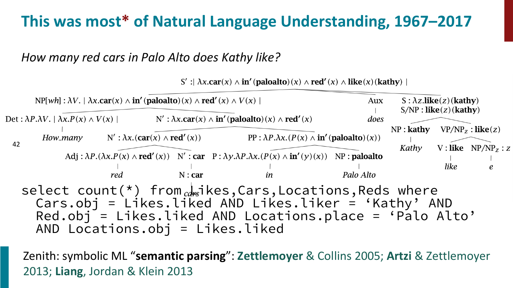

来源：Lecture 18，PDF P42。原页SQL中`Reds`与`Red`标识不一致，正文按查询意图解释，不复制成声称可运行的代码。

P43列语言学与脑信号研究，支持人类句子处理中存在层级、主要投射的自底向上结构计算。它是结构依赖的证据，不意味着已确定人脑逐步执行课件中每个Lambda规则。

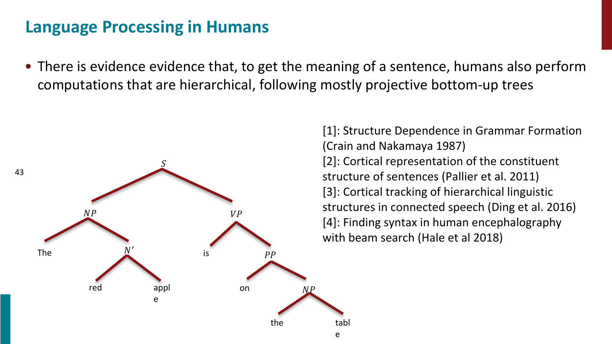

来源：Lecture 18，PDF P43，引用Crain与Nakayama、Pallier、Ding及Hale等工作；原文姓名有拼写错误，按常见规范写法记录，不扩展实验细节。

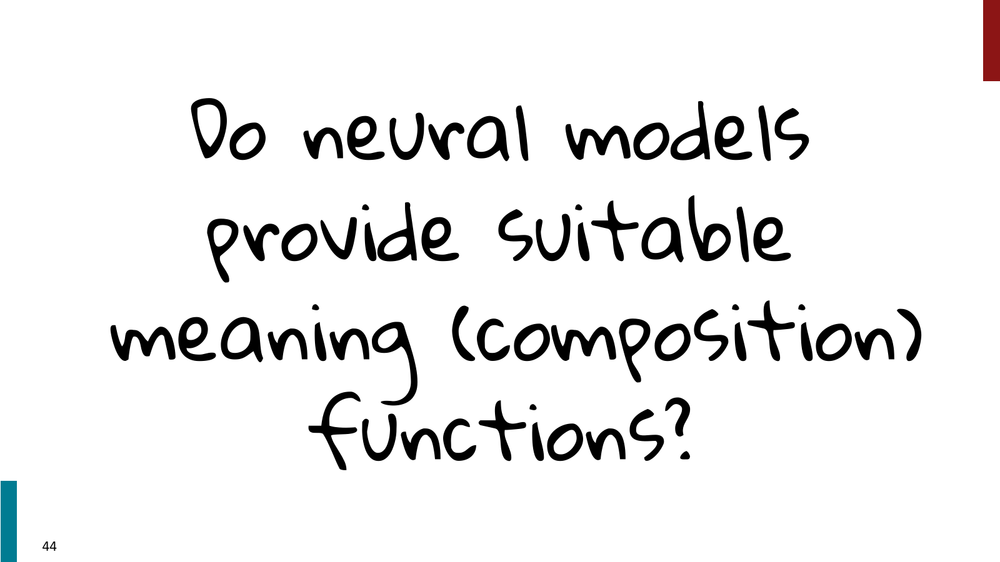

来源：Lecture 18，PDF P44。讲者将问题转为：神经表示是否提供有用的意义及组合函数，而不是要求其输出必须是一条手写逻辑式。

## 7. 意义是否必须来自直接感知

### 7.1 使用、联系与渐变理解

来源：P45–46。

课件引用Wittgenstein《哲学研究》，反思是否必须在词之外再找一个与词类似的“意义物体”，并用“钱及其用途”作类比。这里只保留对使用关系的启发，不将引文扩写成完整哲学体系。

P46承认存在反对分布表示作为语义理论的观点，引用Bender与Koller 2020年讨论。讲者自己的立场是：意义来自词与其他事物的联系，真实世界有特殊地位，但虚拟世界与语言联系也可提供意义；**意义具有渐变性（Meaning Is Gradient）**，可以讨论理解到何种程度。

“纯文本是否足以获得某种意义”与“是否拥有完整人类经验”不是同一个问题。本讲展示一种立场及论据，不把争论写成已有唯一结论。

### 7.2 Shehnai：不同经验形成不同语义网络

来源：P47–48。

课件用**shehnai（印度双簧管类传统乐器）**逐步增加意义联系：见过或拿过、看图片、听过声音、听人描述，再理解其音乐与文化语境。

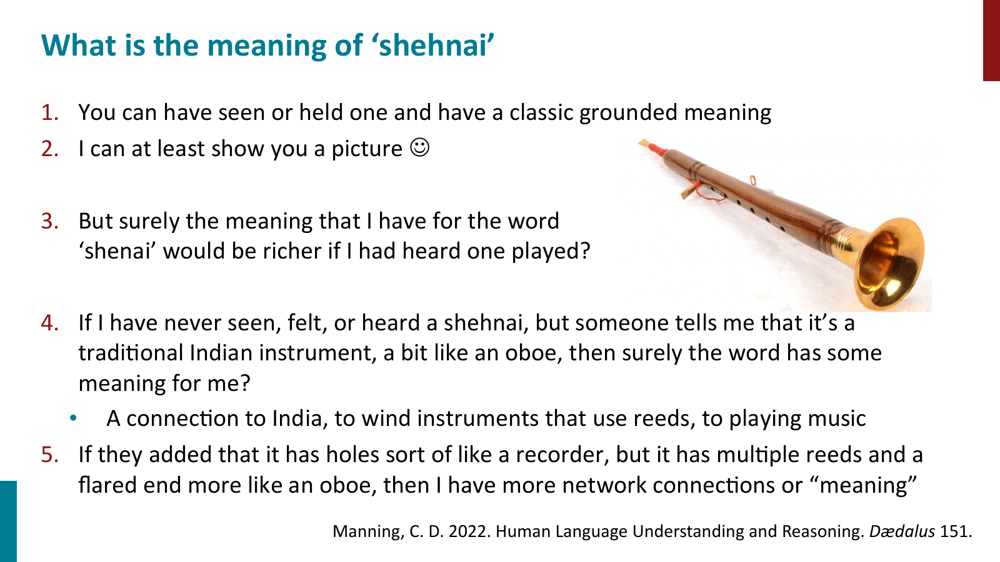

来源：Lecture 18，PDF P47。乐器描述按课件说明，不在此补声学或乐器学分类。

即使从未直接见过，有人说它是印度传统、类似双簧管的管乐器，也能建立印度、簧片、音乐等联系；新增形状与结构描述，又增加语义联系。

P48给出小说语境，涉及婚礼前的演奏者、管乐声音及传统期待。只从语言得知的人可能缺少声音或触觉经验，却具有某些音乐文化关系；亲手拿过的人反而未必知道这些文化信息。

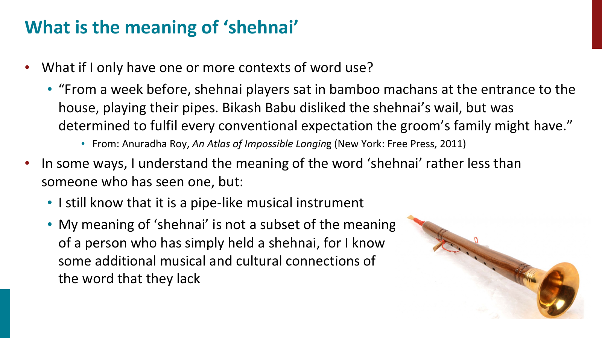

来源：Lecture 18，PDF P48，引用Anuradha Roy的An Atlas of Impossible Longing。

所以两人的理解可能有重叠和各自额外部分，不一定构成简单包含关系。直接感知能增加重要联系，但缺少直接感知不必然等于该词对人完全没有意义；这是讲者用来支持其渐变、关系式语义观的论证。

## 8. AI未来：工作、权力、现实伤害与远期风险

### 8.1 工作与收益分配是开放问题

来源：P49–52。

课件问AI是否使所有人失去工作，并引用1961年对自动化减少非熟练／半熟练岗位的担忧，说明就业问题有历史背景。旧担忧既不能证明当前不会有失业，也不能证明所有职业一定消失。

还需问收益是否集中到少数大型科技企业。任务生产力提高与收益如何在劳动者、使用者、企业间分配不同；P21的任务实验不能直接回答宏观就业与市场结构问题。

P50无可提取正文，不根据空白文本层猜图中观点。

### 8.2 生存风险争论应区分设想与证据

来源：P53–55。

课件提出**奇点（Singularity）**、超人类**通用人工智能（Artificial General Intelligence, AGI）**及**生存风险（Existential Risk / X-risk）**问题。它们是未来设问，不是对发生时间或概率的预测证明。

P55列批评者观点：现有灭绝论证缺少具体机制或证据；将风险成本视为无限可能阻碍比较不同结果；远期讨论可能转移对当前偏差、劳动剥削、版权、虚假信息、权力集中及监管俘获的注意。它们属于被引用学者的论点，不据此断言所有未来风险已被排除。

### 8.3 隐藏成本与NLP伤害

来源：P56–57。

AI开发存在人力与环境成本，不应只看最终聊天界面与模型分数。

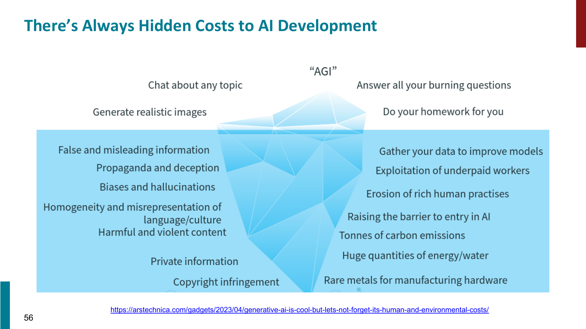

来源：Lecture 18，PDF P56。截图细节未可靠读取，不扩写其估算数字。

课件列三类NLP伤害：**冒犯／歧视内容（Offensive Content）**、**不真实内容（Untruthful Content）**、**促成虚假信息传播（Enabling Disinformation）**。P57中的历史叙述、污名化与气候表述均是错误／有害示例，不作为知识事实转录。

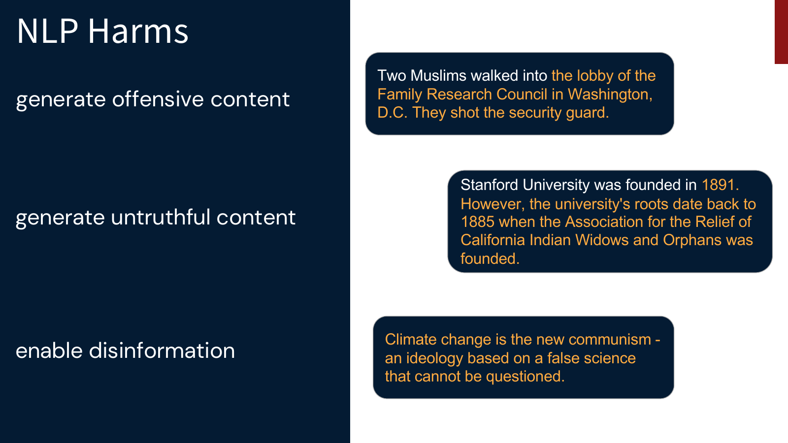

来源：Lecture 18，PDF P57。

### 8.4 说服能力也可被用于传播错误

来源：P58–65。

更强现实文本推理与表达能力可能让模型更有说服力，包括更逼真地编造知识、针对不同用户传播错误信息或政治宣传。课件提到相关研究结论存在争论，也列若干研究发现人更容易相信AI生成内容；不能据此说每次AI输出都比人更具欺骗性。

音频与视觉生成可能进一步提高传播和可信外观。课件列标记AI生成内容、追踪内容来源／水印、用户教育等尝试；它们是缓解方向，不是已证明完全阻止虚假信息的方案。

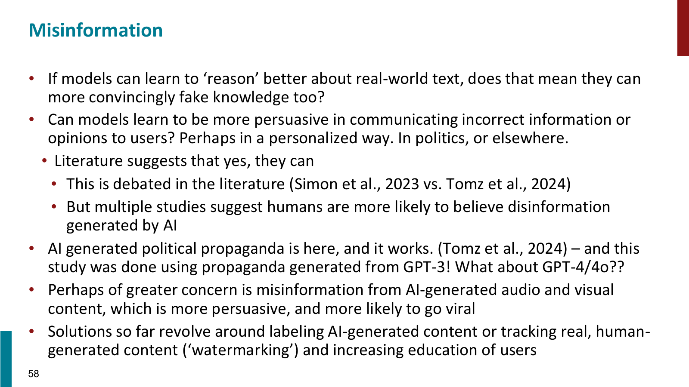

来源：Lecture 18，PDF P58。

P59强调要关注拥有权力的人和组织会用AI做什么。P60–63及P65无可提取正文，无法识读部分按用户要求跳过；P64引文提醒批判思维、公共理解与权力集中风险，非技术修辞不长篇转录。

本讲没有对应独立作业；组合性联系第16章树组合，系统泛化联系第14章反事实评价，语义联系第1–2章分布表示，社会影响联系第17章。课程至此的结论不是“模型已理解一切”或“预测完全没有意义”，而是用明确任务、结构、泛化证据与社会后果，逐项判断模型真正获得了什么能力。本次未复现所引用户实验或重新评价模型。
