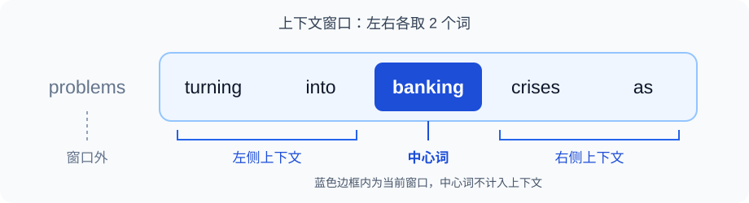
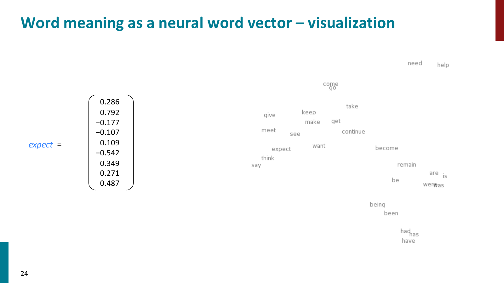
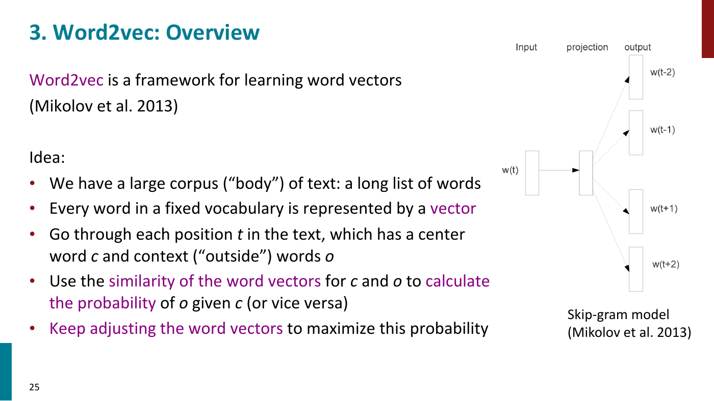

## 1. 为什么需要词向量

计算机不能直接对 `cat`、`dog` 这样的词做加法、求导或计算相似度。要让模型处理语言，首先需要把词转换成数值表示。

一种最直接的方法是给每个词一个编号。例如，词表为：

$$
V=\{\text{cat},\text{dog},\text{car},\text{bus}\}.
$$

可以分别编号为 0、1、2、3。但编号只用于区分词：`dog` 的编号比 `cat` 大，并不表示它的词义“更大”；编号差为 1，也不能说明两个词相似。

我们希望得到一种表示，使模型不仅能区分不同的词，还能利用词之间的联系。例如，`cat` 和 `dog` 都常出现在描述宠物的句子中；`car` 和 `bus` 都与交通有关。**词向量的目标，是把这些语言使用中的联系编码进可以计算的向量。**

### 1.1 独热向量：能区分词，却没有直接表达词间联系

**词表（Vocabulary）**是模型处理的词的集合，记为 $V$，词的数量记为 $|V|$。

独热向量（One-hot Vector）为每个词分配一个坐标：属于该词的坐标为 1，其余坐标都为 0。上述词表对应：

$$
\begin{aligned}
e_{\text{cat}}&=(1,0,0,0)^\top,\\
e_{\text{dog}}&=(0,1,0,0)^\top,\\
e_{\text{car}}&=(0,0,1,0)^\top,\\
e_{\text{bus}}&=(0,0,0,1)^\top.
\end{aligned}
$$

这种表示不再引入编号的大小关系，但任意两个不同词的点积都是 0，欧氏距离都是 $\sqrt 2$。因此，单从这些向量看，`cat` 与 `dog` 的关系和 `cat` 与 `bus` 没有区别。

词表很大时，独热向量的维度也很大，而且只有一个非零元素。实现中通常直接存储词的编号，不必真的创建这么长的数组。**关键限制是独热表示本身没有编码相似性**；模型仍可以在它的基础上学习更有用的表示。

### 1.2 人工词典为什么不够

另一条路线是人工记录词义及其关系。例如，WordNet 用同义词集组织特定词义，并记录“猫是一种动物”这样的上下位关系。

这类资源提供了有用知识，但需要人工维护，难以及时覆盖新词、新用法和语境差异。即使知道两个词属于相关类别，也还需要决定：怎样把这种关系转换成模型可用的数值，以及两个词究竟有多相似。

词向量采用从文本中学习的方式：通过词实际出现的环境，学习词之间的联系。

## 2. 从上下文学习词义

### 2.1 分布假设：相似的使用环境提供相似的语义线索

假设不知道 `banking` 是什么意思，但在文本中反复看到：

```text
banking crises
banking regulation
banking system
```

周围的 `crises`、`regulation`、`system` 为它的含义提供了线索。一次出现提供的信息有限；聚合大量出现位置，才能获得比较稳定的统计规律。

**分布假设（Distributional Hypothesis）**认为，出现在相似上下文中的词往往具有相关的意义。基于这种思想研究词义的方式称为分布语义（Distributional Semantics）。

这里的“分布”指词在语言环境中的出现规律。它不是说某个词义对应一个固定坐标，也不是说上下文相似就一定互为同义词。例如，`happy` 和 `sad` 都能出现在 `I feel ...` 中，使用环境相似，但情感方向相反。

### 2.2 什么是上下文窗口

本讲把某个词左右一定范围内的词作为它的**上下文（Context）**。窗口半径 $m$ 表示左右各取至多 $m$ 个词，中心词本身不计入上下文。

例如：



以 `banking` 为中心、$m=2$ 时，上下文是 `turning`、`into`、`crises`、`as`；`problems` 在窗口之外。

窗口是构造训练数据的规则。它规定从文本中提取哪些词对，而不是模型已经理解的语法或语义关系。

### 2.3 稠密向量与分布式表示

给每个词分配一个 $d$ 维实数向量：

$$
v_w\in\mathbb R^d.
$$

维度 $d$ 由模型设计者指定，通常远小于词表大小。例如，五十万个词可以各用一个 100 维向量表示，而不必各用一个五十万维独热向量。

这种向量称为**词向量或词嵌入（Word Embedding）**。它通常是稠密的，即许多分量都不为零；同时也是**分布式表示（Distributed Representation）**：一个词的信息由多个坐标共同承载，同一个坐标也参与表示许多不同的词。

不需要预先规定“第一维是动物性、第二维是交通性”。各坐标的值通过训练得到，单个坐标未必有清晰的人类解释。模型利用的是整个向量及向量之间的关系。



图中的低维位置用于展示词之间的关系。实际词向量可以有很多维，二维展示会丢失信息。

## 3. Skip-gram：把学习词义变成预测任务

我们没有给每个词标注一组“正确的语义坐标”，所以不能直接让模型拟合这样的答案。可以改为提出一个有现成训练答案的问题：

> 给定中心词，哪些词容易出现在它附近？

文本本身就提供了答案。若 `banking` 与 `crises` 在窗口内共同出现，就得到一个训练词对：

$$
(c,o)=(\text{banking},\text{crises}).
$$

其中 $c$ 表示中心词（Center Word），$o$ 表示外围词（Outside Word），即窗口中的一个上下文词。

**Word2Vec** 是一组学习词向量的方法，**Skip-gram** 是其中“用中心词预测外围词”的方法。对于上一节的窗口，可以提取四个训练词对：

| 中心词 $c$ | 外围词 $o$ |
| --- | --- |
| banking | turning |
| banking | into |
| banking | crises |
| banking | as |

这些词对分别提供训练信号。基本 Skip-gram 不区分外围词在左边还是右边、距离是 1 还是 2，也不把它们按顺序生成一句话。



模型为了做好预测，必须调整词向量。若两个中心词经常对应相似的上下文，训练会推动它们学到能够产生相似预测的表示。这是词向量获得语义联系的途径，而不是训练前已经保证的性质。

## 4. 如何把词向量变成预测概率

### 4.1 两套向量分别承担输入与输出角色

Skip-gram 为每个词学习两套向量：

| 参数 | 含义 | 在预测中的作用 |
| --- | --- | --- |
| $v_w\in\mathbb R^d$ | 中心词向量 | 表示给定的输入词 |
| $u_w\in\mathbb R^d$ | 外围词向量 | 表示候选的输出词 |

例如，预测 `banking` 附近是否出现 `crises` 时，使用 $v_{\text{banking}}$ 和 $u_{\text{crises}}$。若另一个窗口以 `crises` 为中心，则输入使用 $v_{\text{crises}}$。

两套向量对应两种角色，不是一个词的两种词义。将两种角色分开，使模型能分别学习“这个词作为输入时提供什么信息”和“这个词作为输出时如何被预测”。

设全部可学习参数为 $\theta$，它包含所有 $v_w$ 和 $u_w$，总共有 $2d|V|$ 个实数。它们从初始值出发，在训练中不断更新。

### 4.2 点积给出匹配分数

给定中心词 $c$，对每个候选外围词 $w$ 计算：

$$
z_w=u_w^\top v_c=\sum_{k=1}^{d}u_{w,k}v_{c,k}.
$$

$z_w$ 是一个实数，称为分数或 logit。分数越高，表示当前模型越倾向于把 $w$ 预测为 $c$ 的外围词。

点积同时受方向和模长影响，因此这里的匹配分数不等于只比较方向的余弦相似度。分数也还不是概率：它可以为负，各候选的分数之和不必为 1。

### 4.3 Softmax把所有候选分数归一化

用 Softmax 将分数变成概率：

$$
\boxed{P(o\mid c;\theta)=\frac{\exp(u_o^\top v_c)}{\sum_{w\in V}\exp(u_w^\top v_c)}}.
$$

$P(o\mid c;\theta)$ 表示：给定中心词 $c$，在当前参数 $\theta$ 下，模型将外围词预测为 $o$ 的概率。

指数函数使各项为正，分母把整个词表中所有候选的指数分数加起来，所以：

$$
\sum_{o\in V}P(o\mid c;\theta)=1.
$$

例如，三个候选词的分数为 $[2,1,0]$，Softmax 给出约 $[0.665,0.245,0.090]$。分数最高的候选获得最大概率，其余候选仍保留概率。Softmax 返回的是完整概率分布，而不是最大值的索引。

概率取决于候选之间的相对分数。提高正确外围词的分数、保持其他分数不变，会提高它的概率；给所有分数都加同一个常数，则概率不变。

## 5. 训练目标：让真实出现的词对获得更高概率

### 5.1 单个词对的损失

对于观察到的词对 $(c,o)$，我们希望 $P(o\mid c;\theta)$ 更高。把它写成需要最小化的**损失（Loss）**：

$$
J_{c,o}(\theta)=-\log P(o\mid c;\theta).
$$

这里使用自然对数。预测概率为 $0.1$ 时，损失约为 $2.303$；概率为 $0.8$ 时，损失约为 $0.223$。概率越低，惩罚越大。

代入 Softmax：

$$
\boxed{J_{c,o}=-u_o^\top v_c+\log\sum_{w\in V}\exp(u_w^\top v_c)}.
$$

第一项鼓励提高真实外围词的分数；第二项同时考虑全部候选，防止把所有分数一起提高就当作预测改善。

### 5.2 从单个词对到整个语料

**语料（Corpus）**是用于训练的文本集合。将它表示为词序列 $w_1,\ldots,w_T$，其中 $T$ 是词的位置数。

为了简化下标，记位置 $t$ 的合法外围偏移集合为：

$$
\mathcal C_t=\{j\mid -m\le j\le m,\ j\ne0,\ 1\le t+j\le T\}.
$$

它排除中心位置和超出语料边界的位置。把各窗口词对的概率相乘，得到 Skip-gram 的训练似然：

$$
L(\theta)=\prod_{t=1}^{T}\prod_{j\in\mathcal C_t}P(w_{t+j}\mid w_t;\theta).
$$

**似然（Likelihood）**是把已观察到的训练词对固定下来，考察不同参数对这些数据赋予多大的概率。这里把各外围词作为给定中心词后的独立预测项处理，并不表示自然语言中的这些词真的互相独立。

最大化这个乘积，等价于最小化它的负对数：

$$
\boxed{J(\theta)=-\frac1T\log L(\theta)
=\frac1T\sum_{t=1}^{T}\sum_{j\in\mathcal C_t}J_{w_t,w_{t+j}}(\theta)}.
$$

对数把乘积变成求和，负号把最大化变成最小化。这里除以 $T$，是按中心位置数归一化；一个位置仍可能贡献多个词对损失。

同一个中心词在不同位置会对应不同外围词。模型必须在这些训练样本之间取得平衡，学习一个上下文概率分布，而不是永远只预测某一个固定词。

### 5.3 与交叉熵的关系

固定一个训练词对，将真实外围词表示成独热标签 $y\in\mathbb R^{|V|}$：只有 $y_o=1$，其余为 0。用 $\hat y$ 表示模型预测的完整概率分布。

两个分布之间的**交叉熵（Cross-entropy）**为：

$$
H(y,\hat y)=-\sum_{w\in V}y_w\log\hat y_w.
$$

独热标签只保留真实类别对应的一项，所以：

$$
H(y,\hat y)=-\log\hat y_o=J_{c,o}.
$$

因此，对当前词对而言，交叉熵和负对数似然是同一个损失的两种写法。独热标签描述当前样本的答案，不表示该中心词在整个语料里只能有一个外围词。

## 6. 梯度如何告诉模型调整向量

**梯度（Gradient）**把损失对各参数分量的偏导数组成一个向量。它描述参数在当前位置发生微小变化时，损失怎样变化。梯度下降沿负梯度方向更新参数，以降低损失。

下面先固定一个词对 $(c,o)$，推导它对参数的影响。所有词向量均视为列向量，标量损失对参数的梯度与参数形状相同。

### 6.1 对中心词向量求导

记 Softmax 的分母为：

$$
Z_c=\sum_{w\in V}\exp(u_w^\top v_c).
$$

单词对损失为 $J_{c,o}=-u_o^\top v_c+\log Z_c$。第一项是点积，逐坐标求导可得：

$$
\frac{\partial(u_o^\top v_c)}{\partial v_{c,k}}=u_{o,k},
\qquad \nabla_{v_c}(-u_o^\top v_c)=-u_o.
$$

第二项依次对对数、指数和点积使用链式法则：

$$
\begin{aligned}
\nabla_{v_c}\log Z_c
&=\frac1{Z_c}\sum_{w\in V}\exp(u_w^\top v_c)u_w\\
&=\sum_{w\in V}P(w\mid c)u_w.
\end{aligned}
$$

两项相加：

$$
\boxed{\nabla_{v_c}J_{c,o}=\sum_{w\in V}P(w\mid c)u_w-u_o}.
$$

其中 $\sum_wP(w\mid c)u_w$ 是按当前预测概率加权的外围向量平均值，也就是模型预测分布下的期望向量。

学习率为 $\alpha>0$ 时，更新为：

$$
v_c\leftarrow v_c-\alpha\nabla_{v_c}J_{c,o}
=v_c+\alpha\left(u_o-\sum_wP(w\mid c)u_w\right).
$$

更新方向是“真实观察到的外围向量”减去“当前模型预测的平均外围向量”。它增加真实观测相对于模型平均预测的影响。

### 6.2 对外围词向量求导

对某个候选词 $w$ 的向量 $u_w$：

$$
\boxed{\nabla_{u_w}J_{c,o}=(\hat y_w-y_w)v_c}.
$$

分两种情况理解：

- 对真实外围词 $w=o$，$\hat y_o-1<0$，梯度下降会沿 $v_c$ 方向增加 $u_o$，从而提高它与当前中心向量的点积分数。
- 对其他候选词 $w\ne o$，$y_w=0$，梯度下降会减去 $\alpha\hat y_wv_c$。模型原先赋予它的概率越高，这次修正越大。

这解释了完整 Softmax 的一个计算特点：虽然一个样本只观察到一个外围词，分母却依赖整个词表，因此所有外围向量通常都会收到梯度。词表很大时，这部分计算很昂贵；下一讲的负采样会处理这个问题。

### 6.3 一个数值例子

考虑一维向量和三个候选外围词：

$$
v_c=1,\qquad (u_1,u_2,u_3)=(2,1,0).
$$

点积分数为 $[2,1,0]$，预测概率约为 $[0.665,0.245,0.090]$。假设实际外围词是第 2 个词，那么：

$$
\begin{aligned}
\nabla_{v_c}J&\approx0.665\times2+0.245\times1+0.090\times0-1=0.575,\\
(\nabla_{u_1}J,\nabla_{u_2}J,\nabla_{u_3}J)&\approx(0.665,-0.755,0.090).
\end{aligned}
$$

取 $\alpha=0.1$，在同一组旧参数上计算梯度后，得到：

$$
v_c'\approx0.943,\qquad (u_1',u_2',u_3')\approx(1.933,1.076,-0.009).
$$

重新计算后，真实外围词的概率从约 $0.245$ 提高到约 $0.277$，损失从约 $1.408$ 降到约 $1.282$。这体现了一步更新的作用：降低错误候选的相对优势，提高真实观测的预测概率。

### 6.4 矩阵形式与形状检查

把全部外围向量按列排列：

$$
U=[u_1,\ldots,u_{|V|}]\in\mathbb R^{d\times|V|}.
$$

则前向计算和梯度可以写成：

$$
z=U^\top v_c,\qquad \hat y=\operatorname{softmax}(z),
$$

$$
\boxed{\nabla_{v_c}J=U(\hat y-y)},\qquad
\boxed{\nabla_UJ=v_c(\hat y-y)^\top}.
$$

$\hat y-y$ 是“预测概率减真实标签”的误差向量。乘以 $U$，得到 $d$ 维中心向量梯度；与 $v_c$ 做外积，得到 $d\times|V|$ 的外围矩阵梯度。两者都与被更新参数的形状一致。

同一个词向量在多个训练词对中被使用时，它收到的梯度需要相加。整个窗口的梯度是各词对梯度之和，整个训练目标再按定义进行归一化。

## 7. 如何在大量文本上训练

### 7.1 梯度下降

将所有词向量统称为参数 $\theta$，梯度下降的更新规则是：

$$
\theta\leftarrow\theta-\alpha\nabla_\theta J(\theta).
$$

每次都在同一组旧参数上计算梯度，再一起更新参数。学习率 $\alpha$ 控制更新幅度：太大可能使损失上升，太小则训练缓慢。词向量目标涉及两套向量的共同学习，一般不是凸优化问题，因此不能保证训练得到全局最优解。

### 7.2 随机梯度下降与小批量

完整目标包含全部语料窗口。如果每更新一次都遍历全部文本，计算成本会很高。

**随机梯度下降（SGD）**每次抽取一个中心位置，用它的窗口损失计算梯度并更新参数。**小批量梯度下降（Mini-batch Gradient Descent）**一次抽取一批位置，在这些窗口上取平均，再更新参数。

记位置 $t$ 的窗口损失为：

$$
\ell_t(\theta)=\sum_{j\in\mathcal C_t}J_{w_t,w_{t+j}}(\theta).
$$

对一批中心位置 $\mathcal B$：

$$
J_{\mathcal B}(\theta)=\frac1{|\mathcal B|}\sum_{t\in\mathcal B}\ell_t(\theta).
$$

从中心位置均匀抽样时，这个梯度是完整目标梯度的无偏估计：单次更新可能有噪声，但对抽样取平均后，与完整目标的梯度一致。

> **算法 1：用小批量梯度下降训练 Skip-gram（完整 Softmax）**
>
> **输入**：词序列 $w_1,\ldots,w_T$、词表 $V$、窗口半径 $m$、向量维度 $d$、学习率 $\alpha$、批大小 $b$、更新次数 $K$。
>
> **输出**：中心词向量表 $\{v_w\}_{w\in V}$ 和外围词向量表 $\{u_w\}_{w\in V}$。
>
> 1. **初始化**：为每个词随机初始化 $v_w,u_w\in\mathbb R^d$，将所有向量记为参数 $\theta$。
> 2. **循环**：对 $k=1,\ldots,K$，执行以下步骤：
>    1. **抽样**：从 $1,\ldots,T$ 中均匀、有放回地抽取 $b$ 个中心位置，组成批次 $\mathcal B$；重复抽到的位置重复计入。
>    2. **构造词对**：对批次中每个位置 $t$，提取所有 $(w_t,w_{t+j})$，其中 $j\in\mathcal C_t$。
>    3. **前向计算**：对每个词对 $(c,o)$，计算整个词表的分数 $z=U^\top v_c$，再计算 $\hat y=\operatorname{softmax}(z)$ 和损失 $-\log\hat y_o$。
>    4. **汇总损失**：将上述词对损失求和，再除以批大小 $b$，得到 $J_{\mathcal B}(\theta)$。
>    5. **计算梯度**：在当前参数上计算 $g=\nabla_\theta J_{\mathcal B}(\theta)$，累加同一参数在各词对中的梯度贡献。
>    6. **更新参数**：$\theta\leftarrow\theta-\alpha g$。
> 3. **返回**：更新后的两张词向量表。

这里用固定更新次数 $K$ 明确循环何时结束。每次循环完成一次“抽样 → 前向计算 → 计算梯度 → 更新参数”；批大小 $b=1$ 时，就是每次使用一个窗口的 SGD。

## 8. 学到的词向量能表达什么

### 8.1 用余弦相似度寻找相关词

训练结束后，可以取中心向量 $v_w$ 作为词表示，也可以采用外围向量或两者的组合；使用时需要明确选择，并保持一致。

比较两个非零词向量 $p,q$ 时，常用**余弦相似度（Cosine Similarity）**：

$$
\operatorname{cos}(p,q)=\frac{p^\top q}{\|p\|_2\|q\|_2}.
$$

它只比较方向，范围为 $[-1,1]$：方向相同为 1，正交为 0，方向相反为 $-1$。在词表中寻找余弦相似度较高的词，可以观察模型学到了哪些关联。

将向量归一化为 $\bar p=p/\|p\|_2$ 后，单位向量的点积就等于原向量的余弦相似度。归一化保留方向、去掉模长；如果某个任务需要利用模长携带的信息，这种处理也可能丢失信息。

### 8.2 词向量算术与类比

有些词之间的关系可以近似体现为向量差。例如，类比 $a:b::c:x$ 可以通过寻找接近下列向量的词来求解：

$$
v_x\approx v_b-v_a+v_c.
$$

对于 `man : grandfather :: woman : ?`，可以构造 $v_{\text{grandfather}}-v_{\text{man}}+v_{\text{woman}}$，再搜索相近词，预期找到 `grandmother`。

这是一种观察表示的方法，不是严格的符号运算规则。能否得到预期答案取决于训练数据、模型和候选词，不能只凭几个成功例子就认为向量已经完整表示了这种关系。

### 8.3 静态词向量的局限

**静态词向量**为同一个词固定分配一个表示，与当前句子无关。因此它有几个直接限制：

- **多义词混合**：`bank` 的金融机构义与河岸义共享一个向量，常见用法可能主导表示。
- **相关不等于同义**：反义词也可能具有相似上下文，向量接近不保证可以互相替换。
- **语料偏差会进入表示**：职业与性别等社会关联可能被模型学到，但这些关联不等于客观事实。
- **词向量不是句子理解**：即使每个词都有表示，仍需要模型处理词序、否定、句法和上下文，才能解释整句话。

词向量提供的是从文本统计中学到的词级表示。后续的序列模型和上下文化表示，会进一步处理同一个词在不同句子中的含义。
