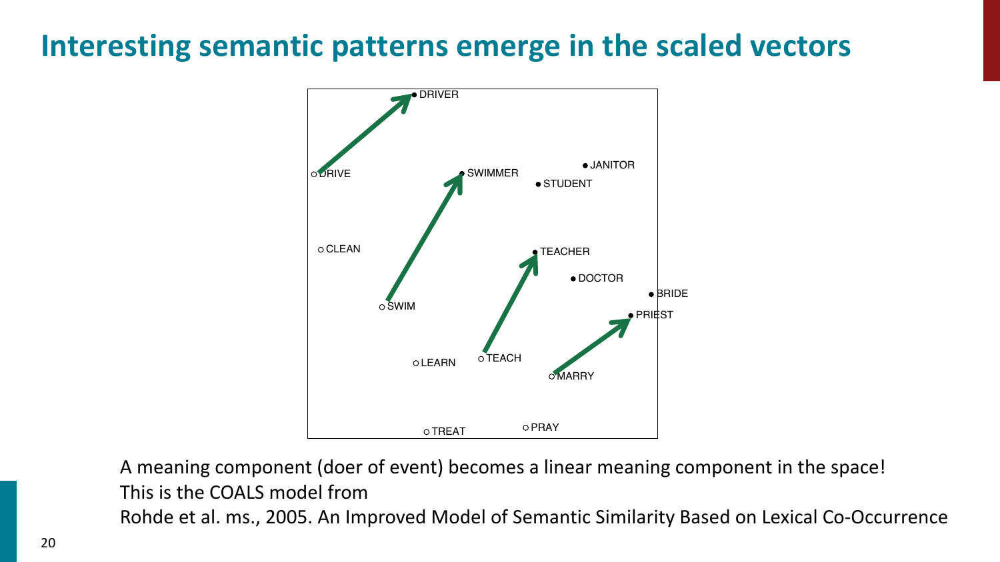
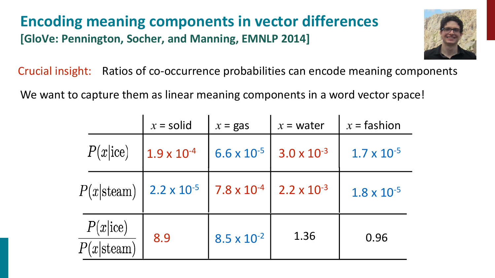
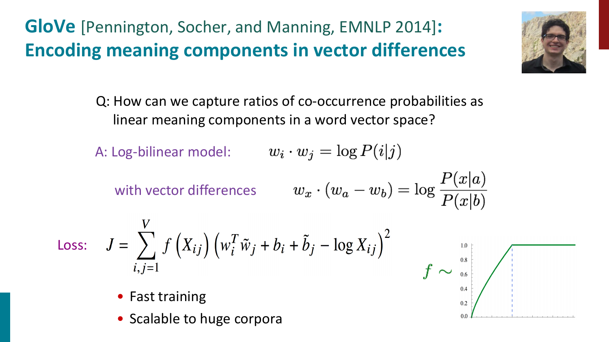
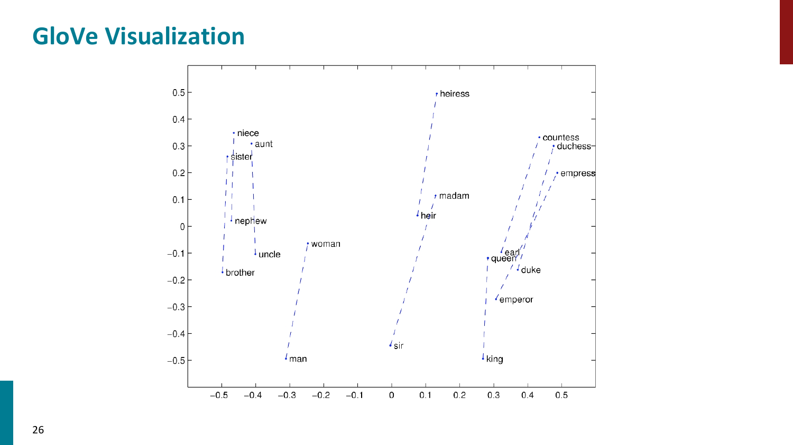
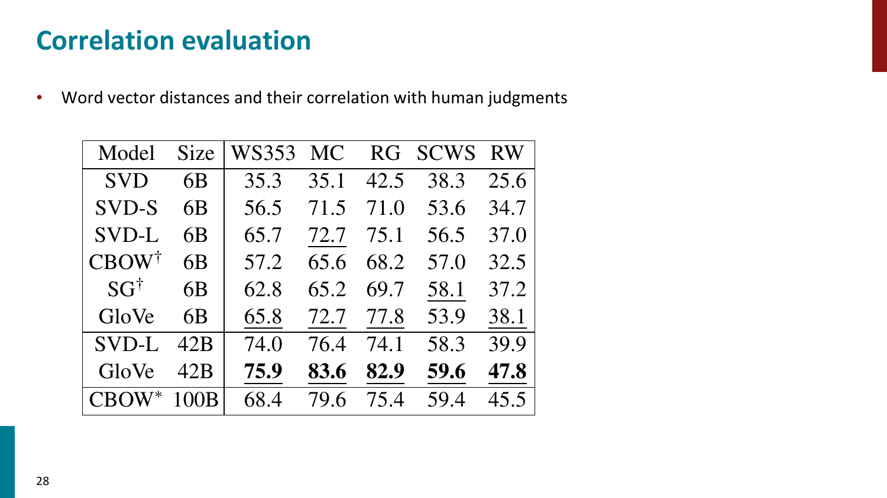
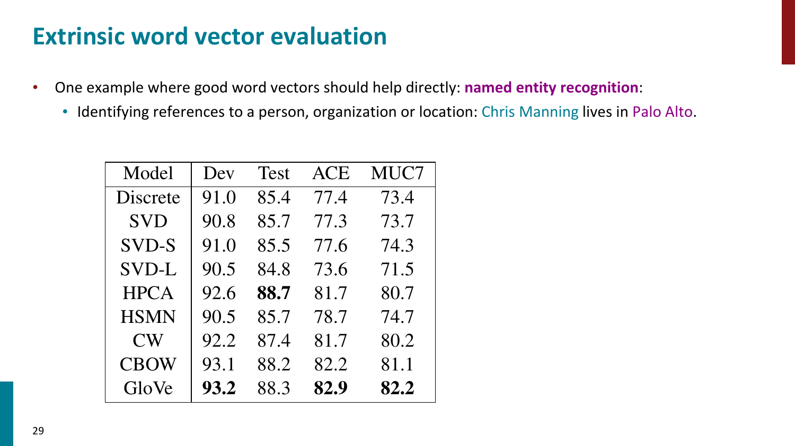
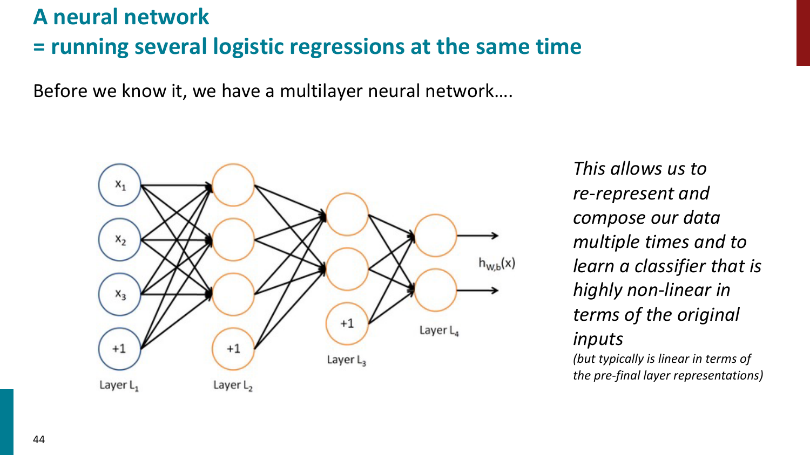

## 1. 优化与 Word2Vec 回顾

**梯度下降（Gradient Descent）**以负梯度方向更新参数：

$$
\theta\leftarrow\theta-\alpha\nabla_\theta J(\theta),\qquad
\theta_i\leftarrow\theta_i-\alpha\frac{\partial J}{\partial\theta_i}.
$$

$\alpha$ 是学习率（Learning Rate）。计算整个语料所有窗口的梯度后才更新，成本可能极高；**随机梯度下降（Stochastic Gradient Descent, SGD）**抽样一个窗口计算梯度并更新，小批量方法一次使用一批窗口。神经网络目标通常非凸，不能将示意图的凸碗形曲面当成一般保证。完整推导见第1讲第6节。

Word2Vec 从随机向量出发，遍历语料位置，预测中心词附近实际出现的词，再更新向量。训练信号只有上下文预测，却能产生词相似性和具有语义意义的方向：

$$
P(o\mid c)=\frac{\exp(u_o^\top v_c)}{\sum_{w\in V}\exp(u_w^\top v_c)}.
$$

**词袋（Bag of Words）性质**：本讲 Skip-gram 对同一个中心词在不同相对位置使用同一个预测分布，不区分左一、右一等位置。训练希望对各种经常出现的上下文词都给出合理概率，而不是把所有概率集中到一个外围词。多个训练词对共同塑造分布。

这里有两个不同层面的“相似”：训练中的中心—外围点积刻画上下文兼容性；训练后比较两个词的表示，可以观察它们是否有相似的上下文。不能直接把每个高概率外围词都称为中心词的同义词。

## 2. Word2Vec 方法族

| 选择 | 输入与预测目标 | 课件强调 |
| --- | --- | --- |
| Skip-gram，SG | 中心词预测外围词 | 外围位置不区分；第1讲采用此方法 |
| 连续词袋，Continuous Bag of Words，CBOW | 上下文词袋预测中心词 | 输入汇总附近词，不保留完整顺序 |
| 朴素Softmax，Naive Softmax | 对整个输出词表归一化 | 简单，但类别多时昂贵 |
| 层次Softmax，Hierarchical Softmax | 优化输出概率计算 | 本页只列举，未展开算法 |
| 负采样，Negative Sampling | 区分真实词对与噪声词对 | 本讲随后展开 |

**两套向量（Two Vectors per Word）**便于优化。课件建议训练结束后可以平均中心向量和外围向量；也指出可以只用一套词向量实现，且可能略有帮助。这里是参数化和经验选择，不应写成“两套向量是唯一合法实现”或“平均一定最好”。

## 3. Skip-gram 负采样

### 3.1 为什么替换完整 Softmax

完整 Softmax 的分母要对 $|V|$ 个词计算分数。即使一条样本只有一个真实外围词，其概率仍依赖全部外围向量。词表很大时，每条样本的全词表归一化成为计算瓶颈。

**负采样（Negative Sampling）**把训练改为二元判别：

- **正样本（Positive Pair）**：实际窗口中的 $(c,o)$。
- **负样本／噪声词对（Negative / Noise Pairs）**：固定同一个中心词 $c$，搭配从噪声分布抽出的词 $n_1,\ldots,n_K$。
- 区分“来自真实上下文”与“来自噪声”，不再为每条样本计算整个词表的归一化分布。

定义 **Sigmoid／Logistic 函数**：

$$
\sigma(s)=\frac1{1+e^{-s}},\qquad 1-\sigma(s)=\sigma(-s).
$$

对一个正词对及其 $K$ 个负样本，损失整理为：

$$
J_{\mathrm{NS}}(c,o;n_1,\ldots,n_K)
=-\log\sigma(u_o^\top v_c)
-\sum_{k=1}^{K}\log\sigma(-u_{n_k}^\top v_c).
$$

第一项鼓励真实词对有较大的点积；第二项鼓励噪声词对有较小的点积。负样本的负号在 Sigmoid 内部：提高负词对点积会增大该项损失。负采样训练的是二元判别目标，不能把 $\sigma(u_o^\top v_c)$ 当成已对词表归一化的 $P(o\mid c)$。

### 3.2 噪声分布

课件采用一元词频分布（Unigram Distribution）$U(w)$ 的 $3/4$ 次幂：

$$
P_n(w)=\frac{U(w)^{3/4}}{Z},\qquad Z=\sum_{w'\in V}U(w')^{3/4}.
$$

相对于直接按词频抽样，这会提高低频词的相对抽样比例。若两个词的频率比为 $r>1$，幂变换后的概率比为 $r^{3/4}<r$；高频词通常仍更容易被抽到，但优势减弱。课件没有要求改为均匀抽样，也没有在本页给出固定的 $K$ 值。

### 3.3 稀疏梯度与实现

窗口半径为 $m$ 时，一个完整窗口涉及至多 $2m+1$ 个真实词。若每个中心—外围词对抽取 $K$ 个负词，至多再涉及 $2mK$ 个负词。重复出现的词共享向量，因此不同参数向量的数量可能更少。

只有这些参与当前目标的向量需要更新，其余词向量梯度为零。**稀疏更新（Sparse Updates）**的意义不仅是少做运算，还在于避免每步创建或传输整个巨大词表的更新。

- 可以使用嵌入矩阵的稀疏行更新，或者以哈希结构保存词向量。
- 课件提醒，实际深度学习框架通常把每个词向量存成矩阵的一行，矩阵形状为 $|V|\times d$；数学推导中的列向量约定不等于存储布局。
- 在百万级词表、分布式计算（Distributed Computing）中，传送完整矩阵更新可能成为主要成本；只发送实际更新的行更合理。

## 4. 从上下文计数直接构造表示

### 4.1 两种共现统计

既然训练信号来自词与上下文的共同出现，可以先累计统计量，构造**共现矩阵（Co-occurrence Matrix）** $X$。

| 统计方式 | 矩阵含义 | 主要捕获的信息 |
| --- | --- | --- |
| 窗口共现，Window-based Co-occurrence | 词与附近词的共同出现次数 | 部分句法和语义信息，词空间（Word Space） |
| 词—文档共现，Word–Document Co-occurrence | 词在各文档中的出现情况 | 文档主题，潜在语义分析（Latent Semantic Analysis, LSA）使用的文档空间 |

同一主题中的词未必同义。例如多个体育词在文档统计中可能相似，因为它们集中出现在体育文章里。

窗口矩阵中 $X_{ij}$ 记录词 $j$ 落入词 $i$ 的窗口的次数。若左右上下文合并、不区分方向，矩阵对称。使用半径1的窗口，说明中提到更常见的窗口大小为5–10。

课件的小语料为 `I like deep learning .`、`I like NLP .`、`I enjoy flying .`。例如：

- `I` 与 `like` 相邻两次，故 $X_{I,\mathrm{like}}=2$。
- `I` 与 `enjoy` 相邻一次，故对应计数为1。
- `deep` 与 `learning` 相邻一次。
- 句末标点 `.` 也作为词表项，与 `learning`、`NLP`、`flying` 各共现一次。

这些统计在每个句子内部进行，不把前一句末尾与后一句开头误连成窗口。

每个词的计数行可以直接当作向量，但维度随词表增长，存储成本高，且向量非常稀疏；后续分类器容易受到稀疏特征和覆盖不足的影响。目标是把主要信息压缩进固定维度的稠密表示，课件给出的常见范围为25–1000维。

### 4.2 SVD 降维

**奇异值分解（Singular Value Decomposition, SVD）**写为：

$$
X=U\Sigma V^\top,\qquad
X_k=U_k\Sigma_kV_k^\top.
$$

保留最大的 $k$ 个奇异值及对应方向，得到秩不超过 $k$ 的近似。$U,V$ 的列为正交单位向量，$\Sigma$ 保存奇异值；不能省略 $\Sigma$ 而把一般矩阵写成两个正交矩阵的乘积。

在最小平方误差意义下，截断SVD给出最佳秩 $k$ 近似：

$$
X_k\in\operatorname*{arg\,min}_{\operatorname{rank}(A)\le k}\|X-A\|_F^2.
$$

丢弃较小奇异值的目的不只是节省空间，也是在压缩中保留主要结构、减少对每个稀疏计数细节的依赖。对巨大矩阵直接做完整SVD昂贵。

**A1 实现补充**：题目要求使用 `sklearn.decomposition.TruncatedSVD`。题目后文明确它的变换输出为 $U_k\Sigma_k$，并在二维可视化前逐行归一化，使点位于单位圆附近；不能把程序输出笼统说成不含奇异值缩放的 $U_k$。作业默认共现窗口半径为4，并加入 `<START>`、`<END>` 标记。这里仅整理题目规定，不新增依赖或运行模型下载。

### 4.3 原始计数为何需要调整

直接对原始计数做SVD效果不好：`the`、`he`、`has` 等功能词（Function Words）过于频繁，可能让高频和句法因素主导表示。课件列出多种处理方式，而非要求全部同时采用：

- 对频数取对数（Log Frequencies），压缩大计数的幅度。
- 截断为 $\min(X_{ij},t)$，其中 $t$ 约为100，限制极大计数的影响。
- 忽略功能词。
- 使用距离加权窗口（Ramped Windows），附近词权重大于远处词。
- 用 Pearson 相关系数替代计数，再把负值置零。

这些方法改变输入统计量的尺度和含义；随后向量中的几何关系也会变化。共现矩阵、变换方法和分解步骤需要一起说明，不能只写“对词频做SVD”。

## 5. GloVe：共现概率比与线性意义成分

### 5.1 向量差中的语义关系

公式定义另对照随课讲义 `cs224n-2019-notes02-wordvecs2.pdf` §1，。

经过缩放的共现向量可以产生有意义的方向。 的 COALS 示例将 `drive/driver`、`swim/swimmer`、`teach/teacher`、`learn/student` 等事件与参与者放在同一空间中，说明“事件的执行者（Doer of Event）”这样的意义成分可能表现为近似一致的位移。

原图为多维缩放展示；关系是经验结构，不表示所有词对都具有完全相同的向量差。

**GloVe（Global Vectors for Word Representation，全局词表示向量）**的核心洞见是：

> Ratios of co-occurrence probabilities can encode meaning components.
>
> 共现概率之比可以编码意义成分。

令 $X_{ij}$ 为词 $j$ 出现在词 $i$ 上下文中的次数，$X_i=\sum_kX_{ik}$，则经验条件概率为：

$$
P_{ij}=P(j\mid i)=\frac{X_{ij}}{X_i}.
$$

对两个目标词 $i,j$，探测词 $k$ 的概率比 $P_{ik}/P_{jk}$ 比单个概率更能突出二者的差异。课件以 `ice` 与 `steam` 为例：

| 探测词 $k$ | solid | gas | water | fashion |
| --- | ---: | ---: | ---: | ---: |
| $P(k\mid\mathrm{ice})$ | $1.9\times10^{-4}$ | $6.6\times10^{-5}$ | $3.0\times10^{-3}$ | $1.7\times10^{-5}$ |
| $P(k\mid\mathrm{steam})$ | $2.2\times10^{-5}$ | $7.8\times10^{-4}$ | $2.2\times10^{-3}$ | $1.8\times10^{-5}$ |
| 二者之比 | $8.9$ | $8.5\times10^{-2}$ | $1.36$ | $0.96$ |

表中均为给出的近似数值，四舍五入后的概率再相除不一定精确复现末行。

- `solid` 更支持 `ice`，概率比远大于1。
- `gas` 更支持 `steam`，概率比远小于1。
- `water` 与二者都相关，两种概率都较大，但比值接近1。
- `fashion` 与二者都不相关，两种概率都较小，比值也接近1。

比值接近1表示该探测词不区分两个目标词，不能单凭比值判断它与二者都相关还是都不相关。是同一思路的定性版本，给出数值。

### 5.2 对数双线性模型与加权平方损失

GloVe 希望将概率比的关系表示为向量差的线性关系。取对数后，概率之比变成差：

$$
\log\frac{P_{ik}}{P_{jk}}=\log P_{ik}-\log P_{jk}.
$$

采用目标词向量 $w_i$、上下文向量 $\tilde w_j$ 和偏置 $b_i,\tilde b_j$，常用的对数双线性形式（Log-bilinear Model）写为：

$$
w_i^\top\tilde w_j+b_i+\tilde b_j\approx\log X_{ij}.
$$

从两个目标词的关系中相减，得到：

$$
(w_i-w_j)^\top\tilde w_k+(b_i-b_j)
\approx\log X_{ik}-\log X_{jk}.
$$

行归一化中的 $\log X_i$ 等仅依赖目标词的量可由偏置项吸收，因此向量差可以承载区分目标词的意义成分。对应训练目标为加权平方误差（Weighted Least Squares）：

$$
J=\sum_{i,j:X_{ij}>0}f(X_{ij})
\left(w_i^\top\tilde w_j+b_i+\tilde b_j-\log X_{ij}\right)^2.
$$

$f$ 控制不同共现计数的权重；零共现不能直接代入 $\log0$。随课讲义§1.3采用省略偏置的简化形式解释从计数到对数计数、再到加权平方误差的变化；上述保留偏置的表达与该简化形式应区分。本讲没有展开 $f$ 的具体分段参数，不额外引入超参数设置。

与逐位置预测相比，GloVe 先收集全局共现统计，再在非零计数上训练；课件强调训练快（Fast Training）且可扩展至大语料（Scalable to Huge Corpora）。它依然利用局部窗口产生的统计量，“全局”指汇总语料统计，不是把全部文本作为一次神经网络输入。

## 6. 如何评价词向量

### 6.1 内在评估与外在评估

| 方式 | 做什么 | 优点 | 局限 |
| --- | --- | --- | --- |
| 内在评估，Intrinsic Evaluation | 在词相似性、类比等中间子任务上评价表示 | 计算快，有助于理解表示本身 | 必须确认与真实任务的相关性，否则高分未必有用 |
| 外在评估，Extrinsic Evaluation | 把词向量放入真实下游系统，评价任务表现 | 直接检验实际用途 | 训练和评估较慢；差结果可能来自其他模块或模块之间的交互 |

只替换一个子系统、其余条件可比时，下游任务提升才为该替换提供较直接的证据。不同模型、不同语料或不同训练条件的结果不能简单当作单一算法因素的因果比较。

### 6.2 类比与可视化

对于 $a:b::c:d$，用 $v_b-v_a+v_c$ 搜索答案：

$$
\hat d=\operatorname*{arg\,max}_{w\in V\setminus\{a,b,c\}}
\frac{v_w^\top(v_b-v_a+v_c)}{\|v_w\|_2\|v_b-v_a+v_c\|_2}.
$$

示例 `man : woman :: king : ?` 预期为 `queen`。必须剔除输入词，否则近邻检索可能返回问题中已有的词。评价可分别考察语义类比（Semantic Analogies）和句法类比（Syntactic Analogies）。

课件提出的限制是：**如果信息存在于表示中，却不是线性编码的呢（What if the information is there but not linear）？** 类比失败可能表示线性检索规则无法读出关系，不能直接证明表示完全没有相关信息。

### 6.3 与人类相似性判断的相关性

**WordSim353** 等数据集让人类对词对进行相似性评分，再比较词向量相似度与人类评分的排序是否一致。示例包括 `tiger/cat` 为7.35，`tiger/tiger` 为10，`book/paper` 为7.46，`computer/internet` 为7.58，`stock/jaguar` 为0.92。

报告 **Spearman秩相关（Spearman Rank Correlation）**，不是分类准确率；表内按百分数尺度展示，向量均为300维。

| 方法 | 语料规模 | WS353 | MC | RG | SCWS | RW |
| --- | --- | ---: | ---: | ---: | ---: | ---: |
| SVD | 6B | 35.3 | 35.1 | 42.5 | 38.3 | 25.6 |
| SVD-S | 6B | 56.5 | 71.5 | 71.0 | 53.6 | 34.7 |
| SVD-L | 6B | 65.7 | 72.7 | 75.1 | 56.5 | 37.0 |
| CBOW | 6B | 57.2 | 65.6 | 68.2 | 57.0 | 32.5 |
| SG | 6B | 62.8 | 65.2 | 69.7 | 58.1 | 37.2 |
| GloVe | 6B | 65.8 | 72.7 | 77.8 | 53.9 | 38.1 |
| SVD-L | 42B | 74.0 | 76.4 | 74.1 | 58.3 | 39.9 |
| GloVe | 42B | 75.9 | 83.6 | 82.9 | 59.6 | 47.8 |
| CBOW | 100B | 68.4 | 79.6 | 75.4 | 59.4 | 45.5 |

这些是课件引用的历史结果。同为6B时，GloVe不在所有列都最优，例如SCWS上的SG高于GloVe；不能总结成“GloVe在每项任务上都胜出”。数据规模也不是唯一因素，不同语料来源和模型设置会影响结果。

### 6.4 NER 下游评估

**命名实体识别（Named Entity Recognition, NER）**识别人名、组织、地点等文本片段，例如 `Chris Manning lives in Palo Alto` 中的人名与地点。课件用50维词向量在NER任务上的F1说明外在评价，`Discrete` 是不使用词向量的基线。

| 模型 | Dev | Test | ACE | MUC7 |
| --- | ---: | ---: | ---: | ---: |
| Discrete | 91.0 | 85.4 | 77.4 | 73.4 |
| SVD | 90.8 | 85.7 | 77.3 | 73.7 |
| SVD-S | 91.0 | 85.5 | 77.6 | 74.3 |
| SVD-L | 90.5 | 84.8 | 73.6 | 71.5 |
| HPCA | 92.6 | 88.7 | 81.7 | 80.7 |
| HSMN | 90.5 | 85.7 | 78.7 | 74.7 |
| CW | 92.2 | 87.4 | 81.7 | 80.2 |
| CBOW | 93.1 | 88.2 | 82.2 | 81.1 |
| GloVe | 93.2 | 88.3 | 82.9 | 82.2 |

GloVe在该表各列最高，但这只是特定实验配置的结果。SVD-L的Test、ACE和MUC7低于Discrete，直接说明“加入词向量”并不自动保证下游提升。

## 7. 一个词有多个词义怎么办

高频词、历史较长的常用词往往有许多含义。`pike` 可指尖头或长矛、一种细长鱼、铁路线、道路、未来（`coming down the pike`）、跳水等运动中的屈体姿势，也可作动词表示刺杀、行进；澳大利亚英语中还可指退出原定活动。单个静态向量如何承载这些含义，是词义歧义（Word Sense Ambiguity）问题。

### 7.1 多原型表示

Huang等（2012）的**多词原型（Multiple Word Prototypes）**方法：收集同一个词出现时的上下文窗口，按上下文聚类，再把词的各次出现标成 `bank1`、`bank2` 等不同簇，重新训练各簇的表示。聚类对象是使用环境，不是简单按词的拼写拆分。

随课讲义§2.6补充的步骤是：用上下文词向量的IDF加权平均表示窗口，应用球面K-means，再按簇重新标记词的出现。此处是明确的讲义补充；课件本页只概括聚类与重训练。

### 7.2 线性叠加的词义

Arora等（TACL 2018）提出，标准词嵌入中的不同词义可以表现为**线性叠加（Linear Superposition）**。文字说明，整理为：

$$
v_{\mathrm{pike}}=\alpha v_{\mathrm{pike}_1}+\beta v_{\mathrm{pike}_2}+\gamma v_{\mathrm{pike}_3},\qquad
\alpha=\frac{f_1}{f_1+f_2+f_3},
$$

其余权重同理，$f_s$ 为相应词义频率。这是课件介绍的词义混合观点，不能当作任意训练后词向量都精确满足、且词义向量已知的恒等式。利用稀疏编码（Sparse Coding）思想，某些相对常见的词义可以从混合表示中分离；稀有词义不在该页结论的保证范围内。

## 8. 从词向量到命名实体分类

### 8.1 任务、标签与上下文

NER对文本中的词元（Tokens）定位并分类。相同拼写可以有不同标签：`Paris Hilton` 中 `Paris` 是人名组成部分，而 `in Paris` 中是地点。课件还列出 `Samuel Quinn`、`Hilton Hotel`、`April 1989` 等人名、地点及日期标签示例；应按课件的标签方案理解，而非假设所有数据集都使用完全一致的类型。

用途包括实体提及追踪、问答中的答案识别、把情感判断关联到具体实体。NER之后常进行**实体链接／规范化（Entity Linking / Canonicalization）**，映射到Wikidata等知识库；识别文本跨度与确定知识库身份是两个步骤。

监督学习（Supervised Learning）的训练集写为 $\{(x^{(i)},y^{(i)})\}_{i=1}^{N}$。输入可以是词、句子或文档；$y$ 可表示情感、实体类别、买卖决策等标签。本例先做中心词是否属于地点的二分类，实际NER通常使用多类别预测。

### 8.2 窗口拼接保留位置

在 `the museums in Paris are amazing to see .` 中，以 `Paris` 为中心、半径为2，拼接五个词向量：

$$
x_{\mathrm{window}}=
\begin{bmatrix}
x_{\mathrm{museums}}\\x_{\mathrm{in}}\\x_{\mathrm{Paris}}\\x_{\mathrm{are}}\\x_{\mathrm{amazing}}
\end{bmatrix}\in\mathbb R^{5d}.
$$

这里的拼接（Concatenation）与求和不同：每个相对位置占据固定的一段坐标，交换位置会改变输入。对每个词滑动窗口，就能逐词分类；本讲示例没有建模完整标签序列之间的依赖。

### 8.3 学习分类器，也学习输入表示

传统固定特征的Softmax分类器只学习权重矩阵，决策边界相对于输入特征是线性的。神经分类器还可以学习词向量，让输入表示随任务目标一起调整。

若 $e_w\in\mathbb R^{|V|}$ 是独热向量，数学上可用嵌入矩阵 $L\in\mathbb R^{d\times|V|}$ 选择对应词向量：

$$
x_w=Le_w.
$$

这与程序中按词索引查表等价，无须真的构造大型独热向量。这里按列定义 $L$，与框架常见的按行存储约定不同。

二分类结构按统一符号写为：

$$
h=f(Wx_{\mathrm{window}}+b),\qquad
s=u^\top h,\qquad
P(y=1\mid x)=\sigma(s).
$$

若隐藏层宽度为 $h_d$，则 $W\in\mathbb R^{h_d\times5d}$、$b,u\in\mathbb R^{h_d}$。$f$ 是逐元素非线性，可选Logistic、tanh或ReLU。该页公式文本不完整，以上为按结构说明整理的记法，不宣称图中所有偏置与符号均已转录。

## 9. 交叉熵、神经元与多层网络

### 9.1 交叉熵与负对数似然

真实分布为 $p$、预测分布为 $q$，**交叉熵（Cross-entropy）**为：

$$
H(p,q)=-\sum_{c=1}^{C}p_c\log q_c.
$$

若真实标签为独热分布，正确类为 $y$，只有 $p_y=1$，其余项为零：

$$
H(p,q)=-\log q_y=-\log P(y\mid x).
$$

因此最小化交叉熵与最大化正确类概率是同一训练目标的两种表述。推荐PyTorch的 `torch.nn.CrossEntropyLoss()`。这里讨论互斥类别的Softmax分类；前节二分类也可写成对应两类的交叉熵：

$$
J=-y\log\hat p-(1-y)\log(1-\hat p).
$$

对一般软标签分布，交叉熵仍是完整求和，不能再只保留一个类别项；本讲暂时以独热标签为主。

### 9.2 单个神经元

一个二元Logistic回归单元近似神经元的抽象：

$$
h_{w,b}(x)=f(w^\top x+b),\qquad f(z)=\sigma(z)=\frac1{1+e^{-z}}.
$$

$w$ 是权重（Weights），$b$ 是偏置（Bias），$x$ 是输入，$h$ 是输出。偏置可作为独立参数，也可用恒为1的输入特征表示。对于Logistic单元，当其他输入贡献为零时，偏置控制基准概率 $\sigma(b)$。

### 9.3 并行神经元与函数复合

把同一个输入送入多个Logistic单元，得到输出向量，再把该向量送入下一层，就形成**多层神经网络（Multilayer Neural Network）**。隐藏单元（Hidden Units）无需事先指定“要预测什么语言学概念”；最终损失通过训练决定哪些中间表示有助于预测标签。

一层的矩阵记法是：

$$
z=Wx+b,\qquad a=f(z),\qquad
a_i=f\left(\sum_jW_{ij}x_j+b_i\right).
$$

若输入为 $n$ 维、输出为 $r$ 维，则 $W\in\mathbb R^{r\times n}$、$b,z,a\in\mathbb R^r$。$f$ **逐元素应用（Element-wise Application）**，即 $f([z_1,z_2,z_3]^\top)=[f(z_1),f(z_2),f(z_3)]^\top$；不是对整向量只输出一个数。

### 9.4 为什么必须有非线性

若层间没有非线性，两层仿射变换可以合并：

$$
W_2(W_1x+b_1)+b_2
=(W_2W_1)x+(W_2b_1+b_2).
$$

增加这种层数，仍只得到一个仿射变换，不能仅靠深度产生更复杂的决策边界。加入非线性激活后，网络才能反复重新表示、组合数据，逼近更复杂的函数。

最终Softmax层相对于倒数第二层表示仍通常是线性打分，但相对于原始输入，整个网络可以是高度非线性的。这与“最后一层线性”并不矛盾。
