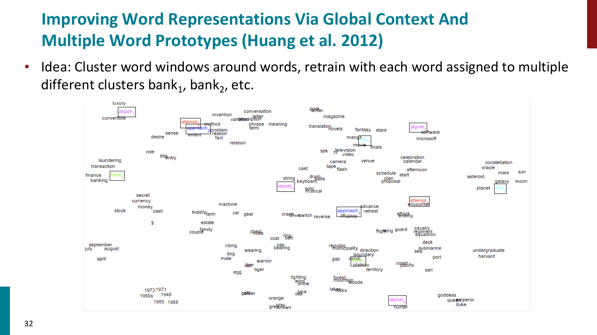
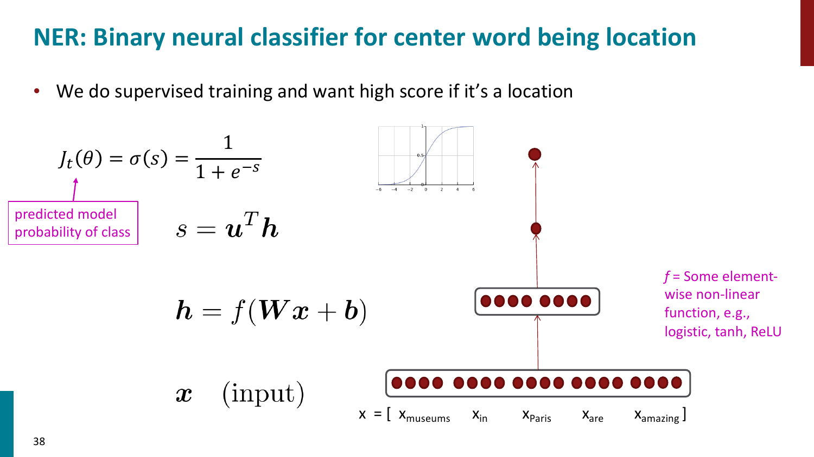

## 1. 从预测上下文到使用词向量

第一讲用 Skip-gram 学习词向量：给定中心词 $c$，预测窗口中的外围词 $o$，再根据预测误差更新向量。完整 Softmax 的概率为：

$$
P(o\mid c)=\frac{\exp(u_o^\top v_c)}{\sum_{w\in V}\exp(u_w^\top v_c)}.
$$

这里 $V$ 是词表，$v_c\in\mathbb R^d$ 是中心词向量，$u_w\in\mathbb R^d$ 是候选外围词向量。两套向量分别承担输入和输出角色。

这个方法带来两个接下来的问题：**词表很大时，怎样降低训练成本？学到向量后，怎样判断它有没有用，并把它用于分类？**

本讲先介绍负采样，再从另一条路线出发：统计词与上下文的共现次数，通过 SVD 或 GloVe 学习表示。最后把词向量作为神经分类器的输入。

### 1.1 Word2Vec：通过词预测学习词向量

**Word2Vec 是一组从文本中学习词向量的方法。** 给它一份语料，它会为词表中的每个词学习数值向量，供相似词检索、文本分类等任务使用。

怎样判断某个向量应该如何调整？文本中没有标注每个词的“正确向量”，却记录了哪些词经常出现在一起。因此，可以让模型练习词预测：提供窗口中的一部分词，让它预测其余位置的词，根据预测误差调整向量。反复训练后，向量就积累了词的使用环境信息。

训练中的基本过程是：先随机初始化词向量，再用向量计算预测，最后根据损失更新向量。**要学到的结果是词向量；词预测任务为学习这些向量提供训练信号。**

下面分别介绍 Word2Vec 中的两种基本模型：Skip-gram 和连续词袋模型（Continuous Bag of Words，CBOW）。

以句子 `the cat eats fish` 为例，固定中心位置为 `eats`，窗口半径为 1。窗口的中心词是 `eats`，左侧上下文是 `cat`，右侧上下文是 `fish`。

#### Skip-gram：用一个词预测它周围的词

**Skip-gram 是一种通过“中心词预测上下文词”来学习词向量的模型。** 它把中心词作为已知输入，将窗口中的每个外围词分别作为预测答案。模型需要从输入词的向量中提取足够的信息，判断哪些词容易出现在附近。

训练时将中心词 `eats` 作为输入，把两个上下文词分别作为答案：

| 训练样本 | 模型看到的输入 | 当前样本的正确答案 |
| --- | --- | --- |
| 第一个词对 | eats | cat |
| 第二个词对 | eats | fish |

一次词对预测的计算过程是：

1. 从输入向量表取出 $v_{\mathrm{eats}}$。
2. 将它与每个候选输出词的向量做点积，得到整个词表的分数。
3. 通过 Softmax 得到 $P(w\mid\mathrm{eats})$。
4. 根据当前答案计算损失：第一个词对使用 $-\log P(\mathrm{cat}\mid\mathrm{eats})$，第二个使用 $-\log P(\mathrm{fish}\mid\mathrm{eats})$。

因此，这个窗口贡献的损失为：

$$
J_{\mathrm{SG}}=-\log P(\mathrm{cat}\mid\mathrm{eats})
-\log P(\mathrm{fish}\mid\mathrm{eats}).
$$

两条样本的输入相同，模型给出的分布也相同；它们共同要求这个分布给 `cat` 和 `fish` 分配合理概率。模型并没有先生成 `cat` 再根据它生成 `fish`，也没有两个分别负责左侧和右侧的输出分布。窗口中实际有多少个外围词，就产生多少个中心—外围词对。

训练会在许多句子中重复这个过程。`eats` 在其他位置还可能与 `dog` 或 `rice` 等词共现，所有这些词对共同塑造它的表示。**Skip-gram 学到的表示，需要能支持从这个词预测其多种使用环境。**

#### CBOW：用周围的词预测中间的词

**CBOW 是一种通过“上下文词预测中心词”来学习词向量的模型。** 它将一个窗口中的多个上下文词作为输入，先汇总这些词的向量，再预测中心位置的词。每个上下文向量都参与预测，并根据预测误差得到调整。

在上面的例子中，一个窗口构成一条样本：输入是 `cat` 和 `fish`，答案是 `eats`。可以把它理解为隐藏中间位置，让模型根据两侧信息填词。

为了清楚区分角色，这里统一将输入词向量记为 $v_w$，将输出候选词向量记为 $u_w$。在 CBOW 中，输入来自上下文，输出候选是中心词；这与前面 Skip-gram 中的中心、外围角色正好相反。

采用平均汇总时，计算过程是：

1. 查出两个输入词向量 $v_{\mathrm{cat}}$ 和 $v_{\mathrm{fish}}$。
2. 计算上下文表示 $h=(v_{\mathrm{cat}}+v_{\mathrm{fish}})/2$。
3. 对每个候选中心词 $w$ 计算分数 $u_w^\top h$，再经过 Softmax。
4. 用真实中心词 `eats` 的概率计算损失。

对应公式为：

$$
P(w\mid\{\mathrm{cat},\mathrm{fish}\})
=\frac{\exp(u_w^\top h)}{\sum_{a\in V}\exp(u_a^\top h)},\qquad
J_{\mathrm{CBOW}}=-\log P(\mathrm{eats}\mid\{\mathrm{cat},\mathrm{fish}\}).
$$

也可以使用求和汇总；这里固定采用平均，明确本例的计算规则。平均后的 $h$ 仍为 $d$ 维，不是将两个向量拼成 $2d$ 维。损失的梯度会经过平均操作传到两个输入词向量，因此它们会一起调整，以便这个上下文更容易预测出 `eats`。

“词袋”描述的正是这种汇总方式：交换 `cat` 和 `fish` 的位置，$h$ 不变，预测也不变。因此，基本 CBOW 能利用窗口里有哪些词，却无法凭这个输入区分它们的排列顺序。这里使用集合式记号简写上下文，但重复词在实际平均中仍按出现次数计入。

#### 两种模型的比较

| 比较项 | Skip-gram | CBOW（平均汇总） |
| --- | --- | --- |
| 已知信息 | 一个中心词 | 一组上下文词 |
| 当前窗口的训练答案 | 每个外围词分别作为答案 | 中心词作为一个答案 |
| 模型使用的输入表示 | 一个词的向量 | 多个上下文词向量的平均 |
| 一个窗口包含 $q$ 个外围词时 | 产生 $q$ 个词对预测项 | 产生一个中心词预测项 |
| 对向量提出的要求 | 单个词的表示要能预测多种上下文 | 多个词的表示汇总后要能预测中心词 |

两者都通过大量窗口中的预测误差来学习向量；上下文相似的词会受到相似的训练约束，因而可能得到相近的表示。预测是训练手段，词向量是训练过程中学到的参数，并不要求后续使用词向量时仍然做同一种预测。

上面的两种模型都需要为整个词表中的候选词计算分数。当词表很大时，这一步会成为训练瓶颈。第 2 节将以 Skip-gram 为例，介绍如何降低这部分计算成本。

### 1.2 上下文兼容性不等于同义关系

$u_{\text{fish}}^\top v_{\text{eats}}$ 衡量 `fish` 作为 `eats` 的上下文词是否匹配；它不表示这两个词互为同义词。

训练后比较 $v_{\text{cat}}$ 与 $v_{\text{dog}}$，是在观察两个输入词是否形成了相近的表示。它们可能因为经常出现在相似环境中而接近，即使两者并不经常紧挨着出现。

使用词向量时，可以选择中心向量、外围向量，或两者的和、平均值。这是表示的选择，需要在同一次比较中保持一致。

## 2. 负采样：不必每次计算整个词表

### 2.1 完整 Softmax 的成本在哪里

对于一个真实词对 $(c,o)$，完整 Softmax 需要计算所有 $u_w^\top v_c$，才能得到分母。如果词表有一百万个词，一条训练样本就需要对一百万个候选评分。

每个点积的成本与向量维度 $d$ 成正比，因此单词对的直接计算成本约为 $O(|V|d)$。分母还使所有外围向量通常都有非零梯度。

负采样将问题改为：

> 给定一个词对，判断它来自真实上下文，还是来自随机搭配。

### 2.2 正样本与负样本

负采样中的一条训练样本由**两个词和一个标签**组成：第一个词是中心词，第二个词是与它配对的候选上下文词，标签记录这次配对是怎样构造出来的。这里的“正、负”与词的情感、好坏或语法正确性无关。

**第一步：从文本中取出真实配对，作为正样本。**

例句：The **banking** crises spread quickly.

选中 `banking` 作为中心词，窗口半径设为 1，左右各看一个词。因此，左侧上下文是 `The`，右侧上下文是 `crises`。

现在把中心词与右侧的 `crises` 配成一对，记作 $(c,o)=(\text{banking},\text{crises})$。这对括号表示一个有序词对：第一个位置放中心词，第二个位置放外围词；它不是句子中额外出现的一段文字。

因为这个配对来自我们实际观察到的窗口，所以把它作为**正样本（Positive Sample）**，标签设为 $y=1$。左侧的 `The` 也会与 `banking` 构成另一个正样本；下面先只处理右侧这一对。

**第二步：保持中心词不变，随机配上其他词，作为负样本。**

为了让模型学习区分，还要给它一些随机搭配。固定中心词 `banking`，从词表中按指定概率随机抽词。这个抽词规则称为**噪声分布**，具体概率如何设置会在第 2.6 节说明。

例如，设每个正词对配两个随机词，本例将这两个抽样结果设为 `banana` 和 `guitar`，于是构造出：

| 模型接收的中心词 | 与之配对的候选词 | 配对来自哪里 | 标签 |
| --- | --- | --- | ---: |
| banking | crises | 句子中实际观察到的邻近关系 | 1：正样本 |
| banking | banana | 保持中心词不变，候选词从词表随机抽取 | 0：负样本 |
| banking | guitar | 保持中心词不变，候选词从词表随机抽取 | 0：负样本 |

后两条称为**负样本（Negative Samples）**。不需要人工挑选“错误词”，也不需要真的修改原句；只是额外构造两条训练记录。

**第三步：让模型学习区分这两种配对来源。**

对上面的三条记录，训练希望模型给真实配对 `(banking, crises)` 较高的判别分数，给随机配对较低的判别分数。处理下一个正词对时，再抽取新的负样本。大量词对共同训练后，向量需要反映“哪些搭配在真实上下文中比随机搭配更常见”。

一般地，为一个正词对抽取 $K$ 个随机词，记为 $n_1,\ldots,n_K$，就得到一个正样本和 $K$ 个负样本。下一节会把这种判别分数转换成概率，再据此定义损失。

负样本的标签只记录**这次样本由随机抽样产生**，不表示该词对在任何文本中都不可能出现。随机抽样甚至可能碰巧抽中真实上下文词；它仍按这次抽样的来源标为 0。同一个词也可能被重复抽到，重复出现需要重复计入损失和梯度。

### 2.3 模型怎样判断一个词对更像正样本还是负样本

模型根据两个词的向量，计算它们组成正样本的概率。计算分为两步：先用点积得到匹配分数，再用 Sigmoid 将分数转换为概率。

#### 第一步：取出两个词的向量，计算匹配分数

先看正样本 `banking` 配 `crises`。从中心词向量表取出 $v_{\mathrm{banking}}$，从外围词向量表取出 $u_{\mathrm{crises}}$，计算点积：

$$
s=u_{\mathrm{crises}}^\top v_{\mathrm{banking}}.
$$

$s$ 是这个词对的**匹配分数**。分数越大，模型越倾向于把它判为正样本。但是点积可以为任意实数，例如 $-2$、$0$ 或 $2$，还不能直接当作概率。

#### 第二步：用 Sigmoid 把分数转换为 0 到 1 之间的数

Sigmoid 是一个数值变换函数，记为 $\sigma$，计算规则为：

$$
\hat p=\sigma(s)=\frac1{1+e^{-s}}.
$$

这里 $e$ 是自然常数，$\hat p$ 是模型预测的正样本概率。

| 点积分数 $s$ | Sigmoid 输出 $\hat p$ | 模型的预测倾向 |
| --- | ---: | --- |
| $-2$ | 约 $0.119$ | 更倾向于负样本 |
| $0$ | $0.5$ | 对正负两类给出相同概率 |
| $2$ | 约 $0.881$ | 更倾向于正样本 |

例如，若当前向量使 `banking` 与 `crises` 的点积为 2，模型就给这条记录约 $0.881$ 的正样本概率，以及约 $0.119$ 的负样本概率。这些是演示计算的假设数值，实际分数由当前向量决定。

#### 第三步：对正负样本使用同一种计算，再与各自标签比较

`banking` 配 `banana` 时，同样取出两套表中的对应向量，计算点积和 Sigmoid。模型不会因为这条记录被标为负样本就自动输出低概率；它可能一开始就预测错，下一节的损失函数会根据这种误差推动参数更新。

为了统一表示这些不同的词对，下面约定：

- $c$ 代表中心词，本例始终是 `banking`。
- $w$ 代表当前与中心词配对的候选词，可以是正样本中的 `crises`，也可以是负样本中的 `banana` 或 `guitar`。
- $(c,w)$ 表示这两个词组成的一条输入，不包含标签。

于是所有记录都使用同一个计算规则：

$$
\boxed{s=u_w^\top v_c,\qquad \hat p=\sigma(s)}.
$$

这里 $\hat p$ 回答“给定这两个词，这条记录属于正样本的概率是多少”，而不是“给定中心词，下一个外围词恰好是 $w$ 的概率是多少”。对于同一个中心词，不同候选词分别做一次正负分类；它们的 $\hat p$ 不需要在整个词表上加起来等于 1。

### 2.4 从二分类损失得到负采样目标

二分类标签为 $y\in\{0,1\}$，预测值为 $\hat p=\sigma(s)$ 时，交叉熵损失为：

$$
\ell(s,y)=-y\log\sigma(s)-(1-y)\log(1-\sigma(s)).
$$

对正样本 $y=1$，损失为 $-\log\sigma(s)$；对负样本 $y=0$，利用 $1-\sigma(s)=\sigma(-s)$，损失为 $-\log\sigma(-s)$。

因此，一个正词对及其 $K$ 个负词的总损失为：

$$
\boxed{J_{\mathrm{NS}}=-\log\sigma(u_o^\top v_c)
-\sum_{k=1}^{K}\log\sigma(-u_{n_k}^\top v_c)}.
$$

第一项鼓励正词对分数增大，第二项鼓励负词对分数减小。每次只需要对 $K+1$ 个词对评分，计算成本约为 $O((K+1)d)$，不再随整个词表大小线性增长。

### 2.5 梯度为什么只更新少量词向量

Sigmoid 的导数为 $\sigma'(s)=\sigma(s)(1-\sigma(s))$。代入二分类交叉熵，可以得到简单的误差信号：

$$
\frac{\partial\ell}{\partial s}=\sigma(s)-y.
$$

记 $s_o=u_o^\top v_c$、$s_k=u_{n_k}^\top v_c$，则：

$$
\boxed{\nabla_{v_c}J_{\mathrm{NS}}
=(\sigma(s_o)-1)u_o+\sum_{k=1}^{K}\sigma(s_k)u_{n_k}}.
$$

对于正样本中的外围词 $o$，它对应的损失项为 $\ell_o=-\log\sigma(s_o)$。对外围向量 $u_o$ 求导：

$$
\nabla_{u_o}\ell_o=(\sigma(s_o)-1)v_c.
$$

对于第 $k$ 次抽到的负词 $n_k$，它对应的损失项为 $\ell_k=-\log\sigma(-s_k)$。这里 $k$ 是抽样序号，$u_{n_k}$ 是这个负词的外围向量。由链式法则：

$$
\nabla_{u_{n_k}}\ell_k
=\frac{\partial\ell_k}{\partial s_k}\nabla_{u_{n_k}}(u_{n_k}^\top v_c)
=\sigma(s_k)v_c.
$$

例如，负词是 `banana` 时，上式求的是这条负样本损失对 $u_{\mathrm{banana}}$ 的梯度。梯度下降会从这个向量中减去 $\alpha\sigma(s_k)v_c$，使它与当前中心向量的点积分数降低。

同一个词可能被重复抽到，但向量表中只保存它的一份向量。因此要把重复样本产生的梯度相加。例如，`banana` 被抽到两次时，两项损失都依赖 $u_{\mathrm{banana}}$，合计梯度为 $2\sigma(u_{\mathrm{banana}}^\top v_c)v_c$。若某个词同时作为正词和负词出现，它的正、负两部分梯度也要相加。

未参与本次损失的向量梯度为零。这称为**稀疏更新**：只更新当前使用到的词向量，而不是整个词表。

实际存储时，通常把每个词向量放在嵌入矩阵的一行，通过词编号取出对应行。数学上将向量写成列向量，与程序中的存储方向是两回事。

### 2.6 负样本的抽样分布

设词 $w$ 在语料中出现 $f(w)$ 次，常用噪声分布为：

$$
P_n(w)=\frac{f(w)^{3/4}}{\sum_{a\in V}f(a)^{3/4}}.
$$

它仍然更常抽到高频词，但会削弱高频词的优势。例如，两个词的频率比为 $16:1$，变换后的抽样概率比为 $8:1$。低频词的相对占比因而提高。

若直接均匀抽样，则每个词概率相同；若直接按词频抽样，则大量样本会集中到最高频的词。$3/4$ 次幂是介于两者之间的经验选择。

> **算法 1：用负采样训练 Skip-gram**
>
> **输入**：词序列、词表 $V$、窗口半径 $m$、维度 $d$、负样本数 $K$、学习率 $\alpha$、更新次数 $S$。
>
> **输出**：中心词向量表和外围词向量表。
>
> 1. **准备**：统计词频，构造噪声分布 $P_n$，随机初始化两张向量表。
> 2. **循环**：重复 $S$ 次：
>    1. 均匀抽取一个中心位置，并提取它的所有合法外围词。
>    2. 为每个正词对独立地从 $P_n$ 有放回抽取 $K$ 个负词。
>    3. 对该窗口所有正词对分别计算 $J_{\mathrm{NS}}$，再相加得到窗口损失。
>    4. 在同一组当前参数上计算梯度，累加重复词的贡献。
>    5. 按 $\theta\leftarrow\theta-\alpha\nabla_\theta J$ 更新参与本次损失的向量。
> 3. **返回**：更新后的两张向量表。

这里的负样本标签由抽样来源决定；即使抽到了当前正词或另一个真实上下文词，也按其负样本出现计入目标。若实现选择排除这些词，就改变了抽样规则，需要相应说明。

### 2.7 回看预测任务与训练目标

现在可以区分两个层面的选择：

- **预测任务**规定哪些词作为输入、哪些词作为答案。Skip-gram 用中心词预测外围词，CBOW 用汇总后的上下文预测中心词。
- **训练目标**规定怎样评价这些输入与答案之间的匹配。完整 Softmax 计算整个词表的条件概率，最小化真实答案的负对数概率；负采样则构造真实搭配与随机搭配，最小化二分类损失。

因此，负采样不是与 Skip-gram 并列的第三种预测模型，而是可以用于训练词向量的目标构造方式。本节具体展开的是 Skip-gram 与负采样的组合。它通过改变训练目标节省计算，并不直接计算或精确复现完整 Softmax 的词表概率。

## 3. 共现矩阵

**共现**指两个词在指定的上下文范围内一起出现。共现矩阵把这种关系记录成一张计数表：每行对应一个中心词，每列对应一个上下文词，格子中的数表示观察到这个配对多少次。

它把整份语料中的上下文记录汇总起来。表中的每一行都可以作为对应词的数值表示；随后还可以通过降维，把这些计数压缩成低维词向量。

### 3.1 从文本构造计数表

以两句话为例：

```text
I like cats
I like dogs
```

先固定统计规则：窗口半径为 1，只统计紧邻中心词的左右两个位置；句首、句末只取存在的邻词；窗口不跨句。词表按 `I`、`like`、`cats`、`dogs` 排列。

建立一个四行四列的矩阵 $X$，初始值全部为 0。每观察到一次“中心词 $i$ 配上下文词 $j$”，就在第 $i$ 行、第 $j$ 列加 1：

$$
X_{ij}\leftarrow X_{ij}+1.
$$

遍历第一句时，依次得到：

| 当前中心位置 | 窗口中的上下文词 | 计数操作 |
| --- | --- | --- |
| I | like | `I` 行、`like` 列加 1 |
| like | 左侧 I，右侧 cats | `like` 行、`I` 列加 1；`like` 行、`cats` 列加 1 |
| cats | like | `cats` 行、`like` 列加 1 |

这里 `I` 与 `like` 相邻一次，会分别在两个格子中留下记录：以 `I` 为中心时更新 $X_{\mathrm{I},\mathrm{like}}$，以 `like` 为中心时更新 $X_{\mathrm{like},\mathrm{I}}$。不是在同一个格子里加两次。

再以相同规则遍历第二句，得到完整矩阵：

| 中心词 / 上下文词 | I | like | cats | dogs |
| --- | ---: | ---: | ---: | ---: |
| I | 0 | 2 | 0 | 0 |
| like | 2 | 0 | 1 | 1 |
| cats | 0 | 1 | 0 | 0 |
| dogs | 0 | 1 | 0 | 0 |

例如，$X_{\mathrm{I},\mathrm{like}}=2$，因为两句话中的 `I` 右侧都出现了 `like`；$X_{\mathrm{like},\mathrm{cats}}=1$，因为只有第一句中的 `like` 与 `cats` 相邻。

一般地，词表大小为 $|V|$ 时，$X\in\mathbb R^{|V|\times|V|}$。在上述规则下，每个元素的定义为：

$$
X_{ij}=\text{遍历语料时，词 }j\text{ 落在中心词 }i\text{ 的窗口内的总次数}.
$$

左右采用相同范围和权重时，每次邻近关系都会被双向记录，所以 $X_{ij}=X_{ji}$。本例对角线为零，是因为窗口内没有同一个词的重复出现；若文本中有 `very very good`，两个不同位置的 `very` 也能共现，对角线就可以非零。

### 3.2 从计数行得到词表示

固定列顺序后，每一行就是一个向量。上表中：

$$
x_{\mathrm{cats}}=(0,1,0,0),\qquad
x_{\mathrm{dogs}}=(0,1,0,0).
$$

四个坐标依次记录与 `I`、`like`、`cats`、`dogs` 的共现次数。`cats` 和 `dogs` 的向量相同，表示在这份小语料和这套窗口规则下，它们具有相同的上下文计数。

注意 $X_{\mathrm{cats},\mathrm{dogs}}=0$：它们没有直接相邻，但各自都与 `like` 相邻，所以仍然具有相同的行表示。**比较两个词的计数行，比较的是它们各自周围出现了哪些词，而不只是这两个词彼此共现了多少次。**

这个小语料不足以完整刻画词义。随着语料增加，每个坐标累计更多观测，向量才会包含更丰富的使用信息。

计数行与独热向量也不同。独热向量的非零坐标只标记词自身的身份；共现计数行的各坐标记录上下文特征，可以同时有多个非零值。

### 3.3 词—文档矩阵

如果把“共同出现在一篇文档中”作为上下文关系，可以改为统计每个词在每篇文档中出现多少次，形成词—文档矩阵。它的行仍对应词，列改为文档。

将上面两句话分别视为两篇文档，得到：

| 词 | 文档 1：I like cats | 文档 2：I like dogs |
| --- | ---: | ---: |
| I | 1 | 1 |
| like | 1 | 1 |
| cats | 1 | 0 |
| dogs | 0 | 1 |

现在 `cats` 的行表示为 $(1,0)$，含义是它出现于文档 1，没有出现于文档 2。坐标含义已经改变，因而不能与上一节的窗口计数向量混用。

窗口共现反映局部用法；词—文档统计更容易反映主题联系。例如，球队、球员、比赛可能集中出现在体育文档中，但它们不是同义词。潜在语义分析（LSA）通过分解词—文档统计矩阵得到低维表示。

### 3.4 原始计数的加权与压缩

直接使用计数行有两类限制：维度随词表或文档数增长，且许多坐标为零；高频词产生的大计数也可能主导表示，掩盖更有区分力的关系。

**加权调整的是计数的影响力。** 例如，对每个元素使用 $\log(1+X_{ij})$，原来的 1 和 100 分别变为约 0.693 和 4.615。差距被压缩，但出现较多的配对仍保留较大的值。

其他选择包括将计数截断为 $\min(X_{ij},t)$，其中 $t$ 是上限；降低高频上下文词的权重；或者按距离加权，让近邻的一次出现比远邻的一次出现贡献更大。这些是可选择的统计规则，不需要全部同时采用。

**降维调整的是表示所需的坐标数。** 即使经过加权，矩阵仍可能有几十万列。下一节的 SVD 将利用各列之间的相关结构，用较少的坐标近似原来的统计信息。

## 4. SVD：把高维统计压缩成低维表示

### 4.1 分解与低秩近似

对于矩阵 $X\in\mathbb R^{n\times p}$，奇异值分解（SVD）的紧凑形式为：

$$
X=Q\Sigma R^\top.
$$

若 $X$ 的秩为 $r$，则 $Q\in\mathbb R^{n\times r}$、$R\in\mathbb R^{p\times r}$ 的列分别正交归一，$\Sigma\in\mathbb R^{r\times r}$ 的对角线是从大到小排列的非负奇异值。

保留最大的 $k$ 个奇异值及其对应方向，得到：

$$
X_k=Q_k\Sigma_kR_k^\top,\qquad k\le r.
$$

它用 $k$ 个共享方向近似原矩阵。在所有秩不超过 $k$ 的矩阵中，截断 SVD 最小化重建误差：

$$
X_k\in\operatorname*{arg\,min}_{\operatorname{rank}(A)\le k}\|X-A\|_F^2.
$$

这里 $\|X-A\|_F^2$ 就是所有元素重建误差的平方和。

### 4.2 词向量具体取哪一个矩阵

一种常见选择是：

$$
E=Q_k\Sigma_k\in\mathbb R^{n\times k}.
$$

第 $i$ 行 $E_{i,:}$ 就是词 $i$ 的 $k$ 维表示，它与 $R_k$ 的各行配合，可以重建原来的上下文统计：

$$
(X_k)_{ij}=E_{i,:}(R_k)_{j,:}^\top.
$$

原来每个词用一条长度为 $p$ 的计数行表示，现在用长度为 $k$ 的坐标表示。多个词共享同一组重建方向，因而能够利用整体统计中的相关结构。

只取 $Q_k$ 也是一种表示选择，但它去掉了奇异值的尺度，与 $Q_k\Sigma_k$ 不相同。判断向量含义时，要看实际取了分解的哪一部分。

低秩近似优化的是统计矩阵的重建，不直接优化“词义是否正确”。如果原始矩阵被高频词主导，保留下来的主要方向也可能主要反映词频，因此统计加权同样重要。

## 5. GloVe：让向量拟合全局共现统计

### 5.1 概率比为什么能突出词义差异

对共现矩阵按行归一化：

$$
X_i=\sum_kX_{ik},\qquad P(k\mid i)=\frac{X_{ik}}{X_i}.
$$

$P(k\mid i)$ 表示在词 $i$ 的全部上下文观测中，词 $k$ 占多大比例。比较 `ice` 和 `steam` 时，可以看同一个探测词 $k$ 的概率比：

$$
\frac{P(k\mid\text{ice})}{P(k\mid\text{steam})}.
$$

| 探测词 | 与 ice 的关系 | 与 steam 的关系 | 概率比的意义 |
| --- | --- | --- | --- |
| solid | 较相关 | 较弱 | 远大于 1，偏向 ice |
| gas | 较弱 | 较相关 | 远小于 1，偏向 steam |
| water | 都相关 | 都相关 | 接近 1，不易区分二者 |
| fashion | 都不相关 | 都不相关 | 也可能接近 1，不易区分二者 |

比值突出的是**两个目标词之间的差别**。接近 1 只表示该探测词对二者的区分不大，不能单凭比值判断它与二者是否相关。


### 5.2 为什么取对数并使用向量差

取对数后，比值变成差：

$$
\log\frac{P(k\mid i)}{P(k\mid j)}
=\log P(k\mid i)-\log P(k\mid j).
$$

如果希望词向量之间的差能够表达这种关系，就可以让向量点积拟合对数共现统计。GloVe 使用目标词向量 $w_i$、上下文向量 $\tilde w_j$，以及各自的标量偏置 $b_i,\tilde b_j$：

$$
\boxed{w_i^\top\tilde w_j+b_i+\tilde b_j\approx\log X_{ij}}.
$$

两套向量的作用仍由目标词和上下文词这两种角色区分。偏置用于吸收只依赖某个词的整体频率因素，使点积主要拟合词对之间的交互关系。

对同一个探测词 $k$，将目标词 $i,j$ 的两式相减：

$$
(w_i-w_j)^\top\tilde w_k+(b_i-b_j)
\approx\log X_{ik}-\log X_{jk}.
$$

又因为：

$$
\log\frac{P(k\mid i)}{P(k\mid j)}
=\log X_{ik}-\log X_{jk}-\log X_i+\log X_j,
$$

所以概率归一化带来的额外项只依赖目标词，可以与目标词偏置合并理解。这说明向量差如何与区分两个词的统计线索联系起来，并不保证任意语义关系都精确对应同一个位移。


例如，`drive → driver`、`swim → swimmer` 都涉及“动作与执行者”。如果这种关系在表示中具有近似一致的方向，就能用向量差观察它；低维可视化只是展示手段。

### 5.3 加权平方误差如何训练向量

GloVe 将上述近似写成需要最小化的目标：

$$
\boxed{J=\sum_{i,j:X_{ij}>0}f(X_{ij})
\left(w_i^\top\tilde w_j+b_i+\tilde b_j-\log X_{ij}\right)^2}.
$$

括号内是预测值与目标对数计数的误差；平方使正负误差都受到惩罚。权重函数 $f$ 控制不同计数的贡献：低计数统计不够可靠，极高计数也不应无限主导训练。

这里只对 $X_{ij}>0$ 的项求和，因为 $\log0$ 没有定义。权重函数的具体形式是训练配置的一部分，改变它也会改变目标。

例如，某词对出现 100 次时，拟合目标为 $\log100\approx4.605$，并不是让点积拟合概率 100，也不是让模型对整个词表做 Softmax。


### 5.4 三种方法分别在优化什么

| 方法 | 训练数据形式 | 直接优化的目标 |
| --- | --- | --- |
| Skip-gram + 负采样 | 真实窗口词对与随机词对 | 区分真实数据和噪声的二分类损失 |
| 截断 SVD | 经过选定加权的统计矩阵 | 在低秩约束下减小矩阵重建误差 |
| GloVe | 汇总后的非零共现计数 | 拟合对数计数的加权平方误差 |

GloVe 的“全局”指汇总整个语料的统计；每个计数仍然可以来自局部窗口。三者都利用上下文规律，但损失、计算方式和得到的表示并不相同。

## 6. 怎样判断词向量是否有用

### 6.1 内在评估：直接检查表示中的关系

内在评估用词相似度、类比等任务检查词向量本身，成本通常较低。

**词相似度评价**：先让人对若干词对评分，再计算这些词对的余弦相似度，比较两种排序是否一致。例如，人更认可 `tiger/cat` 相关，而不认可 `stock/jaguar` 相关，希望向量也给出相应的相对排序。

常用的 Spearman 秩相关系数，是先把两组分数分别转为排名，再计算排名之间的相关性。它衡量排序一致程度，不是分类准确率。相似性、主题相关性也可能是不同的标注标准，需要看数据集实际问了什么。

**类比评价**：对于 $a:b::c:d$，构造查询向量 $q=v_b-v_a+v_c$，搜索与它余弦相似度最大的词：

$$
\hat d=\operatorname*{arg\,max}_{w\in V\setminus\{a,b,c\}}
\frac{v_w^\top q}{\|v_w\|_2\|q\|_2}.
$$

输入词从候选中排除。`man : woman :: king : ?` 的预期答案为 `queen`，还可以分别统计语义类比与语法形式类比的正确率。

类比搜索假定关系能通过向量加减和余弦检索读出。失败可能来自表示质量，也可能来自这个读取规则的限制。

### 6.2 外在评估：放进实际任务再检查

外在评估把词向量用作下游模型的输入，例如命名实体识别，再比较任务效果。

命名实体识别（NER）要找出文本中的实体片段，并标注人名、地点、组织等类别。例如，`Chris Manning lives in Palo Alto` 包含一个人名和一个地点。

常见指标为精确率、召回率和 F1：

$$
\mathrm{Precision}=\frac{\text{正确预测的实体数}}{\text{预测的实体总数}},\qquad
\mathrm{Recall}=\frac{\text{正确预测的实体数}}{\text{真实实体总数}},
$$

$$
F_1=\frac{2\,\mathrm{Precision}\,\mathrm{Recall}}
{\mathrm{Precision}+\mathrm{Recall}}.
$$

实体级评价通常要求片段边界与类别都正确。例如，把 `Palo Alto` 只识别成 `Palo`，不算完整识别出该地点。

评估词向量时，应尽量保持分类器、数据划分和训练条件一致，只替换词表示。否则结果差异不能直接归因于词向量方法。

**内在高分不保证外在高分。** 向量可能擅长表达词间相似性，却没有保留某个分类任务最需要的信息；下游模型也可能不会有效利用这些信息。

## 7. 一个词有多个词义时怎么办

静态词向量为同一个词固定分配一个表示。例如，`bank` 在 `river bank` 和 `bank loan` 中分别表示河岸和金融机构，但两次查表会得到同一个向量。

### 7.1 多原型：先区分使用环境，再分别学习表示

一种方法是为同一个词学习多个向量，每个向量对应一类使用环境，称为**多原型表示**。

> **算法 2：根据上下文构造多原型词向量**
>
> **输入**：目标词的全部出现位置、上下文词向量、原型数 $q$。
>
> **输出**：该词的 $q$ 个原型向量。
>
> 1. **表示上下文**：取每次出现位置附近的词向量，求平均或加权平均，得到一个窗口向量。
> 2. **聚类**：把这些窗口向量分成 $q$ 类，使相似使用环境归入同一类。
> 3. **重新标记**：将各次出现按类别改写为 `bank_1`、`bank_2` 等。
> 4. **重新训练**：将这些标记当作不同词，学习各自的词向量。

聚类的是上下文，不是词的拼写。预测一个新位置时，还需要根据新上下文选择原型；聚类结果也不一定恰好对应字典中的词义划分。



### 7.2 单个向量也可能混合多种词义

另一种理解方式是把静态向量近似看作多个词义方向的混合：

$$
v_w\approx\sum_{s=1}^{q}\alpha_s v_{w,s},\qquad
\alpha_s\ge0,\quad\sum_s\alpha_s=1.
$$

其中 $v_{w,s}$ 是词义方向，$\alpha_s$ 表示其混合权重；一种直观模型按各词义的相对频率设置权重。

这是一种解释表示结构的近似观点，不能据此断定任意静态词向量都能被唯一分解。常见义可能贡献更大，罕见义则难以从混合向量中读出。

多原型显式保存多个表示，混合观点则解释一个表示如何同时带有多种信号。两者都提示：要确定当前词义，仍需利用当前句子的上下文。

## 8. 从词向量到神经分类器

神经分类器以词向量为输入，预测词或文本所属的类别。例如，判断句子中的 `Paris` 是否表示地点：`in Paris` 中表示地点，`Paris Hilton` 中则属于人名。因此，分类时需要同时看这个词和它的上下文。

### 8.1 输入：拼接窗口中的词向量

在 `the museums in Paris are amazing to see` 中，以 `Paris` 为中心、窗口半径为 2，取出 `museums in Paris are amazing` 的五个词向量，按原顺序首尾拼接，得到输入 $x$。

如果每个词向量有 $d$ 维，拼接后就是 $5d$ 维。每个词占据固定的一段坐标，因此拼接保留了窗口内的词序。对句子中每个词分别取窗口、运行分类器，就能得到逐词的分类结果。

这些输入需要配上人工标注的正确类别，才能训练分类器。这属于**监督学习**：每条训练样本包含窗口输入 $x$ 和中心词的类别标签 $y$。地点二分类中，$y=1$ 表示地点，$y=0$ 表示非地点。

### 8.2 隐藏层：从一个神经元到一组特征

一个神经元接收输入向量 $x$，先对各分量加权求和，再加上偏置，最后经过激活函数：

$$
h_i=f(w_i^\top x+b_i).
$$

$w_i$ 决定这个单元怎样组合输入，$b_i$ 调整加权和的基准，$f$ 是非线性激活函数，例如 Sigmoid、$\tanh$ 或 ReLU。输出 $h_i$ 是一个数。

把同一个窗口输入交给多个这样的单元，每个单元有自己的权重和偏置，就得到一个特征向量 $h$。将各单元的权重按行排列成矩阵 $W$，可以一次写出整层计算：

$$
z=Wx+b,\qquad h=f(z).
$$

这里 $f$ 对 $z$ 的每个分量分别计算：$h_i=f(z_i)$。例如，输入有 $5d$ 维、隐藏层有 $H$ 个单元时，$W$ 有 $H$ 行、$5d$ 列，输出 $h$ 有 $H$ 维。

这些单元称为**隐藏单元**，因为训练数据没有给出它们各自应输出什么。我们只标注最终的地点类别，由分类损失决定哪些中间特征值得学习，而不预先规定某个单元必须识别介词或地名。

### 8.3 输出层：从隐藏特征得到类别概率

输出层将隐藏表示转换成一个分数，再用 Sigmoid 得到地点概率：

$$
s=r^\top h+\beta,\qquad \hat p=\sigma(s).
$$

$r$ 和 $\beta$ 是输出层的权重与偏置。这里 $\hat p$ 表示“当前中心词为地点”的概率。例如，$\hat p=0.9$ 表示模型给地点类分配了 0.9 的概率，给非地点类分配了 0.1。



整个计算过程是：**窗口词向量拼接 → 隐藏层 → 分类分数 → 地点概率**。

如果需要同时区分人名、地点、组织等多个互斥类别，输出层就为每个类别计算一个分数，再用 Softmax 转换成各类概率。变化的是最后的输出方式，窗口输入和隐藏层的基本作用不变。

### 8.4 损失：提高正确类别的预测概率

地点二分类使用交叉熵：

$$
J=-y\log\hat p-(1-y)\log(1-\hat p).
$$

如果正确标签是地点，$y=1$，损失只剩 $-\log\hat p$：预测概率为 0.9 时，损失约为 0.105；预测概率为 0.1 时，损失约为 2.303。如果正确标签是非地点，$y=0$，损失则为 $-\log(1-\hat p)$。两种情况都在惩罚模型给正确类别分配过低的概率。

多类别分类可以用同一个原则理解。设 $q_j$ 是模型对第 $j$ 类的预测概率，$p_j$ 是真实标签分布，交叉熵为：

$$
J=-\sum_{j=1}^{C}p_j\log q_j.
$$

当标签是独热分布时，只有正确类别 $y$ 对应的 $p_y=1$，其他项全为零，于是：

$$
J=-\log q_y.
$$

因此，这里的交叉熵就是正确类别预测概率的负对数，与第一讲的负对数似然采用相同的训练原则。

训练通过梯度下降更新分类器参数。词向量可以保持固定，也可以一起更新，使它们适应分类任务；后者称为**微调词向量**。分类器由此不仅学习怎样使用输入特征，也能调整输入表示本身。

### 8.5 多层网络与非线性

隐藏层的输出还可以作为下一层的输入：第一层组合窗口中的词向量，后续层继续组合已有特征，最后再进行分类。


激活函数的非线性在这里很关键。如果每层只做加权求和与偏置相加，两层就能合并成一层：

$$
W_2(W_1x+b_1)+b_2=(W_2W_1)x+(W_2b_1+b_2).
$$

这样的层无论叠多少次，最终仍只是对原输入做一次仿射变换。加入非线性激活后，一般不能这样合并，模型才能通过多层组合表达更复杂的分类边界。

最终输出层仍可以采用线性打分：它对隐藏特征是线性的，但隐藏特征已经是原输入的非线性变换。各层和词向量如何从最终损失获得梯度，将在下一讲的反向传播中展开。
