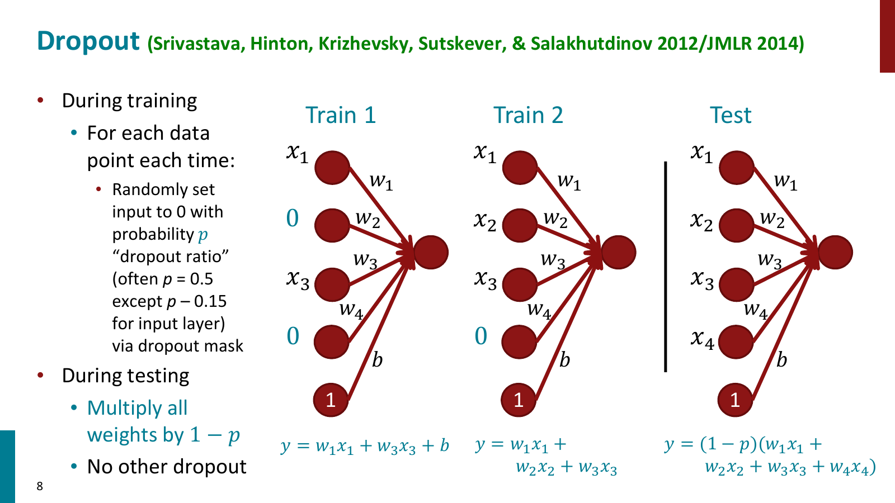
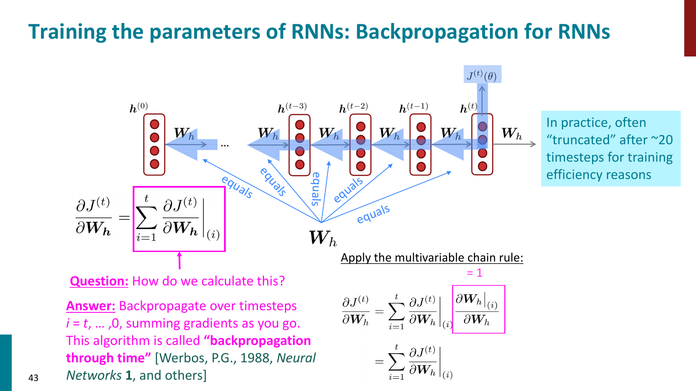
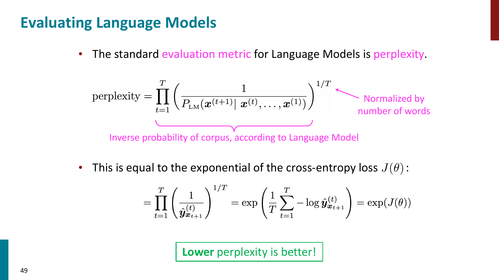
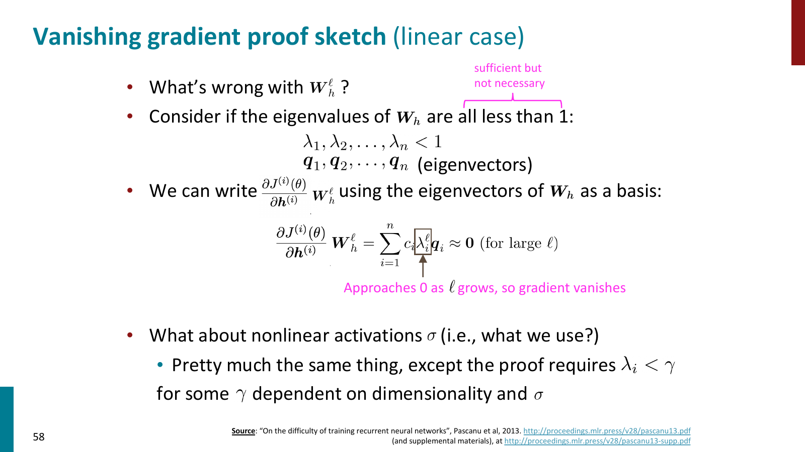
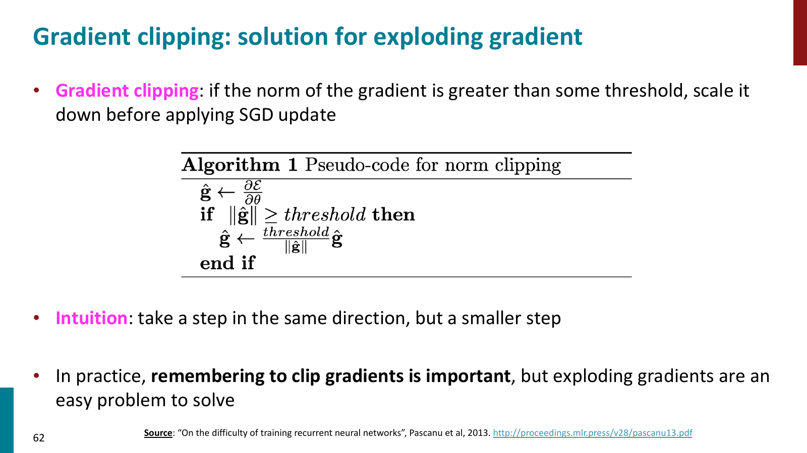
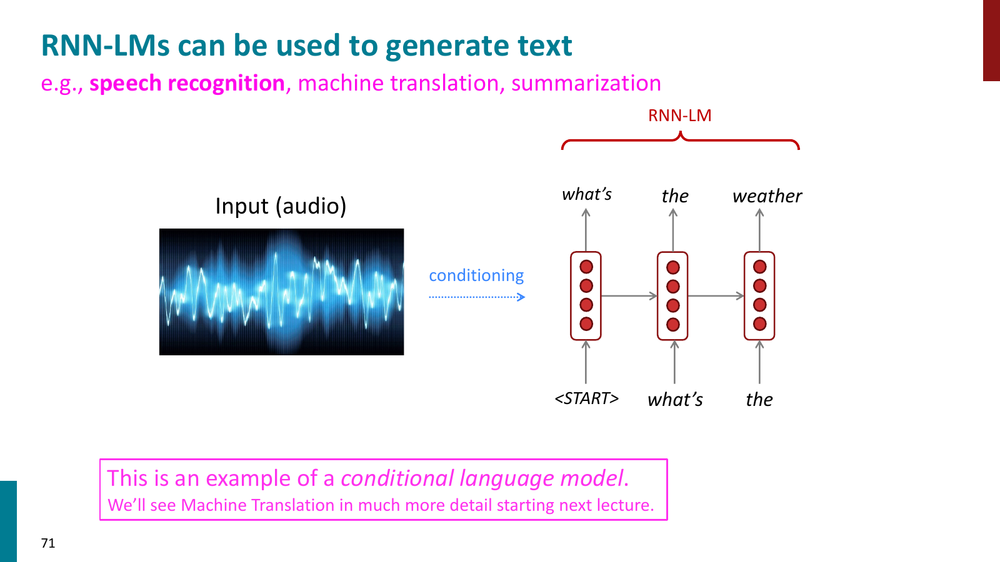

## 1. 深层网络的训练基础

### 1.1 正则化与泛化

大型模型参数很多，需要关注**泛化（Generalization）**，而不是仅让训练损失下降。将L2正则化（L2 Regularization）写入目标的常用形式为：

$$
J_{\mathrm{total}}(\theta)=J_{\mathrm{data}}(\theta)+\lambda\|\theta\|_2^2.
$$

$\lambda$控制惩罚强度，是否含$1/2$仅是系数约定。模型可以在训练数据上拟合得非常充分，仍需用独立数据检验泛化，不能仅由参数多或训练误差低断定实际表现。

### 1.2 两种Dropout缩放约定

课件展示的原始Dropout约定是：训练时以概率$p$丢弃输入，不进行补偿；测试时将对应权重乘$1-p$，使整体尺度与训练平均情况匹配。它限制特征协同适应（Feature Co-adaptation），使某个特征不能只在特定其他特征同时存在时才有用，也可从模型集成（Model Bagging）的角度理解。

A2采用的**反向Dropout（Inverted Dropout）**则在训练时除以保留概率，测试时不缩放。两种方式的尺度安排不同：

| 约定 | 训练时 | 评估时 |
| --- | --- | --- |
| 本页原始约定 | $d\odot h$ | 对相应贡献乘$1-p$ |
| A2期望保持约定 | $(d\odot h)/(1-p)$ | 使用完整$h$ |

不能同时使用训练期补偿和测试期再次缩放。课件举$p=0.5$、输入层较小丢弃率约0.15为经验示例，不是所有架构的固定超参数。

### 1.3 向量化与初始化

**向量化（Vectorization）**把多个词向量放成矩阵，一次进行矩阵乘法，代替逐词循环。课件示例从每轮约639微秒降到53.8微秒；这是特定实现的演示值，不能当成所有硬件的固定加速比。GPU上批量矩阵计算尤其重要。

权重一般应初始化为小随机值，避免所有隐藏单元因相同初始化与相同梯度一直保持对称、无法分工。隐藏偏置可以为0；输出偏置可按零权重时的目标基准分布设置，例如二分类平均标签为$\bar y$时，有限情况下取$\operatorname{logit}(\bar y)$。

**Xavier初始化（Xavier Initialization）**根据扇入$n_{\mathrm{in}}$与扇出$n_{\mathrm{out}}$控制尺度。对应均匀初始化常写为：

$$
W_{ij}\sim\mathcal U(-r,r),\quad
r=\sqrt{\frac6{n_{\mathrm{in}}+n_{\mathrm{out}}}},\quad
\operatorname{Var}(W_{ij})=\frac2{n_{\mathrm{in}}+n_{\mathrm{out}}}.
$$

目的在于避免信号过大或过小，不能只记任意一个固定的随机范围。

### 1.4 优化器

普通SGD也能工作，但往往需要调学习率，例如训练若干轮后减半。自适应优化器按累积梯度信息调整不同参数的更新尺度，课件依次列举Adagrad、RMSprop、Adam、AdamW与NAdamW。Adagrad可能较早停滞；Adam被建议作为常用起点，初始学习率约0.001仅是经验建议。Adam的作业推导见第3讲，本页没有展开所有优化器公式。

## 2. 语言模型定义

**语言建模（Language Modeling）**是根据已有词序列预测下一个词的概率分布。给定$w_{1:t}$：

$$
P(w_{t+1}\mid w_1,\ldots,w_t),\qquad w_{t+1}\in V.
$$

`the students opened their ___`可能接`books`、`laptops`、`exams`或`minds`，模型输出的是整个词表的分布，不只一个确定答案。

**语言模型（Language Model, LM）**也为整个文本分配概率。链式分解是概率恒等式：

$$
P(w_1,\ldots,w_T)=\prod_{t=1}^{T}P(w_t\mid w_1,\ldots,w_{t-1}).
$$

第一词可视为给定句首标记，完整变长句子的建模还可预测句末标记。链式分解本身不要求固定窗口，也不指定模型必须是RNN。

## 3. n-gram语言模型

### 3.1 有限上下文与频数估计

**n-gram**是$n$个连续词组成的片段。Unigram为单词，Bigram为连续两词，Trigram为连续三词。n-gram语言模型作**Markov假设（马尔可夫假设）**：下一词只依赖最近$n-1$个词：

$$
P(w_t\mid w_{<t})\approx P(w_t\mid w_{t-n+1:t-1}).
$$

令上下文$c=w_{t-n+1:t-1}$，用语料频数作估计：

$$
P(w_t\mid c)\approx\frac{\operatorname{count}(c,w_t)}{\operatorname{count}(c)}.
$$

链式概率分解是精确的，但丢弃更早上下文是建模假设；不能把两者都叫“由概率定义必然得到”。

4-gram例子只保留`students opened their`。若出现1000次，其中接`books`的有400次、接`exams`的有100次，估计概率分别为0.4和0.1。但更早的`as the proctor started the clock`提示考试语境，固定窗口丢掉了有用线索。

### 3.2 稀疏与存储问题

两种稀疏情况需区分：

- 上下文$c$出现过，但$(c,w)$未出现，频数估计给$w$零概率。**平滑（Smoothing）**可为候选词计数增加小量；若每项加$\alpha$，也要相应调整分母为$\operatorname{count}(c)+\alpha|V|$，保持归一化。
- 上下文$c$本身未出现，分母为零，无法计算整个分布。**回退（Backoff）**改用更短上下文，例如从`students opened their`退到`opened their`。

增大$n$会加剧数据稀疏和存储成本。课件称经典实践通常难以超过5-gram，这是所述计数方法的经验限制，而非数学上禁止$n>5$。

模型还必须保存见过的n-gram及计数，语料或$n$增长都会增加存储。在约170万词Reuters新闻语料上展示Trigram模型，`today the`之后候选包括`company`、`bank`、`price`等；数据量有限导致概率粒度较粗。

### 3.3 用模型生成文本

生成是重复抽样（Repeated Sampling）：由当前上下文计算分布，抽取下一词，加入文本，再根据新上下文预测。课件连续展示`today the`→`today the price`→`today the price of`→`today the price of gold...`。

Trigram生成文本局部可能符合语法，却缺少长篇连贯性（Incoherence）；仅看最近少量词无法保持全局主题。继续增大$n$又恶化稀疏与存储，因此需要能共享统计强度、更灵活处理上下文的模型。

## 4. 固定窗口神经语言模型

将最近$k$个词嵌入拼接为$x\in\mathbb R^{kd}$，经过隐藏层与Softmax：

$$
h=f(Wx+b_1),\qquad\hat y=\operatorname{softmax}(Uh+b_2).
$$

此处为课件简化架构，不额外加入原始Bengio模型的其他连接。它使用共享的词向量与神经参数，能够给未见过的具体n-gram组合评分，不必为全部观察到的n-gram分别保存计数。课件说“没有稀疏问题”，应理解为缓解计数表中未见组合直接给零概率的机制，而非训练数据不足从此没有影响。

仍有三个限制：窗口固定且可能太短；增大窗口会增大输入层权重矩阵；不同位置的同一个词乘以不同权重块，处理方式没有跨时间共享的对称性。无论窗口设多大，总可能遇到更远的依赖。

## 5. 循环神经网络语言模型

### 5.1 共享参数的递归状态

**循环神经网络（Recurrent Neural Network, RNN）**的核心是反复应用同一组权重。令词嵌入$e_t\in\mathbb R^d$，隐藏状态$h_t\in\mathbb R^H$：

$$
e_t=E[w_t],\qquad
h_t=f(W_hh_{t-1}+W_ee_t+b_h),\qquad
\hat y_t=\operatorname{softmax}(Uh_t+b_o).
$$

$W_h\in\mathbb R^{H\times H}$、$W_e\in\mathbb R^{H\times d}$、$U\in\mathbb R^{|V|\times H}$。$h_0$为初始状态，$\hat y_t$预测$w_{t+1}$而非重新预测已输入的$w_t$。偏置在此显式写出以统一记法，不意味着原图全部符号均已转录。

优点是能处理变长输入、理论上利用很早的信息，参数量不随序列长度增长，并在所有时间步共享处理规则。限制是循环计算存在先后依赖，难以将同一句所有时间步完全并行；实际也难以长期保留信息。固定参数量不等于训练内存不随展开长度增长。

### 5.2 逐步交叉熵与教师强制

给定真实后继词的独热标签$y_t$：

$$
J_t=-\sum_{w\in V}(y_t)_w\log(\hat y_t)_w
=-\log P(w_{t+1}\mid w_{1:t}),\qquad
J=\frac1T\sum_{t=1}^{T}J_t.
$$

这里$T$表示所纳入损失的预测位置数，最后位置可对应句末标记。逐次展示预测`students`、`opened`、`their`、`exams`并汇总损失；合并为同一训练流程。

**教师强制（Teacher Forcing）**训练时每步输入真实语料中的词，而不是将上一步抽样词作为下一步训练输入。模型仍通过预测真实下一词的误差学习共享参数。

一次把整个语料展开并保存梯度，内存成本过大。实际按句子或文档组织小批量，计算本批损失与梯度再更新。平均损失时只计有效预测位置；填充词本身不是新的语言建模目标。

### 5.3 时间反向传播

同一个$W_h$在各时间步重复使用。其梯度是每个使用位置的贡献之和，而不是只保留最后一次：

$$
\nabla_{W_h}J=\sum_{t=1}^{T}\left.\nabla_{W_h}J\right|_{\text{use at }t}.
$$

将RNN沿时间展开后应用计算图反向传播，称为**时间反向传播（Backpropagation Through Time, BPTT）**。隐藏状态梯度既可能来自当前输出损失，也可能来自未来时间步，必须相加。

课件提到为效率将反向链截断到约20步，这是**截断BPTT（Truncated BPTT）**的示例，并非所有任务必须用20步。截断限制梯度传播距离；即便状态值继续传给后续片段，也不代表梯度能跨越被截断的全部历史。

### 5.4 自回归生成

生成时从句首标记开始，计算分布并抽样下一词；抽出的词作为下一步输入，直到句末标记或终止长度。与训练的教师强制相比，生成历史包含模型自己的输出。

课件展示基于演讲、小说、食谱及油漆颜色名称训练的生成例子。是**字符级语言模型（Character-level LM）**，预测下一个字符，说明RNN机制不限定词粒度。

## 6. 困惑度评价

**困惑度（Perplexity, PPL）**是测试语料真实词概率倒数的几何平均：

$$
\operatorname{PPL}=\left(\prod_{t=1}^{T}\frac1{P(w_t\mid w_{<t})}\right)^{1/T}
=\exp\left(-\frac1T\sum_{t=1}^{T}\log P(w_t\mid w_{<t})\right)=e^J.
$$

这里$J$使用自然对数。若交叉熵使用以2为底的对数，则$\operatorname{PPL}=2^J$；2019随课讲义使用这一写法，不能不说明对数底数就与$e^J$混用。

相同语料、词表／切分方式和评估约定下，越低越好。它评价对真实后继词赋予多大概率，不等于自由生成文本的事实正确率。

## 7. 梯度消失与梯度爆炸

### 7.1 长距离传播是多个Jacobian相乘

令预激活$a_t=W_hh_{t-1}+W_ee_t+b_h$，$h_t=f(a_t)$，则一个时间步的局部Jacobian为：

$$
A_t=\frac{\partial h_t}{\partial h_{t-1}}
=\operatorname{diag}(f'(a_t))W_h.
$$

从较早的$h_k$到较晚的$h_t$，链式法则给出有序乘积：

$$
\frac{\partial h_t}{\partial h_k}=A_tA_{t-1}\cdots A_{k+1}.
$$

因此当前损失$J_t$传回早期状态的列梯度为：

$$
\nabla_{h_k}J_t=
A_{k+1}^\top\cdots A_t^\top\nabla_{h_t}J_t.
$$

逐步展开这条链。每一步都略微缩小信号，经过许多步就可能极小；反之某些方向连续放大，可能产生巨大梯度。这里描述当前损失沿时间的传播贡献，不表示整个总损失梯度只有这一条路径。

### 7.2 线性情形的证明概要

先将$f$设为恒等函数，局部Jacobian就是$W_h$：

$$
\frac{\partial h_t}{\partial h_k}=W_h^{t-k}.
$$

若存在一致的算子范数界$\|W_h\|_2<1$：

$$
\left\|W_h^{t-k}\right\|_2\le\|W_h\|_2^{t-k}\longrightarrow0.
$$

这给出梯度消失的充分条件，不是必要条件。它限制的是矩阵的作用尺度，不能用“所有元素都小于1”代替。

若$W_h$可对角化，写为$W_h=Q\Lambda Q^{-1}$：

$$
W_h^r=Q\Lambda^rQ^{-1},\qquad
\Lambda^r=\operatorname{diag}(\lambda_1^r,\ldots,\lambda_H^r).
$$

各特征值的模都小于1时，各对应模式长期衰减；存在模大于1的特征值时，对应方向可能随时间放大。实际梯度还取决于损失信号在这些方向上的分量，不能仅凭一个元素或某次观察就断言每条梯度都爆炸。课件以特征向量为基给出直观说明，此处显式注明可对角化条件。

非线性情形还要乘激活导数矩阵。若$\|\operatorname{diag}(f'(a_i))\|_2\le\gamma$，则：

$$
\left\|\frac{\partial h_t}{\partial h_k}\right\|_2
\le(\gamma\|W_h\|_2)^{t-k}.
$$

若右侧底数严格小于1，长距离贡献衰减。底数大于1只说明这个上界可能增长，不能由上界增长直接证明实际梯度必然爆炸。

图中部分符号不可直接读取，正文依据递归定义与讲义统一推导。

### 7.3 为什么这会损害学习

远处损失传来的梯度若远小于近处梯度，参数更新主要反映短期影响，模型难以学到应保留哪些长期信息。**梯度消失（Vanishing Gradients）**不仅是数值变小，还意味着远距离训练信号被近距离信号淹没。

课件例子先提到打印`tickets`，中间经历缺墨、购买墨粉和装回打印机，最后要预测`she finally printed her ___`。要学会预测`tickets`，误差信号必须跨过长段无关叙述，指导早期状态保留信息。模型理论上可以读取整个前缀，不代表训练时能有效学会使用整个前缀。

### 7.4 梯度爆炸与裁剪

**梯度爆炸（Exploding Gradients）**使更新$-\alpha g$过大，参数可能跳到高损失区域，严重时出现Inf或NaN。**梯度范数裁剪（Gradient Norm Clipping）**在更新前统一缩放：

$$
\tilde g=\begin{cases}
g,&\|g\|_2\le\tau,\\
\tau\dfrac{g}{\|g\|_2},&\|g\|_2>\tau,
\end{cases}
\qquad\theta\leftarrow\theta-\alpha\tilde g.
$$

$\tau>0$为阈值。非零梯度被裁剪时方向不变、范数变为$\tau$；它不是逐坐标截断到固定区间。应先算出梯度，再裁剪，最后优化器更新。

裁剪限制过大的更新，不能恢复已经衰减掉的长期梯度，也不能保证所有数值异常都自动修复。若梯度已经非有限，需要检查此前计算与状态，而不是假设乘一个比例就能变正常。

### 7.5 后续结构的动机

普通RNN隐藏状态不断被重写，难以学会跨很多步保留信息。课件预告两类方向：带独立、加法更新记忆的LSTM，以及更直接、更线性的传递路径，例如Attention和残差连接。具体门控与注意力公式在后续讲次展开，本讲不额外扩写。

## 8. RNN不等于语言模型

**语言模型（Language Model）**是预测语言分布的任务／系统；**RNN**是一类共享时间步参数的序列架构。RNN能做LM，也能做其他任务；LM也能由Transformer等其他架构实现。

### 8.1 序列标注

**序列标注（Sequence Tagging）**在每个输入位置输出标签，例如词性标注和NER。结构可表示为：

$$
h_t=\operatorname{RNN}(e_t,h_{t-1}),\qquad
P(y_t\mid w_{1:t})=\operatorname{softmax}(W_yh_t+b_y).
$$

这里预测的是当前位置的标签，而语言模型通常预测下一个词；相同递归架构，输出空间和训练目标不同。本页没有额外引入全局标签序列解码。

### 8.2 句子分类与池化

**句子分类（Sentence Classification）**需要固定长度的句子编码（Sentence Encoding），然后预测情感等类别。课件先给最后隐藏状态，再给通常更好的池化选择：

$$
s=h_T,\qquad
s=\frac1T\sum_{t=1}^{T}h_t,\qquad
s_j=\max_{1\le t\le T}(h_t)_j.
$$

三式分别为末状态、均值池化（Mean Pooling）、逐元素最大池化（Element-wise Max Pooling），不是依次串联执行。均值与最大值对所有有效位置聚合，带填充的批次应排除填充位置。

### 8.3 编码器与条件生成

RNN可作为更大系统中的**编码器（Encoder）**。例如将问题`what nationality was Beethoven?`编码成状态，再与上下文结合回答`German`。它不是单靠读问题就保证知道答案，课件图中有外部上下文。

**条件语言模型（Conditional Language Model）**在额外输入$x$的条件下生成输出序列：

$$
P(y_{1:T}\mid x)=\prod_{t=1}^{T}P(y_t\mid y_{<t},x).
$$

$x$可以是语音、待翻译句子或待总结文档，解码时依次生成词。本讲只展示条件生成用途，机器翻译的编码器—解码器结构从下一讲开始。

### 8.4 为什么语言建模重要

传统上，LM既是衡量语言预测能力的基准，也用于预测输入、语音／手写识别、拼写语法纠错、翻译、摘要、对话等系统。现代NLP进一步以语言建模作为预训练基础，再通过指令等方式完成理解与推理任务；课件举GPT系列等当时模型说明这一变化。

本讲的RNN称为**简单／原始／Elman RNN（Simple / Vanilla / Elman RNN）**。LSTM、GRU和多层结构属于随后讲次，不把所有循环结构都等同于本讲的单一更新公式。
