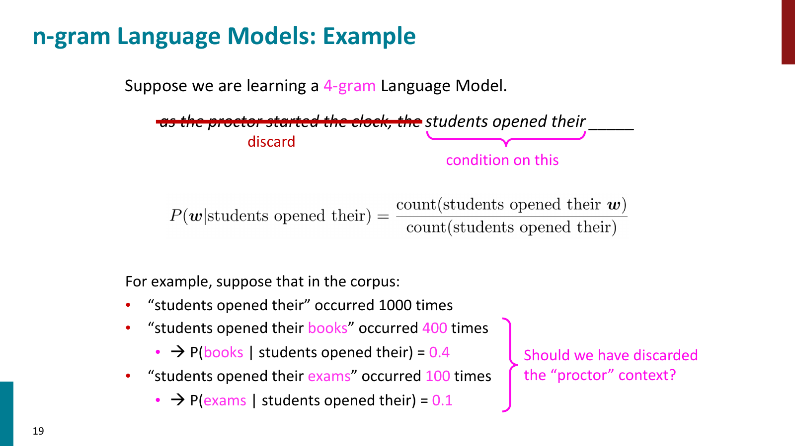
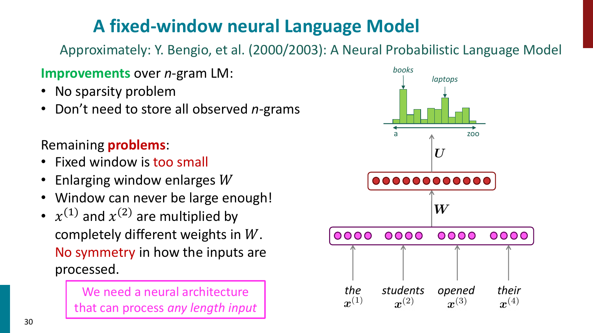
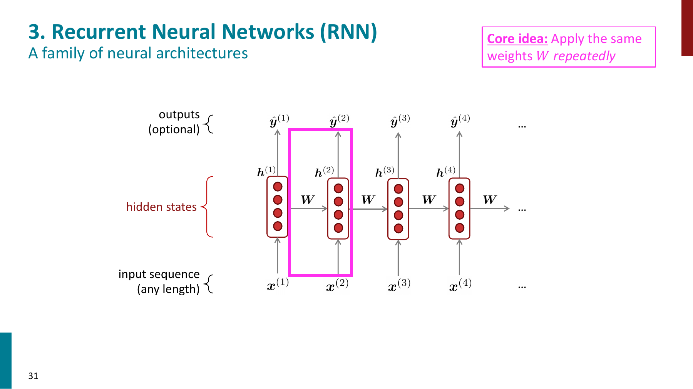
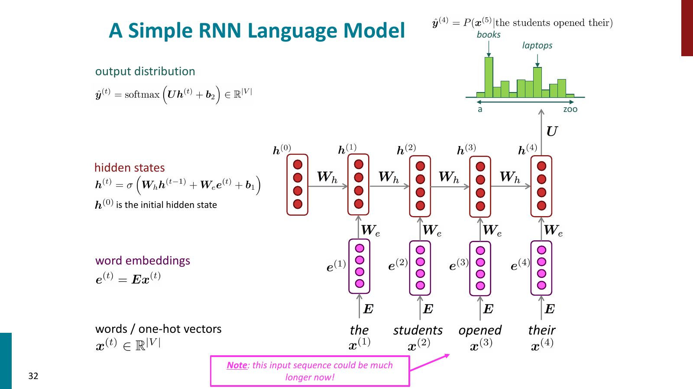
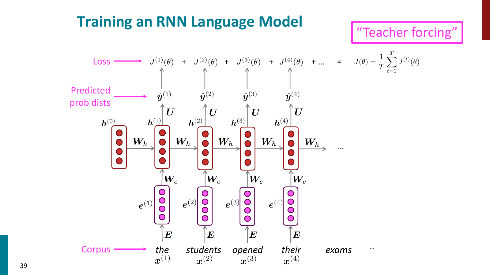
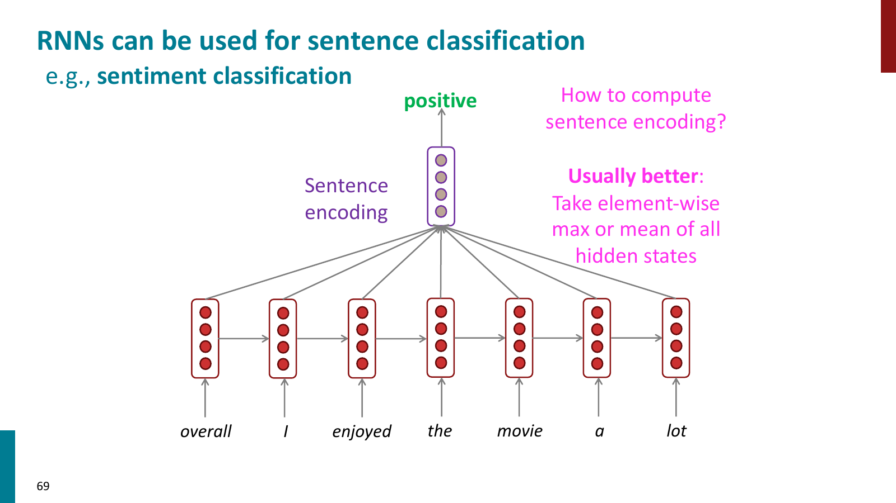

## 1. 神经网络的训练设置

### 1.1 正则化与 Dropout

训练损失低，表示模型能很好地预测训练数据；**泛化（Generalization）**则是模型对未见过的数据也能作出准确预测。正则化用于帮助模型获得更好的泛化能力。

**L2 正则化**在预测损失之外，增加一项对参数大小的惩罚：

$$
J_{\mathrm{total}}(\boldsymbol{\theta})
=J_{\mathrm{data}}(\boldsymbol{\theta})+\lambda\|\boldsymbol{\theta}\|_2^2.
$$

$\boldsymbol{\theta}$ 是参数向量，$\|\boldsymbol{\theta}\|_2^2$ 是各参数平方的总和，$\lambda$ 控制惩罚强度。训练时既要降低预测误差，也要考虑参数过大的代价。

**Dropout**在训练时随机将一部分神经元的输入置零。每次使用的输入组合不同，模型就不能始终依赖某几个特征同时出现，而需要从其他特征中也学到有用信息。


上图采用的 Dropout 做法是：训练时，每个输入都有概率 $p$ 被置零，留下的输入照常参与计算。测试时不再随机丢弃，所有输入都参与计算。

**测试时参与计算的输入更多，因此要将这些输入对应的权重乘以保留概率 $1-p$，避免加权和突然变大。** 例如，两个输入加权后分别贡献 2 和 4；若训练时每个输入都有一半概率被丢弃，它们的平均贡献就分别是 1 和 2，平均加权和为 3。测试时两个输入都保留，将权重各乘以 $0.5$，加权和仍为 $1+2=3$。这样对齐的是训练时的平均加权和，不是每次随机丢弃后的具体结果。

第三讲采用的另一种做法是在训练时将保留的输入除以 $1-p$，测试时直接使用完整网络。两者将缩放放在不同阶段，目的相同。

### 1.2 向量化、初始化与优化器

**向量化（Vectorization）**把多个样本放进矩阵，一次完成矩阵运算。例如，将多个词向量作为矩阵的各列，就可以用一次矩阵乘法计算它们的输出分数，比逐个词循环计算更适合 GPU。

权重通常初始化为小随机数。如果同一层的所有神经元使用完全相同的权重，它们会计算出相同结果，并在训练中受到相同更新，难以学到不同特征。偏置则可以初始化为零。

**Xavier 初始化**根据相邻两层的大小选择随机范围：

$$
W_{ij}\sim\mathcal U(-r,r),\qquad
r=\sqrt{\frac6{n_{\mathrm{in}}+n_{\mathrm{out}}}}.
$$

$n_{\mathrm{in}}$ 是输入单元数，$n_{\mathrm{out}}$ 是输出单元数，$\mathcal U(-r,r)$ 表示在该区间均匀抽样。这样设置是为了让各层输出和反向传播的梯度保持适当的数值尺度，减少它们随层数增加而不断放大或缩小的情况。


## 2. 语言模型

### 2.1 根据前文预测下一个词

**语言模型（Language Model，LM）**根据已经出现的词，为下一个词给出概率分布。例如：

```text
the students opened their ______
```

后面可能是 `books`、`laptops`、`exams`，也可能是其他词。模型要为词表中的每个候选词分配概率，而不是只输出一个确定答案。

给定词序列 $x^{(1)},x^{(2)},\ldots,x^{(t)}$，语言模型计算下一个词 $x^{(t+1)}$ 的概率分布：

$$
P\bigl(x^{(t+1)}\mid x^{(1)},x^{(2)},\ldots,x^{(t)}\bigr).
$$

$x^{(t)}$ 表示第 $t$ 个词，括号中的上标是位置编号，不是乘方。$x^{(t+1)}$ 可以取词表中的任意一个词；固定前文后，所有候选词的概率之和为 1。

### 2.2 整段文本的概率

语言模型也可以给一整段文本分配概率：**依次计算每个词在前文条件下出现的概率，再将它们相乘。**

例如，`the students opened` 的概率为：

$$
P(\mathrm{the})\,
P(\mathrm{students}\mid\mathrm{the})\,
P(\mathrm{opened}\mid\mathrm{the\ students}).
$$

一般地，长度为 $T$ 的词序列满足：

$$
P\bigl(x^{(1)},\ldots,x^{(T)}\bigr)
=\prod_{t=1}^{T}P\bigl(x^{(t)}\mid x^{(1)},\ldots,x^{(t-1)}\bigr).
$$

这是概率的链式法则。语言模型提供的正是乘积中的每一项。实际处理句子时，可用句首标记 `<s>` 开始预测，并将句末标记 `</s>` 作为最后的预测目标。

## 3. n-gram 语言模型

### 3.1 用最近几个词的出现次数估计概率

**n-gram**是连续 $n$ 个词组成的片段。例如，`the students` 是 bigram，`the students opened` 是 trigram。

**n-gram 语言模型只根据最近的 $n-1$ 个词预测下一个词**，忽略更早的前文。这个限制称为马尔可夫假设（Markov Assumption）。例如，4-gram 模型根据最近 3 个词预测第 4 个词。

对前面的例句，4-gram 模型只看 `students opened their`。若训练语料中：

- `students opened their` 出现 1000 次；
- 其中 400 次后面是 `books`；
- 其中 100 次后面是 `exams`；

则估计：

$$
P(\mathrm{books}\mid\mathrm{students\ opened\ their})=\frac{400}{1000}=0.4,
$$

$$
P(\mathrm{exams}\mid\mathrm{students\ opened\ their})=\frac{100}{1000}=0.1.
$$

也就是：**某个上下文后接目标词的次数，除以该上下文出现的总次数。**

### 3.2 上下文丢失、数据稀疏与存储

考虑更长的前文：

```text
as the proctor started the clock, the students opened their ______
```

`proctor`（监考人员）提示这是考试场景，有助于预测 `exams`。但 4-gram 模型只保留最后 3 个词，这个线索被丢掉了。



扩大 $n$ 能保留更多前文，却会让更长的词语组合很少重复出现，产生**数据稀疏**问题：

- **训练语料中出现过这个上下文，但没有出现过它后接某个候选词的组合**：该组合的计数为零，直接按计数估计就会给这个候选词零概率。平滑（Smoothing）为计数增加小量，避免仅因训练语料中没有某种组合就判它不可能。
- **训练语料中连这个上下文也没有出现过**：无法根据它的计数计算概率。回退（Backoff）改用更短上下文，例如从 `students opened their` 退到 `opened their`。

模型还要保存语料中见过的 n-gram 及其计数。$n$ 越大，或语料越大，需要存储的不同组合通常越多。

### 3.3 逐词生成文本

有了下一个词的概率分布，就能按这个分布抽取一个词，接到文本后面，再预测下一个词。例如：

```text
today the
→ today the price
→ today the price of
→ today the price of gold
```

每次根据新的末尾上下文继续预测。这样生成的文本可能局部通顺，但由于模型只看最近几个词，很难保持长篇内容的连贯性。

## 4. 固定窗口神经语言模型

**固定窗口神经语言模型**仍然只看最近几个词，但用词向量和神经网络计算概率，代替查找整段词组合的计数。

例如，取最近 4 个词 `the students opened their`，分别查出词向量，再按词序拼接为输入 $\mathbf{x}$：

$$
\mathbf{x}=\operatorname{concat}
(\mathbf{e}_{\mathrm{the}},\mathbf{e}_{\mathrm{students}},
\mathbf{e}_{\mathrm{opened}},\mathbf{e}_{\mathrm{their}}).
$$

经过隐藏层，再为词表中的每个词计算分数，并用 Softmax 得到概率：

$$
\mathbf{h}=f(\mathbf{W}\mathbf{x}+\mathbf{b}_1),\qquad
\hat{\mathbf{y}}=\operatorname{softmax}(\mathbf{U}\mathbf{h}+\mathbf{b}_2).
$$

$\mathbf{h}$ 是隐藏表示。$\hat{\mathbf{y}}$ 的长度等于词表大小，每个分量对应词表中的一个词，表示该词作为下一个词的概率；所有分量之和为 1。即使训练中没见过完全相同的词语组合，网络仍能用已有的词向量和参数计算结果，不会因为某个 n-gram 的计数为零就直接给出零概率。



它仍有固定窗口的限制：

- 窗口之外的信息被丢弃。
- 扩大窗口会让拼接向量变长，输入层权重也随之增加。
- 不同位置对应不同的权重。例如，同一个词出现在窗口第一格和第四格时，会经过不同的输入权重。

因此，需要一种能不断接收新词、又不因前文变长而增加参数的网络。

## 5. 循环神经网络语言模型

### 5.1 循环神经网络（RNN）

**循环神经网络（Recurrent Neural Network，RNN）**按顺序处理输入。每读入一个词，就结合上一步保存的**隐藏状态（Hidden State）**，计算新的隐藏状态。所有时间步重复使用同一组权重。

隐藏状态是一个固定长度的向量，用于保存读到当前位置时的前文信息。例如，依次读入 `the students opened their`：

1. 读入 `the`，结合初始状态，得到 $\mathbf{h}^{(1)}$。
2. 读入 `students`，结合 $\mathbf{h}^{(1)}$，得到 $\mathbf{h}^{(2)}$。
3. 读入 `opened`，结合 $\mathbf{h}^{(2)}$，得到 $\mathbf{h}^{(3)}$。
4. 读入 `their`，结合 $\mathbf{h}^{(3)}$，得到 $\mathbf{h}^{(4)}$，再据此预测下一个词。

前面的词通过隐藏状态逐步影响后面的预测，不必把所有词向量拼接成越来越长的输入。

设第 $t$ 个输入词 $x^{(t)}$ 的词向量为 $\mathbf{e}^{(t)}$，隐藏状态为 $\mathbf{h}^{(t)}$，更新规则为：

$$
\boxed{\mathbf{h}^{(t)}=f(\mathbf{W}_h\mathbf{h}^{(t-1)}+\mathbf{W}_e\mathbf{e}^{(t)}+\mathbf{b}_1)}.
$$

$\mathbf{W}_h$ 处理上一步状态，$\mathbf{W}_e$ 处理当前词，$\mathbf{b}_1$ 是偏置，$f$ 是逐元素激活函数，例如 $\tanh$。$\mathbf{h}^{(0)}$ 是读入第一个词之前的初始状态，可以设为零向量。



图中从下到上依次是输入序列、隐藏状态和可选的输出。隐藏状态之间的连接表示前文信息逐步向后传递，各时间步重复使用相同的权重。

输入词向量为 $d$ 维、隐藏状态为 $H$ 维时，$\mathbf{W}_e$ 的形状为 $H\times d$，$\mathbf{W}_h$ 的形状为 $H\times H$。上标 $(t)$ 表示读到第几个词，不表示使用了第 $t$ 套权重。

### 5.2 从隐藏状态预测下一个词

RNN 读完当前词后得到隐藏状态 $\mathbf{h}^{(t)}$。要预测下一个词，还需要用这个状态**为词表中的每个候选词计算一个分数，再把分数转换成概率**。完成这一步的输出层称为**词表分类器**；RNN 加上这个输出层，就构成 RNN 语言模型。



图中从下到上依次是输入词及其独热表示、词向量、隐藏状态和输出概率。水平方向的连接负责将隐藏状态传给下一步；从隐藏状态向上计算输出概率时，使用的是 $\mathbf{U}$ 和 Softmax。

$\mathbf{U}$ 是训练中学习的**输出权重矩阵**，负责把隐藏状态转换成候选词的分数。它的每一行对应词表中的一个词。例如，`books` 对应的那一行与隐藏状态做点积，再加上 `books` 对应的偏置，就得到 `books` 的分数。对所有行一起计算，便得到全部候选词的分数向量：

$$
\mathbf{z}^{(t)}=\mathbf{U}\mathbf{h}^{(t)}+\mathbf{b}_2.
$$

若隐藏状态有 $H$ 维，词表有 $|V|$ 个词，则 $\mathbf{U}$ 有 $|V|$ 行、$H$ 列；偏置向量 $\mathbf{b}_2$ 和分数向量 $\mathbf{z}^{(t)}$ 都有 $|V|$ 维。

Softmax 将这些分数转换成概率：

$$
\hat{\mathbf{y}}^{(t)}=\operatorname{softmax}(\mathbf{z}^{(t)}).
$$

$\hat{\mathbf{y}}^{(t)}$ 的每个分量对应词表中的一个词，表示它作为**第 $t+1$ 个词**的概率，所有分量之和为 1。词表若有 1 万个词，输出就是 1 万维概率向量。例如，读入 `their` 后，模型为 `books`、`exams` 等词分别给出概率，再据此选择下一个词。

输入序列变长时，RNN 增加的是计算步数，使用的权重和隐藏状态长度都不变。理论上，当前预测可以受到很早之前的词影响。但隐藏状态必须不断更新，能否学会保留有用的远处信息，是训练中的难点。

另外，第 $t$ 步必须先得到第 $t-1$ 步的状态，因此同一句子的循环计算有先后依赖，速度受到限制。

## 6. RNN 语言模型的训练与生成

### 6.1 每一步的输入与训练答案

训练文本本身提供了预测答案：每读入一个词，就用真实的下一个词检查预测。

| 已读到的前文 | 本步输入 | 应预测的下一个词 |
| --- | --- | --- |
| the | the | students |
| the students | students | opened |
| the students opened | opened | their |
| the students opened their | their | exams |

在第二行中，本步输入只有 `students` 的词向量，但上一时刻的隐藏状态已经包含读过 `the` 的信息。

训练时，即使模型在第一步预测错了，第二步仍输入真实文本中的 `students`。这种**每一步都输入真实词**的训练方式称为**教师强制（Teacher Forcing）**。



### 6.2 预测损失与参数更新

每一步的损失是**真实下一词的预测概率的负对数**。例如，读完 `their` 后，真实答案是 `exams`，则：

$$
J^{(t)}=-\log P(\mathrm{exams}\mid\mathrm{the\ students\ opened\ their}).
$$

模型给 `exams` 的概率越高，这一步的损失越低。将各个预测位置的损失取平均，得到训练损失：

$$
J=\frac{J_1+J_2+\cdots+J_T}{T}.
$$

$T$ 是参与训练的预测位置数。训练时通常一次处理一批句子或文本片段，计算损失和梯度，再更新参数；不需要一次将整份语料全部展开。

### 6.3 时间反向传播

**时间反向传播（Backpropagation Through Time，BPTT）**就是将 RNN 按时间步展开，再沿这个计算图应用第三讲的反向传播。

例如，最后一步的预测使用了 $\mathbf{h}^{(4)}$，而 $\mathbf{h}^{(4)}$ 来自 $\mathbf{h}^{(3)}$，后者又来自 $\mathbf{h}^{(2)}$。因此，最后一步的损失不仅会影响输出层，还会沿隐藏状态的连接传回较早的步骤。


**重复使用的权重，其梯度等于它在每次出现处的梯度之和。** 求导时，可以把同一个权重的各次使用暂时记成不同的参数，分别计算损失对它们的梯度，再相加；更新时，仍然只更新原来那一份共享参数。

例如，前面计算各步隐藏状态时都使用同一个 $\mathbf{W}_h$。求导时，可以将它在各时间步的使用暂时记为不同的矩阵 $\mathbf{W}_{h,1},\ldots,\mathbf{W}_{h,T}$，分别计算损失对它们的梯度。每个梯度矩阵都与 $\mathbf{W}_h$ 同形状，将它们逐元素相加，得到共享参数的总梯度：

$$
\nabla_{\mathbf{W}_h}J=\sum_{t=1}^{T}\nabla_{\mathbf{W}_{h,t}}J.
$$

前向计算和反向求导期间，权重保持不变；得到总梯度后，只更新原来的那一份矩阵：

$$
\mathbf{W}_h\leftarrow\mathbf{W}_h-\alpha\nabla_{\mathbf{W}_h}J.
$$

$\mathbf{W}_e$、$\mathbf{U}$ 等共享参数也遵循相同规则。实际实现不必复制参数，反向传播会自动累加各次使用产生的梯度。

BPTT 从当前时间步向前反向传播，沿途累加这些梯度。

序列很长时，为降低训练成本，可以只向前面有限的步数反传梯度，称为**截断时间反向传播（Truncated BPTT）**。例如，只反传最近约 20 步，就在这个边界停止继续向前传梯度。这次仍会更新共享权重，只是不计算当前损失通过更早状态传回的那部分梯度。

### 6.4 逐词生成

生成时，根据模型预测的下一词概率分布随机选择一个词，这称为**采样（Sampling）**。概率越大的词越容易被选中，但不一定每次都选概率最大的词。将选中的词作为下一步的输入，重复这个过程，就能逐词生成文本。例如：

```text
输入 <s>       → 采样得到 my
输入 my        → 采样得到 favorite
输入 favorite  → 采样得到 season
输入 season    → 采样得到 is
输入 is        → 采样得到 spring
输入 spring    → 采样得到 </s>，结束
```

每一步都保留并更新隐藏状态，重新计算下一词的分布。训练时输入真实词；生成时输入自己生成的词。

同样的方法也能用于**字符级语言模型**：每步输入一个字符，预测下一个字符的概率，再通过采样逐个生成字符。

## 7. 困惑度

**困惑度（Perplexity，PPL）**用于评价语言模型预测测试文本的能力，越低越好。

评估时，将测试文本依次输入模型，记录模型给每个真实下一词分配的概率，计算平均负对数损失 $J$，再取指数：

$$
\boxed{\mathrm{PPL}=e^J}.
$$

这里的 $J$ 使用自然对数，与训练中的平均交叉熵采用同一种计算方式。例如，若模型在每一步都给真实下一词 $1/4$ 的概率，则平均损失为 $-\log(1/4)=\log4$，困惑度为 4。若每一步都给真实词 $1/2$ 的概率，则困惑度为 2，说明预测更准确。

从整段文本的概率来看，同一个指标也可以写成：

$$
\mathrm{PPL}=\left(\frac1{P\bigl(x^{(1)},\ldots,x^{(T)}\bigr)}\right)^{1/T}.
$$

先对整段文本的概率取倒数，再取 $T$ 次方根，是为了按预测词数归一化，避免仅仅因为文本更长、概率乘积更小，就认为模型更差。


比较困惑度时，应使用相同的测试语料、词表和切分方式。

## 8. 梯度消失与梯度爆炸

### 8.1 梯度沿时间反复相乘

RNN 的隐藏状态一环接一环。较晚一步的损失要影响较早的状态，就必须经过中间每一步的连接；根据链式法则，每经过一步，都要乘上这一步的局部导数。

先看一个简化的一维例子。若状态更新为 $h^{(t)}=a h^{(t-1)}$，其中 $a$ 是反复使用的标量权重，那么：

$$
\frac{\partial h^{(t)}}{\partial h^{(t-1)}}=a,\qquad
\frac{\partial h^{(t)}}{\partial h^{(t-2)}}=a^2,\qquad
\frac{\partial h^{(t)}}{\partial h^{(t-k)}}=a^k.
$$

- 若 $a=0.5$，经过 10 步得到 $0.5^{10}\approx0.001$，传回的梯度很小。
- 若 $a=2$，经过 10 步得到 $2^{10}=1024$，传回的梯度可能很大。

这分别说明**梯度消失（Vanishing Gradients）**和**梯度爆炸（Exploding Gradients）**的基本原因：连续相乘会不断缩小或放大信号。

### 8.2 线性 RNN 中的矩阵形式

将隐藏状态从标量换回向量，先暂时去掉非线性激活：

$$
\mathbf{h}^{(t)}=\mathbf{W}_h\mathbf{h}^{(t-1)}+\mathbf{W}_e\mathbf{e}^{(t)}+\mathbf{b}_1.
$$

对上一步隐藏状态 $\mathbf{h}^{(t-1)}$ 求偏导时，当前输入 $\mathbf{e}^{(t)}$ 保持固定，偏置也不随隐藏状态变化，因此导数矩阵为 $\mathbf{W}_h$。跨越 $k$ 个时间步应用链式法则，就会连续乘 $k$ 次同一个矩阵：

$$
\frac{\partial\mathbf{h}^{(t)}}{\partial\mathbf{h}^{(t-k)}}=\mathbf{W}_h^k.
$$

矩阵的特征值描述它沿对应特征向量方向的缩放倍数。若 $\mathbf{W}_h\mathbf{v}=\lambda\mathbf{v}$，连续作用 $k$ 次后：

$$
\mathbf{W}_h^k\mathbf{v}=\lambda^k\mathbf{v}.
$$

因此，当矩阵可以用特征向量作为基，且所有特征值的绝对值都小于 1 时，各方向的影响都会随步数增加而衰减。某个方向的特征值绝对值大于 1 时，沿该方向的影响可能被反复放大。


实际 RNN 还包含 $\tanh$ 等非线性激活，反向时需要同时乘上激活函数的导数。核心问题仍是：许多步的局部导数连续相乘，使远处的梯度可能过小或过大。

### 8.3 梯度消失使长期关系难以学到

梯度是参数学习的信号。若后面的预测误差传回前面时已经非常小，训练就很难教会模型：前面哪些信息值得一直保留。

例如，文本先说她要打印 **tickets**，随后描述打印机缺墨、去文具店买墨粉、安装墨粉等过程，最后出现：

```text
she finally printed her ______
```

要预测 `tickets`，模型需要使用很早之前的信息。若最后这次预测的梯度传不到前面，模型就难以学会保留 `tickets` 这个线索。相比之下，附近词语产生的训练信号更强，模型更容易学到短距离关系。

### 8.4 梯度爆炸与梯度裁剪

梯度下降的参数更新为：

$$
\boldsymbol{\theta}\leftarrow\boldsymbol{\theta}-\alpha\mathbf{g}.
$$

$\mathbf{g}$ 是梯度，$\alpha$ 是学习率。梯度过大时，一次更新可能让参数变化过猛、损失突然升高，严重时出现无穷大或 NaN（非数值）。

**梯度裁剪（Gradient Clipping）**在更新前限制梯度的长度。设阈值为 $\tau$：梯度长度不超过阈值时保持原样；超过时，将整个梯度向量按比例缩短：

$$
\mathbf{g}\leftarrow\tau\frac{\mathbf{g}}{\|\mathbf{g}\|_2}
\qquad\text{当 }\|\mathbf{g}\|_2>\tau.
$$

$\|\mathbf{g}\|_2$ 表示梯度向量的长度。例如，梯度为 $(3,4)^\top$，长度为 5，阈值为 1，裁剪后变成 $(0.6,0.8)^\top$。它的方向不变，但长度降为 1，因此更新步子变小。


梯度裁剪只缩小过大的梯度，不能解决梯度消失。

## 9. RNN 的其他用途

RNN 读入文本后得到的隐藏状态，也可以用于预测词性、判断句子情感等任务。改变隐藏状态所连接的输出层和训练目标，就能让 RNN 完成不同的任务。

**序列标注**在每个词的位置输出一个标签，例如词性或命名实体类别。此时隐藏状态用于预测当前词的标签，而不是下一个词。

**句子分类**将整句转换为一个固定长度向量，再预测情感等类别。可以直接取最后一个隐藏状态，也可以对所有隐藏状态逐维取平均值或最大值：每个坐标分别汇总，得到一个句子向量。



**编码器**用 RNN 将输入文本转换成向量表示，供后续计算使用。例如，在问答系统中，可以分别用 RNN 处理问题和文章，再利用得到的隐藏状态计算文章中哪些位置最可能是答案。

**条件语言模型**在额外输入的帮助下生成文本，例如根据语音生成转写结果，或根据源语言句子生成译文。生成时既参考已经生成的词，也参考额外输入。


本讲使用的是简单 RNN，也称 vanilla RNN 或 Elman RNN。LSTM、GRU 等循环网络将在下一讲介绍。
