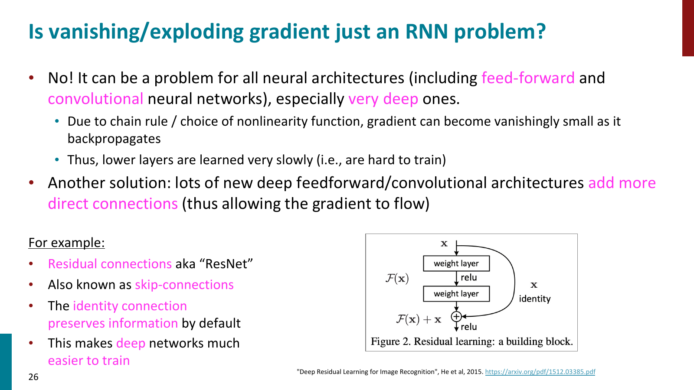
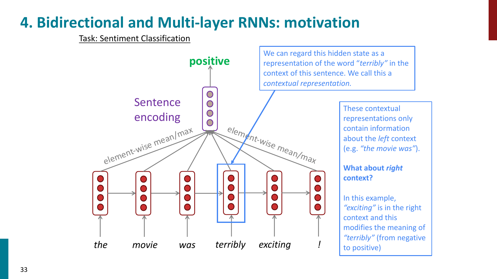
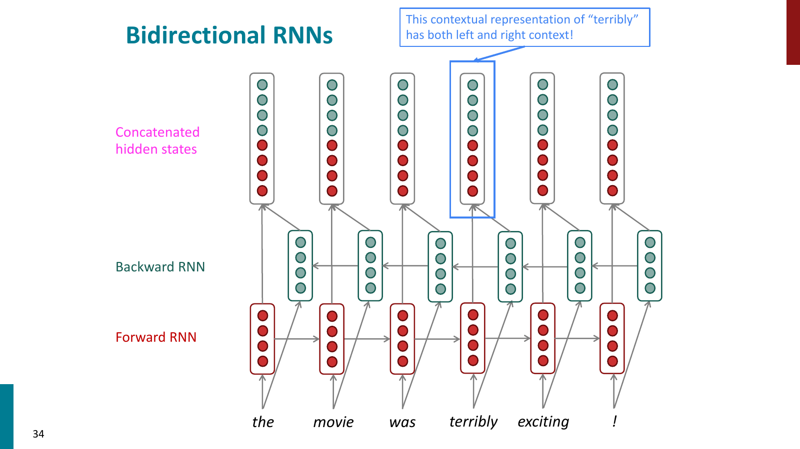
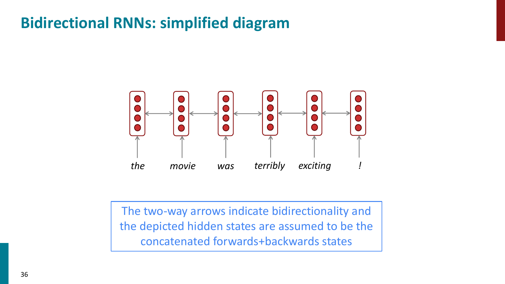
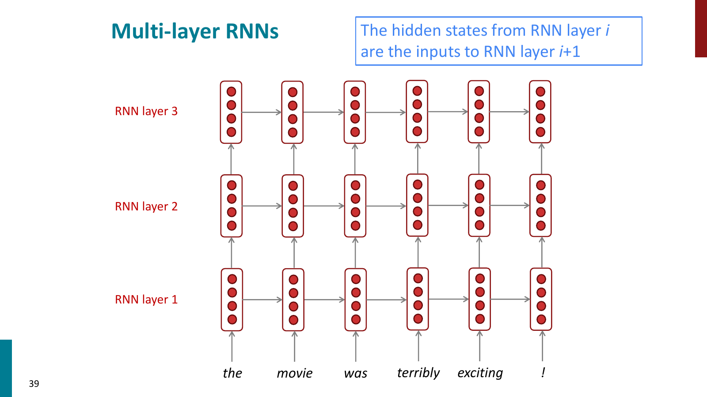
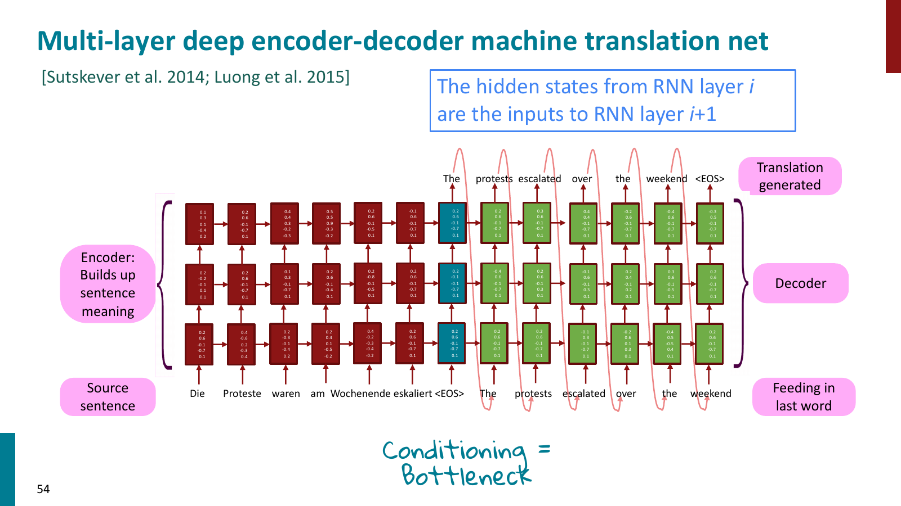

## 1. 简单 RNN 的长期记忆问题

简单 RNN 每读入一个词，就根据当前输入和上一步隐藏状态，重新计算隐藏状态：

$$
\mathbf{h}^{(t)}=f(\mathbf{W}_h\mathbf{h}^{(t-1)}+\mathbf{W}_e\mathbf{e}^{(t)}+\mathbf{b}).
$$

早先读到的信息必须经过一次次状态计算，才能影响后面的预测。训练时，较晚位置的损失也必须沿这些计算反向求导，才能指导模型学习怎样使用早先的信息。

例如，文本开头提到她要打印 `tickets`，中间讲了打印机缺墨、购买和安装墨粉，最后是 `she finally printed her ______`。要预测 `tickets`，模型必须保留很早之前的线索。如果反向传播的梯度经过许多步后变得很小，模型就很难从这个例子中学会保留该线索。这是**梯度消失**造成的长期依赖学习困难。

**梯度裁剪**可以缩小过大的梯度，防止一次参数更新幅度过大，但不能解决梯度消失。LSTM 则改变状态的计算方式：增加一份专门保存信息的记忆状态，让网络能够保留旧内容，并向其中加入新内容。

## 2. 长短期记忆网络（LSTM）

### 2.1 隐藏状态与记忆状态

**长短期记忆网络（Long Short-Term Memory，LSTM）**是一种循环神经网络。它在每个时间步维护两个向量：

- **记忆状态／细胞状态（Cell State）$\mathbf{c}^{(t)}$**：保存需要跨时间保留的信息。
- **隐藏状态（Hidden State）$\mathbf{h}^{(t)}$**：根据当前记忆计算出的表示，用于本步输出，也参与下一步的计算。

两者都是 $n$ 维向量。LSTM 用三个**门（Gate）**控制旧记忆保留多少、新内容写入多少，以及记忆中的哪些内容用于计算隐藏状态。

门也是 $n$ 维向量，每个分量在 0 到 1 之间。它与被控制的向量逐元素相乘：门值为 1 时保留对应分量，为 0 时将其置零，为 0.3 时保留原值的 30%。每一步的门值都由当前输入和上一步隐藏状态计算得到。

### 2.2 门与候选记忆的计算

设当前词的词向量为 $\mathbf{x}^{(t)}$，上一步隐藏状态和记忆状态分别为 $\mathbf{h}^{(t-1)}$、$\mathbf{c}^{(t-1)}$。

**遗忘门（Forget Gate）**决定旧记忆的各分量保留多少：

$$
\mathbf{f}^{(t)}=\sigma(\mathbf{W}_f\mathbf{h}^{(t-1)}+\mathbf{U}_f\mathbf{x}^{(t)}+\mathbf{b}_f).
$$

**输入门（Input Gate）**决定新内容的各分量写入多少：

$$
\mathbf{i}^{(t)}=\sigma(\mathbf{W}_i\mathbf{h}^{(t-1)}+\mathbf{U}_i\mathbf{x}^{(t)}+\mathbf{b}_i).
$$

**输出门（Output Gate）**决定记忆经过 $\tanh$ 变换后，各分量有多少用于隐藏状态：

$$
\mathbf{o}^{(t)}=\sigma(\mathbf{W}_o\mathbf{h}^{(t-1)}+\mathbf{U}_o\mathbf{x}^{(t)}+\mathbf{b}_o).
$$

三个门都使用 Sigmoid，使输出落在 0 到 1 之间。还需要计算本步准备写入的**候选记忆（New Cell Content）**：

$$
\tilde{\mathbf{c}}^{(t)}=\tanh(\mathbf{W}_c\mathbf{h}^{(t-1)}+\mathbf{U}_c\mathbf{x}^{(t)}+\mathbf{b}_c).
$$

候选记忆由当前输入和旧隐藏状态生成，分量在 $-1$ 到 1 之间。它提供“准备写什么”，输入门决定“实际写入多少”。

若输入为 $d$ 维，隐藏状态为 $n$ 维，则各组 $\mathbf{W}$ 的形状为 $n\times n$，各组 $\mathbf{U}$ 的形状为 $n\times d$，偏置、门和候选记忆都是 $n$ 维向量。不同门使用各自的参数；同一个门的参数在所有时间步共享。


### 2.3 记忆状态与隐藏状态的更新

新的记忆状态由两部分相加得到：

$$
\boxed{\mathbf{c}^{(t)}=
\underbrace{\mathbf{f}^{(t)}\odot\mathbf{c}^{(t-1)}}_{\text{保留的旧记忆}}
+\underbrace{\mathbf{i}^{(t)}\odot\tilde{\mathbf{c}}^{(t)}}_{\text{写入的新内容}}}.
$$

$\odot$ 表示逐元素乘法。例如，只看一个坐标，旧记忆为 0.8，遗忘门值为 0.9，候选记忆为 $-0.5$，输入门值为 0.2，则新记忆为：

$$
0.9\times0.8+0.2\times(-0.5)=0.62.
$$

再根据新记忆计算隐藏状态：

$$
\boxed{\mathbf{h}^{(t)}=\mathbf{o}^{(t)}\odot\tanh(\mathbf{c}^{(t)})}.
$$

新的记忆状态 $\mathbf{c}^{(t)}$ 和隐藏状态 $\mathbf{h}^{(t)}$ 都传给下一步：前者用于保留和更新记忆，后者与下一个输入一起计算门值及候选记忆。隐藏状态还可以交给本步的输出层，例如通过线性打分和 Softmax 计算下一词的概率。

输出门控制记忆中的多少内容用于本步隐藏状态，不会直接删除记忆状态中的内容。因此，本步没有输出的信息仍可以留在记忆中，供后续使用。


图中上方横向传递的是记忆状态。沿这条路径，先乘遗忘门，再与新写入的内容相加；下方的输入和旧隐藏状态用于计算三个门及候选记忆。

### 2.4 LSTM 对长期依赖的改进

简单 RNN 每一步都用矩阵和激活函数重新计算隐藏状态。反向传播跨越许多步时，需要连续乘上这些计算的导数，梯度可能越来越小，导致早期计算难以根据后面的预测误差得到调整。

LSTM 的记忆更新则是“保留的旧记忆＋写入的新内容”：

$$
\mathbf{c}^{(t)}=\mathbf{f}^{(t)}\odot\mathbf{c}^{(t-1)}+\mathbf{i}^{(t)}\odot\tilde{\mathbf{c}}^{(t)}.
$$

某个坐标的遗忘门接近 1、输入门接近 0 时，旧记忆就能几乎原样保留，不必每步经过矩阵和激活函数重新生成。

**梯度也能沿这条记忆保留路径传回。** 只看第 $j$ 个坐标的直接保留路径，固定门值和新写入的内容，其局部导数为：

$$
\frac{\partial c_j^{(t)}}{\partial c_j^{(t-1)}}=f_j^{(t)}.
$$

因此，反向传播沿这条路径每经过一步，都将传来的梯度乘以该门值；门值接近 1 时，梯度就不容易迅速缩小，较晚的预测误差也更容易指导早期的写入和保留操作。这是 LSTM 更容易学习长期依赖的原因。

## 3. 深层网络中的梯度问题

梯度消失与爆炸也会出现在很深的前馈网络和卷积网络中。反向传播经过许多层时，局部导数连续相乘，可能使梯度不断缩小或放大；梯度消失会使靠近输入的层学习得很慢。

增加跨层的直接连接，可以让梯度通过更短的路径传回较早的层，使深层网络更容易训练。例如，**残差连接／跳跃连接（Residual / Skip Connection）**的输出为 $\mathbf{y}=\mathbf{x}+F(\mathbf{x})$：输入 $\mathbf{x}$ 一路经过需要学习的变换 $F$，另一路直接与变换结果相加。反向传播时，梯度也能沿直接连接传回输入，不必全部经过 $F$ 中的计算。



相关方法还包括将一层输出直接送给后续多层的**稠密连接（Dense Connection）**，以及用门控制直接连接与变换分支的 **Highway 连接**。

RNN 尤其容易出现梯度不稳定，因为沿时间反向传播时，会反复乘上同一个循环权重矩阵。

## 4. 双向 RNN

### 4.1 词的上下文化表示

以这句话为例：

```text
the movie was terribly exciting!
```

RNN 读到 `terribly` 时，用它的词向量和上一步隐藏状态计算当前隐藏状态。上一步状态带有已经读过的 `the movie was` 的信息，因此，当前位置的隐藏状态既与 `terribly` 有关，也与它前面的词有关。把 `terribly` 放到另一句话中，即使输入词向量相同，算出的隐藏状态也可能不同。

这个随上下文变化的隐藏状态，可以作为 `terribly` 在当前句子中的表示，称为**上下文化表示（Contextual Representation）**。



但此时单向 RNN 还没读到右边的 `exciting`。这个词很重要：`terribly exciting` 表示“非常令人兴奋”，整体是积极评价。要在 `terribly` 的位置同时利用左右两侧的信息，可以使用双向 RNN。

### 4.2 两个方向的隐藏状态

**双向 RNN（Bidirectional RNN）**用两个 RNN 处理同一句话：一个从左向右读，另一个从右向左读。在每个词的位置，将两个方向的隐藏状态拼接，作为这个词的表示。



图中下方是前向 RNN，中间是后向 RNN，上方是每个位置拼接后的隐藏状态。


在第 $t$ 个位置：

$$
\overrightarrow{\mathbf{h}}^{(t)}=
\operatorname{RNN}_{\mathrm{FW}}(\overrightarrow{\mathbf{h}}^{(t-1)},\mathbf{x}^{(t)}),
$$

$$
\overleftarrow{\mathbf{h}}^{(t)}=
\operatorname{RNN}_{\mathrm{BW}}(\overleftarrow{\mathbf{h}}^{(t+1)},\mathbf{x}^{(t)}),
$$

$$
\mathbf{h}^{(t)}=[\overrightarrow{\mathbf{h}}^{(t)};\overleftarrow{\mathbf{h}}^{(t)}].
$$

$\operatorname{RNN}_{\mathrm{FW}}$ 和 $\operatorname{RNN}_{\mathrm{BW}}$ 分别表示前向、后向 RNN 的单步计算，可以使用简单 RNN 或 LSTM。

前向 RNN 从左向右读取，所以计算位置 $t$ 的状态时，使用位置 $t-1$ 的前向状态和当前输入 $\mathbf{x}^{(t)}$。后向 RNN 从右向左读取，所以它先处理位置 $t+1$，再结合当前输入计算位置 $t$ 的后向状态。公式中的 $t+1$ 来自相反的读取方向。

两个方向各自学习一组参数。方括号和分号表示首尾拼接：若每个方向的隐藏状态为 $n$ 维，拼接后就是 $2n$ 维。

对于 `terribly`，前向状态包含左边 `the movie was` 的信息，后向状态包含右边 `exciting!` 的信息。拼接后，模型就能同时利用两侧信息。



简化图中的双向箭头代表前向和后向两套循环计算；每个位置画出的状态已经是两个方向的拼接结果。

### 4.3 适用条件

**双向 RNN 的前提是完整输入序列已经给出**，这样才能分别从句首和句末开始读取。对整句做词性标注、情感分类或其他编码任务时，可以利用左右两侧的信息，通常应优先考虑双向结构。

从左到右预测下一个词时，后面的词尚未确定，不能用反向 RNN 提前读取真实后文。因此，这种语言模型不能直接采用双向 RNN。

机器翻译中，两部分的条件不同：**源句已经完整给出，编码器可以使用双向 RNN；译文需要逐词生成，解码器不能提前读取尚未生成的目标词，因此采用单向 RNN。**

## 5. 多层 RNN

**多层／堆叠 RNN（Multi-layer / Stacked RNN）**将多个 RNN 层叠起来：第一层读取输入词向量，第二层读取第一层在各位置的隐藏状态，第三层再读取第二层的隐藏状态。



图中有两种连接方向：水平方向在同一层中传递前一步的隐藏状态；竖直方向将当前位置的下层输出传给上层。各层有各自的参数，同一层在所有时间步共享参数。

多层结构让后一层能继续组合前一层学到的特征，计算更复杂的表示。较深的 RNN 通常需要配合跳跃连接等结构，以便训练中的梯度传回较低层。

## 6. 机器翻译

### 6.1 翻译任务与统计机器翻译

**机器翻译（Machine Translation，MT）**将源语言的句子 $x$ 翻译成目标语言的句子 $y$。例如，法语译英语：

```text
x: L'homme est né libre, et partout il est dans les fers
y: Man is born free, but everywhere he is in chains
```

翻译需要保留原句含义，但两种语言的词数、词序和表达方式可以不同，不能只按原词序逐个替换单词。

**统计机器翻译（Statistical Machine Translation，SMT）**从语料中学习概率模型，寻找给定源句 $x$ 时概率最大的译文 $y$。利用贝叶斯公式，可以将搜索目标写成：

$$
\hat y=\operatorname*{arg\,max}_y P(y\mid x)
=\operatorname*{arg\,max}_y P(x\mid y)P(y).
$$

贝叶斯公式中的分母 $P(x)$ 对固定源句是常数，不影响哪条译文得分最高，因此省略。这种分解称为**噪声信道模型（Noisy-channel Model）**。


两个概率项分别由不同模型计算：

- **翻译模型 $P(x\mid y)$**：根据候选英语译文 $y$，评价它与法语源句 $x$ 的对应关系。使用**平行语料**训练，即互为翻译的源句与目标句，主要考虑译文是否忠实于原文。
- **语言模型 $P(y)$**：评价候选译文作为英语句子是否自然。使用英语单语文本训练，主要考虑流畅性。

虽然翻译模型写成了 $P(x\mid y)$，最终搜索的仍是英语译文 $y$：为不同候选译文计算两个概率的乘积，选取得分最高者。

传统 SMT 系统还需要短语对应表、大量人工设计的特征和多个单独维护的组件。不同语言对通常需要分别设计和调整这些部分。

### 6.2 神经机器翻译与编码器—解码器

**神经机器翻译（Neural Machine Translation，NMT）**使用一个端到端神经网络，直接计算给定源句时译文的概率 $P(y\mid x)$。

本讲使用的**序列到序列模型（Sequence-to-sequence，Seq2Seq）**由两个 RNN 组成：

- **编码器（Encoder）**读入整个源句，将源句信息保存在最终状态中。
- **解码器（Decoder）**以编码器提供的状态开始计算，逐个生成目标语言的词。


图中展示的是生成译文的过程。编码器读完法语 `il m'a entarté` 后，将最终隐藏状态提供给解码器，作为它的初始隐藏状态。若使用 LSTM，还需要初始化解码器的记忆状态。

解码器首先输入起始标记 `<START>`，计算第一个英语词的概率分布。图中通过 `argmax` 选择概率最大的词 `he`，再将 `he` 输入下一步，计算第二个词的概率分布并选出 `hit`。重复这个过程，直到选出结束标记 `<END>`。这种每步选择当前概率最大词的方式称为**贪心解码（Greedy Decoding）**。

解码器每一步都预测目标语言的下一个词，但预测不仅依据已经生成的目标词，还依据源句。因此，它是**条件语言模型（Conditional Language Model）**：

$$
P(y\mid x)=\prod_{t=1}^{T}P(y^{(t)}\mid y^{(1)},\ldots,y^{(t-1)},x).
$$

$x$ 是完整源句，$y^{(t)}$ 是第 $t$ 个目标词，$T$ 是目标序列长度，包含结束标记。乘积中的每一项都是“给定源句和已有译文前缀时，下一个目标词的概率”。

Seq2Seq 也可用于摘要、对话、句法分析和代码生成，将一种输入序列转换为所需的输出序列。

### 6.3 训练与端到端优化

训练使用**平行语料库（Parallel Corpus）**，每条样本包含源句 $x$ 和人工给出的正确译文 $y$。例如，源句是 `il m'a entarté`，正确译文是 `he hit me with a pie`。编码器先读取源句，为解码器提供初始状态。

训练时，正确译文既提供解码器各步的输入，也提供用来检查预测的答案，两者错开一个词：

| 解码步 | 输入解码器的词 | 本步应预测的词 |
| --- | --- | --- |
| 1 | `<START>` | `he` |
| 2 | `he` | `hit` |
| 3 | `hit` | `me` |

例如，第一步即使给 `she` 的概率最高，也用正确答案 `he` 的概率计算损失；第二步仍输入语料中的 `he`，继续预测 `hit`，不把预测错的 `she` 作为输入。这种每一步都使用正确译文中的前一个词作为输入的训练方式，称为**教师强制（Teacher Forcing）**。

生成新译文时没有给定的正确目标句，所以下一步输入来自模型自己选出的词。


每一步输出一个目标词表上的概率向量 $\hat{\mathbf{y}}^{(t)}$。计算损失时，取出其中**正确目标词**对应的概率，再取负对数：

$$
J_t=-\log P(y^{(t)}\mid y^{(1)},\ldots,y^{(t-1)},x).
$$

将一个句对中各步的损失取平均：

$$
J=\frac1T\sum_{t=1}^{T}J_t.
$$

结束标记也是需要预测的答案，因此计入损失。对该损失反向传播后，再更新模型参数。

**端到端训练**表示编码器和解码器根据同一个翻译损失一起学习。解码器的预测依赖自己的参数，也依赖编码器提供的初始状态。因此，反向传播既会计算解码器参数的梯度，也会计算损失对这个初始状态的梯度。由于初始状态来自编码器，求导可以继续传回编码器，计算其参数和源词嵌入的梯度。

全部梯度算完后，再更新两侧网络的参数。编码器由翻译损失指导学习，不需要另外为它标注一个“正确的源句向量”。

### 6.4 固定长度表示的限制

编码器和解码器都可以使用多层 RNN。下图将德语句子翻译为英语，竖直方向是多层网络，水平方向是依次读入或生成的词。



基础 Seq2Seq 在编码结束后，用固定长度的状态向解码器传递源句信息。无论源句有多少个词，都必须把生成译文所需的信息保存在这些状态中；解码器不能直接查看编码器在每个源词位置的隐藏状态。

源句较长时，这份固定长度表示可能难以保留全部细节。这称为**信息瓶颈（图中的 Conditioning Bottleneck）**。
