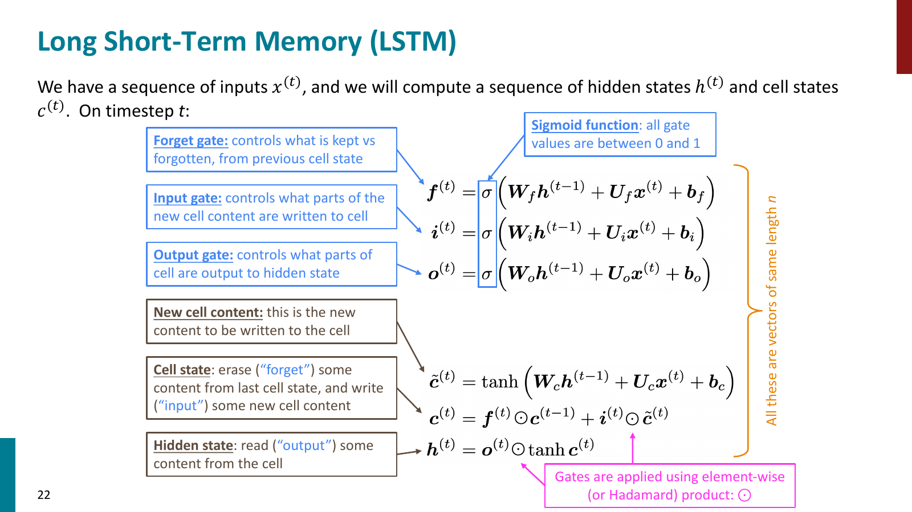
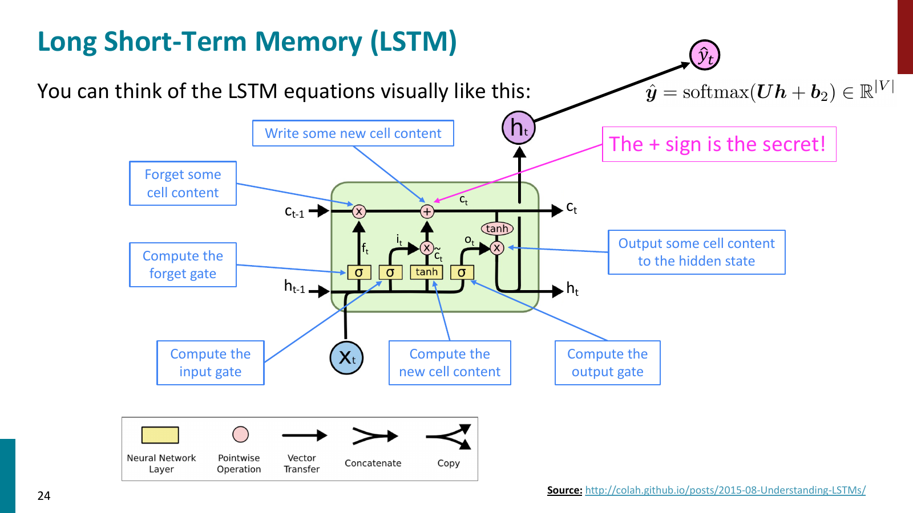
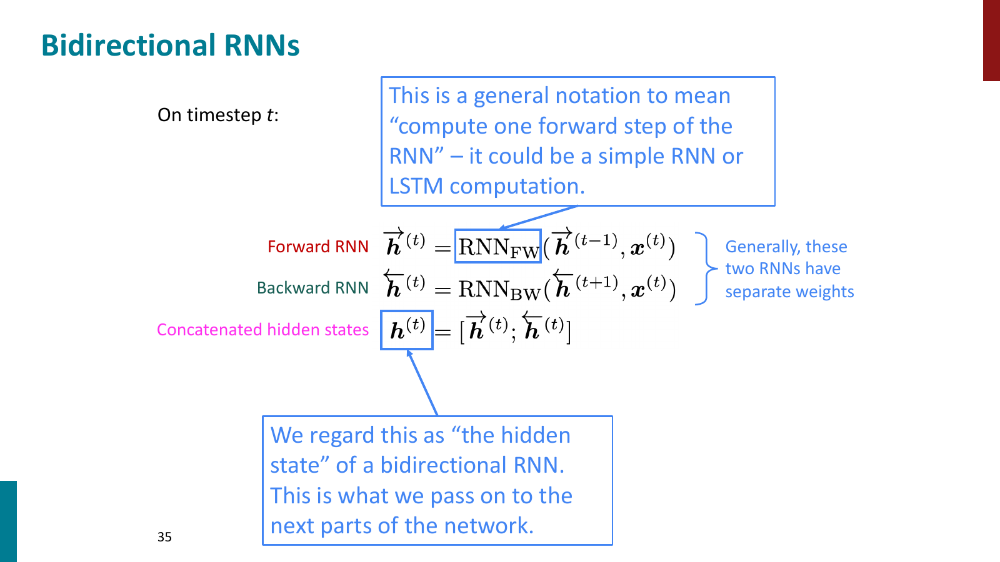
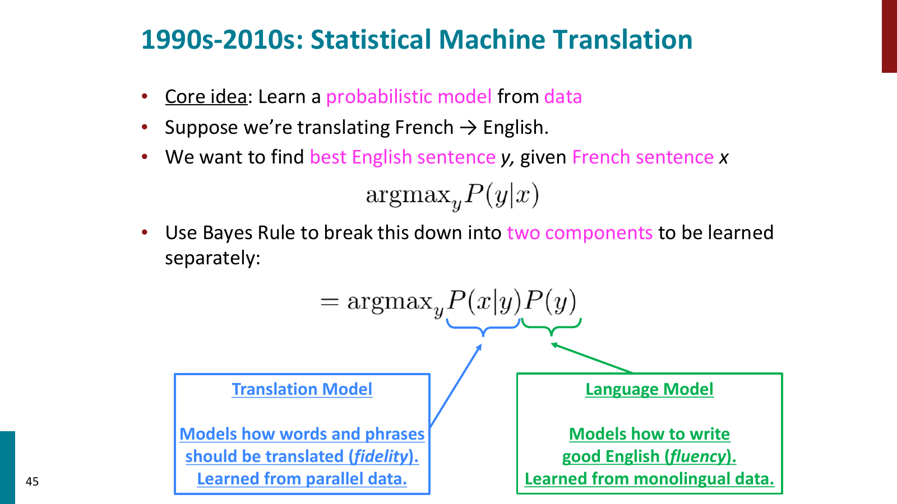
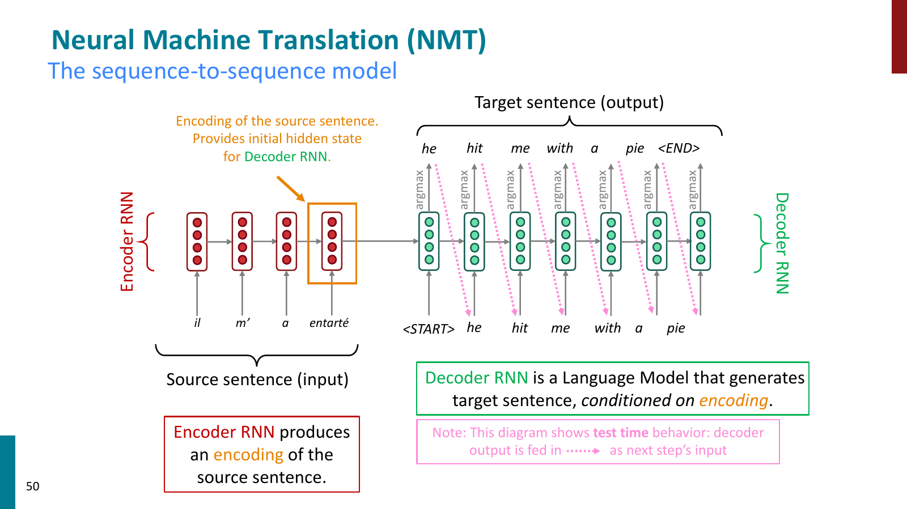
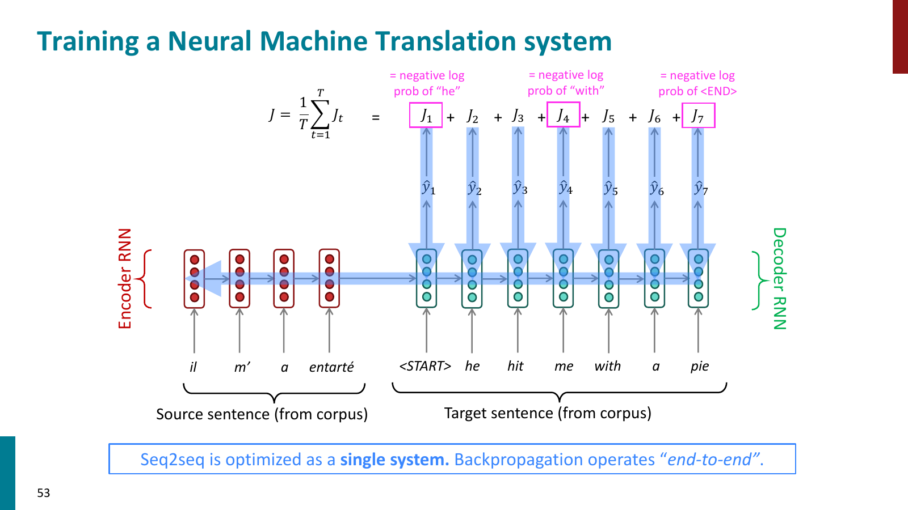

## 1. 为什么要改变简单RNN

语言模型（Language Model）是预测下一词分布的任务，循环神经网络（Recurrent Neural Network, RNN）是可用于语言建模、标注、编码等任务的架构。

回顾梯度问题。简单RNN沿时间传播的Jacobian连乘会让长期信号缩小或放大：

$$
\frac{\partial h_t}{\partial h_k}=A_tA_{t-1}\cdots A_{k+1},\qquad
A_i=\operatorname{diag}(f'(a_i))W_h.
$$

梯度消失时，训练主要反映短期影响，难以学会保留远处的`tickets`等信息。课件给“约7个词”的模糊经验量级，不是任何简单RNN都不能超过7步的硬上限。

梯度爆炸可在更新前通过范数裁剪限制过大步长；梯度消失则需要更容易保留信息的计算路径。第5讲已给详细推导，本讲的新增动机是：**能否把长期记忆独立出来，用加法更新，而非每步完全重写隐藏状态？**

## 2. LSTM：记忆状态与三个门

### 2.1 隐藏状态不等于记忆状态

为展示页，为背景，保留模型动机而不扩写人物沿革。

**长短期记忆网络（Long Short-Term Memory, LSTM）**仍是RNN，但维护两种向量：

- **隐藏状态（Hidden State）**$h_t\in\mathbb R^H$：当前暴露给输出及后续门计算的表示。
- **记忆／细胞状态（Cell State）**$c_t\in\mathbb R^H$：承载跨时间保留的信息。

三个门（Gates）决定读取、写入和保留多少信息。门也是$H$维向量，由当前输入与旧隐藏状态动态计算，不是每个时间步固定的开关。Sigmoid门值介于0和1之间，按坐标软选择；它们不要求各坐标相加为1，也不意味着运行时必须随机采样0或1。

### 2.2 完整更新公式与维度

以下统一列向量和显式偏置。

输入$x_t\in\mathbb R^d$，旧状态$h_{t-1},c_{t-1}\in\mathbb R^H$：

$$
\begin{aligned}
f_t&=\sigma(W_fx_t+U_fh_{t-1}+b_f),\\
i_t&=\sigma(W_ix_t+U_ih_{t-1}+b_i),\\
o_t&=\sigma(W_ox_t+U_oh_{t-1}+b_o),\\
\tilde c_t&=\tanh(W_cx_t+U_ch_{t-1}+b_c),\\
c_t&=f_t\odot c_{t-1}+i_t\odot\tilde c_t,\\
h_t&=o_t\odot\tanh(c_t).
\end{aligned}
$$

每组$W_*\in\mathbb R^{H\times d}$、$U_*\in\mathbb R^{H\times H}$、$b_*\in\mathbb R^H$。门、候选内容、新旧状态均为$H$维；$\odot$为逐元素乘法，而不是矩阵乘法。

| 部件 | 名称 | 控制内容 |
| --- | --- | --- |
| $f_t$ | 遗忘门，Forget Gate | 旧记忆每个坐标保留多少；接近1为保留，接近0为删除 |
| $i_t$ | 输入门，Input Gate | 候选内容的每个坐标写入多少 |
| $o_t$ | 输出门，Output Gate | 当前记忆经tanh后暴露给隐藏状态多少 |
| $\tilde c_t$ | 候选记忆，New Cell Content | 根据当前输入和旧隐藏状态提出的新内容 |

候选记忆可以有正负值；三个Sigmoid门非负。输入门与遗忘门相互独立，不要求$i_t+f_t=1$。输出门抑制某坐标的隐藏输出，不等于删除$c_t$中的该坐标。

### 2.3 加法通路如何帮助长期记忆

对某个维度，若$f_t=1$且$i_t=0$，则$c_t=c_{t-1}$。原样保留信息不再要求每步通过一个复杂矩阵和非线性重新构造相同状态。

只看显式记忆保留通路、暂时固定门值，其局部导数为：

$$
\left.\frac{\partial c_t}{\partial c_{t-1}}\right|_{\text{direct path}}=\operatorname{diag}(f_t).
$$

跨多步的直接通路受遗忘门连乘控制；门接近1时更容易保留信号。完整网络还有门值对旧状态的间接依赖，不能把上式当成整个LSTM全部路径的总导数。

课件以“约100步相对约7步”说明实践改进，是经验量级，不是保证。LSTM使保留信息更容易，不代表任何训练配置都彻底消除梯度消失或爆炸，仍应裁剪过大梯度。

## 3. 更直接的信息与梯度通路

梯度消失并非RNN专属；非常深的前馈或卷积网络也有连续Jacobian相乘的问题。课件介绍三种相关结构思路：

- **残差／跳跃连接（Residual / Skip Connections）**：恒等通路默认保留输入，变换分支学习额外变化。典型形式$y=x+F(x)$，其Jacobian含$I+J_F(x)$。
- **稠密连接（Dense Connections）**：将层输出直接连接到后续多层，提供更直接的路径；不把“连接”一律误写成数值相加。
- **Highway连接（Highway Connections）**：用动态门控制恒等通路与变换通路，受LSTM启发，用于深层前馈／卷积结构。

本讲只介绍它们与梯度传播的关系，不展开完整视觉网络架构。RNN特别容易不稳定，是因为同一循环矩阵被重复使用，误差沿时间反复经过相似变换。

## 4. 双向RNN与上下文化表示

重复标注、句子池化及条件生成，合并到第5讲相关小节；本节展开新增的双向信息。

### 4.1 左上下文不足

单向RNN在位置$t$的隐藏状态只看见当前及左侧输入。例如`the movie was terribly exciting!`中，读取`terribly`时尚不知道右侧`exciting`；只凭左上下文可能错误理解该词的情感作用。

**上下文化表示（Contextual Representation）**是某个词元在特定语境中的向量，不等于字典中为同一拼写查出的固定词向量。

### 4.2 两个方向分别递归，再拼接

$$
\overrightarrow h_t=\operatorname{RNN}_{\to}(x_t,\overrightarrow h_{t-1}),\qquad
\overleftarrow h_t=\operatorname{RNN}_{\leftarrow}(x_t,\overleftarrow h_{t+1}),
$$

$$
h_t=[\overrightarrow h_t;\overleftarrow h_t].
$$

两个方向通常使用独立参数，单步单元可以是简单RNN或LSTM。若每方向状态宽度为$H$，拼接宽度为$2H$；不是两个方向都共用一个$H$维状态。每个词元最终同时获得左、右上下文信息。

### 4.3 何时能用双向

双向编码要求完整输入序列已知。对已提供的句子做情感分析、NER或翻译源端编码是合理的；对标准从左到右下一词生成，不能访问尚未生成的真实右侧词，否则会泄露目标信息。

课件提到BERT的双向表示作为后续主题，不将BERT视为双向RNN。双向是信息访问方式，RNN或Transformer是计算架构，概念层面不同。

## 5. 多层／堆叠RNN

RNN已沿时间方向展开；还可以在层方向堆叠，使下层同一时间步的隐藏输出成为上层输入：

$$
h_t^{(\ell)}=\operatorname{RNN}^{(\ell)}\bigl(h_t^{(\ell-1)},h_{t-1}^{(\ell)}\bigr),\qquad h_t^{(0)}=x_t.
$$

层间参数通常不同，同一层跨时间共享参数。双向层的输入需包含下层两个方向的拼接表示。**时间深度（Temporal Depth）**与**堆叠层数（Stacked Layers）**不同，不能把长句展开100步说成100层不同参数。

低层可学习较局部特征，高层组合更抽象表示，这是设计动机，不是预设每层必须对应某个固定语言学概念。课件引用Britz等2017的NMT实验：编码器2–4层、解码器4层效果较好，2层相对1层的收益常较明显，更深RNN往往需要跳跃／稠密连接。它是特定实验结论，不是所有翻译任务的最优层数。

回顾LSTM在2013–2015时期对语言、语音、翻译等任务的重要性，以及后来Transformer成为主流的历史变化；不将当年竞赛报告的词频统计当成模型性能指标。

## 6. 从统计机器翻译到神经机器翻译

### 6.1 翻译任务并非逐词替换

**机器翻译（Machine Translation, MT）**给定源语言句子$x$，输出目标语言句子$y$。输入输出的长度、词序与表达方式可以不同。例如课件用法语`L'homme est né libre, et partout il est dans les fers`及英语`Man is born free, but everywhere he is in chains`说明，译文需要表达整句含义，而非按源词顺序替换词典条目。

早期规则系统（Rule-based Systems）大量依赖词替换，但翻译涉及**句法（Syntax）**、**语义（Semantics）**与**语用（Pragmatics）**，各语言组织这些信息的方式也不同。历史中译英例子涉及1519年、600名西班牙人、阿兹特克帝国的人口与损失三分之二士兵：译文可能包含许多正确词，却仍错误连接数字、修饰成分和事件参与者。

### 6.2 SMT的噪声信道分解

**统计机器翻译（Statistical Machine Translation, SMT）**的核心是从数据学习概率模型。法语译英语时，目标是选出给定法语$x$最可能的英语$y$：

$$
\hat y=\arg\max_y P(y\mid x)
=\arg\max_y\frac{P(x\mid y)P(y)}{P(x)}
=\arg\max_y P(x\mid y)P(y).
$$

$P(x)$在固定源句时与候选译文无关，因此可以在搜索中省略。这是**噪声信道模型（Noisy-channel Model）**的分解。

| 概率项 | 名称 | 学习资料 | 主要目标 |
| --- | --- | --- | --- |
| $P(x\mid y)$ | 翻译模型，Translation Model | 平行语料，Parallel Data：互为翻译的句对 | 忠实性，Fidelity：源词、短语及意义如何与译文对应 |
| $P(y)$ | 语言模型，Language Model | 目标语言单语语料，Monolingual Data | 流畅性，Fluency：目标句是否像自然英语 |

这里翻译模型的方向为“目标英语$y$解释观测到的源法语$x$”，最终任务仍是源语到目标语。完整条件概率的最优化被改写成两个可分别学习的模型相乘。

课件强调传统高性能SMT系统的工程复杂度：大量单独设计的子组件、为具体语言现象设计的特征、短语对应表（Phrase Tables）等额外资源。每个语言对都需要大量维护工作。它的困难不只是参数量，而是系统各部分需要分别设计、拼装和调整。

### 6.3 NMT的核心变化

为戏剧化过渡插图，跳过。

**神经机器翻译（Neural Machine Translation, NMT）**用一个端到端神经网络直接建模$P(y\mid x)$。本讲的经典**序列到序列模型（Sequence-to-sequence Model, Seq2Seq）**由两个RNN组成：一个读取源句，一个生成译文。Seq2Seq描述输入输出都是序列的建模方式；后续章节可采用其他网络实现。

记录从2014年早期Seq2Seq工作到2016年前后NMT广泛替换SMT的技术变化：学习一个联合优化的系统，显著减少了单独维护大量翻译组件的需求。这是课件中的历史背景。

## 7. 编码器—解码器与条件语言模型

### 7.1 编码源句，逐步生成目标句

**编码器（Encoder）**依次读取源句$x_1,\ldots,x_m$，产生源句表示；**解码器（Decoder）**根据这个表示从`<START>`开始生成目标序列，直到生成`<END>`。

课件示例为：

- 源句：`il m'a entarté`。
- 译文：`he hit me with a pie <END>`。
- 源句编码提供解码RNN的初始隐藏状态；在LSTM实例中还需要处理初始记忆状态，见A3对应部分。

原图展示**测试时行为（Test-time Behavior）**：本步输出反馈为下一步输入。

用$z=\operatorname{Encoder}(x_{1:m})$表示源句编码，一种基础表达为：

$$
s_0=\operatorname{Init}(z),\qquad
s_t=\operatorname{Decoder}\bigl(E_y[y_{t-1}],s_{t-1}\bigr),\qquad
p_t=\operatorname{softmax}(W_os_t+b_o).
$$

这里$y_0=\texttt{<START>}$，$E_y$为目标语言嵌入；LSTM的$s_t$应理解为隐藏状态与记忆状态组成的状态对，输出层通常读取隐藏状态。公式表示最基本的“通过初态条件化”结构，作业完整模型还会使用注意力和上一时刻的组合输出。

每步选择$\arg\max p_t$，对应**贪心解码（Greedy Decoding）**。它在当前已选前缀下选最可能的下一个词，并不保证找到整个序列概率最大的译文；束搜索留到第7讲。

### 7.2 概率分解：为什么叫条件语言模型

$$
P(y_{1:T}\mid x_{1:m})=\prod_{t=1}^{T}P(y_t\mid y_{<t},x_{1:m}).
$$

每一步预测下一个目标词，所以它是**语言模型（Language Model）**；预测同时依赖源句，所以是**条件语言模型（Conditional Language Model）**。源句长度$m$与目标句长度$T$可以不同，停止由目标端结束符决定。

无条件语言模型只有$P(y_t\mid y_{<t})$；NMT必须结合$x$选择与源文相符的表达。目标句很流畅但语义不对应，仍是错误翻译。

### 7.3 Encoder–Decoder的通用性

一般的**编码器—解码器模型（Encoder–Decoder Model）**先将输入变为神经表示，再据此生成输出。当输入输出均为序列时，可统一为Seq2Seq：

| 任务 | 输入序列 | 输出序列 |
| --- | --- | --- |
| 摘要，Summarization | 长文本 | 短摘要 |
| 对话，Dialogue | 之前的话语 | 下一段回复 |
| 句法分析，Parsing | 句子 | 序列化的句法树 |
| 代码生成，Code Generation | 自然语言描述 | Python等代码 |

这些任务共享“编码输入、条件生成输出”的组织形式，但目标序列的含义和约束不同。本讲仅列用途，不展开各任务专门算法。

## 8. 训练Seq2Seq：教师强制与端到端梯度

### 8.1 平行语料与输入目标错位

训练使用**平行语料库（Parallel Corpus）**中的源句—目标句对$(x,y^*)$。课件提及无监督NMT和数据增强作为其他方向，未展开方法。

**教师强制（Teacher Forcing）**是在训练第$t$步时输入真实的前一个目标词，而非模型自己上一步预测的词。以译文为例：

| 解码步 | 本步输入 | 应预测的标签 |
| --- | --- | --- |
| 1 | `<START>` | `he` |
| 2 | `he` | `hit` |
| 3 | `hit` | `me` |
| 4 | `me` | `with` |
| 5 | `with` | `a` |
| 6 | `a` | `pie` |
| 7 | `pie` | `<END>` |

起始符提供第一次输入，结束符是需要学习预测的标签。源句编码不能替代目标端这一位移关系。

### 8.2 每步损失与联合优化

真实目标$y_t^*$对应独热向量$g_t$，每步交叉熵为：

$$
J_t(\theta)=-\sum_{v\in V_y}g_{t,v}\log p_{t,v}
=-\log P_\theta(y_t^*\mid y_{<t}^*,x).
$$

课件以各步平均给出一个句对的训练损失：

$$
J(\theta)=\frac1T\sum_{t=1}^{T}J_t(\theta)
=-\frac1T\log P_\theta(y^*\mid x).
$$

$T$包含需要预测的结束符，不包含仅用作首个输入的起始符。对固定样本，最小化总负对数似然与其按长度平均的形式有相同最优点；跨不同长度样本汇总时，按句平均和按词平均会给样本不同权重，需明确实现的归约方式。

图中的`he`、`with`、`<END>`等位置都贡献损失。

**端到端优化（End-to-end Optimization）**意味着解码误差不仅更新目标端输出层和解码RNN，还通过源句表示反传到编码RNN与源词嵌入。编码器不需要另一个独立的“正确句向量”监督标签；翻译目标本身指导它学习保留哪些源信息。

训练时前缀来自真实目标；测试时前缀来自模型的输出，两种输入来源不同。读和时应分别对应推断过程和训练过程。

### 8.3 多层结构与固定表示瓶颈

编码器和解码器都可堆叠多层RNN；同一时刻第$i$层隐藏状态作为第$i+1$层输入。以德语`Die Proteste waren am Wochenende eskaliert <EOS>`到英语`The protests escalated over the weekend <EOS>`展示深层编码—解码。

图中数字用于示意隐藏表示，不作为需要背诵的训练结果。

**条件化瓶颈（Conditioning Bottleneck）**：基础Seq2Seq把任意长度源句压进固定宽度表示，目标端所有步骤都依赖这份压缩信息。源句越长、需保留的实体和关系越多，编码端越难仅靠一个最终状态为所有输出位置提供所需细节。这引出下一讲的注意力：生成每个目标词时直接访问源端各位置表示。

本讲实践要点是：使用LSTM等更有利于记忆的单元，裁剪爆炸梯度；完整输入可得时使用双向编码；用Encoder–Decoder联合学习源序列到目标序列的映射。

## 9. 作业3衔接：双向LSTM到单向解码器

本节只展开本章对应结构；注意力计算、源端mask、BLEU和搜索分析在第7讲整理。

### 9.1 实际输入：子词、卷积、双向编码

A3是中文到英文翻译，使用**SentencePiece子词切分（Subword Segmentation）**：即使中文没有空格，也可映射为词表中的字符或多字符片段。源、目标分别有嵌入矩阵。每个源位置先得到$e$维向量，再经过保持序列形状的**一维卷积（1D Convolution）**，最后送入双向LSTM。

Part 2(a)的关键解释是：中文字符可以独立成词，也可以是多字词中的语素。课件举“电（electricity）”“脑（brain）”组成“电脑（computer）”的例子；卷积可先组合相邻片段的局部信息，再交由双向LSTM学习较长距离关系。它不是简单给每个字符换一个独立词向量。

每方向隐藏宽度为$H$，对位置$i$拼接：

$$
h_i^{\mathrm{enc}}=[\overrightarrow h_i;\overleftarrow h_i]\in\mathbb R^{2H},\qquad
c_i^{\mathrm{enc}}=[\overrightarrow c_i;\overleftarrow c_i]\in\mathbb R^{2H}.
$$

批内不同长度句子通过**填充（Padding）**补齐到最长长度，以便张量运算。填充只改变批处理的存储形状，不代表原句多了真实词元。A3的`pad_sents`对应这一准备步骤。

### 9.2 “最终状态”在两个方向的端点不同

前向LSTM在$m$处读完源句，反向LSTM在$1$处读完源句。用于解码初态的整句摘要因此取：

$$
h_{\mathrm{final}}=[\overleftarrow h_1;\overrightarrow h_m]\in\mathbb R^{2H},\qquad
c_{\mathrm{final}}=[\overleftarrow c_1;\overrightarrow c_m]\in\mathbb R^{2H}.
$$

这是作业说明式(3–4)的方向顺序，与前面每位置表示的拼接顺序是不同定义。按具体代码返回状态时必须核对其方向轴顺序，不能直接把最后一个源位置的$h_m^{\mathrm{enc}}$当作两个方向均已读完整句的摘要。

解码器单向、宽度$H$，用两个独立线性投影将$2H$变为$H$：

$$
h_0^{\mathrm{dec}}=W_hh_{\mathrm{final}},\qquad
c_0^{\mathrm{dec}}=W_cc_{\mathrm{final}},\qquad
W_h,W_c\in\mathbb R^{H\times2H}.
$$

隐藏状态和记忆状态各自初始化，不能只投影$h$而漏掉$c$。这里按作业列出无额外非线性的线性投影，不擅自加tanh。

### 9.3 解码循环中的状态与输出

A3完整模型使用注意力。为了对齐本讲的状态传递，先记住其解码输入：上一步的**组合输出（Combined-output Vector）**$o_{t-1}\in\mathbb R^H$与当前提供的目标嵌入$v_t\in\mathbb R^e$拼接：

$$
\bar v_t=[v_t;o_{t-1}]\in\mathbb R^{e+H},\qquad o_0=0,
$$

$$
(h_t^{\mathrm{dec}},c_t^{\mathrm{dec}})
=\operatorname{LSTM}_{\mathrm{dec}}(\bar v_t,h_{t-1}^{\mathrm{dec}},c_{t-1}^{\mathrm{dec}}).
$$

作业把“本步送入的目标嵌入”记为$y_t$；本章前文则用$y_t$记本步要预测的标签，故这里另用$v_t$避免混淆。教师强制训练时，第一个$v_t$来自起始符，随后来自真实目标前缀。

$o_t$由本步解码隐藏状态与注意力输出组合得到，具体投影与维度见第7讲。目标词表分布及监督保持同一原则：

$$
P_t=\operatorname{softmax}(W_{\mathrm{vocab}}o_t),\qquad
W_{\mathrm{vocab}}\in\mathbb R^{|V_y|\times H},\qquad
J_t=-\log P_t[y_t^*].
$$

实现职责对应为：`encode`计算全部源隐藏状态及两个解码初态；`decode`准备错位目标输入并遍历时间步；`step`执行一次解码单元和注意力组合。完整翻译模型的训练监督仍是每一步正确目标词的交叉熵。

本地缺少A3代码包，因此这里依据作业说明整理结构和公式，不宣称已运行模型、复现训练曲线或取得BLEU分数；云机器配置、提交和评分要求省略。
