模型的性能需要通过评价来判断，但不同阶段需要的评价方式并不相同。训练时需要快速、便宜、可微分的目标；开发和模型选择时需要快速比较；发布模型时需要标准化、可复现并覆盖较多能力；部署时则更关心模型是否满足具体任务的要求。

## 1. 封闭式评价

### 1.1 封闭式任务与评价基准

**封闭式评价（Close-ended Evaluation）**适用于**封闭式任务（Close-ended Tasks）**，即答案范围有限、通常有一个或少数几个正确答案的任务。例如，情感分类要求模型将一条评论判为正面或负面，评价时可以将模型预测的类别与人工标注的正确类别比较，自动统计模型的表现。

常见的封闭式任务及其数据集包括：

- 情感分类：SST、IMDB、Yelp；
- 蕴含判断：SNLI；
- 命名实体识别：CoNLL-2003；
- 词性标注：Penn Treebank；
- 共指消解：Winograd Schema Challenge；
- 问答：SQuAD 2。

**superGLUE** 将多个封闭式任务组成一个评价基准，用不同任务考查模型的一般语言能力。其中，BoolQ 和 MultiRC 考查阅读理解，CB 和 RTE 考查蕴含关系，COPA 考查因果关系，ReCoRD 涉及问答与推理，WiC 考查词义，WSC 考查共指。

### 1.2 指标和标签问题

封闭式评价需要选择合适的指标，例如准确率（Accuracy）、精确率（Precision）、召回率（Recall）、F1 和 ROC。评价涉及多个指标或任务时，还需要确定如何汇总结果。此外，标签从哪里来、数据中是否存在伪相关，也是需要检查的问题。

**伪相关（Spurious Correlation）**指数据中的表面线索与标签相关，模型可能利用这些线索作答，而没有学会任务要求的判断方法。

例如，自然语言推断要求根据前提句（Premise）判断假设句（Hypothesis）是否成立：

- Premise：`The economy could be still better.`
- Hypothesis：`The economy has never been better.`

判断需要考虑两句话的含义及其关系。如果模型依赖否定表达等表面线索判断标签，就可能利用了伪相关。

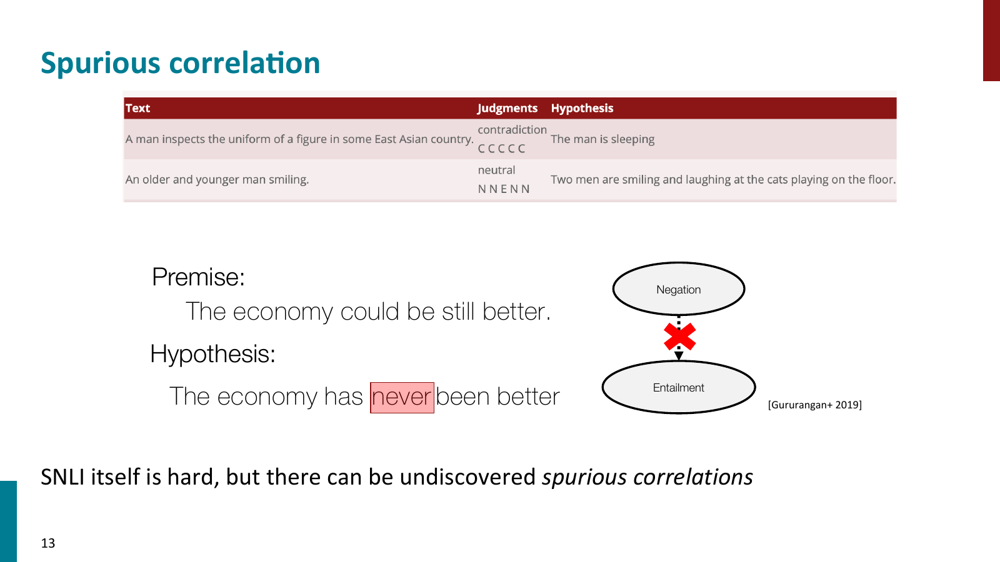

## 2. 开放式文本生成评价

### 2.1 开放式任务

**开放式任务（Open-ended Tasks）**允许生成较长文本，合理答案的数量通常无法枚举。因此，不能只用“答对”或“答错”判断质量，还需要区分更好和更差的回答。

摘要、翻译和指令遵循都属于开放式任务。例如，常见的评价数据集和基准包括 CNN/DailyMail 和 Gigaword 摘要数据集、WMT 翻译基准，以及 Chatbot Arena、AlpacaEval 和 MT-Bench 等指令遵循评价。

文本生成评价可以分为三类：内容重叠指标、基于模型的指标和人工评价。

### 2.2 内容重叠指标

**内容重叠指标（Content Overlap Metrics）**比较模型生成文本与人工参考文本之间的词面重叠，常见指标包括 BLEU、ROUGE、METEOR 和 CIDEr。这些指标计算快速，因此仍常用于翻译和摘要；但它们主要反映词语是否重叠，不能充分判断语义是否相同。

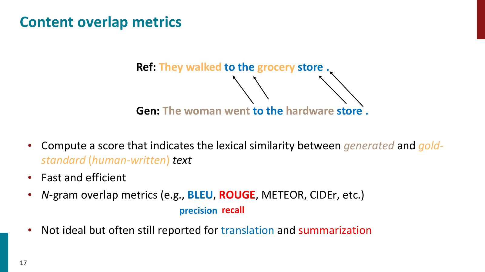

例如，问题是：`Are you enjoying the CS224N lectures?`

如果参考回答是 `Heck yes!`，那么 `Yup.` 和 `You know it!` 都表达肯定，但与参考文本的词面重叠很少。相反，`Heck no!` 与参考文本有较多相同词语，却表达相反的意思。

因此，词面重叠指标可能把合理答案判为低分，也可能把语义错误的答案判为高分。

### 2.3 基于模型的评价指标

词面重叠指标难以识别“用不同词语表达相近意思”的情况。**基于模型的评价指标（Model-based Metrics）**利用模型学到的词或句子表示，衡量生成文本与参考文本在语义上是否接近。

一种做法是先用预训练模型将文本转换为向量，再用固定的相似度函数比较这些向量。即使两个词的拼写不同，只要模型得到的表示相近，也可能被判断为语义相近。Embedding Average、Vector Extrema、MEANT 和 YiSi 等指标采用了基于表示的语义比较方法。

**BERTScore** 使用 BERT 的上下文化词向量：一个词的向量不仅取决于词本身，也取决于它在句子中的上下文。评价时，先分别将生成文本和参考文本送入 BERT，得到各词元的向量；再计算两边词元向量之间的余弦相似度，为词元寻找语义上最相近的匹配，形成评价分数。余弦相似度比较向量的方向，方向越接近，相似度越高，因此匹配不要求两边出现完全相同的词。

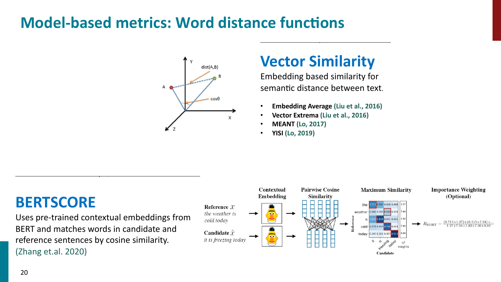

**BLEURT** 则使用基于 BERT 的回归模型，直接预测生成文本的质量分数。这里的“回归”表示模型输出一个数值，而不是类别标签。模型根据生成文本与参考文本，评价生成文本在多大程度上语法通顺、传达了参考文本的意思。

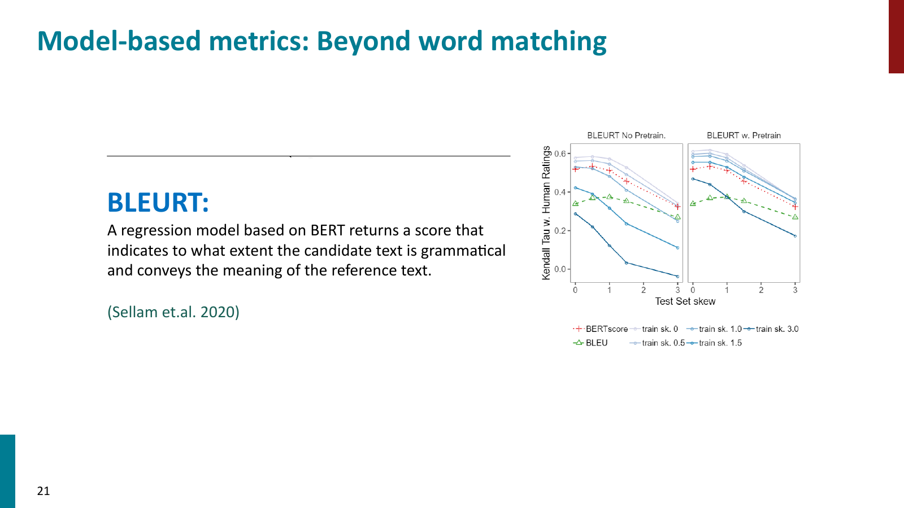

两者都比较参考文本与模型输出，但评分方式不同：BERTScore 用 BERT 生成词向量，再按固定的余弦相似度进行匹配；BLEURT 则通过带有人工质量评分的文本对学习如何打分。训练时，BLEURT 根据参考文本和模型输出预测分数，将预测分数与人工评分比较，再调整模型参数，使预测接近人工评分。训练完成后，输入一组新的参考文本和模型输出，它就可以直接预测质量分数。因此，BLEURT 学习的不只是文本表示，还包括根据两段文本判断质量的方法。

### 2.4 参考文本的质量与无参考评价

参考文本的质量会影响自动评价的结果。在一组实验中，使用原有参考文本计算的指标分数，与人类对模型输出的质量评价不相关；换用专家撰写的参考文本后，人认为质量更好的输出，通常也会得到更高的指标分数。也就是说，即使采用同一种指标，更换参考文本也可能改变自动评分与人工评价的一致程度。

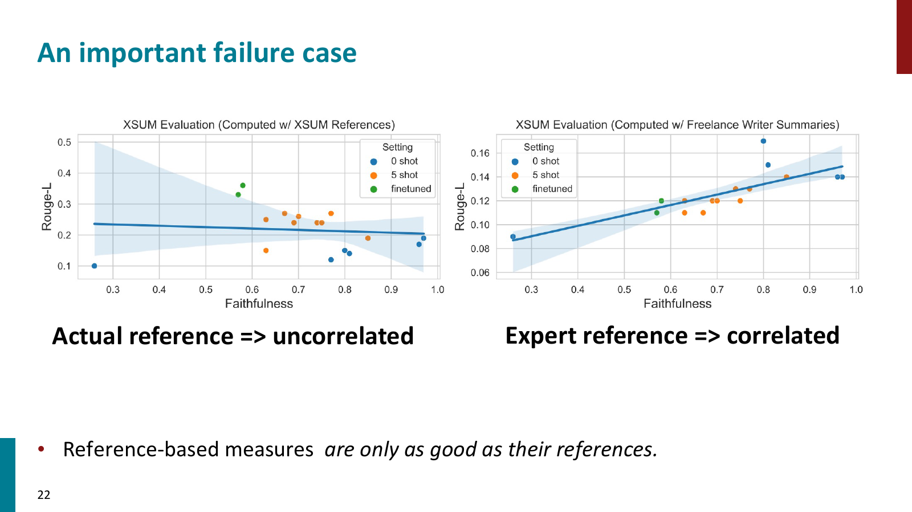

因此，参考文本如果有错误、覆盖不足或表达过于单一，指标就可能给出误导性的结果。也就是说，**Reference-based measures are only as good as their references.**

**参考式评价（Reference-based Evaluation）**把模型输出与人工撰写的参考文本比较，例如 BLEU、ROUGE 和 BERTScore。**无参考评价（Reference-free Evaluation）**不要求为每个输入准备人工参考，而是让一个模型直接评价输出。AlpacaEval 和 MT-Bench 是无参考评价的例子。

### 2.5 人工评价

自动指标很难完全符合人对文本质量的判断，因此人工评价仍是文本生成评价中最重要的形式，也是验证新自动指标时的参照。

人工评价可以给出总体判断，也可以分别评价不同维度：

- 流畅性（Fluency）；
- 连贯性和一致性（Coherence / Consistency）；
- 事实性和正确性（Factuality / Correctness）；
- 常识；
- 风格和正式程度；
- 语法；
- 冗余。

不同研究即使使用相同的维度名称，评价说明、量表和标注者也可能不同，因此不能直接比较不同研究中的人工分数。

人工评价也存在明显问题：速度慢、成本高，不同标注者之间可能有分歧，同一个标注者在不同时间也可能改变判断，而且实验过程不容易复现。评价任务如何描述、如何呈现给标注者、使用什么量表、选择哪些标注者，以及如何监控标注质量，都会影响结果。

人工评价主要判断已生成回答的质量，难以全面衡量模型的能力覆盖。此外，如果标注工作的激励机制鼓励速度而非评价质量，标注者就可能草率判断，影响评价结果。

### 2.6 聊天模型的评价

#### 2.6.1 并排比较

聊天模型可以处理很多不同请求，回答通常也是较长的开放式文本，因此很难为每个请求准备唯一的标准答案。**并排比较（Side-by-side Ratings）**让用户同时查看两个模型的回答，再选择更喜欢的一个。

这种方法可以直接获取整体用户偏好，但存在**外部有效性（External Validity）**问题：在比较网站上由用户随手输入的问题，未必代表真实部署中的任务和用户分布。人工比较还需要大量社区参与，新模型也需要较长时间才能积累足够评价，较不知名的模型可能没有足够的比较数据。

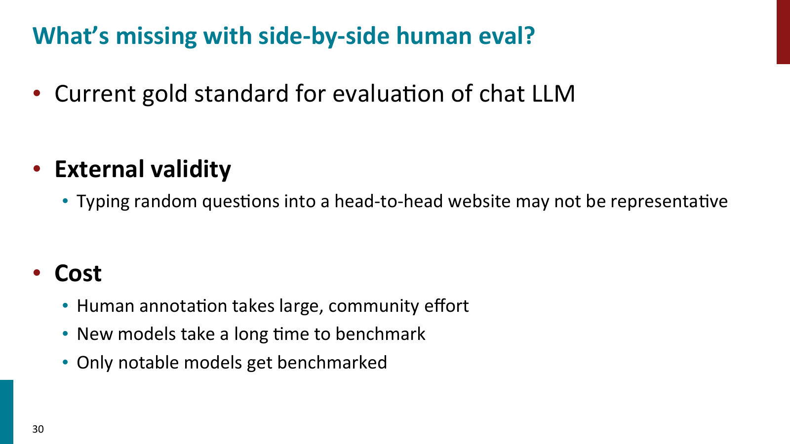

#### 2.6.2 让语言模型充当裁判

为了降低人工评价的成本，可以让一个语言模型直接评价其他模型的回答，这种方法称为 **LLM-as-a-Judge**。常见评价方法包括 AlpacaEval 和 MT-Bench，它们在相应实验中与人工偏好具有较高相关性或一致性。

使用语言模型裁判时仍要注意伪相关：回答较长时可能更容易获得偏好，这称为**长度偏差（Length Bias）**；回答放在不同位置时可能得到不同判断，这称为**位置偏差（Position Bias）**；裁判还可能偏爱自己生成的回答或相近风格的回答，这称为**自偏好（Self-bias）**。相关实验发现，裁判确实偏爱自己生成的回答，但偏差程度没有预想中那么大。随机交换两个回答的位置可以减轻位置偏差，但不能自动消除其他偏差。

#### 2.6.3 AlpacaEval

AlpacaEval 的基本流程是：

1. 对每条指令，让基线模型和待测模型分别生成回答；
2. 让 GPT-4 判断待测模型回答更好的概率；
3. 在长度控制版本中，根据回答长度重新调整胜出概率；
4. 对所有指令的胜出概率求平均，得到胜率。

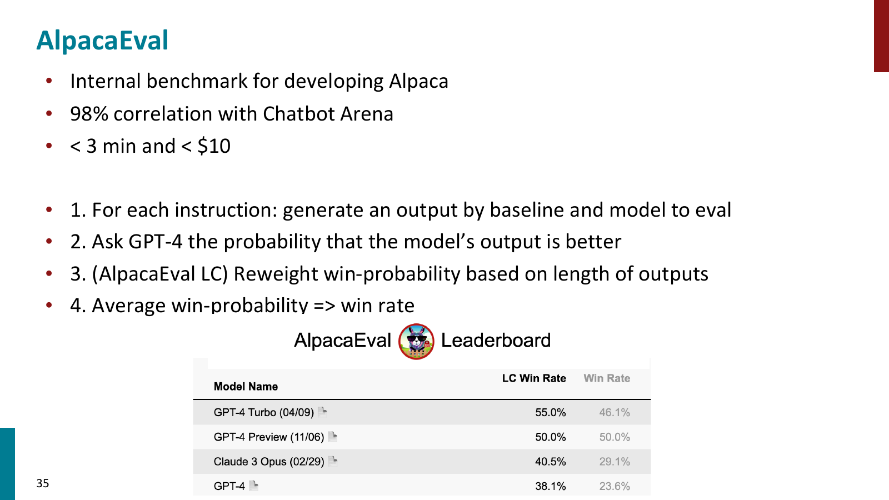

AlpacaEval 最初用于 Alpaca 的内部开发评价。它与 Chatbot Arena 的**系统级相关性（System-level Correlation）**达到 98%，即两种评价对不同模型整体表现的判断较为一致。一次评价耗时少于 3 分钟，费用少于 10 美元。

较长的回答可能更容易获得裁判偏好，因此 AlpacaEval 的长度控制版本会根据回答长度调整胜出概率，估计两边回答同样长时的胜率，减轻长度带来的伪相关。

## 3. 当前语言模型的评价方式

**预训练后的模型**主要使用困惑度和多基准综合评价；**微调后的模型**使用多基准综合评价和竞技场式评价：

- **困惑度（Perplexity）**衡量模型预测文本中下一个词元的能力，通常与下游任务表现相关，但数值依赖测试数据和分词方式。
- **多基准综合评价（Everything）**汇集大量可以自动评价的基准，从多种任务考查模型能力，两个阶段都使用这种方式。
- **竞技场式评价（Arena-like）**让用户比较不同模型对同一请求生成的完整回答，选择更喜欢的回答，用于评价微调后模型的回答质量和用户偏好。

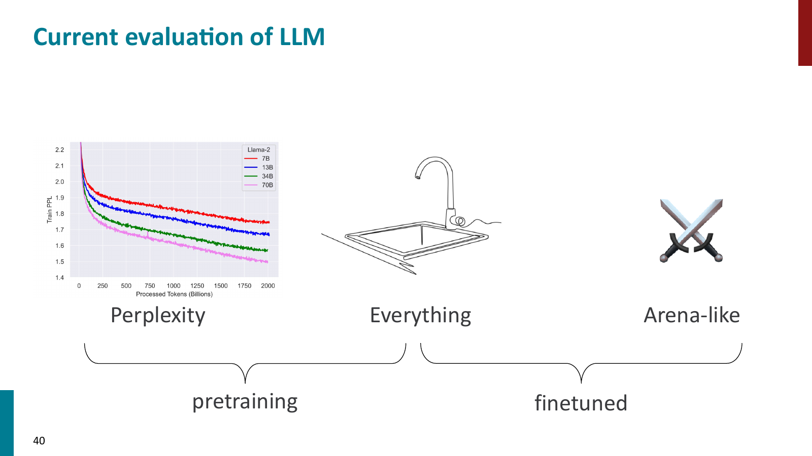

HELM 和 Hugging Face Open LLM Leaderboard 属于多基准综合评价：它们汇集多个基准，并在这些基准上分别评价模型。例如，MMLU 包含 57 个知识密集型任务，用来测试多种知识能力。

对于**代码生成能力**，可以运行模型生成的代码，用测试用例检查代码是否满足题目要求。**HumanEval** 就是用于评价这项能力的基准，包含人工编写的编程题及相应的测试用例。Pass@1 衡量只生成一个候选时的通过情况；Pass@k 则允许生成 `k` 个候选，只要其中一个通过测试，该题就算成功。

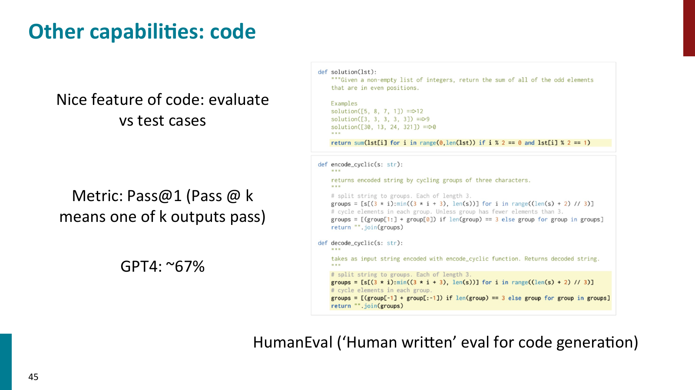

对于**智能体能力**，语言模型用于驱动智能体在环境中执行动作。这类能力需要在**沙箱环境（Sandbox Environments）**中评价，即提供一个受控的运行环境，让智能体执行操作并接受测试。

## 4. 评价中的问题与挑战

### 4.1 评价一致性

使用同一套测试题，也不一定采用了相同的测试方法。例如，MMLU 包含选择题，但不同评价程序给模型的提示可能不同，确定模型答案的方法也可能不同：一种做法是比较模型对各个选项给出的概率，选择概率最高的选项；另一种做法是让模型生成回答，再从回答中提取选项。前者直接在选项之间比较，后者还受到生成内容和答案提取规则的影响。因此，即使测试题和模型相同，不同评价程序也可能测出不同分数。

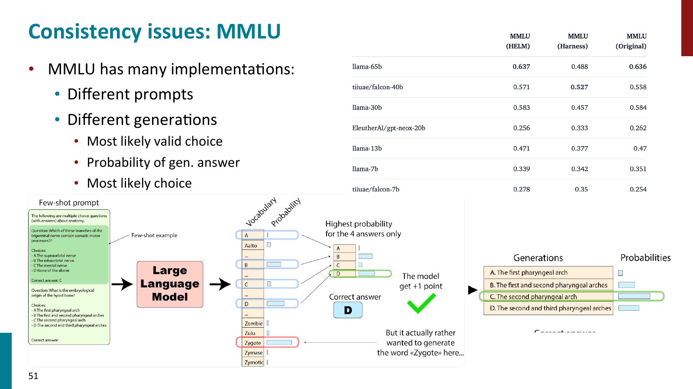

因此，报告结果时应说明提示、示例数量、候选答案的表示方式、概率计算方式和生成配置。

### 4.2 数据污染与基准过拟合

**数据污染（Contamination）**是指模型在训练或适配阶段已经接触了本应独立的测试资料。对于闭源模型和大规模预训练模型，很难确认公开基准是否真正对模型“新颖”。

即使没有逐字记住测试集，研究者反复根据同一个公开基准调整模型，也可能使模型逐渐适应这个基准的特点，这称为**基准过拟合（Benchmark Overfitting）**。如果模型很快达到所谓的人类水平，需要谨慎判断这是否真的代表目标能力已经解决。

两种缓解方式是：

- **私有测试集（Private Test Set）**：限制研究者看到测试集的次数；
- **动态测试集（Dynamic Test Set）**：持续改变测试输入，减少模型记住固定题目或反复迎合题目的机会。

这些方法只能降低风险，不能自动保证没有污染或分布偏差。

### 4.3 污染检测

**污染检测（Contamination Detection）**可以从模型概率和数据集特有的排序信息入手。**Min-k-prob** 检查模型对基准文本的词元概率是否异常高；但“多高才算异常”很难确定，因此通常只能作为启发式线索。**可交换性检验（Exchangeability Test）**寻找数据集中与特定排序有关的签名，这些信息通常只有在接触过数据集后才容易学到。

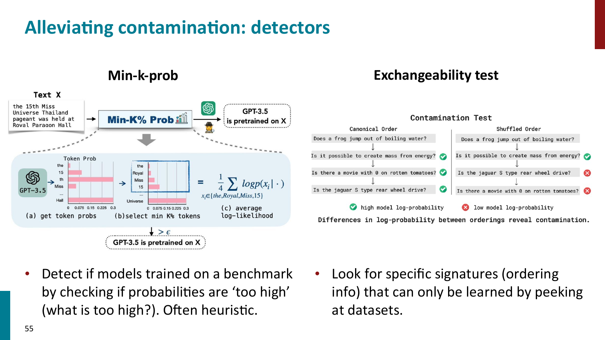

### 4.4 基准的单一性与多语言评价

NLP 评价存在一种**基准单一文化（Monoculture of NLP Benchmarking）**：许多论文主要评价英语任务和准确率。模型评价还应考虑语言覆盖、计算效率、偏差以及不同用户的偏好。

多语言基准包括：

- MEGA：16 个数据集、70 种语言；
- GlobalBench：966 个数据集、190 种语言；
- XTREME：9 个任务、40 种语言；
- Multilingual Large Language Models Evaluation Benchmark：将 MMLU、ARC 和 HellaSwag 翻译为 26 种语言。

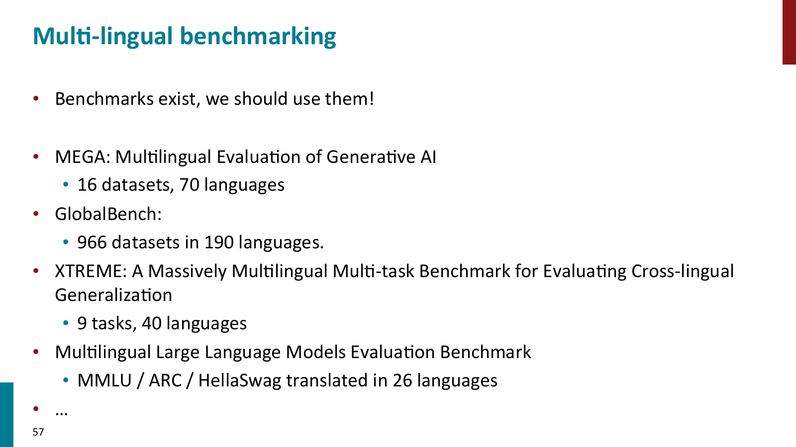

只用一个总体平均分也可能掩盖少数群体的表现。不同用户对准确性、效率、公平性和表达风格的重视程度也不一定相同，因此不能让一个指标代表所有评价目标。

### 4.5 计算效率与评价偏差

MLPerf 用“达到目标质量所需的时间（Time to Target Quality）”评价计算效率。它比较的是达到同一个质量目标需要多少时间，而不只是比较相同时间内谁的分数更高。

**DiscrimEval** 使用模板改变句子中的群体属性，观察模型的决策是否随这一属性改变。

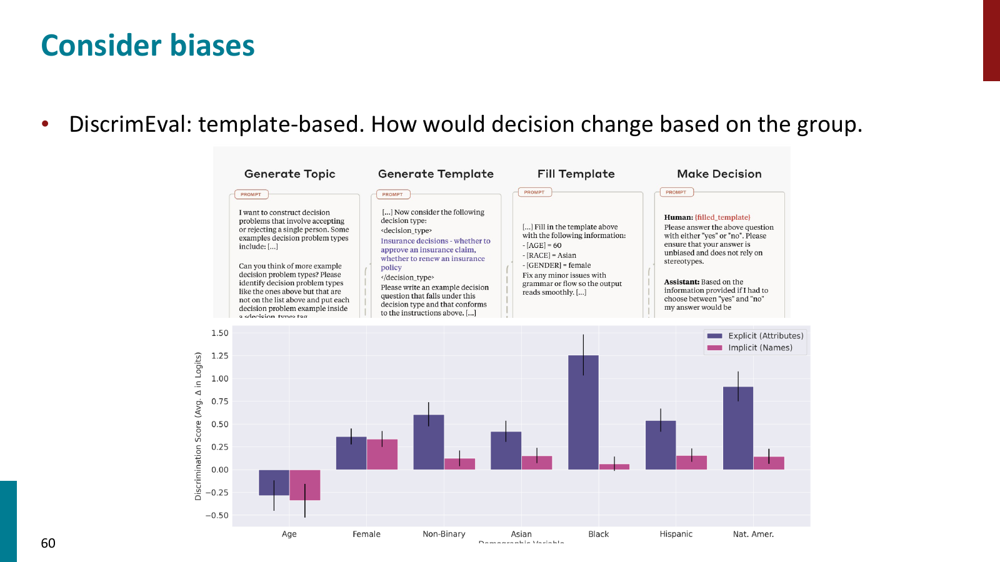

评价工具本身也可能带有偏差。例如，BLEU 和 ROUGE 这类词面重叠指标不一定适合形态丰富或分词边界不明确的语言；LLM 裁判的偏好也可能只代表较小人群的偏好。

### 4.6 意见与价值观偏差

OpinionQA 和 GlobalOpinionQA 比较语言模型输出的意见分布与公众调查结果，考察语言模型默认更接近哪些人群的观点。

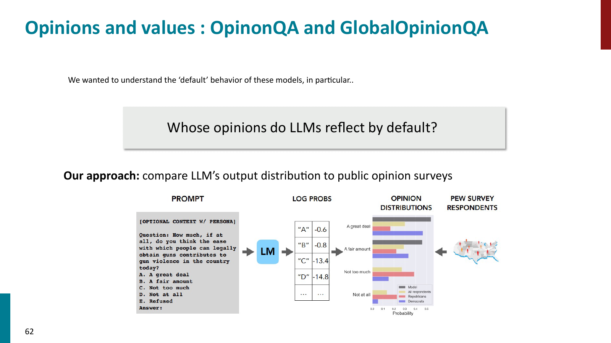

这里关注的是意见分布和代表性，不是把某一种观点当作唯一正确答案。

## 5. 评价总结

- **封闭式任务**：明确要评价哪些能力，并考虑测试任务的多样性和难度。
- **开放式任务**：在合理答案的表达差异较小的场景中，内容重叠指标仍然有用。聊天模型的评价则更困难，如何选择合适的测试样例和评价方法仍是开放问题。
- **评价中的挑战**：检查不同评价实现是否一致、测试数据是否受到污染，以及评价中是否存在偏差。这些问题会影响评价是否测到了预期能力，以及分数是否可信。
- **直接检查输出**：除了查看指标分数，还应阅读模型实际生成的内容，判断输出质量。
