## 1. 推理的类型

**推理（Reasoning）**是利用事实和逻辑得出答案。按从已知信息得到结论的方式，可以区分为：

- **演绎推理（Deductive Reasoning）**：根据前提和逻辑规则得出确定的结论。例如，所有哺乳动物都有肾，鲸是哺乳动物，因此鲸有肾。
- **归纳推理（Inductive Reasoning）**：根据观察预测可能的结论。例如，看到有翅膀的生物通常是鸟，于是推测眼前这个有翅膀的生物可能是鸟。
- **溯因推理（Abductive Reasoning）**：根据现象寻找最可能的解释。例如，汽车无法启动，发动机下方又有一摊液体，于是推测散热器可能泄漏。

推理还可以分为**形式推理（Formal Reasoning）**和**非形式推理（Informal Reasoning）**。前者依据明确的逻辑规则和公理推导结论；后者借助直觉、经验和常识得出答案。下面主要讨论用自然语言进行、通常包含多个步骤的非形式演绎推理。

语言模型能够生成合理的续文、遵循输入要求并给出符合人类偏好的回答。判断它是否能推理，还需要检查它能否正确完成多步骤问题，以及改变规则或条件后能否继续正确求解。

## 2. 通过提示改善推理

### 2.1 思维链提示

**思维链提示（Chain-of-Thought Prompting，CoT）**在示例中同时给出问题、求解步骤和答案，引导模型在回答新问题时也生成中间步骤。

例如，示例问题是：Roger 原来有 5 个网球，又买了两罐，每罐 3 个，现在共有多少个？普通提示只给出答案 11；思维链示例则写出“新买了 2 × 3 = 6 个，共有 5 + 6 = 11 个”。

随后询问“食堂原有 23 个苹果，用掉 20 个，又买来 6 个，还剩多少个”时，模型可以按步骤计算：先剩下 23 − 20 = 3 个，再得到 3 + 6 = 9 个。

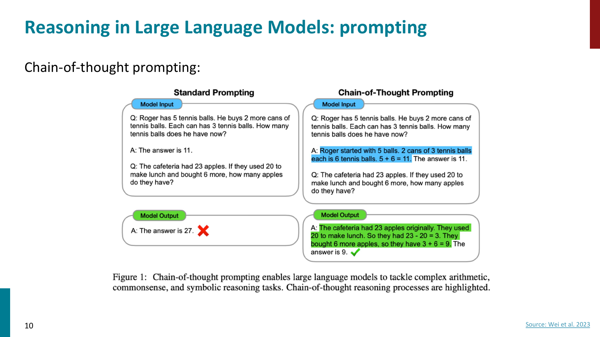

**零样本思维链提示（Zero-shot CoT Prompting）**不提供解题示例，而是在问题后加入 `Let's think step by step.`，让模型逐步求解。例如，16 个球中一半是高尔夫球，高尔夫球中一半是蓝色，分两步计算就是 16 ÷ 2 = 8，再计算 8 ÷ 2 = 4。

### 2.2 自一致性

普通 CoT 可以只生成一次求解过程，但这一次可能算错。**自一致性（Self-consistency）**对同一个问题采样多条求解过程，再选择出现次数最多的最终答案。

例如，Janet 的鸭子每天产 16 个蛋，早餐吃 3 个，做松饼用 4 个，其余每个卖 2 美元。不同求解过程可能得到 18 美元、26 美元、18 美元，按最终答案投票后选择 18 美元。

具体过程是：

1. 使用同一个 CoT 提示，多次采样，得到不同的求解过程与答案。
2. 从每次输出中提取最终答案。
3. 统计各答案的出现次数，选择最常见的答案。

这里比较的是**答案是否一致**，不要求推理文字相同。例如，“先算剩余蛋数再乘单价”和“分别扣除早餐及做松饼的用量”可以支持同一个答案。

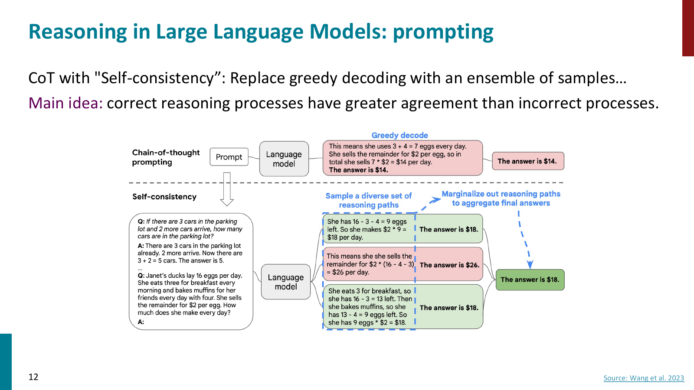

其依据是：不同的正确求解过程更容易得到相同答案，错误过程的答案则可能分散。在多个推理基准上，自一致性优于普通 CoT，也优于仅改变提示示例或示例顺序的简单集成。

### 2.3 由简到繁提示

**由简到繁提示（Least-to-Most Prompting）**先将复杂问题分解成较简单的子问题，再按顺序求解。后面的子问题会用到前面已经得到的答案。

例如，Amy 爬到滑梯顶端需要 4 分钟，滑下需要 1 分钟，滑梯在 15 分钟后关闭，问她能滑几次：

1. **分解问题**：要先知道完成一次需要多长时间，再计算 15 分钟能完成几次。
2. **回答第一个子问题**：4 + 1 = 5 分钟。
3. **把这个答案加入后续输入**：已知每次需要 5 分钟，再计算 15 ÷ 5 = 3 次。

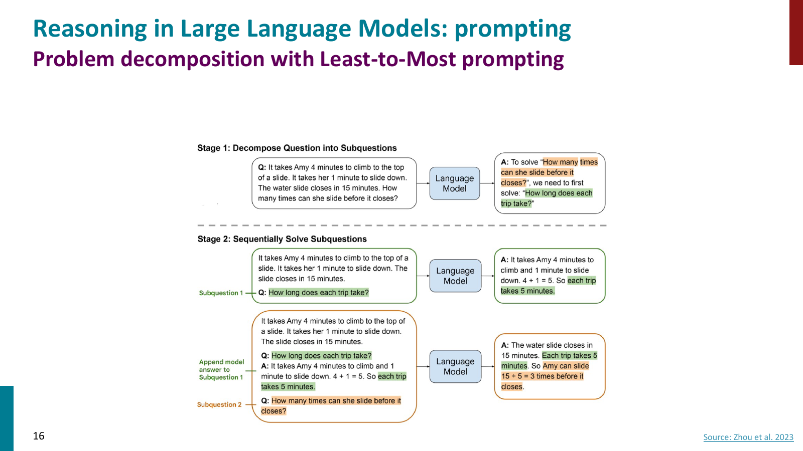

CoT 通常在一次回答中连续生成求解过程；由简到繁提示则明确分开“分解”和“逐个求解”，每次求解都能使用此前的子问题及答案。

数学推理实验中，这种方法可以求解比提示示例需要更多步骤的问题。不过，经过充分的提示设计，CoT 也能达到相近效果，提示的具体写法会影响比较结果。

## 3. 通过训练改善推理

### 3.1 Orca 的推理蒸馏

提示方法直接使用已有模型。**推理蒸馏（Reasoning Distillation）**则让较大的模型生成求解示范，再用这些示范训练较小的模型，使其学习类似的解题行为。

**Orca** 用包含思维链解释的数据对 Llama-13B 进行指令微调：

1. 从 FLAN-v2 指令集合中收集多样的任务。
2. 将任务和系统指令交给 GPT-4 或 ChatGPT，要求逐步思考并解释各步骤，生成答案及求解过程。
3. 用这些输出微调 Llama-13B。

例如，输入是求 `[7, 3, 8, 2, 10]` 的中位数，生成的示范先将数字排序为 `[2, 3, 7, 8, 10]`，再判断有 5 个数，最后选出中间的 7。较小模型学习的是这样的解释与答案，而不只是最终的数字。

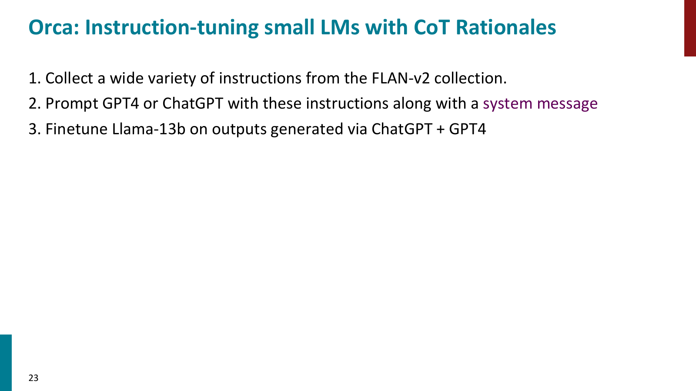

评价使用 **BigBench-hard（BBH）**，它包含从 BIG-bench 中选出的 23 个任务，重点考查多步推理，包括布尔表达式、日期理解和几何形状判断等。Orca 在该评价设置中的平均表现超过 Vicuna-13B 和 ChatGPT；GPT-4 的比较还存在潜在的**数据污染（Data Contamination）**问题，即评价数据可能与模型此前见过的数据重合。

### 3.2 用模型自己的解答训练

**ReSTEM** 不依赖另一个更大的模型提供全部示范，而是反复执行“生成并筛选—监督微调”：

1. **生成（Generate，E-Step）**：对一个推理问题采样多个解答，再使用适合该任务的检查方法筛选。例如，数学题可以按最终答案是否正确筛选。
2. **改进（Improve，M-Step）**：把筛选通过的解答作为监督数据微调语言模型，提高模型生成这些解答的概率。

更新后的模型再生成新解答，继续筛选和训练。这样，模型自己产生的正确解答就成为下一轮的训练数据。

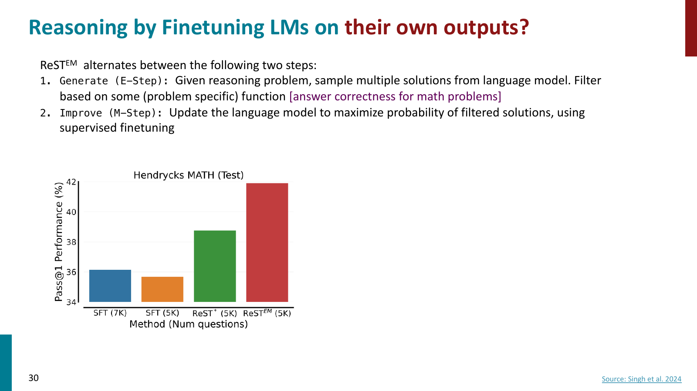

## 4. 推理能力的检验

模型答对问题并写出求解步骤，并不一定说明它掌握了推理规则。还需要检验：答案是否依赖这些步骤，以及改变题目规则后，模型能否继续正确求解。

### 4.1 思维链的忠实性

**忠实性（Faithfulness）**关注模型写出的解释，是否确实反映了它得出答案所依赖的过程。

为了检查模型是否依赖写出的求解步骤，可以截短思维链，只保留部分步骤，再要求模型回答；也可以在步骤中加入错误，观察答案是否受到影响。实验发现，有时步骤不完整，甚至包含错误，模型仍能答对。

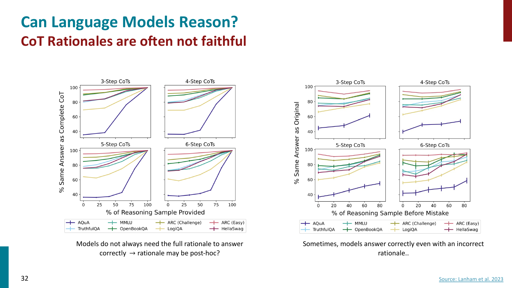

因此，不能仅凭解释看起来合理，就认定它反映了模型得出答案的实际过程。部分解释可能是为答案补写的**事后解释（Post-hoc Rationale）**。

### 4.2 改变规则后的推理表现

**反事实评价（Counterfactual Evaluation）**改变题目中通常默认的规则或条件，检查模型是否按新规则推理，而不是重复熟悉的答案模式。

例如，27 + 62 在十进制下等于 89，但在九进制下，27 和 62 表示不同的数，相加结果应写成 100。模型需要根据题目指定的进制计算，不能沿用十进制答案。

逻辑题也可以改变前提：若“所有柯基都是爬行动物，所有爬行动物都是植物”，按这两个前提仍应推出“所有柯基都是植物”。虽然前提违背常识，演绎结论仍应由题目给定的关系决定。

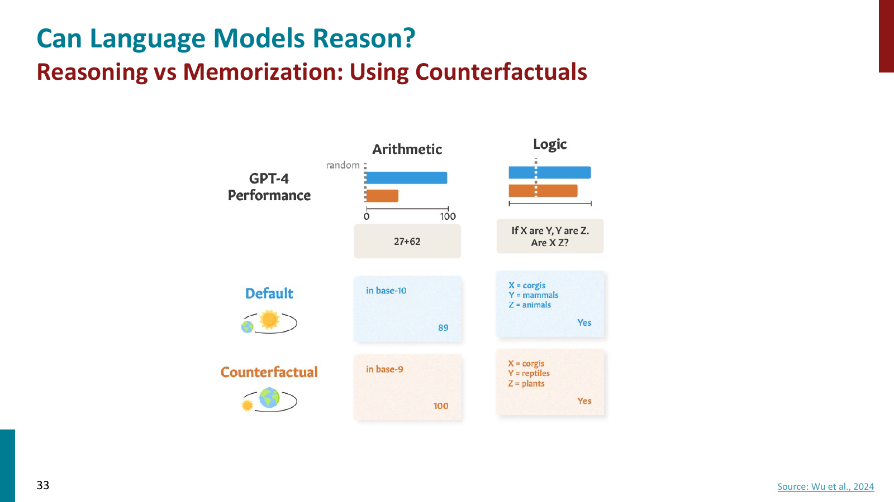

**类比推理（Analogical Reasoning）**也可以这样检验。例如，给出 `abcd → abcde`，要求对 `ijkl` 应用相同变换，得到 `ijklm`。进一步的测试会修改字母间隔，或者提供一套重新排列的字母表。字母表改序后，模型需要按照题目提供的新顺序选择后续字母，不能继续沿用通常的字母顺序。

在这些修改条件下，GPT-4 的表现明显下降，而人类没有出现相应下降。这表明模型的推理可能依赖熟悉的模式，未必能稳定地将规则应用于改变后的条件。

## 5. 语言模型智能体

### 5.1 环境、观察与动作

**智能体（Agent）**根据当前获得的信息选择动作，在环境中执行，再根据执行结果继续行动。对于语言模型智能体，用户用自然语言给出目标，例如“预订从旧金山到纽约的航班”。

在网页操作中：

- **环境（Environment）**是智能体操作的网站或应用。
- **观察（Observation）**是当前能看到的信息，例如页面截图，或描述页面元素及结构的 HTML DOM。
- **动作（Action）**是输入文字、点击按钮、从下拉框选择选项等操作。
- **策略（Policy）**决定在给定指令和观察后采取什么动作。以语言指令为条件的策略也称为**语言条件策略（Language-conditioned Policy）**。

例如，智能体先看到航班搜索页面，输入出发地和目的地，执行搜索后再看到结果页面，然后选择下一步操作。动作会改变环境，因此需要反复读取新的观察。

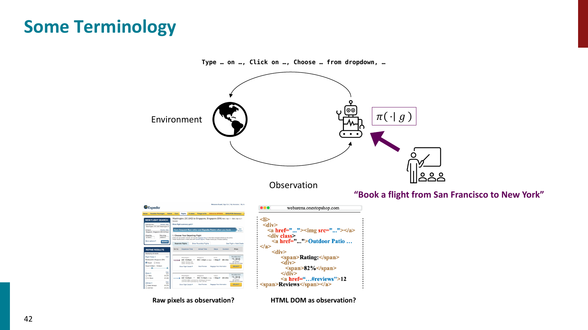

这类系统可用于虚拟助手、自然语言编程、界面自动化和多步工具使用。例如设置闹钟、将列表降序排列、把字典导出为 CSV 文件等。

### 5.2 从指令到动作序列

在大语言模型之前，指令遵循主要有三条路线：

1. **直接预测动作序列**：类似机器翻译，将自然语言指令映射为动作或查询语句，适用于 Text-to-SQL、知识图谱查询等较简单、指令含义明确的环境。
2. **先生成结构化计划**：从“指令—执行轨迹”数据中推断可执行计划，再训练模型将指令转换为计划。
3. **强化学习**：通过与环境交互、获得奖励，学习根据指令采取动作。

智能体通过一系列动作完成用户指令，过程中依次记录的状态和动作组成一条**轨迹（Trajectory）** $\tau=(s_1,a_1,s_2,a_2,\ldots)$。其中，$g$ 表示用户指令，$s_t$ 和 $a_t$ 分别表示轨迹中的状态和动作。

例如，指令是“搜索飞往纽约的航班”，轨迹中的一段是“看到搜索页——填写目的地——看到填写后的页面——点击搜索——看到搜索结果”。状态在网页任务中可以用当前页面的 HTML 或截图表示。

给定指令 $g$，产生一条轨迹的概率可以分解为各步的状态转移概率和动作选择概率的乘积：

$$
p(\tau\mid g)
=p(s_1,a_1,s_2,a_2,\ldots\mid g)
=\prod_t p(s_t\mid s_{t-1},a_t)
\times\pi(a_t\mid\tau_{\le t},g).
$$

这两部分分别表示：

- **转移动态（Transition Dynamics）** $p(s_t\mid s_{t-1},a_t)$：环境在执行动作后如何改变状态。例如，输入“纽约”后，页面中的目的地字段随之改变。
- **智能体策略（Agent Policy）** $\pi(a_t\mid\tau_{\le t},g)$：根据指令和截至当前可用的轨迹历史 $\tau_{\le t}$，选择动作。例如，看到目的地输入框后，决定输入“纽约”。

**因果 Transformer 对轨迹序列进行建模，用于预测智能体的下一步动作。** 已有状态和动作经过嵌入与位置编码后输入 Transformer，再由输出层预测动作。这样，动作选择能够利用此前的交互过程，而不只依赖当前页面。

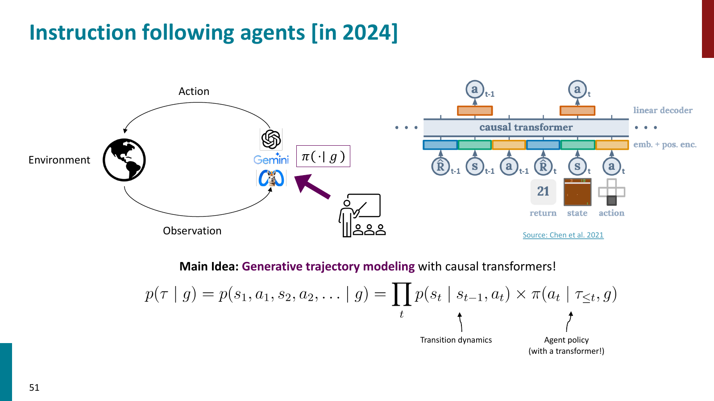

这一结构示例还将**回报（Return）**与状态、动作一起输入模型，用回报表示期望获得的任务收益。网页中的状态变化仍由环境在动作执行后产生。

### 5.3 ReAct 的交互循环

**ReAct（Reasoning and Acting）**将文字推理与执行动作结合起来。模型在每一步生成 `Thought` 和 `Action`，动作执行后，再把新的环境观察交给模型。

一次模型调用的输入包括：

1. 可用的动作及其格式，例如在指定元素中输入文字、移动鼠标和点击。
2. 用户指令。
3. 此前的观察和动作。
4. 当前页面状态，例如 HTML 文本。

模型先生成对下一步的思考，再生成具体动作。系统执行动作、获取新页面，将结果加入历史，然后再次调用模型，以此类推。

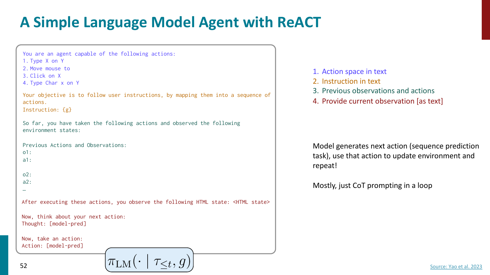

例如，订票时先决定填写出发地，执行输入后查看页面，再决定填写目的地。这里的推理与行动交替进行，后续决策会使用动作执行后得到的新信息。

## 6. 智能体评价基准

### 6.1 MiniWoB++

**MiniWoB++** 提供沙箱中的基础浏览器任务，例如点击指定按钮、选择选项和填写表单。它覆盖类似社交网站、邮件客户端等应用的简化操作，但功能有限，任务通常只需要较少步骤。

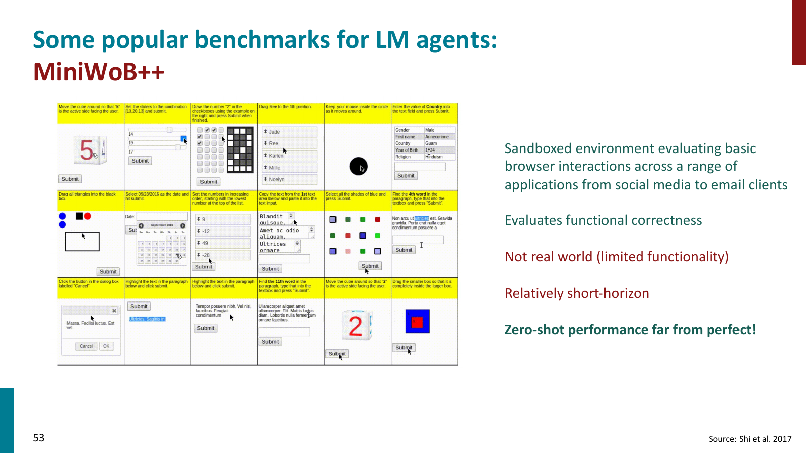

评价关注**功能正确性（Functional Correctness）**，即智能体是否实际完成任务要求。例如，要求把日期设为指定值，就检查最终日期是否正确。即使在这样的简单环境中，模型的零样本表现也并不完善。

### 6.2 WebArena

**WebArena** 使用电商、社交等真实网站的沙箱版本，支持多标签页浏览，并提供地图、计算器、草稿纸和 Wikipedia 等工具。任务往往包含较长的操作过程，同样按功能正确性评价。

例如，规划匹兹堡艺术博物馆的参观路线，并把访问顺序记录到指定代码仓库，需要先查找博物馆，再使用地图比较路线，最后将结果写入仓库。

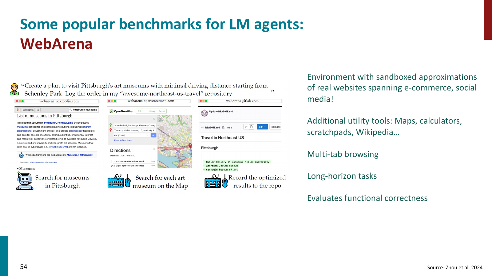

### 6.3 WebLINX

**WebLINX** 收集真实网站上的对话式交互轨迹，支持多标签页操作，并包含向用户说话的 `say` 动作。智能体可以在缺少信息时向用户询问，再继续操作。

例如，用户要求创建招聘会日历事项，智能体可以进一步询问是否添加描述，再将用户补充的内容写入事项。

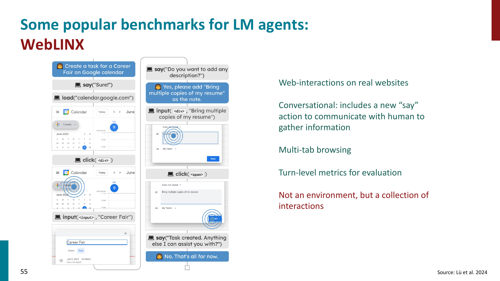

WebLINX 是交互数据集合，不是可供智能体自由执行新动作的环境；它按回合评价预测的动作，而不是像 WebArena 那样运行完整任务后检查结果。

## 7. 智能体示范数据的构造

### 7.1 人工示范的局限

为了让智能体完成一条新指令，可以在模型输入中先提供几个例子，展示人类如何通过网页操作完成类似指令。例如，先展示“搜索广州到深圳的航班”的指令和操作过程：在出发地输入“广州”——在目的地输入“深圳”——点击搜索；再让模型完成“搜索北京到上海的航班”。这种把少量示范放进输入、供模型参考的做法属于**少样本上下文学习（Few-shot In-context Learning）**，不需要为此重新训练模型。

网站和操作种类很多，靠人逐个演示难以覆盖。因此，可以让智能体先自主探索网站，再由语言模型根据操作记录，写出这段操作完成了什么，构造新的“指令—操作轨迹”示范。

### 7.2 探索环境并生成指令

首先，让语言模型智能体在网站上逐步执行操作，记录动作及对应的 HTML 页面状态，得到探索轨迹 $\tau$。智能体中的语言模型根据页面信息选择动作，系统再将这些动作执行到网站上。

随后，将这段动作和页面变化交给语言模型，让它描述这段操作完成了什么。这段描述就成为与轨迹配对的指令 $g$。标注过程写作 $p_{\text{label}}(\cdot\mid\tau)$，表示根据轨迹生成指令；其中的 $\cdot$ 表示尚未生成的指令。

例如，一段轨迹完成了日期设置，就可以标注为“将日期设为 2016 年 12 月 26 日”。这样，无须人先写出指令并演示操作，也能得到一组“指令—轨迹”示范。

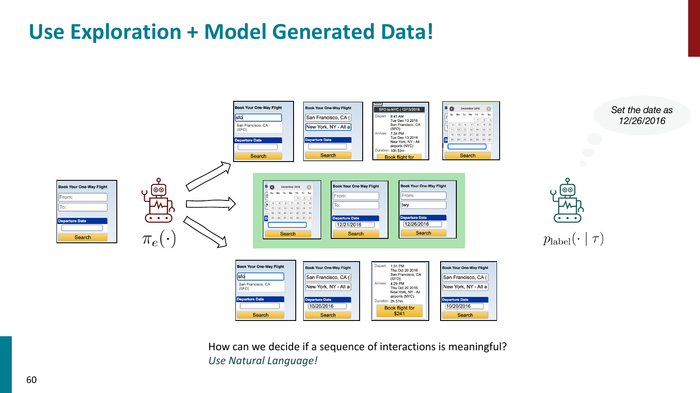

### 7.3 按指令执行、验证与重新标注

得到指令 $g$ 后，让智能体尝试完成它。**执行指令的智能体策略**记为 $\pi_{\mathrm{LM}}(\cdot\mid g)$：智能体以语言模型选择动作，结合网站返回的新页面逐步操作，产生轨迹 $\tau$。这里的机器人图标代表执行操作的智能体，$\mathrm{LM}$ 表明它的策略由语言模型实现。

例如，给定“将日期设为 2016 年 12 月 26 日”，智能体逐步操作日期控件，记录操作和页面变化。随后，将指令和轨迹一起交给语言模型，要求判断这段操作是否正确完成了指令：完成则输出 1，否则输出 0。

**指令与轨迹是否相符的评价**记为 $R(g,\tau)$。它接收指令 $g$ 和轨迹 $\tau$，输出完成情况的评分。例如，日期确实被设为指定值，才算完成这条指令。连接指令与轨迹的 $R(g,\tau)$ 表示对两者进行检查，并不是另一个执行动作的智能体。

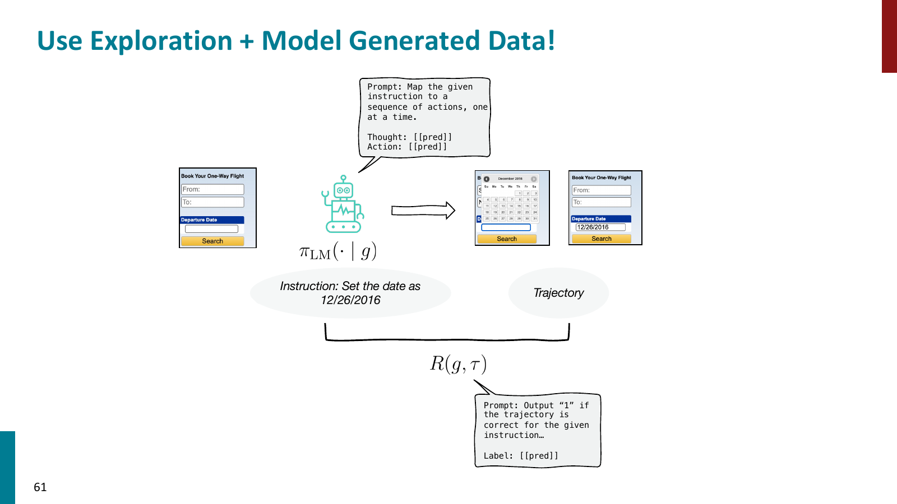

如果轨迹没有完成原指令，可以让**标注智能体** $p_{\text{label}}(\cdot\mid\tau)$ 根据实际操作重新生成指令。例如，原指令是“预订从 SFO 到 NYC 的航班”，但执行智能体只填写了出发地和目的地，还没有完成订票。标注智能体读取这条轨迹，将指令改为“将出发地设为 SFO、目的地设为 NYC”，就能得到与这段操作相符的示范。

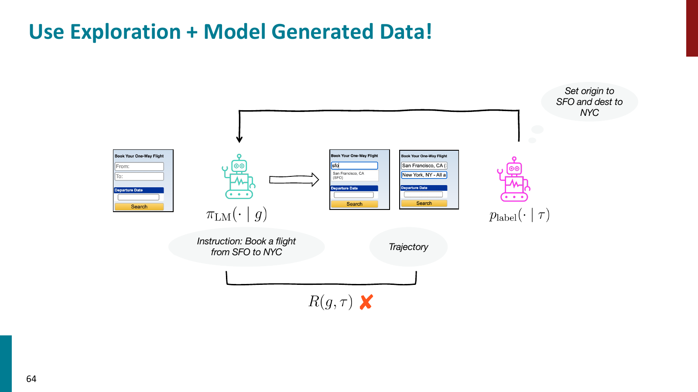

### 7.4 BAGEL 的流程与示范使用

**BAGEL（Bootstrapping Agents by Guiding Exploration with Language）**结合执行智能体与标注智能体，自动构造“指令—轨迹”示范：执行智能体根据指令操作环境，标注智能体根据实际轨迹生成相符的指令。通过反复执行与重新标注，可以得到供智能体参考的合成示范。

完整流程包括：

1. **探索环境**：收集动作和页面状态组成的轨迹。
2. **迭代重新标注**：为轨迹生成指令，再结合按指令执行、验证和重新标注，构造合成的“指令—轨迹”示范。
3. **执行新指令时检索示范**：从已构造的示范中检索相关例子，放进模型上下文，帮助模型选择动作。这些示范也可以用于微调。

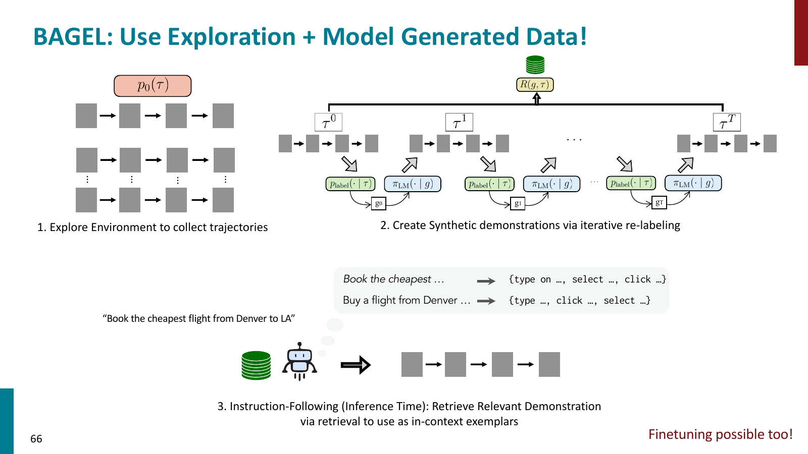

使用 PaLM-2、无需人工监督构造示范的实验中，BAGEL 在 MiniWoB++ 上提高了 13 个百分点，在多步工具使用任务上提高了 2.5%。

## 8. 多模态智能体与局限

### 8.1 用截图作为智能体的输入

前面的网页智能体通过 HTML 文本获取页面信息，但真实网站的 HTML 可能非常长，难以全部交给语言模型处理。另一种做法是将页面截图作为输入，让智能体根据看到的界面选择操作。这需要模型能够同时处理图像和文字。

**LLaVA** 是能够根据图像和文字指令生成回答的视觉语言模型。图像先由 CLIP 视觉编码器转换为向量，再经过投影层，连同文字指令一起输入 Vicuna-13B 语言模型，生成回答。

训练这类模型需要与图像有关的指令和回答。可以把图像的文字描述交给 GPT-4，让它生成相关问题与回答，再用这些合成数据训练图像编码器与语言解码器。

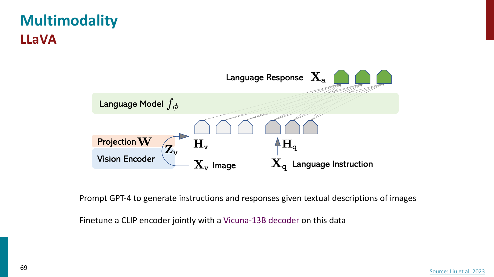

**Pix2Struct** 则训练模型根据网页截图生成描述页面内容与结构的文本。它使用 ViT 编码器读取截图，使用 Transformer 解码器输出相应文本，使模型学习从图像中识别网页信息。

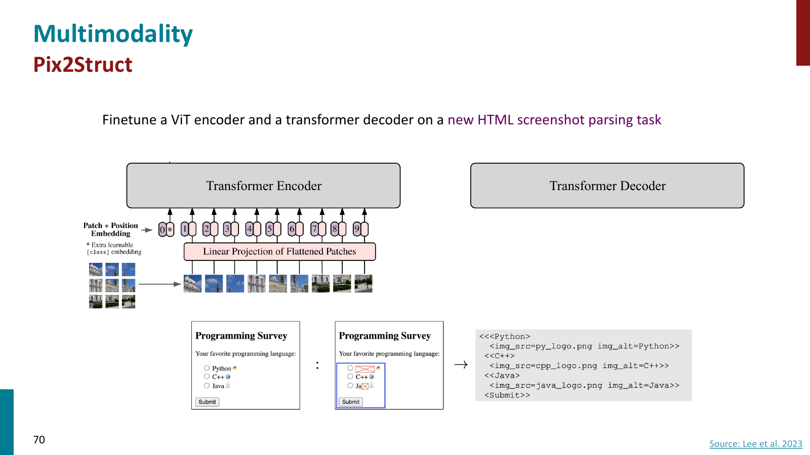

### 8.2 提示设计与多步操作的困难

语言模型能够生成动作，并不意味着智能体就能可靠完成网页操作。若没有仔细设计的提示，或专门针对任务提供的少量示范，即使较强的模型，在最简单的环境中也会出错。这种对提示和示范的依赖称为**提示差距（Prompting Gap）**。

需要连续执行多步操作时，任务也更难完成。**长程规划（Long-horizon Planning）**关注如何安排一系列动作以完成最终目标；实验发现，即使在简单基准中，要求的操作步骤变多后，智能体的成功率也会大幅下降。

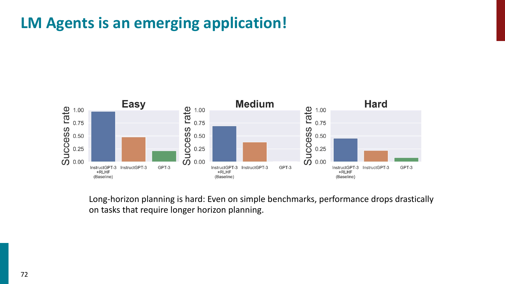

改进不仅涉及提示怎么写，也涉及智能体如何获取页面信息、如何表达操作：例如，将 HTML 还是截图交给模型，以及让模型用什么格式指定点击、输入等动作。这些分别属于观察接口和动作接口的设计。

## 9. 总结

语言模型推理的改进包括提示方法、从大模型蒸馏求解过程，以及用模型自己生成并筛选的解答反复训练。反事实评价表明，模型的推理未必具有稳定的规则泛化能力。

语言模型智能体通过提示和上下文示范与环境交互；BAGEL 利用探索与迭代重新标注构造合成示范，多模态模型则提供了直接理解页面图像的途径。现有交互基准仍然具有挑战，尤其是在减少提示依赖和完成长程任务方面。
