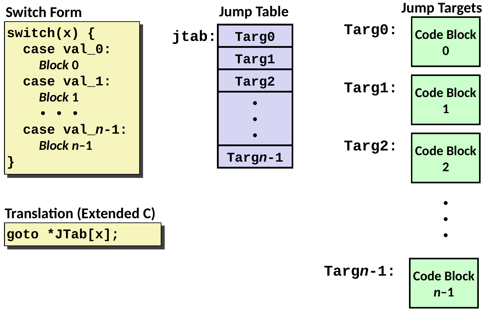
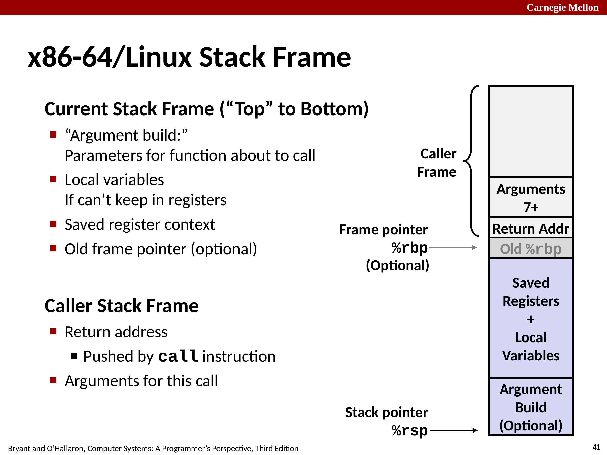
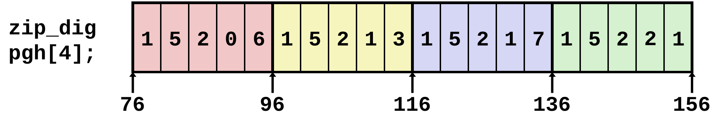
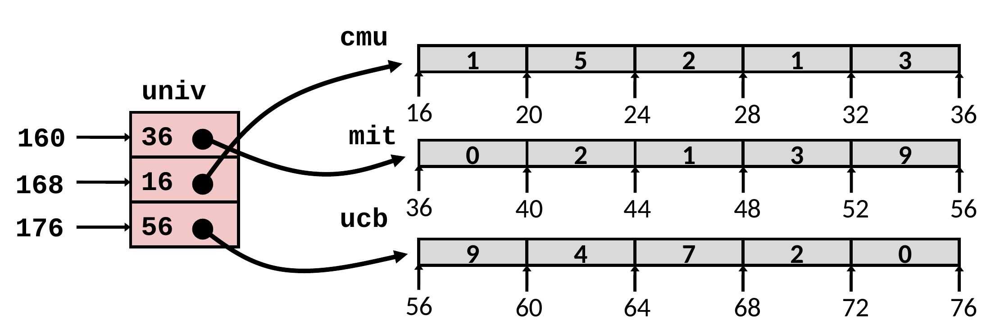
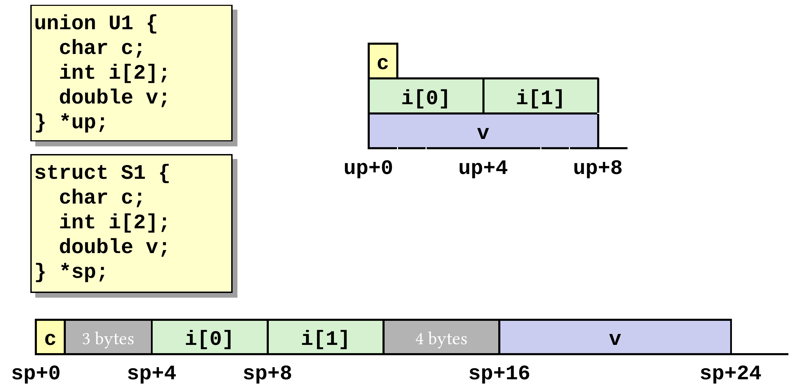
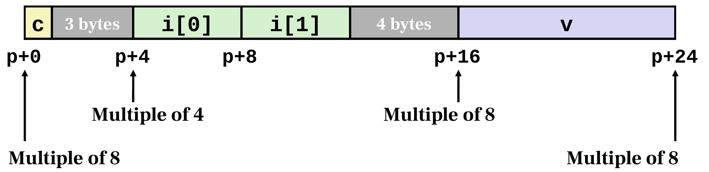
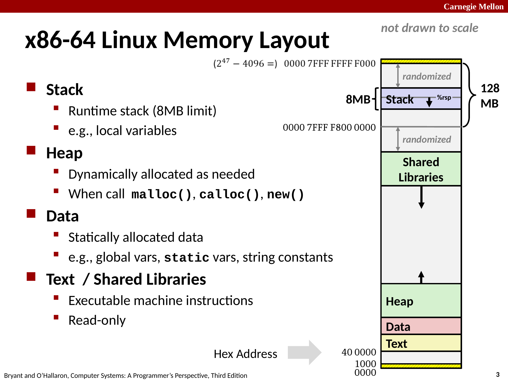
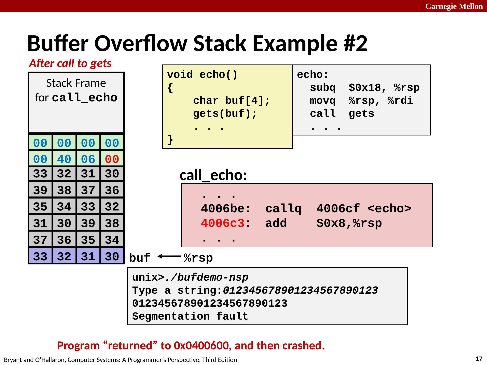
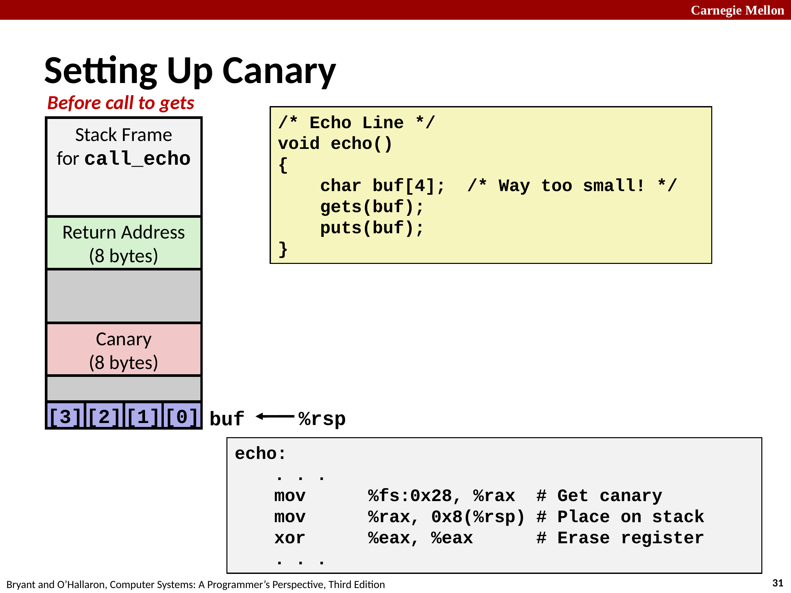
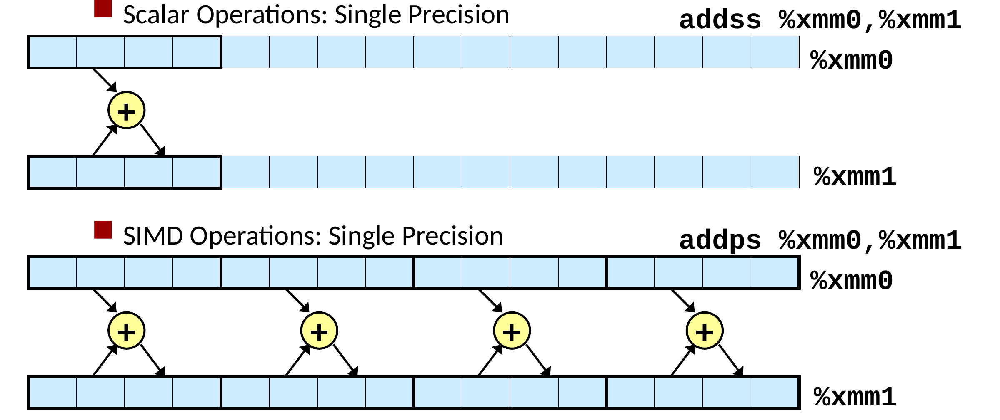

# 1. 程序编码

## 1.1 从源程序到可执行文件

将两个 C 源文件 `p1.c`、`p2.c` 编译为可执行文件，可以使用 `gcc -Og p1.c p2.c -o p`。`-Og` 使生成的代码较容易与源程序对应，`-o p` 指定输出文件名。

GCC 依次调用多个程序完成转换。**预处理器**把 `#include` 指定的文件内容插入源文件，并展开 `#define` 定义的宏；**编译器**把预处理后的 C 程序转换为汇编代码；**汇编器**把汇编指令编码为机器指令，形成目标文件 `p1.o` 和 `p2.o`。此时目标文件还不能独立运行，其中跨文件引用的地址尚未确定。最后，**链接器**将两个目标文件与所需的库代码合并，确定这些引用指向的位置，生成处理器可以执行的文件 `p`。

## 1.2 机器级代码

机器级编程建立在两种抽象之上：

- **指令集架构（Instruction Set Architecture，ISA）**规定处理器状态、指令格式，以及每条指令对状态的影响。它将程序描述为按顺序执行的指令序列；硬件内部即使并行执行多条指令，也要保持与该模型一致的程序行为。
- **虚拟地址**是机器级程序使用的内存地址。程序看到的内存是按字节寻址的数组，实际地址转换和存储管理由硬件与操作系统共同完成。

x86 经历了从 16 位到 IA32，再到 x86-64 的演进。为了兼容已有程序，新架构保留了许多早期指令和寄存器名称。本章采用 x86-64、Linux 上的调用约定和 AT&T 汇编语法，例子中的 `long` 与指针均为 8 字节。

**机器代码（Machine Code）**是处理器执行的指令字节，**汇编代码（Assembly Code）**用指令名和操作数表示这些指令。分析机器级程序时，需要跟踪以下状态。

| 状态 | 作用 |
| --- | --- |
| 程序计数器（PC，x86-64 中为 `%rip`） | 保存下一条将要执行的指令地址 |
| 通用寄存器 | 保存正在使用的整数、地址和临时结果 |
| 条件码 | 记录算术或逻辑运算产生的状态，供条件操作读取 |
| 向量寄存器 | 保存一个或多个整数或浮点数 |
| 内存 | 按字节寻址，保存指令、数据和运行时栈 |

**机器代码把内存看成按字节寻址的数组**。C 语言中的数组、结构体等对象，在机器代码中由连续的字节表示；访问这些对象时，需要根据地址找到相应的字节。

例如，`multstore` 调用 `mult2`，将返回值写入 `dest` 指向的位置。

```c
long mult2(long, long);

void multstore(long x, long y, long *dest) {
    long t = mult2(x, y);
    *dest = t;
}
```

对应的汇编代码如下。

```asm
multstore:
    pushq %rbx
    movq %rdx, %rbx
    call mult2
    movq %rax, (%rbx)
    popq %rbx
    ret
```

汇编中的每条指令对应一个基本操作：这里先保存 `dest`，调用 `mult2`，再把返回结果写回内存。C 代码中的局部变量名 `t` 不再出现在指令中。

**反汇编器（Disassembler）根据机器码字节还原指令的文本表示**，不需要原始 C 源码或汇编文件。例如，`objdump -d mstore.o` 可以查看目标文件中的指令，输出依次列出指令地址、机器码字节和对应的汇编指令：

```text
0:  53             push %rbx
1:  48 89 d3       mov  %rdx,%rbx
```

**x86-64 指令长度为 1～15 字节**，反汇编器从给定的起始位置将字节序列解码为指令。反汇编与 GCC 输出的指令名称可能略有差异，例如 `push` 与 `pushq` 表示相同的操作。

链接后的可执行文件也可以反汇编。与目标文件相比，**链接器会重新安排代码地址，并填入调用外部函数所需的地址信息**。

# 2. 数据格式

Intel 沿用 16 位体系结构中的命名：**字（Word）为 16 位，双字（Double Word）为 32 位，四字（Quad Word）为 64 位**。本章采用的 x86-64 Linux 环境中，C 基本类型的大小如下。

| C 类型 | 数据格式 | 大小 | 整数指令后缀 |
| --- | --- | ---: | --- |
| `char` | 字节 | 1 字节 | `b` |
| `short` | 字 | 2 字节 | `w` |
| `int` | 双字 | 4 字节 | `l` |
| `long` | 四字 | 8 字节 | `q` |
| 指针 | 四字 | 8 字节 | `q` |
| `float` | 单精度浮点数 | 4 字节 | — |
| `double` | 双精度浮点数 | 8 字节 | — |

**多数指令用后缀表示操作数的大小**，例如 `movb`、`movw`、`movl` 和 `movq` 分别传送 1、2、4、8 字节。后缀 `l` 源于“长字”（Long Word），用于 4 字节整数操作。

# 3. 数据访问

## 3.1 通用寄存器

x86-64 包含 **16 个存储 64 位值的通用目的寄存器**，用于保存整数数据和指针。寄存器名称反映了架构的演变：原有的 16 位寄存器（如 `%ax`）扩展为 IA32 的 32 位寄存器（`%eax`），再扩展为 x86-64 的 64 位寄存器（`%rax`）；另外新增了 `%r8`～`%r15`。

指令可以访问整个寄存器，也可以只访问其低位部分。下表同一行中的名称分别表示该寄存器的全部 64 位、低 32 位、低 16 位和低 8 位。

| 64 位 | 低 32 位 | 低 16 位 | 低 8 位 | 用途 |
| --- | --- | --- | --- | --- |
| `%rax` | `%eax` | `%ax` | `%al` | 返回值 |
| `%rbx` | `%ebx` | `%bx` | `%bl` | 被调用者保存 |
| `%rcx` | `%ecx` | `%cx` | `%cl` | 第 4 个参数 |
| `%rdx` | `%edx` | `%dx` | `%dl` | 第 3 个参数 |
| `%rsi` | `%esi` | `%si` | `%sil` | 第 2 个参数 |
| `%rdi` | `%edi` | `%di` | `%dil` | 第 1 个参数 |
| `%rbp` | `%ebp` | `%bp` | `%bpl` | 被调用者保存 |
| `%rsp` | `%esp` | `%sp` | `%spl` | 栈指针 |
| `%r8` | `%r8d` | `%r8w` | `%r8b` | 第 5 个参数 |
| `%r9` | `%r9d` | `%r9w` | `%r9b` | 第 6 个参数 |
| `%r10` | `%r10d` | `%r10w` | `%r10b` | 调用者保存 |
| `%r11` | `%r11d` | `%r11w` | `%r11b` | 调用者保存 |
| `%r12` | `%r12d` | `%r12w` | `%r12b` | 被调用者保存 |
| `%r13` | `%r13d` | `%r13w` | `%r13b` | 被调用者保存 |
| `%r14` | `%r14d` | `%r14w` | `%r14b` | 被调用者保存 |
| `%r15` | `%r15d` | `%r15w` | `%r15b` | 被调用者保存 |

以寄存器为目的位置时，**写入 1 或 2 字节会保留其余字节，写入 4 字节则将高 4 字节清零**。例如，写 `%al` 只修改 `%rax` 的低 8 位；`movl %eax, %edx` 写入 `%edx` 后，`%rdx` 的高 32 位也会变为 0。

表中的用途遵循本章使用的调用约定。**调用者保存**表示调用者若需要在函数调用后继续使用原值，就要在调用前保存它；**被调用者保存**表示被调用函数若使用该寄存器，就必须在返回前恢复原值。栈指针 `%rsp` 指向运行时栈的栈顶。

## 3.2 操作数指示符

**操作数（Operand）指明指令使用的源数据，以及存放结果的目的位置**。源数据可以是常数，也可以来自寄存器或内存；结果可以写入寄存器或内存。操作数分为以下三类。

- **立即数（Immediate）**表示常数值。在 AT&T 语法中，写作 `$` 后跟一个整数，例如 `$-577`、`$0x1F`。不同指令允许的立即数范围不同。
- **寄存器（Register）**表示某个寄存器中的内容。根据所用的寄存器名称，可以取低位的 1、2、4 字节或完整的 8 字节，例如 `%al`、`%ax`、`%eax` 和 `%rax`。用 $r_a$ 表示任意寄存器的标识，用 $R[r_a]$ 表示其中的值，即把寄存器集合看作数组 $R$，以寄存器标识作为索引。
- **内存引用（Memory Reference）**表示内存中某个位置的数据。它先计算要访问的地址，这个地址称为**有效地址**，再读取从该地址开始的相应字节。用 $M_b[\mathrm{Addr}]$ 表示从地址 $\mathrm{Addr}$ 开始的 $b$ 个字节组成的值；为简便，通常省略下标 $b$，写作 $M[\mathrm{Addr}]$。

| 类型 | 格式 | 操作数值 | 名称 |
| --- | --- | --- | --- |
| 立即数 | `$Imm` | $\mathrm{Imm}$ | 立即数寻址 |
| 寄存器 | `ra` | $R[r_a]$ | 寄存器寻址 |
| 内存 | `Imm` | $M[\mathrm{Imm}]$ | 绝对寻址 |
| 内存 | `(ra)` | $M[R[r_a]]$ | 间接寻址 |
| 内存 | `Imm(ra)` | $M[\mathrm{Imm}+R[r_a]]$ | （基址＋偏移量）寻址 |
| 内存 | `(rb,ri)` | $M[R[r_b]+R[r_i]]$ | 变址寻址 |
| 内存 | `Imm(rb,ri)` | $M[\mathrm{Imm}+R[r_b]+R[r_i]]$ | 变址寻址 |
| 内存 | `(,ri,s)` | $M[R[r_i]\cdot s]$ | 比例变址寻址 |
| 内存 | `Imm(,ri,s)` | $M[\mathrm{Imm}+R[r_i]\cdot s]$ | 比例变址寻址 |
| 内存 | `(rb,ri,s)` | $M[R[r_b]+R[r_i]\cdot s]$ | 比例变址寻址 |
| 内存 | `Imm(rb,ri,s)` | $M[\mathrm{Imm}+R[r_b]+R[r_i]\cdot s]$ | 比例变址寻址 |

表中 `Imm` 表示整数常量；`ra` 表示任意寄存器，`rb`、`ri` 分别表示基址寄存器和变址寄存器，实际书写时使用 `%rax` 等寄存器名称。基址和变址寄存器均为 64 位，比例因子 `s` 只能取 **1、2、4、8**。

一般的内存引用形式 `Imm(rb,ri,s)` 包含四个部分：偏移量 `Imm`、基址寄存器 `rb`、变址寄存器 `ri` 和比例因子 `s`。其有效地址为 $\mathrm{Imm}+R[r_b]+R[r_i]\cdot s$，其他寻址形式可通过省略其中的部分得到。

## 3.3 数据传送指令

数据传送指令将数据从源位置复制到目的位置。在 AT&T 汇编语法中，**源操作数写在前，目的操作数写在后**，例如 `movq %rax, %rdx` 将 `%rax` 中的数据复制到 `%rdx`。普通传送直接复制数据；将较小的值复制到较大的寄存器时，还可以使用零扩展或符号扩展传送。

### 3.3.1 普通传送

**MOV 类直接复制源数据**，四种指令的区别在于传送的数据大小。

| 指令 | 传送大小 |
| --- | --- |
| `movb S,D` | 字节，1 字节 |
| `movw S,D` | 字，2 字节 |
| `movl S,D` | 双字，4 字节 |
| `movq S,D` | 四字，8 字节 |

源可以是立即数、寄存器或内存，目的可以是寄存器或内存。**两个操作数不能同时为内存引用**，所以内存之间的复制需要先读入寄存器，再写入目的内存。寄存器名称所表示的宽度必须与指令后缀一致。

下面列出源与目的的五种组合。

| 指令 | 传送方向 |
| --- | --- |
| `movl $0x4050,%eax` | 立即数 → 寄存器 |
| `movw %bp,%sp` | 寄存器 → 寄存器 |
| `movb (%rdi,%rcx),%al` | 内存 → 寄存器 |
| `movb $-17,(%rsp)` | 立即数 → 内存 |
| `movq %rax,-12(%rbp)` | 寄存器 → 内存 |

常规 `movq` 的立即数形式使用可表示为 32 位补码的值，并将它符号扩展到 64 位。**`movabsq` 可以传送任意 64 位立即数，但目的必须是寄存器**。

普通传送通常只修改目的所指定的字节。**`movl` 以寄存器为目的时，还会将该寄存器的高 4 字节清零**。以下指令依次执行，展示了不同传送宽度对 `%rax` 的影响。

```asm
movabsq $0x0011223344556677, %rax  # rax = 0011223344556677
movb $-1, %al                    # rax = 00112233445566ff
movw $-1, %ax                    # rax = 001122334455ffff
movl $-1, %eax                   # rax = 00000000ffffffff
movq $-1, %rax                   # rax = ffffffffffffffff
```

### 3.3.2 扩展传送

把较小的源值复制到较大的目的寄存器时，需要决定如何填充增加的高位。**MOVZ 类用 0 填充，MOVS 类复制源值的符号位进行填充**。两类指令的源可以是寄存器或内存，目的必须是寄存器。指令名最后两个字符分别表示源和目的的大小。

| 源 → 目的 | 零扩展 | 符号扩展 |
| --- | --- | --- |
| 字节 → 字 | `movzbw` | `movsbw` |
| 字节 → 双字 | `movzbl` | `movsbl` |
| 字 → 双字 | `movzwl` | `movswl` |
| 字节 → 四字 | `movzbq` | `movsbq` |
| 字 → 四字 | `movzwq` | `movswq` |
| 双字 → 四字 | 用 `movl` 写入目的寄存器的低 32 位 | `movslq` |

没有单独的 `movzlq` 指令，因为 `movl` 写寄存器时就会清零高 32 位。`cltq` 则没有显式操作数，固定将 `%eax` 符号扩展到 `%rax`，效果与 `movslq %eax,%rax` 相同。

例如，源字节 `0xaa` 的最高位为 1。下面依次比较普通传送、符号扩展和零扩展的结果。

```asm
movabsq $0x0011223344556677, %rax
movb $0xaa, %dl
movb %dl, %al       # rax = 00112233445566aa
movsbq %dl, %rax    # rax = ffffffffffffffaa
movzbq %dl, %rax    # rax = 00000000000000aa
```

`movb` 保留目的寄存器的其余字节，`movsbq` 将源字节的最高位复制到高 56 位，`movzbq` 将高 56 位全部填为 0。

## 3.4 数据传送示例

`exchange` 将 `y` 写入 `xp` 指向的位置，并返回该位置原来的值。参数 `xp`、`y` 分别放在 `%rdi`、`%rsi` 中，返回值放在 `%rax` 中。

```c
long exchange(long *xp, long y) {
    long x = *xp;
    *xp = y;
    return x;
}
```

```asm
exchange:
    movq (%rdi), %rax    # 读取 *xp，保存为返回值
    movq %rsi, (%rdi)    # 将 y 写入 *xp
    ret
```

**指针的值就是地址，间接引用通过内存访问实现**。这里 `%rdi` 保存地址，`(%rdi)` 访问该地址处的值。局部变量 `x` 直接保存在 `%rax` 中，不需要另在栈上分配空间。例如，`a=4` 时执行 `b=exchange(&a,3)`，结果为 `a=3`、`b=4`。

## 3.5 压入和弹出栈数据

**栈遵循后进先出的规则**：最近压入且尚未弹出的值最先弹出。x86-64 的程序栈位于内存中，向低地址增长，`%rsp` 保存栈顶地址。

| 指令 | 操作过程 |
| --- | --- |
| `pushq S` | 取得源值，将 `%rsp` 减 8，再将值写入新栈顶 |
| `popq D` | 读取栈顶的 8 字节，将 `%rsp` 加 8，再将读出的值写入目的位置 |

例如，初始 `%rsp=0x108`、`%rax=0x123`。执行 `pushq %rax` 后，`%rsp=0x100`，地址 `0x100` 处保存 `0x123`；再执行 `popq %rdx`，`%rdx` 得到 `0x123`，`%rsp` 恢复为 `0x108`。弹出后，原内存字节仍保留，直到被后续写入覆盖。

栈内的数据也可以用普通寻址方式访问。例如，栈顶元素为 8 字节时，`movq 8(%rsp),%rdx` 读取紧邻栈顶的下一个元素。

# 4. 算术和逻辑操作

## 4.1 加载有效地址

**`leaq S,D` 计算源操作数所表示的有效地址，并将结果写入目的寄存器**。源的写法与内存引用相同，但指令不读取内存，也不修改条件码。因此，它既可以生成指针，也可以计算整数表达式。

例如，`scale` 计算 `x+4*y+12*z`。三个参数分别位于 `%rdi`、`%rsi`、`%rdx`，返回值位于 `%rax`。

```c
long scale(long x, long y, long z) {
    long t = x + 4 * y + 12 * z;
    return t;
}
```

```asm
scale:
    leaq (%rdi,%rsi,4), %rax   # x+4*y
    leaq (%rdx,%rdx,2), %rdx   # 3*z
    leaq (%rax,%rdx,4), %rax   # x+4*y+12*z
    ret
```

## 4.2 一元和二元操作

**一元操作的操作数既是源，也是目的；二元操作则将第二个操作数同时作为源和目的**。表中 `S` 表示源值，`D` 表示目的位置中的值。以下列出 8 字节形式，其他宽度使用相应的 `b`、`w`、`l` 后缀。

| 指令 | 效果 |
| --- | --- |
| `incq D`、`decq D` | `D=D+1`、`D=D-1` |
| `negq D`、`notq D` | `D=-D`、`D=~D` |
| `addq S,D` | `D=D+S` |
| `subq S,D` | `D=D-S` |
| `imulq S,D` | 将乘积的低 64 位写入 `D` |
| `xorq S,D` | `D=D^S` |
| `orq S,D` | `D=D\|S` |
| `andq S,D` | `D=D&S` |

一元操作的目的可以是寄存器或内存。二元操作的源可以是立即数、寄存器或内存，目的可以是寄存器或内存，但两个操作数不能同时引用内存。目的为内存时，指令读取原值、完成计算，再将结果写回。例如，`subq %rax,%rdx` 从 `%rdx` 中减去 `%rax`；`incq (%rsp)` 将栈顶的 8 字节值加 1。

## 4.3 移位操作

移位指令先写移位量，再写待移位的目的操作数。**移位量可以是立即数，也可以放在 `%cl` 中**；目的可以是寄存器或内存。

| 指令 | 效果 |
| --- | --- |
| `salq k,D`、`shlq k,D` | 左移 `k` 位，低位补 0 |
| `sarq k,D` | 算术右移 `k` 位，高位补符号位 |
| `shrq k,D` | 逻辑右移 `k` 位，高位补 0 |

变量移位量只使用 `%cl` 的部分低位。64 位操作使用低 6 位，32 位操作使用低 5 位。例如，`%cl=0xff` 时，`salq %cl,%rax` 实际左移 63 位。

## 4.4 算术运算示例

下面的 `arith` 组合了异或、乘法、按位与和减法。

```c
long arith(long x, long y, long z) {
    long t1 = x ^ y;
    long t2 = z * 48;
    long t3 = t1 & 0x0F0F0F0F;
    long t4 = t2 - t3;
    return t4;
}
```

```asm
arith:
    xorq %rsi, %rdi               # t1=x^y
    leaq (%rdx,%rdx,2), %rax      # 3*z
    salq $4, %rax                 # t2=48*z
    andl $252645135, %edi         # t3=t1 & 0x0f0f0f0f
    subq %rdi, %rax               # t4=t2-t3
    ret
```

掩码的高 32 位全为 0，因此 `andl` 计算低 32 位并清零高 32 位，即可得到完整的 `t3`。一个寄存器可以先后保存多个程序值：这里 `%rax` 依次保存 `3*z`、`48*z` 和返回值。

## 4.5 完整乘积和整数除法

两个 64 位整数的完整乘积可能需要 128 位。**单操作数的 `imulq`、`mulq` 将 `%rax` 作为一个乘数，显式操作数作为另一个乘数，结果存入 `%rdx:%rax`**，其中 `%rdx` 保存高 64 位，`%rax` 保存低 64 位。

| 指令 | 操作 |
| --- | --- |
| `imulq S` | 有符号全乘法，结果写入 `%rdx:%rax` |
| `mulq S` | 无符号全乘法，结果写入 `%rdx:%rax` |
| `cqto` | 将 `%rax` 符号扩展为 `%rdx:%rax` |
| `idivq S` | 有符号除法，`%rdx:%rax` 除以 `S` |
| `divq S` | 无符号除法，`%rdx:%rax` 除以 `S` |

**除法将商写入 `%rax`，余数写入 `%rdx`**。计算一个 64 位有符号数的除法时，先将被除数放入 `%rax`，再用 `cqto` 准备高半部；无符号除法则将 `%rdx` 清零。

例如，`remdiv` 同时保存 `x/y` 和 `x%y`。

```c
void remdiv(long x, long y, long *qp, long *rp) {
    long q = x / y;
    long r = x % y;
    *qp = q;
    *rp = r;
}
```

```asm
remdiv:
    movq %rdx, %r8       # qp 原本在 rdx，先保存
    movq %rdi, %rax      # 被除数 x
    cqto
    idivq %rsi           # 除数 y
    movq %rax, (%r8)     # 保存商
    movq %rdx, (%rcx)    # 保存余数
    ret
```

# 5. 控制流

## 5.1 条件码

**条件码（Condition Codes）**是处理器中记录运算状态的位。它们与通用寄存器中的结果共同描述一次计算，但可以被后续条件指令单独读取。

| 标志 | 含义 | 以加法为例 |
| --- | --- | --- |
| CF，Carry Flag | 无符号进位标志 | 最高位产生进位时为 1 |
| ZF，Zero Flag | 零标志 | 截断到操作宽度后的结果为 0 时为 1 |
| SF，Sign Flag | 符号标志 | 结果的最高位为 1 时为 1 |
| OF，Overflow Flag | 有符号溢出标志 | 同号操作数相加后符号改变时为 1 |

`addq` 等指令在保存计算结果的同时设置条件码，`leaq` 则保持条件码不变。`and`、`or`、`xor` 将 CF 和 OF 清零，`inc`、`dec` 更新 ZF、SF、OF，但保留 CF。条件码会被后续更新它们的指令覆盖，分析分支时应找到实际决定标志的那次运算。

`cmpq S,D` 按 `D-S` 设置条件码，并保留原来的操作数。例如，`cmpq %rsi, %rdi` 比较 `%rdi` 中的 `x` 与 `%rsi` 中的 `y`，标志来自 `x-y`。在减法比较中，CF 可以反映无符号借位。

`testq S,D` 按位计算 `S & D` 并设置标志，也保留原来的操作数。`testq %rdi, %rdi` 常用来检查 `%rdi` 是否为零，结果的零状态由 ZF 表示。`test` 同时按结果设置 SF，并清零 CF、OF。

## 5.2 访问条件码

条件码可以用于生成一个 0 或 1 的字节、控制条件跳转，或控制条件传送。

有符号比较必须同时考虑 SF 和 OF，因为减法溢出可能使结果的符号与数学差值不同。对于 `cmp S,D`，有符号的 `D<S` 对应 `SF` 与 `OF` 不同，无符号的 `D<S` 则对应 CF 为 1。

| 比较关系 | 标志条件 | 条件跳转 | 设置字节 |
| --- | --- | --- | --- |
| 相等 | ZF | `je` | `sete` |
| 不等 | 非 ZF | `jne` | `setne` |
| 有符号小于 | $\mathrm{SF}\oplus\mathrm{OF}$ | `jl` | `setl` |
| 有符号小于等于 | $(\mathrm{SF}\oplus\mathrm{OF})\lor\mathrm{ZF}$ | `jle` | `setle` |
| 有符号大于 | $\neg(\mathrm{SF}\oplus\mathrm{OF})\land\neg\mathrm{ZF}$ | `jg` | `setg` |
| 有符号大于等于 | $\neg(\mathrm{SF}\oplus\mathrm{OF})$ | `jge` | `setge` |
| 无符号小于 | CF | `jb` | `setb` |
| 无符号大于 | $\neg\mathrm{CF}\land\neg\mathrm{ZF}$ | `ja` | `seta` |
| 无符号小于等于 | $\mathrm{CF}\lor\mathrm{ZF}$ | `jbe` | `setbe` |
| 无符号大于等于 | $\neg\mathrm{CF}$ | `jae` | `setae` |

`setcc` 根据条件写入一个字节，条件成立时写 1，否则写 0。它保留目的寄存器的其他位，因此返回一个完整的 `int` 布尔值时，还需要扩展这个字节。

```c
int gt(long x, long y) {
    return x > y;
}
```

```asm
gt:
    cmpq %rsi, %rdi      # 比较 x 与 y
    setg %al            # 仅写入最低字节
    movzbl %al, %eax     # 将该字节零扩展到 32 位
    ret
```

`movzbl` 中的 `b`、`l` 分别表示源字节和目的 4 字节宽度。该指令将 `%al` 的值零扩展到 `%eax`，而写 `%eax` 又会清零 `%rax` 的高 32 位，最终完整返回值为 0 或 1。

## 5.3 跳转指令

**`jmp` 无条件跳转，条件跳转则根据条件码决定是否转移到目标位置**。汇编中通常用标号表示目标，汇编器和链接器再确定相应地址。

| 写法 | 跳转目标 |
| --- | --- |
| `jmp .L1` | 标号 `.L1` 对应的指令，属于直接跳转 |
| `jmp *%rax` | `%rax` 中保存的地址 |
| `jmp *(%rax)` | 从 `%rax` 指向的内存位置读出的地址 |

后两种属于间接跳转，以 `*` 开头。条件跳转只能直接指定目标；条件不成立时，继续执行紧随其后的指令。

跳转目标常用 **PC 相对寻址**编码：保存目标地址与跳转指令之后那条指令地址的差。例如，一条跳转指令位于 `0x3`，长 2 字节，编码的偏移为 3，则目标为 `0x5+3=0x8`。

## 5.4 条件分支

条件分支可以通过跳转选择执行路径，也可以通过条件传送选择结果。

### 5.4.1 条件跳转

下面的 `absdiff` 返回两个数之差的绝对值。这里假设所需差值可以由 `long` 表示。

```c
long absdiff(long x, long y) {
    if (x > y)
        return x - y;
    else
        return y - x;
}
```

可以先把它写成接近汇编的控制流形式。

```c
long absdiff_goto(long x, long y) {
    if (x <= y)
        goto Else;
    return x - y;
Else:
    return y - x;
}
```

对应的分支汇编在比较后只执行其中一条计算路径。

```asm
absdiff:
    cmpq %rsi, %rdi
    jle .Lelse
    movq %rdi, %rax
    subq %rsi, %rax       # x-y
    ret
.Lelse:
    movq %rsi, %rax
    subq %rdi, %rax       # y-x
    ret
```

### 5.4.2 条件传送

**条件传送先计算候选结果，再根据条件选择其中一个**。`cmovcc S,D` 的源可以是寄存器或内存，目的必须是寄存器；条件成立时，源值才写入目的。下面的实现先计算两个差值，再选择返回值。

```asm
absdiff:
    movq %rdi, %rax
    subq %rsi, %rax       # 候选结果 x-y
    movq %rsi, %rdx
    subq %rdi, %rdx       # 候选结果 y-x
    cmpq %rsi, %rdi
    cmovle %rdx, %rax     # x<=y 时选 y-x
    ret
```

例如，`x=3,y=8` 时，两个候选寄存器分别保存 `-5` 和 `5`，`cmovle` 最终把 5 写入 `%rax`。两项候选计算都会执行。处理器会预测条件分支的执行方向，预测错误时需要丢弃错误路径上的工作；条件传送可以避免这种代价，但会增加计算候选结果的工作。

因此，条件传送适合简单且可安全求值的候选表达式。`p ? *p : 0` 在 `p` 为空时必须跳过解引用，不能先无条件读取 `*p`。同样，若候选计算代价很高，或会修改变量、调用有副作用的函数，就需要检查同时求值是否改变程序行为。

## 5.5 循环

### 5.5.1 `do-while` 循环

循环在机器级表现为一段循环体和回到该循环体的跳转。`do-while` 先执行循环体，再检查是否继续，适合直接组织成尾部条件跳转。

例如，`fact_do` 对正整数 `n` 计算阶乘，每轮将当前的 `n` 乘入结果，再将 `n` 减 1。

```c
long fact_do(long n) {
    long result = 1;
    do {
        result *= n;
        n = n - 1;
    } while (n > 1);
    return result;
}
```

```asm
fact_do:
    movl $1, %eax
.Lloop:
    imulq %rdi, %rax
    subq $1, %rdi
    cmpq $1, %rdi
    jg .Lloop
    ret
```

`%rax` 保存 `result`，`%rdi` 保存 `n`。每轮在乘法和减法之后，用 `cmpq` 检查新的 `n`；大于 1 时回到循环体。这个版本在检查条件前就执行一次乘法，因此只用于正整数阶乘。

### 5.5.2 `while` 循环

`while` 必须在第一次执行循环体之前检查条件。下面用 `Body` 表示循环体，`Test` 表示测试条件。可以先跳到判断位置，再由判断决定是否进入循环体。

```text
goto test;
loop:
    Body;
test:
    if (Test) goto loop;
done:
```

也可以先做一次入口检查，进入后采用 `do-while` 的尾部判断形式。

```text
if (!Test) goto done;
loop:
    Body;
    if (Test) goto loop;
done:
```

这两种形式分别称为**跳转到中间（Jump to Middle）**和**预先测试的 do-while（Guarded-Do）**。例如，将阶乘循环改为 `while (n>1)` 后，`n<=1` 时直接返回初始结果 1，不执行乘法。

### 5.5.3 `for` 循环

`for (Init; Test; Update)` 先执行一次 `Init`，每轮判断 `Test`；条件成立时执行 `Body`，再执行 `Update`。对应的跳转形式如下，其中 `Body` 表示循环体。

```text
Init;
goto test;
loop:
    Body;
    Update;
test:
    if (Test) goto loop;
```

例如，阶乘也可以从 2 开始逐项相乘。

```c
long fact_for(long n) {
    long i;
    long result = 1;
    for (i = 2; i <= n; i++)
        result *= i;
    return result;
}
```

这里初始化为 `i=2`，测试为 `i<=n`，循环体为 `result*=i`，更新为 `i++`。还原汇编中的循环时，也要分别找到这四部分。若循环体包含 `continue`，`for` 的执行会先经过更新表达式，再检查条件。

## 5.6 `switch` 语句

当分支较多、分支值分布较密集时，编译器可以把 `switch` 实现为**跳转表（Jump Table）**。表中每项保存一个代码块的目标地址，程序检查索引范围后，从表中取出地址并间接跳转。

```c
long switch_eg(long x, long y, long z) {
    long w = 1;
    switch (x) {
    case 1:
        w = y * z;
        break;
    case 2:
        w = y / z;
        /* 继续执行 case 3 */
    case 3:
        w += z;
        break;
    case 5:
    case 6:
        w -= z;
        break;
    default:
        w = 2;
    }
    return w;
}
```

这个例子同时包含缺失的分支值、共享标签和贯穿执行。分析算术路径时，假设除数非零且运算结果在类型范围内。入口处 `x,y,z` 分别位于 `%rdi,%rsi,%rdx`。

```asm
switch_eg:
    movq %rdx, %rcx       # 保存 z，除法会使用 rdx
    cmpq $6, %rdi
    ja .Ldefault         # 无符号比较，负的 x 也会走默认分支
    jmp *.Ltable(,%rdi,8)
```

`ja` 检查无符号大于。一个负的 64 位 `x` 按无符号解释时很大，因此也会被排除。只有 `0<=x<=6` 的索引进入表，每项地址占 8 字节。

```asm
.Ltable:
    .quad .Ldefault       # x=0
    .quad .Lcase1         # x=1
    .quad .Lcase2         # x=2
    .quad .Lcase3         # x=3
    .quad .Ldefault       # x=4
    .quad .Lcase56        # x=5
    .quad .Lcase56        # x=6
```

下面的图展示表项与代码块的关系。多个表项可以指向同一个块，一个代码块也可以继续流入公共后续块。



`jmp .Ldefault` 直接指定代码位置，`jmp *.Ltable(,%rdi,8)` 则先访问表项，再以读出的地址作为目标。跳转前的范围检查保证只访问有效表项。

`case 2` 与 `case 3` 的处理体现了贯穿执行。

```asm
.Lcase2:
    movq %rsi, %rax       # y
    cqto                  # 将 rax 符号扩展到 rdx:rax
    idivq %rcx            # rax=y/z，rdx 为余数
    jmp .Lmerge
.Lcase3:
    movl $1, %eax         # 直接进入 case 3 时 w=1
.Lmerge:
    addq %rcx, %rax       # w+=z
    ret
```

`idivq` 把 `%rdx:%rax` 组成的有符号 128 位数除以操作数，商写入 `%rax`，余数写入 `%rdx`。`cqto` 通过复制 `%rax` 的符号位准备高半部，参数 `z` 因此提前移入 `%rcx`。

从 `case 2` 进入时，先得到 `y/z`，再跳到公共的加法。从 `case 3` 进入时，先设置 `w=1`，再执行同一条加法。其余代码块分别计算 `y*z`、`1-z` 或返回 2。源码中的 `w=1` 因而可以在实际需要的代码块内才赋值。


# 6. 过程调用

## 6.1 过程调用的基本机制

**过程是封装一段功能的代码，可以接收参数并返回结果**，C 语言中的函数就是过程的一种形式。过程调用涉及控制传递、数据传递和局部存储。调用方要进入另一个函数，并在它结束后继续执行。被调用函数要取得参数、生成返回值，同时为自己的临时数据找到存放位置。

**调用约定**规定参数放在哪些寄存器中、哪些值需要保留，以及栈如何对齐，使调用方和被调用方能够配合。

函数可能再次调用其他函数，也可能递归调用自身。每个尚未结束的调用都需要保留恢复执行所需的状态。后调用的函数先返回，这种生命周期与后进先出的栈结构一致。

## 6.2 运行时栈

当过程 P 调用 Q 时，P 暂停执行，Q 可以在栈顶继续分配自己的存储；Q 返回时，再释放这些空间。这种分配和释放顺序与栈的后进先出规则一致。

`%rsp` 指向当前栈顶。除了用 `pushq`、`popq` 保存和恢复值，还可以用 `subq $N,%rsp` 一次分配局部空间，返回前用 `addq $N,%rsp` 释放。函数只分配自己需要的部分；局部值能放在寄存器中、且不调用其他函数的过程，可能不需要分配栈帧。

### 6.2.1 栈帧

一次函数调用使用的局部栈存储称为**栈帧（Stack Frame）**。它可以包含局部变量、保存的寄存器和为后续调用准备的栈参数。下面的图展示这些部分之间的关系，其中帧指针和参数准备区域均按需要使用。



图中的 `%rbp` 可以作为相对稳定的帧指针，也可以按调用约定保存后用作通用寄存器。函数并不一定包含图中所有区域，能放在寄存器中的局部值也不一定占用栈槽。

在本章使用的调用约定中，执行 `call` 前 `%rsp` 应按 16 字节对齐。压入 8 字节返回地址后，被调用函数入口处的 `%rsp+8` 按 16 字节对齐。因此，分配局部空间时还要把已压入的数据与对齐空间一起计算。

## 6.3 控制权传递

`call` 先把紧随调用指令之后的指令地址压栈，再转移到目标函数。这个保存的地址称为**返回地址（Return Address）**。`ret` 从栈顶取出返回地址，把栈指针增加 8，并跳到取出的地址。

下面的 `multstore` 调用乘法函数 `mult2`，再把乘积存入 `dest`。

```c
long mult2(long a, long b) {
    return a * b;
}

void multstore(long x, long y, long *dest) {
    long t = mult2(x, y);
    *dest = t;
}
```

```asm
mult2:
    movq %rdi, %rax
    imulq %rsi, %rax
    ret

multstore:
    pushq %rbx
    movq %rdx, %rbx       # 跨调用保存 dest
    call mult2
    movq %rax, (%rbx)
    popq %rbx
    ret
```

设一份具体反汇编中，调用位于 `0x400544`，下一条指令位于 `0x400549`，`mult2` 入口为 `0x400550`。调用前 `%rsp=0x120`，变化如下。

| 时刻 | `%rip` 所在位置 | `%rsp` | 栈中返回地址 |
| --- | --- | --- | --- |
| 执行调用前 | `0x400544` | `0x120` | 尚未压入本次返回地址 |
| 进入 `mult2` | `0x400550` | `0x118` | `0x118` 处保存 `0x400549` |
| `mult2` 准备返回 | `ret` 所在位置 | `0x118` | 仍保存 `0x400549` |
| 返回调用方 | `0x400549` | `0x120` | 返回地址已从有效栈中弹出 |

`ret` 使用的是栈顶的值，因此函数返回前，必须先恢复自己分配的局部空间和压入的保存值，使 `%rsp` 再次指向正确的返回地址。

## 6.4 参数传递

**前六个整数或指针参数按顺序通过寄存器传递**，使用的寄存器名称取决于参数大小。

| 参数位置 | 第 1 个 | 第 2 个 | 第 3 个 | 第 4 个 | 第 5 个 | 第 6 个 |
| --- | --- | --- | --- | --- | --- | --- |
| 64 位 | `%rdi` | `%rsi` | `%rdx` | `%rcx` | `%r8` | `%r9` |
| 32 位 | `%edi` | `%esi` | `%edx` | `%ecx` | `%r8d` | `%r9d` |
| 16 位 | `%di` | `%si` | `%dx` | `%cx` | `%r8w` | `%r9w` |
| 8 位 | `%dil` | `%sil` | `%dl` | `%cl` | `%r8b` | `%r9b` |

后续整数参数通过栈传递，整数或指针返回值通常放在 `%rax`。在被调用函数刚进入、尚未改变 `%rsp` 时，`(%rsp)` 保存返回地址，第 7 个这类参数位于 `8(%rsp)`，第 8 个位于 `16(%rsp)`。

### 6.4.1 多参数传递示例

`proc` 的八个参数包括不同宽度的整数及相应指针。前六个参数使用寄存器，后两个通过栈传递。

```c
void proc(long a1, long *a1p, int a2, int *a2p,
          short a3, short *a3p, char a4, char *a4p) {
    *a1p += a1;
    *a2p += a2;
    *a3p += a3;
    *a4p += a4;
}
```

```asm
proc:
    movq 16(%rsp), %rax  # 第 8 个参数 a4p
    addq %rdi, (%rsi)    # *a1p += a1
    addl %edx, (%rcx)    # *a2p += a2
    addw %r8w, (%r9)     # *a3p += a3
    movl 8(%rsp), %edx   # 读取第 7 个参数所在栈槽
    addb %dl, (%rax)     # 只使用其中的低字节 a4
    ret
```

函数入口处，`(%rsp)` 是返回地址，`8(%rsp)`、`16(%rsp)` 分别是第 7、8 个参数所在位置。通过栈传递的参数所占空间按 8 字节的倍数安排，但实际运算仍按参数类型使用 `addq`、`addl`、`addw`、`addb`。

## 6.5 栈上的局部变量

局部值需要放到栈上的常见情况包括：寄存器不够用、对局部变量取地址，以及局部变量是数组或结构体。

下面的 `incr` 读取 `*p`，加上 `val` 并写回，同时返回修改前的值。`call_incr` 创建局部变量，把它的地址传给 `incr`，最后相加新值和旧值。

```c
long incr(long *p, long val) {
    long x = *p;
    *p = x + val;
    return x;
}

long call_incr(void) {
    long v1 = 15213;
    long v2 = incr(&v1, 3000);
    return v1 + v2;
}
```

```asm
incr:
    movq (%rdi), %rax      # 返回值为原来的 *p
    addq %rax, %rsi        # 原值加 val
    movq %rsi, (%rdi)      # 修改调用方的对象
    ret

call_incr:
    subq $24, %rsp         # 局部存储与调用前的对齐空间
    movq $15213, 8(%rsp)   # v1
    movl $3000, %esi       # 第二个参数 val
    leaq 8(%rsp), %rdi     # 第一个参数 &v1
    call incr
    addq 8(%rsp), %rax     # 新 v1 加上返回的旧值
    addq $24, %rsp
    ret
```

本例将局部空间和对齐空间统一分配为 24 字节，`v1` 位于分配后栈顶上方 8 字节处。`leaq` 生成该位置的地址，`incr` 再通过这个地址访问调用方的局部变量。

设分配后的栈顶为地址 $B$，执行过程如下。

| 阶段 | 栈顶 | 地址 $B+8$ 处的 `v1` | `%rax` 的含义 |
| --- | --- | ---: | --- |
| 调用前 | $B$ | 15213 | 尚未得到返回值 |
| 进入 `incr` | $B-8$ | 15213 | 读取后保存旧值 15213 |
| `incr` 完成写回 | $B-8$ | 18213 | 旧值 15213 |
| 返回 `call_incr` | $B$ | 18213 | 返回的旧值 15213 |
| 执行加法后 | $B$ | 18213 | 33426 |

进入 `incr` 时，调用方的局部变量仍在原地址，只是被调用函数的栈顶更低。指针 `%rdi` 一直指向 $B+8$，因此可以正确读写 `v1`。`movl $3000,%esi` 利用写入 32 位寄存器清零高位的规则，生成完整的 64 位正参数 3000。

## 6.6 寄存器保存约定

函数调用会复用寄存器。若调用方把一个稍后还要使用的值留在允许被覆盖的寄存器中，被调用函数就可能破坏它。

调用约定将保存责任分配给调用者或被调用者。

| 类别 | 寄存器 | 保存责任 |
| --- | --- | --- |
| 调用者保存（Caller-Saved） | `%rax`、`%rdi`、`%rsi`、`%rdx`、`%rcx`、`%r8`～`%r11` | 调用方若需跨调用保留值，应先另行保存 |
| 被调用者保存（Callee-Saved） | `%rbx`、`%rbp`、`%r12`～`%r15` | 被调用方使用后，应在返回前恢复原值 |
| 栈指针 | `%rsp` | 函数返回前恢复与调用返回机制一致的栈位置 |

“调用者保存”并不要求每次调用都保存所有这些寄存器，保存与否取决于相应值在调用后是否仍然需要。

例如，`P` 先计算 `Q(y)`，再计算 `Q(x)`。第一次调用时需要保留 `x`，第二次调用时需要保留 `Q(y)`。

```c
long Q(long x);

long P(long x, long y) {
    long u = Q(y);
    long v = Q(x);
    return u + v;
}
```

```asm
P:
    pushq %rbp
    pushq %rbx
    subq $8, %rsp        # 调整栈对齐
    movq %rdi, %rbp      # 保存 x
    movq %rsi, %rdi
    call Q              # Q(y)
    movq %rax, %rbx      # 保存 Q(y)
    movq %rbp, %rdi
    call Q              # Q(x)
    addq %rbx, %rax
    addq $8, %rsp
    popq %rbx
    popq %rbp
    ret
```

`%rbp`、`%rbx` 是被调用者保存寄存器，Q 必须保留它们的值，P 因而可以用它们跨调用保存数据。同时，P 使用前也要保存调用者原有的值，并在返回前按相反顺序恢复。

## 6.7 递归调用

**递归使用与普通函数相同的调用机制**。每次调用都在栈上保存自己的返回位置和需要恢复的寄存器值，因此不同层的状态可以独立保留。

```c
long rfact(long n) {
    long result;
    if (n <= 1)
        result = 1;
    else
        result = n * rfact(n - 1);
    return result;
}
```

```asm
rfact:
    pushq %rbx
    movq %rdi, %rbx      # 本层的 n
    movl $1, %eax
    cmpq $1, %rdi
    jle .Ldone
    leaq -1(%rdi), %rdi
    call rfact          # rfact(n-1)
    imulq %rbx, %rax     # n * rfact(n-1)
.Ldone:
    popq %rbx
    ret
```

递归调用返回后，`%rax` 保存 `rfact(n-1)`，`%rbx` 仍保存本层的 `n`。下一层在使用 `%rbx` 前先将旧值压栈，返回前再恢复，所以它不会覆盖上一层仍需使用的值。各层返回时依次弹出保存值和返回地址，释放自己的栈空间。

# 7. 数组访问

## 7.1 一维数组

声明 `T a[N]` 分配一段能容纳 `N` 个 `T` 对象的连续空间，总大小为 `N*sizeof(T)`。设首元素地址为 $x_a$、元素大小为 $L$ 字节，第 $i$ 个元素的地址为

$$
\operatorname{addr}(a[i])=x_a+iL
$$

例如，`int val[5]={1,5,2,1,3}` 在本章平台上占 20 字节，五个元素依次位于 $x_a$、$x_a+4$、$x_a+8$、$x_a+12$ 和 $x_a+16$。

| C 表达式 | 含义 | 结果类型 |
| --- | --- | --- |
| `val[4]` | 读取最后一个元素，值为 3 | `int` |
| `*(val+3)` | 读取第 4 个元素，值为 1 | `int` |
| `val+1` | 第 2 个元素的地址 | `int *` |
| `&val[2]` | 第 3 个元素的地址 | `int *` |
| `val+i` | 地址 $x_a+4i$ | `int *` |
| `&val[i]-val` | 两个元素之间相隔的元素数，值为 `i` | `long` |

指针加法按所指类型的大小缩放。`val+i` 前进 `4*i` 字节，编译器可以利用比例因子为 4 的寻址方式实现访问。同一数组内两个元素指针相减，则将地址之差除以元素大小，得到相隔的元素数。

```c
typedef int zip_dig[5];

int get_digit(zip_dig z, long digit) {
    return z[digit];
}
```

```asm
get_digit:
    movl (%rdi,%rsi,4), %eax   # z 在 rdi，digit 在 rsi
    ret
```

函数参数中的数组声明会调整为指针参数，入口 `%rdi` 指向首元素。`movl` 根据索引找到元素地址，再读取一个 4 字节整数。数组下标的有效性由程序保证，这条指令不检查 `digit` 是否小于 5。

## 7.2 数组声明与指针运算

数组名在大多数表达式中转换成指向首元素的指针，但数组对象和指针对象分配的空间不同。`sizeof` 可以体现这种差异。

| 声明 | 对象本身分配的空间 | `sizeof` | 指向或包含的对象 |
| --- | --- | ---: | --- |
| `int A1[3]` | 3 个连续整数 | 12 | 包含 3 个 `int` |
| `int *A2` | 一个指针对象 | 8 | 可以指向一个 `int` |
| `int *A3[3]` | 3 个连续指针 | 24 | 每个元素为 `int *` |
| `int (*A4)[3]` | 一个指针对象 | 8 | 可以指向含 3 个 `int` 的数组 |

声明指针本身不会为它所指向的对象分配存储，使用前还需要让它保存有效地址。对于 `A3`，还需分别初始化要使用的指针元素。

`A4+1` 按整个三元素数组的大小前进 12 字节，`A2+1` 则按一个整数的大小前进 4 字节。`sizeof A1` 取得整个数组大小，`sizeof *A4` 取得所指数组的大小。这些非变长类型的 `sizeof` 表达式不需要实际解引用指针。

## 7.3 嵌套数组

`T A[R][C]` 是包含 `R` 个行数组的数组，每一行又包含 `C` 个 `T`。所有元素按行连续存放，整个对象占 `R*C*sizeof(T)` 字节。

若数组首地址为 $x_A$，每个元素占 $L$ 字节，则行 `i` 的首地址为 $x_A+iCL$，元素地址为

$$
\operatorname{addr}(A[i][j])=x_A+(iC+j)L
$$

例如，下面的 `pgh` 包含四行，每行 5 个整数，行间距为 20 字节。

```c
zip_dig pgh[4] = {
    {1, 5, 2, 0, 6},
    {1, 5, 2, 1, 3},
    {1, 5, 2, 1, 7},
    {1, 5, 2, 2, 1}
};
```



图中用不同颜色标出四行，示例首地址为 76，后续行首分别为 96、116、136。这些数字用于展示 20 字节行间距，实际运行时地址可以不同。

返回一行的首地址时，只需计算地址。

```c
int *get_pgh_zip(long index) {
    return pgh[index];
}
```

```asm
get_pgh_zip:
    leaq (%rdi,%rdi,4), %rax   # 5*index
    leaq pgh(,%rax,4), %rax    # pgh+20*index
    ret
```

读取具体元素时，还需加入列偏移并访问内存。

```c
int get_pgh_digit(long index, long digit) {
    return pgh[index][digit];
}
```

```asm
get_pgh_digit:
    leaq (%rdi,%rdi,4), %rax   # 5*index
    addq %rsi, %rax            # 5*index+digit
    movl pgh(,%rax,4), %eax    # 读取该 int
    ret
```

`get_pgh_zip` 只计算行首地址，`get_pgh_digit` 则在地址计算之后用 `movl` 读取元素。

## 7.4 指针数组

另一种组织多行数据的方法，是把每行的首地址保存在指针数组中。

```c
zip_dig cmu = {1, 5, 2, 1, 3};
zip_dig mit = {0, 2, 1, 3, 9};
zip_dig ucb = {9, 4, 7, 2, 0};

int *univ[3] = {mit, cmu, ucb};
```

`univ` 自身包含 3 个 8 字节指针，占 24 字节。各行的数据位于另外的数组中，行数组之间的相邻性由实际分配决定。



图中 `univ` 的第一个元素保存 `mit` 的地址 36，第二个元素保存 `cmu` 的地址 16，第三个元素保存 `ucb` 的地址 56。访问 `univ[index][digit]` 时，需要先读取指针，再根据这个指针访问元素。

```asm
get_univ_digit:
    movq univ(,%rdi,8), %rax  # 先读取 univ[index] 的行指针
    movl (%rax,%rsi,4), %eax  # 再读取该行第 digit 个 int
    ret
```

若用 $M_n[a]$ 表示从地址 $a$ 开始读取的 $n$ 字节数据，两种访问可以写成

$$
\begin{aligned}
pgh[i][j]&:\quad M_4[x_{pgh}+20i+4j]\\
univ[i][j]&:\quad M_4[M_8[x_{univ}+8i]+4j]
\end{aligned}
$$

其中 $x_{pgh}$、$x_{univ}$ 是两个数组各自的首地址。连续二维数组的行地址可以直接算出，指针数组则要先从内存中取出行地址。两种对象的表示不同，不能通过互换参数类型来代替彼此。

## 7.5 定长与变长数组

当列数在编译时已知，行偏移中的乘数也是常量。例如，`int A[16][16]` 每行占 64 字节，可以用左移计算行偏移。

```c
int fix_ele(int A[16][16], long i, long j) {
    return A[i][j];
}
```

```asm
fix_ele:
    salq $6, %rsi             # 64*i
    addq %rsi, %rdi
    movl (%rdi,%rdx,4), %eax   # A+64*i+4*j
    ret
```

维度在运行时给出时，函数要用实际列数计算行偏移。

```c
int var_ele(long n, int A[n][n], long i, long j) {
    return A[i][j];
}
```

```asm
var_ele:
    imulq %rdx, %rdi          # n*i
    leaq (%rsi,%rdi,4), %rax  # A+4*n*i
    movl (%rax,%rcx,4), %eax  # 读取 A[i][j]
    ret
```

两者使用相同的行优先地址公式。区别在于常量行宽可被编译进指令，运行时行宽需要参与乘法。这里的参数表示行长度，数组元素仍连续存放。

## 7.6 数组遍历的地址计算

循环访问数组时，编译器可以将反复计算的下标地址改为**按固定步长更新指针**。例如，计算两个矩阵乘积中的一个元素，需要依次访问 A 的一行和 B 的一列。

| 访问方向 | `int A[n][n]` 中每次移动的字节数 |
| --- | ---: |
| 同一行的下一列 | 4 |
| 同一列的下一行 | `4*n` |

因此，循环中可以让指向 A 元素的指针每次增加 4 字节，让指向 B 元素的指针每次增加 `4*n` 字节，而不必每轮重新计算完整的行列地址。定长数组的步长是常量；变长数组的步长可以在进入循环前根据 `n` 算好。

# 8. 数据结构布局

## 8.1 结构体

结构体把不同类型的成员放在一个内存块中，字段按声明顺序排列。编译器确定成员偏移，汇编中通过地址加偏移访问成员。

```c
struct rec {
    int a[4];
    long i;
    struct rec *next;
};
```

在本章平台上，`a` 占 16 字节，`i` 和 `next` 各占 8 字节，整个结构体占 32 字节。

| 成员 | 相对结构体起始地址的偏移 | 大小 |
| --- | ---: | ---: |
| `a` | 0 | 16 字节 |
| `i` | 16 | 8 字节 |
| `next` | 24 | 8 字节 |

`&r->a[idx]` 可以用 `leaq (%rdi,%rsi,4),%rax` 计算。访问 `r->next` 则需要读取地址 `r+24` 处的指针。

```c
long length(struct rec *r) {
    long len = 0;
    while (r) {
        len++;
        r = r->next;
    }
    return len;
}
```

```asm
length:
    movl $0, %eax
    testq %rdi, %rdi
    je .Ldone
.Lloop:
    addq $1, %rax
    movq 24(%rdi), %rdi      # 取 next 指针作为新的 r
    testq %rdi, %rdi
    jne .Lloop
.Ldone:
    ret
```

其中 `movq 24(%rdi),%rdi` 先用旧 `%rdi` 计算读取地址，再把读取到的下一结点地址写回同一寄存器。它使循环沿链表前进。

若要执行 `r->a[r->i]=val`，需要先从 `16(%rdi)` 读出索引 `i`，再向 `(%rdi,%rax,4)` 写入 4 字节值。成员偏移和数组索引可以组合使用，但该访存过程仍不会自动检查 `i` 是否在 0～3 内。

## 8.2 联合体

**联合体（Union）**让多个成员共用同一块存储。成员都从偏移 0 开始，整体大小必须容纳最大成员并满足对齐要求。写入一个成员会改变其他成员所看到的同一组字节。

```c
union U1 {
    char c;
    int i[2];
    double v;
};
```

下面把这个联合体与具有相同成员的结构体对照。



联合体中 `c`、`i[0]`、`v` 都从偏移 0 开始，`i[1]` 从偏移 4 开始，整个对象为 8 字节。结构体则按声明顺序为所有成员安排独立空间，总大小为 24 字节。成员之间的填充和整体大小由对齐要求决定。

在采用 32 位 `unsigned` 和 IEEE 754 单精度数的 C 实现中，可以用如下联合体观察浮点数的位模式。

```c
typedef union {
    float f;
    unsigned u;
} bit_float_t;

unsigned float2bits(float f) {
    bit_float_t arg;
    arg.f = f;
    return arg.u;
}
```

这里写入和读取的是相同的 4 字节。例如，`1.0f` 的位模式为 `0x3f800000`，函数返回该整数位模式。数值转换 `(unsigned)1.0f` 则生成整数 1 的编码。观察位模式与转换数值具有不同目的。

如果联合体用于保存多种不同类别的值，程序还需要记录当前使用的成员。

```c
#include <stdbool.h>

typedef union {
    float f;
    unsigned u;
} num_t;

typedef struct {
    bool is_float;
    num_t val;
} value_t;
```

读取时先检查 `is_float`，再选择 `val.f` 或 `val.u`。在本章平台上，标记占 1 字节，其后补 3 字节以对齐 `val`，联合体占 4 字节，整个 `value_t` 占 8 字节。

### 8.2.1 字节表示

联合体还可以让同一组字节按不同宽度读取，帮助理解字节序与类型宽度的共同作用。

```c
union {
    unsigned char c[8];
    unsigned short s[4];
    unsigned int i[2];
    unsigned long l[1];
} dw;

for (int j = 0; j < 8; j++)
    dw.c[j] = 0xf0 + j;
```

按地址递增顺序，8 个字节为 `f0 f1 f2 f3 f4 f5 f6 f7`。在本章的小端平台上，最低地址的字节具有最低数值权重。

| 读取的成员 | 读取字节数 | 十六进制解释 |
| --- | ---: | --- |
| `dw.c[0]` | 1 | `0xf0` |
| `dw.s[0]` | 2 | `0xf1f0` |
| `dw.i[0]` | 4 | `0xf3f2f1f0` |
| `dw.l[0]` | 8 | `0xf7f6f5f4f3f2f1f0` |

同一组字节按不同类型读取时，读取宽度和各字节的数值权重共同决定结果。

## 8.3 数据对齐

**对齐（Alignment）**要求某类对象的起始地址满足特定倍数关系。按要求对齐可以简化内存访问，避免一个对象跨越多个存储块而需要分次读写。例如，本章平台中，`int` 通常要求按 4 字节对齐，`double`、`long` 和指针通常按 8 字节对齐。编译器通过插入填充字节安排结构体成员。

```c
struct S1 {
    char c;
    int i[2];
    double v;
};
```

若紧接着排列成员，`i` 会从偏移 1 开始，`v` 从偏移 9 开始，无法满足所采用的对齐要求。对齐后的布局如下。



`c` 位于偏移 0，随后补 3 字节，使 `i` 从偏移 4 开始。两个整数占用偏移 4～11，再补 4 字节，使 `v` 从偏移 16 开始。`v` 占 8 字节，因此整个结构体大小为 24 字节。

这种成员之间的空隙称为**内部填充（Internal Padding）**。结构体本身还要满足整体对齐，使结构体数组中的每个元素都正确对齐。若最后一个字段结束时没有达到所需倍数，还要增加**尾部填充（Tail Padding）**。

例如，下面的 `S2` 中，最后一个 `char` 位于偏移 16，占 1 字节。末尾还需补 7 字节，整个对象仍为 24 字节。

```c
struct S2 {
    double v;
    int i[2];
    char c;
};
```

数组元素之间以 `sizeof(struct S2)` 为步长，第二个对象从首地址上方 24 字节处开始，内部成员的对齐也随之成立。

字段排列可能改变填充总量。

```c
struct S4 { char c; int i; char d; };
struct S5 { int i; char c; char d; };
```

在 4 字节 `int` 对齐的条件下，`S4` 包含 3 字节内部填充和 3 字节尾部填充，共 12 字节。`S5` 只有 2 字节尾部填充，共 8 字节。

结构体数组访问要同时计算元素步长和成员偏移。例如，`struct S3 { short i; float v; short j; }` 的成员偏移为 0、4、8，末尾再补 2 字节，总大小为 12。于是 `a[idx].j` 的地址为数组首地址加 `12*idx+8`，可以先用 `leaq` 计算 `3*idx`，再乘以 4 并加成员偏移。

# 9. 内存使用

## 9.1 指针

**指针的值是地址，指针的类型决定如何解释该地址处的对象，以及指针运算的步长**。例如，`int *ip` 指向整数，`char **cpp` 指向一个字符指针。类型是 C 语言提供的抽象，不作为独立的类型信息保存在机器指令中。

| C 操作 | 含义 | 机器级实现 |
| --- | --- | --- |
| `&x` | 取得对象的地址 | 常用 `leaq` 计算地址 |
| `*p` | 访问指针所指的对象 | 从内存读取或向内存写入 |
| `p+i` | 向后移动 `i` 个元素 | 地址增加 `i*sizeof(*p)` |
| `a[i]` | 访问数组元素 | 等价于 `*(a+i)` |

将对象指针转换为另一种指针类型时，地址值不变，但后续指针运算的步长会改变。例如，`p` 为 `char *` 时，`(int *)p+7` 将地址增加 28 字节，`(int *)(p+7)` 则先增加 7 字节，再转换类型。

**函数指针保存函数入口的地址**。例如，`int (*fp)(int,int *)` 声明一个指向函数的指针，该函数接受 `int`、`int *` 两个参数并返回 `int`。令 `fp=fun` 后，可以用 `fp(3,&y)` 调用 `fun`。

## 9.2 GDB 调试

GDB 可以在程序运行时检查指令、寄存器和内存。用 `gdb prog` 打开可执行文件 `prog` 后，通常先在函数入口或指定地址设置断点，运行到断点后检查状态，再按指令单步执行。

| 命令 | 作用 |
| --- | --- |
| `break multstore` | 在函数入口设置断点 |
| `run` | 运行程序 |
| `stepi` | 执行一条指令，遇到调用时进入被调用函数 |
| `nexti` | 执行一条指令，将函数调用作为一个整体 |
| `continue` | 继续运行到下一个断点或程序结束 |
| `disas multstore` | 查看函数的反汇编 |
| `info registers` | 查看寄存器的值 |
| `print /x $rax` | 以十六进制查看 `%rax` |
| `x/8xb $rsp` | 从栈顶开始，以十六进制查看 8 个字节 |
| `info frame` | 查看当前栈帧 |

## 9.3 程序内存布局

程序中的不同对象使用不同存储区域。下面展示一份 x86-64 Linux 进程地址空间示意，其中地址、区域大小与栈限制对应示例环境，实际布局由构建方式、操作系统配置和运行时分配决定。



从图的低地址向上，可以观察代码、静态数据和堆区域，较高位置有共享库等映射区域，以及向低地址增长的栈。

| 区域 | 常见内容 |
| --- | --- |
| 代码区域 Text | 函数的机器指令 |
| 静态数据区域 Data | 全局变量、静态存储期对象等，具体对象可有不同权限 |
| 堆 Heap | 动态分配的数据 |
| 映射区域 | 共享库，以及部分较大的动态分配块等 |
| 栈 Stack | 活动函数调用的局部存储、返回信息等 |

例如，一个全局大数组、一个局部整数和一次 `malloc` 返回的数据块可能位于不同区域。指针变量本身的位置与它保存的目标地址也需要分别考虑，一个位于栈上的局部指针可以指向动态分配的数据。

## 9.4 缓冲区溢出

**缓冲区溢出是指写入的数据超出缓冲区所分配的空间**。C 不会自动检查数组边界，越界写入可能破坏相邻变量、保存的寄存器或返回地址。

`gets` 从输入读取字符直到换行或文件结束，并在末尾写入 `\0`。它的接口没有缓冲区长度参数，因此无法根据目标对象的容量限制输入。

```c
void echo(void) {
    char buf[4];
    gets(buf);
    puts(buf);
}
```

这个数组只能容纳最多 3 个普通字符和一个结束符。下面是一份没有栈保护的示例汇编，编译器为局部区域安排了 24 字节。

```asm
echo:
    subq $24, %rsp
    movq %rsp, %rdi       # buf 的起始地址
    call gets
    movq %rsp, %rdi
    call puts
    addq $24, %rsp
    ret
```

在调用 `gets` 前，以此时的 `%rsp` 为起点，布局如下。

| 相对偏移 | 对应区域 |
| --- | --- |
| 0～3 | `buf[0]`～`buf[3]` |
| 4～23 | 此示例分配的其他空隙，共 20 字节 |
| 24～31 | 返回到调用者的 8 字节返回地址 |

输入按从低地址到高地址的顺序写入。长度为 23 的字符串连同末尾 `\0` 占 24 字节，已经越过 `buf` 边界，但尚未改写保存的返回地址。输入增加到 24 个字符时，结束符会写到偏移 24，覆盖返回地址的最低字节。

下面的图显示返回地址的一个字节被结束符覆盖后的状态。



若原返回地址为 `0x4006c3`，小端存储的最低字节 `c3` 被改成 `00` 后，`ret` 会使用 `0x400600`。程序可能仍能完成前面的输出，却在返回时跳到错误位置并崩溃。

越界写入发生的位置与故障出现的位置可以相隔多条指令。缓冲区边界由对象大小决定，观察到某次运行没有崩溃，也无法把分配空间中的填充字节当作数组可用空间。

### 9.4.1 控制流劫持

如果输入不仅覆盖返回地址，还把它替换为另一个代码地址，函数返回时就会转向该处。原本返回到调用方的控制流由此改变。

例如，若示例中另一个函数 `smash` 位于地址 `0x4006c8`，写入返回地址槽的 8 个小端字节可以表示为

```text
c8 06 40 00 00 00 00 00
```

前面的输入先到达返回地址所在位置，这些字节再替换原地址。后续 `ret` 取出被修改的目标，而不会判断它是否仍指向原来的调用位置。

**代码注入（Code Injection）**进一步把指令字节放在输入缓冲区内，并令返回地址指向该缓冲区。此时输入同时承担了保存数据和提供待执行指令的作用。要执行这些字节，还需要相关内存页允许执行，以及目标地址与实际缓冲区位置相符。

## 9.5 缓冲区溢出防护

不同防护作用于不同环节。

| 措施 | 作用 |
| --- | --- |
| 限制输入长度 | 在写入时约束目标对象边界，避免覆盖其他数据 |
| 地址空间布局随机化 ASLR | 改变部分区域的位置，提高预测目标地址的难度 |
| 不可执行内存 NX | 把数据所在页面标记为不可执行，阻止从该页取指 |
| 栈 canary | 在返回前检查栈上的校验值是否被破坏 |

例如，`fgets` 接受目标容量。对 4 字节缓冲区，下面的调用最多读入 3 个字符，再保留结束符空间。

```c
void echo_bounded(void) {
    char buf[4];
    if (fgets(buf, sizeof buf, stdin) != NULL)
        puts(buf);
}
```

地址随机化可以改变栈的位置，使输入中猜测的缓冲区地址难以稳定命中。不可执行标记则在程序试图跳到数据页执行时阻止取指。两者分别约束地址预测与代码执行，栈上的越界写入仍需要从输入长度和对象边界处处理。

### 9.5.1 栈保护 canary

**栈 canary**是在局部缓冲区与关键控制信息之间放置的校验值。函数入口保存它，返回前比较其是否改变。连续越界写入若经过该位置，往往会同时破坏校验值，从而在使用返回地址前被检测到。



图中缓冲区位于较低地址，canary 在更高处，保存的返回地址又在其上方。在这份布局中，canary 位于分配后栈顶上方 8 字节处。

```asm
# 入口片段
movq %fs:0x28, %rax       # 从线程相关区域取得校验值
movq %rax, 8(%rsp)       # 保存到当前栈帧

# 返回前的片段
movq 8(%rsp), %rax
xorq %fs:0x28, %rax       # 相同则结果为零
je .Lcanary_ok
call __stack_chk_fail    # 校验失败
.Lcanary_ok:
# 恢复局部空间后返回
```

`%fs:0x28` 是这个实现中取得校验值的位置。`xorq` 比较后的零标志决定是否通过检查，失败时转入错误处理函数。canary 通过检测被覆盖的值发现问题，不能替代写入时的边界约束。

## 9.6 变长栈帧

**变长栈帧的大小在运行时才能确定**。例如，局部变长数组的长度来自函数参数，编译器就无法提前确定需要分配多少空间。编译器可以在运行时根据元素个数调整 `%rsp`；若还要通过固定偏移访问其他局部变量，则可用 `%rbp` 作为帧指针。进入函数时先保存原 `%rbp`，再令它指向当前栈帧的固定位置。之后即使 `%rsp` 因分配变长数组而继续下降，仍能用相对 `%rbp` 的偏移访问固定位置的变量。

例如，局部数组 `long *p[n]` 的每个元素是一个 8 字节指针，因此需要至少 `8n` 字节。为满足栈对齐要求，实际分配量可能大于 `8n`，数组首地址也可能在分配区域内进一步对齐。函数返回前，`leave` 相当于先执行 `movq %rbp, %rsp`，再执行 `popq %rbp`：这样同时释放变长区域并恢复调用者的帧指针，随后 `ret` 使用栈上的返回地址。

# 10. 浮点代码

## 10.1 浮点寄存器

x86-64 用独立的寄存器和指令处理浮点数。**XMM 寄存器为 128 位，YMM 寄存器为 256 位，XMM 对应 YMM 的低 128 位**。共有 16 个这样的寄存器，分别编号为 0～15。

**标量（Scalar）操作一次处理一个数值**，`float` 使用 XMM 寄存器的低 32 位，`double` 使用低 64 位。**单指令多数据（Single Instruction, Multiple Data，SIMD）**操作则在一条指令中对多个数据项执行同类运算。

下面的 SSE 指令示意图展示两者的差异：`addss` 只对最低的单精度数相加，`addps` 则对四组对应的单精度数分别相加。



以下采用 AVX 指令形式，名称通常以 `v` 开头。标量指令中的 `ss` 表示单精度，`sd` 表示双精度。

## 10.2 浮点传送和类型转换

浮点传送在内存与 XMM 寄存器之间，或两个 XMM 寄存器之间复制数据。

| 指令 | 作用 |
| --- | --- |
| `vmovss` | 在内存与 XMM 寄存器间传送单精度数 |
| `vmovsd` | 在内存与 XMM 寄存器间传送双精度数 |
| `vmovaps`、`vmovapd` | 可用于两个 XMM 寄存器间的数据复制 |

例如，`float_mov` 从 `src` 读取一个数作为返回值，同时将参数 `v1` 写入 `dst`。`v1` 在 `%xmm0`，`src`、`dst` 分别在 `%rdi`、`%rsi`。

```c
float float_mov(float v1, float *src, float *dst) {
    float v2 = *src;
    *dst = v1;
    return v2;
}
```

```asm
float_mov:
    vmovaps %xmm0, %xmm1   # 保存 v1
    vmovss (%rdi), %xmm0   # 读取 v2，作为返回值
    vmovss %xmm1, (%rsi)   # 写入 v1
    ret
```

**传送复制原有数据，类型转换则计算目标类型的数值表示**。例如，从 `double` 转换为 `long` 时，必须使用转换指令，而不是把浮点位模式直接复制到整数寄存器。

| 转换 | 指令示例 | 结果位置 |
| --- | --- | --- |
| `float` → `int` | `vcvttss2si` | 32 位通用寄存器 |
| `double` → `int` | `vcvttsd2si` | 32 位通用寄存器 |
| `float` → `long` | `vcvttss2siq` | 64 位通用寄存器 |
| `double` → `long` | `vcvttsd2siq` | 64 位通用寄存器 |
| `int` → `float` / `double` | `vcvtsi2ss` / `vcvtsi2sd` | XMM 寄存器 |
| `long` → `float` / `double` | `vcvtsi2ssq` / `vcvtsi2sdq` | XMM 寄存器 |
| `float` → `double` | `vcvtss2sd` | XMM 寄存器 |
| `double` → `float` | `vcvtsd2ss` | XMM 寄存器 |

浮点转整数使用**向零舍入**，例如 `3.9` 转为 3，`-3.9` 转为 -3。整数转浮点以及两种浮点精度之间的转换采用三操作数形式，例如 `vcvtsi2sdq %rax,%xmm1,%xmm1` 将 `%rax` 中的 `long` 转成 `double`，写入 `%xmm1` 的低 64 位。第二个源操作数用于提供目的寄存器其余部分的内容。

## 10.3 浮点参数和返回值

**前八个浮点参数通过 `%xmm0`～`%xmm7` 传递，浮点返回值放在 `%xmm0`**。更多浮点参数通过栈传递。XMM 寄存器均由调用者保存。

整数、指针参数与浮点参数分别使用自己的寄存器序列。例如：

```c
double funct(double a, float x, double b, int i) {
    return a * x - b / i;
}
```

这里 `a`、`x`、`b` 分别使用 `%xmm0`、`%xmm1`、`%xmm2`，`i` 使用 `%edi`。计算前要将 `x` 和 `i` 转成双精度，再进行乘法、除法和减法。

## 10.4 浮点算术

AVX 标量算术通常有两个源操作数和一个目的操作数，写作 `指令 S1,S2,D`。**减法计算 `S2-S1`，除法计算 `S2/S1`**；结果写入 `D`。第一个源可以是 XMM 寄存器或内存，第二个源和目的必须是 XMM 寄存器。

| 单精度 | 双精度 | 运算 |
| --- | --- | --- |
| `vaddss` | `vaddsd` | `D=S2+S1` |
| `vsubss` | `vsubsd` | `D=S2-S1` |
| `vmulss` | `vmulsd` | `D=S2*S1` |
| `vdivss` | `vdivsd` | `D=S2/S1` |
| `vmaxss` | `vmaxsd` | 取较大值 |
| `vminss` | `vminsd` | 取较小值 |

平方根也有单精度和双精度形式，例如 `vsqrtss`、`vsqrtsd`，计算源浮点数的平方根。

例如，`vdivsd %xmm1,%xmm2,%xmm2` 计算 `%xmm2` 中的双精度数除以 `%xmm1` 中的双精度数，再写回 `%xmm2`。

## 10.5 浮点常数和位级操作

**浮点算术不能直接使用立即数常量**。编译器通常将常数的位模式存入内存，再由指令读取。例如，摄氏温度转换函数计算 `1.8*temp+32.0`：

```asm
cel2fahr:
    vmulsd .LC2(%rip), %xmm0, %xmm0   # 乘以常数 1.8
    vaddsd .LC3(%rip), %xmm0, %xmm0   # 加上常数 32.0
    ret
```

`.LC2`、`.LC3` 分别标记两个双精度常数的存储位置，`(%rip)` 表示相对于程序计数器的内存引用。

浮点代码也可以通过位级操作构造结果。例如，`vxorpd %xmm0,%xmm0,%xmm0` 把寄存器清零，低 64 位表示双精度的正零；用掩码清除浮点数的符号位可以取绝对值，翻转符号位则可以取负。

## 10.6 浮点比较

`ucomiss S1,S2`、`ucomisd S1,S2` 分别比较单精度数、双精度数，并根据 **`S2` 与 `S1` 的关系**设置 ZF、PF、CF。`S2` 必须在 XMM 寄存器中，`S1` 可以是 XMM 寄存器或内存。设 `S2` 为 `x`、`S1` 为 `y`，比较结果如下。

| `x` 与 `y` 的关系 | ZF | PF | CF |
| --- | ---: | ---: | ---: |
| `x>y` | 0 | 0 | 0 |
| `x<y` | 0 | 0 | 1 |
| `x==y` | 1 | 0 | 0 |
| 无序，即至少一项为 NaN | 1 | 1 | 1 |

**PF 用来识别无序比较**。NaN 不能按普通大小关系比较；无序时三个标志都为 1。因此仅用 `je` 检查 ZF 无法区分相等与无序，还需要用 `jp` 等检查 PF。

# 11. 小结

- 汇编把程序行为落实为寄存器、内存、条件码与控制转移，操作数位置和宽度决定每条指令的含义。
- 分支、循环和 `switch` 通过标签、条件跳转、条件传送和间接跳转组织执行路径。
- `call`、`ret`、栈帧和寄存器保存约定共同支持嵌套调用与递归，返回前要正确恢复所需状态。
- 数组访问组合基址与索引，结构体访问组合对象地址与成员偏移，对齐还会影响大小与步长。
- 浮点指令使用 XMM 寄存器，混合参数和 NaN 比较需要按相应约定解释。
- 越界写入可能破坏相邻数据和返回信息，分析时应把对象边界、存储布局与后续控制流联系起来。
