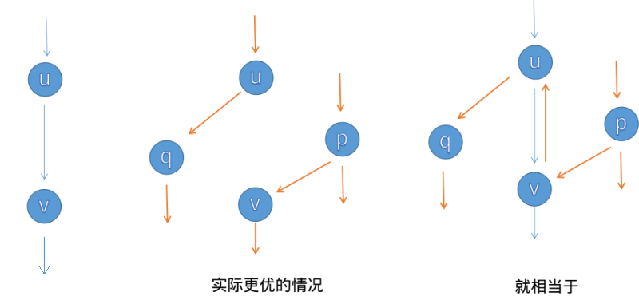

## 图的 DFS 与 BFS

DFS 和 BFS 是图论刷题的入口。大多数基础图题都可以先抽象成：点是什么、边是什么、要从哪些点开始搜索、访问状态如何记录。

### 图的存储

邻接矩阵、邻接表、十字链表和邻接多重表详见[图的存储结构](./graph-basics.md)。以下算法统一假设图已使用邻接表表示。

### DFS

#### 核心模板

DFS 适合处理连通块、可达性、路径搜索、树/图上的递归状态传递。

```cpp
void dfs(int u, vector<vector<int>>& graph, vector<int>& visited) {
    visited[u] = 1;

    for (int v : graph[u]) {
        if (!visited[v]) {
            dfs(v, graph, visited);
        }
    }
}
```

统计无向图连通块数量：

```cpp
int countComponents(int n, vector<vector<int>>& graph) {
    vector<int> visited(n, 0);
    int ans = 0;

    for (int i = 0; i < n; i++) {
        if (!visited[i]) {
            ans++;
            dfs(i, graph, visited);
        }
    }

    return ans;
}
```

### BFS

#### 核心模板

BFS 适合处理无权图最短路、层序扩展、最少步数问题。

```cpp
vector<int> bfs(int start, vector<vector<int>>& graph) {
    int n = graph.size();
    vector<int> dist(n, -1); // 从start开始的无权最段路
    queue<int> q;

    dist[start] = 0;
    q.push(start);

    while (!q.empty()) {
        int u = q.front();
        q.pop();

        for (int v : graph[u]) {
            if (dist[v] == -1) {
                dist[v] = dist[u] + 1;
                q.push(v);
            }
        }
    }

    return dist;
}
```

### 例题

#### [547. 省份数量](https://leetcode.cn/problems/number-of-provinces/)

**题目描述：**

有 `n` 个城市，其中 `isConnected[i][j] = 1` 表示城市 `i` 和城市 `j` 直接相连。直接或间接相连的一组城市构成一个省份，求省份数量。

**输入：**

第一行输入整数 `n`。接下来 `n` 行，每行输入 `n` 个整数，表示连接矩阵。

**输出：**

输出一个整数，表示省份数量。

**示例：**

- 输入：

  ```text
  3
  1 1 0
  1 1 0
  0 0 1
  ```

- 输出：

  ```text
  2
  ```

<details class="note-solution">
<summary>查看解析</summary>

**思路：**

把矩阵看成无向图的邻接矩阵。从每个未访问城市出发 DFS，一次 DFS 可以访问整个省份，DFS 启动次数就是省份数量。

**代码：**

```cpp
#include <bits/stdc++.h>
using namespace std;

void dfs(int u, vector<vector<int>>& isConnected, vector<int>& visited) {
    visited[u] = 1;
    int n = isConnected.size();

    for (int v = 0; v < n; v++) {
        if (isConnected[u][v] == 1 && !visited[v]) {
            dfs(v, isConnected, visited);
        }
    }
}

int main() {
    int n;
    cin >> n;

    vector<vector<int>> isConnected(n, vector<int>(n));
    for (int i = 0; i < n; i++) {
        for (int j = 0; j < n; j++) {
            cin >> isConnected[i][j];
        }
    }

    vector<int> visited(n, 0);
    int provinces = 0;

    for (int i = 0; i < n; i++) {
        if (!visited[i]) {
            provinces++;
            dfs(i, isConnected, visited);
        }
    }

    cout << provinces << '\n';
    return 0;
}
```

</details>

#### [1971. 寻找图中是否存在路径](https://leetcode.cn/problems/find-if-path-exists-in-graph/)

**题目描述：**

给定一个无向图，判断从 `source` 到 `destination` 是否存在路径。

**输入：**

第一行输入 `n m`，表示点数和边数。接下来 `m` 行输入无向边 `u v`。最后一行输入 `source destination`。

**输出：**

如果存在路径，输出 `true`，否则输出 `false`。

**示例：**

- 输入：

  ```text
  3 3
  0 1
  1 2
  2 0
  0 2
  ```

- 输出：

  ```text
  true
  ```

<details class="note-solution">
<summary>查看解析</summary>

**思路：**

建无向图后，从 `source` 出发 DFS 或 BFS。只要访问到 `destination`，答案就是 `true`。

**代码：**

```cpp
#include <bits/stdc++.h>
using namespace std;

int main() {
    int n, m;
    cin >> n >> m;

    vector<vector<int>> graph(n);
    for (int i = 0; i < m; i++) {
        int u, v;
        cin >> u >> v;
        graph[u].push_back(v);
        graph[v].push_back(u);
    }

    int source, destination;
    cin >> source >> destination;

    vector<int> visited(n, 0);
    queue<int> q;
    visited[source] = 1;
    q.push(source);

    while (!q.empty()) {
        int u = q.front();
        q.pop();

        if (u == destination) {
            cout << "true" << '\n';
            return 0;
        }

        for (int v : graph[u]) {
            if (!visited[v]) {
                visited[v] = 1;
                q.push(v);
            }
        }
    }

    cout << "false" << '\n';
    return 0;
}
```

</details>

#### [752. 打开转盘锁](https://leetcode.cn/problems/open-the-lock/)

**题目描述：**

有一个四位转盘锁，初始状态是 `0000`。每次可以把任意一位数字向上或向下拨动一格，`9` 再向上变成 `0`，`0` 再向下变成 `9`。给定一组死亡状态 `deadends` 和目标状态 `target`，求打开锁的最少步数；如果无法打开，返回 `-1`。

**输入：**

第一行输入整数 `k`，表示死亡状态数量。接下来 `k` 行每行输入一个死亡状态。最后一行输入目标状态 `target`。

**输出：**

输出从 `0000` 到 `target` 的最少拨动次数；无法到达则输出 `-1`。

**示例：**

- 输入：

  ```text
  5
  0201
  0101
  0102
  1212
  2002
  0202
  ```

- 输出：

  ```text
  6
  ```

<details class="note-solution">
<summary>查看解析</summary>

**思路：**

每个四位字符串是一个图节点，一次拨动生成相邻节点。所有边权都是 `1`，所以用 BFS 求最短步数。

**代码：**

```cpp
#include <bits/stdc++.h>
using namespace std;

vector<string> getNextStates(string state) {
    vector<string> nextStates;

    for (int i = 0; i < 4; i++) {
        string up = state;
        up[i] = (up[i] == '9') ? '0' : up[i] + 1;
        nextStates.push_back(up);

        string down = state;
        down[i] = (down[i] == '0') ? '9' : down[i] - 1;
        nextStates.push_back(down);
    }

    return nextStates;
}

int main() {
    int k;
    cin >> k;

    unordered_set<string> dead;
    for (int i = 0; i < k; i++) {
        string s;
        cin >> s;
        dead.insert(s);
    }

    string target;
    cin >> target;

    string start = "0000";
    if (dead.count(start)) {
        cout << -1 << '\n';
        return 0;
    }

    queue<string> q;
    unordered_map<string, int> dist;
    q.push(start);
    dist[start] = 0;

    while (!q.empty()) {
        string cur = q.front();
        q.pop();

        if (cur == target) {
            cout << dist[cur] << '\n';
            return 0;
        }

        for (string nextState : getNextStates(cur)) {
            if (!dead.count(nextState) && !dist.count(nextState)) {
                dist[nextState] = dist[cur] + 1;
                q.push(nextState);
            }
        }
    }

    cout << -1 << '\n';
    return 0;
}
```

</details>

### 小结

| 场景 | 常用方法 |
| --- | --- |
| 判断可达性 | DFS / BFS |
| 统计连通块 | DFS / BFS |
| 无权图最短路 | BFS |
| 层序扩展、最少操作次数 | BFS |
| 递归搜索一整块区域 | DFS |

## 拓扑排序

拓扑排序用于有向图，要求如果存在边 `u -> v`，那么 `u` 必须排在 `v` 前面。

只有有向无环图才存在拓扑序。如果有向图存在环，环内节点互相依赖，就无法排出合法顺序。

用顶点表示活动、有向边表示活动先后关系的图称为 AOV 网。一个 AOV 网必须是有向无环图，其拓扑序就是满足所有先后约束的活动排列。

### Kahn 入度 BFS

#### 核心流程

1. 建图，同时统计每个点的入度。
2. 把所有入度为 `0` 的点加入队列。
3. 每次取出一个点 `u`，把它加入答案。
4. 删除 `u` 的所有出边，也就是让相邻点入度减一。
5. 如果某个相邻点入度变成 `0`，加入队列。
6. 最后如果答案长度等于点数，说明无环；否则有环。

#### 核心模板

```cpp
vector<int> topologicalSort(int n, vector<vector<int>>& graph, vector<int>& indegree) {
    queue<int> q;
    for (int i = 0; i < n; i++) {
        if (indegree[i] == 0) {
            q.push(i);
        }
    }

    vector<int> order;
    while (!q.empty()) {
        int u = q.front();
        q.pop();
        order.push_back(u);

        for (int v : graph[u]) {
            indegree[v]--;
            if (indegree[v] == 0) {
                q.push(v);
            }
        }
    }

    return order;
}
```

#### 例题：[207. 课程表](https://leetcode.cn/problems/course-schedule/)

题目描述：有 `numCourses` 门课程，课程编号为 `0` 到 `numCourses - 1`。给定先修关系 `prerequisites`，其中 `[a, b]` 表示学习课程 `a` 前必须先学习课程 `b`。判断是否可以完成所有课程。

输入：第一行输入 `numCourses m`。接下来 `m` 行，每行输入 `a b`，表示学习 `a` 前必须先学习 `b`。

输出：可以完成所有课程输出 `true`，否则输出 `false`。

示例：

- 输入：

  ```text
  2 1
  1 0
  ```

- 输出：

  ```text
  true
  ```

<details class="note-solution">
<summary>查看解析</summary>

思路：把先修关系 `[a, b]` 建成边 `b -> a`。如果拓扑排序能取出所有课程，说明没有循环依赖，可以完成所有课程。

```cpp
#include <bits/stdc++.h>
using namespace std;

int main() {
    int numCourses, m;
    cin >> numCourses >> m;

    vector<vector<int>> graph(numCourses);
    vector<int> indegree(numCourses, 0);

    for (int i = 0; i < m; i++) {
        int a, b;
        cin >> a >> b;
        graph[b].push_back(a);
        indegree[a]++;
    }

    queue<int> q;
    for (int i = 0; i < numCourses; i++) {
        if (indegree[i] == 0) {
            q.push(i);
        }
    }

    int learned = 0;
    while (!q.empty()) {
        int u = q.front();
        q.pop();
        learned++;

        for (int v : graph[u]) {
            indegree[v]--;
            if (indegree[v] == 0) {
                q.push(v);
            }
        }
    }

    cout << (learned == numCourses ? "true" : "false") << '\n';
    return 0;
}
```

</details>

#### 例题：[210. 课程表 II](https://leetcode.cn/problems/course-schedule-ii/)

题目描述：给定课程数量和先修关系，返回一种可行的学习顺序。如果无法完成所有课程，输出空序列。

输入：第一行输入 `numCourses m`。接下来 `m` 行，每行输入 `a b`，表示学习 `a` 前必须先学习 `b`。

输出：如果存在学习顺序，输出课程编号序列；否则输出空行。

示例：

- 输入：

  ```text
  4 4
  1 0
  2 0
  3 1
  3 2
  ```

- 输出：

  ```text
  0 1 2 3
  ```

输出 `0 2 1 3` 也合法。

<details class="note-solution">
<summary>查看解析</summary>

思路：仍然使用 Kahn 拓扑排序。与上一题不同的是，需要保存取出的课程顺序。最后如果顺序长度不足 `numCourses`，说明有环，输出空行。

```cpp
#include <bits/stdc++.h>
using namespace std;

int main() {
    int numCourses, m;
    cin >> numCourses >> m;

    vector<vector<int>> graph(numCourses);
    vector<int> indegree(numCourses, 0);

    for (int i = 0; i < m; i++) {
        int a, b;
        cin >> a >> b;
        graph[b].push_back(a);
        indegree[a]++;
    }

    queue<int> q;
    for (int i = 0; i < numCourses; i++) {
        if (indegree[i] == 0) {
            q.push(i);
        }
    }

    vector<int> order;
    while (!q.empty()) {
        int u = q.front();
        q.pop();
        order.push_back(u);

        for (int v : graph[u]) {
            indegree[v]--;
            if (indegree[v] == 0) {
                q.push(v);
            }
        }
    }

    if ((int)order.size() != numCourses) {
        cout << '\n';
        return 0;
    }

    for (int i = 0; i < numCourses; i++) {
        if (i > 0) cout << ' ';
        cout << order[i];
    }
    cout << '\n';

    return 0;
}
```

</details>

### 小结

| 问题 | 判断方式 |
| --- | --- |
| 是否存在拓扑序 | 拓扑排序结果长度是否等于点数 |
| 是否有环 | 拓扑排序结果长度小于点数 |
| 输出一条合法顺序 | 保存 Kahn BFS 的出队顺序 |
| 依赖关系 `[a, b]` | 通常建边 `b -> a` |

## 最短路

最短路问题是在带权图中求点到点的最小路径代价。面试和 LeetCode 中最常见的是：

| 场景 | 算法 |
| --- | --- |
| 单源最短路，边权非负 | Dijkstra |
| 单源最短路，允许负边权 | Bellman-Ford |
| 多源最短路，点数较小 | Floyd |
| 无权图最短路 | BFS |

### Dijkstra

Dijkstra 用于边权非负的图。核心思想是：每次从未确定的点中取当前距离最小的点，用它更新相邻点。

优先队列版本复杂度为 `O((n + m) log n)`。

#### 核心模板

```cpp
vector<int> dijkstra(int n, vector<vector<pair<int, int>>>& graph, int start) {
    const int INF = 1e9;
    vector<int> dist(n, INF);
    priority_queue<pair<int, int>, vector<pair<int, int>>, greater<pair<int, int>>> pq;

    dist[start] = 0;
    pq.push({0, start});

    while (!pq.empty()) {
        auto [d, u] = pq.top();
        pq.pop();

        if (d > dist[u]) continue;

        for (auto [v, w] : graph[u]) {
            if (dist[v] > dist[u] + w) {
                dist[v] = dist[u] + w;
                pq.push({dist[v], v});
            }
        }
    }

    return dist;
}
```

#### 例题：[743. 网络延迟时间](https://leetcode.cn/problems/network-delay-time/)

题目描述：有 `n` 个网络节点，编号为 `1` 到 `n`。给定有向边 `times[i] = [u, v, w]`，表示信号从 `u` 到 `v` 需要 `w` 时间。信号从节点 `k` 发出，求所有节点收到信号的最短时间；如果有节点无法收到，返回 `-1`。

输入：第一行输入 `n m k`。接下来 `m` 行，每行输入 `u v w`，表示一条有向边。

输出：网络延迟时间；如果存在不可达节点，输出 `-1`。

示例：

- 输入：

  ```text
  4 3 2
  2 1 1
  2 3 1
  3 4 1
  ```

- 输出：

  ```text
  2
  ```

<details class="note-solution">
<summary>查看解析</summary>

思路：这是从 `k` 出发到所有点的单源正权最短路，使用 Dijkstra。答案是所有最短距离的最大值；如果存在不可达节点，输出 `-1`。

```cpp
#include <bits/stdc++.h>
using namespace std;

int main() {
    int n, m, k;
    cin >> n >> m >> k;

    vector<vector<pair<int, int>>> graph(n + 1);
    for (int i = 0; i < m; i++) {
        int u, v, w;
        cin >> u >> v >> w;
        graph[u].push_back({v, w});
    }

    const int INF = 1e9;
    vector<int> dist(n + 1, INF);
    priority_queue<pair<int, int>, vector<pair<int, int>>, greater<pair<int, int>>> pq;

    dist[k] = 0;
    pq.push({0, k});

    while (!pq.empty()) {
        auto [d, u] = pq.top();
        pq.pop();

        if (d > dist[u]) continue;

        for (auto [v, w] : graph[u]) {
            if (dist[v] > dist[u] + w) {
                dist[v] = dist[u] + w;
                pq.push({dist[v], v});
            }
        }
    }

    int ans = 0;
    for (int i = 1; i <= n; i++) {
        if (dist[i] == INF) {
            cout << -1 << '\n';
            return 0;
        }
        ans = max(ans, dist[i]);
    }

    cout << ans << '\n';
    return 0;
}
```

</details>

### Bellman-Ford

Bellman-Ford 用于单源最短路，允许负边权。对所有边重复松弛 $n-1$ 轮；第 $n$ 轮仍能松弛，说明源点可达负环。时间复杂度为 $O(nm)$。

#### 核心模板

```cpp
struct Edge {
    int from;
    int to;
    int weight;
};

bool bellmanFord(int n, int start, const vector<Edge>& edges, vector<long long>& dist) {
    const long long INF = 1LL << 60;
    dist.assign(n, INF);
    dist[start] = 0;

    for (int round = 1; round < n; round++) {
        bool changed = false;
        for (const Edge& edge : edges) {
            if (dist[edge.from] == INF) continue;
            if (dist[edge.to] <= dist[edge.from] + edge.weight) continue;
            dist[edge.to] = dist[edge.from] + edge.weight;
            changed = true;
        }
        if (!changed) break;
    }

    for (const Edge& edge : edges) {
        if (dist[edge.from] == INF) continue;
        if (dist[edge.to] > dist[edge.from] + edge.weight) return false;
    }
    return true;
}
```

### Floyd

Floyd 用于求所有点对之间的最短路，适合点数较小的图，复杂度为 `O(n^3)`。

#### 核心模板

```cpp
for (int k = 0; k < n; k++) {
    for (int i = 0; i < n; i++) {
        for (int j = 0; j < n; j++) {
            if (dist[i][k] != INF && dist[k][j] != INF) {
                dist[i][j] = min(dist[i][j], dist[i][k] + dist[k][j]);
            }
        }
    }
}
```

#### 例题：[1334. 阈值距离内邻居最少的城市](https://leetcode.cn/problems/find-the-city-with-the-smallest-number-of-neighbors-at-a-threshold-distance/)

题目描述：有 `n` 个城市和若干条无向带权边。给定距离阈值 `distanceThreshold`，求能到达的邻居城市数量最少的城市编号；如果有多个答案，返回编号最大的城市。

输入：第一行输入 `n m distanceThreshold`。接下来 `m` 行，每行输入 `u v w`，表示无向带权边。

输出：满足条件的城市编号。

示例：

- 输入：

  ```text
  4 4 4
  0 1 3
  1 2 1
  1 3 4
  2 3 1
  ```

- 输出：

  ```text
  3
  ```

<details class="note-solution">
<summary>查看解析</summary>

思路：需要知道任意两个城市之间的最短距离，且 `n` 较小，使用 Floyd。统计每个城市能到达的城市数量，数量更少或数量相同但编号更大时更新答案。

```cpp
#include <bits/stdc++.h>
using namespace std;

int main() {
    int n, m, distanceThreshold;
    cin >> n >> m >> distanceThreshold;

    const int INF = 1e9;
    vector<vector<int>> dist(n, vector<int>(n, INF));

    for (int i = 0; i < n; i++) {
        dist[i][i] = 0;
    }

    for (int i = 0; i < m; i++) {
        int u, v, w;
        cin >> u >> v >> w;
        dist[u][v] = min(dist[u][v], w);
        dist[v][u] = min(dist[v][u], w);
    }

    for (int k = 0; k < n; k++) {
        for (int i = 0; i < n; i++) {
            for (int j = 0; j < n; j++) {
                if (dist[i][k] != INF && dist[k][j] != INF) {
                    dist[i][j] = min(dist[i][j], dist[i][k] + dist[k][j]);
                }
            }
        }
    }

    int ans = -1;
    int bestCount = INF;

    for (int i = 0; i < n; i++) {
        int count = 0;
        for (int j = 0; j < n; j++) {
            if (i != j && dist[i][j] <= distanceThreshold) {
                count++;
            }
        }

        if (count <= bestCount) {
            bestCount = count;
            ans = i;
        }
    }

    cout << ans << '\n';
    return 0;
}
```

</details>

### 小结

| 算法 | 适用条件 | 复杂度 |
| --- | --- | --- |
| BFS | 无权图最短路 | `O(n + m)` |
| Dijkstra | 单源最短路，边权非负 | `O((n + m) log n)` |
| Floyd | 多源最短路，点数较小 | `O(n^3)` |

## 最小生成树

最小生成树用于无向连通带权图：从所有边中选出 `n - 1` 条边，使所有点连通，并且边权总和最小。

生成树包含图的全部 $n$ 个顶点和 $n-1$ 条边。对于连通图，任意生成树再增加一条边都会形成环，删除一条边都会变得不连通。最小生成树可能不唯一，但最小总权值相同。

### Prim 算法

每轮选择一条连接“已选点”和“未选点”的最短边，把新点加入生成树。邻接矩阵实现的时间复杂度为 $O(n^2)$。

#### 算法流程

1. 任取一个点加入生成树。
2. 枚举所有“一端已选、一端未选”的边。
3. 选择其中权值最小的一条，加入该边和它的未选端点。
4. 重复第 2、3 步，直到所有顶点都在树中。

#### 邻接矩阵模板

`graph[u][v] = 0` 表示没有边，边权为正数。

```cpp
vector<tuple<int, int, int>> prim(const vector<vector<int>>& graph) {
    int n = graph.size();
    vector<bool> selected(n, false);
    vector<tuple<int, int, int>> edges;
    selected[0] = true;

    for (int count = 0; count < n - 1; count++) {
        int minWeight = INT_MAX;
        int u = -1;
        int v = -1;
        for (int i = 0; i < n; i++) {
            if (!selected[i]) continue;
            for (int j = 0; j < n; j++) {
                if (selected[j] || graph[i][j] == 0) continue;
                if (graph[i][j] < minWeight) {
                    minWeight = graph[i][j];
                    u = i;
                    v = j;
                }
            }
        }

        selected[v] = true;
        edges.emplace_back(u, v, minWeight);
    }
    return edges;
}
```

### Kruskal 算法

Kruskal 是从**边**扩张：把所有边放进边表，按边权排序，再用并查集维护当前已经连通的点集。每次只选择两个端点尚不连通的边，因此不会形成环。

#### 步骤

1. 把所有边按权重从小到大排序。
2. 依次枚举每条边 `(u, v, w)`。
3. 如果 `u` 和 `v` 还不连通，就选择这条边，并合并两个集合。
4. 选够 `n - 1` 条边后结束。

Kruskal 按边扩展森林，排序主导时间复杂度为 $O(m\log m)$，通常适合稀疏图。若最后选中的边少于 $n-1$ 条，原图不连通。

判断两个顶点是否已连通并合并连通分量时使用并查集，具体实现详见[并查集](./tree-basics.md#dsu-%E5%B9%B6%E6%9F%A5%E9%9B%86)。

#### 边表与并查集模板

实现需要三种数据：边表 `edges`、按边权排序的 `sort`、用于判环和合并连通分量的并查集。排序占主要复杂度，因此总复杂度为 $O(m\log m)$。

```cpp
struct KruskalEdge {
    int u;
    int v;
    int weight;
};

struct DisjointSet {
    vector<int> parent;
    vector<int> size;

    explicit DisjointSet(int n) : parent(n), size(n, 1) {
        iota(parent.begin(), parent.end(), 0);
    }

    int find(int x) {
        if (parent[x] == x) return x;
        return parent[x] = find(parent[x]);
    }

    bool unite(int a, int b) {
        a = find(a);
        b = find(b);
        if (a == b) return false;
        if (size[a] < size[b]) swap(a, b);
        parent[b] = a;
        size[a] += size[b];
        return true;
    }
};

long long kruskal(int n, vector<KruskalEdge> edges) {
    sort(edges.begin(), edges.end(), [](const KruskalEdge& a, const KruskalEdge& b) {
        return a.weight < b.weight;
    });

    DisjointSet dsu(n);
    long long total = 0;
    int selected = 0;
    for (const KruskalEdge& edge : edges) {
        if (!dsu.unite(edge.u, edge.v)) continue;
        total += edge.weight;
        selected++;
        if (selected == n - 1) return total;
    }
    return -1;
}
```

#### 例题：[1584. 连接所有点的最小费用](https://leetcode.cn/problems/min-cost-to-connect-all-points/)

题目描述：给定平面上的 `n` 个点，连接两个点的费用是它们的曼哈顿距离：`|xi - xj| + |yi - yj|`。求连接所有点的最小总费用。

输入：第一行输入整数 `n`。接下来 `n` 行，每行输入一个点的坐标 `x y`。

输出：连接所有点的最小总费用。

示例：

- 输入：

  ```text
  5
  0 0
  2 2
  3 10
  5 2
  7 0
  ```

- 输出：

  ```text
  20
  ```

<details class="note-solution">
<summary>查看解析</summary>

思路：把每两个点之间都看成一条边，边权是曼哈顿距离。问题变成完全图上的最小生成树，使用 Kruskal：排序所有边，按边权从小到大选择不会形成环的边。

```cpp
#include <bits/stdc++.h>
using namespace std;

struct Edge {
    int u;
    int v;
    int w;
};

struct DSU {
    vector<int> parent, size;

    DSU(int n) : parent(n), size(n, 1) {
        iota(parent.begin(), parent.end(), 0);
    }

    int find(int x) {
        if (parent[x] != x) {
            parent[x] = find(parent[x]);
        }
        return parent[x];
    }

    bool unite(int a, int b) {
        int rootA = find(a);
        int rootB = find(b);
        if (rootA == rootB) return false;

        if (size[rootA] < size[rootB]) {
            swap(rootA, rootB);
        }
        parent[rootB] = rootA;
        size[rootA] += size[rootB];
        return true;
    }
};

int main() {
    int n;
    cin >> n;

    vector<pair<int, int>> points(n);
    for (int i = 0; i < n; i++) {
        cin >> points[i].first >> points[i].second;
    }

    vector<Edge> edges;
    for (int i = 0; i < n; i++) {
        for (int j = i + 1; j < n; j++) {
            int w = abs(points[i].first - points[j].first) +
                    abs(points[i].second - points[j].second);
            edges.push_back({i, j, w});
        }
    }

    sort(edges.begin(), edges.end(), [](const Edge& a, const Edge& b) {
        return a.w < b.w;
    });

    DSU dsu(n);
    int ans = 0;
    int count = 0;

    for (const Edge& edge : edges) {
        if (dsu.unite(edge.u, edge.v)) {
            ans += edge.w;
            count++;
            if (count == n - 1) break;
        }
    }

    cout << ans << '\n';
    return 0;
}
```

</details>

### 选择算法

| 问题特征 | 处理方式 |
| --- | --- |
| 要用最小代价连通所有点 | 最小生成树 |
| 无向带权图 | Kruskal / Prim |
| 判断加边是否成环 | 并查集 |
| LeetCode 常见写法 | Kruskal + DSU |

## Network Flow 网络流

网络流把“能够转移多少资源”写成带容量的有向图。它适合运输、分配、匹配、容量限制和最小割等问题；本页只讨论最常用的最大流。

### 流网络基本概念

流网络是一张有向图。边表示资源可以移动的方向，容量表示该方向最多允许通过多少资源。

| 名称 | 记号 | 含义 |
| --- | --- | --- |
| 流网络 | $G=(V,E)$ | 点集和有向边集组成的图 |
| 源点 | $s$ | 资源从这里进入网络 |
| 汇点 | $t$ | 资源最终到达这里 |
| 容量 | $c(u,v)$ | 原图边 $(u,v)$ 最多允许通过的数量 |
| 流量 | $f(u,v)$ | 当前实际从 $u$ 送到 $v$ 的数量 |
| 流的值 | $\vert f\vert$ | 最终送入汇点的总量，也等于源点送出的总量 |

例如有边 $s\to a$（容量 `4`）、$s\to b$（容量 `3`）、$a\to t$（容量 `4`）、$b\to t$（容量 `2`）。令：

$$
f(s,a)=3,\quad f(a,t)=3,\quad f(s,b)=2,\quad f(b,t)=2
$$

这是一组流量为 `5` 的方案：`a` 收到 `3` 后也送出 `3`，`b` 收到 `2` 后也送出 `2`，没有资源凭空产生或消失。由于进入 $t$ 的总容量为 $4+2=6$，这个例子中的 `5` 还不一定是最大流。

一条边的容量和流量是不同的：容量 `4` 不表示已经送了 `4`，只表示最多能送 `4`。原图中的边有方向；除非题目明确允许双向运输，否则不能从 $v$ 沿 $(u,v)$ 反向送到 $u$。

### 可行流与流量守恒

一组流 $f$ 称为**可行流**，当且仅当它同时满足容量限制和流量守恒。

容量限制要求每条原图边上的流量不超过容量，也不能为负：

$$
0 \le f(u,v) \le c(u,v)
$$

流量守恒要求：除源点 $s$ 和汇点 $t$ 外，任意中间点 $u$ 的流入量等于流出量。

$$
\sum_{(v,u)\in E} f(v,u) = \sum_{(u,w)\in E} f(u,w)
$$

因此，中间点可以转运资源，但不能囤积或制造资源。题目若给出“某个点最多能经过 $k$ 个单位”的限制，不能直接把它当作普通边容量；应使用后文的**点拆分**建模。

### 最大流模型

给定流网络、源点 $s$ 与汇点 $t$，**最大流**是在所有可行流中，让流的值 $|f|$ 尽可能大的方案。流的值等于源点的净流出量，也等于汇点的净流入量。

容量表示上限，不是已经通过的流量。若题目有无向边，应按题意建两条独立的有向边；不要把一条无向边误写成“正反残量边”。

### 残量网络与增广路

向边 $(u,v)$ 发送 $x$ 单位流后：

- 正向剩余容量减少 $x$，之后最多还能再发送 $c(u,v)-f(u,v)$。
- 反向边增加 $x$ 的剩余容量，可以撤销先前的一部分选择。

这张由所有剩余容量大于零的边组成的图称为**残量网络**。从 $s$ 到 $t$ 的一条残量路径称为增广路，沿它能增加的量是路径上的最小剩余容量。

反向边是最大流正确性的关键。例如先把流量错误地送进某条支路后，后续可以经反向边撤销并重新分配；只允许正向增加会卡在局部选择上。



这是一张合并示意图，不是三张并列的独立流程图。最左的蓝色竖直路径表示第一次选择了经过 $u\to v$ 的增广路；中部橙色部分表示更优的两条流向；最右部分把两次增广叠加：橙色路径经过 $p\to v\to u\to q$，其中 $v\to u$ 正是由第一次增广产生的反向残量边。两次流量在 $u,v$ 之间抵消后，结果等价于中部的两条路径，总流量从 `1` 增加到 `2`。

反向边不是原图中多出的一条运输边，而是算法为修正既有选择保留的剩余容量。

图源：[OI Wiki：最大流](https://oi-wiki.org/graph/flow/max-flow/)，CC BY-SA 4.0。

### 最大流最小割

一个割把点集分为 $S,T$ 两部分，满足 $s\in S,t\in T$。从 $S$ 指向 $T$ 的边容量和称为该割容量。

最大流最小割定理：

$$
\text{最大流值}=\text{最小割容量}
$$

当残量网络中已经不存在 $s\to t$ 的路径时，令 $S$ 为从 $s$ 仍可到达的点集，$T=V\setminus S$。所有从 $S$ 到 $T$ 的原图边都已满流，它们就是一个最小割。

这给出了两种常用用途：最大流算法求出的流量就是最优答案；若题目要求“切断哪些边/最少切断多少容量”，在最终残量图中找源点可达集即可恢复割。

### Dinic 算法

Dinic 重复执行两步：

1. BFS 在残量网络中计算每个点到源点的层数，只保留从第 `d` 层到第 `d+1` 层的边，得到分层图。
2. DFS 只在分层图中增广，直到再也无法从源点送到汇点；这一轮送出的总流量称为阻塞流。

`cur[u]` 是当前弧优化：从点 `u` 再次 DFS 时，不重复检查已经证实无用的边。一般复杂度为 $O(V^2E)$，竞赛中的稀疏图通常表现良好；边容量为 `int` 时，累计答案仍建议使用 `long long`。

```cpp
#include <bits/stdc++.h>
using namespace std;

struct Dinic {
    struct Edge {
        int to;
        long long cap;
        int rev;
    };

    int n;
    vector<vector<Edge>> graph;
    vector<int> level;
    vector<int> cur;

    explicit Dinic(int n) : n(n), graph(n), level(n), cur(n) {}

    void addEdge(int from, int to, long long cap) {
        graph[from].push_back({to, cap, static_cast<int>(graph[to].size())});
        graph[to].push_back({from, 0, static_cast<int>(graph[from].size()) - 1});
    }

    bool buildLevelGraph(int source, int sink) {
        fill(level.begin(), level.end(), -1);
        queue<int> q;
        level[source] = 0;
        q.push(source);

        while (!q.empty()) {
            int u = q.front();
            q.pop();
            for (const Edge& edge : graph[u]) {
                if (edge.cap == 0 || level[edge.to] != -1) continue;
                level[edge.to] = level[u] + 1;
                q.push(edge.to);
            }
        }
        return level[sink] != -1;
    }

    long long sendFlow(int u, int sink, long long limit) {
        if (u == sink) return limit;

        for (int& i = cur[u]; i < graph[u].size(); i++) {
            Edge& edge = graph[u][i];
            if (edge.cap == 0 || level[edge.to] != level[u] + 1) continue;

            long long pushed = sendFlow(edge.to, sink, min(limit, edge.cap));
            if (pushed == 0) continue;

            edge.cap -= pushed;
            graph[edge.to][edge.rev].cap += pushed;
            return pushed;
        }
        return 0;
    }

    long long maxFlow(int source, int sink) {
        long long flow = 0;
        while (buildLevelGraph(source, sink)) {
            fill(cur.begin(), cur.end(), 0);
            while (long long pushed = sendFlow(source, sink, LLONG_MAX)) {
                flow += pushed;
            }
        }
        return flow;
    }
};
```

`addEdge(u,v,c)` 会同时加入正向容量 `c` 和反向容量 `0` 的残量边。算法运行后 `graph` 已经是最终残量网络；若还要恢复原边流量，应在建边时保存正向边的位置。

### 例题

#### 最大流模板

题目来源：[洛谷 P3376【模板】网络最大流](https://www.luogu.com.cn/problem/P3376)

题目描述：给定 $n$ 个点、$m$ 条有向边、源点 `s` 与汇点 `t`。每条边给出起点 `u`、终点 `v` 和容量 `w`。求从 `s` 到 `t` 的最大流。

输入：第一行是 `n m s t`；接下来 `m` 行每行是 `u v w`。点编号为 `1` 到 `n`。

输出：最大流值。

**示例：**

- 输入：

  ```text
  4 5 1 4
  1 2 40
  1 3 20
  2 3 10
  2 4 20
  3 4 30
  ```

- 输出：`50`

- 解释：可发送 `1→2→4` 的 `20` 单位、`1→2→3→4` 的 `10` 单位、`1→3→4` 的 `20` 单位。汇点的两条入边总容量为 `20+30=50`，因此不可能更大。

<details class="note-solution">
<summary>查看解析</summary>

思路：按输入直接调用 `addEdge`，然后执行 `maxFlow(s, t)`。不要额外手动加反向边，Dinic 已经维护残量网络。

```cpp
int main() {
    ios::sync_with_stdio(false);
    cin.tie(nullptr);

    int n, m, source, sink;
    cin >> n >> m >> source >> sink;
    Dinic dinic(n + 1);

    while (m--) {
        int u, v;
        long long cap;
        cin >> u >> v >> cap;
        dinic.addEdge(u, v, cap);
    }
    cout << dinic.maxFlow(source, sink) << '\n';
}
```

</details>

#### 二分图最大匹配

题目来源：[1820. 最多邀请的个数](https://leetcode.cn/problems/maximum-number-of-accepted-invitations/)

题目描述：给定 `m × n` 的 `grid`。`grid[i][j] = 1` 表示男孩 `i` 可以邀请女孩 `j`；每个男孩和女孩最多接受一次匹配。返回最多可形成的邀请数。

**示例：**

- 输入：`grid = [[1,1,1],[1,0,1],[0,0,1]]`

- 输出：`3`

- 解释：可以匹配 `(男孩 0, 女孩 1)`、`(男孩 1, 女孩 0)`、`(男孩 2, 女孩 2)`。

<details class="note-solution">
<summary>查看解析</summary>

建模：建立超级源点 `s` 与超级汇点 `t`。

- `s → 每个男孩`，容量为 `1`：每个男孩最多匹配一次。
- `男孩 i → 女孩 j`，当 `grid[i][j]=1` 时容量为 `1`：只允许合法邀请。
- `每个女孩 → t`，容量为 `1`：每个女孩最多匹配一次。

任何整数流都对应一组匹配，最大流值就是最大匹配数。二分图最大匹配也可用匈牙利算法或 Hopcroft-Karp；网络流的优点是当边、点或类别出现额外容量限制时，仍可直接扩展。

```cpp
class Solution {
public:
    int maximumInvitations(vector<vector<int>>& grid) {
        int boys = grid.size();
        int girls = grid[0].size();
        int source = boys + girls;
        int sink = source + 1;
        Dinic dinic(sink + 1);

        for (int i = 0; i < boys; i++) {
            dinic.addEdge(source, i, 1);
        }
        for (int j = 0; j < girls; j++) {
            dinic.addEdge(boys + j, sink, 1);
        }
        for (int i = 0; i < boys; i++) {
            for (int j = 0; j < girls; j++) {
                if (grid[i][j] == 1) dinic.addEdge(i, boys + j, 1);
            }
        }
        return dinic.maxFlow(source, sink);
    }
};
```

</details>

### 常见建模

| 限制 | 建边方式 |
| --- | --- |
| 每个对象最多使用一次 | 相关边容量设为 `1` |
| 对象可使用 $k$ 次 | 相关边容量设为 $k$ |
| 点容量为 $c$ | 拆成 `in → out`，容量设为 $c$；所有入边连到 `in`，所有出边从 `out` 发出 |
| 多个供给点/需求点 | 超级源点连供给点，需求点连超级汇点 |
| 禁止/允许关系 | 只为允许关系建边 |
| 最少切断成本 | 边容量设为切断成本，求最小割 |

网络流通常要求容量为非负整数；若有费用、下界或“恰好满足”的限制，需要分别使用最小费用最大流、上下界网络流等扩展。

### 常见错误

- 反向残量边容量必须从 `0` 开始，不能写成与正向边相同的容量。
- 原题出现重边时应分别 `addEdge`；算法会自然叠加可用容量。
- `source`、`sink` 与实际点编号不要冲突。
- 最大流值及容量和可能超过 `int`，使用 `long long`。
- Dinic 的 DFS 只能走 `level[v] = level[u] + 1` 的边；否则分层图不成立。

### 参考

- [OI Wiki：最大流](https://oi-wiki.org/graph/flow/max-flow/)

## 二分图

如果一个图的点可以被分成两个集合，并且每条边的两个端点都属于不同集合，那么这个图是二分图。

二分图判定的核心方法是染色法：用两种颜色给相邻节点染不同颜色。如果出现一条边的两个端点颜色相同，就不是二分图。

### 二分图判定

#### BFS 染色模板

```cpp
bool isBipartite(int n, vector<vector<int>>& graph) {
    vector<int> color(n, 0); // 0 表示未染色，1 和 -1 表示两种颜色

    for (int i = 0; i < n; i++) {
        if (color[i] != 0) continue;

        queue<int> q;
        color[i] = 1;
        q.push(i);

        while (!q.empty()) {
            int u = q.front();
            q.pop();

            for (int v : graph[u]) {
                if (color[v] == 0) {
                    color[v] = -color[u];
                    q.push(v);
                } else if (color[v] == color[u]) {
                    return false;
                }
            }
        }
    }

    return true;
}
```

为什么要从每个点开始检查：图可能不连通，每个连通块都需要单独染色。

#### 例题：[785. 判断二分图](https://leetcode.cn/problems/is-graph-bipartite/)

**题目描述：**

给定一个无向图，判断它是否是二分图。图中可能不连通。

**输入：**

第一行输入整数 `n`，表示点数。接下来 `n` 行，每行先输入整数 `k`，表示该点的邻居数量，然后输入 `k` 个邻居编号。

**输出：**

如果是二分图，输出 `true`，否则输出 `false`。

**示例：**

- 输入：

  ```text
  4
  2 1 3
  2 0 2
  2 1 3
  2 0 2
  ```

- 输出：

  ```text
  true
  ```

上面的输入表示：

```text
0: 1 3
1: 0 2
2: 1 3
3: 0 2
```

<details class="note-solution">
<summary>查看解析</summary>

**思路：**

使用 BFS 染色。遇到未染色节点就给它染成 `1`，它的所有邻居染成 `-1`。如果搜索过程中发现相邻节点颜色相同，说明不能分成两个集合。

**代码：**

```cpp
#include <bits/stdc++.h>
using namespace std;

int main() {
    int n;
    cin >> n;

    vector<vector<int>> graph(n);
    for (int i = 0; i < n; i++) {
        int k;
        cin >> k;
        graph[i].resize(k);
        for (int j = 0; j < k; j++) {
            cin >> graph[i][j];
        }
    }

    vector<int> color(n, 0);

    for (int i = 0; i < n; i++) {
        if (color[i] != 0) continue;

        queue<int> q;
        color[i] = 1;
        q.push(i);

        while (!q.empty()) {
            int u = q.front();
            q.pop();

            for (int v : graph[u]) {
                if (color[v] == 0) {
                    color[v] = -color[u];
                    q.push(v);
                } else if (color[v] == color[u]) {
                    cout << "false" << '\n';
                    return 0;
                }
            }
        }
    }

    cout << "true" << '\n';
    return 0;
}
```

</details>

#### 例题：[886. 可能的二分法](https://leetcode.cn/problems/possible-bipartition/)

**题目描述：**

有 `n` 个人，编号为 `1` 到 `n`。给定若干组互相不喜欢的关系 `dislikes[i] = [a, b]`。判断是否可以把所有人分成两组，使每组内部没有互相不喜欢的人。

**输入：**

第一行输入 `n m`。接下来 `m` 行，每行输入 `a b`，表示 `a` 和 `b` 互相不喜欢。

**输出：**

如果可以分成两组，输出 `true`，否则输出 `false`。

**示例：**

- 输入：

  ```text
  4 3
  1 2
  1 3
  2 4
  ```

- 输出：

  ```text
  true
  ```

<details class="note-solution">
<summary>查看解析</summary>

**思路：**

把每个人看成点，不喜欢关系看成无向边。要求边的两个端点分在不同组，本质上就是判断这张图是否是二分图。

**代码：**

```cpp
#include <bits/stdc++.h>
using namespace std;

int main() {
    int n, m;
    cin >> n >> m;

    vector<vector<int>> graph(n + 1);
    for (int i = 0; i < m; i++) {
        int a, b;
        cin >> a >> b;
        graph[a].push_back(b);
        graph[b].push_back(a);
    }

    vector<int> color(n + 1, 0);

    for (int i = 1; i <= n; i++) {
        if (color[i] != 0) continue;

        queue<int> q;
        color[i] = 1;
        q.push(i);

        while (!q.empty()) {
            int u = q.front();
            q.pop();

            for (int v : graph[u]) {
                if (color[v] == 0) {
                    color[v] = -color[u];
                    q.push(v);
                } else if (color[v] == color[u]) {
                    cout << "false" << '\n';
                    return 0;
                }
            }
        }
    }

    cout << "true" << '\n';
    return 0;
}
```

</details>

### 小结

| 问题特征 | 处理方式 |
| --- | --- |
| 相邻点必须分到不同集合 | 二分图染色 |
| 图可能不连通 | 从每个未染色点开始 BFS/DFS |
| 染色冲突 | 不是二分图 |
| 判断是否能分成两组 | 转成二分图判定 |

## Critical Path 关键路径

AOE 网用带权有向无环图表示工程：顶点表示事件，边表示活动，边权表示活动持续时间。入度为 $0$ 的顶点是源点，出度为 $0$ 的顶点是汇点。

### 事件的时间

事件 $v_k$ 的最早发生时间 $ve(k)$ 按拓扑序计算：

$$ve(k)=\max\{ve(j)+weight(j,k)\}$$

源点的 $ve$ 为 $0$，汇点的 $ve$ 就是工程最短完成时间。

事件 $v_k$ 的最迟发生时间 $vl(k)$ 按逆拓扑序计算：

$$vl(k)=\min\{vl(j)-weight(k,j)\}$$

先令汇点的 $vl$ 等于其 $ve$，再向前递推。

### 活动的时间

对活动 $a_i=\langle v_j,v_k\rangle$，持续时间为 $w_i$：

- 最早开始时间：$e(i)=ve(j)$
- 最迟开始时间：$l(i)=vl(k)-w_i$
- 时间余量：$d(i)=l(i)-e(i)$

$d(i)=0$ 的活动是关键活动，从源点到汇点由关键活动构成的路径是关键路径。关键路径长度等于工程最短完成时间。

缩短非关键活动通常不会缩短整个工程；缩短关键活动后需要重新计算，因为可能出现新的关键路径，也可能同时存在多条关键路径。
