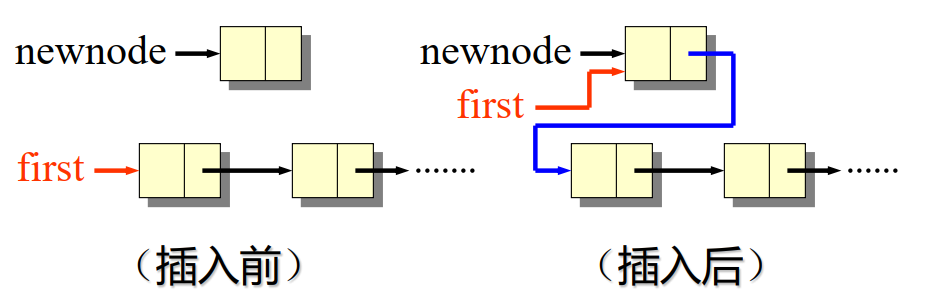
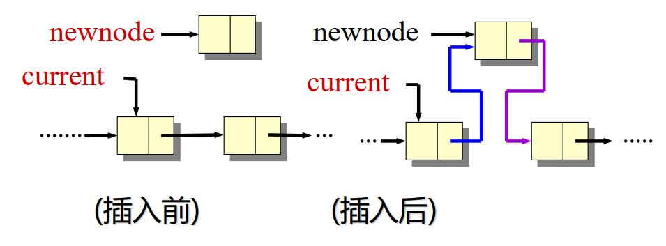
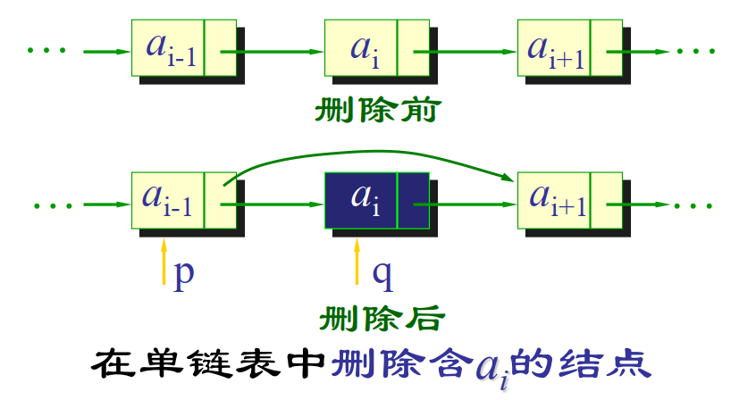

线性表是具有相同数据类型的 $n$ 个元素组成的有限序列。当 $n=0$ 时称为空表。除第一个元素外，每个元素都有唯一直接前驱；除最后一个元素外，每个元素都有唯一直接后继。

线性表可以采用顺序存储或链式存储。


## 两种存储结构的选择

| 特性 | 顺序表 | 链表 |
| --- | --- | --- |
| 存储空间 | 连续，不需要指针域 | 可以分散，每个节点需要额外指针 |
| 按位访问 | $O(1)$ | $O(n)$ |
| 按值查找 | 无序时 $O(n)$ | $O(n)$ |
| 已知位置后插入、删除 | 通常需要移动元素 | 修改指针即可 |
| 容量 | 受连续空间与扩容成本影响 | 按需分配节点 |

频繁按下标访问或强调缓存局部性时优先顺序表；元素数量变化大、难以预估容量，且频繁在已知节点附近插入或删除时可以选择链表。

## Sequential List 顺序表

顺序表用一组地址连续的存储单元依次保存线性表元素。设首元素地址为 $LOC(L)$，每个元素占 $d$ 个字节，则第 $i$ 个元素的地址为：

$$
LOC(a_i) = LOC(L) + (i - 1)d
$$

因此按位置访问任意元素只需 $O(1)$ 时间，顺序表是随机存取结构。

### 存储方式

- **静态分配**：创建时确定最大容量，空间不足时无法继续插入。
- **动态分配**：容量不足时申请更大的连续空间，将原有元素复制过去后释放旧空间。

### 基本操作

| 操作 | 时间复杂度 | 原因 |
| --- | --- | --- |
| 按位访问 | $O(1)$ | 直接计算元素地址 |
| 按值查找 | $O(n)$ | 无序表需要逐个比较 |
| 在表尾插入 | 均摊 $O(1)$ | 扩容会偶尔复制全部元素 |
| 在第 $i$ 个位置插入 | $O(n)$ | 需要向后移动后续元素 |
| 删除第 $i$ 个元素 | $O(n)$ | 需要向前移动后续元素 |

插入时需要从表尾开始向后移动，避免覆盖原数据；删除时则从被删位置开始向前移动。

### 特点

- 支持随机访问，缓存局部性好。
- 存储密度高，不需要为每个元素额外保存指针。
- 大片连续空间可能不易分配。
- 中间位置的插入和删除需要移动元素。

C++ 直接使用 `type array[size];` 来定义数组，或者使用 `std::array` 和 `std::vector`。

### Array List 动态数组

Array List 是一种基于数组的列表，能够根据需要自动调整大小。C++ STL 提供了 `std::vector`，Java 提供了 `ArrayList` 类。

```cpp
#include <vector>

std::vector<int> vec;
vec.push_back(10); // 添加元素
int element = vec[0]; // 访问元素
vec.pop_back(); // 删除最后一个元素
vec.size(); // 获取大小
```

```java
import java.util.ArrayList;

List<Integer> list = new ArrayList<>();
list.add(10); // 添加元素
int element = list.get(0); // 访问元素
list.remove(list.size() - 1); // 删除最后一个元素
list.size(); // 获取大小
```

### 常见题型

- 原地修改数组
- 有序数组双指针
- 前缀和与差分
- 子数组统计

### 41. 缺失的第一个正数

题目来源：[41. 缺失的第一个正数](https://leetcode.cn/problems/first-missing-positive/description/?envType=study-plan-v2&envId=top-100-liked)

题目描述：给你一个未排序的整数数组 `nums`，请找出其中没有出现的最小正整数。要求算法的时间复杂度为 $O(n)$，并且只使用 $O(1)$ 额外空间。

示例：

```text
输入：nums = [1,2,0]
输出：3
```

```text
输入：nums = [3,4,-1,1]
输出：2
```

```text
输入：nums = [7,8,9,11,12]
输出：1
```

思路：
- 长度为 `n` 的数组中，缺失的第一个正数一定在 `[1, n + 1]` 范围内。
- 对于范围内的数 `x`，它应该被放在下标 `x - 1` 的位置。
- 遍历数组，持续交换 `nums[i]` 到它应该在的位置。
- 交换结束后，再从左到右检查，第一个满足 `nums[i] != i + 1` 的位置，答案就是 `i + 1`。
- 如果所有位置都正确，说明 `[1, n]` 都出现了，答案是 `n + 1`。

注意：交换前要判断目标位置是否已经是相同的值，否则遇到重复数字会死循环。

输入格式：

```text
n
nums[0] nums[1] ... nums[n-1]
```

输出格式：一行，一个整数，表示缺失的最小整数。

```cpp
#include <bits/stdc++.h>
using namespace std;

int main() {
    int n;
    cin >> n;

    vector<int> nums(n);
    for (int i = 0; i < n; i++) {
        cin >> nums[i];
    }

    for (int i = 0; i < n; i++) {
        while (nums[i] >= 1 && nums[i] <= n && nums[nums[i] - 1] != nums[i]) {
            swap(nums[i], nums[nums[i] - 1]);
        }
    }

    for (int i = 0; i < n; i++) {
        if (nums[i] != i + 1) {
            cout << i + 1 << '\n';
            return 0;
        }
    }

    cout << n + 1 << '\n';
    return 0;
}
```

## Linked List 链表

Linked List 是一种动态数据结构，由节点组成，每个节点包含数据和指向下一个节点的指针。主要特点包括：
- 动态大小：链表可以根据需要动态增长或缩小。
- 插入和删除操作快速：在已知节点位置时，只需调整指针，时间复杂度为 $O(1)$。
- 访问元素较慢：需要从头节点开始遍历，时间复杂度为 $O(n)$。

常见链表类型：
- 单链表：每个节点只有 `next` 指针。
- 双链表：每个节点有 `prev` 和 `next` 两个指针。
- 循环链表：尾节点指回头节点，常用于循环模拟。
- 静态链表：用数组保存节点，以数组下标代替指针。

常见复杂度：

| 操作 | 复杂度 |
| --- | --- |
| 访问第 i 个节点 | $O(n)$ |
| 已知前驱节点后插入 | $O(1)$ |
| 已知前驱节点后删除 | $O(1)$ |
| 查找指定值 | $O(n)$ |

#### 头节点与头指针

头指针始终指向链表的第一个节点；头节点是为了统一插入和删除逻辑而附加的节点，通常不保存有效数据。带头节点时，第一个数据节点与其他节点可以使用同一套操作。

#### 循环链表与静态链表

单循环链表的尾节点 `next` 指向头节点，判断遍历结束时应检查是否回到起点，而不是检查空指针。双循环链表还使头节点的 `prev` 指向尾节点。

静态链表的节点由数据域和游标域组成，游标保存下一节点的数组下标。它不需要语言提供指针，但仍然具有链式存储的非随机访问特性。

下面展示 C++ 实现的链表。

#### 节点与链表类

```cpp
struct Node { // 单链表节点
    int data;
    Node* next;
};

class LinkedList { // 单链表
public:
    Node* head;

    LinkedList() {
        head = nullptr;
    }

    void insert(int i, int data); // 插入
    void remove(int i); // 删除
    int get(int i); // 访问
};

struct DoubleNode { // 双链表节点
    int data;
    DoubleNode* next;
    DoubleNode* prev;
};

class DoublyLinkedList { // 双链表
public:
    DoubleNode* head;
    DoubleNode* tail;

    DoublyLinkedList() {
        head = nullptr;
        tail = nullptr;
    }

    void insert(int i, int data); // 插入
    void remove(int i); // 删除
    int get(int i); // 访问
};
```

#### 插入

单链表的插入，分为在头部插入和在其他位置插入。

```cpp
newnode->next = head;
head = newnode;
```



```cpp
newnode->next = current->next; // current 是第 i-1 个节点
current->next = newnode;
```



```cpp
void LinkedList::insert(int i, int data) {
    Node* newnode = new Node();
    newnode->data = data;
    if (i == 0) {
        newnode->next = head;
        head = newnode;
    } else {
        Node* current = head;
        for (int index = 0; index < i - 1 && current != nullptr; index++) {
            current = current->next;
        }
        if (current != nullptr) {
            newnode->next = current->next;
            current->next = newnode;
        }
    }
}
```

双链表插入时还要维护 `prev` 指针。

```cpp
newnode->next = current->next;
newnode->prev = current;
if (current->next != nullptr) {
    current->next->prev = newnode;
}
current->next = newnode;
```

#### 删除

单链表删除头部节点：

```cpp
temp = head;
head = head->next;
delete temp;
```

删除其他位置节点：

```cpp
temp = current->next;
current->next = temp->next;
delete temp;
```



```cpp
void LinkedList::remove(int i) {
    if (head == nullptr) {
        return;
    }
    Node* temp;
    if (i == 0) {
        temp = head;
        head = head->next;
        delete temp;
    } else {
        Node* current = head;
        for (int index = 0; index < i - 1 && current->next != nullptr; index++) {
            current = current->next;
        }
        if (current->next != nullptr) {
            temp = current->next;
            current->next = temp->next;
            delete temp;
        }
    }
}
```

#### Dummy 虚拟头节点

链表题中经常使用 dummy 节点简化头节点被删除或替换的情况。

```cpp
ListNode* dummy = new ListNode(0);
dummy->next = head;

// 对 dummy->next 做统一操作

return dummy->next;
```

没有 dummy 时，删除头节点通常需要单独判断；有 dummy 后，头节点和中间节点可以使用同一套逻辑。

#### 快慢指针

快慢指针常用于链表环、链表中点、倒数第 k 个节点。

```cpp
ListNode* slow = head;
ListNode* fast = head;

while (fast != nullptr && fast->next != nullptr) {
    slow = slow->next;
    fast = fast->next->next;
}
```

循环结束时，`slow` 通常位于中点附近。若链表有环，快慢指针最终会相遇。

#### 指针修改顺序

链表操作最容易错在断链。修改指针前，先保存后续节点。

反转链表的标准写法：

```cpp
ListNode* prev = nullptr;
ListNode* cur = head;

while (cur != nullptr) {
    ListNode* next = cur->next;
    cur->next = prev;
    prev = cur;
    cur = next;
}

return prev;
```

核心顺序是：先保存 `next`，再改 `cur->next`。

#### 访问

```cpp
int LinkedList::get(int i) {
    Node* current = head;
    for (int index = 0; index < i && current != nullptr; index++) {
        current = current->next;
    }
    if (current != nullptr) {
        return current->data;
    }
    return -1;
}
```

### 常见题型

- 反转链表
- 快慢指针找环
- 删除倒数第 N 个节点
- 合并有序链表
- K 个一组翻转链表

### 语言库速查

- [C++ STL](./reference/cpp-stl.md)
- [Python Library](./reference/python-library.md)
- [Java Library](./reference/java-library.md)
