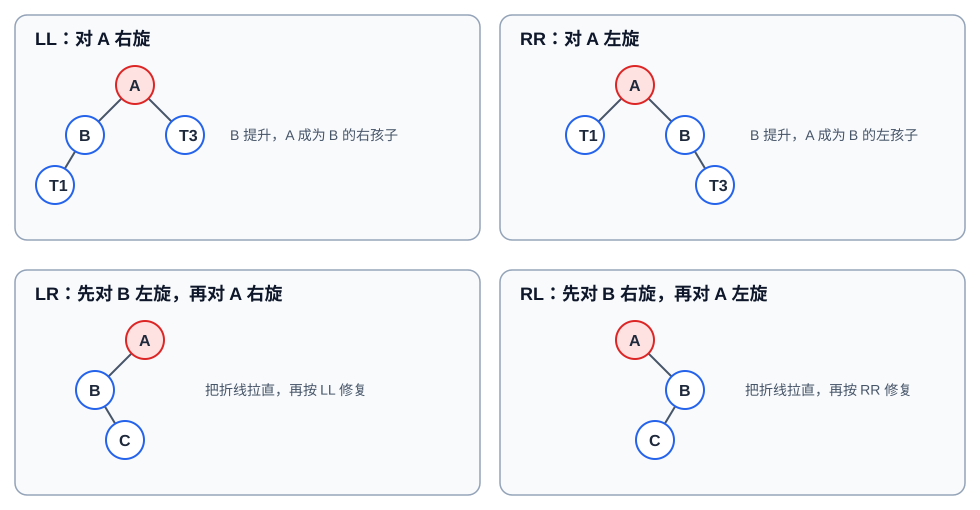
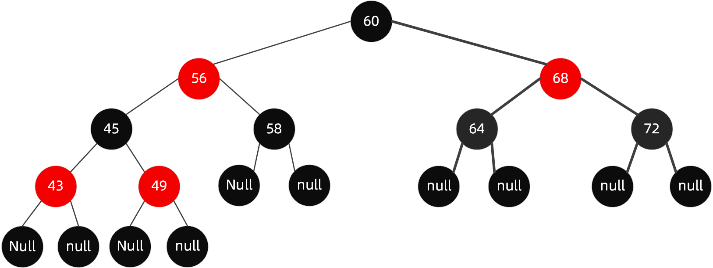
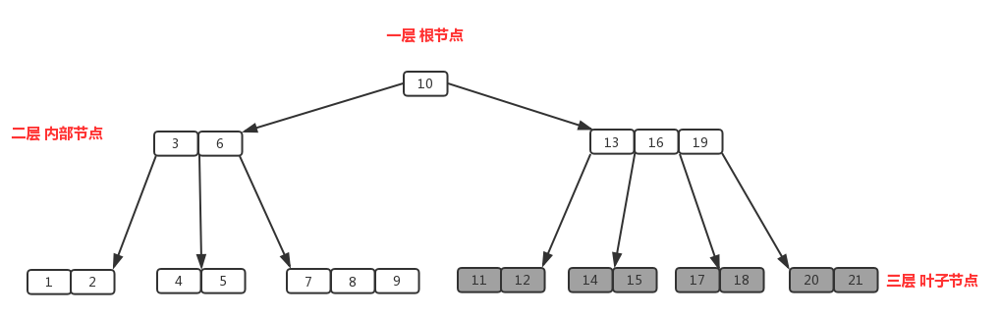
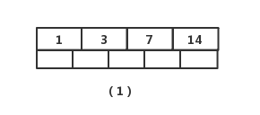
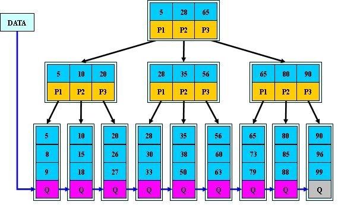

## Basic Search 查找基础

查找是在数据集合中确定关键字等于给定值的数据元素。只进行查找的结构称为静态查找表；查找过程中还允许插入或删除元素的结构称为动态查找表。

### 基本概念

- **查找表**：用于查找的同类数据元素集合。
- **关键字**：数据元素中可以识别该元素的数据项。
- **主关键字**：可以唯一标识数据元素的关键字。
- **次关键字**：可以识别若干数据元素的关键字。

### 平均查找长度

关键字比较次数是衡量查找效率的主要指标。设查找第 $i$ 个元素的概率为 $p_i$，需要比较 $c_i$ 次，则查找成功的平均查找长度为：

$$
ASL=\sum_{i=1}^{n}p_i c_i
$$

查找成功和查找失败对应不同的比较路径，必须分别计算 ASL。查找判定树可以直观表示各种成功节点和失败区间的比较次数。

### 顺序查找

顺序查找从表的一端开始，逐个比较关键字。它既适用于顺序表，也适用于链表，对数据的有序性没有要求。

在等概率查找下，含 $n$ 个元素的无序顺序表查找成功的 ASL 为：

$$
ASL_{success}=\frac{n+1}{2}
$$

将待查关键字放在数组边界作为哨兵，可以省去循环中的越界判断。对有序顺序表进行顺序查找时，遇到大于待查值的元素就可以提前确定查找失败。

### 分块查找

分块查找又称索引顺序查找。将查找表分成若干块，块内可以无序，但块之间必须有序：前一块的最大关键字小于后一块的最小关键字。

索引表为每块保存最大关键字和该块首元素地址。查找分为两步：

1. 在索引表中确定待查元素所属的候选块。
2. 在候选块内进行顺序查找。

总 ASL 等于查找索引表的 ASL 与块内查找的 ASL 之和。若使用顺序查找索引，当块数和每块元素数都接近 $\sqrt n$ 时，查找性能通常较均衡。

折半查找属于算法基础，详见[二分查找](./techniques.md#binary-search-%E4%BA%8C%E5%88%86%E6%9F%A5%E6%89%BE)。

### 适用场景

| 方法 | 存储要求 | 数据要求 | 特点 |
| --- | --- | --- | --- |
| 顺序查找 | 顺序或链式 | 无要求 | 简单，适合小表或查找频率低的表 |
| 分块查找 | 通常为顺序存储 | 块间有序、块内可无序 | 兼顾查找速度与插入删除便利性 |
| 折半查找 | 支持随机访问 | 整体有序 | 比较次数少，但维护有序表可能较贵 |

## Binary Search Tree 二叉排序树

二叉排序树（BST）是一棵二叉树，满足：

- 左子树上所有节点关键字小于根节点。
- 右子树上所有节点关键字大于根节点。
- 左右子树也分别是二叉排序树。

中序遍历二叉排序树可以得到递增关键字序列。

### 查找

从根节点开始比较：

- 待查值与当前关键字相等时查找成功。
- 待查值较小时进入左子树。
- 待查值较大时进入右子树。
- 到达空指针时查找失败。

查找需要比较的次数等于访问路径上的节点数，时间复杂度为 $O(h)$，$h$ 是树高。

### 插入

插入前先按查找路径确定关键字不存在，然后将新节点连接到查找失败时到达的空指针位置。新节点一定成为叶节点，插入不需要移动其他节点。

从空树开始按给定顺序依次插入关键字，可以构造二叉排序树。不同插入顺序可能得到不同树形。

### 删除

删除后仍需保持二叉排序树性质：

1. **叶节点**：直接删除。
2. **只有一棵子树**：使该子树替代被删节点。
3. **有两棵子树**：用中序前驱或中序后继替换被删节点的关键字，再删除对应的前驱或后继节点。

中序前驱是左子树中关键字最大的节点，中序后继是右子树中关键字最小的节点。它们不可能同时拥有两棵子树，因此可以转化为前两种删除情况。

### 性能

二叉排序树的性能取决于树高：

- 树形接近平衡时，查找、插入和删除接近 $O(\log n)$。
- 关键字接近有序插入时，树可能退化为单链表，最坏复杂度为 $O(n)$。

需要稳定对数高度时，应使用 [AVL 树](#%E5%B9%B3%E8%A1%A1%E4%BA%8C%E5%8F%89%E6%A0%91-avl-%E6%A0%91) 或[红黑树](#%E7%BA%A2%E9%BB%91%E6%A0%91)。

## 平衡二叉树（AVL 树）

平衡二叉树（AVL 树）首先是一棵[二叉排序树](#binary-search-tree-%E4%BA%8C%E5%8F%89%E6%8E%92%E5%BA%8F%E6%A0%91)，并通过限制每个节点两侧子树的高度差，避免树退化成链表。它是 408 中的重点：需要判断平衡、确定失衡类型，并写出旋转后的局部结构。

### 定义与平衡因子

设节点 $x$ 的左右子树高度分别为 $h_L$、$h_R$，其平衡因子为：

$$
BF(x)=h_L-h_R
$$

AVL 树要求每个节点都满足：

$$
|BF(x)|\le1
$$

因此 $BF=1$ 表示左高，$BF=-1$ 表示右高，$BF=0$ 表示等高。高度的起始约定可以不同（空树高度为 $-1$ 或 $0$），但同一道题中必须保持一致；平衡因子和旋转类型不受该起始约定影响。

### 为什么能保证对数高度

高度为 $h$ 的 AVL 树要尽量少节点时，一边子树高度为 $h-1$，另一边只能为 $h-2$，故最少节点数满足：

$$
N_h=N_{h-1}+N_{h-2}+1
$$

它按 Fibonacci 数增长，因此高度为 $O(\log n)$。查找、插入、删除均沿一条根叶路径进行，时间复杂度都是 $O(\log n)$。

### 失衡与旋转

插入或删除后，从变化位置向根回溯，找到第一个 $|BF|=2$ 的节点 $A$。设 $A$ 较高一侧的孩子为 $B$，$B$ 较高一侧的孩子为 $C$：



*图：红色节点是最低失衡节点 $A$。LR、RL 必须先把折线变直，再处理为 LL、RR。*

| 类型 | 路径方向 | 修复 | 旋转后局部根 |
| --- | --- | --- | --- |
| LL | $A\rightarrow B\rightarrow C$ 均向左 | 对 $A$ 右单旋 | $B$ |
| RR | $A\rightarrow B\rightarrow C$ 均向右 | 对 $A$ 左单旋 | $B$ |
| LR | 先左再右 | 先对 $B$ 左旋，再对 $A$ 右旋 | $C$ |
| RL | 先右再左 | 先对 $B$ 右旋，再对 $A$ 左旋 | $C$ |

#### 单旋为何不破坏二叉排序树

以 LL 的右旋为例，原来满足：

$$
T_1 < B < T_2 < A < T_3
$$

右旋后 $B$ 成为局部根，$A$ 成为其右孩子，$T_2$ 改为 $A$ 的左子树；中序序列仍是 $T_1,B,T_2,A,T_3$，所以二叉排序树性质不变。RR 左旋完全镜像。

#### 双旋的关键

LR 中，新增节点位于 $A$ 的左孩子 $B$ 的右子树。若直接对 $A$ 右旋，$B$ 会提升，但高度关系仍不对；先对 $B$ 左旋使 $C$ 提升，局部变成 LL，再对 $A$ 右旋。RL 同理。

### 插入后的调整

新键先按二叉排序树规则插入为叶子，再自底向上更新高度与平衡因子。

1. 若祖先的 $BF$ 从 $0$ 变为 $\pm1$，该子树高度增加，继续向上。
2. 若 $BF$ 从 $\pm1$ 变为 $0$，该子树高度没有增加，插入调整结束。
3. 首次出现 $|BF|=2$ 时，按 LL、RR、LR、RL 旋转；插入导致的最低失衡子树旋转后高度恢复，因此无需再向上旋转。

判断类型时看“插入点相对 $A$ 的路径”，不要只看新键大小。比如新键在 $A$ 的左子树但落在左孩子的右侧，就是 LR。

### 删除后的调整

删除先按二叉排序树处理：有两个孩子时，用前驱或后继替换，再删除至多一个孩子的节点。随后从实际删除位置向根回溯。

删除与插入的区别是：一次旋转后局部高度**可能继续降低**，所以仍可能使更高祖先失衡，必须持续回溯到根。

当 $A$ 左高（$BF(A)=2$）时，令 $B=A.left$：

| $BF(B)$ | 调整 | 旋转后高度变化 |
| --- | --- | --- |
| $1$ | LL：对 $A$ 右旋 | 子树高度降低，继续向上检查 |
| $0$ | 对 $A$ 右旋 | 子树高度不变，可以停止 |
| $-1$ | LR：先左旋 $B$，再右旋 $A$ | 子树高度降低，继续向上检查 |

$A$ 右高时完全镜像：$BF(B)=-1$ 对应 RR，$0$ 对应左单旋，$1$ 对应 RL。删除题中孩子平衡因子为 $0$ 的单旋情形是常见考点，不能按插入规则忽略。

### 与红黑树的关系

| 特性 | AVL 树 | [红黑树](#%E7%BA%A2%E9%BB%91%E6%A0%91) |
| --- | --- | --- |
| 平衡条件 | 每个节点左右高度差至多 $1$ | 黑高相同、红节点不相邻 |
| 树高 | 更严格，通常更矮 | 约束较松 |
| 查找 | 通常常数更小 | 最坏仍为 $O(\log n)$ |
| 更新 | 删除时可能连续调整 | 旋转通常较少 |

查找明显多于更新时，AVL 的严格平衡很合适；频繁插删的通用有序映射常使用红黑树。

### 易错点

- AVL 的“平衡”不是左右子树节点数相等，而是**高度差绝对值不超过 $1$**。
- 旋转后要同时更新局部节点高度，通常先更新较低的旧根，再更新新根。
- 插入只需修复最低失衡节点；删除可能需要一直修复到根。
- LR、RL 都是两次旋转，不能把它们当作一次单旋。
- AVL 是二叉排序树，旋转前后中序遍历顺序不变。

### 参考

- [平衡二叉树（AVL）参考文章](https://zhuanlan.zhihu.com/p/551421983)：性质与旋转情形的参考；该页拒绝自动访问，图示改为本站 SVG 重绘。

## 红黑树

红黑树（Red-Black Tree, RBT）是一种**自平衡二叉搜索树**。它不要求左右子树高度严格相等，而是用颜色限制最长路径与最短路径的比例，因此查找、插入、删除的最坏时间复杂度都为 $O(\log n)$。Java `TreeMap`、C++ `std::map` 和 Linux 内核中的许多有序容器都采用这一类思想。

### 性质与术语

约定每个空孩子都是黑色的 NIL 哨兵节点，NIL 不存实际键。红黑树满足：

1. 每个实际节点是红色或黑色。
2. 根节点为黑色。
3. 所有 NIL 叶子为黑色。
4. 红色节点的两个孩子都是黑色，即不能有连续的红色节点。
5. 从任一节点到其所有后代 NIL 叶子的路径，经过的黑色节点数相同。

从节点 $x$ 到任一后代 NIL 路径上的黑色节点数称为 $x$ 的**黑高**（black height）。第 5 条使同一节点两边黑高相等；第 4 条又限制了红色节点不能连续出现。

```text
                 8(B)
                /    \
             3(R)    12(R)
             /  \    /   \
          1(B) 6(B) 10(B) 14(B)
          / \   / \  / \    / \
        NIL NIL ...        NIL NIL
```

上图中 `B`、`R` 分别表示黑、红。实际实现通常用一个共享的黑色 NIL 节点代替每个空指针，便于统一处理删除。



*图：红黑树通过红黑颜色与相同黑高维持近似平衡。*

#### 为什么它仍然足够平衡

设根到 NIL 的黑高为 $bh$。任一路径至少有 $bh$ 个黑节点；由“不连续红”可知，任一路径最多插入同样多的红节点，所以最长路径至多是最短路径的两倍。又因为黑高为 $bh$ 的子树至少含 $2^{bh}-1$ 个实际节点，可得：

$$
h\le 2\log_2(n+1)
$$

这就是红黑树所有基本操作保持 $O(\log n)$ 的原因。

#### 为什么新节点先染红

按普通二叉搜索树规则插入位置。若新节点直接染黑，会使经过该位置的路径黑高加一，必定破坏第 5 条；染红不会改变黑高，只有“父节点也是红色”时才违反第 4 条，因此需要修复的情形更少。

### 基础操作：旋转

左旋与右旋只调整局部结构，**不改变中序遍历顺序**，因此仍是二叉搜索树。

```text
对 x 左旋：                         对 y 右旋（镜像）：

      x                                  y
     / \                                / \
    A   y          ==>                 x   C
       / \                            / \
      B   C                          A   B
```

颜色调整负责恢复黑高，旋转负责把“内侧”形状变成可处理的“外侧”形状，或把父节点提升到合适位置。

### 插入修复

新节点 $x$ 先染红。若父节点为黑色，所有性质仍成立，直接结束。若父节点 $P$ 为红色，祖父 $G$ 必为黑色；令 $U$ 为 $P$ 的兄弟（叔叔）。以下按 $P$ 是 $G$ 左孩子说明，右侧情形完全镜像。

#### 情形 1：叔叔为红色——变色并向上继续

将 $P$、$U$ 染黑，$G$ 染红，然后把 $G$ 当成新的 $x$ 继续向上检查。根最终必须染黑。

```text
修复前：             G(B)                 修复后：            G(R)
                    /    \                                   /    \
                 P(R)    U(R)                             P(B)    U(B)
                 /                                          /
               x(R)                                      x(R)
```

局部两条路径的黑高仍相同；唯一可能的问题是 $G$ 的父节点也为红色，所以要向上继续。

#### 情形 2：叔叔为黑色，且是内侧（LR）——先转成外侧

若 $P$ 是 $G$ 的左孩子、$x$ 是 $P$ 的右孩子，先对 $P$ 左旋；旋转后原来的 $x$ 成为该局部的父节点，形状变为 LL。右侧的 RL 情形先对 $P$ 右旋。

```text
        G(B)                         G(B)
        /                            /
     P(R)        对 P 左旋          x(R)
        \          ======>         /
        x(R)                      P(R)
```

#### 情形 3：叔叔为黑色，且是外侧（LL）——旋转祖父并变色

将 $P$ 染黑、$G$ 染红，对 $G$ 右旋。RR 情形则交换左右、对 $G$ 左旋。

```text
修复前：             G(B)                 修复后：             P(B)
                    /                                      /    \
                 P(R)          G 右旋                    x(R)   G(R)
                 /              ======>
               x(R)
```

完成后局部黑高相等，且不再存在红红相邻。一次插入最多经历一次“叔叔红色”的向上传播，最后至多进行两次旋转。

#### 插入例：依次插入 10、20、30、15

1. 插入 `10`：作为根，染黑。
2. 插入 `20`：红色右孩子，父为黑，结束。
3. 插入 `30`：父 `20` 红、叔叔为黑，属于 RR；对 `10` 左旋并变色，得到根 `20(B)`，左右为 `10(R)`、`30(R)`。
4. 插入 `15`：成为 `10` 的右孩子，父 `10` 和叔叔 `30` 都是红色；将 `10`、`30` 染黑，`20` 暂染红，再将根 `20` 染回黑色。

```text
              20(B)
             /     \
          10(B)    30(B)
              \
              15(R)
```

### 删除修复

删除先按二叉搜索树规则进行。若目标有两个非 NIL 孩子，先用前驱或后继的键替换它；随后真正被移除的节点至多有一个非 NIL 孩子。

- 删除红色节点，不改变任何路径黑高，直接结束。
- 删除黑色节点且其唯一孩子为红色：让该孩子顶替原节点并染黑，补回少掉的一层黑高。
- 删除黑色叶子会在该位置形成一个“**额外黑色**”（double black）的 NIL，需要修复。以下设 $x$ 是带额外黑色的左孩子，$S$ 是其右兄弟；右侧情形镜像处理。

#### 情形 1：兄弟为红色——转换为兄弟黑色

此时父必为黑，$S$ 的两个孩子必为黑。将 $S$ 染黑、父染红，对父左旋；新的兄弟变黑后进入后续情形。

```text
        P(B)                         S(B)
       /   \        P 左旋          /   \
   x(DB)  S(R)      ======>      P(R)  SR(B)
          /  \                   /  \
       SL(B) SR(B)             x(DB) SL(B)
```

#### 情形 2：兄弟黑色，两个侄子都黑——把额外黑色上推

将 $S$ 染红；若父是红色，将父染黑后结束，否则把父视为新的 double black，继续向上修复。

```text
      P(?)                         P(DB)
     /   \                       /    \
 x(DB)  S(B)   ==>             x(B)  S(R)
        /  \
     SL(B) SR(B)
```

#### 情形 3：兄弟黑色，近侄子红、远侄子黑——转为情形 4

近侄子是 $S$ 的左孩子。将近侄子染黑、$S$ 染红，对 $S$ 右旋；这样得到“远侄子红”的情形。右侧情形完全镜像。

#### 情形 4：兄弟黑色，远侄子红——旋转并结束

让 $S$ 取父节点原颜色，父染黑，远侄子染黑，对父左旋。额外黑色被消除，修复结束。

```text
修复前：              P(c)                    修复后：          S(c)
                     /    \                                     /    \
                  x(DB)  S(B)              P(B)              SR(B)
                         /   \              /   \
                      SL(?)  SR(R)        x(B) SL(?)
                     对 P 左旋
```

删除最多沿祖先链传播一次额外黑色，并在最后进行常数次旋转，所以仍为 $O(\log n)$。实现时不要把“删除修复的四种情况”死记为颜色表：始终先确认 $x$ 位于父的哪一侧，再将另一侧作为兄弟，近/远侄子均相对于 $x$ 定义。

### 与 AVL 树的选择

| 特性 | AVL 树 | 红黑树 |
| --- | --- | --- |
| 平衡约束 | 任意节点左右高度差至多 $1$ | 黑高相同、红节点不相邻 |
| 高度 | 通常更低 | 至多 $2\log_2(n+1)$ |
| 查询 | 常数通常更好 | $O(\log n)$ |
| 插入/删除 | 删除可能引起多次调整 | 约束较松，旋转通常更少 |
| 典型场景 | 查询明显多于更新 | 通用有序映射、更新频繁 |

### 易错点

- 空孩子（NIL）是黑色；它不是存储实际数据的叶子节点。
- 新节点“默认红色”是插入算法的策略，不是红黑树额外的定义性质。
- 红黑树不要求每个节点左右子树高度相同，只要求从某节点向下的各条路径**黑高**相同。
- 删除有两个孩子的节点时，先交换键再删除前驱/后继；真正被物理删除的节点最多一个非 NIL 孩子。
- LR/RL 不是直接对祖父做单旋：先在父节点处旋转，化为 LL/RR，再旋转祖父。

### 参考

- [B 树、B+ 树与红黑树详解](https://www.cnblogs.com/henuliulei/p/15114440.html)：本文的插入、删除情形组织参考之一；内容与示意图均重新撰写。

## B 树与 B+ 树

磁盘（或 SSD 的页）一次读取的是一整页数据，而不是一个关键字。若索引使用二叉树，树高很大，每向下一层都可能发生一次页 I/O。B 树把多个关键字和多个孩子放进同一页，以很大的**扇出**换取很小的树高；B+ 树进一步把全部记录放在叶子层，并把叶子串起来，因此特别适合数据库索引和范围扫描。

> **术语：**B-tree 就是 **B 树**，不是“B 减树”。下文的“关键字”指用于比较和定位的键；“记录”指该键对应的数据或数据指针。

### 为什么是多路树

一页大小若为 $4\,\mathrm{KiB}$，一个内部节点能够容纳数百个“关键字 + 子页指针”。假设每页可分出 $200$ 个孩子，三层就能覆盖约 $200^3=8\times10^6$ 个叶子范围。一次从根到叶子的查找通常只需数次页读取。

因此，外存索引关注的主要不是节点内比较的次数，而是**树高（页 I/O 次数）**。节点内部的有序关键字可用二分查找。

### B 树

#### 定义与阶

$m$ 阶 B 树是平衡的 $m$ 路查找树。这里的“$m$ 阶”表示**一个节点最多有 $m$ 个孩子**，不是一个节点恰有 $m$ 个关键字。

- 每个节点最多有 $m$ 个孩子，因此最多有 $m-1$ 个关键字。
- 除根以外的每个节点至少有 $\lceil m/2\rceil$ 个孩子，因此至少有 $\lceil m/2\rceil-1$ 个关键字。
- 根若不是叶子，至少有 $2$ 个孩子、至少 $1$ 个关键字；根是唯一节点时可以没有关键字。
- 有 $k$ 个孩子的内部节点，恰有 $k-1$ 个关键字。若关键字为 $K_1<K_2<\cdots<K_{k-1}$，则 $C_0$ 中的键小于 $K_1$，$C_i$ 中的键位于 $(K_i,K_{i+1})$，$C_{k-1}$ 中的键大于 $K_{k-1}$。
- 所有叶子节点位于同一层。这里的叶子节点是**不含孩子指针的节点**，不是红黑树中表示空指针的 NIL。

例如，下图是一个 $4$ 阶 B 树：每个节点最多 $3$ 个关键字、最多 $4$ 个孩子；除根外至少 $1$ 个关键字。



*图：四阶 B 树中，一个节点的关键字将其孩子划分为多个有序区间。*

```text
                         [ 30 | 60 ]
                  /          |          \
          [ 10 | 20 ]     [ 40 | 50 ]   [ 70 | 80 | 90 ]
```

#### 查找

在当前页的有序关键字中定位：命中则成功；未命中就沿对应区间的孩子指针继续。例如查找 $45$：在根的 $30$、$60$ 之间，进入中间孩子；再在 $40$、$50$ 之间，发现对应叶子中没有 $45$，查找失败。

若树高为 $h$，查找需要 $O(h)$ 次页访问。B 树保持平衡且扇出很大，所以 $h=O(\log_m n)$；节点内的二分比较不改变这一结论。

#### 插入：满则分裂，中间键上升

插入总是在叶子节点完成。设节点最多容纳 $m-1$ 个关键字：

1. 按查找路径到达叶子，将新键插入该节点的有序位置。
2. 未超过 $m-1$ 个关键字时结束。
3. 溢出时，取**中间关键字**提升到父节点；中间键左、右两侧的关键字分别形成两个新节点。
4. 父节点也可能溢出，重复分裂；若根溢出，创建新根，树高加 $1$。

以 $4$ 阶 B 树为例，一个节点最多 $3$ 个键。向满叶子 `[10 | 20 | 30]` 插入 $25$ 后有 $4$ 个键，分裂并将 $25$ 上升：

```text
插入前： [ 10 | 20 | 30 ]

临时页： [ 10 | 20 | 25 | 30 ]
                     ↑
                 提升 25

分裂后：       [ 25 ]
               /    \
       [ 10 | 20 ]  [ 30 ]
```

考试中常用的理解是：**分裂的分隔键离开子节点，进入父节点**。因此 B 树的一个关键字只保留在一个节点中。



*图：B 树插入时，节点溢出后以中间关键字分裂，分隔键上升到父节点。*

#### 删除：替换、借位、合并

删除后，非根节点不能少于 $\lceil m/2\rceil-1$ 个关键字。处理顺序如下。

1. 若待删键在内部节点，用其前驱（左子树最大键）或后继（右子树最小键）替换；实际删除转化为叶子删除。
2. 删除后仍满足最小关键字数，结束。
3. 若相邻兄弟有多余关键字，执行**借位（重分配）**：父节点的分隔键下移到当前节点，兄弟最靠近父节点的键上移成为新的分隔键；相应孩子指针也一起移动。
4. 若兄弟也正好在下限，执行**合并**：把父节点的分隔键下移，和两个相邻孩子合为一个节点；父节点少一个键，可能继续下溢。
5. 根没有关键字但仍有一个孩子时，令该孩子成为新根，树高减 $1$。

下图展示向右兄弟借位。当前节点删除后为空，右兄弟有多余键 `$50$`；父键 `$40$` 下移，兄弟最小键 `$50$` 上移：

```text
调整前：              [ 40 ]
                       /   \
                    [ ]   [ 50 | 60 ]

调整后：              [ 50 ]
                       /   \
                   [ 40 ] [ 60 ]
```

若右兄弟同样不能借，则把父键下移后合并，例如 `[10] + 20 + [30]` 合为 `[10 | 20 | 30]`。

#### 高度与关键字数

设 $t=\lceil m/2\rceil$。根不是叶子时，根至少有 $2$ 个孩子，其他内部节点至少有 $t$ 个孩子。高度为 $h$（根在第 $1$ 层）的 B 树至少有：

$$
n_{\min}=2t^{h-1}-1
$$

个关键字。因此：

$$
h\le 1+\log_t\frac{n+1}{2}
$$

这说明即使每个节点只达到最低装载率，树高仍是对数级。

### B+ 树

#### 性质

一棵 $m$ 阶 B+ 树满足：

- 每个节点至多有 $m$ 个关键字（元素），至多有 $m$ 棵子树。
- 除根节点外，每个节点至少有 $\lceil m/2\rceil$ 个关键字；内部节点也至少有同样多的子树。
- 根若不是叶子，至少有 $2$ 个关键字和 $2$ 棵子树；根若同时是叶子，可以只含一个关键字。
- 一个内部节点有 $n$ 个关键字，就**恰有 $n$ 棵子树**。设键为 $K_1<K_2<\cdots<K_n$，第 $i$ 棵子树中所有键都不小于 $K_i$，且（$i<n$ 时）小于 $K_{i+1}$；$K_i$ 是该子树最小键的副本。
- 所有叶子节点在同一层；叶子节点包含全部关键字和记录（或记录指针），并从小到大相互链接。
- 非叶节点只做索引，叶子节点才保存实际记录。叶子中的每个键可以在祖先索引节点中重复出现。

#### 与 B 树的结构差异

B+ 树也是多路平衡查找树，但它把“索引”和“记录”分开：

- **内部节点只存导航键和孩子指针**，不保存完整记录。
- **所有记录（或记录指针）只在叶子节点**，同一关键字可在内部节点出现副本。
- 所有叶子在同一层，并按键值从小到大通过链表相连，通常实现为双向链表。
- 任意成功查找都必须走到叶子，所以路径长度稳定。

```text
内部索引页：              [ 10 | 30 | 60 ]
                         /       |        \
叶子记录页：      [10,20] ⇄ [30,40,50] ⇄ [60,70,80]
                  ↑                         ↑
                最小键                    最大键
```

上图中索引页有 $3$ 个关键字，也有 $3$ 棵子树：`10`、`30`、`60` 分别是三棵子树的最小键。这样才能和本节“$n$ 个关键字对应 $n$ 棵子树”的性质一致。



*图：B+ 树的记录集中在叶子页，叶子页按键值顺序相连。*

#### 查找与范围查询

精确查找先从根定位到目标叶页，再在叶页查找。范围查询 `WHERE key BETWEEN L AND R` 先定位 $L$ 所在叶子，随后只沿叶子链向右扫描，直到超过 $R$ 为止；不需要回到父节点做中序遍历。

这也是 B+ 树最适合数据库范围查询、排序和顺序扫描的原因。

#### 插入：叶子复制分隔键

新记录先插入叶页。叶页未满则结束；叶页满时分成左右叶页，**右叶页的最小键复制到父节点作为分隔键**。注意这个键仍保留在右叶页中，这一点与 B 树“中间键上升且离开子节点”不同。

```text
叶页满：[10 | 20 | 30]，插入 25

分裂后叶页： [10 | 20] ⇄ [25 | 30]
                           ↑
                将 25 复制到父索引页
```

若父索引页也满，则内部页分裂并继续向上传播。根分裂时新建根，树高加 $1$。工程实现有时会优先向未满的相邻叶页重分配，以减少页分裂；这不改变 B+ 树的基本性质。

#### 删除：先维护叶页，再更新索引

从叶页删除记录后，仍保持该页有序。

1. 叶页装载量仍满足下限时结束；若被删除的是叶页最小键，按分隔键约定更新祖先索引。
2. 叶页下溢且兄弟有多余记录时，从兄弟借一条记录，并更新父分隔键。
3. 兄弟也不能借时，合并两个叶页，修复叶子链，再从父节点删除对应分隔键。
4. 内部节点下溢也按“借位或合并”处理；根只剩一个孩子时降低树高。

实现中的最小填充比例和分裂点可能由数据库页格式决定；教材题通常按“非根节点至少半满”计算。

### B 树与 B+ 树对比

| 特性 | B 树 | B+ 树 |
| --- | --- | --- |
| 完整记录的位置 | 所有节点都可能保存 | 仅叶子节点保存 |
| 内部键 | 是实际关键字，通常只出现一次 | 是导航副本，可与叶子重复 |
| $n$ 个关键字的内部节点 | 有 $n+1$ 棵子树 | 有 $n$ 棵子树（本笔记约定） |
| 成功查找终点 | 可能在内部节点 | 必定到叶子节点 |
| 范围/顺序访问 | 需跨层遍历 | 沿叶子链顺序扫描 |
| 内部页扇出 | 受记录大小影响 | 不存完整记录，通常更大 |
| 查询路径 | 长度可能不同 | 长度一致，性能更稳定 |

### 易错点

- B 树的阶是**最大孩子数**，不是最大关键字数；最大关键字数为 $m-1$。
- B+ 树最多有 $m$ 个关键字和 $m$ 棵子树；非根节点最少有 $\lceil m/2\rceil$ 个关键字。
- “所有叶子同层”是 B/B+ 树保持平衡的条件；不等同于二叉树的完全二叉树。
- B+ 树的内部键是索引副本；插入叶子分裂后，分隔键通常是**复制**到父节点，不是从叶子删除。
- B+ 树的范围查询高效依赖叶子链；不是从根节点反复查找区间内每个键。
- 不同教材对“阶”和内部键取左子树最大值/右子树最小值的约定可能不同，计算节点容量前先读题设。

### 参考

- [B 树、B+ 树与红黑树详解](https://www.cnblogs.com/henuliulei/p/15114440.html)：本文的结构与操作示意参考之一；定义、例子和表述均已重新组织撰写。

## Hash Table 哈希表

哈希表用于把一个键 `key` 映射到一个值 `value`，核心能力是快速判断一个元素是否出现过，或者快速找到某个键对应的信息。

刷题中常见用途：
- 去重：判断某个数、字符串、状态是否已经出现。
- 计数：统计元素出现次数。
- 映射：记录某个值对应的位置、分组、答案。
- 快速查询：把原本需要线性查找的信息变成平均 $O(1)$ 查询。

### C++ 常用容器

| 容器 | 作用 | 常用操作 |
| --- | --- | --- |
| `unordered_set<T>` | 只关心元素是否存在 | `insert`、`count`、`erase` |
| `unordered_map<K, V>` | 记录 key 到 value 的映射 | `mp[key]`、`count`、`find`、`erase` |

常用写法：

```cpp
unordered_set<int> seen;
seen.insert(x);
if (seen.count(x)) {
    // x 出现过
}
```

```cpp
unordered_map<string, int> cnt;
cnt[s]++;
if (cnt.count(s)) {
    // s 是 map 中已有的 key
}
```

注意：`mp[key]` 如果 key 不存在，会自动插入一个默认值。只想判断是否存在时，优先用 `count` 或 `find`。

### 复杂度

理想情况下，哈希表的查找、插入、删除平均时间复杂度都是 $O(1)$。

如果大量 key 被映射到同一个桶，哈希冲突严重，复杂度可能退化。算法题一般按照平均 $O(1)$ 分析。

### 哈希表的基本参数

1. $T$：哈希表键的集合。
2. $b$：哈希表桶的个数。
3. $s$：一个桶中槽的个数。
4. $n$：哈希表中键值对的个数。
5. $\alpha = \dfrac{n}{b \times s}$：负载因子，表示每个槽平均存储的键值对数量，用于衡量哈希表的拥挤程度。

### 哈希函数

哈希函数把键 $x$ 映射到桶索引：

$$
x \rightarrow h(x) \in [0, b-1]
$$

好的哈希函数应该让 key 尽量均匀分布，减少冲突。

常见构造方法：

- **直接定址法**：$H(key)=a\times key+b$，适合关键字分布基本连续的场景。
- **除留余数法**：$H(key)=key\bmod p$，$p$ 通常取不大于表长的质数。
- **数字分析法**：选取关键字中分布较均匀的若干位组成地址。
- **平方取中法**：取关键字平方值的中间若干位，使原关键字多个位参与地址计算。

选择哈希函数时需要同时考虑关键字分布、哈希表长度和计算成本。

### 哈希冲突处理

当多个键映射到同一个桶时，称为哈希冲突。常见处理方法有两类。

1. 开地址法：冲突后继续在表中寻找下一个空位置。

- 线性探测：依次检查下一个槽。
- 二次探测：按照二次方间隔检查槽，例如 $h(x) + i^2$。
- 双重哈希：使用第二个哈希函数计算探测步长。

2. 链地址法：每个桶后面挂一个链表或其他结构，冲突的元素放到同一个桶里。

开放定址法不能在删除元素时直接将存储单元改为“从未使用”，否则会中断其他关键字的探测链。应使用专门的“已删除”标记，查找时继续探测，插入时可以复用该位置。

装填因子 $\alpha$ 越大，冲突概率越高，平均查找长度通常越大。哈希表的查找性能主要取决于哈希函数、冲突处理方法和装填因子，而不是元素数量本身。

例题：已知哈希表大小为 11，哈希函数 $h(x) = x \mod 11$，插入键：`23, 34, 15, 38, 47, 12, 56`。

线性探测插入结果：

- 插入 23：$h(23) = 1$，存储在索引 1。
- 插入 34：$h(34) = 1$，冲突，存储在索引 2。
- 插入 15：$h(15) = 4$，存储在索引 4。
- 插入 38：$h(38) = 5$，存储在索引 5。
- 插入 47：$h(47) = 3$，存储在索引 3。
- 插入 12：$h(12) = 1$，冲突，依次检查索引 2、3、4、5，最终存储在索引 6。
- 插入 56：$h(56) = 1$，冲突，依次检查索引 2、3、4、5、6，最终存储在索引 7。

```text
Index: 0 | 1 | 2 | 3 | 4 | 5 | 6 | 7 | 8 | 9 | 10
Value: - |23 |34 |47 |15 |38 |12 |56 | - | - | -
```

二次探测插入结果：

- 插入 23：$h(23) = 1$，存储在索引 1。
- 插入 34：$h(34) = 1$，冲突，存储在索引 $1 + 1^2 = 2$。
- 插入 15：$h(15) = 4$，存储在索引 4。
- 插入 38：$h(38) = 5$，存储在索引 5。
- 插入 47：$h(47) = 3$，存储在索引 3。
- 插入 12：$h(12) = 1$，冲突，依次检查索引 $1 + 1^2 = 2$、$1 - 1^2 = 0$，最终存储在索引 0。
- 插入 56：$h(56) = 1$，冲突，依次检查索引 $1 + 1^2 = 2$、$1 - 1^2 = 0$、$1 + 2^2 = 5$、$1 - 2^2 = -3 \equiv 8 \pmod{11}$，最终存储在索引 8。

```text
Index: 0 | 1 | 2 | 3 | 4 | 5 | 6 | 7 | 8 | 9 | 10
Value: 12|23 |34 |47 |15 |38 | - | - |56 | - | -
```

双重哈希插入结果：

已知第二个哈希函数 $h_2(x) = 7 - (x \mod 7)$。

- 插入 23：$h(23) = 1$，存储在索引 1。
- 插入 34：$h(34) = 1$，冲突，步长 $h_2(34) = 1$，存储在索引 2。
- 插入 15：$h(15) = 4$，存储在索引 4。
- 插入 38：$h(38) = 5$，存储在索引 5。
- 插入 47：$h(47) = 3$，存储在索引 3。
- 插入 12：$h(12) = 1$，冲突，步长 $h_2(12) = 2$，依次检查 3、5、7，最终存储在索引 7。
- 插入 56：$h(56) = 1$，冲突，步长 $h_2(56) = 7$，存储在索引 8。

```text
Index: 0 | 1 | 2 | 3 | 4 | 5 | 6 | 7 | 8 | 9 | 10
Value: - |23 |34 |47 |15 |38 | - |12 |56 | - | -
```

### 128. 最长连续序列

题目来源：[128. 最长连续序列](https://leetcode.cn/problems/longest-consecutive-sequence/?envType=study-plan-v2&envId=top-100-liked)

题目描述：给定一个未排序的整数数组 `nums`，请找出数字连续的最长序列的长度。要求算法的时间复杂度为 $O(n)$。

示例：

```text
输入：nums = [100,4,200,1,3,2]
输出：4
解释：最长连续序列是 [1,2,3,4]。
```

```text
输入：nums = [0,3,7,2,5,8,4,6,0,1]
输出：9
```

思路：
- 把所有数放入 `unordered_set<int>`，用于 $O(1)$ 判断某个数是否存在。
- 对于一个数 `x`，如果 `x - 1` 存在，说明 `x` 不是连续序列的起点，跳过。
- 只有当 `x - 1` 不存在时，才从 `x` 开始向右枚举 `x + 1`、`x + 2`。
- 每个连续序列只会从起点扩展一次，整体平均复杂度为 $O(n)$。

OI 输入格式：

```text
n
nums[0] nums[1] ... nums[n-1]
```

OI 输出格式：

```text
最长连续序列长度
```

```cpp
#include <bits/stdc++.h>
using namespace std;

int main() {
    int n;
    cin >> n;

    unordered_set<int> nums;
    for (int i = 0; i < n; i++) {
        int x;
        cin >> x;
        nums.insert(x);
    }

    int ans = 0;
    for (int x : nums) {
        if (nums.count(x - 1)) {
            continue;
        }

        int cur = x;
        int len = 1;
        while (nums.count(cur + 1)) {
            cur++;
            len++;
        }

        ans = max(ans, len);
    }

    cout << ans << '\n';
    return 0;
}
```

### 49. 字母异位词分组

题目来源：[49. 字母异位词分组](https://leetcode.cn/problems/group-anagrams/solutions/2718519/ha-xi-biao-fen-zu-jian-ji-xie-fa-pythonj-1ukv/?envType=study-plan-v2&envId=top-100-liked)

题目描述：给定一个字符串数组 `strs`，请将字母异位词组合在一起。字母异位词指由相同字母重新排列形成的字符串。

示例：

```text
输入：strs = ["eat","tea","tan","ate","nat","bat"]
输出：[["bat"],["nat","tan"],["ate","eat","tea"]]
```

```text
输入：strs = [""]
输出：[[""]]
```

```text
输入：strs = ["a"]
输出：[["a"]]
```

思路：
- 字母异位词排序后会得到相同字符串，例如 `eat`、`tea`、`ate` 排序后都是 `aet`。
- 用排序后的字符串作为哈希表的 key。
- `unordered_map<string, vector<string>> groups` 存储每个 key 对应的一组原字符串。
- `unordered_map` 遍历顺序不固定；为了让 OI 输出稳定，输出前把每组内部排序，再把所有分组按首个字符串排序。

OI 输入格式：

```text
n
strs[0] strs[1] ... strs[n-1]
```

OI 输出格式：

```text
每一组输出一行，组内字符串用空格分隔
```

```cpp
#include <bits/stdc++.h>
using namespace std;

int main() {
    int n;
    cin >> n;

    unordered_map<string, vector<string>> groups;
    for (int i = 0; i < n; i++) {
        string s;
        cin >> s;

        string key = s;
        sort(key.begin(), key.end());
        groups[key].push_back(s);
    }

    vector<vector<string>> ans;
    for (auto &[key, group] : groups) {
        sort(group.begin(), group.end());
        ans.push_back(group);
    }

    sort(ans.begin(), ans.end(), [](const vector<string> &a, const vector<string> &b) {
        return a[0] < b[0];
    });

    for (auto &group : ans) {
        for (int i = 0; i < (int)group.size(); i++) {
            if (i > 0) {
                cout << ' ';
            }
            cout << group[i];
        }
        cout << '\n';
    }

    return 0;
}
```

### 常见坑

- 只判断 key 是否存在时，不要随手写 `mp[key]`，它会插入默认值。
- 需要稳定输出时，不要依赖 `unordered_map` 的遍历顺序。
- 连续序列题必须只从序列起点开始扩展，否则会退化成 $O(n^2)$。
- 分组题要明确 key 的设计：排序字符串适合字母异位词，字符计数数组也可以作为 key。
